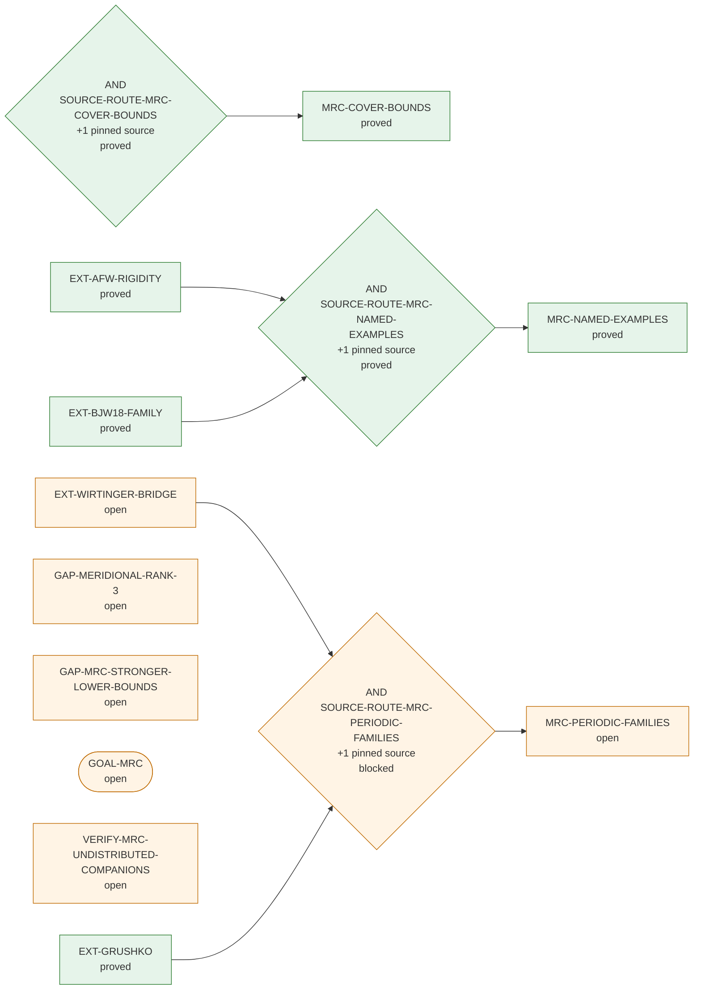
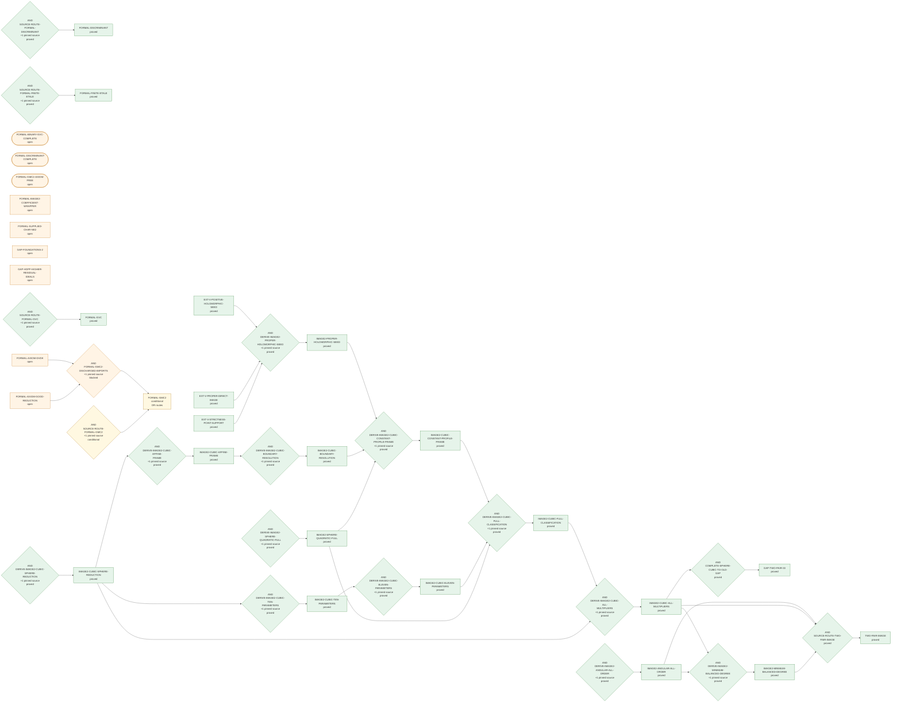

# Mathematical dependencies

<!-- Generated by scripts/research.py render from MATH_STATUS.json. -->

This is a generated view of the [current catalogue](MATH_STATUS.json). An AND diamond requires every premise; alternative incoming diamonds are OR routes. A checked route becomes available only when its premises and pinned proof sources are current. A falsified premise blocks its route; it does not falsify the conclusion.

Documented equivalence components retain separately proved directions and their context premises. Each component requires an independent proof seed; equivalent open goals cannot prove one another. Collapsing those components gives an acyclic quotient graph. The diagrams show the directional routes inside each component.

Graph state follows the declared dependencies. Dependency coverage separately records whether that model is complete, partial or unmapped. A source hash detects changed bytes; it does not check a mathematical argument. Authored state, formal verification, replay, external review and publication remain separate.

[Exact scopes and recorded assurances](SCOPES.md) · [Result catalogue](STATUS.md) · [Research topics](README.md)

The graph contains 1118 claim/source nodes, 829 implication rules and 2 documented equivalence components. conditional: 1; open: 252; proved: 865.

Inspect the current graph from the repository root:

```sh
python3 research/scripts/research.py gaps
python3 research/scripts/research.py explain ID
python3 research/scripts/research.py impact ID
python3 research/scripts/research.py simulate --prove ID
python3 research/scripts/research.py graph --format dot
```

Replace `ID` with a node identifier below. Simulation is read only and explicitly hypothetical: assuming a node proved leaves its identifier among the conditional assumptions of dependent conclusions. It does not edit the catalogue or upgrade assurances.

## Equivalence components

| Component | Statements | Directional context premises |
|---|---|---|
| PLANE-INVERSE-TRACE-ENERGY-EQUIVALENCES | GAP-AUTOMATIC-T3-PERFECTION; GOAL-HC4; GOAL-JC2; HESS-GAP-ACTUAL-L4; HESS-GAP-FULL-CODIFFERENT-MULTIPLICATION | JC2-TO-FULL-CODIFFERENT: none; FULL-CODIFFERENT-TO-JC2-EQUIV: HESS-KU, EXT-AFFINE-COVERS-CHAR0; JC2-TO-ACTUAL-L4: none; ACTUAL-L4-TO-CODIFFERENT-EQUIV: HESS-LW; JC2-TO-SIXTH-TRACE-PERFECTION: none; SIXTH-TRACE-TO-JC2-EQUIV: HESS-LZ; JC2-AND-TANG-TO-HC4: OWN-TANG-STRUCTURAL-AUDIT; HC4-TO-JC2: none; SIXTH-TRACE-PERFECTION-TO-JC2: HESSIAN-MOMENT-TRACE |
| EQUIV-GAUSSIAN-SAFETY-VACUUM | MOMENTS-SAFETY-PURITY; MOMENTS-VACUUM-PRIMITIVITY | AUDIT-A-vacuum-primitivity-to-purity: GAUSSIAN-RANKONE-GLOBAL-LATTICE, GAUSSIAN-REALIZED-EXPONENTIAL-CANCELLATION, GAUSSIAN-SAFE-UNIT-MARKER; EQUIV-GAUSSIAN-SAFETY-VACUUM-MOMENTS-SAFETY-PURITY-TO-MOMENTS-VACUUM-PRIMITIVITY: GAUSSIAN-RANKONE-GLOBAL-LATTICE, GAUSSIAN-REALIZED-EXPONENTIAL-CANCELLATION, GAUSSIAN-SAFE-UNIT-MARKER |

## Moments and vanishing

Generalized vanishing, Gaussian moments and Image/Mathieu spaces.

**Computed obligation progress:** 19 open; 1 proved / discharged.

**Authored scope assessment:** The universal GVC/GMC dimension classifications and Gaussian dimension-degree boundary are claimed closed in their exact domains. Higher-dimensional GMC is refuted by witnesses; general Gaussian extensions is not an unrestricted open GMC claim.

**Authored scope assessment:** Safety-to-purity is the converse implication to GMC. Its primitive-vacuum equivalence is represented in one direction with equivalence metadata to preserve acyclicity.

**Authored scope assessment:** Two-base marker generation supplies a proved reduction, while purity-to-base-marker polynomiality remains a mathematical gap.

**Authored scope assessment:** The full sixteen-parameter two-pair cubic Image stratum is positive with sharp mixed cutoff m>3 deg_z Q. Constant-profile extraction uses a proper holomorphic-volume V-filtration argument and explicit boundary resolutions; the exact eleven-parameter certificate finishes all exceptional cases. The least failing bihomogeneous balanced degree is four. Independent review remains pending.

**Authored scope assessment:** The latest two-pair Image cubic note now supplies an internal full(3,3) proof and sharp minimum balanced degree4. Its prior F1-versus-closing-gap inconsistency is obsolete; external review/formal coverage remain separate.

| Principal claim | Graph state | Dependency coverage | Current blockers |
|---|---|---|---|
| [GVC-GMC-IMAGE](../results/generalized-vanishing-two-variables/main.tex) | proved | partial | none in declared routes |
| [GAUSSIAN-DIMENSION-DEGREE](../unpublished/gaussian-boundary/manuscript.tex) | proved | partial | none in declared routes |
| [MATHIEU-REDUCTIVE](../results/mathieu-reductive-homogeneous-spaces/main.tex) | proved | partial | none in declared routes |
| [GAUSSIAN-STRUCTURE](moments/vanishing/GAUSSIAN_AMPLITUDE_IDEALS_AND_WEIGHT_INVARIANCE.md) | proved | partial | none in declared routes |
| [GAUSSIAN-H21-AFFINE-CHART](moments/vanishing/GAUSSIAN_AFFINE_ISOTROPIC_CHART.md) | proved | partial | none in declared routes |
| [TWO-PAIR-IMAGE](foundations/extended-geometry/TWO_PAIR_IMAGE_MATHIEU_COUNTEREXAMPLE.md) | proved | partial | none in declared routes |
| [TWO-PAIR-IMAGE-CUBIC](foundations/extended-geometry/TWO_PAIR_IMAGE_CUBIC_STRATIFICATION.md) | proved | partial | none in declared routes |

| Goal or obligation | Kind | Graph state | Coverage | Exact scope | Current blockers |
|---|---|---|---|---|---|
| EXT-ACK-GFUNCTION | verification | open | partial | Strict G-function growth/convergence implies regular singularity, quasi-unipotence and global nilpotence at the cited exact arithmetic hypotheses. | EXT-ACK-GFUNCTION (open) |
| EXT-AIRY-IRREDUCIBILITY | verification | open | partial | Generalized Airy D^ell-x irreducibility and connected SL/Sp groups for ell>=2,  only the stated differential-equation input. | EXT-AIRY-IRREDUCIBILITY (open) |
| EXT-HONDA-KRONECKER-RANKONE | verification | open | partial | The finite-prime rank-one arithmetic residue theorem under reductions at all primes above almost every rational prime. | EXT-HONDA-KRONECKER-RANKONE (open) |
| EXT-OAKU-GRAPH-BFUNCTION | verification | open | partial | Oaku graph/elimination identities including the exact f-torsion and specialization hypotheses. | EXT-OAKU-GRAPH-BFUNCTION (open) |
| EXT-OAKU-WHOLE-INTEGRATION | verification | open | partial | Full exact module and amplitude-map algorithm before cyclic extraction, over the stated effective field. | EXT-OAKU-WHOLE-INTEGRATION (open) |
| EXT-TSAI-WALTHER-POLYNOMIAL-HOM | verification | open | partial | Terminating computation of polynomial Hom bases for exactly presented holonomic Weyl modules over effective characteristic-zero fields. | EXT-TSAI-WALTHER-POLYNOMIAL-HOM (open) |
| GAP-GAUSSIAN-ACTUAL-KERNEL-ALGORITHM | mathematical | open | partial | Compute intersection t^k H_P; the structural kernel description and polynomial-Hom safety algorithm do not implement this infinite intersection. | GAP-GAUSSIAN-ACTUAL-KERNEL-ALGORITHM (open) |
| GAP-GAUSSIAN-ALGORITHM-EXTENSIONS | verification | open | partial | Parameter stratification,coefficient-ring normalization,all-ring ordinary ideal producers and least cutoffs remain beyond current QQ/simple-number-field interface. | GAP-GAUSSIAN-ALGORITHM-EXTENSIONS (open) |
| GAP-GAUSSIAN-REGULAR-TRANSCENDENTAL | mathematical | open | partial | Construct an original full Gaussian image with genuinely transcendental globally regular higher-rank submodule,or prove an obstruction beyond rational-primitive/unipotent and nonzero-action exclusions. | GAP-GAUSSIAN-REGULAR-TRANSCENDENTAL (open) |
| GAP-GAUSSIAN-SAFE-NORMAL-FORMS | mathematical | open | partial | Classify safe phases retaining actual source-to-image original-marker filtration; the full actual image plus seed does not determine this filtration. | GAP-GAUSSIAN-SAFE-NORMAL-FORMS (open) |
| GAP-GMC3-FOUR-TERM-ALL-DEGREES | mathematical | open | partial | Exclude all four-term failures withoutdegreebound,orfindone; thedegree<=4 rectangle does notsettlethis. | GAP-GMC3-FOUR-TERM-ALL-DEGREES (open) |
| GAP-GMC3-QUARTIC-ORBITS | mathematical | open | partial | Classify allfive-term quartic failures under allowed Gaussian orthogonal orbits,beyond rank-one template. | GAP-GMC3-QUARTIC-ORBITS (open) |
| GAP-H21-SHARED-HIGH-MULTIPLICITY | mathematical | open | partial | Classifya=0 mixed family with common root ofc,h ofc-multiplicity>=3 outside safe zero-root case; double-root estimate does not control extra reciprocal volume factor. | GAP-H21-SHARED-HIGH-MULTIPLICITY (open) |
| GAP-H21-SPATIALLY-VARYING-DETERMINANT | mathematical | open | partial | Treat higherW degree and spatially variableW²/WY coefficients beyond constant-matrix family, retaining the spatial algebraic volume. | GAP-H21-SPATIALLY-VARYING-DETERMINANT (open) |
| GAP-TERNARY-PURE-PREFIX | mathematical | open | partial | Determine the exact least pure-moment prefix sufficient for the ternary-cubic class; the sharp mixed cutoff m>3 deg Q is a separate theorem. | GAP-TERNARY-PURE-PREFIX (open) |
| MOMENTS-TWO-BASE-GATE | mathematical | open | partial | For pure P=aY^2+B(U1,U2)Y+g(U1,U2), show every base-marker period is polynomial. | MOMENTS-TWO-BASE-GATE (open) |
| MOMENTS-TWO-BASE-SAFETY | goal | open | partial | Purity implies safety in the specified one constant-quadratic fibre and two ordinary bases family. | MOMENTS-TWO-BASE-GATE (open) |
| MOMENTS-SAFETY-PURITY | goal | open | partial | Every safe polynomial Gaussian phase over a characteristic-zero field has original vacuum Phi[1]=1. | EQUIV-GAUSSIAN-SAFETY-VACUUM (open) |
| MOMENTS-VACUUM-PRIMITIVITY | mathematical | open | partial | In every actual rank-one Gaussian image M finite over K[t], the distinguished original vacuum f generates the entire K[t]-lattice: M=f K[t]. The equivalence ranges over all dimensions/degrees and nonsingular rational covariance over characteristic-zero fields. | EQUIV-GAUSSIAN-SAFETY-VACUUM (open) |
| GAP-TWO-PAIR-33 | mathematical | proved / discharged | partial | Every characteristic-zero bihomogeneous F of bidegree (3,3) with all pure contractions zero has E2(QF^m)=0 for m>3 deg_z Q for every polynomial Q; the full sixteen-coefficient family is covered by the written constant-profile extraction and exact eleven-parameter classification. | none in declared routes |

```mermaid
flowchart LR
  subgraph e1["EQUIV-GAUSSIAN-SAFETY-VACUUM<br/>independent grounding required"]
  n38(["MOMENTS-SAFETY-PURITY<br/>open"])
  class n38 open
  n39["MOMENTS-VACUUM-PRIMITIVITY<br/>open"]
  class n39 open
  r0{"AND<br/>AUDIT-A-vacuum-primitivity-to-<br/>purity<br/>blocked"}
  class r0 open
  r1{"AND<br/>EQUIV-GAUSSIAN-SAFETY-VACUUM-<br/>MOMENTS-SAFETY-PURITY-TO-<br/>MOMENTS-VACUUM-PRIMITIVITY<br/>blocked"}
  class r1 open
  end
  n0["EXT-ACK-GFUNCTION<br/>open"]
  class n0 open
  n1["EXT-AIRY-IRREDUCIBILITY<br/>open"]
  class n1 open
  n2["EXT-HONDA-KRONECKER-RANKONE<br/>open"]
  class n2 open
  n3["EXT-OAKU-GRAPH-BFUNCTION<br/>open"]
  class n3 open
  n4["EXT-OAKU-WHOLE-INTEGRATION<br/>open"]
  class n4 open
  n5["EXT-TSAI-WALTHER-POLYNOMIAL-<br/>HOM<br/>open"]
  class n5 open
  n6["EXT-V-POSITIVE-HOLOMORPHIC-<br/>SEED<br/>proved"]
  class n6 proved
  n7["EXT-V-PROPER-DIRECT-IMAGE<br/>proved"]
  class n7 proved
  n8["EXT-V-STRICTNESS-POINT-SUPPORT<br/>proved"]
  class n8 proved
  n9["EXT-WILSON-GMC2<br/>open"]
  class n9 open
  n10["GAP-GAUSSIAN-ACTUAL-KERNEL-<br/>ALGORITHM<br/>open"]
  class n10 open
  n11["GAP-GAUSSIAN-ALGORITHM-<br/>EXTENSIONS<br/>open"]
  class n11 open
  n12["GAP-GAUSSIAN-REGULAR-<br/>TRANSCENDENTAL<br/>open"]
  class n12 open
  n13["GAP-GAUSSIAN-SAFE-NORMAL-FORMS<br/>open"]
  class n13 open
  n14["GAP-GMC3-FOUR-TERM-ALL-DEGREES<br/>open"]
  class n14 open
  n15["GAP-GMC3-QUARTIC-ORBITS<br/>open"]
  class n15 open
  n16["GAP-H21-SHARED-HIGH-<br/>MULTIPLICITY<br/>open"]
  class n16 open
  n17["GAP-H21-SPATIALLY-VARYING-<br/>DETERMINANT<br/>open"]
  class n17 open
  n18["GAP-TERNARY-PURE-PREFIX<br/>open"]
  class n18 open
  n19["MOMENTS-GAUSSIAN-FAILURES<br/>proved"]
  class n19 proved
  n20["MOMENTS-GAUSSIAN-QUADRATICS<br/>proved"]
  class n20 proved
  n21["MOMENTS-TERNARY-CUBIC<br/>proved"]
  class n21 proved
  n22["MOMENTS-TWO-BASE-GATE<br/>open"]
  class n22 open
  n23(["MOMENTS-TWO-BASE-SAFETY<br/>open"])
  class n23 open
  n24["GAUSSIAN-H21-AFFINE-CHART<br/>proved"]
  class n24 proved
  n25["GAUSSIAN-STRUCTURE<br/>proved"]
  class n25 proved
  n26["GVC-GMC-IMAGE<br/>proved"]
  class n26 proved
  n27["MATHIEU-REDUCTIVE<br/>proved"]
  class n27 proved
  n28["GAUSSIAN-REALIZED-EXPONENTIAL-<br/>CANCELLATION<br/>proved"]
  class n28 proved
  n29["GAUSSIAN-SAFE-UNIT-MARKER<br/>proved"]
  class n29 proved
  n30["IMAGE2-CUBIC-SPHERE-REDUCTION<br/>proved"]
  class n30 proved
  n31["IMAGE2-PROPER-HOLOMORPHIC-SEED<br/>proved"]
  class n31 proved
  n32["IMAGE2-SPHERE-QUADRATIC-FULL<br/>proved"]
  class n32 proved
  n33["IMAGE2-ANGULAR-ALL-ORDER<br/>proved"]
  class n33 proved
  n34["GAUSSIAN-RANKONE-GLOBAL-<br/>LATTICE<br/>proved"]
  class n34 proved
  n35["IMAGE2-CUBIC-AFFINE-FRAME<br/>proved"]
  class n35 proved
  n36["IMAGE2-CUBIC-TEN-PARAMETERS<br/>proved"]
  class n36 proved
  n37["MOMENTS-BINARY-GMC<br/>open"]
  class n37 open
  n40["IMAGE2-CUBIC-BOUNDARY-<br/>RESOLUTION<br/>proved"]
  class n40 proved
  n41["IMAGE2-CUBIC-ELEVEN-PARAMETERS<br/>proved"]
  class n41 proved
  n42["GAUSSIAN-DIMENSION-DEGREE<br/>proved<br/>OR routes"]
  class n42 proved
  n43["IMAGE2-CUBIC-CONSTANT-PROFILE-<br/>FRAME<br/>proved"]
  class n43 proved
  n44["IMAGE2-CUBIC-FULL-<br/>CLASSIFICATION<br/>proved"]
  class n44 proved
  n45["IMAGE2-CUBIC-ALL-MULTIPLIERS<br/>proved"]
  class n45 proved
  n46["GAP-TWO-PAIR-33<br/>proved"]
  class n46 proved
  n47["IMAGE2-MINIMUM-BALANCED-DEGREE<br/>proved"]
  class n47 proved
  n48["TWO-PAIR-IMAGE<br/>proved"]
  class n48 proved
  n49["TWO-PAIR-IMAGE-CUBIC<br/>proved"]
  class n49 proved
  n39 --> r0
  n34 --> r0
  n28 --> r0
  n29 --> r0
  r0 --> n38
  n38 --> r1
  n34 --> r1
  n28 --> r1
  n29 --> r1
  r1 --> n39
  r2{"AND<br/>AUDIT-A-boundary-from-cases<br/>blocked"}
  class r2 open
  n9 --> r2
  n20 --> r2
  n21 --> r2
  n19 --> r2
  r2 --> n42
  r3{"AND<br/>AUDIT-A-boundary-from-owned-<br/>binary-alternative<br/>blocked"}
  class r3 open
  n37 --> r3
  n20 --> r3
  n21 --> r3
  n19 --> r3
  r3 --> n42
  r4{"AND<br/>SOURCE-ROUTE-GAUSSIAN-<br/>DIMENSION-DEGREE<br/>+1 pinned source<br/>proved"}
  class r4 proved
  r4 --> n42
  r5{"AND<br/>SOURCE-ROUTE-<br/>GAUSSIAN-H21-AFFINE-CHART<br/>+1 pinned source<br/>proved"}
  class r5 proved
  r5 --> n24
  r6{"AND<br/>SOURCE-ROUTE-GAUSSIAN-<br/>STRUCTURE<br/>+1 pinned source<br/>proved"}
  class r6 proved
  r6 --> n25
  r7{"AND<br/>SOURCE-ROUTE-GVC-GMC-IMAGE<br/>+1 pinned source<br/>proved"}
  class r7 proved
  r7 --> n26
  r8{"AND<br/>SOURCE-ROUTE-MATHIEU-REDUCTIVE<br/>+1 pinned source<br/>proved"}
  class r8 proved
  r8 --> n27
  r9{"AND<br/>SOURCE-ROUTE-TWO-PAIR-IMAGE<br/>proved"}
  class r9 proved
  n33 --> r9
  n45 --> r9
  n47 --> r9
  r9 --> n48
  r10{"AND<br/>CUBIC-POSITIVITY-AND-QUARTIC-<br/>FAILURE-BOUNDARY<br/>proved"}
  class r10 proved
  n46 --> r10
  n48 --> r10
  r10 --> n49
  r11{"AND<br/>COMPLETE-SPHERE-CUBIC-TO-OLD-<br/>GAP<br/>proved"}
  class r11 proved
  n45 --> r11
  r11 --> n46
  r12{"AND<br/>AUDIT-A-two-base-marker-<br/>transfer<br/>blocked"}
  class r12 open
  n22 --> r12
  r12 --> n23
  r13{"AND<br/>DERIVE-IMAGE2-ANGULAR-ALL-<br/>ORDER<br/>+1 pinned source<br/>proved"}
  class r13 proved
  r13 --> n33
  r14{"AND<br/>DERIVE-IMAGE2-CUBIC-ALL-<br/>MULTIPLIERS<br/>+1 pinned source<br/>proved"}
  class r14 proved
  n44 --> r14
  n30 --> r14
  r14 --> n45
  r15{"AND<br/>DERIVE-IMAGE2-CUBIC-BOUNDARY-<br/>RESOLUTION<br/>+1 pinned source<br/>proved"}
  class r15 proved
  n35 --> r15
  r15 --> n40
  r16{"AND<br/>DERIVE-IMAGE2-CUBIC-CONSTANT-<br/>PROFILE-FRAME<br/>+1 pinned source<br/>proved"}
  class r16 proved
  n31 --> r16
  n40 --> r16
  n32 --> r16
  r16 --> n43
  r17{"AND<br/>DERIVE-IMAGE2-CUBIC-ELEVEN-<br/>PARAMETERS<br/>+1 pinned source<br/>proved"}
  class r17 proved
  n36 --> r17
  r17 --> n41
  r18{"AND<br/>DERIVE-IMAGE2-CUBIC-FULL-<br/>CLASSIFICATION<br/>+1 pinned source<br/>proved"}
  class r18 proved
  n43 --> r18
  n41 --> r18
  n32 --> r18
  r18 --> n44
  r19{"AND<br/>DERIVE-IMAGE2-MINIMUM-<br/>BALANCED-DEGREE<br/>+1 pinned source<br/>proved"}
  class r19 proved
  n45 --> r19
  n33 --> r19
  r19 --> n47
  r20{"AND<br/>DERIVE-IMAGE2-PROPER-<br/>HOLOMORPHIC-SEED<br/>+1 pinned source<br/>proved"}
  class r20 proved
  n6 --> r20
  n7 --> r20
  n8 --> r20
  r20 --> n31
  r21{"AND<br/>DERIVE-IMAGE2-SPHERE-<br/>QUADRATIC-FULL<br/>+1 pinned source<br/>proved"}
  class r21 proved
  r21 --> n32
  r22{"AND<br/>DERIVE-GAUSSIAN-RANKONE-<br/>GLOBAL-LATTICE<br/>+2 omitted proof premises<br/>proved"}
  class r22 proved
  r22 --> n34
  r23{"AND<br/>DERIVE-GAUSSIAN-REALIZED-<br/>EXPONENTIAL-CANCELLATION<br/>+1 omitted proof premise<br/>proved"}
  class r23 proved
  r23 --> n28
  r24{"AND<br/>DERIVE-GAUSSIAN-SAFE-UNIT-<br/>MARKER<br/>+1 omitted proof premise<br/>proved"}
  class r24 proved
  r24 --> n29
  r25{"AND<br/>DERIVE-IMAGE2-CUBIC-AFFINE-<br/>FRAME<br/>+1 pinned source<br/>proved"}
  class r25 proved
  n30 --> r25
  r25 --> n35
  r26{"AND<br/>DERIVE-IMAGE2-CUBIC-SPHERE-<br/>REDUCTION<br/>+1 pinned source<br/>proved"}
  class r26 proved
  r26 --> n30
  r27{"AND<br/>DERIVE-IMAGE2-CUBIC-TEN-<br/>PARAMETERS<br/>+1 pinned source<br/>proved"}
  class r27 proved
  n30 --> r27
  r27 --> n36
  r28{"AND<br/>LOWER-FACE-TO-BINARY-GMC<br/>+1 omitted proof premise<br/>blocked"}
  class r28 open
  r28 --> n37
  classDef proved fill:#e6f4ea,stroke:#2e7d32
  classDef conditional fill:#fff8e1,stroke:#a66b00
  classDef open fill:#fff4e5,stroke:#bf6a00
  classDef stale fill:#fce8e6,stroke:#c62828
  classDef falsified fill:#ffebee,stroke:#8e0000
  classDef unmapped fill:#f1f3f4,stroke:#607d8b
```



Overview: 50 statements and 29 routes (238 statements mapped to this topic). Detailed lemma trees and some routes may be omitted; the full graph and focused exports retain them. All premises, including hidden sources and omitted proof premises, are required. Use `explain` for their complete source pins, locators and blockers.

Current unconditional proof-source leaves are omitted from this diagram; each diamond states how many source premises are hidden.

## Jacobian and Keller maps

Polynomial Keller maps, their fibres, monodromy and boundary geometry.

**Computed obligation progress:** 15 open.

Retained ordinary characteristic-zero polynomial Keller constructions have determinant one and explicit collisions; their internal consequence is failure of the unrestricted Jacobian conjecture. The earlier full-JC-open summary was inconsistent with these source claims. This is internal assurance, not external acceptance.

JC2 remains a separate unresolved target. Ruling degree, generic map degree, graph degree and sparse support minima are distinct quantities.

A canonical non-atomic vector-bundle receiver already exists. Canonical atomic coupling remains open; an automorphism-invariant natural fixed frame is obstructed, not an unqualified existence gap.

| Principal claim | Graph state | Dependency coverage | Current blockers |
|---|---|---|---|
| [JACOBIAN-MONODROMY](jacobian/monodromy-theory/THEORY.md) | open | partial | EXT-PURITY (open); EXT-AFFINE-COVERS-CHAR0 (open) |
| [JACOBIAN-CANONICAL-RECEIVERS](jacobian/universal-keller-canonical-filter/PROOF.md) | proved | partial | none in declared routes |
| [JACOBIAN-CUBIC-CONSTRUCTIONS](jacobian/cubic-reduction/PROOF12.md) | proved | partial | none in declared routes |
| [JACOBIAN-QUADRATIC-BOUNDARY](jacobian/affine-complements/POLYNOMIAL_RESIDUE_RAMIFIED_LINE_AND_QUADRATIC_RULING_FIVE_CLOSURE.md) | open | partial | HESS-COMMON-PENCIL-INPUT (open); HESS-LA0-INPUT (open); DIX-EXT-RENTSCHLER (open) |

| Goal or obligation | Kind | Graph state | Coverage | Exact scope | Current blockers |
|---|---|---|---|---|---|
| EXT-AFFINE-COVERS-CHAR0 | verification | open | partial | Finite etale connected covers of affine space over an algebraically closed characteristic-zero field are trivial, with constant-field variant under the exact descent hypotheses stated by the application. | EXT-AFFINE-COVERS-CHAR0 (open) |
| EXT-PURITY | verification | open | partial | Under the exact regular-source/normal finite-cover hypotheses used in the whole-affine Keller application, absence of height-one ramification gives the stated etale-cover purity consequence. | EXT-PURITY (open) |
| GAP-CANONICAL-ATOMIC-COUPLING | mathematical | open | partial | Construct a canonical degree-controlled atomic coupling for the presentation-free vector-bundle receiver; current trace-filter receiver is explicitly non-atomic. An automorphism-invariant fixed frame is obstructed rather than simply awaiting construction. | GAP-CANONICAL-ATOMIC-COUPLING (open) |
| GAP-JACOBIAN-1 | mathematical | open | partial | A complete classification of Keller-map monodromy remains open. | GAP-JACOBIAN-1 (open) |
| GAP-JACOBIAN-3 | mathematical | open | partial | Complete-type ruling descent and existence of a genuine proper intermediate remain open. | GAP-JACOBIAN-3 (open) |
| GAP-JACOBIAN-4 | mathematical | open | partial | Determine whether characteristic-zero Keller failures exist in dimension two (dimension-three examples are retained), and sharpen the separate cubic dimension and support upper bounds. | GAP-JACOBIAN-4 (open) |
| GAP-RULING-SIX | mathematical | open | partial | Eliminate or realize all three surviving off-boundary weighted faces and remaining residue alternatives in the complete marked quadratic source-image class; this does not supply global normal-form coverage. | GAP-RULING-SIX (open) |
| JAC-GAP-BUNDLE-EXISTENTIAL-FREENESS | mathematical | open | partial | For prescribed bases determine existential freeness/trivializability of the canonical receiver bundle without requiring an automorphism-invariant natural frame, which is already obstructed. | JAC-GAP-BUNDLE-EXISTENTIAL-FREENESS (open) |
| JAC-GAP-CANONICAL-ATOMIC | mathematical | open | partial | Construct a canonical atomic finite-etale vector-bundle receiver with degree/dimension control; the current invariant-filter receiver has an actual factorization persisting under identity stabilization and coordinate changes. | JAC-GAP-CANONICAL-ATOMIC (open) |
| JAC-GAP-COMPLETE-TYPE-RULING-DESCENT | mathematical | open | partial | Handle geometric complete-type Galois-permuted rulings on proper native intermediates; affine-type ruling descent is proved but averaging distinct rulings does not prove this remaining descent. | JAC-GAP-COMPLETE-TYPE-RULING-DESCENT (open) |
| JAC-GAP-CYCLIC-TARGET-EXCLUSION | mathematical | open | partial | Exclude every actual nontrivial cyclic-deck target represented by the complete rational pole atlas, including every cyclic order, all remaining ruling degrees and all original normalization primes. | JAC-GAP-CYCLIC-TARGET-EXCLUSION (open) |
| JAC-GAP-DERIVATIVE-INTEGRALITY | mathematical | open | partial | Prove actual generic source first derivatives land in the trace-dual/required full finite normalization at every original ramified prime; field reconstruction and relative polar traces do not imply this. | JAC-GAP-DERIVATIVE-INTEGRALITY (open) |
| JAC-GAP-NORMAL-TAIL-POWER-GROWTH | mathematical | open | partial | Prove the actual normal-tail increasing-power containment or finite termination on a genuinely surviving polynomial graph candidate quotient; J^4096=0 on the first-jet quotient alone is insufficient and reduced-body polynomiality there is false. | JAC-GAP-NORMAL-TAIL-POWER-GROWTH (open) |
| JAC-GAP-TRIVIAL-DECK-COVERAGE | mathematical | open | partial | Exclude every hypothetical minimal-generic-degree complex plane Keller counterexample with trivial generic deck, or give a complete alternative normal form; finite source-jet field generation is insufficient. | JAC-GAP-TRIVIAL-DECK-COVERAGE (open) |
| GOAL-JC2 | goal | open | partial | Every complex polynomial Keller self-map of affine two-space is a polynomial automorphism. | DIX-GAP-RANK2-BOUNDED-GAUGE (open); PLANE-INVERSE-TRACE-ENERGY-EQUIVALENCES (open); HESS-KQ0-INPUT (open); EXT-AFFINE-COVERS-CHAR0 (open) |



```mermaid
flowchart LR
  subgraph e0["PLANE-INVERSE-TRACE-ENERGY-<br/>EQUIVALENCES<br/>independent grounding required"]
  n68["GAP-AUTOMATIC-T3-PERFECTION<br/>open"]
  class n68 open
  n69(["GOAL-HC4<br/>open"])
  class n69 open
  n70(["GOAL-JC2<br/>open<br/>OR routes"])
  class n70 open
  n71["HESS-GAP-ACTUAL-L4<br/>open"]
  class n71 open
  n72["HESS-GAP-FULL-CODIFFERENT-<br/>MULTIPLICATION<br/>open<br/>OR routes"]
  class n72 open
  r0{"AND<br/>FULL-CODIFFERENT-TO-JC2-EQUIV<br/>blocked"}
  class r0 open
  r1{"AND<br/>HC4-TO-JC2<br/>blocked"}
  class r1 open
  r2{"AND<br/>SIXTH-TRACE-PERFECTION-TO-JC2<br/>blocked"}
  class r2 open
  r3{"AND<br/>SIXTH-TRACE-TO-JC2-EQUIV<br/>blocked"}
  class r3 open
  r4{"AND<br/>JC2-TO-SIXTH-TRACE-PERFECTION<br/>blocked"}
  class r4 open
  r5{"AND<br/>JC2-AND-TANG-TO-HC4<br/>+1 omitted proof premise<br/>blocked"}
  class r5 open
  r6{"AND<br/>JC2-TO-ACTUAL-L4<br/>blocked"}
  class r6 open
  r7{"AND<br/>ACTUAL-L4-TO-CODIFFERENT-EQUIV<br/>+1 omitted proof premise<br/>blocked"}
  class r7 open
  r8{"AND<br/>JC2-TO-FULL-CODIFFERENT<br/>blocked"}
  class r8 open
  end
  n0["DIX-GAP-RANK2-BOUNDED-GAUGE<br/>open"]
  class n0 open
  n1["EXT-AFFINE-COVERS-CHAR0<br/>open"]
  class n1 open
  n2["EXT-PURITY<br/>open"]
  class n2 open
  n3["GAP-CANONICAL-ATOMIC-COUPLING<br/>open"]
  class n3 open
  n4["GAP-JACOBIAN-1<br/>open"]
  class n4 open
  n5["GAP-JACOBIAN-3<br/>open"]
  class n5 open
  n6["GAP-JACOBIAN-4<br/>open"]
  class n6 open
  n7["GAP-RULING-SIX<br/>open"]
  class n7 open
  n8["JAC-GAP-BUNDLE-EXISTENTIAL-<br/>FREENESS<br/>open"]
  class n8 open
  n9["JAC-GAP-CANONICAL-ATOMIC<br/>open"]
  class n9 open
  n10["JAC-GAP-COMPLETE-TYPE-RULING-<br/>DESCENT<br/>open"]
  class n10 open
  n11["JAC-GAP-CYCLIC-TARGET-<br/>EXCLUSION<br/>open"]
  class n11 open
  n12["JAC-GAP-DERIVATIVE-INTEGRALITY<br/>open"]
  class n12 open
  n13["JAC-GAP-NORMAL-TAIL-POWER-<br/>GROWTH<br/>open"]
  class n13 open
  n14["JAC-GAP-TRIVIAL-DECK-COVERAGE<br/>open"]
  class n14 open
  n15["DIX-COTANGENT-TRANSFER<br/>proved"]
  class n15 proved
  n16["DIX-QSC1<br/>proved"]
  class n16 proved
  n17["FOUND-F1<br/>proved"]
  class n17 proved
  n18["FOUND-RELATIVE-COMPILER<br/>proved"]
  class n18 proved
  n19["HESS-MR<br/>open"]
  class n19 open
  n20["JAC-PF142<br/>proved"]
  class n20 proved
  n21["JAC-MONODROMY<br/>open"]
  class n21 open
  n22["HESS-KU<br/>open"]
  class n22 open
  n23["HESS-MP<br/>open"]
  class n23 open
  n24["DIX-QFC1<br/>open"]
  class n24 open
  n25["DIX-QFC1-S1<br/>open"]
  class n25 open
  n26["DIX-QFC1-S2<br/>open"]
  class n26 open
  n27["DIX-QFC1-S3<br/>open"]
  class n27 open
  n28["DIX-QFC1-S4<br/>open"]
  class n28 open
  n29["DIX-QFC1-S5<br/>open"]
  class n29 open
  n30["DIX-QFC1-S6<br/>open"]
  class n30 open
  n31["DIX-QFC1-S7<br/>open"]
  class n31 open
  n32["DIX-QFC1-S9<br/>open"]
  class n32 open
  n33["DIX-QNI1<br/>proved"]
  class n33 proved
  n34["DIX-QNI1-S1<br/>proved"]
  class n34 proved
  n35["DIX-QNI1-S2<br/>proved"]
  class n35 proved
  n36["DIX-QNI1-S3<br/>proved"]
  class n36 proved
  n37["DIX-QNI1-S4<br/>proved"]
  class n37 proved
  n38["DIX-QNI1-S5<br/>proved"]
  class n38 proved
  n39["DIX-QNI1-S6<br/>proved"]
  class n39 proved
  n40["DIX-QNI1-S7<br/>proved"]
  class n40 proved
  n41["DIX-SEED-COFACTOR-BOUND<br/>proved"]
  class n41 proved
  n42["JACOBIAN-MONODROMY<br/>open"]
  class n42 open
  n43["HESS-MQ<br/>open"]
  class n43 open
  n44["DIX-QET1<br/>open"]
  class n44 open
  n45["DIX-QET1-S1<br/>open"]
  class n45 open
  n46["DIX-QET1-S2<br/>open"]
  class n46 open
  n47["DIX-QET1-S3<br/>open"]
  class n47 open
  n48["DIX-QET1-S4<br/>open"]
  class n48 open
  n49["DIX-QET1-S5<br/>open"]
  class n49 open
  n50["DIX-QET1-S6<br/>open"]
  class n50 open
  n51["DIX-QET1-S8<br/>open"]
  class n51 open
  n52["DIX-RANK3-FINITE-<br/>COUNTEREXAMPLE<br/>proved"]
  class n52 proved
  n53["FOUND-MENG-QUINTIC<br/>proved"]
  class n53 proved
  n54["HESS-LZ<br/>open"]
  class n54 open
  n55["JACOBIAN-CUBIC-CONSTRUCTIONS<br/>proved"]
  class n55 proved
  n56["JAC-PF155<br/>proved"]
  class n56 proved
  n57["JAC-PF155-S2<br/>proved"]
  class n57 proved
  n58["JAC-PF155-S3<br/>proved"]
  class n58 proved
  n59["JAC-PF155-S4<br/>proved"]
  class n59 proved
  n60["JAC-PF155-S5<br/>proved"]
  class n60 proved
  n61["JAC-PF155-S6<br/>proved"]
  class n61 proved
  n62["HESSIAN-MOMENT-TRACE<br/>open"]
  class n62 open
  n63["JAC-PF156<br/>proved"]
  class n63 proved
  n64["JAC-PF156-S1<br/>proved"]
  class n64 proved
  n65["JAC-PF156-S2<br/>proved"]
  class n65 proved
  n66["JAC-PF156-S3<br/>proved"]
  class n66 proved
  n67["JAC-PF156-S4<br/>proved"]
  class n67 proved
  n73["HESSIAN-QUINTIC-GRAPH<br/>proved"]
  class n73 proved
  n74["JACOBIAN-CANONICAL-RECEIVERS<br/>proved"]
  class n74 proved
  n75["ARITH-COMMON-ARITHMETIC-<br/>FIBERS-COR-FINITE-ETALE-<br/>REALIZATION<br/>proved"]
  class n75 proved
  n76["ARITH-COMMON-ARITHMETIC-<br/>FIBERS-COR-RANK-CLASSIFICATION<br/>open"]
  class n76 open
  n77["ARITHMETIC-COMMON-ARITHMETIC-<br/>FIBERS<br/>proved"]
  class n77 proved
  n78["ARITHMETIC-JC-NEGATION<br/>proved<br/>OR routes"]
  class n78 proved
  n79["JACOBIAN-QUADRATIC-BOUNDARY<br/>open"]
  class n79 open
  n72 --> r0
  n22 --> r0
  n1 --> r0
  r0 --> n70
  n69 --> r1
  r1 --> n70
  n62 --> r2
  n68 --> r2
  r2 --> n70
  n68 --> r3
  n54 --> r3
  r3 --> n70
  n70 --> r4
  r4 --> n68
  n70 --> r5
  r5 --> n69
  n70 --> r6
  r6 --> n71
  n71 --> r7
  r7 --> n72
  n70 --> r8
  r8 --> n72
  r9{"AND<br/>SOURCE-ROUTE-JACOBIAN-<br/>CANONICAL-RECEIVERS<br/>+3 omitted proof premises<br/>proved"}
  class r9 proved
  r9 --> n74
  r10{"AND<br/>SOURCE-ROUTE-JACOBIAN-CUBIC-<br/>CONSTRUCTIONS<br/>+2 omitted proof premises<br/>proved"}
  class r10 proved
  r10 --> n55
  r11{"AND<br/>SOURCE-ROUTE-JACOBIAN-<br/>MONODROMY<br/>blocked"}
  class r11 open
  n21 --> r11
  r11 --> n42
  r12{"AND<br/>SOURCE-ROUTE-JACOBIAN-<br/>QUADRATIC-BOUNDARY<br/>+4 omitted proof premises<br/>blocked"}
  class r12 open
  r12 --> n79
  r13{"AND<br/>RANK2-BOUNDED-GAUGE-TO-JC2<br/>+1 pinned source<br/>blocked"}
  class r13 open
  n0 --> r13
  r13 --> n70
  r14{"AND<br/>DERIVE-ARITH-COMMON-<br/>ARITHMETIC-FIBERS-COR-FINITE-<br/>ETALE-REALIZATION<br/>+1 pinned source<br/>+2 omitted proof premises<br/>proved"}
  class r14 proved
  r14 --> n75
  r15{"AND<br/>DERIVE-ARITH-COMMON-<br/>ARITHMETIC-FIBERS-COR-RANK-<br/>CLASSIFICATION<br/>+1 pinned source<br/>blocked"}
  class r15 open
  n75 --> r15
  n21 --> r15
  r15 --> n76
  r16{"AND<br/>SOURCE-ROUTE-ARITHMETIC-<br/>COMMON-ARITHMETIC-FIBERS<br/>+3 omitted proof premises<br/>proved"}
  class r16 proved
  n75 --> r16
  r16 --> n77
  r17{"AND<br/>AUDIT-A-realization-to-jc-<br/>negation<br/>proved"}
  class r17 proved
  n77 --> r17
  r17 --> n78
  r18{"AND<br/>INTERNAL-CUBIC-COLLISION-TO-<br/>JC-FAILURE<br/>proved"}
  class r18 proved
  n55 --> r18
  r18 --> n78
  r19{"AND<br/>DERIVE-DIX-COTANGENT-TRANSFER<br/>+1 pinned source<br/>proved"}
  class r19 proved
  r19 --> n15
  r20{"AND<br/>DERIVE-DIX-QET1<br/>+1 pinned source<br/>blocked"}
  class r20 open
  n24 --> r20
  n2 --> r20
  n1 --> r20
  r20 --> n44
  r21{"AND<br/>DERIVE-DIX-QET1-S1<br/>+1 pinned source<br/>blocked"}
  class r21 open
  n24 --> r21
  n2 --> r21
  n1 --> r21
  r21 --> n45
  r22{"AND<br/>DERIVE-DIX-QET1-S2<br/>+1 pinned source<br/>blocked"}
  class r22 open
  n24 --> r22
  n2 --> r22
  n1 --> r22
  r22 --> n46
  r23{"AND<br/>DERIVE-DIX-QET1-S3<br/>+1 pinned source<br/>blocked"}
  class r23 open
  n24 --> r23
  n2 --> r23
  n1 --> r23
  r23 --> n47
  r24{"AND<br/>DERIVE-DIX-QET1-S4<br/>+1 pinned source<br/>blocked"}
  class r24 open
  n24 --> r24
  n2 --> r24
  n1 --> r24
  r24 --> n48
  r25{"AND<br/>DERIVE-DIX-QET1-S5<br/>+1 pinned source<br/>blocked"}
  class r25 open
  n24 --> r25
  n2 --> r25
  n1 --> r25
  r25 --> n49
  r26{"AND<br/>DERIVE-DIX-QET1-S6<br/>+1 pinned source<br/>blocked"}
  class r26 open
  n24 --> r26
  n2 --> r26
  n1 --> r26
  r26 --> n50
  r27{"AND<br/>DERIVE-DIX-QET1-S8<br/>+1 pinned source<br/>blocked"}
  class r27 open
  n24 --> r27
  n2 --> r27
  n1 --> r27
  r27 --> n51
  r28{"AND<br/>DERIVE-DIX-QFC1<br/>+1 pinned source<br/>blocked"}
  class r28 open
  n16 --> r28
  n1 --> r28
  r28 --> n24
  r29{"AND<br/>DERIVE-DIX-QFC1-S1<br/>+1 pinned source<br/>blocked"}
  class r29 open
  n16 --> r29
  n1 --> r29
  r29 --> n25
  r30{"AND<br/>DERIVE-DIX-QFC1-S2<br/>+1 pinned source<br/>blocked"}
  class r30 open
  n16 --> r30
  n1 --> r30
  r30 --> n26
  r31{"AND<br/>DERIVE-DIX-QFC1-S3<br/>+1 pinned source<br/>blocked"}
  class r31 open
  n16 --> r31
  n1 --> r31
  r31 --> n27
  r32{"AND<br/>DERIVE-DIX-QFC1-S4<br/>+1 pinned source<br/>blocked"}
  class r32 open
  n16 --> r32
  n1 --> r32
  r32 --> n28
  r33{"AND<br/>DERIVE-DIX-QFC1-S5<br/>+1 pinned source<br/>blocked"}
  class r33 open
  n16 --> r33
  n1 --> r33
  r33 --> n29
  r34{"AND<br/>DERIVE-DIX-QFC1-S6<br/>+1 pinned source<br/>blocked"}
  class r34 open
  n16 --> r34
  n1 --> r34
  r34 --> n30
  r35{"AND<br/>DERIVE-DIX-QFC1-S7<br/>+1 pinned source<br/>blocked"}
  class r35 open
  n16 --> r35
  n1 --> r35
  r35 --> n31
  r36{"AND<br/>DERIVE-DIX-QFC1-S9<br/>+1 pinned source<br/>blocked"}
  class r36 open
  n16 --> r36
  n1 --> r36
  r36 --> n32
  r37{"AND<br/>DERIVE-DIX-QNI1<br/>+1 pinned source<br/>proved"}
  class r37 proved
  n17 --> r37
  r37 --> n33
  r38{"AND<br/>DERIVE-DIX-QNI1-S1<br/>+1 pinned source<br/>proved"}
  class r38 proved
  n17 --> r38
  r38 --> n34
  r39{"AND<br/>DERIVE-DIX-QNI1-S2<br/>+1 pinned source<br/>proved"}
  class r39 proved
  n17 --> r39
  r39 --> n35
  r40{"AND<br/>DERIVE-DIX-QNI1-S3<br/>+1 pinned source<br/>proved"}
  class r40 proved
  n17 --> r40
  r40 --> n36
  r41{"AND<br/>DERIVE-DIX-QNI1-S4<br/>+1 pinned source<br/>proved"}
  class r41 proved
  n17 --> r41
  r41 --> n37
  r42{"AND<br/>DERIVE-DIX-QNI1-S5<br/>+1 pinned source<br/>proved"}
  class r42 proved
  n17 --> r42
  r42 --> n38
  r43{"AND<br/>DERIVE-DIX-QNI1-S6<br/>+1 pinned source<br/>proved"}
  class r43 proved
  n17 --> r43
  r43 --> n39
  r44{"AND<br/>DERIVE-DIX-QNI1-S7<br/>+1 pinned source<br/>proved"}
  class r44 proved
  n17 --> r44
  r44 --> n40
  r45{"AND<br/>DERIVE-DIX-QSC1<br/>+1 pinned source<br/>proved"}
  class r45 proved
  r45 --> n16
  r46{"AND<br/>DERIVE-DIX-RANK3-FINITE-<br/>COUNTEREXAMPLE<br/>proved"}
  class r46 proved
  n17 --> r46
  n15 --> r46
  n41 --> r46
  r46 --> n52
  r47{"AND<br/>DERIVE-DIX-SEED-COFACTOR-BOUND<br/>+1 pinned source<br/>proved"}
  class r47 proved
  n17 --> r47
  r47 --> n41
  r48{"AND<br/>DERIVE-FOUND-F1<br/>+1 pinned source<br/>proved"}
  class r48 proved
  r48 --> n17
  r49{"AND<br/>DERIVE-FOUND-MENG-QUINTIC<br/>+1 pinned source<br/>+1 omitted proof premise<br/>proved"}
  class r49 proved
  r49 --> n53
  r50{"AND<br/>DERIVE-FOUND-RELATIVE-COMPILER<br/>+1 pinned source<br/>proved"}
  class r50 proved
  r50 --> n18
  r51{"AND<br/>DERIVE-HESS-KU<br/>+1 pinned source<br/>+1 omitted proof premise<br/>blocked"}
  class r51 open
  r51 --> n22
  r52{"AND<br/>DERIVE-HESS-LZ<br/>+1 pinned source<br/>+3 omitted proof premises<br/>blocked"}
  class r52 open
  r52 --> n54
  r53{"AND<br/>DERIVE-HESS-MP<br/>+1 pinned source<br/>+2 omitted proof premises<br/>blocked"}
  class r53 open
  r53 --> n23
  r54{"AND<br/>DERIVE-HESS-MQ<br/>+1 pinned source<br/>+1 omitted proof premise<br/>blocked"}
  class r54 open
  n23 --> r54
  r54 --> n43
  r55{"AND<br/>DERIVE-HESS-MR<br/>+1 pinned source<br/>+1 omitted proof premise<br/>blocked"}
  class r55 open
  r55 --> n19
  r56{"AND<br/>SOURCE-ROUTE-HESSIAN-MOMENT-<br/>TRACE<br/>blocked"}
  class r56 open
  n54 --> r56
  r56 --> n62
  r57{"AND<br/>SOURCE-ROUTE-HESSIAN-QUINTIC-<br/>GRAPH<br/>proved"}
  class r57 proved
  n63 --> r57
  r57 --> n73
  r58{"AND<br/>DERIVE-JAC-MONODROMY<br/>+1 pinned source<br/>blocked"}
  class r58 open
  n2 --> r58
  n1 --> r58
  r58 --> n21
  r59{"AND<br/>DERIVE-JAC-PF142<br/>+1 pinned source<br/>proved"}
  class r59 proved
  r59 --> n20
  r60{"AND<br/>DERIVE-JAC-PF155<br/>+1 pinned source<br/>proved"}
  class r60 proved
  n53 --> r60
  r60 --> n56
  r61{"AND<br/>DERIVE-JAC-PF155-S2<br/>+1 pinned source<br/>proved"}
  class r61 proved
  n53 --> r61
  r61 --> n57
  r62{"AND<br/>DERIVE-JAC-PF155-S3<br/>+1 pinned source<br/>proved"}
  class r62 proved
  n53 --> r62
  r62 --> n58
  r63{"AND<br/>DERIVE-JAC-PF155-S4<br/>+1 pinned source<br/>proved"}
  class r63 proved
  n53 --> r63
  r63 --> n59
  r64{"AND<br/>DERIVE-JAC-PF155-S5<br/>+1 pinned source<br/>proved"}
  class r64 proved
  n53 --> r64
  r64 --> n60
  r65{"AND<br/>DERIVE-JAC-PF155-S6<br/>+1 pinned source<br/>proved"}
  class r65 proved
  n53 --> r65
  r65 --> n61
  r66{"AND<br/>DERIVE-JAC-PF156<br/>+1 pinned source<br/>proved"}
  class r66 proved
  n56 --> r66
  n53 --> r66
  r66 --> n63
  r67{"AND<br/>DERIVE-JAC-PF156-S1<br/>+1 pinned source<br/>proved"}
  class r67 proved
  n56 --> r67
  n53 --> r67
  r67 --> n64
  r68{"AND<br/>DERIVE-JAC-PF156-S2<br/>+1 pinned source<br/>proved"}
  class r68 proved
  n56 --> r68
  n53 --> r68
  r68 --> n65
  r69{"AND<br/>DERIVE-JAC-PF156-S3<br/>+1 pinned source<br/>proved"}
  class r69 proved
  n56 --> r69
  n53 --> r69
  r69 --> n66
  r70{"AND<br/>DERIVE-JAC-PF156-S4<br/>+1 pinned source<br/>proved"}
  class r70 proved
  n56 --> r70
  n53 --> r70
  r70 --> n67
  classDef proved fill:#e6f4ea,stroke:#2e7d32
  classDef conditional fill:#fff8e1,stroke:#a66b00
  classDef open fill:#fff4e5,stroke:#bf6a00
  classDef stale fill:#fce8e6,stroke:#c62828
  classDef falsified fill:#ffebee,stroke:#8e0000
  classDef unmapped fill:#f1f3f4,stroke:#607d8b
```

Overview: 80 statements and 71 routes (223 statements mapped to this topic). Detailed lemma trees and some routes may be omitted; the full graph and focused exports retain them. All premises, including hidden sources and omitted proof premises, are required. Use `explain` for their complete source pins, locators and blockers.

Current unconditional proof-source leaves are omitted from this diagram; each diamond states how many source premises are hidden.

## Hessian and Schur reductions

Restricted Hessian classes, polynomial graphs and formal termination.

**Computed obligation progress:** 10 open.

The degree-five graph exclusion concerns a fixed v2 parent and graph degree, not all potentials or embeddings.

Ricci-flat HC4 is a restricted sufficient theorem using the attributed Tang structural alternative. Scalar curvature does not substitute for Ricci flatness. Retained invertible cotangent examples have nonzero Ricci, so Ricci flatness is not necessary for invertibility.

The exact moment lattice/trace criterion retains LW0, LY0 and KN0. Automatic T3 perfection remains the missing implication to JC2; HC4 and JC2 are linked by the stated Tang/cotangent equivalence.

| Principal claim | Graph state | Dependency coverage | Current blockers |
|---|---|---|---|
| [HESSIAN-QUINTIC-GRAPH](jacobian/affine-complements/FULL_COMPLEX_QUINTIC_GRAPH_EXCLUSION_AND_CUBIC_NILPOTENCE.md) | proved | partial | none in declared routes |
| [HESSIAN-RICCI-FLAT](hessian/hc4-triangular-graphs/RICCI_FLAT_HC4_AND_ONE_DIMENSIONAL_JACOBIAN_IMAGES.md) | proved | partial | none in declared routes |
| [HESSIAN-MOMENT-TRACE](hessian/hc4-triangular-graphs/EVEN_MOMENT_LATTICES_AND_SIXTH_MOMENT_TRACE_TEST.md) | open | partial | HESS-KQ0-INPUT (open) |

| Goal or obligation | Kind | Graph state | Coverage | Exact scope | Current blockers |
|---|---|---|---|---|---|
| GAP-HESSIAN-TERMINATION | mathematical | open | partial | Extend fixed-parent bounded graph exclusion to actual higher graph degrees/other embeddings and establish required all-order normal-ideal power growth or termination; finite residual nilpotence alone does not provide it. | GAP-HESSIAN-TERMINATION (open) |
| HESS-COMMON-PENCIL-INPUT | verification | open | partial | The full PF2RULED46/50 theorem that all unramified omitted primes of the actual full normalization share one source A1 pencil, with whole normalized root charts at every boundary point, not merely generic divisorial descriptions. | HESS-COMMON-PENCIL-INPUT (open) |
| HESS-GAP-CUBIC-TRACE-REGULARITY | mathematical | open | partial | In the actual all-odd half-ramification self-dual source lattice, prove all cubic traces regular; quadratic trace perfection alone does not do so. | HESS-GAP-CUBIC-TRACE-REGULARITY (open) |
| HESS-KQ0-INPUT | verification | open | partial | The exact retained KQ0/PF2BATT1 source-layer theorem: the whole polynomial plane is open in its full finite normalization, omitted boundary points have only the stated cyclic quotient singularities, and its entire differential source-layer conclusions hold. The present audit has no separate complete retained proof at this identifier. | HESS-KQ0-INPUT (open) |
| HESS-LA0-INPUT | verification | open | partial | For the actual entire etale completion U, the retained LA0 theorem gives smooth affineness, simple connectedness, pairwise-disjoint A1 complement components and regular free generic deck action, at all original primes. A separate proof is not reproduced in the audited MQ/MP notes. | HESS-LA0-INPUT (open) |
| GAP-AUTOMATIC-T3-PERFECTION | mathematical | open | partial | For every actual complex polynomial plane Keller map under the full LW0/LY0/KN0 setup, its polynomial L6 lattice T3 has perfect regular trace Gram form. | DIX-GAP-RANK2-BOUNDED-GAUGE (open); PLANE-INVERSE-TRACE-ENERGY-EQUIVALENCES (open); HESS-KQ0-INPUT (open); EXT-AFFINE-COVERS-CHAR0 (open) |
| GOAL-HC4 | goal | open | partial | Every complex polynomial potential in four variables with nonzero constant Hessian determinant has a polynomially invertible gradient. | DIX-GAP-RANK2-BOUNDED-GAUGE (open); PLANE-INVERSE-TRACE-ENERGY-EQUIVALENCES (open); HESS-KQ0-INPUT (open); EXT-AFFINE-COVERS-CHAR0 (open) |
| GOAL-JC2 | goal | open | partial | Every complex polynomial Keller self-map of affine two-space is a polynomial automorphism. | DIX-GAP-RANK2-BOUNDED-GAUGE (open); PLANE-INVERSE-TRACE-ENERGY-EQUIVALENCES (open); HESS-KQ0-INPUT (open); EXT-AFFINE-COVERS-CHAR0 (open) |
| HESS-GAP-ACTUAL-L4 | mathematical | open | partial | Prove the global L4 estimate for every polynomial member of the actual full codifferent on a bounded target ball meeting every omitted prime; ordinary source L2 and bounded trace retraction do not provide it. | DIX-GAP-RANK2-BOUNDED-GAUGE (open); PLANE-INVERSE-TRACE-ENERGY-EQUIVALENCES (open); HESS-KQ0-INPUT (open); EXT-AFFINE-COVERS-CHAR0 (open) |
| HESS-GAP-FULL-CODIFFERENT-MULTIPLICATION | mathematical | open | partial | For every actual complex polynomial plane Keller map with full finite order S and codifferent Lambda, prove Tr(Lambda*Lambda) subset B automatically. | DIX-GAP-RANK2-BOUNDED-GAUGE (open); PLANE-INVERSE-TRACE-ENERGY-EQUIVALENCES (open); HESS-KQ0-INPUT (open); EXT-AFFINE-COVERS-CHAR0 (open) |

```mermaid
flowchart LR
  subgraph e0["PLANE-INVERSE-TRACE-ENERGY-<br/>EQUIVALENCES<br/>independent grounding required"]
  n49["GAP-AUTOMATIC-T3-PERFECTION<br/>open"]
  class n49 open
  n50(["GOAL-HC4<br/>open"])
  class n50 open
  n51(["GOAL-JC2<br/>open<br/>OR routes"])
  class n51 open
  n52["HESS-GAP-ACTUAL-L4<br/>open"]
  class n52 open
  n53["HESS-GAP-FULL-CODIFFERENT-<br/>MULTIPLICATION<br/>open<br/>OR routes"]
  class n53 open
  r0{"AND<br/>JC2-TO-SIXTH-TRACE-PERFECTION<br/>blocked"}
  class r0 open
  r1{"AND<br/>JC2-AND-TANG-TO-HC4<br/>blocked"}
  class r1 open
  r2{"AND<br/>FULL-CODIFFERENT-TO-JC2-EQUIV<br/>blocked"}
  class r2 open
  r3{"AND<br/>HC4-TO-JC2<br/>blocked"}
  class r3 open
  r4{"AND<br/>SIXTH-TRACE-PERFECTION-TO-JC2<br/>blocked"}
  class r4 open
  r5{"AND<br/>SIXTH-TRACE-TO-JC2-EQUIV<br/>blocked"}
  class r5 open
  r6{"AND<br/>JC2-TO-ACTUAL-L4<br/>blocked"}
  class r6 open
  r7{"AND<br/>ACTUAL-L4-TO-CODIFFERENT-EQUIV<br/>blocked"}
  class r7 open
  r8{"AND<br/>JC2-TO-FULL-CODIFFERENT<br/>blocked"}
  class r8 open
  end
  n0["DIX-EXT-RENTSCHLER<br/>open"]
  class n0 open
  n1["DIX-GAP-RANK2-BOUNDED-GAUGE<br/>open"]
  class n1 open
  n2["EXT-AFFINE-COVERS-CHAR0<br/>open"]
  class n2 open
  n3["GAP-HESSIAN-TERMINATION<br/>open"]
  class n3 open
  n4["HESS-COMMON-PENCIL-INPUT<br/>open"]
  class n4 open
  n5["HESS-GAP-CUBIC-TRACE-<br/>REGULARITY<br/>open"]
  class n5 open
  n6["HESS-KQ0-INPUT<br/>open"]
  class n6 open
  n7["HESS-LA0-INPUT<br/>open"]
  class n7 open
  n8["OWN-TANG-STRUCTURAL-AUDIT<br/>proved"]
  class n8 proved
  n9["HESS-KN<br/>proved"]
  class n9 proved
  n10["HESS-LY<br/>proved"]
  class n10 proved
  n11["HESS-MR<br/>open"]
  class n11 open
  n12["HESS-MR-S1<br/>open"]
  class n12 open
  n13["HESS-MR-S2<br/>open"]
  class n13 open
  n14["HESS-MR-S3<br/>open"]
  class n14 open
  n15["HESS-MR-S4<br/>open"]
  class n15 open
  n16["HESS-MR-S5<br/>open"]
  class n16 open
  n17["HESS-MR-S6<br/>open"]
  class n17 open
  n18["HESS-MR-S7<br/>open"]
  class n18 open
  n19["JAC-PF142<br/>proved"]
  class n19 proved
  n20["HESS-KU<br/>open"]
  class n20 open
  n21["HESS-MP<br/>open"]
  class n21 open
  n22["FOUND-MENG-NORMAL-JET<br/>proved"]
  class n22 proved
  n23["HESS-LW<br/>open"]
  class n23 open
  n24["HESS-MJ<br/>proved"]
  class n24 proved
  n25["HESS-MQ<br/>open"]
  class n25 open
  n26["FOUND-MENG-QUINTIC<br/>proved"]
  class n26 proved
  n27["HESS-LZ<br/>open"]
  class n27 open
  n28["HESSIAN-RICCI-FLAT<br/>proved"]
  class n28 proved
  n29["JAC-PF157<br/>open"]
  class n29 open
  n30["JAC-PF157-S2<br/>open"]
  class n30 open
  n31["JAC-PF157-S3<br/>open"]
  class n31 open
  n32["JAC-PF157-S4<br/>open"]
  class n32 open
  n33["JAC-PF157-S5<br/>open"]
  class n33 open
  n34["JAC-PF157-S6<br/>open"]
  class n34 open
  n35["JAC-PF157-S7<br/>open"]
  class n35 open
  n36["JAC-PF155<br/>proved"]
  class n36 proved
  n37["JAC-PF155-S2<br/>proved"]
  class n37 proved
  n38["JAC-PF155-S3<br/>proved"]
  class n38 proved
  n39["JAC-PF155-S4<br/>proved"]
  class n39 proved
  n40["JAC-PF155-S5<br/>proved"]
  class n40 proved
  n41["JAC-PF155-S6<br/>proved"]
  class n41 proved
  n42["HESSIAN-MOMENT-TRACE<br/>open"]
  class n42 open
  n43["JAC-PF156<br/>proved"]
  class n43 proved
  n44["JAC-PF156-S1<br/>proved"]
  class n44 proved
  n45["JAC-PF156-S2<br/>proved"]
  class n45 proved
  n46["JAC-PF156-S3<br/>proved"]
  class n46 proved
  n47["JAC-PF156-S4<br/>proved"]
  class n47 proved
  n48["JAC-PF156-S5<br/>proved"]
  class n48 proved
  n54["HESSIAN-QUINTIC-GRAPH<br/>proved"]
  class n54 proved
  n51 --> r0
  r0 --> n49
  n51 --> r1
  n8 --> r1
  r1 --> n50
  n53 --> r2
  n20 --> r2
  n2 --> r2
  r2 --> n51
  n50 --> r3
  r3 --> n51
  n42 --> r4
  n49 --> r4
  r4 --> n51
  n49 --> r5
  n27 --> r5
  r5 --> n51
  n51 --> r6
  r6 --> n52
  n52 --> r7
  n23 --> r7
  r7 --> n53
  n51 --> r8
  r8 --> n53
  r9{"AND<br/>SOURCE-ROUTE-HESSIAN-MOMENT-<br/>TRACE<br/>blocked"}
  class r9 open
  n27 --> r9
  r9 --> n42
  r10{"AND<br/>SOURCE-ROUTE-HESSIAN-QUINTIC-<br/>GRAPH<br/>proved"}
  class r10 proved
  n43 --> r10
  r10 --> n54
  r11{"AND<br/>SOURCE-ROUTE-HESSIAN-RICCI-<br/>FLAT<br/>proved"}
  class r11 proved
  n24 --> r11
  r11 --> n28
  r12{"AND<br/>RANK2-BOUNDED-GAUGE-TO-JC2<br/>+1 pinned source<br/>blocked"}
  class r12 open
  n1 --> r12
  r12 --> n51
  r13{"AND<br/>DERIVE-FOUND-MENG-QUINTIC<br/>+1 pinned source<br/>proved"}
  class r13 proved
  n22 --> r13
  r13 --> n26
  r14{"AND<br/>DERIVE-HESS-KU<br/>+1 pinned source<br/>blocked"}
  class r14 open
  n6 --> r14
  r14 --> n20
  r15{"AND<br/>DERIVE-HESS-LZ<br/>+1 pinned source<br/>blocked"}
  class r15 open
  n23 --> r15
  n10 --> r15
  n9 --> r15
  r15 --> n27
  r16{"AND<br/>DERIVE-HESS-MP<br/>+1 pinned source<br/>blocked"}
  class r16 open
  n4 --> r16
  n7 --> r16
  r16 --> n21
  r17{"AND<br/>DERIVE-HESS-MQ<br/>+1 pinned source<br/>blocked"}
  class r17 open
  n21 --> r17
  n7 --> r17
  r17 --> n25
  r18{"AND<br/>DERIVE-HESS-MR<br/>+1 pinned source<br/>blocked"}
  class r18 open
  n0 --> r18
  r18 --> n11
  r19{"AND<br/>DERIVE-HESS-MR-S1<br/>+1 pinned source<br/>blocked"}
  class r19 open
  n0 --> r19
  r19 --> n12
  r20{"AND<br/>DERIVE-HESS-MR-S2<br/>+1 pinned source<br/>blocked"}
  class r20 open
  n0 --> r20
  r20 --> n13
  r21{"AND<br/>DERIVE-HESS-MR-S3<br/>+1 pinned source<br/>blocked"}
  class r21 open
  n0 --> r21
  r21 --> n14
  r22{"AND<br/>DERIVE-HESS-MR-S4<br/>+1 pinned source<br/>blocked"}
  class r22 open
  n0 --> r22
  r22 --> n15
  r23{"AND<br/>DERIVE-HESS-MR-S5<br/>+1 pinned source<br/>blocked"}
  class r23 open
  n0 --> r23
  r23 --> n16
  r24{"AND<br/>DERIVE-HESS-MR-S6<br/>+1 pinned source<br/>blocked"}
  class r24 open
  n0 --> r24
  r24 --> n17
  r25{"AND<br/>DERIVE-HESS-MR-S7<br/>+1 pinned source<br/>blocked"}
  class r25 open
  n0 --> r25
  r25 --> n18
  r26{"AND<br/>DERIVE-JAC-PF142<br/>+1 pinned source<br/>proved"}
  class r26 proved
  r26 --> n19
  r27{"AND<br/>DERIVE-JAC-PF155<br/>+1 pinned source<br/>proved"}
  class r27 proved
  n26 --> r27
  r27 --> n36
  r28{"AND<br/>DERIVE-JAC-PF155-S2<br/>+1 pinned source<br/>proved"}
  class r28 proved
  n26 --> r28
  r28 --> n37
  r29{"AND<br/>DERIVE-JAC-PF155-S3<br/>+1 pinned source<br/>proved"}
  class r29 proved
  n26 --> r29
  r29 --> n38
  r30{"AND<br/>DERIVE-JAC-PF155-S4<br/>+1 pinned source<br/>proved"}
  class r30 proved
  n26 --> r30
  r30 --> n39
  r31{"AND<br/>DERIVE-JAC-PF155-S5<br/>+1 pinned source<br/>proved"}
  class r31 proved
  n26 --> r31
  r31 --> n40
  r32{"AND<br/>DERIVE-JAC-PF155-S6<br/>+1 pinned source<br/>proved"}
  class r32 proved
  n26 --> r32
  r32 --> n41
  r33{"AND<br/>DERIVE-JAC-PF156<br/>+1 pinned source<br/>proved"}
  class r33 proved
  n36 --> r33
  n26 --> r33
  r33 --> n43
  r34{"AND<br/>DERIVE-JAC-PF156-S1<br/>+1 pinned source<br/>proved"}
  class r34 proved
  n36 --> r34
  n26 --> r34
  r34 --> n44
  r35{"AND<br/>DERIVE-JAC-PF156-S2<br/>+1 pinned source<br/>proved"}
  class r35 proved
  n36 --> r35
  n26 --> r35
  r35 --> n45
  r36{"AND<br/>DERIVE-JAC-PF156-S3<br/>+1 pinned source<br/>proved"}
  class r36 proved
  n36 --> r36
  n26 --> r36
  r36 --> n46
  r37{"AND<br/>DERIVE-JAC-PF156-S4<br/>+1 pinned source<br/>proved"}
  class r37 proved
  n36 --> r37
  n26 --> r37
  r37 --> n47
  r38{"AND<br/>DERIVE-JAC-PF156-S5<br/>+1 pinned source<br/>proved"}
  class r38 proved
  n36 --> r38
  n26 --> r38
  r38 --> n48
  r39{"AND<br/>DERIVE-JAC-PF157<br/>+1 pinned source<br/>blocked"}
  class r39 open
  n19 --> r39
  n21 --> r39
  n25 --> r39
  n11 --> r39
  r39 --> n29
  r40{"AND<br/>DERIVE-JAC-PF157-S2<br/>+1 pinned source<br/>blocked"}
  class r40 open
  n19 --> r40
  n21 --> r40
  n25 --> r40
  n11 --> r40
  r40 --> n30
  r41{"AND<br/>DERIVE-JAC-PF157-S3<br/>+1 pinned source<br/>blocked"}
  class r41 open
  n19 --> r41
  n21 --> r41
  n25 --> r41
  n11 --> r41
  r41 --> n31
  r42{"AND<br/>DERIVE-JAC-PF157-S4<br/>+1 pinned source<br/>blocked"}
  class r42 open
  n19 --> r42
  n21 --> r42
  n25 --> r42
  n11 --> r42
  r42 --> n32
  r43{"AND<br/>DERIVE-JAC-PF157-S5<br/>+1 pinned source<br/>blocked"}
  class r43 open
  n19 --> r43
  n21 --> r43
  n25 --> r43
  n11 --> r43
  r43 --> n33
  r44{"AND<br/>DERIVE-JAC-PF157-S6<br/>+1 pinned source<br/>blocked"}
  class r44 open
  n19 --> r44
  n21 --> r44
  n25 --> r44
  n11 --> r44
  r44 --> n34
  r45{"AND<br/>DERIVE-JAC-PF157-S7<br/>+1 pinned source<br/>blocked"}
  class r45 open
  n19 --> r45
  n21 --> r45
  n25 --> r45
  n11 --> r45
  r45 --> n35
  r46{"AND<br/>DERIVE-FOUND-MENG-NORMAL-JET<br/>+2 omitted proof premises<br/>proved"}
  class r46 proved
  r46 --> n22
  r47{"AND<br/>DERIVE-HESS-KN<br/>+1 omitted proof premise<br/>proved"}
  class r47 proved
  r47 --> n9
  r48{"AND<br/>DERIVE-HESS-LW<br/>+1 omitted proof premise<br/>blocked"}
  class r48 open
  n9 --> r48
  n6 --> r48
  r48 --> n23
  r49{"AND<br/>DERIVE-HESS-LY<br/>+1 omitted proof premise<br/>proved"}
  class r49 proved
  r49 --> n10
  r50{"AND<br/>DERIVE-HESS-MJ<br/>+2 omitted proof premises<br/>proved"}
  class r50 proved
  r50 --> n24
  classDef proved fill:#e6f4ea,stroke:#2e7d32
  classDef conditional fill:#fff8e1,stroke:#a66b00
  classDef open fill:#fff4e5,stroke:#bf6a00
  classDef stale fill:#fce8e6,stroke:#c62828
  classDef falsified fill:#ffebee,stroke:#8e0000
  classDef unmapped fill:#f1f3f4,stroke:#607d8b
```



Overview: 55 statements and 51 routes (113 statements mapped to this topic). Detailed lemma trees and some routes may be omitted; the full graph and focused exports retain them. All premises, including hidden sources and omitted proof premises, are required. Use `explain` for their complete source pins, locators and blockers.

Current unconditional proof-source leaves are omitted from this diagram; each diamond states how many source premises are hidden.

## Factorial moments and rigidity

Factorial moment functionals, composition rigidity and Strong Factorial families.

**Computed obligation progress:** 16 open.

Unrestricted FC and SFC remain open. Universal special-family theorems do not supply an arbitrary-support reduction.

The pencil and coupled-family descriptions retain the scale, Gamma-shape, block and ordinary coefficient-ring normalization restrictions stated in their proofs.

Higher-gap rank and backward-pivot results are proved criteria. Uniform actual-family rank/nonzero-pivot assertions remain open; finite controls do not discharge them. Priority and independent review are separate obligations.

New gap-three certificates cover entire infinite matrices for n=2..16 and all beta>=0; initial minors and pivots have separate unbounded-index scopes. Prime-power terminal families and arbitrary-support initial pairs do not close all univariate binomial SFC.

Effective large-gap and large-lower-exponent bounds reduce each fixed ordinary terminal order to an explicit finite support rectangle; all rectangles as N varies are still unchecked. Fixed-shape auxiliary positive networks do not yet transfer through the signed cyclic Wronskian map.

All lower exponents and gaps are now separated through terminal four, including every positive Gamma shape. Arithmetic prime criteria and the exact diagonal derivative embedding extend general-a structure; they do not discharge all N>=5 or uniform gap-three H3 total nonnegativity.

| Principal claim | Graph state | Dependency coverage | Current blockers |
|---|---|---|---|
| [BINARY-FACTORIAL-RIGIDITY](factorial/image-rigidity/LONG_EIT_AND_FC2_AUDIT.tex) | proved | partial | none in declared routes |
| [FACTORIAL-PENCIL-FAMILIES](factorial/image-rigidity/SIMPLEX_PENCILS_AND_AFFINE_LIMITS.tex) | proved | partial | none in declared routes |
| [UNIVARIATE-TWO-TERM-SFC](factorial/image-rigidity/ALL_UNIVARIATE_TWO_TERM_SFC.tex) | proved | partial | none in declared routes |
| [OTHER-TWO-TERM-SFC](factorial/image-rigidity/UNIFORM_PADE_PARABOLA_SFC.tex) | proved | partial | none in declared routes |
| [GENERAL-GAP-CRITERIA](factorial/image-rigidity/HIGHER_GAP_ADJOINT_RANK.tex) | proved | partial | none in declared routes |
| [BINOMIAL-INITIAL-BOUNDARY](factorial/image-rigidity/lower_exponent_initial_and_boundary.tex) | proved | partial | none in declared routes |
| [BINOMIAL-ARITHMETIC-STARTS](factorial/image-rigidity/ARITHMETIC_FRONTIER_TERMINAL_ORDERS.tex) | proved | partial | none in declared routes |
| [GAP-THREE-HURWITZ-CERTIFICATES](factorial/image-rigidity/gap_three_hurwitz.tex) | proved | partial | none in declared routes |
| [AUXILIARY-RIORDAN-TRANSFER](factorial/image-rigidity/gap_three_hurwitz_structure.tex) | proved | partial | none in declared routes |

| Goal or obligation | Kind | Graph state | Coverage | Exact scope | Current blockers |
|---|---|---|---|---|---|
| FACTORIAL-BINOMIAL-DIAGONAL-PAIRS | mathematical | open | partial | For every integers a,d>=1,N>=2, prove coprimality of D^((a-1)N)S_(aN) and D^((a-1)(N-1))S_(a(N-1)), where S_m(z)=sum_k binom(m,k)(m+1)_(dk)z^(m-k). The ordinary positive-lower-exponent binomial assertion is exactly this diagonal statement. Simplicity, stability and base consecutive coprimality alone are insufficient, as the explicit generic counterexample shows. | FACTORIAL-BINOMIAL-DIAGONAL-PAIRS (open) |
| FACTORIAL-BINOMIAL-RECTANGLE-PAIRS | mathematical | open | partial | For every integer N>=5 and every integer 1<=a<A_N,2<=d<D_N, prove gcd_Q[t](M_(N-1,a,d),M_(N,a,d))=1, with D_N=2(N-1)*min{e:2^e>=4N(N-1)} and A_N=(N*D_N^2+D_N)(4N+1)^N. Each rectangle is finite, but all N are unbounded and unverified. | FACTORIAL-BINOMIAL-RECTANGLE-PAIRS (open) |
| FACTORIAL-GAP-FULL-RANK | mathematical | open | partial | For the actual positive Gamma moment family at higher gaps, prove all (d-1)-minors have no common nonzero root uniformly in the stated index/shape range. | FACTORIAL-GAP-FULL-RANK (open) |
| FACTORIAL-GAP3-PIVOTS | mathematical | open | partial | Every pivot in the backward certificate for actual W_r/W_r(0) in physical gamma=n+beta-1,beta>0 is nonzero. | FACTORIAL-GAP3-PIVOTS (open) |
| FACTORIAL-GAP3-STAIRCASE-POSITIVITY | mathematical | open | partial | For every p>=1, r=ceil(p/2), prove the special minor Delta_p(x+r,beta) has nonnegative rational coefficients and a positive constant. Delta_p=det(C_(3j-i)), rows i=k..k+r-1, columns j=1..r, k=2r-p+1. Retained certificates prove p<=8 only. | FACTORIAL-GAP3-STAIRCASE-POSITIVITY (open) |
| FACTORIAL-GENERAL-FC | goal | open | partial | Unrestricted higher-dimensional Factorial conjecture beyond the stated proven families. | FACTORIAL-GENERAL-FC (open) |
| FACTORIAL-GENERAL-SFC | goal | open | partial | Strong Factorial for arbitrary nonzero polynomial supports with correct term-count windows, beyond listed families. | FACTORIAL-GENERAL-SFC (open) |
| GAP-ALL-EXPONENTS-SQUAREFREE | mathematical | open | partial | Prove individual squarefreeness of all factorial binomial polynomials in the remaining finite-candidate exponent range; all-indexSFC alone does not prove individual squarefreeness. | GAP-ALL-EXPONENTS-SQUAREFREE (open) |
| GAP-BINOMIAL-FINITE-RECTANGLES | mathematical | open | partial | For each terminalN verify every remaining positivea/gapd in the explicit finite rectangle; rectangle size depends onN,so this is not one finite all-N proof. | GAP-BINOMIAL-FINITE-RECTANGLES (open) |
| GAP-BINOMIAL-PARAMETER-OBSTRUCTIONS | mathematical | open | partial | Exclude simultaneous finite obstruction conditions for the unique polynomial solution of the order-(d+1) parameter recurrence in the uncovered range. | GAP-BINOMIAL-PARAMETER-OBSTRUCTIONS (open) |
| GAP-FACTORIAL-3 | verification | open | partial | Independent mathematical and priority review. | GAP-FACTORIAL-3 (open) |
| FACTORIAL-GAP3-HURWITZ-TN | mathematical | open | partial | Prove that the whole infinite H3(W_(n,n+beta-1)) is totally nonnegative for every integer n>=2 and every beta>0; the n<=16 theorem and first nine pivots do not prove this. | FACTORIAL-GAP3-STAIRCASE-POSITIVITY (open) |
| FACTORIAL-ALL-UNIVARIATE-BINOMIAL-SFC | goal | open | partial | For every integers a>=0,d>=1,N>=2, the ordinary factorial moment polynomials M_(N-1,a,d) and M_(N,a,d) are coprime, equivalently every nonzero complex X^a(A+B X^d) has a nonzero moment in every consecutive positive pair. Neither all-index lower-one gap-three nor unrestricted lower exponents are presumed solved. | FACTORIAL-BINOMIAL-RECTANGLE-PAIRS (open); FACTORIAL-BINOMIAL-DIAGONAL-PAIRS (open) |
| FACTORIAL-GAP3-ALL-PAIRS | goal | open | partial | For every beta>0, nonzero X(A+B X^3), and terminal N>=2, the Gamma moments at N-1 and N cannot both vanish. The ordinary quartic-binomial case is beta=1. | FACTORIAL-GAP3-STAIRCASE-POSITIVITY (open) |
| FACTORIAL-LOWER-ONE-HIGHER-GAP | goal | open | partial | Close the specified X(A+B X^d) families for all indices and positive Gamma shapes at d>=3. | FACTORIAL-GAP-FULL-RANK (open) |
| GOAL-ORDINARY-BINOMIAL-SFC | goal | open | partial | For every integer lower exponent a>=0 and gap d>=1, every nonzero complex phase X^a(A+B X^d) has no two consecutive zero ordinary factorial moments at any starting index; this does not assert arbitrary Gamma shape or arbitrary polynomial support. | GAP-BINOMIAL-FINITE-RECTANGLES (open); FACTORIAL-GENERAL-SFC (open) |

```mermaid
flowchart LR
  n0["EXT-GRACE-WALSH-SZEGO<br/>proved"]
  class n0 proved
  n1["EXT-LONG-EIT-I<br/>proved"]
  class n1 proved
  n2["FACTORIAL-BINOMIAL-DIAGONAL-<br/>PAIRS<br/>open"]
  class n2 open
  n3["FACTORIAL-BINOMIAL-RECTANGLE-<br/>PAIRS<br/>open"]
  class n3 open
  n4["FACTORIAL-GAP-FULL-RANK<br/>open"]
  class n4 open
  n5["FACTORIAL-GAP3-PIVOTS<br/>open"]
  class n5 open
  n6["FACTORIAL-GAP3-REAL-SECTIONS<br/>proved"]
  class n6 proved
  n7["FACTORIAL-GAP3-STAIRCASE-<br/>POSITIVITY<br/>open"]
  class n7 open
  n8(["FACTORIAL-GENERAL-FC<br/>open"])
  class n8 open
  n9(["FACTORIAL-GENERAL-SFC<br/>open"])
  class n9 open
  n10["GAP-ALL-EXPONENTS-SQUAREFREE<br/>open"]
  class n10 open
  n11["GAP-BINOMIAL-FINITE-RECTANGLES<br/>open"]
  class n11 open
  n12["GAP-BINOMIAL-PARAMETER-<br/>OBSTRUCTIONS<br/>open"]
  class n12 open
  n13["GAP-FACTORIAL-3<br/>open"]
  class n13 open
  n14["FACTORIAL-GAP3-HURWITZ-TN<br/>open"]
  class n14 open
  n15["AUXILIARY-RIORDAN-TRANSFER<br/>proved"]
  class n15 proved
  n16["BINARY-FACTORIAL-RIGIDITY<br/>proved"]
  class n16 proved
  n17["BINOMIAL-ARITHMETIC-STARTS<br/>proved"]
  class n17 proved
  n18["BINOMIAL-INITIAL-BOUNDARY<br/>proved"]
  class n18 proved
  n19["FACTORIAL-PENCIL-FAMILIES<br/>proved"]
  class n19 proved
  n20["GAP-THREE-HURWITZ-CERTIFICATES<br/>proved"]
  class n20 proved
  n21["GENERAL-GAP-CRITERIA<br/>proved"]
  class n21 proved
  n22["OTHER-TWO-TERM-SFC<br/>proved"]
  class n22 proved
  n23["FACT-ALL-UNIVARIATE-TWO-TERM-<br/>SFC-THM-ALL<br/>proved"]
  class n23 proved
  n24["UNIVARIATE-TWO-TERM-SFC<br/>proved<br/>OR routes"]
  class n24 proved
  n25["FACTORIAL-GAP-RANK-CRITERION<br/>proved"]
  class n25 proved
  n26["FACT-LOWER-EXPONENT-INITIAL-<br/>AND-BOUNDARY-COR-RECTANGLE<br/>proved"]
  class n26 proved
  n27(["FACTORIAL-ALL-UNIVARIATE-<br/>BINOMIAL-SFC<br/>open<br/>OR routes"])
  class n27 open
  n28(["FACTORIAL-GAP3-ALL-PAIRS<br/>open"])
  class n28 open
  n29(["FACTORIAL-LOWER-ONE-HIGHER-GAP<br/>open"])
  class n29 open
  n30["FACTORIAL-ADJACENT-SFC<br/>proved"]
  class n30 proved
  n31(["GOAL-ORDINARY-BINOMIAL-SFC<br/>open<br/>OR routes"])
  class n31 open
  r0{"AND<br/>SOURCE-ROUTE-AUXILIARY-<br/>RIORDAN-TRANSFER<br/>+1 pinned source<br/>proved"}
  class r0 proved
  r0 --> n15
  r1{"AND<br/>SOURCE-ROUTE-BINARY-FACTORIAL-<br/>RIGIDITY<br/>+1 pinned source<br/>proved"}
  class r1 proved
  n1 --> r1
  r1 --> n16
  r2{"AND<br/>SOURCE-ROUTE-BINOMIAL-<br/>ARITHMETIC-STARTS<br/>+1 pinned source<br/>proved"}
  class r2 proved
  r2 --> n17
  r3{"AND<br/>SOURCE-ROUTE-BINOMIAL-INITIAL-<br/>BOUNDARY<br/>+1 pinned source<br/>proved"}
  class r3 proved
  r3 --> n18
  r4{"AND<br/>SOURCE-ROUTE-FACTORIAL-PENCIL-<br/>FAMILIES<br/>+1 pinned source<br/>proved"}
  class r4 proved
  r4 --> n19
  r5{"AND<br/>SOURCE-ROUTE-GAP-THREE-<br/>HURWITZ-CERTIFICATES<br/>+1 pinned source<br/>proved"}
  class r5 proved
  r5 --> n20
  r6{"AND<br/>SOURCE-ROUTE-GENERAL-GAP-<br/>CRITERIA<br/>+1 pinned source<br/>proved"}
  class r6 proved
  r6 --> n21
  r7{"AND<br/>SOURCE-ROUTE-OTHER-TWO-TERM-<br/>SFC<br/>+1 pinned source<br/>proved"}
  class r7 proved
  n0 --> r7
  r7 --> n22
  r8{"AND<br/>ALL-EXPONENTS-TO-PRINCIPAL<br/>proved"}
  class r8 proved
  n23 --> r8
  r8 --> n24
  r9{"AND<br/>SOURCE-ROUTE-UNIVARIATE-TWO-<br/>TERM-SFC<br/>+1 pinned source<br/>proved"}
  class r9 proved
  r9 --> n24
  r10{"AND<br/>FACTORIAL-DIAGONAL-PAIRS-TO-<br/>ALL-BINOMIALS<br/>blocked"}
  class r10 open
  n18 --> r10
  n2 --> r10
  n24 --> r10
  r10 --> n27
  r11{"AND<br/>FACTORIAL-SUPPORT-RECTANGLES-<br/>TO-ALL-BINOMIALS<br/>blocked"}
  class r11 open
  n18 --> r11
  n3 --> r11
  n24 --> r11
  n22 --> r11
  r11 --> n27
  r12{"AND<br/>FACTORIAL-GAP3-OPEN-SECTOR-TO-<br/>SFC<br/>+1 pinned source<br/>blocked"}
  class r12 open
  n14 --> r12
  n6 --> r12
  n25 --> r12
  r12 --> n28
  r13{"AND<br/>FACTORIAL-GAP3-STAIRCASE-TO-TN<br/>+1 pinned source<br/>blocked"}
  class r13 open
  n7 --> r13
  r13 --> n14
  r14{"AND<br/>AUDIT-A-rank-to-lower-one<br/>blocked"}
  class r14 open
  n25 --> r14
  n4 --> r14
  r14 --> n29
  r15{"AND<br/>FINITE-RECTANGLE-VERIFICATION-<br/>TO-BINOMIAL-SFC<br/>blocked"}
  class r15 open
  n11 --> r15
  n26 --> r15
  n24 --> r15
  n30 --> r15
  r15 --> n31
  r16{"AND<br/>GENERAL-SFC-TO-ORDINARY-<br/>BINOMIAL<br/>blocked"}
  class r16 open
  n9 --> r16
  r16 --> n31
  r17{"AND<br/>DERIVE-FACT-ALL-UNIVARIATE-<br/>TWO-TERM-SFC-THM-ALL<br/>+1 omitted proof premise<br/>proved"}
  class r17 proved
  r17 --> n23
  r18{"AND<br/>DERIVE-FACT-LOWER-EXPONENT-<br/>INITIAL-AND-BOUNDARY-COR-<br/>RECTANGLE<br/>+3 omitted proof premises<br/>proved"}
  class r18 proved
  r18 --> n26
  r19{"AND<br/>ADJACENT-PADE-TO-SFC<br/>+1 omitted proof premise<br/>proved"}
  class r19 proved
  r19 --> n30
  r20{"AND<br/>ADJOINT-TO-RANK-CRITERION<br/>+1 omitted proof premise<br/>proved"}
  class r20 proved
  r20 --> n25
  classDef proved fill:#e6f4ea,stroke:#2e7d32
  classDef conditional fill:#fff8e1,stroke:#a66b00
  classDef open fill:#fff4e5,stroke:#bf6a00
  classDef stale fill:#fce8e6,stroke:#c62828
  classDef falsified fill:#ffebee,stroke:#8e0000
  classDef unmapped fill:#f1f3f4,stroke:#607d8b
```



Overview: 32 statements and 21 routes (158 statements mapped to this topic). Detailed lemma trees and some routes may be omitted; the full graph and focused exports retain them. All premises, including hidden sources and omitted proof premises, are required. Use `explain` for their complete source pins, locators and blockers.

Current unconditional proof-source leaves are omitted from this diagram; each diamond states how many source premises are hidden.

## Dixmier and Weyl algebras

Formal Weyl-algebra lifts, finite scalar mates and centralizers.

**Computed obligation progress:** 13 open.

All-order formal lifting has polynomial coefficients, but supplies no common finite spatial-degree bound. Evaluation of an unbounded h-adic series at one is unavailable.

A proved bounded-realization criterion would produce a finite nonsurjective Weyl endomorphism from the specified noninvertible classical frame and common degree bound; that bound is not supplied.

The scalar finite-mate classification is for the fixed pure form and actual finite operators. Mixed/nonscalar carriers and actual Long centralizer/radical inputs remain outside it; DC1 and DC2 remain unresolved.

| Principal claim | Graph state | Dependency coverage | Current blockers |
|---|---|---|---|
| [DIXMIER-FORMAL-LIFTING](dixmier/dixmier-formal-lifting/PROOF.md) | proved | partial | none in declared routes |
| [DIXMIER-SCALAR-MATES](dixmier/dixmier-formal-lifting/ALGEBRAIC_INFINITY_LIMITS.md) | proved | partial | none in declared routes |
| [DIXMIER-CENTRALIZER-COMPLETION](dixmier/dixmier-formal-lifting/FINITE_CENTRALIZERS_AND_COMPLETION.md) | open | partial | EXT-AFFINE-COVERS-CHAR0 (open); EXT-PURITY (open) |

| Goal or obligation | Kind | Graph state | Coverage | Exact scope | Current blockers |
|---|---|---|---|---|---|
| DIX-EXT-DIVISION-INDEX-EQUALITY | verification | open | partial | Equality of left/right Weyl division indices under the exact Lauritzen-Thomsen Corollary8.11 hypotheses; this is not supplied by completed division degree alone. | DIX-EXT-DIVISION-INDEX-EQUALITY (open) |
| DIX-EXT-FOURIER-RANK | verification | open | partial | Minimal-extension Malgrange inverse-Fourier rank formula and formal slope theory at the exact scope of Arinkin Proposition3.5 and definition3.1, as used in QKR1. | DIX-EXT-FOURIER-RANK (open) |
| DIX-EXT-PICARD-VESSIOT | verification | open | partial | Picard-Vessiot correspondence and algebraic-cover/component-group consequences used to turn the rational-line Fourier module argument into all-finite-cover irreducibility. | DIX-EXT-PICARD-VESSIOT (open) |
| DIX-EXT-RENTSCHLER | verification | open | partial | Every nonzero locally nilpotent derivation of C[x,y] is, after a polynomial coordinate change, p(y)partial_x; exact characteristic-zero plane theorem used in replica-degree argument. | DIX-EXT-RENTSCHLER (open) |
| DIX-GAP-GENERAL-CARRIER | mathematical | open | partial | Construct or exclude all spatially bounded rank-two full Long lifts with genuinely mixed coefficients, deformed/nonpositional first images and general matrix/projective carriers; scalar ansatz obstructions and formal all-order existence do not settle this. | DIX-GAP-GENERAL-CARRIER (open) |
| DIX-GAP-RANK2-BOUNDED-GAUGE | mathematical | open | partial | Prove the proposed bounded canonical comparison for every rank-two cotangent formal identity class with bounded forward images; the retained source proves this assertion would imply JC2, so it cannot be assumed from formal equivalence. | DIX-GAP-RANK2-BOUNDED-GAUGE (open) |
| EXT-AFFINE-COVERS-CHAR0 | verification | open | partial | Finite etale connected covers of affine space over an algebraically closed characteristic-zero field are trivial, with constant-field variant under the exact descent hypotheses stated by the application. | EXT-AFFINE-COVERS-CHAR0 (open) |
| GAP-ACTUAL-LONG-CENTRALIZER | mathematical | open | partial | Supply an actual Long pair with individual mates satisfying the stated polynomial classical centralizer and actual module-finite/birational hypotheses, or an actual radical/Galois relation meeting the unit/constants assumptions. Abstract finite field degree or formal completion is insufficient. | GAP-ACTUAL-LONG-CENTRALIZER (open) |
| GAP-BOUNDED-FULL-LIFT | mathematical | open | partial | Supply a noninvertible polynomial symplectic endomorphism of affine four-space (in particular the retained Long frame) together with a full all-order Weyl lift whose generator coefficients share one finite spatial-degree bound. Formal existence alone does not supply this bound. | GAP-BOUNDED-FULL-LIFT (open) |
| GAP-DIXMIER-2 | mathematical | open | partial | Genuinely mixed coefficients, other infinity faces, nonpositional first images and nonscalar carriers remain open; this does not settle DC2. | GAP-DIXMIER-2 (open) |
| GOAL-DC1 | goal | open | partial | Every endomorphism of the first Weyl algebra over C is an automorphism. | GOAL-DC1 (open) |
| GOAL-DC2 | goal | open | partial | Every endomorphism of the second Weyl algebra over C is an automorphism. | GOAL-DC2 (open) |
| GOAL-DC2-FAILURE | goal | open | partial | There exists a nonsurjective endomorphism of the second Weyl algebra over C. | GAP-BOUNDED-FULL-LIFT (open) |

```mermaid
flowchart LR
  subgraph e0["PLANE-INVERSE-TRACE-ENERGY-<br/>EQUIVALENCES<br/>independent grounding required"]
  n65["GAP-AUTOMATIC-T3-PERFECTION<br/>open"]
  class n65 open
  n66(["GOAL-HC4<br/>open"])
  class n66 open
  n67(["GOAL-JC2<br/>open<br/>OR routes"])
  class n67 open
  n68["HESS-GAP-ACTUAL-L4<br/>open"]
  class n68 open
  n69["HESS-GAP-FULL-CODIFFERENT-<br/>MULTIPLICATION<br/>open<br/>OR routes"]
  class n69 open
  r0{"AND<br/>JC2-TO-SIXTH-TRACE-PERFECTION<br/>blocked"}
  class r0 open
  r1{"AND<br/>JC2-AND-TANG-TO-HC4<br/>blocked"}
  class r1 open
  r2{"AND<br/>FULL-CODIFFERENT-TO-JC2-EQUIV<br/>blocked"}
  class r2 open
  r3{"AND<br/>HC4-TO-JC2<br/>blocked"}
  class r3 open
  r4{"AND<br/>SIXTH-TRACE-PERFECTION-TO-JC2<br/>blocked"}
  class r4 open
  r5{"AND<br/>SIXTH-TRACE-TO-JC2-EQUIV<br/>blocked"}
  class r5 open
  r6{"AND<br/>JC2-TO-ACTUAL-L4<br/>blocked"}
  class r6 open
  r7{"AND<br/>ACTUAL-L4-TO-CODIFFERENT-EQUIV<br/>blocked"}
  class r7 open
  r8{"AND<br/>JC2-TO-FULL-CODIFFERENT<br/>blocked"}
  class r8 open
  end
  n0["DIX-EXT-DIVISION-INDEX-<br/>EQUALITY<br/>open"]
  class n0 open
  n1["DIX-EXT-FOURIER-RANK<br/>open"]
  class n1 open
  n2["DIX-EXT-PICARD-VESSIOT<br/>open"]
  class n2 open
  n3["DIX-EXT-RENTSCHLER<br/>open"]
  class n3 open
  n4["DIX-GAP-GENERAL-CARRIER<br/>open"]
  class n4 open
  n5["DIX-GAP-RANK2-BOUNDED-GAUGE<br/>open"]
  class n5 open
  n6["EXT-AFFINE-COVERS-CHAR0<br/>open"]
  class n6 open
  n7["EXT-PURITY<br/>open"]
  class n7 open
  n8["GAP-ACTUAL-LONG-CENTRALIZER<br/>open"]
  class n8 open
  n9["GAP-BOUNDED-FULL-LIFT<br/>open"]
  class n9 open
  n10["GAP-DIXMIER-2<br/>open"]
  class n10 open
  n11(["GOAL-DC1<br/>open"])
  class n11 open
  n12(["GOAL-DC2<br/>open"])
  class n12 open
  n13["OWN-TANG-STRUCTURAL-AUDIT<br/>proved"]
  class n13 proved
  n14["DIX-QFL1<br/>proved"]
  class n14 proved
  n15["DIX-QFL2<br/>proved"]
  class n15 proved
  n16["DIX-COTANGENT-TRANSFER<br/>proved"]
  class n16 proved
  n17["DIX-QSC1<br/>proved"]
  class n17 proved
  n18["DIX-QSO2<br/>proved"]
  class n18 proved
  n19["FOUND-F1<br/>proved"]
  class n19 proved
  n20["HESS-MR<br/>open"]
  class n20 open
  n21["HESS-MR-S1<br/>open"]
  class n21 open
  n22["HESS-MR-S2<br/>open"]
  class n22 open
  n23["HESS-MR-S3<br/>open"]
  class n23 open
  n24["HESS-MR-S4<br/>open"]
  class n24 open
  n25["HESS-MR-S5<br/>open"]
  class n25 open
  n26["HESS-MR-S6<br/>open"]
  class n26 open
  n27["HESS-MR-S7<br/>open"]
  class n27 open
  n28["HESS-KU<br/>open"]
  class n28 open
  n29["DIXMIER-FORMAL-LIFTING<br/>proved"]
  class n29 proved
  n30["DIX-QFC1<br/>open"]
  class n30 open
  n31["DIX-QFC1-S1<br/>open"]
  class n31 open
  n32["DIX-QFC1-S2<br/>open"]
  class n32 open
  n33["DIX-QFC1-S3<br/>open"]
  class n33 open
  n34["DIX-QFC1-S4<br/>open"]
  class n34 open
  n35["DIX-QFC1-S5<br/>open"]
  class n35 open
  n36["DIX-QFC1-S6<br/>open"]
  class n36 open
  n37["DIX-QFC1-S7<br/>open"]
  class n37 open
  n38["DIX-QFC1-S9<br/>open"]
  class n38 open
  n39["DIX-QNI1<br/>proved"]
  class n39 proved
  n40["DIX-QNI1-S1<br/>proved"]
  class n40 proved
  n41["DIX-QNI1-S2<br/>proved"]
  class n41 proved
  n42["DIX-QNI1-S3<br/>proved"]
  class n42 proved
  n43["DIX-QNI1-S4<br/>proved"]
  class n43 proved
  n44["DIX-QNI1-S5<br/>proved"]
  class n44 proved
  n45["DIX-QNI1-S6<br/>proved"]
  class n45 proved
  n46["DIX-QNI1-S7<br/>proved"]
  class n46 proved
  n47["DIX-SEED-COFACTOR-BOUND<br/>proved"]
  class n47 proved
  n48["HESS-LW<br/>open"]
  class n48 open
  n49(["GOAL-DC2-FAILURE<br/>open"])
  class n49 open
  n50["DIX-QET1<br/>open"]
  class n50 open
  n51["DIX-QET1-S1<br/>open"]
  class n51 open
  n52["DIX-QET1-S2<br/>open"]
  class n52 open
  n53["DIX-QET1-S3<br/>open"]
  class n53 open
  n54["DIX-QET1-S4<br/>open"]
  class n54 open
  n55["DIX-QET1-S5<br/>open"]
  class n55 open
  n56["DIX-QET1-S6<br/>open"]
  class n56 open
  n57["DIX-QET1-S8<br/>open"]
  class n57 open
  n58["DIX-QTB1<br/>open"]
  class n58 open
  n59["DIX-PURE-SEPARABLE-<br/>CLASSIFICATION<br/>proved"]
  class n59 proved
  n60["DIX-RANK3-FINITE-<br/>COUNTEREXAMPLE<br/>proved"]
  class n60 proved
  n61["HESS-LZ<br/>open"]
  class n61 open
  n62["DIXMIER-CENTRALIZER-COMPLETION<br/>open"]
  class n62 open
  n63["DIXMIER-SCALAR-MATES<br/>proved"]
  class n63 proved
  n64["HESSIAN-MOMENT-TRACE<br/>open"]
  class n64 open
  n67 --> r0
  r0 --> n65
  n67 --> r1
  n13 --> r1
  r1 --> n66
  n69 --> r2
  n28 --> r2
  n6 --> r2
  r2 --> n67
  n66 --> r3
  r3 --> n67
  n64 --> r4
  n65 --> r4
  r4 --> n67
  n65 --> r5
  n61 --> r5
  r5 --> n67
  n67 --> r6
  r6 --> n68
  n68 --> r7
  n48 --> r7
  r7 --> n69
  n67 --> r8
  r8 --> n69
  r9{"AND<br/>SOURCE-ROUTE-DIXMIER-<br/>CENTRALIZER-COMPLETION<br/>blocked"}
  class r9 open
  n30 --> r9
  n50 --> r9
  n58 --> r9
  r9 --> n62
  r10{"AND<br/>SOURCE-ROUTE-DIXMIER-FORMAL-<br/>LIFTING<br/>proved"}
  class r10 proved
  n14 --> r10
  n15 --> r10
  r10 --> n29
  r11{"AND<br/>SOURCE-ROUTE-DIXMIER-SCALAR-<br/>MATES<br/>proved"}
  class r11 proved
  n59 --> r11
  n18 --> r11
  r11 --> n63
  r12{"AND<br/>BOUNDED-LIFT-TO-DC2-FAILURE<br/>blocked"}
  class r12 open
  n29 --> r12
  n9 --> r12
  r12 --> n49
  r13{"AND<br/>RANK2-BOUNDED-GAUGE-TO-JC2<br/>+1 pinned source<br/>blocked"}
  class r13 open
  n5 --> r13
  r13 --> n67
  r14{"AND<br/>DERIVE-DIX-COTANGENT-TRANSFER<br/>+1 pinned source<br/>proved"}
  class r14 proved
  r14 --> n16
  r15{"AND<br/>DERIVE-DIX-QET1<br/>+1 pinned source<br/>blocked"}
  class r15 open
  n30 --> r15
  n7 --> r15
  n6 --> r15
  r15 --> n50
  r16{"AND<br/>DERIVE-DIX-QET1-S1<br/>+1 pinned source<br/>blocked"}
  class r16 open
  n30 --> r16
  n7 --> r16
  n6 --> r16
  r16 --> n51
  r17{"AND<br/>DERIVE-DIX-QET1-S2<br/>+1 pinned source<br/>blocked"}
  class r17 open
  n30 --> r17
  n7 --> r17
  n6 --> r17
  r17 --> n52
  r18{"AND<br/>DERIVE-DIX-QET1-S3<br/>+1 pinned source<br/>blocked"}
  class r18 open
  n30 --> r18
  n7 --> r18
  n6 --> r18
  r18 --> n53
  r19{"AND<br/>DERIVE-DIX-QET1-S4<br/>+1 pinned source<br/>blocked"}
  class r19 open
  n30 --> r19
  n7 --> r19
  n6 --> r19
  r19 --> n54
  r20{"AND<br/>DERIVE-DIX-QET1-S5<br/>+1 pinned source<br/>blocked"}
  class r20 open
  n30 --> r20
  n7 --> r20
  n6 --> r20
  r20 --> n55
  r21{"AND<br/>DERIVE-DIX-QET1-S6<br/>+1 pinned source<br/>blocked"}
  class r21 open
  n30 --> r21
  n7 --> r21
  n6 --> r21
  r21 --> n56
  r22{"AND<br/>DERIVE-DIX-QET1-S8<br/>+1 pinned source<br/>blocked"}
  class r22 open
  n30 --> r22
  n7 --> r22
  n6 --> r22
  r22 --> n57
  r23{"AND<br/>DERIVE-DIX-QFC1<br/>+1 pinned source<br/>blocked"}
  class r23 open
  n17 --> r23
  n6 --> r23
  r23 --> n30
  r24{"AND<br/>DERIVE-DIX-QFC1-S1<br/>+1 pinned source<br/>blocked"}
  class r24 open
  n17 --> r24
  n6 --> r24
  r24 --> n31
  r25{"AND<br/>DERIVE-DIX-QFC1-S2<br/>+1 pinned source<br/>blocked"}
  class r25 open
  n17 --> r25
  n6 --> r25
  r25 --> n32
  r26{"AND<br/>DERIVE-DIX-QFC1-S3<br/>+1 pinned source<br/>blocked"}
  class r26 open
  n17 --> r26
  n6 --> r26
  r26 --> n33
  r27{"AND<br/>DERIVE-DIX-QFC1-S4<br/>+1 pinned source<br/>blocked"}
  class r27 open
  n17 --> r27
  n6 --> r27
  r27 --> n34
  r28{"AND<br/>DERIVE-DIX-QFC1-S5<br/>+1 pinned source<br/>blocked"}
  class r28 open
  n17 --> r28
  n6 --> r28
  r28 --> n35
  r29{"AND<br/>DERIVE-DIX-QFC1-S6<br/>+1 pinned source<br/>blocked"}
  class r29 open
  n17 --> r29
  n6 --> r29
  r29 --> n36
  r30{"AND<br/>DERIVE-DIX-QFC1-S7<br/>+1 pinned source<br/>blocked"}
  class r30 open
  n17 --> r30
  n6 --> r30
  r30 --> n37
  r31{"AND<br/>DERIVE-DIX-QFC1-S9<br/>+1 pinned source<br/>blocked"}
  class r31 open
  n17 --> r31
  n6 --> r31
  r31 --> n38
  r32{"AND<br/>DERIVE-DIX-QNI1<br/>+1 pinned source<br/>proved"}
  class r32 proved
  n19 --> r32
  r32 --> n39
  r33{"AND<br/>DERIVE-DIX-QNI1-S1<br/>+1 pinned source<br/>proved"}
  class r33 proved
  n19 --> r33
  r33 --> n40
  r34{"AND<br/>DERIVE-DIX-QNI1-S2<br/>+1 pinned source<br/>proved"}
  class r34 proved
  n19 --> r34
  r34 --> n41
  r35{"AND<br/>DERIVE-DIX-QNI1-S3<br/>+1 pinned source<br/>proved"}
  class r35 proved
  n19 --> r35
  r35 --> n42
  r36{"AND<br/>DERIVE-DIX-QNI1-S4<br/>+1 pinned source<br/>proved"}
  class r36 proved
  n19 --> r36
  r36 --> n43
  r37{"AND<br/>DERIVE-DIX-QNI1-S5<br/>+1 pinned source<br/>proved"}
  class r37 proved
  n19 --> r37
  r37 --> n44
  r38{"AND<br/>DERIVE-DIX-QNI1-S6<br/>+1 pinned source<br/>proved"}
  class r38 proved
  n19 --> r38
  r38 --> n45
  r39{"AND<br/>DERIVE-DIX-QNI1-S7<br/>+1 pinned source<br/>proved"}
  class r39 proved
  n19 --> r39
  r39 --> n46
  r40{"AND<br/>DERIVE-DIX-QSC1<br/>+1 pinned source<br/>proved"}
  class r40 proved
  r40 --> n17
  r41{"AND<br/>DERIVE-DIX-RANK3-FINITE-<br/>COUNTEREXAMPLE<br/>proved"}
  class r41 proved
  n19 --> r41
  n16 --> r41
  n47 --> r41
  r41 --> n60
  r42{"AND<br/>DERIVE-DIX-SEED-COFACTOR-BOUND<br/>+1 pinned source<br/>proved"}
  class r42 proved
  n19 --> r42
  r42 --> n47
  r43{"AND<br/>DERIVE-FOUND-F1<br/>+1 pinned source<br/>proved"}
  class r43 proved
  r43 --> n19
  r44{"AND<br/>DERIVE-HESS-MR<br/>+1 pinned source<br/>blocked"}
  class r44 open
  n3 --> r44
  r44 --> n20
  r45{"AND<br/>DERIVE-HESS-MR-S1<br/>+1 pinned source<br/>blocked"}
  class r45 open
  n3 --> r45
  r45 --> n21
  r46{"AND<br/>DERIVE-HESS-MR-S2<br/>+1 pinned source<br/>blocked"}
  class r46 open
  n3 --> r46
  r46 --> n22
  r47{"AND<br/>DERIVE-HESS-MR-S3<br/>+1 pinned source<br/>blocked"}
  class r47 open
  n3 --> r47
  r47 --> n23
  r48{"AND<br/>DERIVE-HESS-MR-S4<br/>+1 pinned source<br/>blocked"}
  class r48 open
  n3 --> r48
  r48 --> n24
  r49{"AND<br/>DERIVE-HESS-MR-S5<br/>+1 pinned source<br/>blocked"}
  class r49 open
  n3 --> r49
  r49 --> n25
  r50{"AND<br/>DERIVE-HESS-MR-S6<br/>+1 pinned source<br/>blocked"}
  class r50 open
  n3 --> r50
  r50 --> n26
  r51{"AND<br/>DERIVE-HESS-MR-S7<br/>+1 pinned source<br/>blocked"}
  class r51 open
  n3 --> r51
  r51 --> n27
  r52{"AND<br/>DERIVE-DIX-PURE-SEPARABLE-<br/>CLASSIFICATION<br/>+3 omitted proof premises<br/>proved"}
  class r52 proved
  r52 --> n59
  r53{"AND<br/>DERIVE-DIX-QFL1<br/>+1 omitted proof premise<br/>proved"}
  class r53 proved
  r53 --> n14
  r54{"AND<br/>DERIVE-DIX-QFL2<br/>+1 omitted proof premise<br/>proved"}
  class r54 proved
  r54 --> n15
  r55{"AND<br/>DERIVE-DIX-QSO2<br/>+1 omitted proof premise<br/>proved"}
  class r55 proved
  r55 --> n18
  r56{"AND<br/>DERIVE-DIX-QTB1<br/>+1 omitted proof premise<br/>blocked"}
  class r56 open
  n30 --> r56
  r56 --> n58
  r57{"AND<br/>DERIVE-HESS-KU<br/>+2 omitted proof premises<br/>blocked"}
  class r57 open
  r57 --> n28
  r58{"AND<br/>DERIVE-HESS-LW<br/>+3 omitted proof premises<br/>blocked"}
  class r58 open
  r58 --> n48
  r59{"AND<br/>DERIVE-HESS-LZ<br/>+3 omitted proof premises<br/>blocked"}
  class r59 open
  n48 --> r59
  r59 --> n61
  r60{"AND<br/>SOURCE-ROUTE-HESSIAN-MOMENT-<br/>TRACE<br/>blocked"}
  class r60 open
  n61 --> r60
  r60 --> n64
  classDef proved fill:#e6f4ea,stroke:#2e7d32
  classDef conditional fill:#fff8e1,stroke:#a66b00
  classDef open fill:#fff4e5,stroke:#bf6a00
  classDef stale fill:#fce8e6,stroke:#c62828
  classDef falsified fill:#ffebee,stroke:#8e0000
  classDef unmapped fill:#f1f3f4,stroke:#607d8b
```



Overview: 70 statements and 61 routes (170 statements mapped to this topic). Detailed lemma trees and some routes may be omitted; the full graph and focused exports retain them. All premises, including hidden sources and omitted proof premises, are required. Use `explain` for their complete source pins, locators and blockers.

Current unconditional proof-source leaves are omitted from this diagram; each diamond states how many source premises are hidden.

## Meridional rank

Knot-group representations, branched-cover bounds and explicit sharp families.

**Computed obligation progress:** 5 open.

Finite named equalities, four uniform periodic families and general cover bounds are separate scopes. Compact certificate replays do not replay the retired broad campaign.

The original sixteen rank-four examples lie in the known BJW18 graph-cover family, and the sixteen sharp-five examples are known Montesinos. Global novelty of other seeds/families remains unestablished.

Cover invariants have proved connected-sum formulas under exact hypotheses and proved deficiencies; neither supplies unrestricted meridional-rank additivity or the full MRC.

| Principal claim | Graph state | Dependency coverage | Current blockers |
|---|---|---|---|
| [MRC-NAMED-EXAMPLES](meridional-rank/representations/ORIGINAL_SIXTEEN_KNOWN_GRAPH_COVER_FAMILY.tex) | proved | partial | none in declared routes |
| [MRC-PERIODIC-FAMILIES](meridional-rank/representations/PERIODIC_TWIST_FAMILIES.tex) | open | partial | EXT-WIRTINGER-BRIDGE (open) |
| [MRC-COVER-BOUNDS](meridional-rank/representations/PROOF.tex) | proved | partial | none in declared routes |

| Goal or obligation | Kind | Graph state | Coverage | Exact scope | Current blockers |
|---|---|---|---|---|---|
| EXT-WIRTINGER-BRIDGE | verification | open | partial | For classical knots, bridge number equals the minimum diagrammatic Wirtinger number under the cited definition; used to turn uniform seed propagation into the stated bridge upper bounds. | EXT-WIRTINGER-BRIDGE (open) |
| GAP-MERIDIONAL-RANK-3 | verification | open | partial | Precise novelty and existing-family comparison for the four other sharp seeds and infinite periodic families. | GAP-MERIDIONAL-RANK-3 (open) |
| GAP-MRC-STRONGER-LOWER-BOUNDS | mathematical | open | partial | Find lower bounds covering arbitrary knots beyond the affine/cover methods proved deficient by the stated torus-knot controls. | GAP-MRC-STRONGER-LOWER-BOUNDS (open) |
| GOAL-MRC | goal | open | partial | For every classical knot, meridional rank equals bridge number. | GOAL-MRC (open) |
| VERIFY-MRC-UNDISTRIBUTED-COMPANIONS | verification | open | partial | Supply the precise companion proof and complete frozen inputs needed to revalidate reported formal-deformation,Whitehead-iteration and finite quotient-panel statements whose retained synthesis names undistributed work. Retained sharp graph-cover proofs remain separate. | VERIFY-MRC-UNDISTRIBUTED-COMPANIONS (open) |



Overview: 11 statements and 3 routes (91 statements mapped to this topic). Detailed lemma trees and some routes may be omitted; the full graph and focused exports retain them. All premises, including hidden sources and omitted proof premises, are required. Use `explain` for their complete source pins, locators and blockers.

Current unconditional proof-source leaves are omitted from this diagram; each diamond states how many source premises are hidden.

## Arithmetic fibres and discriminant geometry

Constructive finite etale fibres, arithmetic failures and discriminant geometry.

**Computed obligation progress:** 11 open; 1 proved / discharged.

**Authored scope assessment:** The characteristic-zero headline is an ordinary A3 polynomial Keller realization, not merely a localized chart or a positive-characteristic model. Its internal JC-failure consequence is displayed explicitly alongside the cubic route.

**Authored scope assessment:** The supplied char!=2 proposition retains its nonzero first/third Hasse-coefficient hypotheses and is not formalized end to end. Characteristic-zero formal scope is separate from analytic counting and classical rank-two exclusion.

**Authored scope assessment:** The latest fixed-map manuscript claims complete rational Hasse-failure classification and Cphi B^2/log B counting on one specified target line, while the earlier B/sqrt(log B) theorem counts a sufficient integer subfamily. Neither is an ambient A3-target classification. Specialist analytic/source review and publication workflow are separate obligations.

| Principal claim | Graph state | Dependency coverage | Current blockers |
|---|---|---|---|
| [ARITHMETIC-COMMON-ARITHMETIC-FIBERS](../unpublished/common-arithmetic-fibers/main.tex) | proved | partial | none in declared routes |
| [ARITHMETIC-FIXED-MAP-HASSE-FAILURES](../unpublished/fixed-map-hasse-failures/main.tex) | proved | partial | none in declared routes |
| [ARITHMETIC-QUADRATIC-GAUGE-NONPROPERNESS](../unpublished/quadratic-gauge-nonproperness/main.tex) | open | partial | ARITH-EXT-JELONEK-CARDINALITY (open) |
| [ARITHMETIC-DISCRIMINANT-PENCILS](../unpublished/discriminant-pencils/main.tex) | proved | partial | none in declared routes |
| [ARITHMETIC-EXACT-REAL-CHAMBER-SPECTRA](../unpublished/exact-real-chamber-spectra/main.tex) | proved | partial | none in declared routes |

| Goal or obligation | Kind | Graph state | Coverage | Exact scope | Current blockers |
|---|---|---|---|---|---|
| ARITH-EXT-JELONEK-CARDINALITY | verification | open | partial | For a dominant etale polynomial self-map of affine space over an algebraically closed characteristic-zero field, a target is outside the graph-boundary/nonproperness locus iff its fibre cardinality equals the geometric degree, with the exact theorem/field-extension hypotheses used by the manuscript. | ARITH-EXT-JELONEK-CARDINALITY (open) |
| EXT-SELBERG-DELANGE | verification | proved / discharged | partial | De la Breteche-Tenenbaum Theorem 1.2 under class F(r,sigma) and fixed prime-mean error hypotheses; applied with r=1/2,sigma=3/4 and rho=1/2,0,0. | none in declared routes |
| FORMAL-SUPPLIED-CHAR-NE2 | formalization | open | partial | Remove the blanket CharZero hypotheses and formalize the separate supplied-presentation proposition end to end in characteristic different from two under its exact nonzero Hasse-coefficient conditions. | FORMAL-SUPPLIED-CHAR-NE2 (open) |
| GAP-ARITHMETIC-1 | verification | open | partial | Review the manuscript against its formal theorem and external inputs. | GAP-ARITHMETIC-1 (open) |
| GAP-ARITHMETIC-2 | workflow | open | partial | Complete editorial and priority review before submission. | GAP-ARITHMETIC-2 (open) |
| GAP-ARITHMETIC-3 | verification | open | partial | Complete the priority and source review recorded in LITERATURE_AUDIT.md. | GAP-ARITHMETIC-3 (open) |
| GAP-ARITHMETIC-4 | verification | open | partial | Review the counting argument and prepare a frozen submission bundle. | GAP-ARITHMETIC-4 (open) |
| GAP-ARITHMETIC-5 | verification | open | partial | Review the geometric proof and exact symbolic audit. | GAP-ARITHMETIC-5 (open) |
| GAP-ARITHMETIC-6 | workflow | open | partial | Decide whether to develop this companion into a submission. | GAP-ARITHMETIC-6 (open) |
| GAP-ARITHMETIC-7 | verification | open | partial | Reassess the scope and complete the proof review before restarting publication work. | GAP-ARITHMETIC-7 (open) |
| GAP-ARITHMETIC-8 | verification | open | partial | Reassess the manuscript against the canonical fibre-spectrum proof and current literature. | GAP-ARITHMETIC-8 (open) |
| VERIFY-RATIONAL-LINE-COUNT | verification | open | partial | Review the current rational local converse, exact target-height content/polygon calculation, coprime twisted convolution, uniform stratum tail control and Selberg-Delange hypotheses. Retained finite arithmetic audits and old Lean integer certificates do not certify the new asymptotic. | VERIFY-RATIONAL-LINE-COUNT (open) |

```mermaid
flowchart LR
  n0["ARITH-EXT-JELONEK-CARDINALITY<br/>open"]
  class n0 open
  n1["EXT-AFFINE-COVERS-CHAR0<br/>open"]
  class n1 open
  n2["EXT-PURITY<br/>open"]
  class n2 open
  n3["EXT-SELBERG-DELANGE<br/>proved"]
  class n3 proved
  n4["FORMAL-SUPPLIED-CHAR-NE2<br/>open"]
  class n4 open
  n5["GAP-ARITHMETIC-1<br/>open"]
  class n5 open
  n6["GAP-ARITHMETIC-2<br/>open"]
  class n6 open
  n7["GAP-ARITHMETIC-3<br/>open"]
  class n7 open
  n8["GAP-ARITHMETIC-4<br/>open"]
  class n8 open
  n9["GAP-ARITHMETIC-5<br/>open"]
  class n9 open
  n10["GAP-ARITHMETIC-6<br/>open"]
  class n10 open
  n11["GAP-ARITHMETIC-7<br/>open"]
  class n11 open
  n12["GAP-ARITHMETIC-8<br/>open"]
  class n12 open
  n13["VERIFY-RATIONAL-LINE-COUNT<br/>open"]
  class n13 open
  n14["FOUND-RELATIVE-COMPILER<br/>proved"]
  class n14 proved
  n15["JAC-CUBIC12<br/>proved"]
  class n15 proved
  n16["ARITH-COMMON-ARITHMETIC-<br/>FIBERS-LEM-MONOGENIC<br/>proved"]
  class n16 proved
  n17["JAC-MONODROMY<br/>open"]
  class n17 open
  n18["JAC-PLANE-COMPLETION<br/>proved"]
  class n18 proved
  n19["JAC-PLANE-COMPLETION-S1<br/>proved"]
  class n19 proved
  n20["JAC-PLANE-COMPLETION-S2<br/>proved"]
  class n20 proved
  n21["JAC-PLANE-COMPLETION-S3<br/>proved"]
  class n21 proved
  n22["JAC-PLANE-COMPLETION-S4<br/>proved"]
  class n22 proved
  n23["JAC-PLANE-COMPLETION-S5<br/>proved"]
  class n23 proved
  n24["JAC-RECEIVER<br/>proved"]
  class n24 proved
  n25["JAC-RECEIVER-S1<br/>proved"]
  class n25 proved
  n26["JAC-RECEIVER-S2<br/>proved"]
  class n26 proved
  n27["JAC-RECEIVER-S3<br/>proved"]
  class n27 proved
  n28["JAC-RECEIVER-S4<br/>proved"]
  class n28 proved
  n29["JAC-RECEIVER-S5<br/>proved"]
  class n29 proved
  n30["JAC-RECEIVER-S6<br/>proved"]
  class n30 proved
  n31["JAC-RECEIVER-S7<br/>proved"]
  class n31 proved
  n32["JAC-RECEIVER-S8<br/>proved"]
  class n32 proved
  n33["JAC-CUBICLINEAR89<br/>proved"]
  class n33 proved
  n34["ARITH-FIXED-MAP-HASSE-<br/>FAILURES-PROP-GAUGE<br/>proved"]
  class n34 proved
  n35["ARITH-QUADRATIC-GAUGE-<br/>NONPROPERNESS-LEM-EXACT-<br/>DISCRIMINANT-ORDER<br/>proved"]
  class n35 proved
  n36["ARITH-EXACT-REAL-CHAMBER-<br/>SPECTRA-THM-SPECTRUM<br/>proved"]
  class n36 proved
  n37["JACOBIAN-CUBIC-CONSTRUCTIONS<br/>proved"]
  class n37 proved
  n38["ARITH-COMMON-ARITHMETIC-<br/>FIBERS-PROP-SUPPLIED-<br/>POLYNOMIAL-REALIZATION<br/>proved"]
  class n38 proved
  n39["ARITH-DISCRIMINANT-PENCILS-<br/>THM-MAIN<br/>proved"]
  class n39 proved
  n40["ARITHMETIC-EXACT-REAL-CHAMBER-<br/>SPECTRA<br/>proved"]
  class n40 proved
  n41["ARITH-QUADRATIC-GAUGE-<br/>NONPROPERNESS-THM-EXACT-<br/>NONPROPERNESS<br/>open"]
  class n41 open
  n42["ARITH-COMMON-ARITHMETIC-<br/>FIBERS-COR-POLYNOMIAL-<br/>EFFECTIVE<br/>proved"]
  class n42 proved
  n43["ARITHMETIC-RATIONAL-LINE-<br/>CLASSIFICATION<br/>proved"]
  class n43 proved
  n44["ARITHMETIC-DISCRIMINANT-<br/>PENCILS<br/>proved"]
  class n44 proved
  n45["ARITH-QUADRATIC-GAUGE-<br/>NONPROPERNESS-COR-INTRINSIC-<br/>FULLNESS<br/>open"]
  class n45 open
  n46["ARITH-COMMON-ARITHMETIC-<br/>FIBERS-THM-POLYNOMIAL-<br/>REALIZATION<br/>proved"]
  class n46 proved
  n47["ARITHMETIC-RATIONAL-LINE-COUNT<br/>proved"]
  class n47 proved
  n48["ARITHMETIC-QUADRATIC-GAUGE-<br/>NONPROPERNESS<br/>open"]
  class n48 open
  n49["ARITH-COMMON-ARITHMETIC-<br/>FIBERS-COR-FINITE-ETALE-<br/>REALIZATION<br/>proved"]
  class n49 proved
  n50["ARITHMETIC-FIXED-MAP-HASSE-<br/>FAILURES<br/>proved"]
  class n50 proved
  n51["ARITH-COMMON-ARITHMETIC-<br/>FIBERS-COR-RANK-CLASSIFICATION<br/>open"]
  class n51 open
  n52["ARITHMETIC-COMMON-ARITHMETIC-<br/>FIBERS<br/>proved"]
  class n52 proved
  n53["ARITHMETIC-JC-NEGATION<br/>proved<br/>OR routes"]
  class n53 proved
  r0{"AND<br/>SOURCE-ROUTE-ARITHMETIC-<br/>COMMON-ARITHMETIC-FIBERS<br/>proved"}
  class r0 proved
  n46 --> r0
  n42 --> r0
  n49 --> r0
  n38 --> r0
  r0 --> n52
  r1{"AND<br/>SOURCE-ROUTE-ARITHMETIC-<br/>DISCRIMINANT-PENCILS<br/>proved"}
  class r1 proved
  n39 --> r1
  r1 --> n44
  r2{"AND<br/>SOURCE-ROUTE-ARITHMETIC-EXACT-<br/>REAL-CHAMBER-SPECTRA<br/>proved"}
  class r2 proved
  n36 --> r2
  r2 --> n40
  r3{"AND<br/>SOURCE-ROUTE-ARITHMETIC-FIXED-<br/>MAP-HASSE-FAILURES<br/>proved"}
  class r3 proved
  n43 --> r3
  n47 --> r3
  n34 --> r3
  r3 --> n50
  r4{"AND<br/>SOURCE-ROUTE-ARITHMETIC-<br/>QUADRATIC-GAUGE-NONPROPERNESS<br/>blocked"}
  class r4 open
  n41 --> r4
  n35 --> r4
  n45 --> r4
  r4 --> n48
  r5{"AND<br/>DERIVE-ARITH-COMMON-<br/>ARITHMETIC-FIBERS-COR-FINITE-<br/>ETALE-REALIZATION<br/>+1 pinned source<br/>proved"}
  class r5 proved
  n46 --> r5
  n16 --> r5
  r5 --> n49
  r6{"AND<br/>DERIVE-ARITH-COMMON-<br/>ARITHMETIC-FIBERS-COR-RANK-<br/>CLASSIFICATION<br/>+1 pinned source<br/>blocked"}
  class r6 open
  n49 --> r6
  n17 --> r6
  r6 --> n51
  r7{"AND<br/>AUDIT-A-realization-to-jc-<br/>negation<br/>proved"}
  class r7 proved
  n52 --> r7
  r7 --> n53
  r8{"AND<br/>INTERNAL-CUBIC-COLLISION-TO-<br/>JC-FAILURE<br/>proved"}
  class r8 proved
  n37 --> r8
  r8 --> n53
  r9{"AND<br/>DERIVE-FOUND-RELATIVE-COMPILER<br/>+1 pinned source<br/>proved"}
  class r9 proved
  r9 --> n14
  r10{"AND<br/>DERIVE-JAC-MONODROMY<br/>+1 pinned source<br/>blocked"}
  class r10 open
  n2 --> r10
  n1 --> r10
  r10 --> n17
  r11{"AND<br/>DERIVE-JAC-PLANE-COMPLETION<br/>+1 pinned source<br/>proved"}
  class r11 proved
  n14 --> r11
  r11 --> n18
  r12{"AND<br/>DERIVE-JAC-PLANE-COMPLETION-S1<br/>+1 pinned source<br/>proved"}
  class r12 proved
  n14 --> r12
  r12 --> n19
  r13{"AND<br/>DERIVE-JAC-PLANE-COMPLETION-S2<br/>+1 pinned source<br/>proved"}
  class r13 proved
  n14 --> r13
  r13 --> n20
  r14{"AND<br/>DERIVE-JAC-PLANE-COMPLETION-S3<br/>+1 pinned source<br/>proved"}
  class r14 proved
  n14 --> r14
  r14 --> n21
  r15{"AND<br/>DERIVE-JAC-PLANE-COMPLETION-S4<br/>+1 pinned source<br/>proved"}
  class r15 proved
  n14 --> r15
  r15 --> n22
  r16{"AND<br/>DERIVE-JAC-PLANE-COMPLETION-S5<br/>+1 pinned source<br/>proved"}
  class r16 proved
  n14 --> r16
  r16 --> n23
  r17{"AND<br/>DERIVE-JAC-RECEIVER<br/>+1 pinned source<br/>proved"}
  class r17 proved
  n14 --> r17
  r17 --> n24
  r18{"AND<br/>DERIVE-JAC-RECEIVER-S1<br/>+1 pinned source<br/>proved"}
  class r18 proved
  n14 --> r18
  r18 --> n25
  r19{"AND<br/>DERIVE-JAC-RECEIVER-S2<br/>+1 pinned source<br/>proved"}
  class r19 proved
  n14 --> r19
  r19 --> n26
  r20{"AND<br/>DERIVE-JAC-RECEIVER-S3<br/>+1 pinned source<br/>proved"}
  class r20 proved
  n14 --> r20
  r20 --> n27
  r21{"AND<br/>DERIVE-JAC-RECEIVER-S4<br/>+1 pinned source<br/>proved"}
  class r21 proved
  n14 --> r21
  r21 --> n28
  r22{"AND<br/>DERIVE-JAC-RECEIVER-S5<br/>+1 pinned source<br/>proved"}
  class r22 proved
  n14 --> r22
  r22 --> n29
  r23{"AND<br/>DERIVE-JAC-RECEIVER-S6<br/>+1 pinned source<br/>proved"}
  class r23 proved
  n14 --> r23
  r23 --> n30
  r24{"AND<br/>DERIVE-JAC-RECEIVER-S7<br/>+1 pinned source<br/>proved"}
  class r24 proved
  n14 --> r24
  r24 --> n31
  r25{"AND<br/>DERIVE-JAC-RECEIVER-S8<br/>+1 pinned source<br/>proved"}
  class r25 proved
  n14 --> r25
  r25 --> n32
  r26{"AND<br/>SOURCE-ROUTE-JACOBIAN-CUBIC-<br/>CONSTRUCTIONS<br/>proved"}
  class r26 proved
  n15 --> r26
  n33 --> r26
  r26 --> n37
  r27{"AND<br/>DERIVE-ARITH-COMMON-<br/>ARITHMETIC-FIBERS-COR-<br/>POLYNOMIAL-EFFECTIVE<br/>+1 pinned source<br/>+1 omitted proof premise<br/>proved"}
  class r27 proved
  n38 --> r27
  r27 --> n42
  r28{"AND<br/>DERIVE-ARITH-COMMON-<br/>ARITHMETIC-FIBERS-LEM-<br/>MONOGENIC<br/>+1 pinned source<br/>proved"}
  class r28 proved
  r28 --> n16
  r29{"AND<br/>DERIVE-ARITH-COMMON-<br/>ARITHMETIC-FIBERS-PROP-<br/>SUPPLIED-POLYNOMIAL-<br/>REALIZATION<br/>+1 pinned source<br/>+2 omitted proof premises<br/>proved"}
  class r29 proved
  r29 --> n38
  r30{"AND<br/>DERIVE-ARITH-COMMON-<br/>ARITHMETIC-FIBERS-THM-<br/>POLYNOMIAL-REALIZATION<br/>+1 pinned source<br/>proved"}
  class r30 proved
  n38 --> r30
  n42 --> r30
  r30 --> n46
  r31{"AND<br/>DERIVE-ARITH-DISCRIMINANT-<br/>PENCILS-THM-MAIN<br/>+4 omitted proof premises<br/>proved"}
  class r31 proved
  r31 --> n39
  r32{"AND<br/>DERIVE-ARITH-EXACT-REAL-<br/>CHAMBER-SPECTRA-THM-SPECTRUM<br/>+3 omitted proof premises<br/>proved"}
  class r32 proved
  r32 --> n36
  r33{"AND<br/>DERIVE-ARITH-FIXED-MAP-HASSE-<br/>FAILURES-PROP-GAUGE<br/>+2 omitted proof premises<br/>proved"}
  class r33 proved
  r33 --> n34
  r34{"AND<br/>DERIVE-ARITH-QUADRATIC-GAUGE-<br/>NONPROPERNESS-COR-INTRINSIC-<br/>FULLNESS<br/>+2 omitted proof premises<br/>blocked"}
  class r34 open
  n41 --> r34
  n38 --> r34
  r34 --> n45
  r35{"AND<br/>DERIVE-ARITH-QUADRATIC-GAUGE-<br/>NONPROPERNESS-LEM-EXACT-<br/>DISCRIMINANT-ORDER<br/>+2 omitted proof premises<br/>proved"}
  class r35 proved
  r35 --> n35
  r36{"AND<br/>DERIVE-ARITH-QUADRATIC-GAUGE-<br/>NONPROPERNESS-THM-EXACT-<br/>NONPROPERNESS<br/>+3 omitted proof premises<br/>blocked"}
  class r36 open
  n35 --> r36
  r36 --> n41
  r37{"AND<br/>FIXED-GEOMETRY-TO-RATIONAL-<br/>LINE-CLASSIFICATION<br/>+1 omitted proof premise<br/>proved"}
  class r37 proved
  r37 --> n43
  r38{"AND<br/>RATIONAL-CLASSIFICATION-AND-<br/>SD-TO-LINE-COUNT<br/>+1 omitted proof premise<br/>proved"}
  class r38 proved
  r38 --> n47
  r39{"AND<br/>DERIVE-JAC-CUBIC12<br/>+1 omitted proof premise<br/>proved"}
  class r39 proved
  r39 --> n15
  r40{"AND<br/>DERIVE-JAC-CUBICLINEAR89<br/>+1 omitted proof premise<br/>proved"}
  class r40 proved
  n15 --> r40
  r40 --> n33
  classDef proved fill:#e6f4ea,stroke:#2e7d32
  classDef conditional fill:#fff8e1,stroke:#a66b00
  classDef open fill:#fff4e5,stroke:#bf6a00
  classDef stale fill:#fce8e6,stroke:#c62828
  classDef falsified fill:#ffebee,stroke:#8e0000
  classDef unmapped fill:#f1f3f4,stroke:#607d8b
```



Overview: 54 statements and 41 routes (80 statements mapped to this topic). Detailed lemma trees and some routes may be omitted; the full graph and focused exports retain them. All premises, including hidden sources and omitted proof premises, are required. Use `explain` for their complete source pins, locators and blockers.

Current unconditional proof-source leaves are omitted from this diagram; each diamond states how many source premises are hidden.

## Formal verification

Precisely scoped Lean developments supporting published papers and current manuscripts.

**Computed obligation progress:** 8 open.

Formal verification is scoped by exact declarations, transitive assumptions and the paper bridge. A paper theorem does not imply that its full formalization is complete.

GMC2 retains two explicit mathematical axiom interfaces, shown as open formalization obligations. Its propagated formal claim remains conditional until discharged; its written mathematical theorem has separate proof support.

Binary GVC and generic tangent-pencil geometry are partial formalizations. The focused finite-etale certificate excludes the broader supplied-presentation and analytic counting scopes. No Lean build was rerun for this registry migration.

The latest two-pair Image cubic note now supplies an internal full(3,3) proof and sharp minimum balanced degree4. Its prior F1-versus-closing-gap inconsistency is obsolete; external review/formal coverage remain separate.

| Principal claim | Graph state | Dependency coverage | Current blockers |
|---|---|---|---|
| [FORMAL-GVC](foundations/formal/gvc/README.md) | proved | partial | none in declared routes |
| [FORMAL-GMC2](foundations/formal/gmc2/README.md) | conditional | partial | FORMAL-AXIOM-DVDK (open); FORMAL-AXIOM-GOOD-REDUCTION (open) |
| [FORMAL-FINITE-ETALE](foundations/formal/finite-etale-keller/README.md) | proved | partial | none in declared routes |
| [FORMAL-DISCRIMINANT](foundations/formal/discriminant-pencils/README.md) | proved | partial | none in declared routes |

| Goal or obligation | Kind | Graph state | Coverage | Exact scope | Current blockers |
|---|---|---|---|---|---|
| FORMAL-AXIOM-DVDK | formalization | open | partial | Replace axiom GMC2.duistermaat_van_der_kallen by a formal proof of its exact characteristic-zero Laurent-polynomial statement. | FORMAL-AXIOM-DVDK (open) |
| FORMAL-AXIOM-GOOD-REDUCTION | formalization | open | partial | Replace GMC2.exists_goodReduction by a formal proof: every characteristic-zero finite-type Z-domain and nonzero c has reductions of arbitrarily large prime characteristic preserving c. | FORMAL-AXIOM-GOOD-REDUCTION (open) |
| FORMAL-BINARY-GVC-COMPLETE | goal | open | partial | Formalize complete moving-envelope and binary GVC proof beyond current supporting algebra. | FORMAL-BINARY-GVC-COMPLETE (open) |
| FORMAL-DISCRIMINANT-COMPLETE | goal | open | partial | Formalize the full generic geometric theorem beyond current tangent/contact/collision algebra and explicit geometric hypotheses. | FORMAL-DISCRIMINANT-COMPLETE (open) |
| FORMAL-GMC2-AXIOM-FREE | goal | open | partial | Replace the two explicit imported mathematical axiom interfaces by formal proofs with matching statements. | FORMAL-GMC2-AXIOM-FREE (open) |
| FORMAL-IMAGE2-COEFFICIENT-WRAPPER | formalization | open | partial | FinishLeanwrapper identifying generic balanced coefficient-array contraction withMvPolynomial.coeff; both algebraic sides are formalized,but this remaining seam is not end-to-end contraction formalization. | FORMAL-IMAGE2-COEFFICIENT-WRAPPER (open) |
| FORMAL-SUPPLIED-CHAR-NE2 | formalization | open | partial | Remove the blanket CharZero hypotheses and formalize the separate supplied-presentation proposition end to end in characteristic different from two under its exact nonzero Hasse-coefficient conditions. | FORMAL-SUPPLIED-CHAR-NE2 (open) |
| GAP-FOUNDATIONS-2 | verification | open | partial | Respect the named imported theorem inputs and the analytic statements outside the focused finite-etale certificate. | GAP-FOUNDATIONS-2 (open) |
| GAP-HOPF-HIGHER-RESIDUAL-IDEALS | mathematical | open | partial | Classify higher-degreeweighted residualideals after pure-jet reconstruction ofD; d-1remainingweightedparameters are notsolvedbyProposition6.2. | GAP-HOPF-HIGHER-RESIDUAL-IDEALS (open) |



Overview: 30 statements and 19 routes (49 statements mapped to this topic). Detailed lemma trees and some routes may be omitted; the full graph and focused exports retain them. All premises, including hidden sources and omitted proof premises, are required. Use `explain` for their complete source pins, locators and blockers.

Current unconditional proof-source leaves are omitted from this diagram; each diamond states how many source premises are hidden.
