# Mathematical dependencies

<!-- Generated by scripts/research.py render from MATH_STATUS.json. -->

This is a generated view of the [current catalogue](MATH_STATUS.json). An AND diamond requires every premise; alternative incoming diamonds are OR routes. A checked route becomes available only when its premises and pinned proof sources are current. A falsified premise blocks its route; it does not falsify the conclusion.

Documented equivalence components retain separately proved directions and their context premises. Each component requires an independent proof seed; equivalent open goals cannot prove one another. Collapsing those components gives an acyclic quotient graph. The diagrams show the directional routes inside each component.

Graph state follows the declared dependencies. Dependency coverage separately records whether that model is complete, partial or unmapped. A source hash detects changed bytes; it does not check a mathematical argument. Authored state, formal verification, replay, external review and publication remain separate.

[Exact scopes and recorded assurances](SCOPES.md) · [Result catalogue](STATUS.md) · [Research topics](README.md)

The graph contains 4657 claim/source nodes, 3541 implication rules and 58 documented equivalence components. conditional: 23; falsified: 17; open: 304; proved: 4313.

Inspect the current graph from the repository root:

```sh
python3 research/scripts/research.py gaps
python3 research/scripts/research.py explain ID
python3 research/scripts/research.py impact ID
python3 research/scripts/research.py simulate --prove ID
python3 research/scripts/research.py graph --format dot
```

Replace `ID` with a node identifier below. Simulation is read only and explicitly hypothetical: assuming a node proved leaves its identifier among the conditional assumptions of dependent conclusions. It does not edit the catalogue or upgrade assurances.

## Equivalence components

| Component | Statements | Directional context premises |
|---|---|---|
| PLANE-INVERSE-TRACE-ENERGY-EQUIVALENCES | GAP-AUTOMATIC-T3-PERFECTION; GOAL-HC4; GOAL-JC2; HESS-GAP-ACTUAL-L4; HESS-GAP-FULL-CODIFFERENT-MULTIPLICATION; DIX-GAP-RANK2-BOUNDED-GAUGE; JAC-GAP-DERIVATIVE-INTEGRALITY; GAP-HESSIAN-AUTOMATIC-ONE-VELOCITY-CODIFFERENT | JC2-TO-FULL-CODIFFERENT: none; FULL-CODIFFERENT-TO-JC2-EQUIV: HESS-LY, HESS-KN, EXT-AFFINE-COVERS-CHAR0; JC2-TO-ACTUAL-L4: none; ACTUAL-L4-TO-CODIFFERENT-EQUIV: HESS-LW; JC2-TO-SIXTH-TRACE-PERFECTION: none; SIXTH-TRACE-TO-JC2-EQUIV: HESS-LZ; JC2-AND-TANG-TO-HC4: OWN-TANG-STRUCTURAL-AUDIT; HC4-TO-JC2: none; SIXTH-TRACE-PERFECTION-TO-JC2: HESSIAN-MOMENT-TRACE; RANK2-BOUNDED-GAUGE-TO-JC2: DIX-COTANGENT-TRANSFER; JC2-TO-RANK2-COTANGENT-BOUNDED-GAUGE: DIX-COTANGENT-TRANSFER; GENERIC-FIRST-VELOCITY-LANDING-TO-JC2: HESSIAN-FIRST-SOURCE-FIELD, HESS-KN, EXT-AFFINE-COVERS-CHAR0; ONE-CODIFFERENT-VELOCITY-TO-DERIVATIVE-INTEGRALITY: HESSIAN-ONE-VELOCITY-CODIFFERENT-INVERSE; JC2-TO-GENERIC-FIRST-VELOCITY-LANDING: none; GENERIC-FIRST-VELOCITY-LANDING-TO-ONE-CODIFFERENT-VELOCITY: HESS-KU-S3 |
| EQUIV-GAUSSIAN-SAFETY-VACUUM | MOMENTS-SAFETY-PURITY; MOMENTS-VACUUM-PRIMITIVITY; MOMENTS-COORDINATE-SAFETY-PURITY; GAUSSIAN-COMPLEX-SAFETY-PURITY; GAUSSIAN-HIGH-ORDER-LINEAR-VACUUM-EXCLUSION | AUDIT-A-vacuum-primitivity-to-purity: GAUSSIAN-RANKONE-GLOBAL-LATTICE, GAUSSIAN-REALIZED-EXPONENTIAL-CANCELLATION, GAUSSIAN-SAFE-UNIT-MARKER; EQUIV-GAUSSIAN-SAFETY-VACUUM-MOMENTS-SAFETY-PURITY-TO-MOMENTS-VACUUM-PRIMITIVITY: GAUSSIAN-RANKONE-GLOBAL-LATTICE, GAUSSIAN-REALIZED-EXPONENTIAL-CANCELLATION, GAUSSIAN-SAFE-UNIT-MARKER; EQUIV-GAUSSIAN-SAFETY-TO-COORDINATE: GAUSSIAN-POLYNOMIAL-COORDINATE-UNIVERSAL-REDUCTION; EQUIV-GAUSSIAN-COORDINATE-TO-SAFETY: GAUSSIAN-POLYNOMIAL-COORDINATE-UNIVERSAL-REDUCTION; GAUSSIAN-COMPLEX-SAFETY-PURITY-AND-HIGH-ORDER-LINEAR-VACUUM-EQUIVALENCE-FORWARD: GAUSSIAN-NORMALIZED-COUNTEREXAMPLES-ARBITRARY-ORIGIN-ORDER; GAUSSIAN-COMPLEX-SAFETY-PURITY-AND-HIGH-ORDER-LINEAR-VACUUM-EQUIVALENCE-REVERSE: GAUSSIAN-NORMALIZED-COUNTEREXAMPLES-ARBITRARY-ORIGIN-ORDER; MOMENTS-SAFETY-PURITY-TO-COMPLEX-GAUSSIAN-SAFETY-PURITY: none; COMPLEX-GAUSSIAN-SAFETY-PURITY-TO-MOMENTS-SAFETY-PURITY: GAUSSIAN-SAFETY-PURITY-FINITE-COEFFICIENT-FIELD-DESCENT |
| FBS-POWER-VARIANCE-ENERGY-EQUIVALENCE | GOAL-ARITH-FBS-POWER-CENTERED-VARIANCE; GAP-ARITH-FBS-SHARP-FOUR-FORM-ENERGY; GAP-ARITH-FROBENIAN-BINARY-MAIN-TERM | FBS-VARIANCE-TO-SHARP-ENERGY: ARITH-FBS-POWER-VARIANCE-REDUCTION; FBS-SHARP-ENERGY-TO-VARIANCE: ARITH-FBS-POWER-VARIANCE-REDUCTION; FBS-POWER-VARIANCE-TO-CAMPAIGN-D: none; FBS-CAMPAIGN-D-TO-CENTERED-POWER-VARIANCE: ARITH-FBS-POWER-VARIANCE-REDUCTION |
| FACTORIAL-ORDINARY-DEGREE-SEVEN-EQUIVALENCE | FACTORIAL-ORDINARY-DEGREE-SEVEN-SFC; GAP-ORDINARY-DEGREE-SEVEN-FOUR-SUPPORT-FAMILIES; GAP-ORDINARY-DEGREE-SEVEN-RESIDUAL-TESTS | ORDINARY-DEGREE-SEVEN-FROM-FOUR-SUPPORT-FAMILIES: FACT-ORDINARY-DEGREE-SIX-BINOMIAL-SFC-COR-DEGREE-SEVEN-FRONTIER; DEGREE-SEVEN-TO-FOUR-SUPPORT-TESTS: FACT-ORDINARY-DEGREE-SIX-BINOMIAL-SFC-COR-DEGREE-SEVEN-FRONTIER; DEGREE-SEVEN-RESIDUAL-TESTS-TO-SFC: FACT-PHYSICAL-PRIME-ANALYTIC-INTERPOLATION-COR-FRONTIER; DEGREE-SEVEN-SFC-TO-RESIDUAL-TESTS: FACT-PHYSICAL-PRIME-ANALYTIC-INTERPOLATION-COR-FRONTIER |
| FACTORIAL-LOWER-ONE-HIGHER-GAP-EQUIVALENCE | FACTORIAL-LOWER-ONE-HIGHER-GAP; FACTORIAL-GAP-FULL-RANK; FACTORIAL-LOWER-ONE-TERMINAL-DETERMINANT | AUDIT-A-rank-to-lower-one: FACTORIAL-GAP-RANK-CRITERION; FACTORIAL-LOWER-ONE-TO-GAP-FULL-RANK: FACTORIAL-GAP-RANK-CRITERION; FACTORIAL-TERMINAL-DETERMINANTS-TO-LOWER-ONE: FACT-GAP-THREE-HURWITZ-STRUCTURE-COR-TOP-NONNEGATIVE, FACTORIAL-GAP-RANK-CRITERION; FACTORIAL-LOWER-ONE-TO-TERMINAL-DETERMINANTS: FACT-GAP-THREE-HURWITZ-STRUCTURE-COR-TOP-NONNEGATIVE, FACTORIAL-GAP-RANK-CRITERION |
| FACTORIAL-GAP3-SFC-TERMINAL-MINOR-EQUIVALENCE | FACTORIAL-GAP3-ALL-PAIRS; FACTORIAL-GAP3-TERMINAL-MINOR-STRICT | FACTORIAL-GAP3-TERMINAL-MINOR-TO-ALL-PAIRS: FACT-GAP-THREE-HURWITZ-STRUCTURE-COR-TOP-NONNEGATIVE, FACTORIAL-GAP-RANK-CRITERION; FACTORIAL-GAP3-ALL-PAIRS-TO-TERMINAL-MINOR: FACT-GAP-THREE-HURWITZ-STRUCTURE-COR-TOP-NONNEGATIVE, FACTORIAL-GAP-RANK-CRITERION |
| M12-ODD-MARGINAL-DILATION-EQUIVALENCE | GAP-ARITH-M12-ODD-VALUATION-MARGINAL; GAP-ARITH-M12-ODD-VALUATION-DILATION | M12-ODD-MARGINAL-TO-DILATION: GAP-ARITH-M12-DILATION-EVENTUAL-POSITIVITY, ARITH-M12-ODD-DILATION-EQUIVALENCE; M12-ODD-DILATION-TO-MARGINAL: GAP-ARITH-M12-DILATION-EVENTUAL-POSITIVITY, ARITH-M12-ODD-DILATION-EQUIVALENCE |
| M12-DEEP-MARGINAL-DILATION-EQUIVALENCE | GAP-ARITH-M12-DEEP-VALUATION-MARGINAL; GAP-ARITH-M12-DEEP-VALUATION-DILATION | M12-DEEP-MARGINAL-TO-DILATION: GAP-ARITH-M12-DILATION-EVENTUAL-POSITIVITY, ARITH-M12-DEEP-DILATION-EQUIVALENCE; M12-DEEP-DILATION-TO-MARGINAL: GAP-ARITH-M12-DILATION-EVENTUAL-POSITIVITY, ARITH-M12-DEEP-DILATION-EQUIVALENCE |
| HC4-JC2-BOUNDED-DEGREE-100-EQUIVALENCE | EXT-JC2-DEGREE-100; HESS-HC4-DEGREE-101 | TANG-AND-JC2-TO-HC4-DEGREE-101: OWN-TANG-STRUCTURAL-AUDIT, HESS-HC4-JC2-DEGREE-TRANSFER; HC4-DEGREE-101-TO-JC2-DEGREE-100: HESS-HC4-JC2-DEGREE-TRANSFER |
| HC4-JC2-BOUNDED-DEGREE-104-EQUIVALENCE | EXT-JC2-DEGREE-104; HESS-HC4-DEGREE-105 | TANG-AND-JC2-TO-HC4-DEGREE-105: OWN-TANG-STRUCTURAL-AUDIT, HESS-HC4-JC2-DEGREE-TRANSFER; HC4-DEGREE-105-TO-JC2-DEGREE-104: HESS-HC4-JC2-DEGREE-TRANSFER |
| HC4-JC2-BOUNDED-DEGREE-107-EQUIVALENCE | EXT-JC2-DEGREE-107; HESS-HC4-DEGREE-108 | TANG-AND-JC2-TO-HC4-DEGREE-108: OWN-TANG-STRUCTURAL-AUDIT, HESS-HC4-JC2-DEGREE-TRANSFER; HC4-DEGREE-108-TO-JC2-DEGREE-107: HESS-HC4-JC2-DEGREE-TRANSFER |
| HURWITZ-RESIDUAL-PURE-DT-CONNECTIVITY-EQUIVALENCE | GAP-ARITH-HURWITZ-UNIFORM-UNMARKED-PURE-DT; GAP-ARITH-HURWITZ-UNIFORM-MARKED-PURE-DT; GAP-ARITH-HURWITZ-UNIFORM-WREATH-REPRESENTATIVE; GAP-ARITH-HURWITZ-UNIFORM-REMOVABLE-DT-REPRESENTATIVE | HURWITZ-UNMARKED-PURE-TO-MARKED: ARITH-POLYNOMIAL-UNMARKED-TO-MARKED-CONNECTIVITY; HURWITZ-MARKED-PURE-TO-UNMARKED: ARITH-POLYNOMIAL-UNMARKED-TO-MARKED-CONNECTIVITY; HURWITZ-PURE-CONNECTED-TO-WREATH-REPRESENTATIVE: ARITH-HURWITZ-IMPRIMITIVE-LEAF-COMPLETE-NORMAL-FORM, ARITH-HURWITZ-COALESCED-ODD-POLYNOMIAL; HURWITZ-WREATH-REPRESENTATIVE-TO-PURE-CONNECTED: ARITH-HURWITZ-IMPRIMITIVE-LEAF-COMPLETE-NORMAL-FORM, ARITH-HURWITZ-COALESCED-ODD-POLYNOMIAL; DT-RESIDUAL-CONNECTIVITY-TO-REMOVABLE-FACTOR: ARITH-HURWITZ-IMPRIMITIVE-UNIFORM-ALTERNATING-RECURSION; DT-RESIDUAL-REMOVABLE-FACTOR-TO-CONNECTIVITY: ARITH-DT-CANONICAL-COMPONENT-TWO-LEAF-CLOSURE, ARITH-DEGREE13-COMPLETE-ABSOLUTE-POLYNOMIAL-ORBITS |
| HURWITZ-RESIDUAL-MIXED-CONNECTIVITY-EQUIVALENCE | GAP-ARITH-HURWITZ-UNIFORM-UNMARKED-MIXED; GAP-ARITH-HURWITZ-UNIFORM-MARKED-MIXED | HURWITZ-UNMARKED-MIXED-TO-MARKED: ARITH-POLYNOMIAL-UNMARKED-TO-MARKED-CONNECTIVITY; HURWITZ-MARKED-MIXED-TO-UNMARKED: ARITH-POLYNOMIAL-UNMARKED-TO-MARKED-CONNECTIVITY |
| MRC-THREE-MERIDIAN-DECK-SPLITTING-EQUIVALENCE | GAP-MRC-THREE-MERIDIAN-FRONTIER; GAP-MRC-THREE-MERIDIAN-DECK-SPLITTING | MRC-FRONTIER-TO-THREE-TANGLE-SPLITTING: MRC-THREE-BRIDGE-EQUIVARIANT-SPLITTING-CRITERION; MRC-THREE-TANGLE-SPLITTING-TO-FRONTIER: MRC-THREE-BRIDGE-EQUIVARIANT-SPLITTING-CRITERION |
| MRC-T4522-MERIDIAN-ORBIT-CERTIFICATE-EQUIVALENCE | GAP-MRC-T4522-THREE-MERIDIAN-GENERATION; GAP-MRC-T4522-FINITE-MONODROMY-ORBIT-CERTIFICATE | MRC-T4522-TRIPLE-TO-FINITE-ORBIT-SPAN: MRC-T4522-ABSTRACT-PRESENTATION-FREE-BY-CYCLIC, SRC-MRC-T4522-PERIPHERAL-PRESENTATION; MRC-T4522-FINITE-ORBIT-SPAN-TO-TRIPLE: MRC-T4522-ABSTRACT-PRESENTATION-FREE-BY-CYCLIC, SRC-MRC-T4522-PERIPHERAL-PRESENTATION |
| EIS-ORDINARY-THIRDS-EXCEPTION-INTERVAL-EQUIVALENCE | GAP-EISENSTEIN-BALANCED; GAP-EISENSTEIN-BALANCED-UNCHECKED-INTERVAL; GAP-EISENSTEIN-BALANCED-INERT-CORES | EIS-THIRDS-EXCEPTION-LIST-TO-RESIDUAL-INTERVAL: none; EIS-THIRDS-RESIDUAL-INTERVAL-TO-EXCEPTION-LIST: ARITH-EISENSTEIN-BALANCED-FINITE-EXACT-EXCEPTIONS, ARITH-EISENSTEIN-BALANCED-EXPLICIT-TAIL; EIS-BALANCED-INERT-CORES-TO-UNCHECKED: ARITHMETIC-EISENSTEIN-BALANCED-REDUCTION; EIS-BALANCED-INERT-CORES-TO-COMPLETE: ARITHMETIC-EISENSTEIN-BALANCED-REDUCTION; EIS-THIRDS-EXCEPTION-LIST-TO-INERT-CORES: none; EIS-THIRDS-RESIDUAL-INTERVAL-TO-INERT-CORES: none |
| DIX-RANK2-BOUNDED-LIFT-HORIZONTAL-EQUIVALENCE | GAP-BOUNDED-FULL-LIFT; DIX-GAP-HORIZONTAL-NONINVERTIBLE-RANK2-POINT | DIX-BOUNDED-TO-HORIZONTAL-SPECIALIZATION: DIX-QFL2-S5; DIX-HORIZONTAL-TO-RAMIFIED-BOUNDED-LIFT: DIX-QFL2-S5 |
| DIX-EXACT-R-INDIVIDUAL-MATES-FULL-LIFT-EQUIVALENCE | DIX-GAP-EXACT-R-INDIVIDUAL-MATES; DIX-GAP-EXACT-R-BOUNDED-LONG-LIFT | DIX-INDIVIDUAL-MATES-TO-EXACT-R-FULL-LONG: DIX-QEP1; DIX-EXACT-R-FULL-LONG-TO-INDIVIDUAL-MATES: none |
| MOM-LAURENT-CONSTANT-TERM-EQUIVALENCES | MOM-LAURENT-CT-SEPARATED; MOM-LAURENT-CT-PURE; MOM-LAURENT-CT-EVENTUAL; MOM-LAURENT-CT-SAFE | MOM-LAURENT-CT-SEPARATED-TO-PURE: SRC-LAURENT-AND-BINARY-GAUSSIAN-VANISHING; MOM-LAURENT-CT-PURE-TO-SEPARATED: EXT-DVDK; MOM-LAURENT-CT-PURE-TO-EVENTUAL: SRC-LAURENT-AND-BINARY-GAUSSIAN-VANISHING; MOM-LAURENT-CT-EVENTUAL-TO-SEPARATED: SRC-LAURENT-AND-BINARY-GAUSSIAN-VANISHING, EXT-DVDK; MOM-LAURENT-CT-SEPARATED-TO-SAFE: SRC-LAURENT-AND-BINARY-GAUSSIAN-VANISHING; MOM-LAURENT-CT-SAFE-TO-EVENTUAL: SRC-LAURENT-AND-BINARY-GAUSSIAN-VANISHING |
| MOM-BINARY-GAUSSIAN-PHASE-EQUIVALENCES | MOM-BINARY-GAUSSIAN-PHASE-ONE-SIDED; MOM-BINARY-GAUSSIAN-PHASE-PURE; MOM-BINARY-GAUSSIAN-PHASE-EVENTUAL; MOM-BINARY-GAUSSIAN-PHASE-SAFE | MOM-BINARY-GAUSSIAN-PHASE-ONE-SIDED-TO-PURE: MOM-BINARY-GAUSSIAN-SIGNED-WEIGHT-CUTOFF; MOM-BINARY-GAUSSIAN-PHASE-PURE-TO-ONE-SIDED: MOM-BINARY-GAUSSIAN-EVENTUAL-PURE-CLASSIFICATION; MOM-BINARY-GAUSSIAN-PHASE-PURE-TO-EVENTUAL: SRC-LAURENT-AND-BINARY-GAUSSIAN-VANISHING; MOM-BINARY-GAUSSIAN-PHASE-EVENTUAL-TO-ONE-SIDED: MOM-BINARY-GAUSSIAN-EVENTUAL-PURE-CLASSIFICATION; MOM-BINARY-GAUSSIAN-PHASE-ONE-SIDED-TO-SAFE: MOM-BINARY-GAUSSIAN-SIGNED-WEIGHT-CUTOFF; MOM-BINARY-GAUSSIAN-PHASE-SAFE-TO-EVENTUAL: SRC-LAURENT-AND-BINARY-GAUSSIAN-VANISHING |
| DIX-LONG-INDEX-THREE-VALUATION-LATTICE-EQUIVALENCE | DIX-LONG-BOUNDED-RIGHT-INDEX-THREE; DIX-LONG-BOUNDED-LEFT-INDEX-THREE; DIX-LONG-BOUNDED-RIGHT-VALUATION-LATTICE-FINITE; DIX-LONG-BOUNDED-LEFT-VALUATION-LATTICE-FINITE; DIX-LONG-BOUNDED-COMPLETION-COMPARISONS-INJECTIVE | DIX-LONG-BOUNDED-RIGHT-INDEX-THREE-TO-LEFT-INDEX-THREE: DIX-EXT-DIVISION-INDEX-EQUALITY, DIX-LONG-COMPLETED-AND-INDIVIDUAL-INDEX-BOUNDS; DIX-LONG-BOUNDED-LEFT-INDEX-THREE-TO-RIGHT-INDEX-THREE: DIX-EXT-DIVISION-INDEX-EQUALITY, DIX-LONG-COMPLETED-AND-INDIVIDUAL-INDEX-BOUNDS; DIX-LONG-BOUNDED-RIGHT-INDEX-THREE-TO-RIGHT-VALUATION-LATTICE-FINITE: DIX-QDI1-S4, DIX-LONG-COMPLETED-AND-INDIVIDUAL-INDEX-BOUNDS; DIX-LONG-BOUNDED-RIGHT-VALUATION-LATTICE-FINITE-TO-RIGHT-INDEX-THREE: DIX-QDI1-S4, DIX-LONG-COMPLETED-AND-INDIVIDUAL-INDEX-BOUNDS; DIX-LONG-BOUNDED-LEFT-INDEX-THREE-TO-LEFT-VALUATION-LATTICE-FINITE: DIX-QDI1-S4, DIX-LONG-COMPLETED-AND-INDIVIDUAL-INDEX-BOUNDS; DIX-LONG-BOUNDED-LEFT-VALUATION-LATTICE-FINITE-TO-LEFT-INDEX-THREE: DIX-QDI1-S4, DIX-LONG-COMPLETED-AND-INDIVIDUAL-INDEX-BOUNDS; DIX-LONG-BOUNDED-RIGHT-INDEX-THREE-TO-COMPLETION-COMPARISONS-INJECTIVE: DIX-QDI1-S4, DIX-LONG-COMPLETED-AND-INDIVIDUAL-INDEX-BOUNDS, DIX-EXT-DIVISION-INDEX-EQUALITY; DIX-LONG-BOUNDED-COMPLETION-COMPARISONS-INJECTIVE-TO-RIGHT-INDEX-THREE: DIX-QDI1-S4, DIX-LONG-COMPLETED-AND-INDIVIDUAL-INDEX-BOUNDS |
| ARITH-QUADRATIC-GAUGE-TARGET-FULLNESS-EQUIVALENCE | ARITH-QUADRATIC-GAUGE-NONPROPERNESS-FIXED-TARGET-NO-BOUNDARY; ARITH-QUADRATIC-GAUGE-NONPROPERNESS-FIXED-TARGET-HAS-N-POINTS; ARITH-QUADRATIC-GAUGE-NONPROPERNESS-FIXED-TARGET-DISCRIMINANT-NONZERO; ARITH-QUADRATIC-GAUGE-NONPROPERNESS-FIXED-TARGET-FINITE-ETALE-NEIGHBORHOOD | ARITH-QG-FULLNESS-FIXED-TARGET-NO-BOUNDARY-TO-FIXED-TARGET-HAS-N-POINTS: ARITH-QUADRATIC-GAUGE-NONPROPERNESS-LEM-PROPERNESS-CARDINALITY, ARITH-QUADRATIC-GAUGE-NONPROPERNESS-THM-EXACT-NONPROPERNESS; ARITH-QG-FULLNESS-FIXED-TARGET-HAS-N-POINTS-TO-FIXED-TARGET-NO-BOUNDARY: ARITH-QUADRATIC-GAUGE-NONPROPERNESS-LEM-PROPERNESS-CARDINALITY, ARITH-QUADRATIC-GAUGE-NONPROPERNESS-THM-EXACT-NONPROPERNESS; ARITH-QG-FULLNESS-FIXED-TARGET-NO-BOUNDARY-TO-FIXED-TARGET-DISCRIMINANT-NONZERO: ARITH-QUADRATIC-GAUGE-NONPROPERNESS-THM-EXACT-NONPROPERNESS; ARITH-QG-FULLNESS-FIXED-TARGET-DISCRIMINANT-NONZERO-TO-FIXED-TARGET-NO-BOUNDARY: ARITH-QUADRATIC-GAUGE-NONPROPERNESS-THM-EXACT-NONPROPERNESS; ARITH-QG-FULLNESS-FIXED-TARGET-NO-BOUNDARY-TO-FIXED-TARGET-FINITE-ETALE-NEIGHBORHOOD: EVIDENCE-PAPER-QUADRATIC-GAUGE-NONPROPERNESS, ARITH-QUADRATIC-GAUGE-NONPROPERNESS-THM-EXACT-NONPROPERNESS; ARITH-QG-FULLNESS-FIXED-TARGET-FINITE-ETALE-NEIGHBORHOOD-TO-FIXED-TARGET-NO-BOUNDARY: EVIDENCE-PAPER-QUADRATIC-GAUGE-NONPROPERNESS |
| DIX-ONE-PUNCTURE-FINITE-COVER-AND-KUMMER-EQUIVALENCE | DIX-ONE-PUNCTURE-FINITE-COVER-REDUCIBLE; DIX-ONE-PUNCTURE-POWER-COVER-REDUCIBLE; DIX-ONE-PUNCTURE-NONTRIVIAL-KUMMER-SELF-TWIST | DIX-ONE-PUNCTURE-FINITE-TO-CYCLIC: DIX-SINGLE-PUNCTURE-PV-COMPONENT-COVER-CYCLIC; DIX-ONE-PUNCTURE-CYCLIC-TO-FINITE: EVIDENCE-DIX-QKR1; DIX-ONE-PUNCTURE-CYCLIC-TO-KUMMER: DIX-CYCLIC-POWER-COVER-REDUCIBILITY-CHARACTER-TEST; DIX-ONE-PUNCTURE-KUMMER-TO-CYCLIC: DIX-CYCLIC-POWER-COVER-REDUCIBILITY-CHARACTER-TEST |
| GAUSSIAN-UNIT-LOG-DERIVATIVE-AND-ACTION-FACTOR-EQUIVALENCE | GAUSSIAN-UNIT-RATIONAL-LOG-DERIVATIVE; GAUSSIAN-UNIT-RATIONAL-ACTION-AND-ALGEBRAIC-FACTOR | GAUSSIAN-UNIT-LOG-DERIVATIVE-AND-ACTION-FACTOR-EQUIVALENCE-FORWARD: GAUSSIAN-RATIONAL-UNIT-LOG-DERIVATIVE-FORCES-RATIONAL-ACTION, GAUSSIAN-FINITE-TYPE-RANKONE-SOLUTION-HAS-RATIONAL-POWER, GAUSSIAN-CRITICAL-NORMALIZATION; GAUSSIAN-UNIT-LOG-DERIVATIVE-AND-ACTION-FACTOR-EQUIVALENCE-REVERSE: SRC-CRITICAL-NORMALIZATION-AND-RANK-ONE-ARITHMETIC |
| GAUSSIAN-FULL-REGULARITY-AND-ALL-MARKER-CONVERGENCE-EQUIVALENCE | GAUSSIAN-FULL-IMAGE-GLOBALLY-REGULAR; GAUSSIAN-ZERO-ACTION-AND-ALL-MARKERS-CONVERGENT | GAUSSIAN-FULL-REGULARITY-AND-ALL-MARKER-CONVERGENCE-EQUIVALENCE-FORWARD: GAUSSIAN-EXACT-REGULAR-CORE; GAUSSIAN-FULL-REGULARITY-AND-ALL-MARKER-CONVERGENCE-EQUIVALENCE-REVERSE: GAUSSIAN-EXACT-REGULAR-CORE |
| HESSIAN-REPLICA-STABILITY-AND-FIRST-VELOCITIES-EQUIVALENCE | HESSIAN-REPLICA-STABLE-INTERMEDIATE; HESSIAN-INTERMEDIATE-CONTAINS-FIRST-REPLICA-VELOCITIES | HESSIAN-REPLICA-STABILITY-AND-FIRST-VELOCITIES-EQUIVALENCE-FORWARD: EVIDENCE-HESSIAN-DIRECT-REPLICA-INDEX; HESSIAN-REPLICA-STABILITY-AND-FIRST-VELOCITIES-EQUIVALENCE-REVERSE: EVIDENCE-HESSIAN-DIRECT-REPLICA-INDEX |
| HESSIAN-MONOMIAL-REPLICA-AND-CYCLIC-DECK-EQUIVALENCE | HESSIAN-INTERMEDIATE-ADMITS-MONOMIAL-SOURCE-REPLICA; HESSIAN-INTERMEDIATE-CYCLIC-GALOIS | HESSIAN-MONOMIAL-REPLICA-AND-CYCLIC-DECK-EQUIVALENCE-FORWARD: HESS-MR-S5; HESSIAN-MONOMIAL-REPLICA-AND-CYCLIC-DECK-EQUIVALENCE-REVERSE: HESS-MQ, HESSIAN-DIRECT-REPLICA-INDEX |
| GAUSSIAN-SAFETY-AND-HERMITE-HEAT-ORDER-EQUIVALENCE | GAUSSIAN-FIXED-PHASE-SAFE; GAUSSIAN-FIXED-PHASE-HEAT-ORDER-TENDS-TO-INFINITY | GAUSSIAN-SAFETY-AND-HERMITE-HEAT-ORDER-EQUIVALENCE-FORWARD: GAUSSIAN-HERMITE-MARKERS-EXACT-HEAT-ORDER; GAUSSIAN-SAFETY-AND-HERMITE-HEAT-ORDER-EQUIVALENCE-REVERSE: GAUSSIAN-HERMITE-MARKERS-EXACT-HEAT-ORDER |
| GAUSSIAN-CANONICAL-WICK-DETECTION-HIGH-ORDER-EQUIVALENCE | GAP-GAUSSIAN-CANONICAL-WICK-LINEAR-VACUUM-DETECTION; GAP-GAUSSIAN-HIGH-ORDER-CANONICAL-WICK-LINEAR-VACUUM-DETECTION | GAUSSIAN-CANONICAL-WICK-DETECTION-TO-HIGH-ORDER: none; GAUSSIAN-HIGH-ORDER-CANONICAL-WICK-DETECTION-TO-UNRESTRICTED: GAUSSIAN-CANONICAL-WICK-RESPONSE-RADIAL-PADDING |
| EIT-IV-FUNCTIONAL-INJECTIVITY-AND-TENSOR-RELATIONS-EQUIVALENCE | EXT-EIT-IV-RELATIVE-FUNCTIONAL-KZ; EXT-EIT-IV-CATEGORICAL-TENSOR-COMPLETENESS | EIT-IV-FUNCTIONAL-INJECTIVITY-TO-TENSOR-COMPLETENESS: SRC-EIT-KZ-SCOPE-AUDIT; EIT-IV-TENSOR-COMPLETENESS-TO-FUNCTIONAL-INJECTIVITY: SRC-EIT-KZ-SCOPE-AUDIT |
| EIT-III-SIMPLEX-FORMAL-VISIBILITY-AND-NUMERICAL-NONVANISHING-EQUIVALENCE | FACTORIAL-KZ-SIMPLEX-FORMAL-VISIBILITY; EXT-EIT-SIMPLEX-NONVANISHING-CONJECTURE | ROUTE-KZ-TO-SIMPLEX-NONVANISHING: EXT-EIT-III-POLYNOMIAL-KZ, FACTORIAL-KZ-SIMPLEX-REPRESENTATION, FACT-EIT-KZ-INJECTIVITY-NONZERO-CLASS; SIMPLEX-NUMERICAL-NONVANISHING-TO-EIT-III-FORMAL-VISIBILITY: FACTORIAL-KZ-SIMPLEX-REPRESENTATION, SRC-EIT-KZ-SCOPE-AUDIT |
| MRC-ORBI-THREE-GENERATORS-AND-MERIDIONAL-DECK-PAIR-EQUIVALENCE | MRC-ORDER-TWO-ORBIFOLD-THREE-MERIDIONAL-GENERATORS; MRC-ORDER-TWO-ORBIFOLD-MERIDIONAL-DECK-GENERATING-PAIR | MRC-ORBI-GENERATORS-TO-MERIDIONAL-DECK-PAIR: MRC-ORBIFOLD-MERIDIAN-TUPLE-PARITY-KERNEL-CRITERION; MRC-MERIDIONAL-DECK-PAIR-TO-ORBI-GENERATORS: MRC-ORBIFOLD-MERIDIAN-TUPLE-PARITY-KERNEL-CRITERION |
| MRC-HYPERBOLIC-FIXED-TRIPLE-ORIGINAL-CONE-AND-HOMOLOGICAL-EQUIVALENCE | MRC-HYPERBOLIC-FIXED-TRIPLE-GENERATES-ORIGINAL-GROUP; MRC-HYPERBOLIC-FIXED-TRIPLE-HOMOLOGICAL-CERTIFICATE-EXISTS; MRC-HYPERBOLIC-FIXED-TRIPLE-GENERATES-ALL-LARGE-CONE-ORDERS; MRC-HYPERBOLIC-FIXED-TRIPLE-GENERATES-ALL-LARGE-FACTORIAL-CONE-ORDERS | MRC-FIXED-TRIPLE-ORIGINAL-TO-HOMOLOGICAL: EXT-AFW-FINITE-VOLUME-HYPERBOLIC-SUBGROUP-SEPARABILITY, MRC-FINITE-RELATOR-MERIDIAN-GENERATION-CERTIFICATE; MRC-FIXED-TRIPLE-HOMOLOGICAL-TO-ORIGINAL: MRC-HOMOLOGICAL-ORIGINAL-GENERATION-CERTIFICATE; MRC-FIXED-TRIPLE-ORIGINAL-TO-ALL-LARGE-CONES: none; MRC-FIXED-TRIPLE-ALL-LARGE-CONES-TO-FACTORIALS: none; MRC-FIXED-TRIPLE-FACTORIALS-TO-ORIGINAL: MRC-FIXED-TUPLE-COFINAL-CONE-GENERATION-TEST, EXT-AFW-FINITE-VOLUME-HYPERBOLIC-SUBGROUP-SEPARABILITY |
| EQUIV-GAUSSIAN-SPHERE-PREFIX-WITNESS-RADICAL | GAUSSIAN-SPHERE-NORMALIZED-PREFIX-WITNESS; GAUSSIAN-SPHERE-PREFIX-RADICAL-NONMEMBERSHIP | MOMENT-NORMALIZED-WITNESS-TO-RADICAL-NONMEMBERSHIP: none; MOMENT-RADICAL-NONMEMBERSHIP-TO-NORMALIZED-WITNESS: EXT-MOMENT-LOCAL-HEIGHT-AND-NULLSTELLENSATZ |
| EQUIV-D20-EXACT-SUMSET-RESIDUAL | ARITH-D20-EXACT-SUMSET-AFFIRMATIVE; ARITH-D20-EXACT-SUMSET-RESIDUAL; ARITH-D20-REDUCED-CORE-FINITE-BRIDGE | D20-EXACT-SUMSET-TO-RESIDUAL: none; D20-RESIDUAL-TO-EXACT-SUMSET: ARITH-D20-EFFECTIVE-ALL-TARGETS, ARITH-D20-PRIMITIVE-NORM-BOUNDED, ARITH-D20-PRIMITIVE-NORM-GENUS-CRITERION, SRC-ARITH-D20-FULL-EFFECTIVE-ONSET; D20-EXACT-SUMSET-TO-REDUCED-CORE-FINITE-BRIDGE: none; D20-REDUCED-CORE-FINITE-BRIDGE-TO-EXACT-SUMSET: ARITH-D20-SPLIT-MULTIPLIER-DESCENT, ARITH-D20-REDUCED-CORES-LARGE, ARITH-D20-EXCEPTIONAL-CORE-ATOMIC-SEEDS, ARITH-D20-PRIMITIVE-NORM-BOUNDED, ARITH-D20-PRIMITIVE-NORM-GENUS-CRITERION, SRC-ARITH-D20-EXACT-COMPLETION |
| EQUIV-MRC-PROTECTED-FOREST-PACKING | MRC-PROTECTED-FOREST-PACKING-IMPOSSIBLE; MRC-PROTECTED-OCCURRENCE-CYCLE | MRC-NO-PACKING-TO-LOCAL-CYCLE: SRC-MRC-PROTECTED-FOREST-CENSUS; MRC-LOCAL-CYCLE-TO-NO-PACKING: SRC-MRC-PROTECTED-FOREST-CENSUS |
| EQUIV-IMAGE2-NONLINEAR-HEIGHT-CONTRACTIONS | IMAGE2-NONLINEAR-HEIGHT-ANGULAR-MOMENTS; IMAGE2-ODD-COMPOSITE-ORIGINAL-CONTRACTIONS | IMAGE2-NONLINEAR-ANGULAR-TO-ORIGINAL: IMAGE2-ALL-DEGREE-CONTRACTION-SPHERE-BRIDGE, SRC-IMAGE2-ODD-COMPOSITE; IMAGE2-NONLINEAR-ORIGINAL-TO-ANGULAR: IMAGE2-ALL-DEGREE-CONTRACTION-SPHERE-BRIDGE, SRC-IMAGE2-ODD-COMPOSITE |
| EQUIV-MRC-CORE-ROOT-COVECTOR-BOUNDS | MRC-SEVEN-RELATION-COVECTOR-BOUND; MRC-SEVEN-RELATION-ROOT-BOUND | MRC-CORE-COVECTOR-TO-ROOT: SRC-MRC-TWO-SIDED-PROTECTED-OBSTRUCTIONS; MRC-CORE-ROOT-TO-COVECTOR: SRC-MRC-TWO-SIDED-PROTECTED-OBSTRUCTIONS |
| EQUIV-MRC-EXACT-STABILIZER-DECOMPOSITION | MRC-EXACT-STABILIZER-MOBILE-DECOMPOSITION; MRC-EXACT-FREE-MERIDIAN-STABILIZER | MRC-DECOMPOSITION-TO-EXACT-STABILIZER: MRC-MOBILE-BANDS-FIX-FREE-MERIDIANS, MRC-MOBILE-BAND-BRAID-EMBEDDING, SRC-MRC-EXACT-FREE-MERIDIAN-STABILIZER; MRC-EXACT-STABILIZER-TO-DECOMPOSITION: SRC-MRC-EXACT-FREE-MERIDIAN-STABILIZER |
| EQUIV-D23-EXACT-SUMSET-RESIDUAL | ARITH-D23-EXACT-SUMSET-AFFIRMATIVE; ARITH-D23-EXACT-SUMSET-RESIDUAL | D23-EXACT-CLASSIFICATION-TO-FINITE-BRIDGE: SRC-ARITH-D23-EFFECTIVE-ALL-TARGETS; D23-FINITE-BRIDGE-TO-EXACT-CLASSIFICATION: ARITH-D23-EFFECTIVE-ALL-TARGETS, ARITH-D23-PRIMITIVE-NORM-SUMSET-BOUNDED, ARITH-D23-LOCAL-529-OBSTRUCTION, SRC-ARITH-D23-EFFECTIVE-ALL-TARGETS |
| EQUIV-HOPF-ODD-CUBIC-LOW-DEGREE-PURITY | HOPF-ODD-CUBIC-LOW-DEGREE-NORMAL-FORMS; HOPF-ODD-CUBIC-LOW-DEGREE-PURITY-IFF | HOPF-ODD-CUBIC-NORMAL-FORMS-TO-IFF: HOPF-ODD-CUBIC-ZERO-CENTER-SAFE, IMAGE2-ALL-DEGREE-CONTRACTION-SPHERE-BRIDGE, SRC-HOPF-ODD-CUBIC-LOW-DEGREE; HOPF-ODD-CUBIC-IFF-TO-NORMAL-FORMS: SRC-HOPF-ODD-CUBIC-LOW-DEGREE |
| EQUIV-MRC-TWO-CABLE-PACKET-AND-LITERAL-RETURN | MRC-TWO-CABLE-ALL-PARAMETER-PACKET-RETURN; MRC-TWO-CABLE-ALL-PARAMETER-TRANSPOSITION-COLORING | MRC-PACKET-RETURN-TO-LITERAL-CABLE-COLORING: MRC-TWO-PARALLEL-FREE-WORD-PACKET-ACTION, SRC-MRC-TWO-CABLE-AUGMENTATION-BARRIER; MRC-LITERAL-CABLE-COLORING-TO-PACKET-RETURN: MRC-TWO-PARALLEL-FREE-WORD-PACKET-ACTION, SRC-MRC-TWO-CABLE-AUGMENTATION-BARRIER |
| EQUIV-IMAGE2-HYPERBOLIC-ODD-DEGREE-SPECTRUM | IMAGE2-HYPERBOLIC-ODD-DEGREE-PARAMETERS; IMAGE2-HYPERBOLIC-ODD-DEGREE-FACTOR-CRITERION | IMAGE2-HYPERBOLIC-PARAMETERS-TO-FACTORS: IMAGE2-HYPERBOLIC-EXACT-BALANCED-DEGREE, SRC-IMAGE2-HYPERBOLIC-ODD-HEIGHT; IMAGE2-HYPERBOLIC-FACTORS-TO-PARAMETERS: IMAGE2-HYPERBOLIC-EXACT-BALANCED-DEGREE, SRC-IMAGE2-HYPERBOLIC-ODD-HEIGHT |
| EQUIV-ARITH-D23-MULTIPLIER-DISPLAYED-PAIR-COVER | ARITH-D23-MULTIPLIER-THREE-SEED-PHASE-COVERS; ARITH-D23-MULTIPLIER-DISPLAYED-PAIRS-UNIVERSAL | D23-FINITE-PHASE-COVER-TO-DISPLAYED-UNIVERSAL-PAIRS: ARITH-CLASS-THREE-PRIMITIVE-NORM-CRITERION, ARITH-D23-MULTIPLIER-BANK-CLASS-FACTS, SRC-ARITH-D23-MULTIPLIER-CONES; D23-DISPLAYED-UNIVERSAL-PAIRS-TO-FINITE-PHASE-COVER: ARITH-CLASS-THREE-PRIMITIVE-NORM-CRITERION, ARITH-D23-MULTIPLIER-BANK-CLASS-FACTS, SRC-ARITH-D23-MULTIPLIER-CONES |
| EQUIV-HOPF-ONE-POLE-PURITY-TEMPLATES | HOPF-ONE-POLE-PURE-NECESSARY-TEMPLATES; HOPF-ONE-POLE-PURITY-IFF-TEMPLATES | HOPF-ONE-POLE-NECESSITY-TO-EXACT-PURITY: HOPF-ODD-CUBIC-FORMAL-EVEN-MOMENT-CRITERION, SRC-HOPF-ONE-POLE-ODD-CUBIC; HOPF-ONE-POLE-EXACT-PURITY-TO-NECESSITY: SRC-HOPF-ONE-POLE-ODD-CUBIC |
| EQUIV-MRC-PROTECTED-COVECTOR-ROOT-COHOMOLOGY | MRC-PROTECTED-UNIVERSAL-COVECTOR-BOUND; MRC-PROTECTED-ROOT-COHOMOLOGY-BOUND | MRC-UNIVERSAL-COVECTOR-TO-ROOT-COHOMOLOGY: MRC-UNIVERSAL-COVECTOR-ROOT-COHOMOLOGY-EQUIVALENCE, MRC-ROOT-COCYCLES-UNIVERSAL-AFFINE-EXTENSION, SRC-MRC-RANKONE-COHOMOLOGY-COVECTOR-BARRIER; MRC-ROOT-COHOMOLOGY-TO-UNIVERSAL-COVECTOR: MRC-UNIVERSAL-COVECTOR-ROOT-COHOMOLOGY-EQUIVALENCE, MRC-RANKONE-COBOUNDARY-COVECTOR-IDENTITY, SRC-MRC-RANKONE-COHOMOLOGY-COVECTOR-BARRIER |
| EQUIV-HOPF-ODD-CUBIC-EXACT-LOG-PURITY | HOPF-ODD-CUBIC-PURITY-INVERSE-PRIMITIVE-CRITERION; HOPF-ODD-CUBIC-PURITY-EXACT-LOG-CRITERION | HOPF-INVERSE-PURITY-TO-EXACT-LOG-CONDITIONS: FUNCTION-FIELD-EXACT-LOGARITHMIC-SEPARATION, SRC-HOPF-MIXED-CENTER-EXACT-LOG; HOPF-EXACT-LOG-CONDITIONS-TO-INVERSE-PURITY: SRC-HOPF-MIXED-CENTER-EXACT-LOG |
| EQUIV-IMAGE2-FIXED-HYPERBOLIC-POLYNOMIAL-FIBER | IMAGE2-HYPERBOLIC-FIBER-LAURENT-NECESSITY; IMAGE2-HYPERBOLIC-FIBER-EXACT-POLYNOMIAL-CLASSIFICATION | IMAGE2-LAURENT-NECESSITY-TO-EXACT-FIBER: IMAGE2-HYPERBOLIC-FIBER-ALL-PURE-MOMENTS, SRC-IMAGE2-HYPERBOLIC-COORDINATE-FIBER; IMAGE2-EXACT-FIBER-TO-LAURENT-NECESSITY: SRC-IMAGE2-HYPERBOLIC-COORDINATE-FIBER |
| EQUIV-HOPF-ODD-START-PRIME-INFINITY-RESTRICTION | HOPF-ODD-START-FINITE-NONZERO-INFINITY-COMPOSITE; HOPF-ODD-START-PRIME-INFINITY-FRONTIER | HOPF-FINITE-INFINITY-COMPOSITE-TO-PRIME-FRONTIER: HOPF-ODD-START-RATIONAL-U-X, HOPF-ODD-START-HJK-AND-DEGREE, SRC-HOPF-ODD-START-RATIONALITY-AND-SAFETY; HOPF-PRIME-FRONTIER-TO-FINITE-INFINITY-COMPOSITE: HOPF-ODD-START-RATIONAL-U-X, HOPF-ODD-START-HJK-AND-DEGREE, SRC-HOPF-ODD-START-RATIONALITY-AND-SAFETY |
| EQUIV-HOPF-ODD-CUBIC-SMALL-ODD-SAFETY-AND-THRESHOLD | HOPF-ODD-CUBIC-ODD-LOW-DEGREE-SAFETY; HOPF-ODD-CUBIC-ODD-UNSAFE-THRESHOLD-NINE | HOPF-SMALL-ODD-SAFETY-TO-SHARP-NINE: IMAGE2-ODD-COMPOSITE-PRIMITIVE, IMAGE2-ALL-DEGREE-CONTRACTION-SPHERE-BRIDGE, SRC-HOPF-ODD-CUBIC-SEPTIC-SAFETY; HOPF-SHARP-NINE-TO-SMALL-ODD-SAFETY: IMAGE2-ALL-DEGREE-CONTRACTION-SPHERE-BRIDGE, SRC-HOPF-ODD-CUBIC-SEPTIC-SAFETY |
| EQUIV-IMAGE2-PRIME-Q-PARAMETERS-DIVISOR | IMAGE2-PRIME-Q-HYPERBOLIC-PARAMETERS; IMAGE2-PRIME-Q-PROPER-DIVISOR-CRITERION | IMAGE2-PRIME-Q-PARAMETERS-TO-DIVISOR: SRC-IMAGE2-PRIME-DEGREE-DENSITY; IMAGE2-PRIME-Q-DIVISOR-TO-PARAMETERS: IMAGE2-HYPERBOLIC-ODD-HEIGHT-PRIMITIVE, SRC-IMAGE2-PRIME-DEGREE-DENSITY |
| EQUIV-IMAGE2-PRIME-DENSITY-ONE-OMISSIONS | IMAGE2-HYPERBOLIC-PRIME-DEGREE-DENSITY-ONE; IMAGE2-HYPERBOLIC-OMITTED-PRIMES-LITTLE-O | IMAGE2-PRIME-DENSITY-ONE-TO-OMISSIONS: EXT-CLASSICAL-FIXED-MODULUS-PNT-AP, SRC-IMAGE2-PRIME-DEGREE-DENSITY; IMAGE2-PRIME-OMISSIONS-TO-DENSITY-ONE: EXT-CLASSICAL-FIXED-MODULUS-PNT-AP, SRC-IMAGE2-PRIME-DEGREE-DENSITY |
| EQUIV-HOPF-ODD-CUBIC-SMALL-PRIME-SAFETY-THIRTEEN | HOPF-ODD-CUBIC-PRIMES-BELOW-THIRTEEN-SAFETY; HOPF-ODD-CUBIC-SHARP-PRIME-THRESHOLD-THIRTEEN | HOPF-ODD-CUBIC-PRIME-LOWER-TO-SHARP-THIRTEEN: IMAGE2-PRIMITIVE-PRIME-DEGREE-THIRTEEN, IMAGE2-ALL-DEGREE-CONTRACTION-SPHERE-BRIDGE, SRC-HOPF-ODD-CUBIC-ELEVEN-SAFETY; HOPF-ODD-CUBIC-SHARP-THIRTEEN-TO-PRIME-LOWER: IMAGE2-ALL-DEGREE-CONTRACTION-SPHERE-BRIDGE, SRC-HOPF-ODD-CUBIC-ELEVEN-SAFETY |
| EQUIV-HOPF-ALL-HEIGHT-SAFETY-NORMAL-FORMS-TWO-MARKERS | HOPF-ALL-START-PURE-SAFE-NORMAL-FORMS; HOPF-ALL-START-SPHERE-TWO-MARKER-CRITERION; IMAGE2-ALL-START-ORIGINAL-TWO-MARKER-CRITERION | ALL-HEIGHT-NORMAL-FORMS-TO-SPHERE-TWO-TEST: HOPF-ODD-START-UNIT-TWO-MARKER-NECESSITY, HOPF-EVEN-START-UNIT-ONE-MARKER-NECESSITY, HOPF-ALL-START-ZERO-CENTER-PURITY-AND-SAFETY, HOPF-ALL-START-EXPLICIT-FORMS-ALL-MARKER-SAFE, SRC-HOPF-ALL-START-HEIGHT-TWO-MARKER-SAFETY; ALL-HEIGHT-SPHERE-TWO-TEST-TO-NORMAL-FORMS: HOPF-ODD-START-UNIT-TWO-MARKER-NECESSITY, HOPF-EVEN-START-UNIT-ONE-MARKER-NECESSITY, HOPF-ALL-START-ZERO-CENTER-PURITY-AND-SAFETY, HOPF-ALL-START-EXPLICIT-FORMS-ALL-MARKER-SAFE, SRC-HOPF-ALL-START-HEIGHT-TWO-MARKER-SAFETY; ALL-HEIGHT-SPHERE-TEST-TO-ORIGINAL-TEST: IMAGE2-ALL-DEGREE-CONTRACTION-SPHERE-BRIDGE, HOPF-ALL-START-EXPLICIT-FORMS-ALL-MARKER-SAFE, SRC-HOPF-ALL-START-HEIGHT-TWO-MARKER-SAFETY, HOPF-ODD-START-UNIT-TWO-MARKER-NECESSITY, HOPF-EVEN-START-UNIT-ONE-MARKER-NECESSITY, HOPF-ALL-START-ZERO-CENTER-PURITY-AND-SAFETY; ALL-HEIGHT-ORIGINAL-TEST-TO-SPHERE-TEST: IMAGE2-ALL-DEGREE-CONTRACTION-SPHERE-BRIDGE, HOPF-ALL-START-EXPLICIT-FORMS-ALL-MARKER-SAFE, HOPF-ODD-START-UNIT-TWO-MARKER-NECESSITY, HOPF-EVEN-START-UNIT-ONE-MARKER-NECESSITY, HOPF-ALL-START-ZERO-CENTER-PURITY-AND-SAFETY, SRC-HOPF-ALL-START-HEIGHT-TWO-MARKER-SAFETY |
| EQUIV-HOPF-ODD-CUBIC-SEVENTEEN-SAFETY-UNIT-EXCLUSION | HOPF-ODD-CUBIC-UNIT-SEVENTEEN-PURITY-EXCLUSION; HOPF-ODD-CUBIC-DEGREE-SEVENTEEN-SAFETY | ODD-CUBIC-SEVENTEEN-UNIT-EXCLUSION-TO-SAFETY: HOPF-ODD-START-ZERO-CENTER-PURITY-AND-SAFETY, IMAGE2-ALL-DEGREE-CONTRACTION-SPHERE-BRIDGE, SRC-HOPF-ODD-CUBIC-SEVENTEEN-SAFETY; ODD-CUBIC-SEVENTEEN-SAFETY-TO-UNIT-EXCLUSION: HOPF-ALL-START-HEIGHT-TWO-MARKER-SAFETY, HOPF-ODD-CUBIC-LOW-DEGREE-CLASSIFICATION, SRC-HOPF-ODD-CUBIC-SEVENTEEN-SAFETY |
| EQUIV-HOPF-ALL-START-LOWER-SAFETY-EXACT-SHARP-DEGREE | HOPF-ALL-START-BELOW-SHARP-DEGREE-SAFETY; HOPF-ALL-START-EXACT-MINIMUM-UNSAFE-DEGREE | ALL-START-BELOW-BOUND-SAFETY-TO-EXACT-MINIMUM: IMAGE2-ALL-START-SHARP-FAMILY-EXACT-DEGREES, SRC-HOPF-ALL-START-HEIGHT-SHARP-UNSAFE-DEGREE; ALL-START-EXACT-MINIMUM-TO-BELOW-BOUND-SAFETY: SRC-HOPF-ALL-START-HEIGHT-SHARP-UNSAFE-DEGREE |
| EQUIV-HOPF-ODD-CUBIC-NINETEEN-SAFETY-UNIT-EXCLUSION | HOPF-ODD-CUBIC-UNIT-NINETEEN-PURITY-EXCLUSION; HOPF-ODD-CUBIC-DEGREE-NINETEEN-SAFETY | ODD-CUBIC-NINETEEN-UNIT-EXCLUSION-TO-SAFETY: HOPF-ODD-START-ZERO-CENTER-PURITY-AND-SAFETY, IMAGE2-ALL-DEGREE-CONTRACTION-SPHERE-BRIDGE, SRC-HOPF-ODD-CUBIC-NINETEEN-SAFETY; ODD-CUBIC-NINETEEN-SAFETY-TO-UNIT-EXCLUSION: HOPF-ALL-START-HEIGHT-TWO-MARKER-SAFETY, HOPF-ODD-CUBIC-LOW-DEGREE-CLASSIFICATION, SRC-HOPF-ODD-CUBIC-NINETEEN-SAFETY |
| EQUIV-HOPF-ALL-START-LOW-PRIME-SAFETY-THIRTEEN-THRESHOLD | HOPF-ALL-START-PRIMES-BELOW-THIRTEEN-SAFETY; HOPF-ALL-START-SHARP-PRIME-THRESHOLD-THIRTEEN | ALL-START-LOW-PRIME-SAFETY-TO-THIRTEEN-THRESHOLD: IMAGE2-PRIMITIVE-PRIME-DEGREE-THIRTEEN, IMAGE2-ALL-DEGREE-CONTRACTION-SPHERE-BRIDGE, SRC-HOPF-ALL-START-SHARP-PRIME-THIRTEEN; ALL-START-THIRTEEN-THRESHOLD-TO-LOW-PRIME-SAFETY: IMAGE2-ALL-DEGREE-CONTRACTION-SPHERE-BRIDGE, SRC-HOPF-ALL-START-SHARP-PRIME-THIRTEEN |

## Moments and vanishing

Generalized vanishing, Gaussian moments and Image/Mathieu spaces. The explicit radial-primitive non-power two-pair Image family covers asymptotically all prime balanced degrees; its cubic-height subfamily alone covers primes3mod10 other than3.

**Computed obligation progress:** 33 open; 4 proved / discharged.

**Authored scope assessment:** The universal GVC/GMC dimension classifications and Gaussian dimension-degree boundary are claimed closed in their exact domains. Higher-dimensional GMC is refuted by witnesses; general Gaussian extensions is not an unrestricted open GMC claim.

**Authored scope assessment:** Safety-to-purity is the converse implication to GMC. Its equivalence with original-vacuum primitivity has both directional proofs in a declared equivalence component; a proof seed or explicit hypothetical premise is required.

**Authored scope assessment:** Two-base marker generation supplies a proved reduction, while purity-to-base-marker polynomiality remains a mathematical gap.

**Authored scope assessment:** The full sixteen-parameter two-pair cubic Image stratum is positive with sharp mixed cutoff m>3 deg_z Q. Constant-profile extraction uses a proper holomorphic-volume V-filtration argument and explicit boundary resolutions; the exact eleven-parameter certificate finishes all exceptional cases. The least failing bihomogeneous balanced degree is four. Independent review remains pending.

**Authored scope assessment:** The retained two-pair Image cubic proof covers exact bihomogeneous bidegree (3,3), with sharp mixed cutoff and minimum failing balanced degree four. Independent review and formal coverage are separate obligations.

**Authored scope assessment:** Theorem 5.5 extends the retained primitive Image family to every even balanced degree d>=4. Odd height powers are allowed: for odd k the fixed marker survives at every even m, which already violates eventual mixed vanishing. The next primitive frontier is odd degree five, with F mod R nonzero required from the start; invariant padding cannot settle it. This internal deduction has no independent review, formal verification or novelty claim; unrestricted Image failure was already known in the retained results.

**Authored scope assessment:** The real signed-height one-affine-profile class is classified: q=r gives primitive failures only in even minimal degree, while q<r is safe for all original multipliers. A separate four-moment certificate excludes every bilinear multiple of the retained quartic from primitive degree five. Neither restriction decides arbitrary primitive odd degree five. The DAG separates angular identities, the contraction bridge, primitivity, Image membership, quartic specialization and padding. The full geometric nullcone interpretation retains a definition/application audit obligation.

**Authored scope assessment:** The pointwise safety decision has an exact-source Hom route and checked original integration-by-parts and Wick-jet certificates. The latter certify the actual decision without a completeness assumption for the relation matrix.

**Authored scope assessment:** For complex ternary phases of degree at most three, the first sixteen moments cut out the exceptional orbit locally with transverse length 40040. Fifteen moments admit algebraic witnesses with the sixteenth moment nonzero. The universal cutoff remains open away from the exceptional orbit. Higher shears separately give arbitrary Gaussian or sphere moment interpolation through explicit quadratic lengths M_d.

**Authored scope assessment:** For rational polynomial phases and polynomial differential symbols, graph-elimination generation and checked nonnegative-power specialization support the actual-power selector. Its safe outputs have sufficient cutoffs, with a separate premise for pure-linear bounds.

**Authored scope assessment:** In two real Gaussian variables, eventual pure vanishing, purity, one strict circular-weight sign and all-marker safety are equivalent. If the angular weights fail separation, one fixed prime dilation gives nonzero moments at every sufficiently large prime.

**Authored scope assessment:** For characteristic-zero Laurent polynomials, vanishing on all multiples of one fixed positive integer forces Newton separation and the exact fixed-marker cutoff.

**Authored scope assessment:** Primitive non-proper-power Image witnesses exist in every composite balanced degree>=4. Hyperbolic inverse covers additionally supply degrees(2a+3)n+a+2 for odd a>=1,n>=1, including odd primes13,23,41,59, with one fixed original marker surviving at every even order. Degrees5,7,11 and other residual odd primes remain open; no minimum odd or prime failing degree is proved.

**Authored scope assessment:** Polynomial quotient deformations now extend the hyperbolic Image family to degrees(2ell(a+2)-1)N+a+2, including prime37,61,71,89 outside the earlier covered set. The same theorem gives the full polynomial pure fiber at each fixed u_N; marker ZQ_h survives every even order with exact original factorials. Global prime5,7,11,17,19 remain open.

**Authored scope assessment:** The explicit full hyperbolic all-odd-a family has relative natural densityone among prime balanced degrees. Already the a1 cubic-height branch covers primes3mod10 except3 with relative density1/4. These are classical fixed-PNT/CRT consequences, and individual residual primes remain open.

| Principal claim | Graph state | Dependency coverage | Current blockers |
|---|---|---|---|
| [GVC-GMC-IMAGE](../results/generalized-vanishing-two-variables/main.tex) | proved | partial | none in declared routes |
| [GAUSSIAN-DIMENSION-DEGREE](../results/gaussian-boundary/manuscript.tex) | proved | partial | none in declared routes |
| [MATHIEU-REDUCTIVE](../results/mathieu-reductive-homogeneous-spaces/main.tex) | proved | partial | none in declared routes |
| [GAUSSIAN-STRUCTURE](moments/vanishing/GAUSSIAN_AMPLITUDE_IDEALS_AND_WEIGHT_INVARIANCE.md) | proved | partial | none in declared routes |
| [GAUSSIAN-MULTIBASE-GENERIC-IMAGES](moments/vanishing/GAUSSIAN_MULTIBASE_QUADRATIC_FIBRE_GENERIC_IMAGE.md) | proved | partial | none in declared routes |
| [GAUSSIAN-ANGULAR-CORE-IMAGES](moments/vanishing/GAUSSIAN_ANGULAR_CORE_FULL_IMAGE_INVARIANCE.md) | proved | partial | none in declared routes |
| [GAUSSIAN-QUADRATIC-W-FINITE-IMAGES](moments/vanishing/GAUSSIAN_QUADRATIC_W_FINITE_IMAGE_CLASSIFICATION.md) | proved | partial | none in declared routes |
| [GAUSSIAN-H21-AFFINE-CHART](moments/vanishing/GAUSSIAN_AFFINE_ISOTROPIC_CHART.md) | proved | partial | none in declared routes |
| [TWO-PAIR-IMAGE](foundations/extended-geometry/TWO_PAIR_IMAGE_MATHIEU_COUNTEREXAMPLE.md) | proved | partial | none in declared routes |
| [IMAGE2-EVEN-PRIMITIVE](foundations/extended-geometry/TWO_PAIR_IMAGE_MATHIEU_COUNTEREXAMPLE.md) | proved | partial | none in declared routes |
| [HOPF-REAL-HEIGHT-PROFILES](foundations/extended-geometry/HOPF_LIFT_CLASSIFICATION.md) | proved | partial | none in declared routes |
| [IMAGE2-QUINTIC-AFFINE-OBSTRUCTION](foundations/extended-geometry/TWO_PAIR_IMAGE_MATHIEU_COUNTEREXAMPLE.md) | proved | partial | none in declared routes |
| [TWO-PAIR-IMAGE-CUBIC](foundations/extended-geometry/TWO_PAIR_IMAGE_CUBIC_STRATIFICATION.md) | proved | partial | none in declared routes |
| [MOMENT-JETS-AND-CERTIFIED-TAILS](moments/vanishing/MIXED_CUTOFF_JETS_AND_INFINITE_TAILS.md) | proved | partial | none in declared routes |
| [GAUSSIAN-PARITY-INVARIANT-FINITE-IMAGES](moments/vanishing/GAUSSIAN_PARITY_INVARIANT_CORE_FINITE_IMAGES.md) | proved | partial | none in declared routes |
| [GAUSSIAN-AXIAL-CUBIC-MOMENT-SCHEME](moments/vanishing/GAUSSIAN_AXIAL_CUBIC_MOMENT_IDEAL.md) | proved | partial | none in declared routes |
| [GAUSSIAN-INVARIANT-QUARTIC-FINITE-IMAGES](moments/vanishing/GAUSSIAN_VARIABLE_RADIAL_QUADRATIC_FIBRE_FINITE_IMAGES.md) | proved | partial | none in declared routes |
| [GAUSSIAN-INVARIANT-QUINTIC-FINITE-IMAGES](moments/vanishing/GAUSSIAN_QUADRATIC_RADIAL_AFFINE_COEFFICIENT_FINITE_IMAGES.md) | proved | partial | none in declared routes |
| [GAUSSIAN-ZERO-BOUNDARY-QUINTIC-MOMENT-SCHEME](moments/vanishing/GAUSSIAN_ZERO_BOUNDARY_QUINTIC_MOMENT_IDEAL.md) | proved | partial | none in declared routes |
| [GAUSSIAN-GENERIC-FIVE-DIRECTION-MOMENT-SCHEMES](moments/vanishing/GAUSSIAN_GENERIC_FIVE_DIRECTION_MOMENT_SCHEMES.md) | proved | partial | none in declared routes |
| [GAUSSIAN-QUADRATIC-RADIAL-LOGARITHMIC-FINITE-IMAGES](moments/vanishing/GAUSSIAN_QUADRATIC_RADIAL_LOGARITHMIC_COVER_FINITE_IMAGES.md) | proved | partial | none in declared routes |
| [GAUSSIAN-QUADRATIC-RADIAL-UNRESTRICTED-FINITE-IMAGES](moments/vanishing/GAUSSIAN_QUADRATIC_RADIAL_UNRESTRICTED_FINITE_IMAGES.md) | proved | partial | none in declared routes |
| [GAUSSIAN-CUBIC-RADIAL-SAFETY-AND-RELATIVE-FIBRES](moments/vanishing/GAUSSIAN_RADIAL_FROBENIUS_AND_CUBIC_FIBRES.md) | proved | partial | none in declared routes |
| [GAUSSIAN-SPHERE-POLYNOMIAL-MOMENT-INTERPOLATION](moments/vanishing/GAUSSIAN_MOMENT_INTERPOLATION.md) | proved | partial | none in declared routes |
| [GAUSSIAN-CUBIC-GEOMETRIC-PREFIX-LOWER-SIXTEEN](moments/vanishing/GAUSSIAN_CUBIC_PREFIX_GEOMETRY.md) | proved | partial | none in declared routes |
| [GAUSSIAN-EXCEPTIONAL-LOCAL-PREFIX-SIXTEEN](moments/vanishing/GAUSSIAN_EXCEPTIONAL_SIXTEEN_MOMENTS.md) | proved | complete | none in declared routes |
| [IMAGE2-ODD-COMPOSITE-PRIMITIVE](foundations/extended-geometry/ODD_PRIMITIVE_TWO_PAIR_IMAGE_WITNESSES.md) | proved | partial | none in declared routes |
| [IMAGE2-HYPERBOLIC-ODD-HEIGHT-PRIMITIVE](foundations/extended-geometry/HYPERBOLIC_ODD_HEIGHT_IMAGE_WITNESSES.md) | proved | partial | none in declared routes |
| [IMAGE2-HYPERBOLIC-COORDINATE-FIBER-PRIMITIVE](foundations/extended-geometry/HYPERBOLIC_COORDINATE_FIBER_IMAGE_WITNESSES.md) | proved | partial | none in declared routes |
| [IMAGE2-ASYMPTOTICALLY-ALL-PRIME-DEGREES](foundations/extended-geometry/PRIME_IMAGE_DEGREE_DENSITY.md) | proved | partial | none in declared routes |

| Goal or obligation | Kind | Graph state | Coverage | Exact scope | Current blockers |
|---|---|---|---|---|---|
| GAP-GAUSSIAN-ACTUAL-KERNEL-ALGORITHM | mathematical | open | partial | Compute intersection t^k H_P; the structural kernel description and polynomial-Hom safety algorithm do not implement this infinite intersection. | GAP-GAUSSIAN-ACTUAL-KERNEL-ALGORITHM (open) |
| GAP-GAUSSIAN-ALGORITHM-EXTENSIONS | verification | open | partial | Parameter stratification,coefficient-ring normalization,all-ring ordinary ideal producers and least cutoffs remain beyond current QQ/simple-number-field interface. | GAP-GAUSSIAN-ALGORITHM-EXTENSIONS (open) |
| GAP-GAUSSIAN-REGULAR-TRANSCENDENTAL | mathematical | open | partial | Construct an original Gaussian image with a genuinely transcendental globally regular actual submodule of rank at least two, or prove an obstruction. The selected action must vanish. Over number fields any candidate submodule must lie in the all-embedding convergent Laurent-series core. | GAP-GAUSSIAN-REGULAR-TRANSCENDENTAL (open) |
| GAP-GAUSSIAN-SAFE-NORMAL-FORMS | mathematical | open | partial | Classify safe phases retaining actual source-to-image original-marker filtration; the full actual image plus seed does not determine this filtration. | GAP-GAUSSIAN-SAFE-NORMAL-FORMS (open) |
| GAP-GMC3-FOUR-TERM-ALL-DEGREES | mathematical | open | partial | Exclude all four-term failures withoutdegreebound,orfindone; thedegree<=4 rectangle does notsettlethis. | GAP-GMC3-FOUR-TERM-ALL-DEGREES (open) |
| GAP-GMC3-QUARTIC-ORBITS | mathematical | open | partial | Classify allfive-term quartic failures under allowed Gaussian orthogonal orbits,beyond rank-one template. | GAP-GMC3-QUARTIC-ORBITS (open) |
| GAP-H21-SHARED-HIGH-MULTIPLICITY | mathematical | open | partial | Classify the a=0 W-affine family when a nonzero common root has m=ord c>=9 and ceil(2m/3)<=ord h<=m-3, outside the safe zero-root case. Every other local root-order pair has positive volume; the mixed classification is complete when no common root lies in this strip. Explicit polynomial cubic barriers realize zero or negative volume order at every pair in the strip, while failing purity. Additional purity constraints or actual Gaussian period selection are required. | GAP-H21-SHARED-HIGH-MULTIPLICITY (open) |
| GAP-H21-SPATIALLY-VARYING-DETERMINANT | mathematical | open | partial | For polynomial ell(Z)W^2, classify degree-one ell, roots of multiplicity>=3 in gcd(ell,c^2), and unclean fixed or moving sources. Moving source failure requires ell/gcd(ell,c^2) constant or proportional to Z and the explicit R=0 identity. Higher W degree in g or B remains open beyond the exact six-parameter mixed quartic classification. The entire R=0,e=kappa Z branch with c(0)=0 is excluded for arbitrary u,k by an actual Wick/Lagrange inverse-kernel contour proof, without multiplicity bounds. Residual constant e and c(0)!=0 for e=kappa Z remain. Under the stated volume hypotheses a simple unclean origin forces a=u(0)=k(0)=0 for purity, leaving its trivial-kernel extension unresolved. Retain the actual Gaussian seed and spatial algebraic volume. | GAP-H21-SPATIALLY-VARYING-DETERMINANT (open) |
| GAP-IMAGE2-ODD-PRIME-PRIMITIVE | mathematical | open | partial | Determine INDIVIDUAL remaining odd prime balanced degrees admitting radial-primitive nonproper-power two-pair Image counterexamples, including global5,7,11,17,19. The retained full all-odd-a hyperbolic family ALREADY covers a relative natural densityone set of primes: H(X)~pi(X)~X/log X. Its a1 subfamily alone covers exactly primes3mod10 except3, asymptotic X/(4log X). Densityone does not imply eventual coverage of every prime and does not settle these individual gaps. Every composite degree>=4 and the extended hyperbolic degrees are supplied. The full odd-cubic winding-one class has sharp odd unsafe threshold9; no global minimum-prime theorem is proved. Within the FULL winding-one odd-cubic class, prime11 is excluded and13 is the sharp least prime unsafe degree; the global prime11 question concerns phases outside that coordinate class. Prime17 and19 are also excluded within the odd-cubic starting-height1 class; their GLOBAL Image questions remain open outside this class. In the entire exact two-height class with arbitrary integer starting height, the least unsafe prime balanced degree is now13; every smaller prime is safe there. The global minimum outside this class remains unresolved. The full three-height quintic coefficient box is safe, so a primitive quintic witness would lie outside that box. | GAP-IMAGE2-ODD-PRIME-PRIMITIVE (open) |
| GAP-IMAGE2-PRIMITIVE-DEGREE-FIVE | mathematical | open | partial | Decide whether balanced bidegree(5,5) in two contraction pairs admits an R-primitive Image failure with all pure contractions zero and one fixed marker nonzero infinitely often. All composite degrees>=4 and some odd primes including13,23,41,59 are supplied, but5 is unresolved. Bilinear multiples of the retained quartic, all winding-one quadratic-height phases and winding-one odd cubic-height phases of least degree5 are excluded. General quintics outside these classes remain open. The unit-center one-pole odd-cubic class is now completely classified, and arbitrary nonconstant squarefree odd-cubic centers are excluded. These additional coordinate restrictions do not settle general degree5,7 or11. The additional entire class t^3(C+t^2D)/x is safe through least degree5. General odd-start pure unit centers have rational u,X and cannot have prime degree when u is finite nonzero at infinity. | GAP-IMAGE2-PRIMITIVE-DEGREE-FIVE (open) |
| GAP-IMAGE2-PRIMITIVE-QUINTIC-COVERAGE | goal | open | partial | Classify primitive balanced two-pair quintic phases beyond the four-parameter affine-multiplier ansatz and the single real signed-height profile family. The former leaves only radial padding; the latter permits primitive failures only in even minimal degree. Neither covers arbitrary complex primitive quintics. | GAP-IMAGE2-PRIMITIVE-QUINTIC-COVERAGE (open) |
| GAP-TERNARY-PURE-PREFIX | mathematical | open | partial | Determine the least N such that the first N Gaussian moments cut out the pure locus set-theoretically for complex polynomials of total degree at most three in three variables. N is at least sixteen, and sixteen is sufficient locally throughout the exceptional orbit, where the transverse length is 40040. A global proof must exclude nonpure components away from the exceptional orbit, or a counterexample must satisfy all sixteen equations. | GAP-TERNARY-PURE-PREFIX (open) |
| MOMENTS-INVARIANT-MIXED-PARITY-CORE | mathematical | open | partial | Classify scalar polynomial-exponential vacua, full finite images and original-vacuum primitivity for F(ZW,Y^2/2)+YB(ZW,Y^2/2), with F nonconstant and B nonzero, beyond the separately proved constant-quadratic-fibre subclasses. In particular decide safety-to-purity for the remaining arbitrary mixed-parity cores. Even cores and constant-plus-odd cores are now classified, and strict one-sided additions preserve the full actual module. This is a restricted frontier, not a replacement for the unrestricted universal Gaussian goal. | MOMENTS-INVARIANT-MIXED-PARITY-CORE (open) |
| MOMENTS-INVARIANT-SEXTIC-FINITE-FRONTIER | mathematical | open | partial | Determine finite actual images for the normalized remaining invariant sextic cores Y+a S^3+S^2 A2(Y)+S H4(Y), a!=0, deg A2<=2, deg H4 in {3,4}. These are the same full-image cases as those with arbitrary nonzero affine boundary slope, by removal of strict one-sided terms and invertible time rescaling after subtraction of the constant. Any finite normalized image must be exp(t^2/2)K[t]. The full Airy relative frame at turning points and escaping Y remains open. | MOMENTS-INVARIANT-SEXTIC-FINITE-FRONTIER (open) |
| MOMENTS-QUADRATIC-RADIAL-HIGH-MULTIPLICITY-COEFFICIENT | mathematical | open | partial | For A of degree>=3 with a root of multiplicity>=3, determine whether A(Y)(ZW)^2+H(Y)ZW+G(Y) can have an actual polynomial-exponential unit with arbitrary G and arbitrary polynomial exponent. The full finite-image classification is now complete because that hypothesis prescribes the affine boundary exponent. General scalar-only rigidity, including arbitrary-boundary purity, requires additional leading-phase or relative-chain estimates. If G is already c+bY, the boundary-normalized exponent ct+b^2t^2/2 is excluded at every root multiplicity; any remaining scalar identity in that subfamily must have a different exponent. | MOMENTS-QUADRATIC-RADIAL-HIGH-MULTIPLICITY-COEFFICIENT (open) |
| MOMENTS-TWO-BASE-GATE | mathematical | open | partial | For pure P=aY^2+B(U1,U2)Y+g(U1,U2), show every base-marker period is polynomial. | MOMENTS-TWO-BASE-GATE (open) |
| VERIFY-GAUSSIAN-H21-CURRENT-PROOF | verification | open | complete | Independent mathematical review of the enlarged H21 proof, including the full marked-curve comparison, sharp common-root strip, actual simple-origin kernel and full residual inverse-kernel contour proof. Internal source audits have checked the displayed universal arguments and reconciled the finite controls with their limited scopes; these are not independent or external mathematical review. | VERIFY-GAUSSIAN-H21-CURRENT-PROOF (open) |
| VERIFY-IMAGE2-NULLCONE-APPLICATION | verification | open | partial | Define the group action and nullcone in the MN_d assertions of Sections 5-6, and source or prove the implication from that nullcone to eventual fixed-marker vanishing. Fixed-marker identities already prove failure of eventual Image membership; no full geometric moment-nullcone implication is registered until its definition/application is checked. The safe mixed cubic outside the orthogonal nullcone is a distinct scoped statement. | VERIFY-IMAGE2-NULLCONE-APPLICATION (open) |
| WORK-GAUSSIAN-BOUNDARY-1 | workflow | open | complete | Specialist review of the explicit degree-one nearby-cycle/chain comparison, finite-target infinity exclusion and regular-rank ledger, and relative-pair identification in the uniform-cut argument. | WORK-GAUSSIAN-BOUNDARY-1 (open) |
| WORK-GAUSSIAN-BOUNDARY-2 | workflow | open | complete | Independent review of the complete qualitative cubic classification and its cited analytic inputs before submission. | WORK-GAUSSIAN-BOUNDARY-2 (open) |
| WORK-GAUSSIAN-CONSTANT-FIBRE-BASE-MARKER-CERTIFICATES-1 | workflow | open | complete | Independent review of the universal even/odd certificates, nilpotent-content corollary and exact coefficient-ring defect. | WORK-GAUSSIAN-CONSTANT-FIBRE-BASE-MARKER-CERTIFICATES-1 (open) |
| WORK-GAUSSIAN-CONSTANT-FIBRE-BASE-MARKER-CERTIFICATES-2 | workflow | open | complete | Investigate purity-to-safety for one constant quadratic fibre over two ordinary base variables; the marker reduction alone does not settle it. | WORK-GAUSSIAN-CONSTANT-FIBRE-BASE-MARKER-CERTIFICATES-2 (open) |
| WORK-GAUSSIAN-MOMENTS-TWO-VARIABLES-1 | workflow | open | complete | Independent mathematical review of the revised proof and attribution. | WORK-GAUSSIAN-MOMENTS-TWO-VARIABLES-1 (open) |
| WORK-GAUSSIAN-MOMENTS-TWO-VARIABLES-2 | workflow | open | complete | A fresh Lean build and transitive axiom audit before claiming a new formal replay. | WORK-GAUSSIAN-MOMENTS-TWO-VARIABLES-2 (open) |
| WORK-GAUSSIAN-QUADRATIC-FIBRE-JORDAN-CANCELLATION-1 | workflow | open | complete | Independent review of the formal stationary theorem, Jordan-block rigidity and determinant-one cancellation. | WORK-GAUSSIAN-QUADRATIC-FIBRE-JORDAN-CANCELLATION-1 (open) |
| WORK-GAUSSIAN-QUADRATIC-FIBRE-JORDAN-CANCELLATION-2 | workflow | open | complete | Review the affine Gaussian extension and sufficient mixed-moment cutoffs. | WORK-GAUSSIAN-QUADRATIC-FIBRE-JORDAN-CANCELLATION-2 (open) |
| WORK-GENERALIZED-VANISHING-TWO-VARIABLES-1 | workflow | open | complete | Independent mathematical review of the binary proof and the support-certificate and cutoff results. | WORK-GENERALIZED-VANISHING-TWO-VARIABLES-1 (open) |
| WORK-GENERALIZED-VANISHING-TWO-VARIABLES-2 | workflow | open | complete | Fresh Lean replay and transitive axiom audit before claiming a newly replayed formal artifact. | WORK-GENERALIZED-VANISHING-TWO-VARIABLES-2 (open) |
| WORK-MATHIEU-REDUCTIVE-HOMOGENEOUS-SPACES-1 | workflow | open | complete | Obtain an external mathematical review and an independent replay of the stated exact checks. | WORK-MATHIEU-REDUCTIVE-HOMOGENEOUS-SPACES-1 (open) |
| WORK-MATHIEU-REDUCTIVE-HOMOGENEOUS-SPACES-2 | workflow | open | complete | Resolve any findings from the external review or independent replay. | WORK-MATHIEU-REDUCTIVE-HOMOGENEOUS-SPACES-2 (open) |
| WORK-SPARSE-MINIMALITY-GAUSSIAN-MOMENTS-DIMENSION-THREE-1 | workflow | open | complete | Obtain external review of the finite coefficient-torus coverage and all-order family arguments. | WORK-SPARSE-MINIMALITY-GAUSSIAN-MOMENTS-DIMENSION-THREE-1 (open) |
| WORK-THREE-PAIR-IMAGE-COUNTEREXAMPLE-1 | workflow | open | complete | Independent mathematical review of the revised exposition and both all-order arguments. | WORK-THREE-PAIR-IMAGE-COUNTEREXAMPLE-1 (open) |
| WORK-THREE-PAIR-IMAGE-COUNTEREXAMPLE-2 | workflow | open | complete | Publish a new version only after author authorization. | WORK-THREE-PAIR-IMAGE-COUNTEREXAMPLE-2 (open) |
| MOMENTS-TWO-BASE-SAFETY | goal | open | partial | Purity implies safety in the specified one constant-quadratic fibre and two ordinary bases family. | MOMENTS-TWO-BASE-GATE (open) |
| GAP-GAUSSIAN-CANONICAL-WICK-LINEAR-VACUUM-DETECTION | mathematical | open | partial | Does every complex polynomial phase with original unit period 1−t have a nonpolynomial original period marked by some canonical Wick power P^{⋄k}? | GAUSSIAN-CANONICAL-WICK-DETECTION-HIGH-ORDER-EQUIVALENCE (open) |
| GAP-GAUSSIAN-HIGH-ORDER-CANONICAL-WICK-LINEAR-VACUUM-DETECTION | mathematical | open | partial | For each prescribed order N≥1, does every complex polynomial Gaussian phase Q with f_Q=1−t and ord_0 Q≥N have a nonpolynomial canonical Wick-power period? | GAUSSIAN-CANONICAL-WICK-DETECTION-HIGH-ORDER-EQUIVALENCE (open) |
| MOMENTS-COORDINATE-SAFETY-PURITY | mathematical | open | partial | Every safe polynomial coordinate phase over every characteristic-zero field, in all dimensions with nonsingular rational Gaussian covariance, has original vacuum1. Null suspension adds two variables and makes this exactly equivalent to the unrestricted universal question. | EQUIV-GAUSSIAN-SAFETY-VACUUM (open); GAUSSIAN-CANONICAL-WICK-DETECTION-HIGH-ORDER-EQUIVALENCE (open) |
| MOMENTS-SAFETY-PURITY | goal | open | partial | Every safe polynomial Gaussian phase over a characteristic-zero field has original vacuum Phi[1]=1. | EQUIV-GAUSSIAN-SAFETY-VACUUM (open); GAUSSIAN-CANONICAL-WICK-DETECTION-HIGH-ORDER-EQUIVALENCE (open) |
| MOMENTS-VACUUM-PRIMITIVITY | mathematical | open | partial | In every actual rank-one Gaussian image M finite over K[t], the distinguished original vacuum f generates the entire K[t]-lattice: M=f K[t]. The equivalence ranges over all dimensions/degrees and nonsingular rational covariance over characteristic-zero fields. | EQUIV-GAUSSIAN-SAFETY-VACUUM (open); GAUSSIAN-CANONICAL-WICK-DETECTION-HIGH-ORDER-EQUIVALENCE (open) |
| GAP-TWO-PAIR-33 | mathematical | proved / discharged | partial | Every characteristic-zero bihomogeneous F of bidegree (3,3) with all pure contractions zero has E2(QF^m)=0 for m>3 deg_z Q for every polynomial Q; the full sixteen-coefficient family is covered by the written constant-profile extraction and exact eleven-parameter classification. | none in declared routes |

```mermaid
flowchart LR
  subgraph e1["EQUIV-GAUSSIAN-SAFETY-VACUUM<br/>independent grounding required"]
  n54["GAUSSIAN-COMPLEX-SAFETY-PURITY<br/>open<br/>OR routes"]
  class n54 open
  n55["GAUSSIAN-HIGH-ORDER-LINEAR-<br/>VACUUM-EXCLUSION<br/>open"]
  class n55 open
  n56["MOMENTS-COORDINATE-SAFETY-<br/>PURITY<br/>open"]
  class n56 open
  n57(["MOMENTS-SAFETY-PURITY<br/>open<br/>OR routes"])
  class n57 open
  n58["MOMENTS-VACUUM-PRIMITIVITY<br/>open"]
  class n58 open
  r2{"AND<br/>EQUIV-GAUSSIAN-SAFETY-TO-<br/>COORDINATE<br/>+1 omitted proof premise<br/>blocked"}
  class r2 open
  r3{"AND<br/>AUDIT-A-vacuum-primitivity-to-<br/>purity<br/>+3 omitted proof premises<br/>blocked"}
  class r3 open
  r4{"AND<br/>COMPLEX-GAUSSIAN-SAFETY-<br/>PURITY-TO-MOMENTS-SAFETY-<br/>PURITY<br/>+1 omitted proof premise<br/>blocked"}
  class r4 open
  r5{"AND<br/>EQUIV-GAUSSIAN-COORDINATE-TO-<br/>SAFETY<br/>+1 omitted proof premise<br/>blocked"}
  class r5 open
  r6{"AND<br/>EQUIV-GAUSSIAN-SAFETY-VACUUM-<br/>MOMENTS-SAFETY-PURITY-TO-<br/>MOMENTS-VACUUM-PRIMITIVITY<br/>+3 omitted proof premises<br/>blocked"}
  class r6 open
  r7{"AND<br/>GAUSSIAN-COMPLEX-SAFETY-<br/>PURITY-AND-HIGH-ORDER-LINEAR-<br/>VACUUM-EQUIVALENCE-REVERSE<br/>+1 omitted proof premise<br/>blocked"}
  class r7 open
  r8{"AND<br/>MOMENTS-SAFETY-PURITY-TO-<br/>COMPLEX-GAUSSIAN-SAFETY-PURITY<br/>blocked"}
  class r8 open
  r9{"AND<br/>GAUSSIAN-COMPLEX-SAFETY-<br/>PURITY-AND-HIGH-ORDER-LINEAR-<br/>VACUUM-EQUIVALENCE-FORWARD<br/>+1 omitted proof premise<br/>blocked"}
  class r9 open
  end
  subgraph e28["GAUSSIAN-CANONICAL-WICK-<br/>DETECTION-HIGH-ORDER-<br/>EQUIVALENCE<br/>independent grounding required"]
  n38["GAP-GAUSSIAN-CANONICAL-WICK-<br/>LINEAR-VACUUM-DETECTION<br/>open"]
  class n38 open
  n39["GAP-GAUSSIAN-HIGH-ORDER-<br/>CANONICAL-WICK-LINEAR-VACUUM-<br/>DETECTION<br/>open"]
  class n39 open
  r0{"AND<br/>GAUSSIAN-HIGH-ORDER-CANONICAL-<br/>WICK-DETECTION-TO-UNRESTRICTED<br/>+1 omitted proof premise<br/>blocked"}
  class r0 open
  r1{"AND<br/>GAUSSIAN-CANONICAL-WICK-<br/>DETECTION-TO-HIGH-ORDER<br/>blocked"}
  class r1 open
  end
  subgraph e53["EQUIV-HOPF-ALL-HEIGHT-SAFETY-<br/>NORMAL-FORMS-TWO-MARKERS<br/>independent grounding required"]
  n51["HOPF-ALL-START-PURE-SAFE-<br/>NORMAL-FORMS<br/>proved<br/>OR routes"]
  class n51 proved
  n52["HOPF-ALL-START-SPHERE-TWO-<br/>MARKER-CRITERION<br/>proved<br/>OR routes"]
  class n52 proved
  n53["IMAGE2-ALL-START-ORIGINAL-TWO-<br/>MARKER-CRITERION<br/>proved"]
  class n53 proved
  r13{"AND<br/>ALL-HEIGHT-SPHERE-TWO-TEST-TO-<br/>NORMAL-FORMS<br/>+1 pinned source<br/>+4 omitted proof premises<br/>proved"}
  class r13 proved
  r15{"AND<br/>ALL-HEIGHT-NORMAL-FORMS-TO-<br/>SPHERE-TWO-TEST<br/>+1 pinned source<br/>+4 omitted proof premises<br/>proved"}
  class r15 proved
  r16{"AND<br/>ALL-HEIGHT-ORIGINAL-TEST-TO-<br/>SPHERE-TEST<br/>+1 pinned source<br/>+5 omitted proof premises<br/>proved"}
  class r16 proved
  r17{"AND<br/>ALL-HEIGHT-SPHERE-TEST-TO-<br/>ORIGINAL-TEST<br/>+1 pinned source<br/>+5 omitted proof premises<br/>proved"}
  class r17 proved
  end
  subgraph e55["EQUIV-HOPF-ALL-START-LOWER-<br/>SAFETY-EXACT-SHARP-DEGREE<br/>independent grounding required"]
  n70["HOPF-ALL-START-BELOW-SHARP-<br/>DEGREE-SAFETY<br/>proved<br/>OR routes"]
  class n70 proved
  n71["HOPF-ALL-START-EXACT-MINIMUM-<br/>UNSAFE-DEGREE<br/>proved"]
  class n71 proved
  r10{"AND<br/>ALL-START-EXACT-MINIMUM-TO-<br/>BELOW-BOUND-SAFETY<br/>+1 pinned source<br/>proved"}
  class r10 proved
  r11{"AND<br/>ALL-START-BELOW-BOUND-SAFETY-<br/>TO-EXACT-MINIMUM<br/>+1 pinned source<br/>+1 omitted proof premise<br/>proved"}
  class r11 proved
  end
  subgraph e57["EQUIV-HOPF-ALL-START-LOW-<br/>PRIME-SAFETY-THIRTEEN-<br/>THRESHOLD<br/>independent grounding required"]
  n80["HOPF-ALL-START-PRIMES-BELOW-<br/>THIRTEEN-SAFETY<br/>proved<br/>OR routes"]
  class n80 proved
  n81["HOPF-ALL-START-SHARP-PRIME-<br/>THRESHOLD-THIRTEEN<br/>proved"]
  class n81 proved
  r12{"AND<br/>ALL-START-THIRTEEN-THRESHOLD-<br/>TO-LOW-PRIME-SAFETY<br/>+1 pinned source<br/>+1 omitted proof premise<br/>proved"}
  class r12 proved
  r14{"AND<br/>ALL-START-LOW-PRIME-SAFETY-TO-<br/>THIRTEEN-THRESHOLD<br/>+1 pinned source<br/>+2 omitted proof premises<br/>proved"}
  class r14 proved
  end
  n0["EXT-ACK-GFUNCTION<br/>proved"]
  class n0 proved
  n1["EXT-AIRY-IRREDUCIBILITY<br/>proved"]
  class n1 proved
  n2["EXT-HONDA-KRONECKER-RANKONE<br/>proved"]
  class n2 proved
  n3["GAP-GAUSSIAN-ACTUAL-KERNEL-<br/>ALGORITHM<br/>open"]
  class n3 open
  n4["GAP-GAUSSIAN-ALGORITHM-<br/>EXTENSIONS<br/>open"]
  class n4 open
  n5["GAP-GAUSSIAN-REGULAR-<br/>TRANSCENDENTAL<br/>open"]
  class n5 open
  n6["GAP-GAUSSIAN-SAFE-NORMAL-FORMS<br/>open"]
  class n6 open
  n7["GAP-GMC3-FOUR-TERM-ALL-DEGREES<br/>open"]
  class n7 open
  n8["GAP-GMC3-QUARTIC-ORBITS<br/>open"]
  class n8 open
  n9["GAP-H21-SHARED-HIGH-<br/>MULTIPLICITY<br/>open"]
  class n9 open
  n10["GAP-H21-SPATIALLY-VARYING-<br/>DETERMINANT<br/>open"]
  class n10 open
  n11["GAP-IMAGE2-ODD-PRIME-PRIMITIVE<br/>open"]
  class n11 open
  n12["GAP-IMAGE2-PRIMITIVE-DEGREE-<br/>FIVE<br/>open"]
  class n12 open
  n13(["GAP-IMAGE2-PRIMITIVE-QUINTIC-<br/>COVERAGE<br/>open"])
  class n13 open
  n14["GAP-TERNARY-PURE-PREFIX<br/>open"]
  class n14 open
  n15["MOMENTS-INVARIANT-MIXED-<br/>PARITY-CORE<br/>open"]
  class n15 open
  n16["MOMENTS-INVARIANT-SEXTIC-<br/>FINITE-FRONTIER<br/>open"]
  class n16 open
  n17["MOMENTS-QUADRATIC-RADIAL-HIGH-<br/>MULTIPLICITY-COEFFICIENT<br/>open"]
  class n17 open
  n18["MOMENTS-TWO-BASE-GATE<br/>open"]
  class n18 open
  n19["VERIFY-GAUSSIAN-H21-CURRENT-<br/>PROOF<br/>open"]
  class n19 open
  n20["VERIFY-IMAGE2-NULLCONE-<br/>APPLICATION<br/>open"]
  class n20 open
  n21["WORK-GAUSSIAN-BOUNDARY-1<br/>open"]
  class n21 open
  n22["WORK-GAUSSIAN-BOUNDARY-2<br/>open"]
  class n22 open
  n23["WORK-GAUSSIAN-CONSTANT-FIBRE-<br/>BASE-MARKER-CERTIFICATES-1<br/>open"]
  class n23 open
  n24["WORK-GAUSSIAN-CONSTANT-FIBRE-<br/>BASE-MARKER-CERTIFICATES-2<br/>open"]
  class n24 open
  n25["WORK-GAUSSIAN-MOMENTS-TWO-<br/>VARIABLES-1<br/>open"]
  class n25 open
  n26["WORK-GAUSSIAN-MOMENTS-TWO-<br/>VARIABLES-2<br/>open"]
  class n26 open
  n27["WORK-GAUSSIAN-QUADRATIC-FIBRE-<br/>JORDAN-CANCELLATION-1<br/>open"]
  class n27 open
  n28["WORK-GAUSSIAN-QUADRATIC-FIBRE-<br/>JORDAN-CANCELLATION-2<br/>open"]
  class n28 open
  n29["WORK-GENERALIZED-VANISHING-<br/>TWO-VARIABLES-1<br/>open"]
  class n29 open
  n30["WORK-GENERALIZED-VANISHING-<br/>TWO-VARIABLES-2<br/>open"]
  class n30 open
  n31["WORK-MATHIEU-REDUCTIVE-<br/>HOMOGENEOUS-SPACES-1<br/>open"]
  class n31 open
  n32["WORK-MATHIEU-REDUCTIVE-<br/>HOMOGENEOUS-SPACES-2<br/>open"]
  class n32 open
  n33["WORK-SPARSE-MINIMALITY-<br/>GAUSSIAN-MOMENTS-DIMENSION-<br/>THREE-1<br/>open"]
  class n33 open
  n34["WORK-THREE-PAIR-IMAGE-<br/>COUNTEREXAMPLE-1<br/>open"]
  class n34 open
  n35["WORK-THREE-PAIR-IMAGE-<br/>COUNTEREXAMPLE-2<br/>open"]
  class n35 open
  n36(["MOMENTS-TWO-BASE-SAFETY<br/>open"])
  class n36 open
  n37["GAUSSIAN-MULTIBASE-GENERIC-<br/>IMAGES<br/>proved"]
  class n37 proved
  n40["GAUSSIAN-SPHERE-POLYNOMIAL-<br/>MOMENT-INTERPOLATION<br/>proved"]
  class n40 proved
  n41["GVC-GMC-IMAGE<br/>proved"]
  class n41 proved
  n42["IMAGE2-ODD-COMPOSITE-PRIMITIVE<br/>proved"]
  class n42 proved
  n43["MATHIEU-REDUCTIVE<br/>proved"]
  class n43 proved
  n44["GAUSSIAN-ZERO-BOUNDARY-<br/>QUINTIC-MOMENT-SCHEME<br/>proved"]
  class n44 proved
  n45["GAUSSIAN-ANGULAR-CORE-IMAGES<br/>proved"]
  class n45 proved
  n46["HOPF-REAL-HEIGHT-PROFILES<br/>proved"]
  class n46 proved
  n47["IMAGE2-HYPERBOLIC-COORDINATE-<br/>FIBER-PRIMITIVE<br/>proved"]
  class n47 proved
  n48["GAUSSIAN-AXIAL-CUBIC-MOMENT-<br/>SCHEME<br/>proved<br/>OR routes"]
  class n48 proved
  n49["GAUSSIAN-GENERIC-FIVE-<br/>DIRECTION-MOMENT-SCHEMES<br/>proved"]
  class n49 proved
  n50["GAUSSIAN-PARITY-INVARIANT-<br/>FINITE-IMAGES<br/>proved"]
  class n50 proved
  n59["IMAGE2-HYPERBOLIC-ODD-HEIGHT-<br/>PRIMITIVE<br/>proved<br/>OR routes"]
  class n59 proved
  n60["GAP-TWO-PAIR-33<br/>proved"]
  class n60 proved
  n61["GAUSSIAN-H21-AFFINE-CHART<br/>proved"]
  class n61 proved
  n62["GAUSSIAN-INVARIANT-QUARTIC-<br/>FINITE-IMAGES<br/>proved"]
  class n62 proved
  n63["IMAGE2-EVEN-PRIMITIVE<br/>proved"]
  class n63 proved
  n64["IMAGE2-QUINTIC-AFFINE-<br/>OBSTRUCTION<br/>proved"]
  class n64 proved
  n65["GAUSSIAN-DIMENSION-DEGREE<br/>proved<br/>OR routes"]
  class n65 proved
  n66["GAUSSIAN-CUBIC-GEOMETRIC-<br/>PREFIX-LOWER-SIXTEEN<br/>proved"]
  class n66 proved
  n67["GAUSSIAN-QUADRATIC-RADIAL-<br/>UNRESTRICTED-FINITE-IMAGES<br/>proved"]
  class n67 proved
  n68["GAUSSIAN-CUBIC-RADIAL-SAFETY-<br/>AND-RELATIVE-FIBRES<br/>proved"]
  class n68 proved
  n69["MOMENT-JETS-AND-CERTIFIED-<br/>TAILS<br/>proved"]
  class n69 proved
  n72["TWO-PAIR-IMAGE<br/>proved"]
  class n72 proved
  n73["GAUSSIAN-QUADRATIC-W-FINITE-<br/>IMAGES<br/>proved"]
  class n73 proved
  n74["GAUSSIAN-EXCEPTIONAL-LOCAL-<br/>PREFIX-SIXTEEN<br/>proved"]
  class n74 proved
  n75["GAUSSIAN-INVARIANT-QUINTIC-<br/>FINITE-IMAGES<br/>proved"]
  class n75 proved
  n76["TWO-PAIR-IMAGE-CUBIC<br/>proved"]
  class n76 proved
  n77["GAUSSIAN-QUADRATIC-RADIAL-<br/>LOGARITHMIC-FINITE-IMAGES<br/>proved"]
  class n77 proved
  n78["GAUSSIAN-STRUCTURE<br/>proved"]
  class n78 proved
  n79["IMAGE2-ASYMPTOTICALLY-ALL-<br/>PRIME-DEGREES<br/>proved"]
  class n79 proved
  n39 --> r0
  r0 --> n38
  n38 --> r1
  r1 --> n39
  n57 --> r2
  r2 --> n56
  n58 --> r3
  r3 --> n57
  n54 --> r4
  r4 --> n57
  n56 --> r5
  r5 --> n57
  n57 --> r6
  r6 --> n58
  n55 --> r7
  r7 --> n54
  n57 --> r8
  r8 --> n54
  n54 --> r9
  r9 --> n55
  n71 --> r10
  r10 --> n70
  n70 --> r11
  r11 --> n71
  n81 --> r12
  r12 --> n80
  n52 --> r13
  r13 --> n51
  n80 --> r14
  r14 --> n81
  n51 --> r15
  r15 --> n52
  n53 --> r16
  r16 --> n52
  n52 --> r17
  r17 --> n53
  r18{"AND<br/>SOURCE-ROUTE-GAUSSIAN-ANGULAR-<br/>CORE-IMAGES<br/>+11 omitted proof premises<br/>proved"}
  class r18 proved
  r18 --> n45
  r19{"AND<br/>MINORS-ONLY-ROUTE-GAUSSIAN-<br/>AXIAL-CUBIC-MOMENT-SCHEME<br/>+1 omitted proof premise<br/>proved"}
  class r19 proved
  r19 --> n48
  r20{"AND<br/>SOURCE-ROUTE-GAUSSIAN-AXIAL-<br/>CUBIC-MOMENT-SCHEME<br/>+7 omitted proof premises<br/>proved"}
  class r20 proved
  r20 --> n48
  r21{"AND<br/>DERIVE-GAUSSIAN-CUBIC-<br/>GEOMETRIC-PREFIX-LOWER-SIXTEEN<br/>+2 pinned sources<br/>+1 omitted proof premise<br/>proved"}
  class r21 proved
  r21 --> n66
  r22{"AND<br/>SOURCE-ROUTE-GAUSSIAN-CUBIC-<br/>RADIAL-SAFETY-AND-RELATIVE-<br/>FIBRES<br/>+7 omitted proof premises<br/>proved"}
  class r22 proved
  r22 --> n68
  r23{"AND<br/>AUDIT-A-boundary-from-cases<br/>+4 omitted proof premises<br/>proved"}
  class r23 proved
  r23 --> n65
  r24{"AND<br/>AUDIT-A-boundary-from-owned-<br/>binary-alternative<br/>+4 omitted proof premises<br/>proved"}
  class r24 proved
  r24 --> n65
  r25{"AND<br/>SOURCE-ROUTE-GAUSSIAN-<br/>DIMENSION-DEGREE<br/>+1 pinned source<br/>+2 omitted proof premises<br/>proved"}
  class r25 proved
  r25 --> n65
  r26{"AND<br/>DERIVE-GAUSSIAN-EXCEPTIONAL-<br/>LOCAL-PREFIX-SIXTEEN<br/>+1 pinned source<br/>+4 omitted proof premises<br/>proved"}
  class r26 proved
  n69 --> r26
  r26 --> n74
  r27{"AND<br/>SOURCE-ROUTE-GAUSSIAN-GENERIC-<br/>FIVE-DIRECTION-MOMENT-SCHEMES<br/>+8 omitted proof premises<br/>proved"}
  class r27 proved
  r27 --> n49
  r28{"AND<br/>SOURCE-ROUTE-<br/>GAUSSIAN-H21-AFFINE-CHART<br/>+1 pinned source<br/>+24 omitted proof premises<br/>proved"}
  class r28 proved
  r28 --> n61
  r29{"AND<br/>SOURCE-ROUTE-GAUSSIAN-<br/>INVARIANT-QUARTIC-FINITE-<br/>IMAGES<br/>+5 omitted proof premises<br/>proved"}
  class r29 proved
  r29 --> n62
  r30{"AND<br/>SOURCE-ROUTE-GAUSSIAN-<br/>INVARIANT-QUINTIC-FINITE-<br/>IMAGES<br/>+11 omitted proof premises<br/>proved"}
  class r30 proved
  r30 --> n75
  r31{"AND<br/>SOURCE-ROUTE-GAUSSIAN-<br/>MULTIBASE-GENERIC-IMAGES<br/>+4 omitted proof premises<br/>proved"}
  class r31 proved
  r31 --> n37
  r32{"AND<br/>SOURCE-ROUTE-GAUSSIAN-PARITY-<br/>INVARIANT-FINITE-IMAGES<br/>+6 omitted proof premises<br/>proved"}
  class r32 proved
  r32 --> n50
  r33{"AND<br/>SOURCE-ROUTE-GAUSSIAN-<br/>QUADRATIC-RADIAL-LOGARITHMIC-<br/>FINITE-IMAGES<br/>+11 omitted proof premises<br/>proved"}
  class r33 proved
  r33 --> n77
  r34{"AND<br/>SOURCE-ROUTE-GAUSSIAN-<br/>QUADRATIC-RADIAL-UNRESTRICTED-<br/>FINITE-IMAGES<br/>+7 omitted proof premises<br/>proved"}
  class r34 proved
  r34 --> n67
  r35{"AND<br/>SOURCE-ROUTE-GAUSSIAN-<br/>QUADRATIC-W-FINITE-IMAGES<br/>+9 omitted proof premises<br/>proved"}
  class r35 proved
  r35 --> n73
  r36{"AND<br/>DERIVE-GAUSSIAN-SPHERE-<br/>PROJECTED-MOMENT-INTERPOLATION<br/>+1 pinned source<br/>+3 omitted proof premises<br/>proved"}
  class r36 proved
  r36 --> n40
  r37{"AND<br/>SOURCE-ROUTE-GAUSSIAN-<br/>STRUCTURE<br/>+1 pinned source<br/>+188 omitted proof premises<br/>proved"}
  class r37 proved
  r37 --> n78
  r38{"AND<br/>SOURCE-ROUTE-GAUSSIAN-ZERO-<br/>BOUNDARY-QUINTIC-MOMENT-SCHEME<br/>+6 omitted proof premises<br/>proved"}
  class r38 proved
  r38 --> n44
  r39{"AND<br/>SOURCE-ROUTE-GVC-GMC-IMAGE<br/>+1 pinned source<br/>+4 omitted proof premises<br/>proved"}
  class r39 proved
  r39 --> n41
  r40{"AND<br/>DERIVE-HOPF-REAL-HEIGHT-<br/>PROFILES<br/>+8 omitted proof premises<br/>proved"}
  class r40 proved
  r40 --> n46
  r41{"AND<br/>DERIVE-IMAGE2-ASYMPTOTICALLY-<br/>ALL-PRIME-DEGREES<br/>+10 omitted proof premises<br/>proved"}
  class r41 proved
  n59 --> r41
  r41 --> n79
  r42{"AND<br/>DERIVE-IMAGE2-EVEN-PRIMITIVE<br/>+3 omitted proof premises<br/>proved"}
  class r42 proved
  r42 --> n63
  r43{"AND<br/>DERIVE-IMAGE2-HYPERBOLIC-<br/>COORDINATE-FIBER-PRIMITIVE<br/>+1 pinned source<br/>+5 omitted proof premises<br/>proved"}
  class r43 proved
  r43 --> n47
  r44{"AND<br/>DERIVE-IMAGE2-HYPERBOLIC-ODD-<br/>HEIGHT-PRIMITIVE<br/>+1 pinned source<br/>+6 omitted proof premises<br/>proved"}
  class r44 proved
  r44 --> n59
  r45{"AND<br/>EXTENDED-FIBER-ELL-ONE-<br/>RECOVERS-OLD-HYPERBOLIC-RESULT<br/>+1 pinned source<br/>+1 omitted proof premise<br/>proved"}
  class r45 proved
  n47 --> r45
  r45 --> n59
  r46{"AND<br/>DERIVE-IMAGE2-ODD-COMPOSITE-<br/>PRIMITIVE<br/>+1 pinned source<br/>+3 omitted proof premises<br/>proved"}
  class r46 proved
  r46 --> n42
  r47{"AND<br/>DERIVE-IMAGE2-QUINTIC-AFFINE-<br/>OBSTRUCTION<br/>+5 omitted proof premises<br/>proved"}
  class r47 proved
  r47 --> n64
  r48{"AND<br/>SOURCE-ROUTE-MATHIEU-REDUCTIVE<br/>+1 pinned source<br/>+4 omitted proof premises<br/>proved"}
  class r48 proved
  r48 --> n43
  r49{"AND<br/>SOURCE-ROUTE-MOMENT-JETS-AND-<br/>CERTIFIED-TAILS<br/>+7 omitted proof premises<br/>proved"}
  class r49 proved
  r49 --> n69
  r50{"AND<br/>SOURCE-ROUTE-TWO-PAIR-IMAGE<br/>+2 omitted proof premises<br/>proved"}
  class r50 proved
  r50 --> n72
  r51{"AND<br/>CUBIC-POSITIVITY-AND-QUARTIC-<br/>FAILURE-BOUNDARY<br/>+3 omitted proof premises<br/>proved"}
  class r51 proved
  n60 --> r51
  r51 --> n76
  r52{"AND<br/>COMPLETE-SPHERE-CUBIC-TO-OLD-<br/>GAP<br/>+1 omitted proof premise<br/>proved"}
  class r52 proved
  r52 --> n60
  r53{"AND<br/>AUDIT-A-two-base-marker-<br/>transfer<br/>blocked"}
  class r53 open
  n18 --> r53
  r53 --> n36
  r54{"AND<br/>CANONICAL-WICK-LINEAR-VACUUM-<br/>DETECTION-TO-COMPLEX-SAFETY-<br/>PURITY<br/>+2 omitted proof premises<br/>blocked"}
  class r54 open
  n38 --> r54
  r54 --> n54
  r55{"AND<br/>DERIVE-HOPF-ALL-START-BELOW-<br/>SHARP-DEGREE-SAFETY<br/>+1 pinned source<br/>+3 omitted proof premises<br/>proved"}
  class r55 proved
  r55 --> n70
  r56{"AND<br/>DERIVE-HOPF-ALL-START-PRIMES-<br/>BELOW-THIRTEEN-SAFETY<br/>+1 pinned source<br/>+5 omitted proof premises<br/>proved"}
  class r56 proved
  n70 --> r56
  r56 --> n80
  r57{"AND<br/>DERIVE-HOPF-ALL-START-PURE-<br/>SAFE-NORMAL-FORMS<br/>+1 pinned source<br/>+4 omitted proof premises<br/>proved"}
  class r57 proved
  r57 --> n51
  classDef proved fill:#e6f4ea,stroke:#2e7d32
  classDef conditional fill:#fff8e1,stroke:#a66b00
  classDef open fill:#fff4e5,stroke:#bf6a00
  classDef stale fill:#fce8e6,stroke:#c62828
  classDef falsified fill:#ffebee,stroke:#8e0000
  classDef unmapped fill:#f1f3f4,stroke:#607d8b
```



Overview: 82 statements and 58 routes (689 statements mapped to this topic). Detailed lemma trees and some routes may be omitted; the full graph and focused exports retain them. All premises, including hidden sources and omitted proof premises, are required. Use `explain` for their complete source pins, locators and blockers.

Current unconditional proof-source leaves are omitted from this diagram; each diamond states how many source premises are hidden.

## Jacobian and Keller maps

Polynomial Keller maps, their fibres, monodromy and boundary geometry.

**Computed obligation progress:** 17 open; 4 proved / discharged.

**Authored scope assessment:** Retained ordinary characteristic-zero polynomial Keller constructions have determinant one and explicit collisions; their internal consequence is failure of the unrestricted Jacobian conjecture. The earlier full-JC-open summary was inconsistent with these source claims. This is internal assurance, not external acceptance.

**Authored scope assessment:** JC2 remains a separate unresolved target. Ruling degree, generic map degree, graph degree and sparse support minima are distinct quantities.

**Authored scope assessment:** A canonical non-atomic vector-bundle receiver already exists. Canonical atomic coupling remains open; an automorphism-invariant natural fixed frame is obstructed, not an unqualified existence gap.

**Authored scope assessment:** Global directional coordinate-conductor degrees2,4 and6 are fully excluded, including degree drops. Actual noninvertible maps require even global degree>=8 in a generic monic source frame; the every-special-line bound remains2. Automatic trace integrality and JC2 remain open. The normalization defect is at least four wherever the leading coefficient stays nonzero, and at least one on every source line.

**Authored scope assessment:** PF187/188 exclude every retained marked quadratic ruling-six target, with no leading-degree, slope, support-count or coefficient/companion bound. Nonsquare first quartics are excluded by an exact three-moment vector; square deformations are excluded by two-moment growth before the parameter cap and quadratic full responses at the cap.

**Authored scope assessment:** The old D24/D27/D30 and D>=33 statements are intermediate necessary implications on the now-excluded ruling-six domain. No D33 or larger-leading-degree frontier survives inside that fixed model.

**Authored scope assessment:** Source-regular H3 and the quadratic remainder remain source functions; formal half-powers only encode coefficient residues. No target landing, trace integrality, inverse or normal-tail termination follows from the ruling-six proof.

**Authored scope assessment:** The retained marked quadratic model is closed through ruling six. Its explicit common-source-coordinate, complete smoothA1 boundary and whole-root-chart inputs are now proved. Partially expanded model/classification applicability, higher rulings, other deck classes and automatic target/ordinary-codifferent integrality remain separate.

**Authored scope assessment:** Ordinary codifferent differentiation now characterizes the full finite order: S={f in L:D_Pf,D_Qf in Lambda}, and one generic target D suffices uniformly on source polynomials. In source-finite frames, one generic first velocity in Lambda forces inversion. Its automatic membership remains open; common-coordinate regularity on the unramified completion does not supply it.

**Authored scope assessment:** For a proper canonical completion the common source-coordinate frame is never source-finite. Its exact plinth/leading-coefficient ideal has at least double zeros on added fibres. An invariant source replica extends the full finite normalization or stabilizes the ordinary codifferent iff that invariant coordinate is already integral; local nilpotence alone supplies neither condition.

**Authored scope assessment:** A nonempty unramified boundary anchors every polar ramified prime by n>q^2. Minimal Borisov Case2 folds are excluded; remaining polar folds have transverse degree one and types (2,1,5) or (p,p+1,p^2+p+1). A smooth affine noncontracting survivor, without a supplied Keller target pair, shows where finite-target trace compatibility is still required.

**Authored scope assessment:** The ordinary trace defect has an intrinsic logarithmic spectrum -i/e and normalized trace -rank/2. A generic target derivative has a non-dense maximal Bergman domain in the ramified case; dense-domain arguments cannot supply automatic integrality without proving the inverse condition.

**Authored scope assessment:** Whole root charts transfer any r>1 unramified multiplicity to an actual degree-rd plane Keller map with cyclic deck subgroup and a specified affine pseudo-plane source image. The new marked ramified prime has nonpolar common coordinate, and selected opens are not full finite intermediate normalizations. This architecture remains unexcluded.

**Authored scope assessment:** Alternating Laurent extensions have surjective etale Jacobian-one charts over the whole affine target, but no polynomial affine-space realization over the displayed affine base, by normalization units. This does not exclude their abstract A_n actions through different extensions.

**Authored scope assessment:** One fixed rational determinant-one A3 map carries infinitely many whole A10 field fibres of the original paired pencil. Arala known concentrated-inertia pencils extend this root-field transfer overQ to every admissible n=m²+1, oddm>=3, with genericS_n and coordinate degree<=20n-54. Arbitrary rational finite-etale families have a fixed A4 compiler; each minimum-rank2^(n-2) alternating Hasse product family now occurs in one fixed A4 map with genericS_(2^(n-2)). A fixed A3 compiler for the product family remains open.

**Authored scope assessment:** Known graded cyclic-cone constructions give polynomial A3 maps with geometricA_n for every evenn>=6; admissible degrees have regular arithmeticA_n overQ(sqrt(-3)). No novelty or plane realization is claimed. All faithful transitive planeA4 actions are excluded. The reported naturalA5 theorem remains a primary-source verification obligation here; architecture-specific obstructions do not give a universal plane exclusion.

**Authored scope assessment:** The published complex planar degree bound is 104. The additional preprint route excludes degrees through 107 under its explicit Theorem 2.1 premise and retains the single unordered pair (72,108) below degree 125.

| Principal claim | Graph state | Dependency coverage | Current blockers |
|---|---|---|---|
| [JACOBIAN-MONODROMY](jacobian/monodromy-theory/THEORY.md) | proved | partial | none in declared routes |
| [JACOBIAN-CANONICAL-RECEIVERS](jacobian/universal-keller-canonical-filter/PROOF.md) | proved | partial | none in declared routes |
| [JACOBIAN-CUBIC-CONSTRUCTIONS](jacobian/cubic-reduction/PROOF12.md) | proved | partial | none in declared routes |
| [JACOBIAN-QUADRATIC-BOUNDARY](jacobian/affine-complements/RULING_SIX_SQUARE_DEFORMATION_AND_MARKED_QUADRATIC_EXCLUSION.md) | proved | partial | none in declared routes |
| [JACOBIAN-RULING-SIX-POLAR-ZERO](jacobian/affine-complements/RULING_SIX_POLAR_ZERO_AND_AFFINE_RESPONSE_FAMILY.md) | proved | partial | none in declared routes |
| [JAC-LAURENT-REALIZATION-BOUNDARY](jacobian/monodromy-theory/ALTERNATING_LAURENT_FEASIBILITY.md) | proved | partial | none in declared routes |
| [JAC-FIXED-KELLER-ALTERNATING-FAMILY](jacobian/monodromy-theory/FIXED_KELLER_MAP_ALTERNATING_FAMILY.md) | proved | partial | none in declared routes |
| [JAC-ALTERNATING-GENERIC-ARCHITECTURE-AUDIT](jacobian/monodromy-theory/ALTERNATING_GENERIC_KELLER_AUDIT.md) | proved | partial | none in declared routes |
| [JAC-FIXED-KELLER-FINITE-ETALE-FAMILIES](jacobian/monodromy-theory/FIXED_KELLER_MAP_FINITE_ETALE_FAMILIES.md) | proved | partial | none in declared routes |
| [JAC-UNIFORM-EVEN-ALTERNATING-CONE](jacobian/monodromy-theory/UNIFORM_EVEN_ALTERNATING_CONE_KELLER_MAPS.md) | proved | partial | none in declared routes |
| [JAC-UNIFORM-ALTERNATING-SHEAR](jacobian/monodromy-theory/UNIFORM_ALTERNATING_SHEAR_KELLER_MAPS.md) | proved | partial | none in declared routes |
| [JAC-PLANE-A4-ALL-ACTIONS-EXCLUDED](jacobian/monodromy-theory/PLANE_A4_MONODROMY_EXCLUSION.md) | proved | partial | none in declared routes |
| [JAC-UNIFORM-RATIONAL-ALTERNATING-WHOLE-FIBRES](arithmetic/ARALA_LAURENT_PENCILS_AND_KELLER_FIBRES.md) | proved | partial | none in declared routes |
| [JAC-UNIFORM-FIXED-A4-ALTERNATING-HASSE-FAMILIES](arithmetic/ARALA_LAURENT_PENCILS_AND_KELLER_FIBRES.md) | proved | partial | none in declared routes |
| [JAC-BGV-ODD-PRIME-RADIAL-WITT-LIFTS](jacobian/mixed-characteristic-lifting/BGV_ODD_PRIME_LIFTING.md) | proved | partial | none in declared routes |
| [JAC-BGV-CRITICAL-GENUS-RATIONAL-CORRECTION-OBSTRUCTION](jacobian/mixed-characteristic-lifting/BGV_CRITICAL_GENUS_AND_RATIONAL_CORRECTIONS.md) | proved | partial | none in declared routes |

| Goal or obligation | Kind | Graph state | Coverage | Exact scope | Current blockers |
|---|---|---|---|---|---|
| GAP-CANONICAL-ATOMIC-COUPLING | mathematical | open | partial | Construct a canonical degree-controlled atomic coupling for the presentation-free vector-bundle receiver; current trace-filter receiver is explicitly non-atomic. An automorphism-invariant fixed frame is obstructed rather than simply awaiting construction. | GAP-CANONICAL-ATOMIC-COUPLING (open) |
| GAP-HESSIAN-HIGHER-COORDINATE-CONDUCTORS | mathematical | open | partial | Global directional coordinate-conductor degrees2,4 and6 are fully excluded for actual noninvertible complex plane Keller maps in a monic source frame, including every genus-three ambient class and special degree drops. Noninvertibility therefore forces even global degree>=8. Every specialized source line still has only the lower bound2; special-line degrees2,4 or6 are not excluded. Higher conductor degrees, automatic first-velocity integrality over the original full target normalization, full codifferent multiplication, trace perfection, HC4 and JC2 remain unresolved. | GAP-HESSIAN-HIGHER-COORDINATE-CONDUCTORS (open) |
| GAP-HESSIAN-RAMIFIED-POLAR-FOLD-REALIZATION | mathematical | open | partial | For actual plane Keller maps with nonempty unramified completion boundary, eliminate or realize the remaining polar index-two types (p,r,n)=(2,1,5) and (p,p+1,p^2+p+1) while preserving the FULL finite target normalization and ordinary trace pairing. The exceptional type now has a WHOLE ramified plane chart a=s^-2+s*t,b=s, target Jacobian J*s, residue degree1 and branch orders (m,m+1); both target polynomials must ALSO admit substitution t=(a*b^2-1)/b^3 as original source polynomials. Neither the corrected genuine affine whole-chart control nor arbitrary-degree finite linear-Jacobian controls supplies this simultaneous admission. Empty-unramified-boundary maps, nonpolar folds and higher ramification remain separate. | GAP-HESSIAN-RAMIFIED-POLAR-FOLD-REALIZATION (open) |
| GAP-JACOBIAN-1 | mathematical | open | partial | A complete classification of Keller-map monodromy remains open. | GAP-JACOBIAN-1 (open) |
| GAP-JACOBIAN-3 | mathematical | open | partial | Complete-type ruling descent and existence of a genuine proper intermediate remain open. | GAP-JACOBIAN-3 (open) |
| GAP-JACOBIAN-4 | mathematical | open | partial | Determine whether characteristic-zero Keller failures exist in dimension two (dimension-three examples are retained), and sharpen the separate cubic dimension and support upper bounds. | GAP-JACOBIAN-4 (open) |
| GAP-RULING-SIX | mathematical | open | partial | The ENTIRE retained marked quadratic ruling-six algebra is closed by PF187/188. Its previously explicit common-source-pencil, complete algebraic A1 boundary and whole root-chart inputs are NOW proved by the individual-coordinate and exact-volume common-pencil notes; the given-replica route already bypasses Rentschler. No larger-D or surviving quartic subcase remains in that fixed model. This residual coverage obligation concerns unexpanded structural/classification imports and which actual noninvertible maps fall into that retained marked quadratic model, rather than the now-solved common-coordinate input. Higher rulings, other deck classes, original ramified primes and automatic ordinary-codifferent/target integrality remain outside the stated closure. HC4/JC2 remain open. | GAP-RULING-SIX (open) |
| JAC-GAP-BUNDLE-EXISTENTIAL-FREENESS | mathematical | open | partial | For prescribed bases determine existential freeness/trivializability of the canonical receiver bundle without requiring an automorphism-invariant natural frame, which is already obstructed. | JAC-GAP-BUNDLE-EXISTENTIAL-FREENESS (open) |
| JAC-GAP-CANONICAL-ATOMIC | mathematical | open | partial | Construct a canonical atomic finite-etale vector-bundle receiver with degree/dimension control; the current invariant-filter receiver has an actual factorization persisting under identity stabilization and coordinate changes. | JAC-GAP-CANONICAL-ATOMIC (open) |
| JAC-GAP-COMPLETE-TYPE-RULING-DESCENT | mathematical | open | partial | Handle geometric complete-type Galois-permuted rulings on proper native intermediates; affine-type ruling descent is proved but averaging distinct rulings does not prove this remaining descent. | JAC-GAP-COMPLETE-TYPE-RULING-DESCENT (open) |
| JAC-GAP-CYCLIC-TARGET-EXCLUSION | mathematical | open | partial | Exclude every actual nontrivial cyclic-deck target represented by the complete rational pole atlas, including every cyclic order, all remaining ruling degrees and all original normalization primes. | JAC-GAP-CYCLIC-TARGET-EXCLUSION (open) |
| JAC-GAP-NORMAL-TAIL-POWER-GROWTH | mathematical | open | partial | Prove the actual normal-tail increasing-power containment or finite termination on a genuinely surviving polynomial graph candidate quotient; J^4096=0 on the first-jet quotient alone is insufficient and reduced-body polynomiality there is false. | JAC-GAP-NORMAL-TAIL-POWER-GROWTH (open) |
| JAC-GAP-TRIVIAL-DECK-COVERAGE | mathematical | open | partial | Exclude every hypothetical minimal-generic-degree complex plane Keller counterexample with trivial generic deck, or give a complete alternative normal form; finite source-jet field generation is insufficient. | JAC-GAP-TRIVIAL-DECK-COVERAGE (open) |
| JAC-NATURAL-A5-PLANE-PRIMARY-SOURCE | verification | open | partial | Obtain and inspect Zoladek2008 Theorem6.12 and its exact hypotheses before importing the reported topologicaldegree<=5 exclusion. Publisher/secondary announcements are not sufficient. This is a verification obligation, not a declaration that naturalA5 plane exclusion is mathematically open. | JAC-NATURAL-A5-PLANE-PRIMARY-SOURCE (open) |
| JAC-PLANE-ALTERNATING-POLYNOMIAL-REALIZATION | mathematical | open | partial | Construct a polynomial plane Keller map with generic geometric alternating group, or prove a universal exclusion in dimension two. Every faithful transitive A4 action is now excluded. The reported natural A5 degree-five theorem awaits primary-source verification here. Even alternating realization in dimension three is already supplied by the verified graded constructions. | JAC-PLANE-ALTERNATING-POLYNOMIAL-REALIZATION (open) |
| GAP-HESSIAN-AUTOMATIC-ONE-VELOCITY-CODIFFERENT | mathematical | open | partial | For EVERY actual complex plane Keller map, establish that in a source-finite polynomial frame and a generic target linear coordinate P*, the ONE source velocity P*_x belongs to the ORDINARY full trace-dual Lambda={a:Tr(aS) subset B}. The new theorem shows this suffices for inversion, and is equivalent there to transverse coordinate y in S. Neither regularity on U nor source polynomiality supplies its ramified-prime pole bounds. No automatic membership is proved. Universally this is equivalent to the two-velocity full-normalization landing and JC2. | PLANE-INVERSE-TRACE-ENERGY-EQUIVALENCES (open); GOAL-DC2 (open) |
| GOAL-JC2 | goal | open | partial | Every complex polynomial Keller self-map of affine two-space is a polynomial automorphism. | GOAL-DC2 (open); PLANE-INVERSE-TRACE-ENERGY-EQUIVALENCES (open) |
| JAC-GAP-DERIVATIVE-INTEGRALITY | mathematical | open | partial | Prove the two first source velocities lie in the FULL target normalization S for a generic monic source direction of every actual plane Keller map. R=S[P_v,Q_v] is now proved; this landing forces R=S and the polynomial inverse. Finite normalization over a jet algebra does not prove integrality over target B. Universally this is equivalent to JC2 and to the one-velocity ordinary-codifferent landing in a source-finite frame. | PLANE-INVERSE-TRACE-ENERGY-EQUIVALENCES (open); GOAL-DC2 (open) |

```mermaid
flowchart LR
  subgraph e0["PLANE-INVERSE-TRACE-ENERGY-<br/>EQUIVALENCES<br/>independent grounding required"]
  n54["DIX-GAP-RANK2-BOUNDED-GAUGE<br/>open<br/>OR routes"]
  class n54 open
  n55["GAP-AUTOMATIC-T3-PERFECTION<br/>open"]
  class n55 open
  n56["GAP-HESSIAN-AUTOMATIC-ONE-<br/>VELOCITY-CODIFFERENT<br/>open"]
  class n56 open
  n57(["GOAL-HC4<br/>open"])
  class n57 open
  n58(["GOAL-JC2<br/>open<br/>OR routes"])
  class n58 open
  n59["HESS-GAP-ACTUAL-L4<br/>open"]
  class n59 open
  n60["HESS-GAP-FULL-CODIFFERENT-<br/>MULTIPLICATION<br/>open<br/>OR routes"]
  class n60 open
  n61["JAC-GAP-DERIVATIVE-INTEGRALITY<br/>open<br/>OR routes"]
  class n61 open
  r0{"AND<br/>GENERIC-FIRST-VELOCITY-<br/>LANDING-TO-ONE-CODIFFERENT-<br/>VELOCITY<br/>+1 omitted proof premise<br/>blocked"}
  class r0 open
  r1{"AND<br/>FULL-CODIFFERENT-TO-JC2-EQUIV<br/>+2 omitted proof premises<br/>blocked"}
  class r1 open
  r2{"AND<br/>GENERIC-FIRST-VELOCITY-<br/>LANDING-TO-JC2<br/>+2 omitted proof premises<br/>blocked"}
  class r2 open
  r3{"AND<br/>HC4-TO-JC2<br/>blocked"}
  class r3 open
  r4{"AND<br/>RANK2-BOUNDED-GAUGE-TO-JC2<br/>blocked"}
  class r4 open
  r5{"AND<br/>SIXTH-TRACE-PERFECTION-TO-JC2<br/>+1 omitted proof premise<br/>blocked"}
  class r5 open
  r6{"AND<br/>SIXTH-TRACE-TO-JC2-EQUIV<br/>+1 omitted proof premise<br/>blocked"}
  class r6 open
  r7{"AND<br/>JC2-TO-GENERIC-FIRST-VELOCITY-<br/>LANDING<br/>blocked"}
  class r7 open
  r8{"AND<br/>ONE-CODIFFERENT-VELOCITY-TO-<br/>DERIVATIVE-INTEGRALITY<br/>+1 omitted proof premise<br/>blocked"}
  class r8 open
  r9{"AND<br/>JC2-TO-RANK2-COTANGENT-<br/>BOUNDED-GAUGE<br/>blocked"}
  class r9 open
  r13{"AND<br/>JC2-TO-SIXTH-TRACE-PERFECTION<br/>blocked"}
  class r13 open
  r14{"AND<br/>JC2-AND-TANG-TO-HC4<br/>+1 omitted proof premise<br/>blocked"}
  class r14 open
  r15{"AND<br/>JC2-TO-ACTUAL-L4<br/>blocked"}
  class r15 open
  r16{"AND<br/>ACTUAL-L4-TO-CODIFFERENT-EQUIV<br/>+1 omitted proof premise<br/>blocked"}
  class r16 open
  r17{"AND<br/>JC2-TO-FULL-CODIFFERENT<br/>blocked"}
  class r17 open
  end
  subgraph e8["HC4-JC2-BOUNDED-<br/>DEGREE-100-EQUIVALENCE<br/>independent grounding required"]
  n27["EXT-JC2-DEGREE-100<br/>proved<br/>OR routes"]
  class n27 proved
  n28["HESS-HC4-DEGREE-101<br/>conditional"]
  class n28 conditional
  r10{"AND<br/>HC4-DEGREE-101-TO-<br/>JC2-DEGREE-100<br/>+1 omitted proof premise<br/>conditional"}
  class r10 conditional
  r18{"AND<br/>TANG-AND-JC2-TO-HC4-DEGREE-101<br/>+2 omitted proof premises<br/>conditional"}
  class r18 conditional
  end
  subgraph e9["HC4-JC2-BOUNDED-<br/>DEGREE-104-EQUIVALENCE<br/>independent grounding required"]
  n32["EXT-JC2-DEGREE-104<br/>proved<br/>OR routes"]
  class n32 proved
  n33["HESS-HC4-DEGREE-105<br/>conditional<br/>OR routes"]
  class n33 conditional
  r11{"AND<br/>HC4-DEGREE-105-TO-<br/>JC2-DEGREE-104<br/>+1 omitted proof premise<br/>conditional"}
  class r11 conditional
  r19{"AND<br/>TANG-AND-JC2-TO-HC4-DEGREE-105<br/>+2 omitted proof premises<br/>conditional"}
  class r19 conditional
  end
  subgraph e10["HC4-JC2-BOUNDED-<br/>DEGREE-107-EQUIVALENCE<br/>independent grounding required"]
  n21["EXT-JC2-DEGREE-107<br/>conditional<br/>OR routes"]
  class n21 conditional
  n22["HESS-HC4-DEGREE-108<br/>conditional"]
  class n22 conditional
  r12{"AND<br/>HC4-DEGREE-108-TO-<br/>JC2-DEGREE-107<br/>+1 omitted proof premise<br/>conditional"}
  class r12 conditional
  r20{"AND<br/>TANG-AND-JC2-TO-HC4-DEGREE-108<br/>+2 omitted proof premises<br/>conditional"}
  class r20 conditional
  end
  n0["DIX-EXT-RENTSCHLER<br/>proved"]
  class n0 proved
  n1["EXT-AFFINE-COVERS-CHAR0<br/>proved"]
  class n1 proved
  n2["EXT-PURITY<br/>proved"]
  class n2 proved
  n3["GAP-CANONICAL-ATOMIC-COUPLING<br/>open"]
  class n3 open
  n4["GAP-HESSIAN-HIGHER-COORDINATE-<br/>CONDUCTORS<br/>open"]
  class n4 open
  n5["GAP-HESSIAN-RAMIFIED-POLAR-<br/>FOLD-REALIZATION<br/>open"]
  class n5 open
  n6["GAP-JACOBIAN-1<br/>open"]
  class n6 open
  n7["GAP-JACOBIAN-3<br/>open"]
  class n7 open
  n8["GAP-JACOBIAN-4<br/>open"]
  class n8 open
  n9["GAP-RULING-SIX<br/>open"]
  class n9 open
  n10["JAC-GAP-BUNDLE-EXISTENTIAL-<br/>FREENESS<br/>open"]
  class n10 open
  n11["JAC-GAP-CANONICAL-ATOMIC<br/>open"]
  class n11 open
  n12["JAC-GAP-COMPLETE-TYPE-RULING-<br/>DESCENT<br/>open"]
  class n12 open
  n13["JAC-GAP-CYCLIC-TARGET-<br/>EXCLUSION<br/>open"]
  class n13 open
  n14["JAC-GAP-NORMAL-TAIL-POWER-<br/>GROWTH<br/>open"]
  class n14 open
  n15["JAC-GAP-TRIVIAL-DECK-COVERAGE<br/>open"]
  class n15 open
  n16["JAC-NATURAL-A5-PLANE-PRIMARY-<br/>SOURCE<br/>open"]
  class n16 open
  n17["JAC-PLANE-ALTERNATING-<br/>POLYNOMIAL-REALIZATION<br/>open"]
  class n17 open
  n18["DIX-COTANGENT-TRANSFER<br/>proved"]
  class n18 proved
  n19["JACOBIAN-RULING-SIX-POLAR-ZERO<br/>proved"]
  class n19 proved
  n20["ARITH-RANK-FIVE-HASSE-ALGEBRAS<br/>proved"]
  class n20 proved
  n23["ARITH-ARALA-LAURENT-<br/>COORDINATES<br/>proved"]
  class n23 proved
  n24["JAC-BGV-CRITICAL-GENUS-<br/>RATIONAL-CORRECTION-<br/>OBSTRUCTION<br/>proved"]
  class n24 proved
  n25["JAC-BGV-ODD-PRIME-RADIAL-WITT-<br/>LIFTS<br/>proved"]
  class n25 proved
  n26["ARITH-PERFECT-GROUP-SOLVABLE-<br/>PULLBACK<br/>proved"]
  class n26 proved
  n29["ARITH-KNOWN-ALTERNATING-<br/>WEIGHTED-MINIMUM<br/>proved"]
  class n29 proved
  n30["JACOBIAN-MONODROMY<br/>proved"]
  class n30 proved
  n31["ARITH-ALTERNATING-PRIME-HALF-<br/>UNIQUE-MINIMUM<br/>proved"]
  class n31 proved
  n34["ARITH-UNIFORM-ALTERNATING-<br/>WEIGHTED-EQUALITY<br/>proved"]
  class n34 proved
  n35["DIX-QET1<br/>proved"]
  class n35 proved
  n36["JACOBIAN-CUBIC-CONSTRUCTIONS<br/>proved"]
  class n36 proved
  n37["JAC-PLANE-A4-ALL-ACTIONS-<br/>EXCLUDED<br/>proved"]
  class n37 proved
  n38["ARITH-FIXED-QUINTIC-FULL-<br/>HASSE-FIBRES<br/>proved"]
  class n38 proved
  n39["ARITH-DEGREE-TEN-REGULAR-A10<br/>proved"]
  class n39 proved
  n40["ARITH-EXPLICIT-DEGREE-<br/>TEN-A10-NUMBER-FIELD<br/>proved"]
  class n40 proved
  n41["ARITH-ALTERNATING-TWO-POLE-<br/>COVERS<br/>proved"]
  class n41 proved
  n42["JAC-UNIFORM-ALTERNATING-SHEAR<br/>proved"]
  class n42 proved
  n43["ARITH-GENERIC-S5-HASSE-<br/>SUBGROUP<br/>proved"]
  class n43 proved
  n44["ARITH-UNIFORM-CONCENTRATED-<br/>ALTERNATING-HASSE-FAMILIES<br/>proved"]
  class n44 proved
  n45["ARITH-A10-HILBERT-<br/>SPECIALIZATIONS<br/>proved"]
  class n45 proved
  n46["ARITH-A10-INFINITE-DISJOINT-<br/>HASSE-ALGEBRAS<br/>proved"]
  class n46 proved
  n47["ARITH-A8-FIXED-QUADRATIC-<br/>RESOLVENT<br/>proved"]
  class n47 proved
  n48["JAC-ALTERNATING-GENERIC-<br/>ARCHITECTURE-AUDIT<br/>proved"]
  class n48 proved
  n49["JAC-UNIFORM-EVEN-ALTERNATING-<br/>CONE<br/>proved"]
  class n49 proved
  n50["ARITH-A8-HILBERT-<br/>SPECIALIZATIONS<br/>proved"]
  class n50 proved
  n51["GAP-JAC-ALTERNATING-ABSTRACT-<br/>REALIZATION<br/>proved"]
  class n51 proved
  n52["JAC-LAURENT-REALIZATION-<br/>BOUNDARY<br/>proved"]
  class n52 proved
  n53["JACOBIAN-CANONICAL-RECEIVERS<br/>proved"]
  class n53 proved
  n62["ARITH-COMMON-ARITHMETIC-<br/>FIBERS-THM-POLYNOMIAL-<br/>REALIZATION<br/>proved"]
  class n62 proved
  n63["HESS-COMMON-SOURCE-COORDINATE-<br/>INPUT<br/>proved"]
  class n63 proved
  n64["ARITH-COMMON-ARITHMETIC-<br/>FIBERS-COR-FINITE-ETALE-<br/>REALIZATION<br/>proved"]
  class n64 proved
  n65["ARITH-COMMON-ARITHMETIC-<br/>FIBERS-COR-RANK-CLASSIFICATION<br/>proved<br/>OR routes"]
  class n65 proved
  n66["ARITH-COMMON-ARITHMETIC-<br/>FIBERS-COR-TRANSFER<br/>proved"]
  class n66 proved
  n67["ARITHMETIC-COMMON-ARITHMETIC-<br/>FIBERS<br/>proved"]
  class n67 proved
  n68["JAC-FIXED-KELLER-ALTERNATING-<br/>FAMILY<br/>proved"]
  class n68 proved
  n69["JAC-UNIFORM-RATIONAL-<br/>ALTERNATING-WHOLE-FIBRES<br/>proved"]
  class n69 proved
  n70["ARITH-A10-HASSE-COMPLETE-<br/>KELLER-FIBRES<br/>proved"]
  class n70 proved
  n71["ARITH-A10-WHOLE-KELLER-FIBRE-<br/>TRANSFER<br/>proved"]
  class n71 proved
  n72["ARITH-A8-WHOLE-KELLER-FIBRE-<br/>TRANSFER<br/>proved"]
  class n72 proved
  n73["ARITHMETIC-JC-NEGATION<br/>proved<br/>OR routes"]
  class n73 proved
  n74["JAC-UNIFORM-<br/>FIXED-A4-ALTERNATING-HASSE-<br/>FAMILIES<br/>proved"]
  class n74 proved
  n75["JAC-FIXED-KELLER-FINITE-ETALE-<br/>FAMILIES<br/>proved"]
  class n75 proved
  n76["ARITH-PRIME-HALF-HASSE-<br/>MINIMUM-ATTAINMENT<br/>proved"]
  class n76 proved
  n77["ARITH-UNIFORM-MINIMUM-RANK-<br/>ALTERNATING-HASSE-FAMILIES<br/>proved"]
  class n77 proved
  n78["ARITH-ALTERNATING-<br/>SPECIALIZATION-FIBRES<br/>proved"]
  class n78 proved
  n79["JACOBIAN-QUADRATIC-BOUNDARY<br/>proved"]
  class n79 proved
  n61 --> r0
  r0 --> n56
  n60 --> r1
  n1 --> r1
  r1 --> n58
  n61 --> r2
  n1 --> r2
  r2 --> n58
  n57 --> r3
  r3 --> n58
  n54 --> r4
  n18 --> r4
  r4 --> n58
  n55 --> r5
  r5 --> n58
  n55 --> r6
  r6 --> n58
  n58 --> r7
  r7 --> n61
  n56 --> r8
  r8 --> n61
  n58 --> r9
  n18 --> r9
  r9 --> n54
  n28 --> r10
  r10 --> n27
  n33 --> r11
  r11 --> n32
  n22 --> r12
  r12 --> n21
  n58 --> r13
  r13 --> n55
  n58 --> r14
  r14 --> n57
  n58 --> r15
  r15 --> n59
  n59 --> r16
  r16 --> n60
  n58 --> r17
  r17 --> n60
  n27 --> r18
  r18 --> n28
  n32 --> r19
  r19 --> n33
  n21 --> r20
  r20 --> n22
  r21{"AND<br/>DERIVE-JAC-ALTERNATING-<br/>GENERIC-ARCHITECTURE-AUDIT<br/>+3 omitted proof premises<br/>proved"}
  class r21 proved
  r21 --> n48
  r22{"AND<br/>DERIVE-JAC-BGV-CRITICAL-GENUS-<br/>RATIONAL-CORRECTION-<br/>OBSTRUCTION<br/>+1 pinned source<br/>proved"}
  class r22 proved
  r22 --> n24
  r23{"AND<br/>DERIVE-JAC-BGV-ODD-PRIME-<br/>RADIAL-WITT-LIFTS<br/>+1 pinned source<br/>proved"}
  class r23 proved
  r23 --> n25
  r24{"AND<br/>DERIVE-JAC-FIXED-KELLER-<br/>ALTERNATING-FAMILY<br/>+2 omitted proof premises<br/>proved"}
  class r24 proved
  n26 --> r24
  n39 --> r24
  r24 --> n68
  r25{"AND<br/>DERIVE-JAC-FIXED-KELLER-<br/>FINITE-ETALE-FAMILIES<br/>+3 omitted proof premises<br/>proved"}
  class r25 proved
  r25 --> n75
  r26{"AND<br/>DERIVE-JAC-LAURENT-<br/>REALIZATION-BOUNDARY<br/>+5 omitted proof premises<br/>proved"}
  class r26 proved
  r26 --> n52
  r27{"AND<br/>DERIVE-JAC-PLANE-A4-ALL-<br/>ACTIONS-EXCLUDED<br/>+2 omitted proof premises<br/>proved"}
  class r27 proved
  r27 --> n37
  r28{"AND<br/>DERIVE-JAC-UNIFORM-<br/>ALTERNATING-SHEAR<br/>+2 omitted proof premises<br/>proved"}
  class r28 proved
  r28 --> n42
  r29{"AND<br/>DERIVE-JAC-UNIFORM-EVEN-<br/>ALTERNATING-CONE<br/>+3 omitted proof premises<br/>proved"}
  class r29 proved
  r29 --> n49
  r30{"AND<br/>DERIVE-JAC-UNIFORM-<br/>FIXED-A4-ALTERNATING-HASSE-<br/>FAMILIES<br/>+1 omitted proof premise<br/>proved"}
  class r30 proved
  n44 --> r30
  r30 --> n74
  r31{"AND<br/>DERIVE-JAC-UNIFORM-RATIONAL-<br/>ALTERNATING-WHOLE-FIBRES<br/>+2 omitted proof premises<br/>proved"}
  class r31 proved
  n23 --> r31
  n26 --> r31
  r31 --> n69
  r32{"AND<br/>SOURCE-ROUTE-JACOBIAN-<br/>CANONICAL-RECEIVERS<br/>+3 omitted proof premises<br/>proved"}
  class r32 proved
  r32 --> n53
  r33{"AND<br/>SOURCE-ROUTE-JACOBIAN-CUBIC-<br/>CONSTRUCTIONS<br/>+2 omitted proof premises<br/>proved"}
  class r33 proved
  r33 --> n36
  r34{"AND<br/>SOURCE-ROUTE-JACOBIAN-<br/>MONODROMY<br/>+1 omitted proof premise<br/>proved"}
  class r34 proved
  r34 --> n30
  r35{"AND<br/>SOURCE-ROUTE-JACOBIAN-<br/>QUADRATIC-BOUNDARY<br/>+29 omitted proof premises<br/>proved"}
  class r35 proved
  r35 --> n79
  r36{"AND<br/>PF163-POLAR-ZERO-EXCLUSION<br/>+1 pinned source<br/>proved"}
  class r36 proved
  r36 --> n19
  r37{"AND<br/>DERIVE-GAP-JAC-ALTERNATING-<br/>ABSTRACT-REALIZATION<br/>proved"}
  class r37 proved
  n49 --> r37
  r37 --> n51
  r38{"AND<br/>DC2-TO-JC2-BY-EXACT-COTANGENT<br/>+1 omitted proof premise<br/>blocked"}
  class r38 open
  n18 --> r38
  r38 --> n58
  r39{"AND<br/>CLOSE-HESS-COMMON-SOURCE-<br/>COORDINATE-INPUT<br/>+1 omitted proof premise<br/>proved"}
  class r39 proved
  r39 --> n63
  r40{"AND<br/>RANK2-ALL-FINITE-PBW-IDENTITY-<br/>INVERSES-TO-COTANGENT<br/>+1 omitted proof premise<br/>blocked"}
  class r40 open
  n18 --> r40
  r40 --> n54
  r41{"AND<br/>MOH-SOURCE-TO-PLANAR-<br/>DEGREE-100<br/>+1 pinned source<br/>proved"}
  class r41 proved
  r41 --> n27
  r42{"AND<br/>JC2-DEGREE-107-TO-DEGREE-104<br/>conditional"}
  class r42 conditional
  n21 --> r42
  r42 --> n32
  r43{"AND<br/>MOH-AND-NGUYEN-TO-<br/>JC2-DEGREE-104<br/>proved"}
  class r43 proved
  n27 --> r43
  r43 --> n32
  r44{"AND<br/>PREPRINT-DEGREE-PAIR-TO-<br/>PLANAR-DEGREE-107<br/>+1 omitted proof premise<br/>conditional"}
  class r44 conditional
  r44 --> n21
  r45{"AND<br/>HC4-DEGREE-108-TO-DEGREE-105<br/>conditional"}
  class r45 conditional
  n22 --> r45
  r45 --> n33
  r46{"AND<br/>DERIVE-ARITH-A10-HASSE-<br/>COMPLETE-KELLER-FIBRES<br/>+1 omitted proof premise<br/>proved"}
  class r46 proved
  n46 --> r46
  n64 --> r46
  n66 --> r46
  r46 --> n70
  r47{"AND<br/>DERIVE-ARITH-A10-HILBERT-<br/>SPECIALIZATIONS<br/>+1 pinned source<br/>+1 omitted proof premise<br/>proved"}
  class r47 proved
  n39 --> r47
  r47 --> n45
  r48{"AND<br/>DERIVE-ARITH-A10-INFINITE-<br/>DISJOINT-HASSE-ALGEBRAS<br/>+1 pinned source<br/>+3 omitted proof premises<br/>proved"}
  class r48 proved
  n39 --> r48
  r48 --> n46
  r49{"AND<br/>DERIVE-ARITH-A10-WHOLE-KELLER-<br/>FIBRE-TRANSFER<br/>+1 pinned source<br/>proved"}
  class r49 proved
  n45 --> r49
  n40 --> r49
  n62 --> r49
  n66 --> r49
  r49 --> n71
  r50{"AND<br/>DERIVE-ARITH-A8-FIXED-<br/>QUADRATIC-RESOLVENT<br/>+1 pinned source<br/>+2 omitted proof premises<br/>proved"}
  class r50 proved
  r50 --> n47
  r51{"AND<br/>DERIVE-ARITH-A8-HILBERT-<br/>SPECIALIZATIONS<br/>+1 pinned source<br/>+3 omitted proof premises<br/>proved"}
  class r51 proved
  n47 --> r51
  r51 --> n50
  r52{"AND<br/>DERIVE-ARITH-A8-WHOLE-KELLER-<br/>FIBRE-TRANSFER<br/>+1 pinned source<br/>+1 omitted proof premise<br/>proved"}
  class r52 proved
  n50 --> r52
  n62 --> r52
  n66 --> r52
  r52 --> n72
  r53{"AND<br/>DERIVE-ARITH-ALTERNATING-<br/>PRIME-HALF-UNIQUE-MINIMUM<br/>+1 omitted proof premise<br/>proved"}
  class r53 proved
  r53 --> n31
  r54{"AND<br/>DERIVE-ARITH-ALTERNATING-<br/>SPECIALIZATION-FIBRES<br/>+1 omitted proof premise<br/>proved"}
  class r54 proved
  n47 --> r54
  n50 --> r54
  n72 --> r54
  n45 --> r54
  n40 --> r54
  n71 --> r54
  r54 --> n78
  r55{"AND<br/>DERIVE-ARITH-ALTERNATING-TWO-<br/>POLE-COVERS<br/>+1 pinned source<br/>+3 omitted proof premises<br/>proved"}
  class r55 proved
  r55 --> n41
  r56{"AND<br/>DERIVE-ARITH-ARALA-LAURENT-<br/>COORDINATES<br/>+1 pinned source<br/>+2 omitted proof premises<br/>proved"}
  class r56 proved
  r56 --> n23
  r57{"AND<br/>DERIVE-ARITH-COMMON-<br/>ARITHMETIC-FIBERS-COR-FINITE-<br/>ETALE-REALIZATION<br/>+1 pinned source<br/>+1 omitted proof premise<br/>proved"}
  class r57 proved
  n62 --> r57
  r57 --> n64
  r58{"AND<br/>DERIVE-ARITH-COMMON-<br/>ARITHMETIC-FIBERS-COR-RANK-<br/>CLASSIFICATION<br/>+1 pinned source<br/>+1 omitted proof premise<br/>proved"}
  class r58 proved
  n64 --> r58
  r58 --> n65
  r59{"AND<br/>NARROW-QUADRATIC-ROUTE-TO-<br/>FULL-FIBRE-RANKS<br/>+1 pinned source<br/>+1 omitted proof premise<br/>proved"}
  class r59 proved
  n64 --> r59
  r59 --> n65
  r60{"AND<br/>DERIVE-ARITH-COMMON-<br/>ARITHMETIC-FIBERS-COR-TRANSFER<br/>+1 pinned source<br/>proved"}
  class r60 proved
  n64 --> r60
  r60 --> n66
  r61{"AND<br/>DERIVE-ARITH-COMMON-<br/>ARITHMETIC-FIBERS-THM-<br/>POLYNOMIAL-REALIZATION<br/>+1 pinned source<br/>+2 omitted proof premises<br/>proved"}
  class r61 proved
  r61 --> n62
  r62{"AND<br/>DERIVE-ARITH-DEGREE-TEN-<br/>REGULAR-A10<br/>+1 pinned source<br/>+2 omitted proof premises<br/>proved"}
  class r62 proved
  r62 --> n39
  r63{"AND<br/>DERIVE-ARITH-EXPLICIT-DEGREE-<br/>TEN-A10-NUMBER-FIELD<br/>+1 pinned source<br/>+2 omitted proof premises<br/>proved"}
  class r63 proved
  r63 --> n40
  r64{"AND<br/>DERIVE-ARITH-FIXED-QUINTIC-<br/>FULL-HASSE-FIBRES<br/>+1 pinned source<br/>+2 omitted proof premises<br/>proved"}
  class r64 proved
  r64 --> n38
  r65{"AND<br/>DERIVE-ARITH-GENERIC-S5-HASSE-<br/>SUBGROUP<br/>+1 pinned source<br/>+1 omitted proof premise<br/>proved"}
  class r65 proved
  n20 --> r65
  n38 --> r65
  r65 --> n43
  r66{"AND<br/>DERIVE-ARITH-KNOWN-<br/>ALTERNATING-WEIGHTED-MINIMUM<br/>+1 pinned source<br/>+1 omitted proof premise<br/>proved"}
  class r66 proved
  r66 --> n29
  r67{"AND<br/>DERIVE-ARITH-PERFECT-GROUP-<br/>SOLVABLE-PULLBACK<br/>+1 pinned source<br/>proved"}
  class r67 proved
  r67 --> n26
  r68{"AND<br/>DERIVE-ARITH-PRIME-HALF-HASSE-<br/>MINIMUM-ATTAINMENT<br/>+1 omitted proof premise<br/>proved"}
  class r68 proved
  n31 --> r68
  n44 --> r68
  n74 --> r68
  r68 --> n76
  r69{"AND<br/>DERIVE-ARITH-RANK-FIVE-HASSE-<br/>ALGEBRAS<br/>+1 pinned source<br/>+1 omitted proof premise<br/>proved"}
  class r69 proved
  r69 --> n20
  r70{"AND<br/>DERIVE-ARITH-UNIFORM-<br/>ALTERNATING-WEIGHTED-EQUALITY<br/>+2 omitted proof premises<br/>proved"}
  class r70 proved
  n29 --> r70
  r70 --> n34
  r71{"AND<br/>DERIVE-ARITH-UNIFORM-<br/>CONCENTRATED-ALTERNATING-<br/>HASSE-FAMILIES<br/>+4 omitted proof premises<br/>proved"}
  class r71 proved
  r71 --> n44
  r72{"AND<br/>DERIVE-ARITH-UNIFORM-MINIMUM-<br/>RANK-ALTERNATING-HASSE-<br/>FAMILIES<br/>+1 omitted proof premise<br/>proved"}
  class r72 proved
  n29 --> r72
  n34 --> r72
  n44 --> r72
  n74 --> r72
  r72 --> n77
  r73{"AND<br/>SOURCE-ROUTE-ARITHMETIC-<br/>COMMON-ARITHMETIC-FIBERS<br/>+2 omitted proof premises<br/>proved"}
  class r73 proved
  n62 --> r73
  n64 --> r73
  r73 --> n67
  r74{"AND<br/>AUDIT-A-realization-to-jc-<br/>negation<br/>proved"}
  class r74 proved
  n67 --> r74
  r74 --> n73
  r75{"AND<br/>INTERNAL-CUBIC-COLLISION-TO-<br/>JC-FAILURE<br/>proved"}
  class r75 proved
  n36 --> r75
  r75 --> n73
  r76{"AND<br/>DERIVE-DIX-COTANGENT-TRANSFER<br/>+1 pinned source<br/>proved"}
  class r76 proved
  r76 --> n18
  r77{"AND<br/>DERIVE-DIX-QET1<br/>+1 pinned source<br/>+1 omitted proof premise<br/>proved"}
  class r77 proved
  n2 --> r77
  n1 --> r77
  r77 --> n35
  classDef proved fill:#e6f4ea,stroke:#2e7d32
  classDef conditional fill:#fff8e1,stroke:#a66b00
  classDef open fill:#fff4e5,stroke:#bf6a00
  classDef stale fill:#fce8e6,stroke:#c62828
  classDef falsified fill:#ffebee,stroke:#8e0000
  classDef unmapped fill:#f1f3f4,stroke:#607d8b
```

Overview: 80 statements and 78 routes (350 statements mapped to this topic). Detailed lemma trees and some routes may be omitted; the full graph and focused exports retain them. All premises, including hidden sources and omitted proof premises, are required. Use `explain` for their complete source pins, locators and blockers.

Current unconditional proof-source leaves are omitted from this diagram; each diamond states how many source premises are hidden.

## Hessian and Schur reductions

Restricted Hessian classes, polynomial graphs and formal termination.

**Computed obligation progress:** 11 open; 3 proved / discharged.

**Authored scope assessment:** The degree-five graph exclusion concerns a fixed v2 parent and graph degree, not all potentials or embeddings.

**Authored scope assessment:** Ricci-flat HC4 is a restricted sufficient theorem using the attributed Tang structural alternative. Scalar curvature does not substitute for Ricci flatness. Retained invertible cotangent examples have nonzero Ricci, so Ricci flatness is not necessary for invertibility.

**Authored scope assessment:** The exact moment lattice/trace criterion retains LW0, LY0 and KN0. Automatic T3 perfection remains the missing implication to JC2; HC4 and JC2 are linked by the stated Tang/cotangent equivalence.

**Authored scope assessment:** Two first source velocities already reconstruct the full function field in every source frame; their integral landing is still open. Reduced branch residue pairings and matrix factorizations are proved by finite-normal-surface algebra independently of KQ0. The analytic moment point hypothesis is now supplied by the audited Flenner-Zaidenberg quotient theorem; the separate differential source-layer input in KU2 remains unverified.

**Authored scope assessment:** In generic source directions two first velocities give the finite normalization of the source first-jet image and R=S[P_v,Q_v] exactly. The open target-integrality step remains. Smooth exact-volume completions with a regular actual source coordinate and positive canonical class exist in every n>=2,q>=2 of the explicit control family; their displayed finite plane maps have Jacobian zeros.

**Authored scope assessment:** Global directional coordinate-conductor degrees2,4 and6 are fully excluded, including all genus-three ambient classes and degree drops. Noninvertibility forces even global degree>=8; each individual source line has only the lower bound2. The normalization defect is at least four wherever the leading coefficient stays nonzero, and at least one on every source line.

**Authored scope assessment:** The full genus-three exclusion combines the hyperelliptic theorem with intrinsic quartic/cable action gates, filtered generic descent and period-pole repair. Neither a uniform family target automorphism nor a special-fibre lower bound8 is assumed. Higher conductors and automatic trace integrality remain open.

**Authored scope assessment:** Direct given-replica differential trace proves index divisibility without arbitrary-LND triangularization. Every actual intermediate source intersection algebra is smooth affine etale; replica stability fills all point gaps and proves disjoint smooth A1 reduced fibres. None makes velocities integral over B.

**Authored scope assessment:** Individual regular source coordinates now follow from the inspected Borisov minimality proof and an elementary positive-pullback sign argument. Actual unramified boundaries are smooth algebraic A1 with entire root charts. Exact volume gives a strict pole inequality; all-length multiplicity and cross-intersection bounds force ONE common source pencil, without adopting Xie or arbitrary-LND classification. This concerns the entire unramified completion, not ramified-prime integrality.

**Authored scope assessment:** Ordinary codifferent differentiation now characterizes the full finite order: S={f in L:D_Pf,D_Qf in Lambda}, and one generic target D suffices uniformly on source polynomials. In source-finite frames, one generic first velocity in Lambda forces inversion. Its automatic membership remains open; common-coordinate regularity on the unramified completion does not supply it.

**Authored scope assessment:** For a proper canonical completion the common source-coordinate frame is never source-finite. Its exact plinth/leading-coefficient ideal has at least double zeros on added fibres. An invariant source replica extends the full finite normalization or stabilizes the ordinary codifferent iff that invariant coordinate is already integral; local nilpotence alone supplies neither condition.

**Authored scope assessment:** A nonempty unramified boundary anchors every polar ramified prime by n>q^2. Minimal Borisov Case2 folds are excluded; remaining polar folds have transverse degree one and types (2,1,5) or (p,p+1,p^2+p+1). A smooth affine noncontracting survivor, without a supplied Keller target pair, shows where finite-target trace compatibility is still required.

**Authored scope assessment:** The ordinary trace defect has an intrinsic logarithmic spectrum -i/e and normalized trace -rank/2. A generic target derivative has a non-dense maximal Bergman domain in the ramified case; dense-domain arguments cannot supply automatic integrality without proving the inverse condition.

**Authored scope assessment:** Whole root charts transfer any r>1 unramified multiplicity to an actual degree-rd plane Keller map with cyclic deck subgroup and a specified affine pseudo-plane source image. The new marked ramified prime has nonpolar common coordinate, and selected opens are not full finite intermediate normalizations. This architecture remains unexcluded.

**Authored scope assessment:** The bounded cotangent converse sends HC4 through potential degree d+1 to planar inversion through degree d. Tang supplies the forward direction. Published planar inversion through 104 gives HC4 through 105 under Tang. The preprint route gives HC4 through 108 under both premises and forces base degrees 72 and 108 for any hypothetical HC4 counterexample of potential degree at most 125.

| Principal claim | Graph state | Dependency coverage | Current blockers |
|---|---|---|---|
| [HESSIAN-QUINTIC-GRAPH](jacobian/affine-complements/FULL_COMPLEX_QUINTIC_GRAPH_EXCLUSION_AND_CUBIC_NILPOTENCE.md) | proved | partial | none in declared routes |
| [HESSIAN-RICCI-FLAT](hessian/hc4-triangular-graphs/RICCI_FLAT_HC4_AND_ONE_DIMENSIONAL_JACOBIAN_IMAGES.md) | proved | partial | none in declared routes |
| [HESSIAN-MOMENT-TRACE](hessian/hc4-triangular-graphs/EVEN_MOMENT_LATTICES_AND_SIXTH_MOMENT_TRACE_TEST.md) | proved | partial | none in declared routes |
| [HESSIAN-FIRST-SOURCE-FIELD](hessian/hc4-triangular-graphs/REPLICA_DEGREE_AND_SOURCE_DERIVATIVE_FIELD_RECONSTRUCTION.md) | proved | partial | none in declared routes |
| [HESSIAN-REDUCED-BRANCH](hessian/hc4-triangular-graphs/REDUCED_BRANCH_PAIRING_AND_SIXTH_MOMENT_DEFECT.md) | proved | partial | none in declared routes |
| [HESSIAN-SOURCE-COORDINATE-COMPLETIONS](hessian/hc4-triangular-graphs/REGULAR_SOURCE_COORDINATE_COMPLETIONS_AND_PRIMITIVE_RESIDUES.md) | proved | partial | none in declared routes |
| [HESSIAN-COORDINATE-CONDUCTOR](hessian/hc4-triangular-graphs/GLOBAL_SEXTIC_CONDUCTOR_EXCLUSION_AND_PERIOD_POLE_REPAIR.md) | proved | partial | none in declared routes |
| [HESSIAN-DIRECT-REPLICA-INDEX](hessian/hc4-triangular-graphs/DIRECT_REPLICA_INDEX_FROM_A_DESCENDED_DIFFERENTIAL.md) | proved | partial | none in declared routes |
| [HESSIAN-COMMON-COORDINATE-HAMILTONIAN](hessian/hc4-triangular-graphs/HAMILTONIAN_COMMON_COORDINATE_AND_ADDITIVE_COMPLETION.md) | proved | partial | none in declared routes |
| [HESSIAN-CANONICAL-COMPLETION-TOPOLOGY](hessian/hc4-triangular-graphs/CANONICAL_ETALE_COMPLETION_BOUNDARY_TOPOLOGY_AND_FREE_DECK_ACTION.md) | proved | partial | none in declared routes |
| [HESSIAN-VALUATION-ONLY-COORDINATE-COUNTERCONTROL](hessian/hc4-triangular-graphs/VALUATION_MATRIX_AND_CONTRACTED_SOURCE_AXES_CONTROL.md) | proved | partial | none in declared routes |
| [HESSIAN-COMMON-COORDINATE-ROOT-CHARTS](hessian/hc4-triangular-graphs/COMMON_COORDINATE_FORCES_SMOOTH_BOUNDARY_AND_WHOLE_ROOT_CHARTS.md) | proved | partial | none in declared routes |
| [HESSIAN-SOURCE-REGULAR-INTERMEDIATE-ALGEBRA](hessian/hc4-triangular-graphs/INTERMEDIATE_SOURCE_ALGEBRA_AND_REPLICA_FIBRE_COVERAGE.md) | proved | partial | none in declared routes |
| [HESSIAN-REPLICA-SOURCE-IMAGE](hessian/hc4-triangular-graphs/INTERMEDIATE_SOURCE_ALGEBRA_AND_REPLICA_FIBRE_COVERAGE.md) | proved | partial | none in declared routes |
| [HESSIAN-INDIVIDUAL-BOUNDARY-COORDINATES](hessian/hc4-triangular-graphs/INDIVIDUAL_SOURCE_COORDINATES_AND_UNCONDITIONAL_BOUNDARY_CHARTS.md) | proved | partial | none in declared routes |
| [HESSIAN-COMMON-SOURCE-PENCIL](hessian/hc4-triangular-graphs/EXACT_VOLUME_BOUNDARY_MULTIPLICITIES_AND_COMMON_SOURCE_PENCIL.md) | proved | partial | none in declared routes |
| [HESSIAN-UNRAMIFIED-RESIDUE-DEGREE](hessian/hc4-triangular-graphs/UNRAMIFIED_BOUNDARY_RESIDUE_DEGREE_AND_TARGET_NORMALIZATION.md) | proved | partial | none in declared routes |
| [HESSIAN-CODIFFERENT-DERIVATION-PREIMAGES](hessian/hc4-triangular-graphs/CODIFFERENT_PREIMAGES_UNDER_TARGET_DERIVATIONS.md) | proved | partial | none in declared routes |
| [HESSIAN-RAMIFIED-FOLD-COMMON-POLES](hessian/hc4-triangular-graphs/RAMIFIED_FOLD_VALUATIONS_AND_COMMON_COORDINATE_POLES.md) | proved | partial | none in declared routes |
| [HESSIAN-PLINTH-AND-INVARIANT-REPLICA-EXTENSION](hessian/hc4-triangular-graphs/PLINTH_IDEALS_AND_INVARIANT_REPLICA_EXTENSION.md) | proved | partial | none in declared routes |
| [HESSIAN-LOGARITHMIC-TRACE-DEFECT](hessian/hc4-triangular-graphs/LOGARITHMIC_TRACE_DEFECT_AND_NON_DENSE_DERIVATIVE_DOMAINS.md) | proved | partial | none in declared routes |
| [HESSIAN-ROOT-CHART-CYCLIC-KELLER-TRANSFER](hessian/hc4-triangular-graphs/WHOLE_ROOT_CHARTS_CREATE_CYCLIC_KELLER_PSEUDOPLANES.md) | proved | partial | none in declared routes |
| [HESSIAN-EXCEPTIONAL-FOLD-WHOLE-CHART-AND-IMAGE](hessian/hc4-triangular-graphs/EXCEPTIONAL_POLAR_FOLD_WHOLE_CHARTS_AND_BIRATIONAL_IMAGES.md) | proved | partial | none in declared routes |
| [HESSIAN-ENTIRE-ETALE-CYCLIC-TRANSFER](hessian/hc4-triangular-graphs/CYCLIC_ROOT_TRANSFER_AND_ENTIRE_ETALE_COMPLETIONS.md) | proved | partial | none in declared routes |
| [HESSIAN-TARGET-INVARIANTS-AND-TRACE-TRANSPORT](hessian/hc4-triangular-graphs/TARGET_INVARIANTS_AND_FINITE_TRACE_TRANSPORT_OBSTRUCTION.md) | proved | partial | none in declared routes |

| Goal or obligation | Kind | Graph state | Coverage | Exact scope | Current blockers |
|---|---|---|---|---|---|
| GAP-HC4-DEGREE-TRANSFER-FORMALIZATION | formalization | open | partial | Formalize the two degree-bounded directions over C, with HCTANG2 an explicit hypothesis of the planar-to-Hessian direction. Verify degree preservation, the one-degree shift and the polynomial inverse in the cotangent form. | GAP-HC4-DEGREE-TRANSFER-FORMALIZATION (open) |
| GAP-HC4-GIRAUDIN-QUINTIC-REPRODUCTION | verification | open | partial | Replay the five verifiers and the separate ternary-top verifier, then audit coverage of all complex unary, binary and ternary coefficient strata, including exceptional normal-form branches. | GAP-HC4-GIRAUDIN-QUINTIC-REPRODUCTION (open) |
| GAP-HC4-TANG-V2-INDEPENDENT-AUDIT | verification | open | partial | Independently verify the weighted-wall termination and coverage of exceptional top-rank branches in Sections 3–4 of Hexagon 2611.00156v2. Extracted manuscript text matches v1 after version-stamp normalization. This verification obligation is separate from the retained HCTANG2 reproduction. | GAP-HC4-TANG-V2-INDEPENDENT-AUDIT (open) |
| GAP-HESSIAN-HIGHER-COORDINATE-CONDUCTORS | mathematical | open | partial | Global directional coordinate-conductor degrees2,4 and6 are fully excluded for actual noninvertible complex plane Keller maps in a monic source frame, including every genus-three ambient class and special degree drops. Noninvertibility therefore forces even global degree>=8. Every specialized source line still has only the lower bound2; special-line degrees2,4 or6 are not excluded. Higher conductor degrees, automatic first-velocity integrality over the original full target normalization, full codifferent multiplication, trace perfection, HC4 and JC2 remain unresolved. | GAP-HESSIAN-HIGHER-COORDINATE-CONDUCTORS (open) |
| GAP-HESSIAN-RAMIFIED-POLAR-FOLD-REALIZATION | mathematical | open | partial | For actual plane Keller maps with nonempty unramified completion boundary, eliminate or realize the remaining polar index-two types (p,r,n)=(2,1,5) and (p,p+1,p^2+p+1) while preserving the FULL finite target normalization and ordinary trace pairing. The exceptional type now has a WHOLE ramified plane chart a=s^-2+s*t,b=s, target Jacobian J*s, residue degree1 and branch orders (m,m+1); both target polynomials must ALSO admit substitution t=(a*b^2-1)/b^3 as original source polynomials. Neither the corrected genuine affine whole-chart control nor arbitrary-degree finite linear-Jacobian controls supplies this simultaneous admission. Empty-unramified-boundary maps, nonpolar folds and higher ramification remain separate. | GAP-HESSIAN-RAMIFIED-POLAR-FOLD-REALIZATION (open) |
| GAP-HESSIAN-TERMINATION | mathematical | open | partial | Extend fixed-parent bounded graph exclusion to actual higher graph degrees/other embeddings and establish required all-order normal-ideal power growth or termination; finite residual nilpotence alone does not provide it. | GAP-HESSIAN-TERMINATION (open) |
| HESS-GAP-CUBIC-TRACE-REGULARITY | mathematical | open | partial | In the actual all-odd half-ramification self-dual source lattice, prove all cubic traces regular; quadratic trace perfection alone does not do so. | HESS-GAP-CUBIC-TRACE-REGULARITY (open) |
| HESS-KQ0-INPUT | verification | open | partial | The IC-socle and semisimple curve-supported differential source-layer statements invoked in KU2 Section4 remain without a complete retained proof. KN0 supplies the plane open immersion; HESS-QUOTIENT-POINTS separately supplies all quotient points and canonical L2 extension, sufficient for LW0 and even moments. Those geometric facts do not prove the differential assertions. | HESS-KQ0-INPUT (open) |
| GAP-AUTOMATIC-T3-PERFECTION | mathematical | open | partial | For every actual complex polynomial plane Keller map under the full LW0/LY0/KN0 setup, its polynomial L6 lattice T3 has perfect regular trace Gram form. | GOAL-DC2 (open); PLANE-INVERSE-TRACE-ENERGY-EQUIVALENCES (open) |
| GAP-HESSIAN-AUTOMATIC-ONE-VELOCITY-CODIFFERENT | mathematical | open | partial | For EVERY actual complex plane Keller map, establish that in a source-finite polynomial frame and a generic target linear coordinate P*, the ONE source velocity P*_x belongs to the ORDINARY full trace-dual Lambda={a:Tr(aS) subset B}. The new theorem shows this suffices for inversion, and is equivalent there to transverse coordinate y in S. Neither regularity on U nor source polynomiality supplies its ramified-prime pole bounds. No automatic membership is proved. Universally this is equivalent to the two-velocity full-normalization landing and JC2. | PLANE-INVERSE-TRACE-ENERGY-EQUIVALENCES (open); GOAL-DC2 (open) |
| GOAL-HC4 | goal | open | partial | Every complex polynomial potential in four variables with nonzero constant Hessian determinant has a polynomially invertible gradient. | GOAL-DC2 (open); PLANE-INVERSE-TRACE-ENERGY-EQUIVALENCES (open) |
| GOAL-JC2 | goal | open | partial | Every complex polynomial Keller self-map of affine two-space is a polynomial automorphism. | GOAL-DC2 (open); PLANE-INVERSE-TRACE-ENERGY-EQUIVALENCES (open) |
| HESS-GAP-ACTUAL-L4 | mathematical | open | partial | Prove the global L4 estimate for every polynomial member of the actual full codifferent on a bounded target ball meeting every omitted prime; ordinary source L2 and bounded trace retraction do not provide it. | GOAL-DC2 (open); PLANE-INVERSE-TRACE-ENERGY-EQUIVALENCES (open) |
| HESS-GAP-FULL-CODIFFERENT-MULTIPLICATION | mathematical | open | partial | For every actual complex polynomial plane Keller map with full finite order S and codifferent Lambda, prove Tr(Lambda*Lambda) subset B automatically. | GOAL-DC2 (open); PLANE-INVERSE-TRACE-ENERGY-EQUIVALENCES (open) |

```mermaid
flowchart LR
  subgraph e0["PLANE-INVERSE-TRACE-ENERGY-<br/>EQUIVALENCES<br/>independent grounding required"]
  n62["DIX-GAP-RANK2-BOUNDED-GAUGE<br/>open<br/>OR routes"]
  class n62 open
  n63["GAP-AUTOMATIC-T3-PERFECTION<br/>open"]
  class n63 open
  n64["GAP-HESSIAN-AUTOMATIC-ONE-<br/>VELOCITY-CODIFFERENT<br/>open"]
  class n64 open
  n65(["GOAL-HC4<br/>open"])
  class n65 open
  n66(["GOAL-JC2<br/>open<br/>OR routes"])
  class n66 open
  n67["HESS-GAP-ACTUAL-L4<br/>open"]
  class n67 open
  n68["HESS-GAP-FULL-CODIFFERENT-<br/>MULTIPLICATION<br/>open<br/>OR routes"]
  class n68 open
  n69["JAC-GAP-DERIVATIVE-INTEGRALITY<br/>open<br/>OR routes"]
  class n69 open
  r0{"AND<br/>JC2-TO-SIXTH-TRACE-PERFECTION<br/>blocked"}
  class r0 open
  r1{"AND<br/>GENERIC-FIRST-VELOCITY-<br/>LANDING-TO-ONE-CODIFFERENT-<br/>VELOCITY<br/>blocked"}
  class r1 open
  r2{"AND<br/>JC2-AND-TANG-TO-HC4<br/>+1 omitted proof premise<br/>blocked"}
  class r2 open
  r3{"AND<br/>FULL-CODIFFERENT-TO-JC2-EQUIV<br/>blocked"}
  class r3 open
  r4{"AND<br/>GENERIC-FIRST-VELOCITY-<br/>LANDING-TO-JC2<br/>blocked"}
  class r4 open
  r5{"AND<br/>HC4-TO-JC2<br/>blocked"}
  class r5 open
  r6{"AND<br/>RANK2-BOUNDED-GAUGE-TO-JC2<br/>+1 omitted proof premise<br/>blocked"}
  class r6 open
  r7{"AND<br/>SIXTH-TRACE-PERFECTION-TO-JC2<br/>blocked"}
  class r7 open
  r8{"AND<br/>SIXTH-TRACE-TO-JC2-EQUIV<br/>+1 omitted proof premise<br/>blocked"}
  class r8 open
  r9{"AND<br/>JC2-TO-ACTUAL-L4<br/>blocked"}
  class r9 open
  r10{"AND<br/>ACTUAL-L4-TO-CODIFFERENT-EQUIV<br/>+1 omitted proof premise<br/>blocked"}
  class r10 open
  r11{"AND<br/>JC2-TO-FULL-CODIFFERENT<br/>blocked"}
  class r11 open
  r12{"AND<br/>JC2-TO-RANK2-COTANGENT-<br/>BOUNDED-GAUGE<br/>+1 omitted proof premise<br/>blocked"}
  class r12 open
  r19{"AND<br/>JC2-TO-GENERIC-FIRST-VELOCITY-<br/>LANDING<br/>blocked"}
  class r19 open
  r20{"AND<br/>ONE-CODIFFERENT-VELOCITY-TO-<br/>DERIVATIVE-INTEGRALITY<br/>+1 omitted proof premise<br/>blocked"}
  class r20 open
  end
  subgraph e8["HC4-JC2-BOUNDED-<br/>DEGREE-100-EQUIVALENCE<br/>independent grounding required"]
  n36["EXT-JC2-DEGREE-100<br/>proved<br/>OR routes"]
  class n36 proved
  n37["HESS-HC4-DEGREE-101<br/>conditional"]
  class n37 conditional
  r13{"AND<br/>HC4-DEGREE-101-TO-<br/>JC2-DEGREE-100<br/>conditional"}
  class r13 conditional
  r16{"AND<br/>TANG-AND-JC2-TO-HC4-DEGREE-101<br/>+1 omitted proof premise<br/>conditional"}
  class r16 conditional
  end
  subgraph e9["HC4-JC2-BOUNDED-<br/>DEGREE-104-EQUIVALENCE<br/>independent grounding required"]
  n43["EXT-JC2-DEGREE-104<br/>proved<br/>OR routes"]
  class n43 proved
  n44["HESS-HC4-DEGREE-105<br/>conditional<br/>OR routes"]
  class n44 conditional
  r14{"AND<br/>HC4-DEGREE-105-TO-<br/>JC2-DEGREE-104<br/>conditional"}
  class r14 conditional
  r17{"AND<br/>TANG-AND-JC2-TO-HC4-DEGREE-105<br/>+1 omitted proof premise<br/>conditional"}
  class r17 conditional
  end
  subgraph e10["HC4-JC2-BOUNDED-<br/>DEGREE-107-EQUIVALENCE<br/>independent grounding required"]
  n33["EXT-JC2-DEGREE-107<br/>conditional<br/>OR routes"]
  class n33 conditional
  n34["HESS-HC4-DEGREE-108<br/>conditional"]
  class n34 conditional
  r15{"AND<br/>HC4-DEGREE-108-TO-<br/>JC2-DEGREE-107<br/>conditional"}
  class r15 conditional
  r18{"AND<br/>TANG-AND-JC2-TO-HC4-DEGREE-108<br/>+1 omitted proof premise<br/>conditional"}
  class r18 conditional
  end
  n0["DIX-EXT-RENTSCHLER<br/>proved"]
  class n0 proved
  n1["EXT-AFFINE-COVERS-CHAR0<br/>proved"]
  class n1 proved
  n2["EXT-BORISOV-MINIMAL-LABEL-ONE<br/>proved"]
  class n2 proved
  n3["EXT-BORISOV-MINIMAL-LABEL-TWO<br/>proved"]
  class n3 proved
  n4["EXT-CHAU-COMPONENT<br/>proved"]
  class n4 proved
  n5["EXT-FINITE-TYPE-NORMALIZATION<br/>proved"]
  class n5 proved
  n6["EXT-FZ-POLYNOMIAL-CURVES-<br/>QUOTIENT<br/>proved"]
  class n6 proved
  n7["EXT-GWOZDZIEWICZ-ONE-LINE<br/>proved"]
  class n7 proved
  n8["EXT-NEUMANN-GENUS-THREE-PLANE-<br/>CLASSIFICATION<br/>proved"]
  class n8 proved
  n9["EXT-NEUMANN-LOW-GENUS-PLANE-<br/>CLASSIFICATION<br/>proved"]
  class n9 proved
  n10["EXT-NEUMANN-RUDOLPH-GOOD-KNOT-<br/>FIBRE<br/>proved"]
  class n10 proved
  n11["EXT-PRIMITIVE-DOUBLE-<br/>TRANSPOSITION<br/>proved"]
  class n11 proved
  n12["EXT-RIEMANN-EXISTENCE-NUMBER-<br/>FIELD<br/>proved"]
  class n12 proved
  n13["EXT-STACKS-031T-NORMAL-<br/>INTERSECTION<br/>proved"]
  class n13 proved
  n14["EXT-STACKS-03GT-ZARISKI-MAIN<br/>proved"]
  class n14 proved
  n15["EXT-STACKS-0C1B-RIEMANN-<br/>HURWITZ<br/>proved"]
  class n15 proved
  n16["EXT-STACKS-FREE-FINITE-<br/>QUOTIENT-ETALE-DESCENT<br/>proved"]
  class n16 proved
  n17["GAP-HC4-DEGREE-TRANSFER-<br/>FORMALIZATION<br/>open"]
  class n17 open
  n18["GAP-HC4-GIRAUDIN-QUINTIC-<br/>REPRODUCTION<br/>open"]
  class n18 open
  n19["GAP-HC4-TANG-V2-INDEPENDENT-<br/>AUDIT<br/>open"]
  class n19 open
  n20["GAP-HESSIAN-HIGHER-COORDINATE-<br/>CONDUCTORS<br/>open"]
  class n20 open
  n21["GAP-HESSIAN-RAMIFIED-POLAR-<br/>FOLD-REALIZATION<br/>open"]
  class n21 open
  n22["GAP-HESSIAN-TERMINATION<br/>open"]
  class n22 open
  n23["HESS-GAP-CUBIC-TRACE-<br/>REGULARITY<br/>open"]
  class n23 open
  n24["HESS-HC4-JC2-DEGREE-TRANSFER<br/>proved"]
  class n24 proved
  n25["HESS-KQ0-INPUT<br/>open"]
  class n25 open
  n26["HESS-KN<br/>proved"]
  class n26 proved
  n27["HESS-LY<br/>proved"]
  class n27 proved
  n28["HESSIAN-DIRECT-REPLICA-INDEX<br/>proved"]
  class n28 proved
  n29["HESSIAN-REDUCED-BRANCH<br/>proved"]
  class n29 proved
  n30["HESSIAN-SOURCE-COORDINATE-<br/>COMPLETIONS<br/>proved"]
  class n30 proved
  n31["HESSIAN-VALUATION-ONLY-<br/>COORDINATE-COUNTERCONTROL<br/>proved"]
  class n31 proved
  n32["HESSIAN-COMMON-COORDINATE-<br/>HAMILTONIAN<br/>proved"]
  class n32 proved
  n35["HESS-HC4-COUNTEREXAMPLE-BASE-<br/>DEGREES-THROUGH-125<br/>conditional"]
  class n35 conditional
  n38["ARITH-REAL-PAIRED-MATCHING-<br/>CLASSIFICATION<br/>proved"]
  class n38 proved
  n39["ARITH-RATIONAL-BASECHANGE-<br/>CANNOT-ERASE-FIVE-DT-BRANCHES<br/>proved"]
  class n39 proved
  n40["HESSIAN-FIRST-SOURCE-FIELD<br/>proved"]
  class n40 proved
  n41["HESS-KU-S3<br/>proved"]
  class n41 proved
  n42["ARITH-HURWITZ-DOUBLED-EDGE-<br/>NORMAL-FORM<br/>proved"]
  class n42 proved
  n45["FOUND-MENG-QUINTIC<br/>proved"]
  class n45 proved
  n46["HESS-LW-S2<br/>proved"]
  class n46 proved
  n47["HESSIAN-CANONICAL-COMPLETION-<br/>TOPOLOGY<br/>proved"]
  class n47 proved
  n48["HESSIAN-CODIFFERENT-<br/>DERIVATION-PREIMAGES<br/>proved"]
  class n48 proved
  n49["HESSIAN-SOURCE-REGULAR-<br/>INTERMEDIATE-ALGEBRA<br/>proved"]
  class n49 proved
  n50["HESSIAN-RICCI-FLAT<br/>proved"]
  class n50 proved
  n51["ARITH-HURWITZ-COALESCED-ODD-<br/>POLYNOMIAL<br/>proved"]
  class n51 proved
  n52["HESS-LW-S4<br/>proved"]
  class n52 proved
  n53["HESS-LW-S5<br/>proved"]
  class n53 proved
  n54["HESSIAN-COMMON-COORDINATE-<br/>ROOT-CHARTS<br/>proved"]
  class n54 proved
  n55["HESSIAN-UNRAMIFIED-RESIDUE-<br/>DEGREE<br/>proved"]
  class n55 proved
  n56["HESSIAN-LOGARITHMIC-TRACE-<br/>DEFECT<br/>proved"]
  class n56 proved
  n57["HESSIAN-TARGET-INVARIANTS-AND-<br/>TRACE-TRANSPORT<br/>proved"]
  class n57 proved
  n58["HESSIAN-REPLICA-SOURCE-IMAGE<br/>proved"]
  class n58 proved
  n59["HESSIAN-MOMENT-TRACE<br/>proved"]
  class n59 proved
  n60["HESSIAN-INDIVIDUAL-BOUNDARY-<br/>COORDINATES<br/>proved"]
  class n60 proved
  n61["HESSIAN-QUINTIC-GRAPH<br/>proved"]
  class n61 proved
  n70["HESSIAN-COMMON-SOURCE-PENCIL<br/>proved"]
  class n70 proved
  n71["HESS-COMMON-SOURCE-COORDINATE-<br/>INPUT<br/>proved"]
  class n71 proved
  n72["HESSIAN-PLINTH-AND-INVARIANT-<br/>REPLICA-EXTENSION<br/>proved"]
  class n72 proved
  n73["HESSIAN-RAMIFIED-FOLD-COMMON-<br/>POLES<br/>proved"]
  class n73 proved
  n74["HESSIAN-ROOT-CHART-CYCLIC-<br/>KELLER-TRANSFER<br/>proved"]
  class n74 proved
  n75["HESSIAN-COORDINATE-CONDUCTOR<br/>proved"]
  class n75 proved
  n76["HESS-COMMON-PENCIL-INPUT<br/>proved<br/>OR routes"]
  class n76 proved
  n77["HESS-LA0-INPUT<br/>proved<br/>OR routes"]
  class n77 proved
  n78["HESSIAN-EXCEPTIONAL-FOLD-<br/>WHOLE-CHART-AND-IMAGE<br/>proved"]
  class n78 proved
  n79["HESSIAN-ENTIRE-ETALE-CYCLIC-<br/>TRANSFER<br/>proved"]
  class n79 proved
  n66 --> r0
  r0 --> n63
  n69 --> r1
  n41 --> r1
  r1 --> n64
  n66 --> r2
  r2 --> n65
  n68 --> r3
  n27 --> r3
  n26 --> r3
  n1 --> r3
  r3 --> n66
  n69 --> r4
  n40 --> r4
  n26 --> r4
  n1 --> r4
  r4 --> n66
  n65 --> r5
  r5 --> n66
  n62 --> r6
  r6 --> n66
  n59 --> r7
  n63 --> r7
  r7 --> n66
  n63 --> r8
  r8 --> n66
  n66 --> r9
  r9 --> n67
  n67 --> r10
  r10 --> n68
  n66 --> r11
  r11 --> n68
  n66 --> r12
  r12 --> n62
  n37 --> r13
  n24 --> r13
  r13 --> n36
  n44 --> r14
  n24 --> r14
  r14 --> n43
  n34 --> r15
  n24 --> r15
  r15 --> n33
  n24 --> r16
  n36 --> r16
  r16 --> n37
  n24 --> r17
  n43 --> r17
  r17 --> n44
  n24 --> r18
  n33 --> r18
  r18 --> n34
  n66 --> r19
  r19 --> n69
  n64 --> r20
  r20 --> n69
  r21{"AND<br/>DERIVE-HESSIAN-CANONICAL-<br/>COMPLETION-TOPOLOGY<br/>+1 pinned source<br/>+1 omitted proof premise<br/>proved"}
  class r21 proved
  n41 --> r21
  n26 --> r21
  n13 --> r21
  n14 --> r21
  r21 --> n47
  r22{"AND<br/>DERIVE-HESSIAN-CODIFFERENT-<br/>DERIVATION-PREIMAGES<br/>+1 pinned source<br/>proved"}
  class r22 proved
  n14 --> r22
  n41 --> r22
  n29 --> r22
  r22 --> n48
  r23{"AND<br/>DERIVE-HESSIAN-COMMON-<br/>COORDINATE-HAMILTONIAN<br/>+1 pinned source<br/>proved"}
  class r23 proved
  n13 --> r23
  r23 --> n32
  r24{"AND<br/>DERIVE-HESSIAN-COMMON-<br/>COORDINATE-ROOT-CHARTS<br/>+1 pinned source<br/>+2 omitted proof premises<br/>proved"}
  class r24 proved
  n47 --> r24
  n32 --> r24
  r24 --> n54
  r25{"AND<br/>DERIVE-HESSIAN-COMMON-SOURCE-<br/>PENCIL<br/>+1 pinned source<br/>proved"}
  class r25 proved
  n60 --> r25
  n47 --> r25
  n54 --> r25
  n32 --> r25
  r25 --> n70
  r26{"AND<br/>DERIVE-HESSIAN-COORDINATE-<br/>CONDUCTOR<br/>+2 omitted proof premises<br/>proved"}
  class r26 proved
  r26 --> n75
  r27{"AND<br/>DERIVE-HESSIAN-DIRECT-REPLICA-<br/>INDEX<br/>+1 pinned source<br/>proved"}
  class r27 proved
  r27 --> n28
  r28{"AND<br/>DERIVE-HESSIAN-ENTIRE-ETALE-<br/>CYCLIC-TRANSFER<br/>+1 pinned source<br/>proved"}
  class r28 proved
  n74 --> r28
  n70 --> r28
  n54 --> r28
  n47 --> r28
  n28 --> r28
  n16 --> r28
  r28 --> n79
  r29{"AND<br/>DERIVE-HESSIAN-EXCEPTIONAL-<br/>FOLD-WHOLE-CHART-AND-IMAGE<br/>+1 pinned source<br/>+1 omitted proof premise<br/>proved"}
  class r29 proved
  n73 --> r29
  n14 --> r29
  n15 --> r29
  n30 --> r29
  r29 --> n78
  r30{"AND<br/>DERIVE-HESSIAN-FIRST-SOURCE-<br/>FIELD<br/>+1 pinned source<br/>proved"}
  class r30 proved
  n5 --> r30
  n26 --> r30
  r30 --> n40
  r31{"AND<br/>DERIVE-HESSIAN-INDIVIDUAL-<br/>BOUNDARY-COORDINATES<br/>+1 pinned source<br/>proved"}
  class r31 proved
  n47 --> r31
  n54 --> r31
  n2 --> r31
  r31 --> n60
  r32{"AND<br/>DERIVE-HESSIAN-LOGARITHMIC-<br/>TRACE-DEFECT<br/>+1 pinned source<br/>+1 omitted proof premise<br/>proved"}
  class r32 proved
  n48 --> r32
  n29 --> r32
  r32 --> n56
  r33{"AND<br/>SOURCE-ROUTE-HESSIAN-MOMENT-<br/>TRACE<br/>+1 omitted proof premise<br/>proved"}
  class r33 proved
  r33 --> n59
  r34{"AND<br/>DERIVE-HESSIAN-PLINTH-AND-<br/>INVARIANT-REPLICA-EXTENSION<br/>+1 pinned source<br/>+1 omitted proof premise<br/>proved"}
  class r34 proved
  n70 --> r34
  n54 --> r34
  n32 --> r34
  n48 --> r34
  r34 --> n72
  r35{"AND<br/>SOURCE-ROUTE-HESSIAN-QUINTIC-<br/>GRAPH<br/>+1 omitted proof premise<br/>proved"}
  class r35 proved
  r35 --> n61
  r36{"AND<br/>DERIVE-HESSIAN-RAMIFIED-FOLD-<br/>COMMON-POLES<br/>+1 pinned source<br/>+1 omitted proof premise<br/>proved"}
  class r36 proved
  n70 --> r36
  n3 --> r36
  r36 --> n73
  r37{"AND<br/>DERIVE-HESSIAN-REDUCED-BRANCH<br/>+1 pinned source<br/>proved"}
  class r37 proved
  r37 --> n29
  r38{"AND<br/>DERIVE-HESSIAN-REPLICA-SOURCE-<br/>IMAGE<br/>+1 pinned source<br/>proved"}
  class r38 proved
  n49 --> r38
  n15 --> r38
  r38 --> n58
  r39{"AND<br/>SOURCE-ROUTE-HESSIAN-RICCI-<br/>FLAT<br/>+1 omitted proof premise<br/>proved"}
  class r39 proved
  r39 --> n50
  r40{"AND<br/>DERIVE-HESSIAN-ROOT-CHART-<br/>CYCLIC-KELLER-TRANSFER<br/>+1 pinned source<br/>proved"}
  class r40 proved
  n70 --> r40
  n54 --> r40
  n47 --> r40
  n5 --> r40
  r40 --> n74
  r41{"AND<br/>DERIVE-HESSIAN-SOURCE-<br/>COORDINATE-COMPLETIONS<br/>+1 pinned source<br/>proved"}
  class r41 proved
  r41 --> n30
  r42{"AND<br/>DERIVE-HESSIAN-SOURCE-REGULAR-<br/>INTERMEDIATE-ALGEBRA<br/>+1 pinned source<br/>+1 omitted proof premise<br/>proved"}
  class r42 proved
  n41 --> r42
  n13 --> r42
  r42 --> n49
  r43{"AND<br/>DERIVE-HESSIAN-TARGET-<br/>INVARIANTS-AND-TRACE-TRANSPORT<br/>+1 pinned source<br/>+2 omitted proof premises<br/>proved"}
  class r43 proved
  n28 --> r43
  n48 --> r43
  n29 --> r43
  n13 --> r43
  r43 --> n57
  r44{"AND<br/>DERIVE-HESSIAN-UNRAMIFIED-<br/>RESIDUE-DEGREE<br/>+1 pinned source<br/>proved"}
  class r44 proved
  n47 --> r44
  r44 --> n55
  r45{"AND<br/>DERIVE-HESSIAN-VALUATION-ONLY-<br/>COORDINATE-COUNTERCONTROL<br/>+1 pinned source<br/>proved"}
  class r45 proved
  r45 --> n31
  r46{"AND<br/>DC2-TO-JC2-BY-EXACT-COTANGENT<br/>+2 omitted proof premises<br/>blocked"}
  class r46 open
  r46 --> n66
  r47{"AND<br/>CLOSE-HESS-COMMON-PENCIL-INPUT<br/>proved"}
  class r47 proved
  n70 --> r47
  n60 --> r47
  r47 --> n76
  r48{"AND<br/>REPAIR-HESS-COMMON-PENCIL-<br/>INPUT-FROM-COMMON-COORDINATE<br/>proved"}
  class r48 proved
  n71 --> r48
  n47 --> r48
  n54 --> r48
  r48 --> n76
  r49{"AND<br/>CLOSE-HESS-COMMON-SOURCE-<br/>COORDINATE-INPUT<br/>proved"}
  class r49 proved
  n70 --> r49
  r49 --> n71
  r50{"AND<br/>CLOSE-HESS-LA0-INPUT<br/>proved"}
  class r50 proved
  n60 --> r50
  n47 --> r50
  r50 --> n77
  r51{"AND<br/>REPAIR-HESS-LA0-INPUT-FROM-<br/>COMMON-COORDINATE<br/>proved"}
  class r51 proved
  n71 --> r51
  n47 --> r51
  n54 --> r51
  r51 --> n77
  r52{"AND<br/>RANK2-ALL-FINITE-PBW-IDENTITY-<br/>INVERSES-TO-COTANGENT<br/>+2 omitted proof premises<br/>blocked"}
  class r52 open
  r52 --> n62
  r53{"AND<br/>MOH-SOURCE-TO-PLANAR-<br/>DEGREE-100<br/>+1 pinned source<br/>proved"}
  class r53 proved
  r53 --> n36
  r54{"AND<br/>JC2-DEGREE-107-TO-DEGREE-104<br/>conditional"}
  class r54 conditional
  n33 --> r54
  r54 --> n43
  r55{"AND<br/>MOH-AND-NGUYEN-TO-<br/>JC2-DEGREE-104<br/>proved"}
  class r55 proved
  n36 --> r55
  r55 --> n43
  r56{"AND<br/>PREPRINT-DEGREE-PAIR-TO-<br/>PLANAR-DEGREE-107<br/>+1 omitted proof premise<br/>conditional"}
  class r56 conditional
  r56 --> n33
  r57{"AND<br/>HC4-DEGREE-108-TO-DEGREE-105<br/>conditional"}
  class r57 conditional
  n34 --> r57
  r57 --> n44
  r58{"AND<br/>DERIVE-ARITH-HURWITZ-<br/>COALESCED-ODD-POLYNOMIAL<br/>+1 pinned source<br/>proved"}
  class r58 proved
  n42 --> r58
  n12 --> r58
  n15 --> r58
  n11 --> r58
  r58 --> n51
  r59{"AND<br/>DERIVE-ARITH-HURWITZ-DOUBLED-<br/>EDGE-NORMAL-FORM<br/>+1 pinned source<br/>+1 omitted proof premise<br/>proved"}
  class r59 proved
  r59 --> n42
  r60{"AND<br/>DERIVE-ARITH-RATIONAL-<br/>BASECHANGE-CANNOT-ERASE-FIVE-<br/>DT-BRANCHES<br/>+1 pinned source<br/>proved"}
  class r60 proved
  n15 --> r60
  r60 --> n39
  r61{"AND<br/>DERIVE-ARITH-REAL-PAIRED-<br/>MATCHING-CLASSIFICATION<br/>+1 pinned source<br/>proved"}
  class r61 proved
  n12 --> r61
  n15 --> r61
  n11 --> r61
  r61 --> n38
  r62{"AND<br/>DERIVE-FOUND-MENG-QUINTIC<br/>+1 pinned source<br/>+1 omitted proof premise<br/>proved"}
  class r62 proved
  r62 --> n45
  r63{"AND<br/>TANG-AND-PLANAR-DEGREE-PAIR-<br/>TO-HC4-THROUGH-125<br/>+2 omitted proof premises<br/>conditional"}
  class r63 conditional
  n24 --> r63
  r63 --> n35
  r64{"AND<br/>DERIVE-HESS-KN<br/>+1 pinned source<br/>proved"}
  class r64 proved
  r64 --> n26
  r65{"AND<br/>DERIVE-HESS-KU-S3<br/>+1 pinned source<br/>+1 omitted proof premise<br/>proved"}
  class r65 proved
  n26 --> r65
  n5 --> r65
  r65 --> n41
  r66{"AND<br/>DERIVE-HESS-LW-S2<br/>+1 pinned source<br/>+2 omitted proof premises<br/>proved"}
  class r66 proved
  r66 --> n46
  r67{"AND<br/>DERIVE-HESS-LW-S4<br/>+1 pinned source<br/>proved"}
  class r67 proved
  n46 --> r67
  n26 --> r67
  r67 --> n52
  r68{"AND<br/>DERIVE-HESS-LW-S5<br/>+1 pinned source<br/>+1 omitted proof premise<br/>proved"}
  class r68 proved
  n46 --> r68
  r68 --> n53
  r69{"AND<br/>DERIVE-HESS-LY<br/>+1 pinned source<br/>proved"}
  class r69 proved
  r69 --> n27
  classDef proved fill:#e6f4ea,stroke:#2e7d32
  classDef conditional fill:#fff8e1,stroke:#a66b00
  classDef open fill:#fff4e5,stroke:#bf6a00
  classDef stale fill:#fce8e6,stroke:#c62828
  classDef falsified fill:#ffebee,stroke:#8e0000
  classDef unmapped fill:#f1f3f4,stroke:#607d8b
```

Overview: 80 statements and 70 routes (235 statements mapped to this topic). Detailed lemma trees and some routes may be omitted; the full graph and focused exports retain them. All premises, including hidden sources and omitted proof premises, are required. Use `explain` for their complete source pins, locators and blockers.

Current unconditional proof-source leaves are omitted from this diagram; each diamond states how many source premises are hidden.

## Factorial moments and rigidity

Factorial moment functionals, composition rigidity and Strong Factorial families.

**Computed obligation progress:** 46 open; 5 proved / discharged.

**Authored scope assessment:** Unrestricted FC and SFC remain open. Universal special-family theorems do not supply an arbitrary-support reduction.

**Authored scope assessment:** Earlier 26/27, no-carry, adjacent-part, residual/parity and all-prime filters retain their proved scopes. They are unnecessary for ordinary degree-five completion; no-carry coverage failure and a surviving local degree are not SFC counterexamples.

**Authored scope assessment:** Every prime-power lower-one family X(A+BX^(p^s)) satisfies ordinary SFC at every index, and gap-two lower exponents 2,3 are proved at every positive real shape. The scalar-minor theorem completes ordinary support {2,5}, hence every ordinary degree <=5 binomial. Full binomial SFC and all-real-shape H3 total nonnegativity remain open.

**Authored scope assessment:** The gap-two families X^2(A+B X^2), X^3(A+B X^2), X^4(A+B X^2) and X^5(A+B X^2) satisfy SFC at every index and every positive real Gamma shape. The lower-four and lower-five extensions use strict Pick quotients and Gamma-product zero-free sectors; all-positive-real-shape assertions for other lower exponents remain separate.

**Authored scope assessment:** Ordinary support {2,5} is proved at every terminal order by projective three-adic balance, a fixed scalar minor with affine unit reduction, and real-field descent. The former N=11 mod27 ray is resolved; the earlier residue theorems remain valid.

**Authored scope assessment:** The pencil and coupled-family descriptions retain the scale, Gamma-shape, block and ordinary coefficient-ring normalization restrictions stated in their proofs.

**Authored scope assessment:** Higher-gap rank and backward-pivot results are proved criteria. Uniform actual-family rank/nonzero-pivot assertions remain open; finite controls do not discharge them. Priority and independent review are separate obligations.

**Authored scope assessment:** New gap-three certificates cover entire infinite matrices for n=2..16 and all beta>=0; initial minors and pivots have separate unbounded-index scopes. Prime-power terminal families and arbitrary-support initial pairs do not close all univariate binomial SFC.

**Authored scope assessment:** Effective large-gap and large-lower-exponent bounds reduce each fixed ordinary terminal order to an explicit finite support rectangle; all rectangles as N varies are still unchecked. Fixed-shape auxiliary positive networks do not yet transfer through the signed cyclic Wronskian map.

**Authored scope assessment:** All lower exponents and gaps are separated through terminal five for ordinary factorials and through terminal four for every positive Gamma shape. Arithmetic criteria, all-j root-scale monotonicity and the diagonal derivative embedding do not discharge the remaining all-N>=6 rectangles or uniform gap-three H3 total nonnegativity.

**Authored scope assessment:** A uniform all-gap identity now normalizes the moment discriminant as an (n-1)-square cyclic Hurwitz determinant. Its nonnegativity is proved for every positive shape, giving the last three gap-three special minors nonnegative at all indices. Strictness is now proved at prime-power gaps for positive rational p-integral shapes; all-real-shape strictness and the remaining intermediate minors are open.

**Authored scope assessment:** The all-order formal Gamma-power cumulant fraction and its positive tree coefficients are recorded separately from fixed-shape Hankel nonnegativity. The latter retains an explicit PSZ theorem/application verification input; transferring either structure to consecutive binomial moments at two different shapes remains an open mathematical gap.

**Authored scope assessment:** The actual three-adic quintic interpolation has a unique integral common point on m=1+27tau, so uniform all-three-adic noncollision is false. New parity proves neither tau_star nor m_star is a nonnegative ordinary integer. Irrationality and negative-integer exclusion are not asserted; the five-adic analytic-index questions remain open.

**Authored scope assessment:** EIT II–IV and original Kontsevich–Zagier are separately inventoried in EIT_KONTSEVICH_ZAGIER_AUDIT.md; compact line/tensor completeness, relative functional comparison, simplex visibility and FC/SFC implications have distinct scopes and open obligations.

**Authored scope assessment:** Quintic five-adic scalar Frobenius closure is proved for seven offsets; the coupled joint-rank descent remains open. The canceled analytic index family has two common pairs and a controlled nonzero tail, yielding necessary integer proximity rather than an ordinary SFC counterexample.

**Authored scope assessment:** Universal nondivisibility and no-carry prime-power index/factor-degree criteria are proved. Generic and transcendental Gamma-shape results are distinct from ordinary beta1; the positive algebraic specialization countercontrol prevents that inference.

**Authored scope assessment:** Residual/parity refinements remain subject to the exact no-carry premise. Universal no-carry pair coverage is false; the independent all-prime degree criterion has no such premise, but uniform degree-set emptiness remains open.

**Authored scope assessment:** The Gamma-shape resultant now has exact all-index degree, positive leading coefficient and negative-shape divisors. Its nonnegative positive-axis values reduce the remaining problem to positive zeros of a repeated cofactor part. Universal cofactor positivity or suitable squarefreeness remains open. Beta-Hurwitz stability is refuted by a fixed degree112 positive-coefficient certificate; this resultant route alone does not close an ordinary binomial or all-positive-shape goal; ordinary degree five is completed separately by the scalar minor.

**Authored scope assessment:** The separately indexed algebraic-Gamma domain theorem strengthens the fixed-monomial radial family from rational p-integral total shape to positive algebraic total shape with one embedding in O_Cp at prime gaps, or inZp+p^s O_Cp at proper prime-power gaps. Individual positive shapes need not be algebraic. It does not cover every positive algebraic shape or arbitrary integral proper-prime-power parameters.

**Authored scope assessment:** Prime-gap SFC covers every positive algebraic shape integral at one place above the gap prime, hence every positive algebraic integer such as sqrt(2). Together with transcendental-shape coprimality, any possible positive prime-gap exception must be algebraic and have negative valuation at every place above that prime; its primitive minimal polynomial is constant and nonzero modulo p. These necessary conditions do not assert failure, and proper-prime-power domains remain restricted.

**Authored scope assessment:** Current completion: the scalar-minor theorem proves ordinary support {2,5} at every positive consecutive pair and completes ordinary degree <=5, including the formerly remaining N>=11,N=11 mod27 ray. Earlier 8/9, 26/27, five-adic, residual and Newton theorems retain their exact original scopes. Their stronger joint-descent, analytic-index separation and uniform E(n)-emptiness questions remain optional open statements, unnecessary for ordinary quintic completion.

**Authored scope assessment:** The native-prime derivative/Hasse criterion proves X^(p+1)(A+B X^p) for positive real algebraic Gamma shapes integral at one p-place, and lower exponent four at odd prime gaps p!=11 on the same domain. Ordinary p2 is separately imported. This is not an every-positive-real-shape assertion.

**Authored scope assessment:** Ordinary support{5,7} is complete by the sector theorem. Earlier residue and half-plane sources retain their exact partial theorem scopes and original assurance flags.

**Authored scope assessment:** The physical prime-total-degree reduction fixes lower Gamma shape exactly at the terminal n. For gap p-1 it proves the Eisenstein index family n=b*p^r,1<=b<p, and confines hypothetical multiple roots to v_p(epsilon/t)=1. For gap6,p7 this is a genuine unbounded terminal family, not all-index closure or an arbitrary integral-Gamma theorem.

**Authored scope assessment:** Ordinary support{3,7} is proved at every positive pair by the restricted Frobenius minor. The older61/64 residue proof and its receipts retain their original, partial scopes.

**Authored scope assessment:** The sector theorem proves support{5,7} for every positive real Gamma shape, and discharges the ordinary quadratic-factor exclusion at every index. Uniform lower-moment Hurwitz stability is not asserted.

**Authored scope assessment:** For every lower exponent h, an exact rising-jet recurrence gives the actual two cyclic upper-root equations. Replacing r_h by V_h=uU_h-r_h gives a subtraction-free coefficient path model in Z_nonnegative[M,s,u]. For EVERY h>=6 and n>=1, sufficiently large positive Gamma shape beta gives a strict right-half-plane point u where Im(W_h/U_h)/Imu<0. Thus the full-quadrant Pick sufficient condition is refuted for every h>=6, within the actual parameter family. The offending u is not asserted to be a lower moment root; this is no SFC counterexample and proves no all-exponent quadratic-gap SFC theorem.

**Authored scope assessment:** For all d,n>=1 and every real gamma>0, every root t of T_(n,gamma,d)=sum binom(n,k)(gamma)_(dk)t^k satisfies |1/t|<=(gamma+d(n−1))_d. If gamma>d(n−1), also |1/t|>=(gamma−d(n−1))_d. Both bounds are strict for n>=2; n1 gives equality. The quadratic reciprocal u=−1/t lies inside |u|<M^2 and, when gamma>2n−2, in the stated two-sided annulus. The coherent-vector numerical-range proof and EXACT-DEGREE circular GWS theorem give the unrestricted quantifiers. For r<s, shape shift Delta>=d(r+s−2) gives consecutive-or-nonconsecutive pair coprimality at every gamma>0. For P_j=T_(j,aj+beta,d), every real beta>0 and integer a>=0, condition a(s−r)>=d(r+s−2) gives P_r/P_s coprimality; hence a>=d(2N−3) gives pairwise coprimality through orders1..N. The prefix threshold depends on N; no all-index fixed-a, all-binomial or unrestricted FC/SFC closure is inferred.

**Authored scope assessment:** For every terminal N=7^r+1,r>=0, every nonzero complex ordinary phase X(A+B X^6) has a nonzero moment in the pair N−1,N. The all-r proof uses Lucas differences, a globally7-divisible row, an explicit affine minor and real-field conjugacy. For r>=1 it also proves that pair at every positive real algebraic Gamma shape beta admitting ONE embedding Q(beta)->C7 with v7(beta−1)>=r+2. This disk depends on r; no all-positive-real-shape or all-index fixed-beta assertion follows.

**Authored scope assessment:** The coupled gap-six boundary stage retains all actual seeds, preserves the seven-adic radius and closes an eight-offset window. Its integral finite-difference lattice has a primitive first-layer countercontrol at n3. A conditional affine saturation criterion is proved, but a uniform certificate or actual coupled rank-exclusion invariant on the current residual terminal domain remains open.

**Authored scope assessment:** For every integer r>=1 and terminal N=2*7^r+1, every nonzero complex ordinary phase X(A+B X^6) has a nonzero factorial moment at orders N-1,N, including degenerate monomials. Formal diagonal series and an all-digit Lucas calculation produce the saturated matrix; a complete thirty-state polynomial quotient-ring certificate proves full residual rank for every r. The r=0 endpoint is outside this theorem and is already covered by the separate native family. No Gamma extension, all-index fixed-support closure, degree-seven closure, unrestricted FC/SFC or full H3 assertion is made.

**Authored scope assessment:** For every 1<=b<=6 and integer r>=0, ordinary gap-six SFC for every nonzero complex X(A+B X^6) holds at terminal N=b*7^r+1. The four new b3..6 depth families follow from uniform formal generating-series divided seeds, correct actual saturated matrices, eight explicit polynomial ideal witnesses and complete quotient-ring orbits. The b1/b2 families and r0 native terminals retain their separate proofs. All-index ordinary gap-six SFC, degree-seven and all-binomial SFC, unrestricted FC/SFC and full H3 positivity remain open; no positive-real-Gamma extension is asserted.

**Authored scope assessment:** For every integer r>=1, every nonzero ordinary X(A+B X^6) passes the consecutive-moment test at terminal N=7^r+2. The proof derives all-depth formal generating-series seeds, two globally divided rows, a fixed actual matrix and a complete six-state obstruction. Monomial degenerates are explicit. No Gamma-shape extension or all-index gap-six closure.

**Authored scope assessment:** For every integer r>=0, ordinary gap-six SFC holds at N=7^r+c for c=2,3,4,5,6. The new c3,c4 cases have full residual rank; c5 permits one residue branch and its simple lifted minor forces a unique algebraic candidate, excluded by real positivity. The c6 first reduction excludes even depth; a uniform two-state trace and an Eisenstein local cluster exclude its remaining odd-depth point. The exact degree-seven frontier omits these families together with all native and shifted-native terminals. No all-index or Gamma-shape extension.

**Authored scope assessment:** For every odd prime p and every fixed y in Z_p^times, the physical trace values H_(b*p^r+c,p)(y), b>=1,c>=0,r>=1, have depth period ord(ybar) if ybar!=1 and period p if ybar=1. For 1<=b<p, K_(p+b(p-1),p)(Z)=p*(-1)^(b-1)/b mod p^2 for every Z in1+pZ_p. For every r>=0, N=b*p^r+p-b has no repeated H_(N,p) root in the entire residue disk v_p(Y+1)>0, including ramified points. This is a local exclusion; no all-index SFC or Gamma-shape extension.

**Authored scope assessment:** Every nonzero ordinary X(A+B X^6), with arbitrary complex A,B not both zero, passes the consecutive-moment test at terminal N=2*7^r+c for every r>=0 and c=0,1,2,3,4,5,6. The proof retains actual coupled formal-series seeds, exact divided matrices, the actual moment residue, necessary ideal witnesses, complete Frobenius orbits, and fixed-point local packet exclusions. The r0 N8 endpoint uses the existing scaled family. No Gamma-shape or all-index gap-six extension.

**Authored scope assessment:** For every physical index N>=1, fixed Gamma shape gamma=N and every integral polynomial Q of arbitrary finite degree, the six normalized rows are guaranteed coefficientwise divisible by 7^e_a(N), e_a=ceil((s_7(N)-a-1)/6)>=0. Integral extension coefficients follow by finite scalar linearity. This is a guaranteed bound, without an optimal-content assertion. After this fixed normalization, the reduced formal raising rule has one cut and 42 patterns indexed by N mod7 and mod6. A unimodular polynomial gauge E conjugates it to the diagonal Euler operator, giving L^7=L before evaluation and an exact coupled six-by-seven actual eigensection factorization of the five-column matrix. The actual seed columns are not asserted finite or independent. Universal full residue rank is false at N=8,v=6, where rank is four; H_8(1) is 21 modulo 49 excludes an actual multiple root in that disk. No all-index critical exclusion or SFC follows.

**Authored scope assessment:** At every prime and every index the actual consecutive lower-one moment pair at gap p-1 is the integral pair W_n,W_(n+1), with H_n=W_(n+1)+(p-1)W_n. The unit-factorial period multiplier gives rational series at every finite precision, including the dyadic sign change. The recurrence order also has a bound linear in precision. For p>=5 the order-p trace recurrence holds modulo p^3. At any unramified unit center, truncated local expansions have explicit index periods. In particular the entire disk v_7(Y-4)>0 has two separable local factors of degrees five and nine for every positive n=145 mod 16758. The disk exclusion leaves all other disks of these orders unrestricted.

**Authored scope assessment:** For every prime p and physical index N with gap p-1, the actual row divisibility bound from the base-p digit sum holds for arbitrary integer-valued polynomials on Z_p. Integral formal gauges yield a contractive functional calculus for the exact raising operator on the Tate algebra, with additional powers of p for factors (X^p-X) and compatible continuous residue projectors. The gauge coefficients fail to tend to zero, while the bounded calculus uses polynomial outputs and operator norm limits. Excluding simultaneous cancellation after evaluation of the actual coupled seed remains open.

**Authored scope assessment:** For every prime p and gap p-1, one bounded vector measure represents every actual physical row before digit-content division. The Amice transform has an exact Artin-Hasse matrix recursion over Z_p[v][[w]]. At precision K its multiplication matrix has degree at most (p-1)K-1, and its substitution is polynomial and raises order by at least p. After content division the coefficient calculation requires precision K+e_a(N). Uniform exclusion of simultaneous critical vanishing of the normalized rows remains open.

**Authored scope assessment:** For every prime p, every n, and the physical lower-one gap p-1, the reduced primitive moment polynomial W_n has unit residue multiplicities at most p-1. At odd p the bound p-2 is attained at common unit residues. An explicit Teichmuller trace formula modulo p^2 excludes every common residue of maximal multiplicity p-2. At p=2,3 the actual consecutive pair is coprime at every n>=2. For p>=5 all actual common roots have ramification index at most p-3 and distance at most p^(-1/(p-3)) from an unramified lift. At every unramified lift y_0 of such a residue a multiple root forces v_p(H_n(y_0))>=3+v_p(n). A further Eisenstein test excludes roots in specified residues where the lower polynomial has a first-valuation constant term. At p=7 the two tests certify every terminal 2<=n<=529, so ordinary degree-seven SFC reduces to the previously unexcluded gap-six terminals N>=530. On every fixed closed disk inside a unit residue class the actual pair admits joint analytic interpolation in index and phase on finitely many index branches. For each fixed unit residue, the indices with a multiple root there form finitely many full progressions and a finite set. The possible persistent branches and finite exceptions remain open in the all-index problem.

| Principal claim | Graph state | Dependency coverage | Current blockers |
|---|---|---|---|
| [BINOMIAL-IRREDUCIBILITY-REDUCTIONS](factorial/image-rigidity/BINOMIAL_IRREDUCIBILITY_REDUCTION.tex) | proved | partial | none in declared routes |
| [BINARY-FACTORIAL-RIGIDITY](factorial/image-rigidity/LONG_EIT_AND_FC2_AUDIT.tex) | proved | partial | none in declared routes |
| [FACTORIAL-PENCIL-FAMILIES](factorial/image-rigidity/SIMPLEX_PENCILS_AND_AFFINE_LIMITS.tex) | proved | partial | none in declared routes |
| [UNIVARIATE-TWO-TERM-SFC](factorial/image-rigidity/ALL_UNIVARIATE_TWO_TERM_SFC.tex) | proved | partial | none in declared routes |
| [OTHER-TWO-TERM-SFC](factorial/image-rigidity/UNIFORM_PADE_PARABOLA_SFC.tex) | proved | partial | none in declared routes |
| [GENERAL-GAP-CRITERIA](factorial/image-rigidity/HIGHER_GAP_ADJOINT_RANK.tex) | proved | partial | none in declared routes |
| [BINOMIAL-INITIAL-BOUNDARY](factorial/image-rigidity/lower_exponent_initial_and_boundary.tex) | proved | partial | none in declared routes |
| [BINOMIAL-ARITHMETIC-STARTS](factorial/image-rigidity/ARITHMETIC_FRONTIER_TERMINAL_ORDERS.tex) | proved | partial | none in declared routes |
| [GAP-THREE-HURWITZ-CERTIFICATES](factorial/image-rigidity/gap_three_hurwitz.tex) | proved | partial | none in declared routes |
| [AUXILIARY-RIORDAN-TRANSFER](factorial/image-rigidity/gap_three_hurwitz_structure.tex) | proved | partial | none in declared routes |
| [PRIME-GAP-LOWER-ONE-SFC](factorial/image-rigidity/ARITHMETIC_FRONTIER_TERMINAL_ORDERS.tex) | proved | partial | none in declared routes |
| [GAP-TWO-LOWER-TWO-THREE-SFC](factorial/image-rigidity/lower_exponent_initial_and_boundary.tex) | proved | partial | none in declared routes |
| [QUINTIC-BINOMIAL-RESIDUE-REDUCTION](factorial/image-rigidity/lower_exponent_initial_and_boundary.tex) | proved | partial | none in declared routes |
| [EIT-KONTSEVICH-ZAGIER-SCOPE-AUDIT](factorial/image-rigidity/EIT_KONTSEVICH_ZAGIER_AUDIT.md) | open | partial | SOURCE-ROUTE-EIT-KONTSEVICH-ZAGIER-SCOPE-AUDIT (unverified); EXT-EIT-IV-ALGEBRAIC-REALIZATION (open); REVIEW-EIT-IV-GLOBAL-RANK-ONE-SATURATION (unverified); REVIEW-EIT-IV-DIRECTIONAL-RELATIVE-RAPID-DECAY (unverified); REVIEW-EIT-IV-FUNCTIONAL-COMPARISON-INTERFACES (unverified); EIT-IV-FUNCTIONAL-INJECTIVITY-AND-TENSOR-RELATIONS-EQUIVALENCE (open) |
| [QUINTIC-FIVE-ADIC-DESCENT-REDUCTIONS](factorial/image-rigidity/QUINTIC_FIVE_ADIC_DESCENT.tex) | proved | partial | none in declared routes |
| [BINOMIAL-RESIDUAL-ARITHMETIC](factorial/image-rigidity/BINOMIAL_RESIDUAL_LIFTING.tex) | proved | partial | none in declared routes |
| [BINOMIAL-SHAPE-RESULTANT](factorial/image-rigidity/BINOMIAL_SHAPE_RESULTANT.tex) | proved | partial | none in declared routes |
| [PRIME-POWER-SFC-TO-MARKED-RADIAL-FAMILIES](factorial/image-rigidity/PRIME_POWER_MARKED_RADIAL_SFC.tex) | proved | partial | none in declared routes |
| [ALGEBRAIC-GAMMA-PRIME-POWER-DOMAINS](factorial/image-rigidity/ALGEBRAIC_GAMMA_PRIME_POWER_DOMAINS.tex) | proved | partial | none in declared routes |
| [QUINTIC-THREE-ADIC-PARITY-REDUCTION](factorial/image-rigidity/QUINTIC_THREE_ADIC_PARITY_REDUCTION.tex) | proved | partial | none in declared routes |
| [GAMMA-CONVOLUTION-APPELL-OBSTRUCTION](factorial/image-rigidity/GAMMA_CONVOLUTION_APPELL_OBSTRUCTION.tex) | proved | partial | none in declared routes |
| [QUINTIC-SCALAR-MINOR-SFC](factorial/image-rigidity/QUINTIC_SCALAR_MINOR_SFC.tex) | proved | partial | none in declared routes |
| [LOWER-TWO-PRIME-GAP-SFC](factorial/image-rigidity/LOWER_TWO_PRIME_GAP_SFC.tex) | proved | partial | none in declared routes |
| [LOWER-TWO-FOURTH-POWER-GAP-SFC](factorial/image-rigidity/LOWER_TWO_FOURTH_POWER_GAP_SFC.tex) | proved | partial | none in declared routes |
| [LOWER-FOUR-QUADRATIC-GAP-SFC](factorial/image-rigidity/LOWER_FOUR_QUADRATIC_GAP_SFC.tex) | proved | partial | none in declared routes |
| [DIAGONAL-PRIME-GAP-SFC](factorial/image-rigidity/DIAGONAL_PRIME_GAP_SFC.tex) | proved | partial | none in declared routes |
| [ORDINARY-DEGREE-SIX-BINOMIAL-SFC](factorial/image-rigidity/ORDINARY_DEGREE_SIX_BINOMIAL_SFC.tex) | proved | partial | none in declared routes |
| [LOWER-THREE-FOURTH-POWER-RESIDUE-REDUCTION](factorial/image-rigidity/LOWER_THREE_FOURTH_POWER_RESIDUE_REDUCTION.tex) | proved | partial | none in declared routes |
| [LOWER-FIVE-QUADRATIC-RESIDUE-REDUCTION](factorial/image-rigidity/LOWER_FIVE_QUADRATIC_RESIDUE_REDUCTION.tex) | proved | partial | none in declared routes |
| [PRIME-PLUS-ONE-EXPONENT-GAP-SFC](factorial/image-rigidity/PRIME_PLUS_ONE_EXPONENT_GAP_SFC.tex) | proved | partial | none in declared routes |
| [ORDINARY-DEGREE-SEVEN-RESIDUE-FRONTIER](factorial/image-rigidity/ORDINARY_DEGREE_SEVEN_RESIDUE_FRONTIER.tex) | proved | partial | none in declared routes |
| [PHYSICAL-PRIME-TOTAL-DEGREE-REDUCTION](factorial/image-rigidity/PHYSICAL_PRIME_TOTAL_DEGREE_REDUCTION.tex) | proved | partial | none in declared routes |
| [LOWER-THREE-FOURTH-POWER-FROBENIUS-SFC](factorial/image-rigidity/LOWER_THREE_FOURTH_POWER_FROBENIUS_SFC.tex) | proved | partial | none in declared routes |
| [LOWER-FIVE-QUADRATIC-HALF-PLANE-REDUCTION](factorial/image-rigidity/LOWER_FIVE_QUADRATIC_HALF_PLANE_REDUCTION.tex) | proved | partial | none in declared routes |
| [ORDINARY-DEGREE-SEVEN-TWO-FAMILY-FRONTIER](factorial/image-rigidity/ORDINARY_DEGREE_SEVEN_TWO_FAMILY_FRONTIER.tex) | proved | partial | none in declared routes |
| [LOWER-FIVE-QUADRATIC-SECTOR-SFC](factorial/image-rigidity/LOWER_FIVE_QUADRATIC_SECTOR_SFC.tex) | proved | partial | none in declared routes |
| [ORDINARY-DEGREE-SEVEN-GAP-SIX-FRONTIER](factorial/image-rigidity/ORDINARY_DEGREE_SEVEN_GAP_SIX_FRONTIER.tex) | proved | partial | none in declared routes |
| [LOWER-FOUR-QUADRATIC-SECTOR-SFC](factorial/image-rigidity/LOWER_FOUR_QUADRATIC_SECTOR_SFC.tex) | proved | partial | none in declared routes |
| [GAMMA-ONE-HALF-WEIGHTED-FACTORIAL-RIGIDITY](moments/vanishing/GAUSSIAN_PARITY_INVARIANT_CORE_FINITE_IMAGES.md) | proved | partial | none in declared routes |
| [GENERAL-QUADRATIC-SHIFT-STRUCTURE-AND-OBSTRUCTION](factorial/image-rigidity/GENERAL_QUADRATIC_SHIFT_STRUCTURE_AND_OBSTRUCTION.tex) | proved | partial | none in declared routes |
| [GAMMA-PRODUCT-ROOT-MODULUS](factorial/image-rigidity/GAMMA_PRODUCT_ROOT_MODULUS.tex) | proved | partial | none in declared routes |
| [GAP-SIX-THIN-DIGIT-SFC](factorial/image-rigidity/GAP_SIX_THIN_DIGIT_SFC.tex) | proved | partial | none in declared routes |
| [GAP-SIX-BOUNDARY-COUPLED-FROBENIUS](factorial/image-rigidity/GAP_SIX_BOUNDARY_COUPLED_FROBENIUS.tex) | proved | partial | none in declared routes |
| [GAP-SIX-TWO-POWER-PLUS-ONE-SFC](factorial/image-rigidity/GAP_SIX_TWO_POWER_PLUS_ONE_SFC.tex) | proved | partial | none in declared routes |
| [GAP-SIX-SCALED-POWER-PLUS-ONE-SFC](factorial/image-rigidity/GAP_SIX_SCALED_POWER_PLUS_ONE_SFC.tex) | proved | partial | none in declared routes |
| [GAP-SIX-POWER-PLUS-TWO-SFC](factorial/image-rigidity/GAP_SIX_POWER_PLUS_TWO_SFC.tex) | proved | partial | none in declared routes |
| [GAP-SIX-SMALL-OFFSET-FAMILIES](factorial/image-rigidity/GAP_SIX_SMALL_OFFSET_FAMILIES.tex) | proved | partial | none in declared routes |
| [PHYSICAL-PRIME-TRACE-PACKETS](factorial/image-rigidity/PHYSICAL_PRIME_TRACE_PACKETS.tex) | proved | partial | none in declared routes |
| [GAP-SIX-TWO-DIGIT-LEADING-TWO-SFC](factorial/image-rigidity/GAP_SIX_TWO_DIGIT_LEADING_TWO_SFC.tex) | proved | partial | none in declared routes |
| [GAP-SIX-DIGIT-NORMALIZATION-AND-FINITE-GAUGE](factorial/image-rigidity/GAP_SIX_DIGIT_NORMALIZATION_AND_FINITE_GAUGE.tex) | proved | partial | none in declared routes |
| [PHYSICAL-PRIME-MOMENT-PAIR-RECURRENCES](factorial/image-rigidity/PHYSICAL_PRIME_MOMENT_PAIR_RECURRENCES.tex) | proved | partial | none in declared routes |
| [PHYSICAL-PRIME-RAISING-CALCULUS](factorial/image-rigidity/PHYSICAL_PRIME_RAISING_CALCULUS.tex) | proved | partial | none in declared routes |
| [PHYSICAL-PRIME-ACTUAL-SEED-RECURSION](factorial/image-rigidity/PHYSICAL_PRIME_ACTUAL_SEED_RECURSION.tex) | proved | partial | none in declared routes |
| [PHYSICAL-PRIME-ANALYTIC-INTERPOLATION](factorial/image-rigidity/PHYSICAL_PRIME_ANALYTIC_INTERPOLATION.tex) | proved | partial | none in declared routes |

| Goal or obligation | Kind | Graph state | Coverage | Exact scope | Current blockers |
|---|---|---|---|---|---|
| ACTUAL-ROOT-QUADRATIC-SHIFT-SEPARATION | mathematical | open | partial | For every h>=6,n>=2,beta>0, with gamma=hn+beta and u=-1/t, exclude a nonreal lower moment root t of T_(n,gamma,2) satisfying BOTH actual equations U_h(u)C_i(u)+W_h(u)B_i(u)=0,i=0,1. One sufficient route would prove U_h!=0 and Im(W_h/U_h)/Imu>=0 specifically at all actual nonreal lower roots; another must use a parameter-compatible coupled invariant. Full-quadrant Pick positivity is false at every h>=6 and cannot be used as a premise. This uniform restricted-root or coupled exclusion remains OPEN; existing lower exponents1..5 and the ordinary degree-seven gap-six frontier are unchanged. | ACTUAL-ROOT-QUADRATIC-SHIFT-SEPARATION (open) |
| FACTORIAL-BINOMIAL-DIAGONAL-PAIRS | mathematical | open | partial | For every integers a,d>=1,N>=2, prove coprimality of D^((a-1)N)S_(aN) and D^((a-1)(N-1))S_(a(N-1)), where S_m(z)=sum_k binom(m,k)(m+1)_(dk)z^(m-k). The ordinary positive-lower-exponent binomial assertion is exactly this diagonal statement. Simplicity, stability and base consecutive coprimality alone are insufficient, as the explicit generic counterexample shows. | FACTORIAL-BINOMIAL-DIAGONAL-PAIRS (open) |
| FACTORIAL-BINOMIAL-RECTANGLE-PAIRS | mathematical | open | partial | For every integer N>=6 and all integers1<=a<A_N,2<=d<D_N, prove gcd_Qt (source reference: `M_(N-1,a,d`),M_(N,a,d))=1, where D_N=2(N-1)*min{e:2^e>=4N(N-1)} and A_N=(N*D_N^2+D_N)(4N+1)^N. Each rectangle is finite; infinitely many N remain unverified. Ordinary terminal<=5 is proved separately. | FACTORIAL-BINOMIAL-RECTANGLE-PAIRS (open) |
| FACTORIAL-GAP3-PIVOTS | mathematical | open | partial | Every pivot in the backward certificate for actual W_r/W_r(0) in physical gamma=n+beta-1,beta>0 is nonzero. | FACTORIAL-GAP3-PIVOTS (open) |
| FACTORIAL-GAP3-STAIRCASE-POSITIVITY | mathematical | open | partial | For every p>=1, r=ceil(p/2), prove the special minor Delta_p(x+r,beta) has nonnegative rational coefficients and a positive constant. Delta_p=det(C_(3j-i)), rows i=k..k+r-1, columns j=1..r, k=2r-p+1. Retained certificates prove p<=8 only. | FACTORIAL-GAP3-STAIRCASE-POSITIVITY (open) |
| FACTORIAL-GENERAL-FC | goal | open | partial | Unrestricted higher-dimensional Factorial conjecture beyond the stated proven families. | FACTORIAL-GENERAL-FC (open) |
| FACTORIAL-GENERAL-SFC | goal | open | partial | Strong Factorial for arbitrary nonzero polynomial supports with correct term-count windows, beyond listed families. | FACTORIAL-GENERAL-SFC (open) |
| FACTORIAL-KZ-CONSECUTIVE-WINDOW-BRIDGE | mathematical | open | partial | Establish the required consecutive moment window in any proposed KZ application to SFC. Eventual nonvanishing or infinitely many nonzero moments does not imply the SFC window for all starting indices. | FACTORIAL-KZ-CONSECUTIVE-WINDOW-BRIDGE (open) |
| FACTORIAL-KZ-SIMPLEX-REPRESENTATION | mathematical | open | partial | Construct, coherently for every d>=1,Q in Qbar[t1,...,td], a representative xi_Q in the exact algebra A of EIT III whose numerical value is integral_Delta_d exp(Q)dt. Fubini alone does not supply this for coupled phases and simplex chains. | FACTORIAL-KZ-SIMPLEX-REPRESENTATION (open) |
| FACTORIAL-KZ-SIMPLEX-TO-FC | mathematical | open | partial | Prove an exact reduction from unrestricted higher-dimensional FC to the stated simplex-period nonvanishing or an adequate visibility theorem. Control nonflat families, higher asymptotic coefficients and remainders; a vanishing leading radial limit alone does not settle FC. No unrestricted reduction is asserted. | FACTORIAL-KZ-SIMPLEX-TO-FC (open) |
| FACTORIAL-LOWER-ONE-NON-PRIME-POWER-GAPS | mathematical | open | partial | Prove all-index ordinary SFC for X(A+BX^d) at every remaining d>=2 which is not a prime power; the first such gap is6. All prime-power gaps and gap1 are now proved. This is only the lower-one part of the full binomial objective; larger lower exponents remain separate. | FACTORIAL-LOWER-ONE-NON-PRIME-POWER-GAPS (open) |
| GAP-ALL-EXPONENTS-SQUAREFREE | mathematical | open | partial | Prove individual squarefreeness of all factorial binomial polynomials in the remaining finite-candidate exponent range; all-indexSFC alone does not prove individual squarefreeness. | GAP-ALL-EXPONENTS-SQUAREFREE (open) |
| GAP-BINOMIAL-FINITE-RECTANGLES | mathematical | open | partial | For every remaining ordinary terminal N>=6, verify consecutive coprimality inside the explicit support rectangle. All ordinary terminal orders<=5 are proved, while arbitrary positive Gamma shapes are proved through terminal4 only; rectangle sizes depend on N. | GAP-BINOMIAL-FINITE-RECTANGLES (open) |
| GAP-BINOMIAL-IRREDUCIBLE-MEMBER-EACH-PAIR | mathematical | open | partial | For every integers a>=0,d>=1,N>=2 at ordinary shape beta1, establish that at least one of P_(N-1,a,d,1) or P_(N,a,d,1) is irreducible over Q. This unproved sufficient property would imply binomial SFC using uniform nondivisibility. It is stronger than pair coprimality and is an optional route, not a redefinition of the goal. Generic beta irreducibility and bounded factorizations do not prove it. | GAP-BINOMIAL-IRREDUCIBLE-MEMBER-EACH-PAIR (open) |
| GAP-BINOMIAL-PARAMETER-OBSTRUCTIONS | mathematical | open | partial | Exclude simultaneous finite obstruction conditions for the unique polynomial solution of the order-(d+1) parameter recurrence in the uncovered range. | GAP-BINOMIAL-PARAMETER-OBSTRUCTIONS (open) |
| GAP-BINOMIAL-SHAPE-REPEATED-PART-POSITIVE-ROOTS | mathematical | open | partial | For every integers a>=0,d>=1,n>=1, put C=R_(n,a,d)/D_- with D_-=D_(n,a,d), or D_-=D_(n,1,d)E_(n,d) for a1. Prove that gcd(C,C') has no positive real zero. This is exactly the all-positive-Gamma-shape consecutive-coprimality target by cor:repeated-part and would imply ordinary beta1 binomial SFC. Squarefreeness of a cofactor after a proved no-positive-zero divisor is an optional stronger sufficient route, not a proved family property. Coefficientwise nonnegativity is another open sufficient route. Removing the repeated part by definition would not prove this condition. Infinitely many n and fixed algebraic shapes remain unresolved. | GAP-BINOMIAL-SHAPE-REPEATED-PART-POSITIVE-ROOTS (open) |
| GAP-CUBIC-UNIT-WEIGHTED-SQUAREFREENESS | mathematical | open | partial | Construct a local weighted-coordinate invariant for the exact cubic unit deformation as an alternative proof mechanism. The squarefreeness conclusion at every nonnegative integer offset, indeed every positive rational3-integral shape, is already proved by the prime-gap cyclic/Fitting theorem; no missing integer-offset squarefreeness theorem is claimed here. The explicit operator and offset-precision identities remain valid, while their direct local-invariant proof remains optional and open. | GAP-CUBIC-UNIT-WEIGHTED-SQUAREFREENESS (open) |
| GAP-EIT-IV-APPLICATION-NUMERICAL-SPECIALIZATION | mathematical | open | partial | For a specified FC/SFC packet, coefficient field, algebraic fiber and formal presentation, establish an applicable arithmetic lifting/comparison theorem with all regularity and nonsingularity hypotheses. Generic functional comparison over actual constants supplies no such theorem by itself. No universal specialization claim is presumed. | GAP-EIT-IV-APPLICATION-NUMERICAL-SPECIALIZATION (open) |
| GAP-EIT-IV-ELEMENTARY-PRESENTATION-COMPARISON | mathematical | open | partial | For a proposed application of IV using only linearity, elementary algebraic changes of variables, Fubini and twisted Stokes, identify its elementary formal algebra and prove the necessary comparison with the categorical motivic tensor-relation algebra. IV's categorical completeness is not itself this presentation theorem. This is an application/verification obligation, not an assertion that no such theorem exists elsewhere. | GAP-EIT-IV-ELEMENTARY-PRESENTATION-COMPARISON (open) |
| GAP-FACTORIAL-3 | verification | open | partial | Independent mathematical and priority review. | GAP-FACTORIAL-3 (open) |
| GAP-GAMMA-POWER-HANKEL-TWO-SHAPE-TRANSFER | mathematical | open | partial | Construct a proved transfer from the formal Gamma-power branched fraction and same-shape cumulant Hankel matrix to consecutive binomial moments at distinct shapes beta+a(N-1) and beta+aN, including the needed resultant coprimality or strict determinant conclusion. Fixed-shape coefficientwise Hankel nonnegativity alone does not supply this open step. | GAP-GAMMA-POWER-HANKEL-TWO-SHAPE-TRANSFER (open) |
| GAP-POSITIVE-GAMMA-TERMINAL-FIVE | mathematical | open | partial | For every positive Gamma shape beta,integer lower exponent a>=0 and gap d>=1,prove that each nonzero complex X^a(A+B X^d) has a nonzero moment in orders4or5,or give a counterexample in this exact powered-Gamma family. Ordinary beta=1 is now proved;the positive finite-Gamma-convolution counterexample is outside this family. | GAP-POSITIVE-GAMMA-TERMINAL-FIVE (open) |
| GAP-QUINTIC-ALL-PRIME-DEGREE-EMPTINESS | mathematical | open | partial | For ordinary quintic P_n(t)=sum binom(n,k)(2n+1)_(3k)t^k prove E(n) empty for every n>=10,n10mod27. E(n) intersects positive even degrees h<n with the bounded shared-slope sets D_p(n), for every prime p<=5(n+1), in thm:quintic-all-prime-degree. That theorem already holds for all n without no-carry assumptions. This unproved emptiness on the narrowed domain closes the remaining ray by n=N-1; the new 26/27 proof separately supplies its complement in full degree-five closure. Stronger domains are optional. A surviving degree is necessary local data, not a common factor. Neither n64 nor residual families establish universal emptiness. | GAP-QUINTIC-ALL-PRIME-DEGREE-EMPTINESS (open) |
| GAP-QUINTIC-FIVE-ADIC-INDEX-DIOPHANTINE-SEPARATION | mathematical | open | partial | At valuation v5(u)=1, any actual common integer index m>=8 must satisfy v5(m-alpha_c)>=max(3,floor(m/4))-2 and the corresponding root proximity bounds. A sufficient Diophantine separation theorem for ordinary indices in the remaining progression is unproved; algebraicity or non-Liouville behavior of alpha_c is not assumed. Other inner valuations remain separate. | GAP-QUINTIC-FIVE-ADIC-INDEX-DIOPHANTINE-SEPARATION (open) |
| GAP-QUINTIC-FROBENIUS-JOINT-RANK-DESCENT | mathematical | open | partial | The exact seven-offset scalar/seed transfer does not imply that an original rank drop of the ordinary mixed pair becomes a smaller physical rank drop. Five descendant seeds differ, while three cyclic evaluations do not isolate five residue blocks. Prove a sufficiently precise coupled invariant, or another valid inner-region exclusion. The seed-blind strengthening is explicitly falsified by prop:quintic-seed-blind-obstruction. | GAP-QUINTIC-FROBENIUS-JOINT-RANK-DESCENT (open) |
| GAP-SIX-ACTUAL-COUPLED-RANK-CERTIFICATE | mathematical | open | partial | For every terminal n still required by GAP-ORDINARY-DEGREE-SEVEN-RESIDUAL-TESTS, show that the actual normalized matrix M_n(v) has at most one distinct rank-drop point on O_C7^times, retaining the coupled actual seed data. A uniform saturation and affine Laurent minor certificate meeting prop:affine-saturation-criterion is a sufficient option; the proved stage and finite window do not provide it. This is an optional sufficient method obligation, not a redefinition of the all-binomial goal. | GAP-SIX-ACTUAL-COUPLED-RANK-CERTIFICATE (open) |
| GAP-SIX-ACTUAL-SPECTRAL-CRITICAL-EXCLUSION | mathematical | open | partial | For every terminal N still required by GAP-ORDINARY-DEGREE-SEVEN-RESIDUAL-TESTS, use the ACTUAL seed s_N and its seven coupled eigensections, together with the physical moment/critical constraints and coefficient lifts, to exclude any algebraic multiple root of T_(N,N,6) with u=-1/t=7v and v a unit. The 42 formal raising patterns do not give a finite actual-seed closure. The required target is actual critical-root exclusion; it does not require universal full rank of normalized residue matrices, which is false. This is an optional method obligation, not a new definition of the main SFC goal. | GAP-SIX-ACTUAL-SPECTRAL-CRITICAL-EXCLUSION (open) |
| GOAL-UNSHIFTED-RESULTANT-COEFFICIENT-POSITIVITY | goal | open | partial | For every integers N>=2,d>=1,prove that all coefficients in a of R_(N,d)(a) are nonnegative. Together with its strictly positive leading coefficient this makes R_(N,d)(a)>0 for every real a>0. The fixed N=8,d=5 obstruction to Hurwitz stability has strictly positive coefficients and does not obstruct this weaker target. | GOAL-UNSHIFTED-RESULTANT-COEFFICIENT-POSITIVITY (open) |
| FACTORIAL-GAP3-HURWITZ-TN | mathematical | open | partial | Prove that the whole infinite H3(W_(n,n+beta-1)) is totally nonnegative for every integer n>=2 and every beta>0; the n<=16 theorem and first nine pivots do not prove this. | FACTORIAL-GAP3-STAIRCASE-POSITIVITY (open) |
| FACTORIAL-KZ-SIMPLEX-FORMAL-VISIBILITY | mathematical | open | partial | For the same coherent representatives xi_Q from FACTORIAL-KZ-SIMPLEX-REPRESENTATION, prove xi_Q!=0 modulo every allowed formal relation. Retain actual-chain detection and boundary terms; nonexactness of a differential alone is insufficient. | FACTORIAL-KZ-SIMPLEX-REPRESENTATION (open); EIT-III-SIMPLEX-FORMAL-VISIBILITY-AND-NUMERICAL-NONVANISHING-EQUIVALENCE (open) |
| GOAL-ORDINARY-BINOMIAL-SFC | goal | open | partial | For every integer lower exponent a>=0 and gap d>=1, every nonzero complex phase X^a(A+B X^d) has no two consecutive zero ordinary factorial moments at any starting index; this does not assert arbitrary Gamma shape or arbitrary polynomial support. | GAP-BINOMIAL-FINITE-RECTANGLES (open); FACTORIAL-GENERAL-SFC (open); GOAL-UNSHIFTED-RESULTANT-COEFFICIENT-POSITIVITY (open) |
| FACTORIAL-GAP-FULL-RANK | mathematical | open | partial | For each terminal n>=2, gap d>=3 and positive Gamma shape beta, at the physical parameter gamma=n+beta-1 the (d-1)-minors of the actual matrix J(z) have no common nonzero root. | FACTORIAL-LOWER-ONE-HIGHER-GAP-EQUIVALENCE (open) |
| FACTORIAL-LOWER-ONE-HIGHER-GAP | goal | open | partial | Every nonzero complex X(A+B X^d), d>=3, has a nonzero Gamma(beta) moment in every consecutive positive moment pair with terminal n>=2, for every real beta>0. | FACTORIAL-LOWER-ONE-HIGHER-GAP-EQUIVALENCE (open) |
| FACTORIAL-LOWER-ONE-TERMINAL-DETERMINANT | mathematical | open | partial | For every integers n>=2,d>=3 and every beta>0, prove D_(n,d)(n+beta-1)>0, with D the (n-1)-square determinant in thm:discriminant. Nonnegativity is now proved. By the exact discriminant identity and the two-moment bridge, strictness is equivalent to all-index lower-one positive-Gamma SFC at these gaps. | FACTORIAL-LOWER-ONE-HIGHER-GAP-EQUIVALENCE (open) |
| GAP-ORDINARY-SUPPORT-FIVE-SEVEN-QUADRATIC-FACTOR | mathematical | proved / discharged | partial | For ordinary P_n(t)=sum binom(n,k)(5n+1)_(2k)t^k, no monic irreducible rational quadratic t^2-alpha*t+delta with alpha,delta>0 and alpha^2<4delta divides both P_n and P_(n+1), including all lower n11,13mod16 (terminal N12,14mod16). The all-index sector theorem proves the stronger coprimality assertion. | none in declared routes |
| GAP-ORDINARY-DEGREE-SIX-THREE-SUPPORT-FAMILIES | mathematical | proved / discharged | partial | For every terminalN>=6 and each(a,d) in{(2,4),(3,3),(4,2)}, gcd_Qt (source reference: `P_(N-1`)^(a,d),P_N^(a,d))=1, with P_j^(a,d)=sum binom(j,k)(aj+1)_(dk)t^k. All three families are now proved at every positive pair. | none in declared routes |
| FACTORIAL-GAP3-ALL-PAIRS | goal | open | partial | For every beta>0, nonzero X(A+B X^3), and terminal N>=2, the Gamma moments at N-1 and N cannot both vanish. The ordinary quartic-binomial case is beta=1. | FACTORIAL-GAP3-STAIRCASE-POSITIVITY (open); FACTORIAL-LOWER-ONE-HIGHER-GAP-EQUIVALENCE (open); FACTORIAL-GAP3-SFC-TERMINAL-MINOR-EQUIVALENCE (open) |
| FACTORIAL-GAP3-TERMINAL-MINOR-STRICT | mathematical | open | partial | For every integer n>=2 and beta>0, prove Delta_(2n-2)(W_(n,n+beta-1))>0. This determinant and the next two special minors are already nonnegative uniformly. Strictness is equivalent to simplicity of the coupled moment polynomial and suffices for the gap-three lower-one Gamma family; it does not assert all H3 minors are nonnegative. | FACTORIAL-LOWER-ONE-HIGHER-GAP-EQUIVALENCE (open); FACTORIAL-GAP3-STAIRCASE-POSITIVITY (open); FACTORIAL-GAP3-SFC-TERMINAL-MINOR-EQUIVALENCE (open) |
| FACTORIAL-QUINTIC-SUPPORT-TWO-FIVE-RESIDUE-RAY | mathematical | proved / discharged | partial | For every integer N>=11,N11mod27 prove gcd(T_(N-1,2N-1,3),T_(N,2N+1,3))=1 overC[t], the ordinary consecutive moments for X^2(A+BX^3). All other quintic supports and terminal classes are proved by the26/27 theorem and prior degree-five classification; the older8/9 theorem remains valid in its exact scope. For r=v3(5N-1)>=3, every common root t has v3(1/t)=r-1 and residue bar(t/3^(1-r))=-(5*bar((5N-1)/3^r))^(-1) in the residue field. Any common root t must also satisfy v5(1/t)>3/5. At v5(1/t)=1 it must have either (1/t)/5=2mod25,N4mod5 or (1/t)/5=9mod25,N2mod5, and the exponential proximity conditions of cor:quintic-integer-index-closeness. Five-adic Diophantine separation and other inner valuations remain open. Apply N11mod27 FIRST, then no-carry prime-power-order/adjacent-part, residual/parity and all-prime Newton-width filters. Terminals65 and146 are already excluded. Any unresolved collision must have a surviving positive even degree in E(N-1). Uniform E(n)-emptiness for n>=10,n10mod27 remains open. The broad infinite no-carry coverage-failure theorem remains valid, but only its subfamily n=2^(36r+6),r>=0 passes the new residue filter. Its first pair64/65 is separately excluded. Neither no-carry failure nor a surviving degree is an SFC counterexample. | none in declared routes |
| FACTORIAL-ALL-UNIVARIATE-BINOMIAL-SFC | goal | open | partial | For every integers a>=0,d>=1,N>=2, the ordinary factorial moment polynomials M_(N-1,a,d) and M_(N,a,d) are coprime, equivalently every nonzero complex X^a(A+B X^d) has a nonzero moment in every consecutive positive pair. Lower-one prime-power gaps and the new no-carry index/factor-degree families are proved; the unrestricted all-index statement remains open. Generic/transcendental Gamma-shape irreducibility does not settle ordinary shape1. | FACTORIAL-BINOMIAL-RECTANGLE-PAIRS (open); FACTORIAL-BINOMIAL-DIAGONAL-PAIRS (open); GAP-BINOMIAL-IRREDUCIBLE-MEMBER-EACH-PAIR (open); GAP-BINOMIAL-SHAPE-REPEATED-PART-POSITIVE-ROOTS (open) |
| FACTORIAL-ORDINARY-DEGREE-FIVE-SFC | goal | proved | partial | Every nonzero ordinary complex binomial A X^a+B X^b with 0<=a<b<=5 has a nonzero factorial moment in every consecutive positive pair. This is equivalent to support{2,5} at every N>=11,N11mod27 by the current exact reduction. | none in declared routes |
| FACTORIAL-ORDINARY-DEGREE-SIX-SFC | goal | proved | partial | Every nonzero complex ordinary univariate binomial of degree<=6 has a nonzero factorial moment in every consecutive positive pair. This is proved by the exact support classification and the three all-order family theorems. | none in declared routes |
| FACTORIAL-ORDINARY-DEGREE-SEVEN-SFC | goal | open | partial | Every nonzero complex univariate binomial of degree at most seven has a nonzero ordinary factorial moment in every consecutive positive moment pair. The exact remaining tests are the support {1,7} coprimality conditions in GAP-ORDINARY-DEGREE-SEVEN-RESIDUAL-TESTS. | FACTORIAL-ORDINARY-DEGREE-SEVEN-EQUIVALENCE (open); GAP-SIX-ACTUAL-COUPLED-RANK-CERTIFICATE (open) |
| GAP-ORDINARY-DEGREE-SEVEN-FOUR-SUPPORT-FAMILIES | mathematical | open | partial | For every terminal N>=6 and (a,d) in {(1,6),(3,4),(4,3),(5,2)}, the ordinary factorial moment polynomials P_j^{a,d}(t)=sum_k binom(j,k)(aj+1)_(dk)t^k at j=N-1,N are coprime over Q. The three supports other than {1,7} and the listed initial and special terminal families for {1,7} are already proved. The current exact residual {1,7} tests start at N>=530 outside those families. | FACTORIAL-ORDINARY-DEGREE-SEVEN-EQUIVALENCE (open); GAP-SIX-ACTUAL-COUPLED-RANK-CERTIFICATE (open) |
| GAP-ORDINARY-DEGREE-SEVEN-RESIDUAL-TESTS | mathematical | open | partial | For every terminal N>=530 outside {b*7^s:1<=b<=6,s>=0} UNION {b*7^r+1:1<=b<=6,r>=0} UNION {7^r+c:r>=0,2<=c<=6} UNION {2*7^r+c:r>=0,0<=c<=6}, prove gcd_Qt (source reference: `P_(N-1`),P_N)=1 for P_j=sum binom(j,k)(j+1)_(6k)t^k, ordinary support{1,7},a1,d6. Every hypothetical common root has v7(-1/t)=1 at every algebraic embedding. The listed omitted families are proved; the residual exclusion remains OPEN. | GAP-SIX-ACTUAL-COUPLED-RANK-CERTIFICATE (open); FACTORIAL-ORDINARY-DEGREE-SEVEN-EQUIVALENCE (open) |

```mermaid
flowchart LR
  subgraph e4["FACTORIAL-LOWER-ONE-HIGHER-<br/>GAP-EQUIVALENCE<br/>independent grounding required"]
  n48["FACTORIAL-GAP-FULL-RANK<br/>open"]
  class n48 open
  n49(["FACTORIAL-LOWER-ONE-HIGHER-GAP<br/>open<br/>OR routes"])
  class n49 open
  n50["FACTORIAL-LOWER-ONE-TERMINAL-<br/>DETERMINANT<br/>open"]
  class n50 open
  r2{"AND<br/>FACTORIAL-LOWER-ONE-TO-GAP-<br/>FULL-RANK<br/>+1 omitted proof premise<br/>blocked"}
  class r2 open
  r6{"AND<br/>AUDIT-A-rank-to-lower-one<br/>+1 omitted proof premise<br/>blocked"}
  class r6 open
  r7{"AND<br/>FACTORIAL-TERMINAL-<br/>DETERMINANTS-TO-LOWER-ONE<br/>+2 omitted proof premises<br/>blocked"}
  class r7 open
  r8{"AND<br/>FACTORIAL-LOWER-ONE-TO-<br/>TERMINAL-DETERMINANTS<br/>+2 omitted proof premises<br/>blocked"}
  class r8 open
  end
  subgraph e5["FACTORIAL-GAP3-SFC-TERMINAL-<br/>MINOR-EQUIVALENCE<br/>independent grounding required"]
  n56(["FACTORIAL-GAP3-ALL-PAIRS<br/>open<br/>OR routes"])
  class n56 open
  n57["FACTORIAL-GAP3-TERMINAL-MINOR-<br/>STRICT<br/>open<br/>OR routes"]
  class n57 open
  r3{"AND<br/>FACTORIAL-GAP3-TERMINAL-MINOR-<br/>TO-ALL-PAIRS<br/>+2 omitted proof premises<br/>blocked"}
  class r3 open
  r4{"AND<br/>FACTORIAL-GAP3-ALL-PAIRS-TO-<br/>TERMINAL-MINOR<br/>+2 omitted proof premises<br/>blocked"}
  class r4 open
  end
  subgraph e29["EIT-IV-FUNCTIONAL-INJECTIVITY-<br/>AND-TENSOR-RELATIONS-<br/>EQUIVALENCE<br/>independent grounding required"]
  n22["EXT-EIT-IV-CATEGORICAL-TENSOR-<br/>COMPLETENESS<br/>open"]
  class n22 open
  n23["EXT-EIT-IV-RELATIVE-<br/>FUNCTIONAL-KZ<br/>open<br/>OR routes"]
  class n23 open
  r0{"AND<br/>EIT-IV-TENSOR-COMPLETENESS-TO-<br/>FUNCTIONAL-INJECTIVITY<br/>+1 pinned source<br/>blocked"}
  class r0 open
  r9{"AND<br/>EIT-IV-FUNCTIONAL-INJECTIVITY-<br/>TO-TENSOR-COMPLETENESS<br/>+1 pinned source<br/>blocked"}
  class r9 open
  end
  subgraph e30["EIT-III-SIMPLEX-FORMAL-<br/>VISIBILITY-AND-NUMERICAL-<br/>NONVANISHING-EQUIVALENCE<br/>independent grounding required"]
  n37["EXT-EIT-SIMPLEX-NONVANISHING-<br/>CONJECTURE<br/>open"]
  class n37 open
  n38["FACTORIAL-KZ-SIMPLEX-FORMAL-<br/>VISIBILITY<br/>open"]
  class n38 open
  r1{"AND<br/>ROUTE-KZ-TO-SIMPLEX-<br/>NONVANISHING<br/>+1 omitted proof premise<br/>blocked"}
  class r1 open
  r5{"AND<br/>SIMPLEX-NUMERICAL-<br/>NONVANISHING-TO-EIT-III-<br/>FORMAL-VISIBILITY<br/>+1 pinned source<br/>blocked"}
  class r5 open
  end
  n0["ACTUAL-ROOT-QUADRATIC-SHIFT-<br/>SEPARATION<br/>open"]
  class n0 open
  n1["EXT-EIT-IV-ALGEBRAIC-<br/>REALIZATION<br/>open"]
  class n1 open
  n2["FACTORIAL-BINOMIAL-DIAGONAL-<br/>PAIRS<br/>open"]
  class n2 open
  n3["FACTORIAL-BINOMIAL-RECTANGLE-<br/>PAIRS<br/>open"]
  class n3 open
  n4["FACTORIAL-GAP3-PIVOTS<br/>open"]
  class n4 open
  n5["FACTORIAL-GAP3-STAIRCASE-<br/>POSITIVITY<br/>open"]
  class n5 open
  n6(["FACTORIAL-GENERAL-FC<br/>open"])
  class n6 open
  n7(["FACTORIAL-GENERAL-SFC<br/>open"])
  class n7 open
  n8["FACTORIAL-KZ-CONSECUTIVE-<br/>WINDOW-BRIDGE<br/>open"]
  class n8 open
  n9["FACTORIAL-KZ-SIMPLEX-<br/>REPRESENTATION<br/>open"]
  class n9 open
  n10["FACTORIAL-KZ-SIMPLEX-TO-FC<br/>open"]
  class n10 open
  n11["FACTORIAL-LOWER-ONE-NON-PRIME-<br/>POWER-GAPS<br/>open"]
  class n11 open
  n12["EXT-EIT-IV-GLOBAL-RANK-ONE-<br/>SATURATION<br/>open"]
  class n12 open
  n13["FACTORIAL-GAP3-HURWITZ-TN<br/>open"]
  class n13 open
  n14["EXT-EIT-IV-ALGEBRAIC-FIXED-<br/>PART<br/>open"]
  class n14 open
  n15["UNIVARIATE-TWO-TERM-SFC<br/>proved<br/>OR routes"]
  class n15 proved
  n16["GAP-THREE-HURWITZ-CERTIFICATES<br/>proved"]
  class n16 proved
  n17["GENERAL-GAP-CRITERIA<br/>proved"]
  class n17 proved
  n18["EXT-EIT-IV-FUNCTIONAL-<br/>COMPARISON<br/>open"]
  class n18 open
  n19["AUXILIARY-RIORDAN-TRANSFER<br/>proved"]
  class n19 proved
  n20["EXT-EIT-II-LINEAR-KZ<br/>proved"]
  class n20 proved
  n21["BINOMIAL-IRREDUCIBILITY-<br/>REDUCTIONS<br/>proved"]
  class n21 proved
  n24["LOWER-TWO-PRIME-GAP-SFC<br/>proved"]
  class n24 proved
  n25["EXT-EIT-III-POLYNOMIAL-KZ<br/>proved"]
  class n25 proved
  n26["PHYSICAL-PRIME-TOTAL-DEGREE-<br/>REDUCTION<br/>proved"]
  class n26 proved
  n27["FACTORIAL-PENCIL-FAMILIES<br/>proved"]
  class n27 proved
  n28["OTHER-TWO-TERM-SFC<br/>proved"]
  class n28 proved
  n29["PHYSICAL-PRIME-RAISING-<br/>CALCULUS<br/>proved"]
  class n29 proved
  n30["BINOMIAL-RESIDUAL-ARITHMETIC<br/>proved"]
  class n30 proved
  n31["BINOMIAL-SHAPE-RESULTANT<br/>proved"]
  class n31 proved
  n32["GAP-TWO-LOWER-TWO-THREE-SFC<br/>proved"]
  class n32 proved
  n33["GAP-SIX-DIGIT-NORMALIZATION-<br/>AND-FINITE-GAUGE<br/>proved"]
  class n33 proved
  n34["GAP-SIX-BOUNDARY-COUPLED-<br/>FROBENIUS<br/>proved"]
  class n34 proved
  n35["GENERAL-QUADRATIC-SHIFT-<br/>STRUCTURE-AND-OBSTRUCTION<br/>proved"]
  class n35 proved
  n36["LOWER-TWO-FOURTH-POWER-GAP-SFC<br/>proved"]
  class n36 proved
  n39["EIT-KONTSEVICH-ZAGIER-SCOPE-<br/>AUDIT<br/>open"]
  class n39 open
  n40["GAMMA-CONVOLUTION-APPELL-<br/>OBSTRUCTION<br/>proved"]
  class n40 proved
  n41["PHYSICAL-PRIME-TRACE-PACKETS<br/>proved"]
  class n41 proved
  n42["QUINTIC-FIVE-ADIC-DESCENT-<br/>REDUCTIONS<br/>proved"]
  class n42 proved
  n43["BINARY-FACTORIAL-RIGIDITY<br/>proved"]
  class n43 proved
  n44["GAMMA-PRODUCT-ROOT-MODULUS<br/>proved"]
  class n44 proved
  n45["GAP-SIX-POWER-PLUS-TWO-SFC<br/>proved"]
  class n45 proved
  n46["GAP-SIX-TWO-POWER-PLUS-ONE-SFC<br/>proved"]
  class n46 proved
  n47["GAMMA-ONE-HALF-WEIGHTED-<br/>FACTORIAL-RIGIDITY<br/>proved"]
  class n47 proved
  n51["LOWER-FIVE-QUADRATIC-RESIDUE-<br/>REDUCTION<br/>proved"]
  class n51 proved
  n52["DIAGONAL-PRIME-GAP-SFC<br/>proved"]
  class n52 proved
  n53["PHYSICAL-PRIME-MOMENT-PAIR-<br/>RECURRENCES<br/>proved"]
  class n53 proved
  n54["LOWER-FOUR-QUADRATIC-SECTOR-<br/>SFC<br/>proved"]
  class n54 proved
  n55["LOWER-FOUR-QUADRATIC-GAP-SFC<br/>proved"]
  class n55 proved
  n58["LOWER-FIVE-QUADRATIC-HALF-<br/>PLANE-REDUCTION<br/>proved"]
  class n58 proved
  n59["LOWER-FIVE-QUADRATIC-SECTOR-<br/>SFC<br/>proved"]
  class n59 proved
  n60["PHYSICAL-PRIME-ACTUAL-SEED-<br/>RECURSION<br/>proved"]
  class n60 proved
  n61["BINOMIAL-ARITHMETIC-STARTS<br/>proved"]
  class n61 proved
  n62["PRIME-GAP-LOWER-ONE-SFC<br/>proved"]
  class n62 proved
  n63["LOWER-THREE-FOURTH-POWER-<br/>RESIDUE-REDUCTION<br/>proved"]
  class n63 proved
  n64["PRIME-PLUS-ONE-EXPONENT-GAP-<br/>SFC<br/>proved"]
  class n64 proved
  n65["BINOMIAL-INITIAL-BOUNDARY<br/>proved"]
  class n65 proved
  n66["QUINTIC-BINOMIAL-RESIDUE-<br/>REDUCTION<br/>proved"]
  class n66 proved
  n67(["FACTORIAL-ALL-UNIVARIATE-<br/>BINOMIAL-SFC<br/>open<br/>OR routes"])
  class n67 open
  n68["QUINTIC-THREE-ADIC-PARITY-<br/>REDUCTION<br/>proved"]
  class n68 proved
  n69["PRIME-POWER-SFC-TO-MARKED-<br/>RADIAL-FAMILIES<br/>proved"]
  class n69 proved
  n70["LOWER-THREE-FOURTH-POWER-<br/>FROBENIUS-SFC<br/>proved"]
  class n70 proved
  n71["ALGEBRAIC-GAMMA-PRIME-POWER-<br/>DOMAINS<br/>proved"]
  class n71 proved
  n72["QUINTIC-SCALAR-MINOR-SFC<br/>proved"]
  class n72 proved
  n73["ORDINARY-DEGREE-SIX-BINOMIAL-<br/>SFC<br/>proved"]
  class n73 proved
  n74["ORDINARY-DEGREE-SEVEN-RESIDUE-<br/>FRONTIER<br/>proved"]
  class n74 proved
  n75["ORDINARY-DEGREE-SEVEN-TWO-<br/>FAMILY-FRONTIER<br/>proved"]
  class n75 proved
  n76["ORDINARY-DEGREE-SEVEN-GAP-SIX-<br/>FRONTIER<br/>proved"]
  class n76 proved
  n77["GAP-SIX-THIN-DIGIT-SFC<br/>proved"]
  class n77 proved
  n78["GAP-SIX-SCALED-POWER-PLUS-ONE-<br/>SFC<br/>proved"]
  class n78 proved
  n79["GAP-SIX-SMALL-OFFSET-FAMILIES<br/>proved"]
  class n79 proved
  n80["GAP-SIX-TWO-DIGIT-LEADING-TWO-<br/>SFC<br/>proved"]
  class n80 proved
  n81["PHYSICAL-PRIME-ANALYTIC-<br/>INTERPOLATION<br/>proved"]
  class n81 proved
  n22 --> r0
  r0 --> n23
  n25 --> r1
  n9 --> r1
  n38 --> r1
  r1 --> n37
  n49 --> r2
  r2 --> n48
  n57 --> r3
  r3 --> n56
  n56 --> r4
  r4 --> n57
  n37 --> r5
  n9 --> r5
  r5 --> n38
  n48 --> r6
  r6 --> n49
  n50 --> r7
  r7 --> n49
  n49 --> r8
  r8 --> n50
  n23 --> r9
  r9 --> n22
  r10{"AND<br/>SOURCE-ROUTE-ALGEBRAIC-GAMMA-<br/>PRIME-POWER-DOMAINS<br/>+1 pinned source<br/>+6 omitted proof premises<br/>proved"}
  class r10 proved
  r10 --> n71
  r11{"AND<br/>SOURCE-ROUTE-AUXILIARY-<br/>RIORDAN-TRANSFER<br/>+1 pinned source<br/>+5 omitted proof premises<br/>proved"}
  class r11 proved
  r11 --> n19
  r12{"AND<br/>SOURCE-ROUTE-BINARY-FACTORIAL-<br/>RIGIDITY<br/>+1 pinned source<br/>+5 omitted proof premises<br/>proved"}
  class r12 proved
  r12 --> n43
  r13{"AND<br/>SOURCE-ROUTE-BINOMIAL-<br/>ARITHMETIC-STARTS<br/>+1 pinned source<br/>+23 omitted proof premises<br/>proved"}
  class r13 proved
  r13 --> n61
  r14{"AND<br/>SOURCE-ROUTE-BINOMIAL-INITIAL-<br/>BOUNDARY<br/>+1 pinned source<br/>+24 omitted proof premises<br/>proved"}
  class r14 proved
  r14 --> n65
  r15{"AND<br/>SOURCE-ROUTE-BINOMIAL-<br/>IRREDUCIBILITY-REDUCTIONS<br/>+1 pinned source<br/>+9 omitted proof premises<br/>proved"}
  class r15 proved
  r15 --> n21
  r16{"AND<br/>SOURCE-ROUTE-BINOMIAL-<br/>RESIDUAL-ARITHMETIC<br/>+2 pinned sources<br/>+10 omitted proof premises<br/>proved"}
  class r16 proved
  r16 --> n30
  r17{"AND<br/>SOURCE-ROUTE-BINOMIAL-SHAPE-<br/>RESULTANT<br/>+1 pinned source<br/>+7 omitted proof premises<br/>proved"}
  class r17 proved
  r17 --> n31
  r18{"AND<br/>SOURCE-ROUTE-DIAGONAL-PRIME-<br/>GAP-SFC<br/>+1 pinned source<br/>+3 omitted proof premises<br/>proved"}
  class r18 proved
  r18 --> n52
  r19{"AND<br/>SOURCE-ROUTE-EIT-KONTSEVICH-<br/>ZAGIER-SCOPE-AUDIT<br/>+1 pinned source<br/>unverified"}
  class r19 open
  n20 --> r19
  n25 --> r19
  n23 --> r19
  r19 --> n39
  r20{"AND<br/>SOURCE-ROUTE-FACTORIAL-PENCIL-<br/>FAMILIES<br/>+1 pinned source<br/>+4 omitted proof premises<br/>proved"}
  class r20 proved
  r20 --> n27
  r21{"AND<br/>SOURCE-ROUTE-GAMMA-<br/>CONVOLUTION-APPELL-OBSTRUCTION<br/>+1 pinned source<br/>+4 omitted proof premises<br/>proved"}
  class r21 proved
  r21 --> n40
  r22{"AND<br/>SOURCE-ROUTE-GAMMA-ONE-HALF-<br/>WEIGHTED-FACTORIAL-RIGIDITY<br/>+6 omitted proof premises<br/>proved"}
  class r22 proved
  r22 --> n47
  r23{"AND<br/>SOURCE-ROUTE-GAMMA-PRODUCT-<br/>ROOT-MODULUS<br/>+1 pinned source<br/>+5 omitted proof premises<br/>proved"}
  class r23 proved
  r23 --> n44
  r24{"AND<br/>SOURCE-ROUTE-GAP-SIX-BOUNDARY-<br/>COUPLED-FROBENIUS<br/>+1 pinned source<br/>+5 omitted proof premises<br/>proved"}
  class r24 proved
  r24 --> n34
  r25{"AND<br/>SOURCE-ROUTE-GAP-SIX-DIGIT-<br/>NORMALIZATION-AND-FINITE-GAUGE<br/>+1 pinned source<br/>+5 omitted proof premises<br/>proved"}
  class r25 proved
  r25 --> n33
  r26{"AND<br/>SOURCE-ROUTE-GAP-SIX-POWER-<br/>PLUS-TWO-SFC<br/>+1 pinned source<br/>+4 omitted proof premises<br/>proved"}
  class r26 proved
  r26 --> n45
  r27{"AND<br/>SOURCE-ROUTE-GAP-SIX-SCALED-<br/>POWER-PLUS-ONE-SFC<br/>+1 pinned source<br/>+7 omitted proof premises<br/>proved"}
  class r27 proved
  r27 --> n78
  r28{"AND<br/>SOURCE-ROUTE-GAP-SIX-SMALL-<br/>OFFSET-FAMILIES<br/>+1 pinned source<br/>+8 omitted proof premises<br/>proved"}
  class r28 proved
  r28 --> n79
  r29{"AND<br/>SOURCE-ROUTE-GAP-SIX-THIN-<br/>DIGIT-SFC<br/>+1 pinned source<br/>+7 omitted proof premises<br/>proved"}
  class r29 proved
  r29 --> n77
  r30{"AND<br/>SOURCE-ROUTE-GAP-SIX-TWO-<br/>DIGIT-LEADING-TWO-SFC<br/>+1 pinned source<br/>+7 omitted proof premises<br/>proved"}
  class r30 proved
  r30 --> n80
  r31{"AND<br/>SOURCE-ROUTE-GAP-SIX-TWO-<br/>POWER-PLUS-ONE-SFC<br/>+1 pinned source<br/>+6 omitted proof premises<br/>proved"}
  class r31 proved
  r31 --> n46
  r32{"AND<br/>SOURCE-ROUTE-GAP-THREE-<br/>HURWITZ-CERTIFICATES<br/>+1 pinned source<br/>+3 omitted proof premises<br/>proved"}
  class r32 proved
  r32 --> n16
  r33{"AND<br/>SOURCE-ROUTE-GAP-TWO-LOWER-<br/>TWO-THREE-SFC<br/>+2 omitted proof premises<br/>proved"}
  class r33 proved
  r33 --> n32
  r34{"AND<br/>SOURCE-ROUTE-GENERAL-GAP-<br/>CRITERIA<br/>+1 pinned source<br/>+3 omitted proof premises<br/>proved"}
  class r34 proved
  r34 --> n17
  r35{"AND<br/>SOURCE-ROUTE-GENERAL-<br/>QUADRATIC-SHIFT-STRUCTURE-AND-<br/>OBSTRUCTION<br/>+1 pinned source<br/>+4 omitted proof premises<br/>proved"}
  class r35 proved
  r35 --> n35
  r36{"AND<br/>SOURCE-ROUTE-LOWER-FIVE-<br/>QUADRATIC-HALF-PLANE-REDUCTION<br/>+1 pinned source<br/>+2 omitted proof premises<br/>proved"}
  class r36 proved
  r36 --> n58
  r37{"AND<br/>SOURCE-ROUTE-LOWER-FIVE-<br/>QUADRATIC-RESIDUE-REDUCTION<br/>+1 pinned source<br/>+4 omitted proof premises<br/>proved"}
  class r37 proved
  r37 --> n51
  r38{"AND<br/>SOURCE-ROUTE-LOWER-FIVE-<br/>QUADRATIC-SECTOR-SFC<br/>+1 pinned source<br/>+6 omitted proof premises<br/>proved"}
  class r38 proved
  r38 --> n59
  r39{"AND<br/>SOURCE-ROUTE-LOWER-FOUR-<br/>QUADRATIC-GAP-SFC<br/>+1 pinned source<br/>+5 omitted proof premises<br/>proved"}
  class r39 proved
  r39 --> n55
  r40{"AND<br/>SOURCE-ROUTE-LOWER-FOUR-<br/>QUADRATIC-SECTOR-SFC<br/>+1 pinned source<br/>+3 omitted proof premises<br/>proved"}
  class r40 proved
  r40 --> n54
  r41{"AND<br/>SOURCE-ROUTE-LOWER-THREE-<br/>FOURTH-POWER-FROBENIUS-SFC<br/>+1 pinned source<br/>+3 omitted proof premises<br/>proved"}
  class r41 proved
  r41 --> n70
  r42{"AND<br/>SOURCE-ROUTE-LOWER-THREE-<br/>FOURTH-POWER-RESIDUE-REDUCTION<br/>+1 pinned source<br/>+6 omitted proof premises<br/>proved"}
  class r42 proved
  r42 --> n63
  r43{"AND<br/>SOURCE-ROUTE-LOWER-TWO-FOURTH-<br/>POWER-GAP-SFC<br/>+1 pinned source<br/>+4 omitted proof premises<br/>proved"}
  class r43 proved
  r43 --> n36
  r44{"AND<br/>SOURCE-ROUTE-LOWER-TWO-PRIME-<br/>GAP-SFC<br/>+1 pinned source<br/>+3 omitted proof premises<br/>proved"}
  class r44 proved
  r44 --> n24
  r45{"AND<br/>SOURCE-ROUTE-ORDINARY-DEGREE-<br/>SEVEN-GAP-SIX-FRONTIER<br/>+1 pinned source<br/>+1 omitted proof premise<br/>proved"}
  class r45 proved
  r45 --> n76
  r46{"AND<br/>SOURCE-ROUTE-ORDINARY-DEGREE-<br/>SEVEN-RESIDUE-FRONTIER<br/>+1 pinned source<br/>+1 omitted proof premise<br/>proved"}
  class r46 proved
  r46 --> n74
  r47{"AND<br/>SOURCE-ROUTE-ORDINARY-DEGREE-<br/>SEVEN-TWO-FAMILY-FRONTIER<br/>+1 pinned source<br/>+1 omitted proof premise<br/>proved"}
  class r47 proved
  r47 --> n75
  r48{"AND<br/>SOURCE-ROUTE-ORDINARY-DEGREE-<br/>SIX-BINOMIAL-SFC<br/>+1 pinned source<br/>+2 omitted proof premises<br/>proved"}
  class r48 proved
  r48 --> n73
  r49{"AND<br/>SOURCE-ROUTE-OTHER-TWO-TERM-<br/>SFC<br/>+1 pinned source<br/>+4 omitted proof premises<br/>proved"}
  class r49 proved
  r49 --> n28
  r50{"AND<br/>SOURCE-ROUTE-PHYSICAL-PRIME-<br/>ACTUAL-SEED-RECURSION<br/>+1 pinned source<br/>+3 omitted proof premises<br/>proved"}
  class r50 proved
  r50 --> n60
  r51{"AND<br/>SOURCE-ROUTE-PHYSICAL-PRIME-<br/>ANALYTIC-INTERPOLATION<br/>+1 pinned source<br/>+11 omitted proof premises<br/>proved"}
  class r51 proved
  r51 --> n81
  r52{"AND<br/>SOURCE-ROUTE-PHYSICAL-PRIME-<br/>MOMENT-PAIR-RECURRENCES<br/>+1 pinned source<br/>+8 omitted proof premises<br/>proved"}
  class r52 proved
  r52 --> n53
  r53{"AND<br/>SOURCE-ROUTE-PHYSICAL-PRIME-<br/>RAISING-CALCULUS<br/>+1 pinned source<br/>+5 omitted proof premises<br/>proved"}
  class r53 proved
  r53 --> n29
  r54{"AND<br/>SOURCE-ROUTE-PHYSICAL-PRIME-<br/>TOTAL-DEGREE-REDUCTION<br/>+1 pinned source<br/>+6 omitted proof premises<br/>proved"}
  class r54 proved
  r54 --> n26
  r55{"AND<br/>SOURCE-ROUTE-PHYSICAL-PRIME-<br/>TRACE-PACKETS<br/>+1 pinned source<br/>+3 omitted proof premises<br/>proved"}
  class r55 proved
  r55 --> n41
  r56{"AND<br/>SOURCE-ROUTE-PRIME-GAP-LOWER-<br/>ONE-SFC<br/>+5 omitted proof premises<br/>proved"}
  class r56 proved
  r56 --> n62
  r57{"AND<br/>SOURCE-ROUTE-PRIME-PLUS-ONE-<br/>EXPONENT-GAP-SFC<br/>+1 pinned source<br/>+7 omitted proof premises<br/>proved"}
  class r57 proved
  r57 --> n64
  r58{"AND<br/>SOURCE-ROUTE-PRIME-POWER-SFC-<br/>TO-MARKED-RADIAL-FAMILIES<br/>+1 pinned source<br/>+4 omitted proof premises<br/>proved"}
  class r58 proved
  r58 --> n69
  r59{"AND<br/>SOURCE-ROUTE-QUINTIC-BINOMIAL-<br/>RESIDUE-REDUCTION<br/>+4 omitted proof premises<br/>proved"}
  class r59 proved
  r59 --> n66
  r60{"AND<br/>SOURCE-ROUTE-QUINTIC-FIVE-<br/>ADIC-DESCENT-REDUCTIONS<br/>+1 pinned source<br/>+7 omitted proof premises<br/>proved"}
  class r60 proved
  r60 --> n42
  r61{"AND<br/>SOURCE-ROUTE-QUINTIC-SCALAR-<br/>MINOR-SFC<br/>+1 pinned source<br/>+9 omitted proof premises<br/>proved"}
  class r61 proved
  r61 --> n72
  r62{"AND<br/>SOURCE-ROUTE-QUINTIC-THREE-<br/>ADIC-PARITY-REDUCTION<br/>+1 pinned source<br/>+7 omitted proof premises<br/>proved"}
  class r62 proved
  r62 --> n68
  r63{"AND<br/>ALL-EXPONENTS-TO-PRINCIPAL<br/>+1 omitted proof premise<br/>proved"}
  class r63 proved
  r63 --> n15
  r64{"AND<br/>SOURCE-ROUTE-UNIVARIATE-TWO-<br/>TERM-SFC<br/>+1 pinned source<br/>+1 omitted proof premise<br/>proved"}
  class r64 proved
  r64 --> n15
  r65{"AND<br/>DERIVE-EIT-II-COMPACT-LINEAR-<br/>KZ<br/>+1 pinned source<br/>+3 omitted proof premises<br/>proved"}
  class r65 proved
  r65 --> n20
  r66{"AND<br/>ROUTE-EIT-III-CLAIMED-PROOF-<br/>INTERFACES<br/>+1 pinned source<br/>+2 omitted proof premises<br/>proved"}
  class r66 proved
  n20 --> r66
  r66 --> n25
  r67{"AND<br/>DERIVE-EIT-IV-ALGEBRAIC-FIXED-<br/>PART-CONDITIONAL<br/>+1 pinned source<br/>blocked"}
  class r67 open
  n1 --> r67
  r67 --> n14
  r68{"AND<br/>REVIEW-EIT-IV-FUNCTIONAL-<br/>COMPARISON-INTERFACES<br/>+1 pinned source<br/>+4 omitted proof premises<br/>unverified"}
  class r68 open
  n1 --> r68
  n14 --> r68
  n12 --> r68
  r68 --> n18
  r69{"AND<br/>REVIEW-EIT-IV-GLOBAL-RANK-ONE-<br/>SATURATION<br/>unverified"}
  class r69 open
  n1 --> r69
  r69 --> n12
  r70{"AND<br/>DERIVE-EIT-IV-FINITE-PACKET-<br/>TO-FILTERED-ENVELOPE<br/>+1 pinned source<br/>+1 omitted proof premise<br/>blocked"}
  class r70 open
  n1 --> r70
  n14 --> r70
  n12 --> r70
  n18 --> r70
  r70 --> n23
  r71{"AND<br/>FACTORIAL-DIAGONAL-PAIRS-TO-<br/>ALL-BINOMIALS<br/>blocked"}
  class r71 open
  n65 --> r71
  n2 --> r71
  n15 --> r71
  r71 --> n67
  r72{"AND<br/>FACTORIAL-SUPPORT-RECTANGLES-<br/>TO-ALL-BINOMIALS<br/>blocked"}
  class r72 open
  n65 --> r72
  n3 --> r72
  n15 --> r72
  n28 --> r72
  r72 --> n67
  r73{"AND<br/>ROUTE-ORDINARY-BINOMIAL-SFC-<br/>VIA-IRREDUCIBLE-PAIR-MEMBER<br/>+2 omitted proof premises<br/>blocked"}
  class r73 open
  r73 --> n67
  r74{"AND<br/>ROUTE-ORDINARY-BINOMIAL-SFC-<br/>VIA-SHAPE-REPEATED-PART<br/>+2 omitted proof premises<br/>blocked"}
  class r74 open
  r74 --> n67
  r75{"AND<br/>FACTORIAL-ALL-HIGHER-GAPS-TO-<br/>GAP3<br/>blocked"}
  class r75 open
  n49 --> r75
  r75 --> n56
  r76{"AND<br/>FACTORIAL-GAP3-OPEN-SECTOR-TO-<br/>SFC<br/>+1 pinned source<br/>+2 omitted proof premises<br/>blocked"}
  class r76 open
  n13 --> r76
  r76 --> n56
  r77{"AND<br/>FACTORIAL-GAP3-STAIRCASE-TO-TN<br/>+1 pinned source<br/>blocked"}
  class r77 open
  n5 --> r77
  r77 --> n13
  r78{"AND<br/>FACTORIAL-ALL-GAP-TERMINAL-TO-<br/>GAP3<br/>blocked"}
  class r78 open
  n19 --> r78
  n50 --> r78
  r78 --> n57
  classDef proved fill:#e6f4ea,stroke:#2e7d32
  classDef conditional fill:#fff8e1,stroke:#a66b00
  classDef open fill:#fff4e5,stroke:#bf6a00
  classDef stale fill:#fce8e6,stroke:#c62828
  classDef falsified fill:#ffebee,stroke:#8e0000
  classDef unmapped fill:#f1f3f4,stroke:#607d8b
```

Overview: 82 statements and 79 routes (611 statements mapped to this topic). Detailed lemma trees and some routes may be omitted; the full graph and focused exports retain them. All premises, including hidden sources and omitted proof premises, are required. Use `explain` for their complete source pins, locators and blockers.

Current unconditional proof-source leaves are omitted from this diagram; each diamond states how many source premises are hidden.

## Dixmier and Weyl algebras

Formal Weyl lifts, scalar mate obstructions, finite centralizers and exact quantum division spectra.

**Computed obligation progress:** 21 open; 2 proved / discharged.

**Authored scope assessment:** All-order formal lifting has polynomial coefficients, but supplies no common finite spatial-degree bound. Evaluation of an unbounded h-adic series at one is unavailable.

**Authored scope assessment:** A proved bounded-realization criterion would produce a finite nonsurjective Weyl endomorphism from the specified noninvertible classical frame and common degree bound; that bound is not supplied.

**Authored scope assessment:** The F1 cotangent transfer supplies finite nonsurjective Weyl endomorphisms in ranks at least three, with generator total degree at most twelve at rank three. This route does not provide a rank-two endomorphism or settle DC1/DC2.

**Authored scope assessment:** Actual scalar joint-centralizer fields are automatically finite, and their degrees divide every certified positive spectral rank; finite field degree still does not imply centralizer module finiteness.

**Authored scope assessment:** For exact positional Long R, one actual second-image mate forces polynomial joint centralizer; the two actual individual mates suffice for finite full completion. Their construction and a bounded normalization fixing R remain open.

**Authored scope assessment:** Weighted Euler reduction of the rank-three cotangent example has a normalized trace at every scalar level, so neither the whole reduction, its finite matrices nor its full corners give a Weyl algebra.

**Authored scope assessment:** Actual internal radical-cover towers and their quantum division automorphism orbit cannot be bounded full Long lifts, even with parameter poles. This uses only commutative-residue Hensel lifting and Long geometric cubic.

**Authored scope assessment:** The actual cubic Weyl model, binary-dihedral realization, classical Long quintic square and individual quantum covers are valid. Their displayed compatible fifth root is excluded, so the conditional fourth-image identities do not construct an actual Long tuple.

**Authored scope assessment:** QSO3A treats every finite algebraic cubic mate and all lower flows. Every regular generic cubic exact-R Long repair is excluded; the first possible generic scalar first-image order is at least4. Cubic Airy-type pairs still exist.

**Authored scope assessment:** Broad meromorphic reconstruction remains open; existing algebraic branches bypass it by forward direct Stokes injectivity.

**Authored scope assessment:** Global admission permits negative Laurent support. Isolated and every scalar ordered-square family are closed by universal all-order proofs.

**Authored scope assessment:** For DC1, every unital rank-one Weyl endomorphism with either image of ordinary differential order at most three is an automorphism. Any counterexample must have both orders at least four in every actual finite Weyl-automorphism presentation; no universal low-order normalization is proved.

**Authored scope assessment:** The mixed S_lambda and its specified first-order nonsymmetric perturbation are closed in every finite mate order by distinct adjoint and residue arguments. Every integer monomial-pole quadratic-square face is excluded by a weaker divisor character with its adjoint. Neither claim classifies the full actual division ring.

**Authored scope assessment:** The next scalar face must pass both its bottom-divisor and adjoint tests; actual global admission and the original R-mate equation remain separate constraints.

**Authored scope assessment:** QQL1 excludes scalar J amplification entrywise at every matrix size, while the explicitly shifted Jtilde admits a genuinely nonscalar Weyl pair and full rational matrix Long completion. These statements have different hypotheses.

**Authored scope assessment:** The shifted model is exact over the division ring and finite after one localized kappa-chart gauge, but the fixed generic module has no full finitely generated original PBW lattice; arbitrary h-polar gauges preserve its obstructing classical trace.

**Authored scope assessment:** Every constant matrix correction to J enforces five cyclic sectors and a global trace pole. A same-branch simple-root scalar relation forces scalarity. New matrix attempts must change these hypotheses.

**Authored scope assessment:** The growing selfadjoint-square theorem excludes (F²+U)²+W for positive infinity degree(U) and degree(W)<2degree(U), in all finite mate orders and finite algebraic covers. It closes the direct global twice-resonant ordering without a polynomial-centralizer premise.

**Authored scope assessment:** Higher-rank formal graph quantization permits an explicit nonconstant rank 2 projective connection with scalar classical graph symbols. No new scalar formal-existence result is claimed. The elementary Airy embedding is strict and cannot repair unbounded scalar support; finite realization and scalarization remain open.

**Authored scope assessment:** Canonical full Long and the pair-only residue seed are distinct inputs. The canonical four-image transcription is verified; no full-frame claim is inferred for an arbitrary modified pair.

**Authored scope assessment:** Formal graph modules with trivial classical bundle are free over the completed source; actual source finiteness still needs an uncompleted lattice/presentation. The finite monic criterion is a certificate, not existence or a degree bound.

**Authored scope assessment:** Non-square mixed quartic top geometry is excluded in the stated strict infinity cone. Perfect-square-top survivors require resonant bottom data and essential lower momentum combinations outside the two proved universal residue families.

**Authored scope assessment:** For every0!=epsilon(h) in hK[[h]], R_epsilon=r+epsilonD0 is admitted with an actual individual conjugate but has no finite regular commuting Long second image. Exact quadratic descent proves the exclusion; explicit formal normalization has unbounded support.

**Authored scope assessment:** All three fixed-bottom canonical quartic blocks are closed to finite scalar mates, including square-completion kernel directions. Other bottoms and extra blocks remain outside the theorem; the final selfadjoint branch has no automatic polynomial-centralizer or generic pole-descent conclusion.

**Authored scope assessment:** At cap 25, a new actually polynomial source Hamiltonian R^4*a adds a second source parameter. Its own formal exponential has unbounded position support, and the two parameters are retained in the exact compatibility certificate; no theorem excludes every finite map with the same first jet.

**Authored scope assessment:** Every exact nonlinear polynomial f(R) has no global finite conjugate, in arbitrary partner order even with scalar h-poles. Rational-position mates exist. Higher corrections outsideK((h))[R] are outside this gate.

**Authored scope assessment:** The complete graded degree-23 odd first family survives through h^3 only with its H6 parameter zero. At h^4 it requires a=544c/27; the full h^5 equations then give 0=1. Thus degree 23 is closed without a parity assumption.

**Authored scope assessment:** The degree-23 homogeneous third coefficient has only the R^6 kernel. Every later admitted coefficient map is injective and coefficients beyond index 9 vanish. This gives conditional uniqueness, not existence.

**Authored scope assessment:** The degree-24 h^3 family includes both coupled branches d=(125±100sqrt(-2))*z and all three second kernels. The h^4 equations force z=0 and a=544c/27; an exact h^5 functional then closes every remaining parameter point.

**Authored scope assessment:** Even graded h5 jets have exact minimum spatial degree 27. The complete eight-parameter first family has two h5 field components; all fourth families on both fail at h7 by exact rational functionals. Positive finite-order jets are not full lifts.

**Authored scope assessment:** The conditional Laurent coefficient invariance step is independently proved, including the exceptional resonance; its gap dichotomy follows from integrality and its source indexing has a consistent repair. Earlier head-order, normalization and commuting-curve inputs remain unverified, so Zheglov v5 is not adopted as a DC1 resolution.

**Authored scope assessment:** Centroid mismatch and the Laurent missing-head coefficient have different orders. The stated monomial-face transport gap gives head-minus-one zero for N>1 independently of centroid equality; unrestricted exceptional Laurent data admit an exact quadratic AB correction.

**Authored scope assessment:** Raw Phi_N PBW components include N binomial corner terms. Retaining them cancels the audited primary proof's claimed leading N growth; only the conditional subprincipal residual remains. A=ab/2 gives no contradiction from that comparison.

**Authored scope assessment:** An explicit irreducible one-place curve retains the nonzero homogeneous parameter, full Puiseux orbit and zero trace; it supplies no actual string or polynomial operator pair. Rational position gauges of actual one-position Weyl pairs obey lattice-trace admission restrictions.

**Authored scope assessment:** The global XQ Airy source datum is genuinely source-dependent over the position field, but every finite-support polynomial flat position connection reflects uniform spatial boundedness. Only noncompositional target actions could bypass this compositional no-go.

**Authored scope assessment:** The adjoint Airy operator is polynomially invertible in one variable, but its XQcrossing pullback has H2=sl2(k). Three explicit coordinates govern the polynomial covariant linear equation; no bounded formal-gauge theorem follows.

**Authored scope assessment:** The centered order4/6Newton-face gate is an independent necessary-condition control. It forces a square/cube face but leaves the next coefficient free; its low total degrees are not a new counterexample frontier under the selected published degree bound.

**Authored scope assessment:** Actual polynomial Ore intertwiners are bijective on k[x] and obey a strict mixed-corner shift in the stated monomial rectangle. This constrains admitted polynomial normalizations; it neither fixes the corner of an unknown Weyl pair nor covers arbitrary division-ring or matrix gauges.

**Authored scope assessment:** The admitted Airy matrix point satisfies the relations through h4 at degree 25. The entire prescribed-first-coefficient family fails at h5 through degree 26, including all three new traceless second-coefficient directions. A separate degree-25 corollary concerns all scales of only the displayed lower family; other first data remain unclassified.

**Authored scope assessment:** Current scalar bounds are 27 for arbitrary-parity canonical graded Long lifts and 28 for even graded Moyal lifts. Degree 27 is the exact scalar minimum for compatibility through h5. Complete degree-26 field strata retain both complex conic signs until proved zero and every declared Laurent boundary; this gives no normalization of nongraded lifts.

**Authored scope assessment:** The rank-two bounded lift question allows ramified parameters. In that scope it is equivalent to horizontal membership of a noninvertible classical point in some finite-degree relation scheme.

**Authored scope assessment:** In the exact positional Long slice QEP1 makes both actual individual mates equivalent to a bounded full lift. The degree-nonincreasing normalized fourth image tests boundedness of a fixed completing triple. Arbitrary deformed first positions still require a bounded comparison.

**Authored scope assessment:** DC2 implies bounded inversion of arbitrary finite-PBW identity assignments. On cotangent rescalings bounded inversion is equivalent to JC2, by differential-order detection and rescaling the polynomial inverse.

**Authored scope assessment:** For bounded full Long lifts the two finite uncompleted Weyl division indices agree by index symmetry. Their common value is three exactly when either valuation-lattice module is finite, equivalently when both completion comparison maps are injective. Finite generation of the ambient Weyl algebra over its image is excluded.

**Authored scope assessment:** For an irreducible affine-line connection with at most one finite singularity, finite-cover reducibility is equivalent to a nontrivial Kummer self-twist at that puncture. If the minimal-extension inverse-Fourier rank is exactly half the connection rank, an actual split must already occur on the quadratic power cover and imposes the indicated local type.

| Principal claim | Graph state | Dependency coverage | Current blockers |
|---|---|---|---|
| [DIXMIER-FORMAL-LIFTING](dixmier/dixmier-formal-lifting/PROOF.md) | proved | partial | none in declared routes |
| [DIXMIER-SCALAR-MATES](dixmier/dixmier-formal-lifting/ALL_CUBIC_ALGEBRAIC_STRING_OBSTRUCTION.md) | proved | partial | none in declared routes |
| [DIXMIER-CENTRALIZER-COMPLETION](dixmier/dixmier-formal-lifting/FINITE_CENTRALIZERS_AND_COMPLETION.md) | proved | partial | none in declared routes |
| [DIXMIER-EULER-REDUCTION](dixmier/dixmier-formal-lifting/EULER_REDUCTION_TRACE_OBSTRUCTION.md) | proved | partial | none in declared routes |
| [DIXMIER-CUBIC-COVER-COMPATIBILITY](dixmier/dixmier-formal-lifting/VALUED_MATRIX_LATTICE_AND_SHIFTED_ADMISSION.md) | proved | partial | none in declared routes |
| [DIXMIER-LAURENT-FACES-AND-ADMISSION](dixmier/dixmier-formal-lifting/GLOBAL_ADMISSION_AND_QUARTIC_CRITICAL_FACE.md) | proved | partial | none in declared routes |

| Goal or obligation | Kind | Graph state | Coverage | Exact scope | Current blockers |
|---|---|---|---|---|---|
| DIX-EXT-ZHEGLOV-DC1-CLAIM | verification | open | partial | The main DC1 claim in arXiv:2410.06959v5 remains unverified. All-stage head alignment, Newton shape, ordinary-operator reconstruction, body-tail and auxiliary averaging require full audit. Local scalar Laurent invariance is proved, including an unrestricted exceptional correction. Centroid mismatch is at head-minus-N; the stated gap gives the head-minus-one zero if constructed. Raw tame-shear PBW terms N*binom(a,2),N*binom(c,2) change the final comparison: conditional on later bridges it forces A=ab/2 rather than giving a contradiction. One-root curve/trace data and formal gauges do not settle actual global polynomial admission. No whole theorem refutation is asserted. | DIX-EXT-ZHEGLOV-DC1-CLAIM (open) |
| DIX-GAP-ACTUAL-POLYNOMIAL-SUBPRINCIPAL-CONSTRAINT | mathematical | open | partial | For an actual simultaneous globally polynomial subrectangular Weyl pair, determine the centered mixed Weyl corner A_W=A-ab/2 and its compatibility with all audited transport/reconstruction hypotheses. The corrected conditional final comparison forces A_W=0, and supplies no contradiction when it vanishes. Formal-unit shifts and one-place algebraic curve/trace data do not settle this global source condition. The centered order4/6rectangle gives a square/cube necessary face but leaves the next coefficient free; its total-degree gcd6 is below the selected published bound, so it is not the generic frontier. For actual polynomial Ore intertwiners the mixed corner obeys strict integer descent, but no absolute corner value or general rational/formal admission criterion follows. | DIX-GAP-ACTUAL-POLYNOMIAL-SUBPRINCIPAL-CONSTRAINT (open) |
| DIX-GAP-CUBIC-ISOMONODROMY-RECONSTRUCTION | mathematical | open | partial | The broad analytic obligation to justify scalar meromorphic reconstruction at every finite time for arbitrary resonant or degenerate rank-three data and all lower flows remains open. QSO3A bypasses it for already-existing algebraic branches by forward direct Stokes injectivity. Its algebraic application proves no general inverse reconstruction. | DIX-GAP-CUBIC-ISOMONODROMY-RECONSTRUCTION (open) |
| DIX-GAP-FINITE-GRAPH-MODULE-REALIZATION | mathematical | open | partial | For the verified canonical full Long graph, formal graph modules are completed-source free, but no actual uncompleted stable finite source lattice is supplied. Find a finite bimodule presentation with a monic exact source-PBW-times-finite-tail normal basis, globally admitted target actions, correct scalar graph reduction and common finite bound; prove any scalar realization needed for DC1/DC2. Coherence+h-flatness alone can hide parameter-polar infinity branches. Unchanged graph constraints and flag-preserving triangular corrections do not bypass the scalar problem. A concrete polynomial rank-two XQ Airy source datum is admitted, but every compositional image under any finite-support polynomial position-flat connection reflects uniform boundedness. Thus source connection admission alone does not give finite target actions. The Airy datum now has an actual cap 25 positive matrix jet through h4, but no cap 25h5 jet with its prescribed first coefficient. This is not a classification of all matrix first data. The complete prescribed-Airy first-coefficient family is excluded through degree 26 at h5, after retaining all three new traceless second-coefficient directions. | DIX-GAP-FINITE-GRAPH-MODULE-REALIZATION (open) |
| DIX-GAP-GENERAL-CARRIER | mathematical | open | partial | Construct or exclude all spatially bounded rank-two full Long lifts with genuinely mixed coefficients, deformed/nonpositional first images and general matrix/projective carriers; scalar ansatz obstructions and formal all-order existence do not settle this. | DIX-GAP-GENERAL-CARRIER (open) |
| DIX-GAP-LONG-SPECTRAL-CERTIFICATE | mathematical | open | partial | Construct one actual finite commuting deformation of the Long positions together with actual generic individual mates and finitely many certified positive spectral ranks in exact finite Weyl polarizations whose gcd is one or two. All certificates must concern this same pair. | DIX-GAP-LONG-SPECTRAL-CERTIFICATE (open) |
| DIX-GAP-NONCONSTANT-MATRIX-TRANSPORT | mathematical | open | partial | Construct a different generic matrix/source representation beyond all constant Euler corrections JI-etaB and beyond single-branch separable fixed scalar-polynomial constraints. Prove finite original global PBW admission of all four images, controlled Long classical data and a scalar realization mechanism. The fixed shifted generic fraction module has no admissible full coherent lattice; changing only its basis is closed. Genuinely source-dependent matrix coefficients, repeated classical spectral relations and other source architectures remain unclassified. A concrete polynomial rank-two XQ Airy source datum is admitted, but every compositional image under any finite-support polynomial position-flat connection reflects uniform boundedness. Thus source connection admission alone does not give finite target actions. The Airy datum now has an actual cap 25 positive matrix jet through h4, but no cap 25h5 jet with its prescribed first coefficient. This is not a classification of all matrix first data. The complete prescribed-Airy first-coefficient family is excluded through degree 26 at h5, after retaining all three new traceless second-coefficient directions. | DIX-GAP-NONCONSTANT-MATRIX-TRANSPORT (open) |
| DIX-GAP-NONHOMOGENEOUS-COVER-ADMISSION | mathematical | open | partial | An actual scalar bounded globally admitted Long tuple remains to be constructed. The exact shifted rational matrix tuple has no globally admitted full coherent original lattice, and its invariant scalar extraction is excluded. A successor must change the generic representation, not merely basis, constant sector shifts, or a separable scalar root ordering. No universal theorem normalizes every bounded lift into these closed architectures. | DIX-GAP-NONHOMOGENEOUS-COVER-ADMISSION (open) |
| DIX-GAP-SHIFTED-EULER-SCALAR-REALIZATION | mathematical | open | partial | A new matrix carrier still requires a proved scalar realization preserving the original source algebra, all Weyl relations, finite spatial support and Long classical data. The fixed shifted model has no invariant source-division sector and no full global coherent lattice. Separably retaining one scalar classical branch in a fixed scalar-coefficient polynomial equation forces an actual scalar solution. Other mechanisms and genuinely changed transports are unclassified. | DIX-GAP-SHIFTED-EULER-SCALAR-REALIZATION (open) |
| DIX-GAP-SHIFTED-EULER-TRANSPORT-COMPATIBILITY | mathematical | open | partial | For a genuinely new generic matrix/source representation, prove the changed quantum transport and the required classical Long source matching. The old fixed scalar cubic pair is not retained by the shifted model, and all full globally admitted lattices of its generic representation are excluded; its rational matrix identities remain valid. | DIX-GAP-SHIFTED-EULER-TRANSPORT-COMPATIBILITY (open) |
| GAP-ACTUAL-LONG-CENTRALIZER | mathematical | open | partial | Supply an actual Long pair with individual mates satisfying the stated polynomial classical centralizer and actual module-finite/birational hypotheses, or an actual radical/Galois relation meeting the unit/constants assumptions. Abstract finite field degree or formal completion is insufficient. | GAP-ACTUAL-LONG-CENTRALIZER (open) |
| GAP-DIXMIER-2 | mathematical | open | partial | DC1/DC2 and a bounded full Long lift remain open. The exact scalar spectrum excludes the proposed Euler factorization in the actual scalar division ring; admission of the fixed shifted generic matrix representation is separately closed. The stated regular, cubic and Laurent-face families, small D0 deformation and exact polynomial reparametrizations of R remain subject to their scoped obstructions. Canonical graded scalar jets of degree at most 26 fail at h5; even degree-at-most-27 jets fail at h7. The prescribed Airy first matrix datum also fails at h5 through degree 26, while the scaled displayed-family theorem remains at degree 25. These results do not classify nongraded scalar lifts or arbitrary nonscalar constructions. The affirmative DC2 assertion implies the unrestricted finite-PBW identity inverse property, which in turn implies JC2. The latter has an exact converse for the cotangent rescalings only. Exact-R bounded Long lifting and horizontal membership are tracked by their own quantifiers. | GAP-DIXMIER-2 (open) |
| GOAL-DC1 | goal | open | partial | Every endomorphism of the first Weyl algebra over C is an automorphism. | GOAL-DC1 (open) |
| GOAL-DC2 | goal | open | partial | Every endomorphism of the second Weyl algebra over C is an automorphism. It implies bounded inversion for finite-PBW identity lifts and implies JC2 by the exact cotangent transfer. | GOAL-DC2 (open) |
| DIX-GAP-RANK2-ALL-FINITE-PBW-IDENTITY-INVERSES | mathematical | open | partial | For every integer N>=2, prove that every exact finite-PBW assignment of the rank-two Weyl algebra with parameter h over C[[h]], having identity reduction modulo h^N, has a finite-PBW inverse over C[[h]]. The claim ranges over arbitrary such assignments; the cotangent rescaling subclass has the exact JC2 criterion. A fixed N already suffices for the implication to JC2; DC2 gives the full assertion by injective special reduction and the coefficient-field argument. | GOAL-DC2 (open) |
| DIX-GAP-EXACT-R-BOUNDED-LONG-LIFT | mathematical | open | partial | Construct one full finite-PBW scalar Weyl assignment over K[[h]] in rank two with all four Long classical images and first position R=X(2-3XQ) exact, so its h-adic coefficients have one common finite ordinary spatial-degree bound. The two actual generic individual mates for a common integral position S suffice by QEP1. This fixes the undeformed h-parameter R slice. | DIX-EXACT-R-INDIVIDUAL-MATES-FULL-LIFT-EQUIVALENCE (open) |
| DIX-GAP-EXACT-R-INDIVIDUAL-MATES | mathematical | open | partial | Construct actual finite S and actual generic finite D,T for the same exact R=X(2-3XQ), with Long classical S, [R,S]=0,[S,T]=h,[R,T]=0,[D,R]=h,[D,S]=0. The mate curvature may be nonzero; QEP1 removes it finitely. Taking the mates from an exact-R bounded lift gives the converse. The exact-R condition remains a genuine restriction on this equivalence. | DIX-EXACT-R-INDIVIDUAL-MATES-FULL-LIFT-EQUIVALENCE (open) |
| DIX-GAP-HORIZONTAL-NONINVERTIBLE-RANK2-POINT | mathematical | open | partial | Find a noninvertible polynomial symplectic frame f of affine four-space over an algebraically closed characteristic-zero coefficient field and a finite degree D for which the classical point of M_(2,D) lies in H_D, the scheme-theoretic closure of h!=0. Its defining ideal in the coordinates of the normalized PBW relation scheme is I_D:h^infinity. The converse via curve selection gives h=t^e*u(t), with e>=1 and u(0)!=0; it does not assert e=1. | DIX-GAP-LONG-SPECTRAL-CERTIFICATE (open); DIX-EXACT-R-INDIVIDUAL-MATES-FULL-LIFT-EQUIVALENCE (open); DIX-RANK2-BOUNDED-LIFT-HORIZONTAL-EQUIVALENCE (open) |
| GAP-BOUNDED-FULL-LIFT | mathematical | open | partial | Construct a full Weyl lift of a noninvertible polynomial symplectic map of affine four-space with one common finite ordinary spatial-degree bound. Canonical Long graded scalar lifts require degree at least 27 with arbitrary parity, or at least 28 for even Moyal symbols. Degree 27 is the sharp scalar minimum through h5 only. Matrix lifts with the prescribed Airy first coefficient require degree at least 27; the displayed scaled lower-family theorem remains at degree 25. Other matrix first data remain open. Finite positive jets and one-order covariant solvers do not establish bounded realization. As in QFL2, the admissible parameter may be ramified, h=t^e*u(t) with u(0)!=0. For this existential formulation one may pass to an algebraic closure of the coefficient field. The corresponding geometric condition is horizontal membership at some finite degree D. | DIX-GAP-LONG-SPECTRAL-CERTIFICATE (open); DIX-EXACT-R-INDIVIDUAL-MATES-FULL-LIFT-EQUIVALENCE (open); DIX-RANK2-BOUNDED-LIFT-HORIZONTAL-EQUIVALENCE (open) |
| GOAL-DC2-FAILURE | goal | open | partial | There exists a nonsurjective endomorphism of the second Weyl algebra over C. | DIX-GAP-LONG-SPECTRAL-CERTIFICATE (open); DIX-EXACT-R-INDIVIDUAL-MATES-FULL-LIFT-EQUIVALENCE (open); DIX-RANK2-BOUNDED-LIFT-HORIZONTAL-EQUIVALENCE (open) |
| DIX-GAP-RANK2-BOUNDED-GAUGE | mathematical | open | partial | For every normalized complex Keller map f in two variables, its cotangent rescaling f_t(x)=t^(-1)f(tx) at t=h^N, N>=2, admits a finite-PBW inverse or equivalently bounded comparison with the identity within this subclass. This restricted assertion is equivalent to JC2 by differential-order detection in (8) and rescaling the polynomial inverse. It does not assert bounded inversion of arbitrary finite-PBW identity lifts. | GOAL-DC2 (open); PLANE-INVERSE-TRACE-ENERGY-EQUIVALENCES (open) |

```mermaid
flowchart LR
  subgraph e0["PLANE-INVERSE-TRACE-ENERGY-<br/>EQUIVALENCES<br/>independent grounding required"]
  n70["DIX-GAP-RANK2-BOUNDED-GAUGE<br/>open<br/>OR routes"]
  class n70 open
  n71["GAP-AUTOMATIC-T3-PERFECTION<br/>open"]
  class n71 open
  n72["GAP-HESSIAN-AUTOMATIC-ONE-<br/>VELOCITY-CODIFFERENT<br/>open"]
  class n72 open
  n73(["GOAL-HC4<br/>open"])
  class n73 open
  n74(["GOAL-JC2<br/>open<br/>OR routes"])
  class n74 open
  n75["HESS-GAP-ACTUAL-L4<br/>open"]
  class n75 open
  n76["HESS-GAP-FULL-CODIFFERENT-<br/>MULTIPLICATION<br/>open<br/>OR routes"]
  class n76 open
  n77["JAC-GAP-DERIVATIVE-INTEGRALITY<br/>open<br/>OR routes"]
  class n77 open
  r3{"AND<br/>JC2-TO-RANK2-COTANGENT-<br/>BOUNDED-GAUGE<br/>blocked"}
  class r3 open
  r5{"AND<br/>JC2-TO-SIXTH-TRACE-PERFECTION<br/>blocked"}
  class r5 open
  r6{"AND<br/>GENERIC-FIRST-VELOCITY-<br/>LANDING-TO-ONE-CODIFFERENT-<br/>VELOCITY<br/>+1 omitted proof premise<br/>blocked"}
  class r6 open
  r7{"AND<br/>JC2-AND-TANG-TO-HC4<br/>+1 omitted proof premise<br/>blocked"}
  class r7 open
  r8{"AND<br/>FULL-CODIFFERENT-TO-JC2-EQUIV<br/>+2 omitted proof premises<br/>blocked"}
  class r8 open
  r9{"AND<br/>GENERIC-FIRST-VELOCITY-<br/>LANDING-TO-JC2<br/>+2 omitted proof premises<br/>blocked"}
  class r9 open
  r10{"AND<br/>HC4-TO-JC2<br/>blocked"}
  class r10 open
  r11{"AND<br/>RANK2-BOUNDED-GAUGE-TO-JC2<br/>blocked"}
  class r11 open
  r12{"AND<br/>SIXTH-TRACE-PERFECTION-TO-JC2<br/>+1 omitted proof premise<br/>blocked"}
  class r12 open
  r13{"AND<br/>SIXTH-TRACE-TO-JC2-EQUIV<br/>+1 omitted proof premise<br/>blocked"}
  class r13 open
  r14{"AND<br/>JC2-TO-ACTUAL-L4<br/>blocked"}
  class r14 open
  r15{"AND<br/>ACTUAL-L4-TO-CODIFFERENT-EQUIV<br/>+1 omitted proof premise<br/>blocked"}
  class r15 open
  r16{"AND<br/>JC2-TO-FULL-CODIFFERENT<br/>blocked"}
  class r16 open
  r17{"AND<br/>JC2-TO-GENERIC-FIRST-VELOCITY-<br/>LANDING<br/>blocked"}
  class r17 open
  r18{"AND<br/>ONE-CODIFFERENT-VELOCITY-TO-<br/>DERIVATIVE-INTEGRALITY<br/>+1 omitted proof premise<br/>blocked"}
  class r18 open
  end
  subgraph e16["DIX-RANK2-BOUNDED-LIFT-<br/>HORIZONTAL-EQUIVALENCE<br/>independent grounding required"]
  n62["DIX-GAP-HORIZONTAL-<br/>NONINVERTIBLE-RANK2-POINT<br/>open"]
  class n62 open
  n63["GAP-BOUNDED-FULL-LIFT<br/>open<br/>OR routes"]
  class n63 open
  r2{"AND<br/>DIX-BOUNDED-TO-HORIZONTAL-<br/>SPECIALIZATION<br/>+1 omitted proof premise<br/>blocked"}
  class r2 open
  r4{"AND<br/>DIX-HORIZONTAL-TO-RAMIFIED-<br/>BOUNDED-LIFT<br/>+1 omitted proof premise<br/>blocked"}
  class r4 open
  end
  subgraph e17["DIX-EXACT-R-INDIVIDUAL-MATES-<br/>FULL-LIFT-EQUIVALENCE<br/>independent grounding required"]
  n46["DIX-GAP-EXACT-R-BOUNDED-LONG-<br/>LIFT<br/>open"]
  class n46 open
  n47["DIX-GAP-EXACT-R-INDIVIDUAL-<br/>MATES<br/>open"]
  class n47 open
  r0{"AND<br/>DIX-INDIVIDUAL-MATES-TO-EXACT-<br/>R-FULL-LONG<br/>+1 omitted proof premise<br/>blocked"}
  class r0 open
  r1{"AND<br/>DIX-EXACT-R-FULL-LONG-TO-<br/>INDIVIDUAL-MATES<br/>blocked"}
  class r1 open
  end
  n0["DIX-EXT-PICARD-VESSIOT<br/>proved"]
  class n0 proved
  n1["DIX-EXT-RENTSCHLER<br/>proved"]
  class n1 proved
  n2["DIX-EXT-ZHEGLOV-DC1-CLAIM<br/>open"]
  class n2 open
  n3["DIX-GAP-ACTUAL-POLYNOMIAL-<br/>SUBPRINCIPAL-CONSTRAINT<br/>open"]
  class n3 open
  n4["DIX-GAP-CUBIC-ISOMONODROMY-<br/>RECONSTRUCTION<br/>open"]
  class n4 open
  n5["DIX-GAP-FINITE-GRAPH-MODULE-<br/>REALIZATION<br/>open"]
  class n5 open
  n6["DIX-GAP-GENERAL-CARRIER<br/>open"]
  class n6 open
  n7["DIX-GAP-LONG-SPECTRAL-<br/>CERTIFICATE<br/>open"]
  class n7 open
  n8["DIX-GAP-NONCONSTANT-MATRIX-<br/>TRANSPORT<br/>open"]
  class n8 open
  n9["DIX-GAP-NONHOMOGENEOUS-COVER-<br/>ADMISSION<br/>open"]
  class n9 open
  n10["DIX-GAP-SHIFTED-EULER-SCALAR-<br/>REALIZATION<br/>open"]
  class n10 open
  n11["DIX-GAP-SHIFTED-EULER-<br/>TRANSPORT-COMPATIBILITY<br/>open"]
  class n11 open
  n12["EXT-AFFINE-COVERS-CHAR0<br/>proved"]
  class n12 proved
  n13["EXT-KATZ-AIRY-CONNECTED-GROUP<br/>proved"]
  class n13 proved
  n14["EXT-KATZ-AIRY-INFINITY-SLOPE<br/>proved"]
  class n14 proved
  n15["EXT-PURITY<br/>proved"]
  class n15 proved
  n16["GAP-ACTUAL-LONG-CENTRALIZER<br/>open"]
  class n16 open
  n17["GAP-DIXMIER-2<br/>open"]
  class n17 open
  n18(["GOAL-DC1<br/>open"])
  class n18 open
  n19(["GOAL-DC2<br/>open"])
  class n19 open
  n20["DIX-ADJOINT-AIRY-POLYNOMIAL-<br/>INVERSE<br/>proved"]
  class n20 proved
  n21["DIX-AIRY-CAP25-COVARIANT-<br/>KERNEL-COMPLETENESS<br/>proved"]
  class n21 proved
  n22["DIX-COTANGENT-TRANSFER<br/>proved"]
  class n22 proved
  n23["DIX-QSC1<br/>proved"]
  class n23 proved
  n24["FOUND-F1<br/>proved"]
  class n24 proved
  n25["DIX-ADJOINT-AIRY-XQ-CROSSING-<br/>COHOMOLOGY<br/>proved"]
  class n25 proved
  n26["DIX-AIRY-EMBEDDING-STRICT-PBW<br/>proved"]
  class n26 proved
  n27["DIX-GAP-RANK2-ALL-FINITE-PBW-<br/>IDENTITY-INVERSES<br/>open"]
  class n27 open
  n28["DIX-QFC1<br/>proved"]
  class n28 proved
  n29["DIX-QFC1-S1<br/>proved"]
  class n29 proved
  n30["DIX-QFC1-S2<br/>proved"]
  class n30 proved
  n31["DIX-QFC1-S3<br/>proved"]
  class n31 proved
  n32["DIX-QFC1-S4<br/>proved"]
  class n32 proved
  n33["DIX-QFC1-S5<br/>proved"]
  class n33 proved
  n34["DIX-QFC1-S6<br/>proved"]
  class n34 proved
  n35["DIX-QFC1-S7<br/>proved"]
  class n35 proved
  n36["DIX-QFC1-S9<br/>proved"]
  class n36 proved
  n37["DIX-QNI1<br/>proved"]
  class n37 proved
  n38["DIX-QNI1-S1<br/>proved"]
  class n38 proved
  n39["DIX-QNI1-S2<br/>proved"]
  class n39 proved
  n40["DIX-QNI1-S3<br/>proved"]
  class n40 proved
  n41["DIX-QNI1-S4<br/>proved"]
  class n41 proved
  n42["DIX-QNI1-S5<br/>proved"]
  class n42 proved
  n43["DIX-QNI1-S6<br/>proved"]
  class n43 proved
  n44["DIX-QNI1-S7<br/>proved"]
  class n44 proved
  n45["DIX-SEED-COFACTOR-BOUND<br/>proved"]
  class n45 proved
  n48["DIX-AIRY-CAP26-COVARIANT-<br/>KERNEL-COMPLETENESS<br/>proved"]
  class n48 proved
  n49["DIX-AIRY-<br/>CAP25-ENTIRE-H4-LOWER-FAMILY<br/>proved"]
  class n49 proved
  n50["DIX-QET1<br/>proved"]
  class n50 proved
  n51["DIX-QET1-S1<br/>proved"]
  class n51 proved
  n52["DIX-QET1-S2<br/>proved"]
  class n52 proved
  n53["DIX-QET1-S3<br/>proved"]
  class n53 proved
  n54["DIX-QET1-S4<br/>proved"]
  class n54 proved
  n55["DIX-QET1-S5<br/>proved"]
  class n55 proved
  n56["DIX-QET1-S6<br/>proved"]
  class n56 proved
  n57["DIX-QET1-S8<br/>proved"]
  class n57 proved
  n58["DIX-RANK3-FINITE-<br/>COUNTEREXAMPLE<br/>proved"]
  class n58 proved
  n59["DIX-AIRY-<br/>CAP26-ENTIRE-H4-LOWER-FAMILY<br/>proved"]
  class n59 proved
  n60["DIX-AIRY-FIRST-COEFFICIENT-<br/>CAP25-H5-OBSTRUCTION<br/>proved"]
  class n60 proved
  n61["DIXMIER-EULER-REDUCTION<br/>proved"]
  class n61 proved
  n64["DIXMIER-CENTRALIZER-COMPLETION<br/>proved"]
  class n64 proved
  n65["DIXMIER-SCALAR-MATES<br/>proved"]
  class n65 proved
  n66["GAUSSIAN-AIRY-ACTUAL-RANK-AND-<br/>IRREDUCIBLE-QUOTIENT<br/>proved"]
  class n66 proved
  n67(["GOAL-DC2-FAILURE<br/>open"])
  class n67 open
  n68["GAUSSIAN-AIRY-EXACT-RANK<br/>proved"]
  class n68 proved
  n69["DIXMIER-LAURENT-FACES-AND-<br/>ADMISSION<br/>proved"]
  class n69 proved
  n78["DIXMIER-FORMAL-LIFTING<br/>proved"]
  class n78 proved
  n79["DIXMIER-CUBIC-COVER-<br/>COMPATIBILITY<br/>proved"]
  class n79 proved
  n47 --> r0
  r0 --> n46
  n46 --> r1
  r1 --> n47
  n63 --> r2
  r2 --> n62
  n74 --> r3
  n22 --> r3
  r3 --> n70
  n62 --> r4
  r4 --> n63
  n74 --> r5
  r5 --> n71
  n77 --> r6
  r6 --> n72
  n74 --> r7
  r7 --> n73
  n76 --> r8
  n12 --> r8
  r8 --> n74
  n77 --> r9
  n12 --> r9
  r9 --> n74
  n73 --> r10
  r10 --> n74
  n70 --> r11
  n22 --> r11
  r11 --> n74
  n71 --> r12
  r12 --> n74
  n71 --> r13
  r13 --> n74
  n74 --> r14
  r14 --> n75
  n75 --> r15
  r15 --> n76
  n74 --> r16
  r16 --> n76
  n74 --> r17
  r17 --> n77
  n72 --> r18
  r18 --> n77
  r19{"AND<br/>SOURCE-ROUTE-DIXMIER-<br/>CENTRALIZER-COMPLETION<br/>+11 omitted proof premises<br/>proved"}
  class r19 proved
  n28 --> r19
  n50 --> r19
  r19 --> n64
  r20{"AND<br/>SOURCE-ROUTE-DIXMIER-CUBIC-<br/>COVER-COMPATIBILITY<br/>+25 omitted proof premises<br/>proved"}
  class r20 proved
  r20 --> n79
  r21{"AND<br/>SOURCE-ROUTE-DIXMIER-EULER-<br/>REDUCTION<br/>+2 omitted proof premises<br/>proved"}
  class r21 proved
  r21 --> n61
  r22{"AND<br/>SOURCE-ROUTE-DIXMIER-FORMAL-<br/>LIFTING<br/>+52 omitted proof premises<br/>proved"}
  class r22 proved
  n26 --> r22
  n20 --> r22
  n25 --> r22
  n21 --> r22
  n49 --> r22
  n60 --> r22
  n48 --> r22
  n59 --> r22
  r22 --> n78
  r23{"AND<br/>SOURCE-ROUTE-DIXMIER-LAURENT-<br/>FACES-AND-ADMISSION<br/>+20 omitted proof premises<br/>proved"}
  class r23 proved
  r23 --> n69
  r24{"AND<br/>SOURCE-ROUTE-DIXMIER-SCALAR-<br/>MATES<br/>+28 omitted proof premises<br/>proved"}
  class r24 proved
  r24 --> n65
  r25{"AND<br/>DC2-TO-RANK2-FINITE-PBW-<br/>IDENTITY-INVERSES<br/>+1 omitted proof premise<br/>blocked"}
  class r25 open
  n19 --> r25
  r25 --> n27
  r26{"AND<br/>RANK2-ALL-FINITE-PBW-IDENTITY-<br/>INVERSES-TO-COTANGENT<br/>blocked"}
  class r26 open
  n27 --> r26
  n22 --> r26
  r26 --> n70
  r27{"AND<br/>DIX-EXACT-R-FULL-LONG-TO-<br/>BOUNDED-LIFT<br/>+1 omitted proof premise<br/>blocked"}
  class r27 open
  n46 --> r27
  r27 --> n63
  r28{"AND<br/>DIX-GAP-LONG-SPECTRAL-<br/>CERTIFICATE-TO-BOUNDED-LIFT<br/>+1 omitted proof premise<br/>blocked"}
  class r28 open
  n7 --> r28
  r28 --> n63
  r29{"AND<br/>BOUNDED-LIFT-TO-DC2-FAILURE<br/>+1 omitted proof premise<br/>blocked"}
  class r29 open
  n63 --> r29
  r29 --> n67
  r30{"AND<br/>DC2-TO-JC2-BY-EXACT-COTANGENT<br/>blocked"}
  class r30 open
  n19 --> r30
  n22 --> r30
  r30 --> n74
  r31{"AND<br/>DERIVE-DIX-COTANGENT-TRANSFER<br/>+1 pinned source<br/>proved"}
  class r31 proved
  r31 --> n22
  r32{"AND<br/>DERIVE-DIX-QET1<br/>+1 pinned source<br/>proved"}
  class r32 proved
  n28 --> r32
  n15 --> r32
  n12 --> r32
  r32 --> n50
  r33{"AND<br/>DERIVE-DIX-QET1-S1<br/>+1 pinned source<br/>proved"}
  class r33 proved
  n28 --> r33
  n15 --> r33
  n12 --> r33
  r33 --> n51
  r34{"AND<br/>DERIVE-DIX-QET1-S2<br/>+1 pinned source<br/>proved"}
  class r34 proved
  n28 --> r34
  n15 --> r34
  n12 --> r34
  r34 --> n52
  r35{"AND<br/>DERIVE-DIX-QET1-S3<br/>+1 pinned source<br/>proved"}
  class r35 proved
  n28 --> r35
  n15 --> r35
  n12 --> r35
  r35 --> n53
  r36{"AND<br/>DERIVE-DIX-QET1-S4<br/>+1 pinned source<br/>proved"}
  class r36 proved
  n28 --> r36
  n15 --> r36
  n12 --> r36
  r36 --> n54
  r37{"AND<br/>DERIVE-DIX-QET1-S5<br/>+1 pinned source<br/>proved"}
  class r37 proved
  n28 --> r37
  n15 --> r37
  n12 --> r37
  r37 --> n55
  r38{"AND<br/>DERIVE-DIX-QET1-S6<br/>+1 pinned source<br/>proved"}
  class r38 proved
  n28 --> r38
  n15 --> r38
  n12 --> r38
  r38 --> n56
  r39{"AND<br/>DERIVE-DIX-QET1-S8<br/>+1 pinned source<br/>proved"}
  class r39 proved
  n28 --> r39
  n15 --> r39
  n12 --> r39
  r39 --> n57
  r40{"AND<br/>DERIVE-DIX-QFC1<br/>+1 pinned source<br/>proved"}
  class r40 proved
  n23 --> r40
  n12 --> r40
  r40 --> n28
  r41{"AND<br/>DERIVE-DIX-QFC1-S1<br/>+1 pinned source<br/>proved"}
  class r41 proved
  n23 --> r41
  n12 --> r41
  r41 --> n29
  r42{"AND<br/>DERIVE-DIX-QFC1-S2<br/>+1 pinned source<br/>proved"}
  class r42 proved
  n23 --> r42
  n12 --> r42
  r42 --> n30
  r43{"AND<br/>DERIVE-DIX-QFC1-S3<br/>+1 pinned source<br/>proved"}
  class r43 proved
  n23 --> r43
  n12 --> r43
  r43 --> n31
  r44{"AND<br/>DERIVE-DIX-QFC1-S4<br/>+1 pinned source<br/>proved"}
  class r44 proved
  n23 --> r44
  n12 --> r44
  r44 --> n32
  r45{"AND<br/>DERIVE-DIX-QFC1-S5<br/>+1 pinned source<br/>proved"}
  class r45 proved
  n23 --> r45
  n12 --> r45
  r45 --> n33
  r46{"AND<br/>DERIVE-DIX-QFC1-S6<br/>+1 pinned source<br/>proved"}
  class r46 proved
  n23 --> r46
  n12 --> r46
  r46 --> n34
  r47{"AND<br/>DERIVE-DIX-QFC1-S7<br/>+1 pinned source<br/>proved"}
  class r47 proved
  n23 --> r47
  n12 --> r47
  r47 --> n35
  r48{"AND<br/>DERIVE-DIX-QFC1-S9<br/>+1 pinned source<br/>proved"}
  class r48 proved
  n23 --> r48
  n12 --> r48
  r48 --> n36
  r49{"AND<br/>DERIVE-DIX-QNI1<br/>+1 pinned source<br/>proved"}
  class r49 proved
  n24 --> r49
  r49 --> n37
  r50{"AND<br/>DERIVE-DIX-QNI1-S1<br/>+1 pinned source<br/>proved"}
  class r50 proved
  n24 --> r50
  r50 --> n38
  r51{"AND<br/>DERIVE-DIX-QNI1-S2<br/>+1 pinned source<br/>proved"}
  class r51 proved
  n24 --> r51
  r51 --> n39
  r52{"AND<br/>DERIVE-DIX-QNI1-S3<br/>+1 pinned source<br/>proved"}
  class r52 proved
  n24 --> r52
  r52 --> n40
  r53{"AND<br/>DERIVE-DIX-QNI1-S4<br/>+1 pinned source<br/>proved"}
  class r53 proved
  n24 --> r53
  r53 --> n41
  r54{"AND<br/>DERIVE-DIX-QNI1-S5<br/>+1 pinned source<br/>proved"}
  class r54 proved
  n24 --> r54
  r54 --> n42
  r55{"AND<br/>DERIVE-DIX-QNI1-S6<br/>+1 pinned source<br/>proved"}
  class r55 proved
  n24 --> r55
  r55 --> n43
  r56{"AND<br/>DERIVE-DIX-QNI1-S7<br/>+1 pinned source<br/>proved"}
  class r56 proved
  n24 --> r56
  r56 --> n44
  r57{"AND<br/>DERIVE-DIX-QSC1<br/>+1 pinned source<br/>proved"}
  class r57 proved
  r57 --> n23
  r58{"AND<br/>DERIVE-DIX-RANK3-FINITE-<br/>COUNTEREXAMPLE<br/>proved"}
  class r58 proved
  n24 --> r58
  n22 --> r58
  n45 --> r58
  r58 --> n58
  r59{"AND<br/>DERIVE-DIX-SEED-COFACTOR-BOUND<br/>+1 pinned source<br/>proved"}
  class r59 proved
  n24 --> r59
  r59 --> n45
  r60{"AND<br/>DERIVE-FOUND-F1<br/>+1 pinned source<br/>proved"}
  class r60 proved
  r60 --> n24
  r61{"AND<br/>DERIVE-GAUSSIAN-AIRY-ACTUAL-<br/>RANK-AND-IRREDUCIBLE-QUOTIENT<br/>+1 pinned source<br/>+2 omitted proof premises<br/>proved"}
  class r61 proved
  r61 --> n66
  r62{"AND<br/>DERIVE-GAUSSIAN-AIRY-EXACT-<br/>RANK<br/>+1 pinned source<br/>proved"}
  class r62 proved
  n66 --> r62
  n13 --> r62
  n14 --> r62
  n0 --> r62
  r62 --> n68
  r63{"AND<br/>DERIVE-DIX-ADJOINT-AIRY-<br/>POLYNOMIAL-INVERSE<br/>+1 omitted proof premise<br/>proved"}
  class r63 proved
  r63 --> n20
  r64{"AND<br/>DERIVE-DIX-ADJOINT-AIRY-XQ-<br/>CROSSING-COHOMOLOGY<br/>+1 omitted proof premise<br/>proved"}
  class r64 proved
  n20 --> r64
  r64 --> n25
  r65{"AND<br/>DERIVE-DIX-AIRY-<br/>CAP25-COVARIANT-KERNEL-<br/>COMPLETENESS<br/>+1 omitted proof premise<br/>proved"}
  class r65 proved
  r65 --> n21
  r66{"AND<br/>DERIVE-DIX-AIRY-<br/>CAP25-ENTIRE-H4-LOWER-FAMILY<br/>+2 omitted proof premises<br/>proved"}
  class r66 proved
  n21 --> r66
  r66 --> n49
  r67{"AND<br/>DERIVE-DIX-AIRY-<br/>CAP26-COVARIANT-KERNEL-<br/>COMPLETENESS<br/>+2 omitted proof premises<br/>proved"}
  class r67 proved
  r67 --> n48
  r68{"AND<br/>DERIVE-DIX-AIRY-<br/>CAP26-ENTIRE-H4-LOWER-FAMILY<br/>+2 omitted proof premises<br/>proved"}
  class r68 proved
  n48 --> r68
  r68 --> n59
  r69{"AND<br/>DERIVE-DIX-AIRY-EMBEDDING-<br/>STRICT-PBW<br/>+2 omitted proof premises<br/>proved"}
  class r69 proved
  r69 --> n26
  r70{"AND<br/>DERIVE-DIX-AIRY-FIRST-<br/>COEFFICIENT-<br/>CAP25-H5-OBSTRUCTION<br/>+2 omitted proof premises<br/>proved"}
  class r70 proved
  n49 --> r70
  r70 --> n60
  classDef proved fill:#e6f4ea,stroke:#2e7d32
  classDef conditional fill:#fff8e1,stroke:#a66b00
  classDef open fill:#fff4e5,stroke:#bf6a00
  classDef stale fill:#fce8e6,stroke:#c62828
  classDef falsified fill:#ffebee,stroke:#8e0000
  classDef unmapped fill:#f1f3f4,stroke:#607d8b
```



Overview: 80 statements and 71 routes (422 statements mapped to this topic). Detailed lemma trees and some routes may be omitted; the full graph and focused exports retain them. All premises, including hidden sources and omitted proof premises, are required. Use `explain` for their complete source pins, locators and blockers.

Current unconditional proof-source leaves are omitted from this diagram; each diamond states how many source premises are hidden.

## Meridional rank

Knot-group representations, branched-cover bounds and explicit sharp families.

**Computed obligation progress:** 2 falsified; 7 open; 1 proved / discharged.

**Authored scope assessment:** The disjoint named collections of 20, 24, 24, 3 and 50 knots give 121 retained sharp-four values. Of these, 66 belong to the known BJW graph-cover family, 52 have mixed non-graph double covers, and three binary cases have unresolved family comparisons.

**Authored scope assessment:** The binary A7 target has order 161280, ordinary rank two and meridian-class rank four. Its three named positives have no claimed double-cover family exclusion or exact ordinary knot-group rank.

**Authored scope assessment:** All sixteen alternating GL3/A6 knots have irreducible rank-one-meridian dimension at most three over every field and every nonzero meridian determinant, including unipotent meridians. Their complex U=1 augmentation rank is exactly three, with the COR17 convention mu!=1, strictly below mr=b=4.

**Authored scope assessment:** For arbitrary finite-dimensional rank-one-meridian representations of those sixteen knots, displacement-span dimension r and common-fixed codimension q satisfy r,q<=4, min(r,q)<=3 and r+q<=7. An invariant nondegenerate bilinear or involution-sesquilinear form gives r=q<=3 without semisimplicity.

**Authored scope assessment:** For each of the sixteen seeds K and every s>=0, ar_C(K#^s trefoil)=s+3<mr(K#^s trefoil)=b(K#^s trefoil)=s+4. The augmentation construction uses the common parameter mu=-1; independent cover sums prove the meridional equality.

**Authored scope assessment:** Completely reducible rank-one-meridian representations of those sixteen knots have fixed codimension and displacement span at most three. Every finite complex reflection image needs at most three members of the meridian class. Other finite targets and nonsplit representations remain separate questions.

**Authored scope assessment:** For all 293 retained panel knots, rank-one F2 fixed-space codimension and displacement span are at most three in every finite ambient dimension. This does not exclude larger displacement rank, other fields or other finite-group class bounds.

**Authored scope assessment:** The 32 certified ordinary knot groups have exact rank three by verified hyperbolic asymmetry and the retained upper certificates. All sixteen alternating GL3/A6 knots have reflective augmentation rank exactly three and no sharp Coxeter reflection quotient, finite or infinite.

**Authored scope assessment:** The 52 mixed-cover examples remain outside BJW and all four-face BBK rational origins. Higher-face arbitrary rational origins are universal and are not an exclusion obligation.

**Authored scope assessment:** The 101 earlier fractional-score seeds give sharp trefoil-sum families with mr=b=4+s. Their retained normalized-cover scores are lower bounds, rather than exact invariant suprema; unrestricted meridional-rank additivity remains open.

**Authored scope assessment:** The same 24 ternary-affine/seven-sheet knots have independent full A8 double-transposition quotients. The target has order 20160, ordinary rank two and meridian-class rank four. These lower proofs use no older affine certificate or cover homology and add no named value.

**Authored scope assessment:** The full G31 reflection class maps to the transposition class of S6. Every full meridional G31 reflection quotient already gives the same bound five by Coxeter and KCH methods, so it adds no detection through that class.

**Authored scope assessment:** The additional knot K_* is the literal four-braid in NEW_SEVENTEEN_CROSSING_KNOT.tex. Its exact crossing number 17 distinguishes it from all 121 named cases. Its exterior is interval-certified hyperbolic; the independent all-parameter theorem now proves its actual double cover closed hyperbolic. The old nonzero closed representation volume remains a separate certificate.

**Authored scope assessment:** For every s>=0, K_*#^s trefoil has mr=b=4+s. Its eight-sheet action gives h_F3=h0+2s and a normalized score at least 7/2+s without computing h0. Independently, all Coxeter reflection-class bounds are at most 3+s.

**Authored scope assessment:** The bounded primary-source audit proves K_* nonalternating with Rasmussen invariant six. It excludes positive and negative presentations, both strongly quasipositive chiralities, and the audited graph-cover, Coxeter-producing and symmetric-maximal-braid construction theorems.

**Authored scope assessment:** The 17-crossing knot also has an all-field, all-nonzero-parameter paired-span upper through three folds and the independent 392 core. Its explicit three-dimensional Q(phi) representation gives ar_C=3<mr=b=4; its trefoil sums have ar=s+3<mr=b=s+4. Its maximum finite complex reflection-class bound is exactly three.

**Authored scope assessment:** Globally, the best single finite complex rank-one-meridian class bound equals the maximum irreducible finite-image KCH dimension and is at most ordinary complex augmentation rank. The constructive group-capacity lemma uses no augmentation theory. Higher-displacement targets and positive characteristic remain outside this comparison.

**Authored scope assessment:** Worldwide priority, remaining binary family comparisons, arbitrary nonsplit rank-one methods, universal finite-target detection and full MRC remain open.

**Authored scope assessment:** For every n>=0 the explicit prime twist knot K_n has ar_C=3<mr=bridge4 and best finite complex rank-one class bound3. Singular Gram extension bounds all finite or infinite Coxeter reflection class quotients by3. The separate all-parameter cover and geometric orbifold/cone results prove every cover and every knot exterior hyperbolic.

**Authored scope assessment:** For every b>=5,n>=2 with gcd(n,b)=1, W_b^n gives a prime knot with mr=bridge=braidindexb and exact genus/crossing formulas. The simple target A_(2b) has ordinary rank2 and double-transposition class rankb. No augmentation-gap claim for these powers.

**Authored scope assessment:** All48 retained full involutory GL3(F2)/A6 quotient knots have finite G24/G27 rank-three KCH positives. Exactly the16 generic seeds have finite capacities and complex augmentation rank3; no upper bound for the other32.

**Authored scope assessment:** The all-parameter cover theorem identifies actual Sigma2(K_n)=N(-1,2+6n) by crossing-circle and annulus/pants topology. A complete14tetrahedron parent and an embeddedarea11 cusp give ordinary lengths>10+19n>6, hence every cover is closed hyperbolic by the six-theorem and geometrization. This route is independent of old n0 representation volume and qualitative filling persistence; E is empty for this family. Exact topological/analytic software correctness and arithmetic are explicit imports.

**Authored scope assessment:** The earlier cofinite proof remains retained as an independent qualitative route; it does not independently compute E. Historical frozen manuscripts state their original proof scopes. The all-parameter theorem does not establish worldwide novelty or exclude all known equality-family hypotheses.

**Authored scope assessment:** For every n>=0, actual double-cover homology is cyclic Z/(117+366n), all exteriors/order-twoorbifolds arehyperbolic, and torsion-generator rank m2 is4. Anyabstractorbifoldepi ontoGammaKn needs sourcebridge>=4. CurrentBKNv3parity-compatible theorem excludes nonzeroDetarborescentpi-domination, whileU4shows det0is essential. Everyplat hasunit scalarBuraugcd. The separate symmetry proof bounds the ordinary knot and orbifold ranks between three and four. Meridional tameness and exhaustive priority remain open.

**Authored scope assessment:** For alln, the literal four-meridian Foxideal has unit scalar image in Z[t,t^-1] and unit fixed-A8 image in F2[A8]. A canonicalintegerlift has nonzero odd regular determinant d, so every unital fixed-A8 model killingtheideal must have positiveodd characteristic dividingd; allchar0 andchar2 models fail, as do nilpotent2 lifts and localmodels with thatchar2 residuequotient. Numericald, otherkernels, ordinaryrank andtameness remainunresolved.

**Authored scope assessment:** For every Kn, the literal first Fox row generates the whole integral group ring under the fixed quotients onto A8 and A8 x C2. Thus all coefficient models through either map fail, in every characteristic. The unit also lifts through finite normal p-group kernels over rings in which p is nilpotent. Other quotient kernels, unrestricted matrix models, and the ordinary rank remain open.

**Authored scope assessment:** Every finite metabelian quotient of each Kn has ordinary rank at most two. The 2-by-2 scalar Fox minors generate Z[t,t^-1], using a fixed-row resultant -83 and a constant minor combination at t=59 modulo83. Every scalar cocycle dimension is at most two. This finite quotient bound is independent of both the integral A8 unit and the geometric rank lower bound three for the actual knot group.

**Authored scope assessment:** Verified hyperbolic symmetry gives exact rank3 for the32 named knot groups and all Pi_n=pi1(Sigma2(K_n)), with 3≤rank(Gamma_n)≤rank(G_n)≤4. All positive-parameter exteriors are asymmetric. Base-cover geodesic classes -61 and43 modulo117 force inversion isometries to preserve the marked core. Precise knot and orbifold ranks inside [3,4], worldwide priority and full MRC stay open.

**Authored scope assessment:** The unboundedprimeaugmentationgaptheoremisproved: for every sufficientlylargeb, infinitelymanydistinctprimeKbk satisfy ar_C<=b-1<mr=br=b. Anexactorientedportinduction transfersallparents tofillings ofonefixedrigorouslyhyperbolicthree-cuspedmanifold. Thresholdsarenon-effective;externalreviewandformalverificationremainpending.

**Authored scope assessment:** Protected-tail rank-one obstructions give explicit knots with ar_C<=b-1<mr=br=b for every b>=5. Certified hyperbolic parents give infinite prime tails at bridges five and six and every sufficiently large bridge number through one fixed three-cusped parent. Uniform bridge/filling thresholds remain non-effective. The old five-strand S6 quotient obstruction does not affect the new protected families.

**Authored scope assessment:** A three-meridian generating tuple gives the actual deck inversion on a two-generator branched-cover group. The geometric frontier is the existence of a compatible splitting into trivial three-string quotients. The trefoil test shows that orbifold generation of a specified triple can coexist with proper original lifts, and finite relative nilpotent stages do not detect that example.

**Authored scope assessment:** The direct F13 braid trace certificate proves mr=b=4 for T(4,5;2,2), excluding EVERY meridian triple, including all309 survivors of the earlier bounded panel. No simplified-presentation, peripheral-software, hyperbolicity or preprint input is needed for this rank bound. The previous nilpotent-fibre and lifting counterchecks remain method barriers; the universal three-meridian frontier remains open.

**Authored scope assessment:** Multiple disjoint protected U blocks supply an arbitrary-field sum-of-defects theorem and explicit band-tail knots. The augmentation upper bound does not supply meridional rank or primeness. A complete tree-component census now proves v<=2b-k+1 for EVERY transitive double-transposition coloring of k disjoint protected blocks; changing the old local colors cannot overcome this support-graph barrier.

**Authored scope assessment:** The signed seven-relation core now bounds each span separately, giving r,q<=b-k and ar_C<=b-k for the explicit protected knot family without a preserved form. The former12-strand/22-symbol target is now excluded by the complete DT support theorem. The universal coloring budget remains valid; no compatible global coloring or prime gap-two example is asserted.

**Authored scope assessment:** The complete local DT classification and the full exact free-meridian stabilizer give v<=2b-2k+2 for every disjoint protected-U knot coloring. Thus the standard DT support lower bound plus ar<=b-k cannot certify gap2, for any number of blocks or extra strands. The augmentation theorem remains valid; a genuinely different lower invariant, meridian class, overlap pattern or local braid is needed.

**Authored scope assessment:** Every odd-slope two-cable of K_n or K_(b,k) has augmentation rank>=2b-1 and mr<=2b, so its actual augmentation gap is at most one. The same natural companion representation cannot extend to odd-p rank-one cable representations. Other representations and a hyperbolic prime gap-two realization remain open; strict augmentation products alone were already known.

**Authored scope assessment:** Universal rank-one covector bounds are now equivalent to universal root-valued cohomology bounds, with the reverse supplied by coboundaries. Protected k-block groups satisfy dimZroot<=b-k and dimZ1<=dimV+b-k-1 in every field. Their rank-one cohomology certificate cannot amplify the known augmentation deficit; higher-displacement modules remain outside this theorem.

**Authored scope assessment:** For every field and every finite-dimensional knot-group module, the clipped GGLW cocycle certificate is attained or exceeded by an irreducible composition factor. All-module uniform caps are equivalent in both directions to irreducible caps. Trivial/root-affine extensions cannot amplify the certificate; new irreducible higher-displacement modules remain a possible route.

| Principal claim | Graph state | Dependency coverage | Current blockers |
|---|---|---|---|
| [MRC-NAMED-EXAMPLES](meridional-rank/representations/ORIGINAL_SIXTEEN_KNOWN_GRAPH_COVER_FAMILY.tex) | proved | partial | none in declared routes |
| [MRC-PERIODIC-FAMILIES](meridional-rank/representations/PERIODIC_TWIST_FAMILIES.tex) | proved | partial | none in declared routes |
| [MRC-COVER-BOUNDS](meridional-rank/representations/PROOF.tex) | proved | partial | none in declared routes |
| [MRC-GENERAL-COVER-BOUNDS](meridional-rank/representations/GENERAL_BRANCHED_COVER_RANK_BOUNDS.tex) | proved | partial | none in declared routes |
| [MRC-SEVEN-SHEET-EXAMPLES](meridional-rank/representations/GENERAL_BRANCHED_COVER_RANK_BOUNDS.tex) | proved | partial | none in declared routes |
| [MRC-RESTRICTED-QUOTIENT-CAPACITY](meridional-rank/representations/CONJUGACY_RESTRICTED_QUOTIENT_CAPACITY.tex) | proved | partial | none in declared routes |
| [MRC-SEED-COVER-TOPOLOGY](meridional-rank/representations/SEED_COVER_TOPOLOGY.tex) | proved | partial | none in declared routes |
| [MRC-FISHNET-AND-PLAT-SCOPE](meridional-rank/representations/FISHNET_SCOPE_AUDIT.tex) | proved | partial | none in declared routes |
| [MRC-TWISTED-FAMILY-SCOPE](meridional-rank/representations/TWISTED_LINK_CROSSCAP_OBSTRUCTION.tex) | proved | partial | none in declared routes |
| [MRC-NO-SHARP-FINITE-COXETER](meridional-rank/representations/FINITE_COXETER_EXCLUSION.tex) | proved | partial | none in declared routes |
| [MRC-NORMALIZED-COVER-ADDITIVITY](meridional-rank/representations/INVOLUTION_COVER_SUM_FORMULAS.tex) | proved | partial | none in declared routes |
| [MRC-NO-SHARP-COXETER](meridional-rank/representations/UNIVERSAL_REFLECTION_OBSTRUCTION.tex) | proved | partial | none in declared routes |
| [MRC-RATIONAL-REPLACEMENT-TOPOLOGY](meridional-rank/representations/RATIONAL_REPLACEMENT_TOPOLOGY.tex) | proved | partial | none in declared routes |
| [MRC-SYMMETRIC-AUGMENTATION-SCOPE](meridional-rank/representations/SYMMETRIC_AUGMENTATION_OBSTRUCTION.tex) | proved | partial | none in declared routes |
| [MRC-HERMITIAN-REFLECTION-OBSTRUCTION](meridional-rank/representations/HERMITIAN_REFLECTION_OBSTRUCTION.tex) | proved | partial | none in declared routes |
| [MRC-HIGHER-FACE-RATIONAL-ORIGINS](meridional-rank/representations/RATIONAL_REPLACEMENT_TOPOLOGY.tex) | proved | partial | none in declared routes |
| [MRC-ORDINARY-RANK-THREE-UPPERS](meridional-rank/representations/RANK_THREE_KNOT_GROUP_UPPERS.tex) | proved | partial | none in declared routes |
| [MRC-REFLECTIVE-AUGMENTATION-GAP](meridional-rank/representations/REFLECTIVE_AUGMENTATION_RANK_GAP.tex) | proved | partial | none in declared routes |
| [MRC-TERNARY-AFFINE-QUOTIENTS](meridional-rank/representations/TERNARY_AFFINE_QUOTIENTS.tex) | proved | partial | none in declared routes |
| [MRC-FINITE-AFFINE-COVER-REALIZATION](meridional-rank/representations/TERNARY_AFFINE_QUOTIENTS.tex) | proved | complete | none in declared routes |
| [MRC-A6-AFFINE-EXAMPLES](meridional-rank/representations/A6_AFFINE_SHARP_FOUR.tex) | proved | partial | none in declared routes |
| [MRC-A6-COVER-TOPOLOGY](meridional-rank/representations/A6_COVER_TOPOLOGY.tex) | proved | partial | none in declared routes |
| [MRC-A7-BINARY-EXAMPLES](meridional-rank/representations/A7_BINARY_SHARP_FOUR.tex) | proved | partial | none in declared routes |
| [MRC-SL3-PROJECTIVE-KNOWN-FAMILY](meridional-rank/representations/SL3_PROJECTIVE_FAMILY_AUDIT.tex) | proved | partial | none in declared routes |
| [MRC-INVOLUTORY-KCH-OBSTRUCTION](meridional-rank/representations/INVOLUTORY_KCH_OBSTRUCTION.tex) | proved | partial | none in declared routes |
| [MRC-RANKONE-BINARY-BOUNDARY](meridional-rank/representations/RANK_ONE_BINARY_BOUNDARY.tex) | proved | partial | none in declared routes |
| [MRC-GENERIC-KCH-OBSTRUCTION](meridional-rank/representations/GENERIC_KCH_OBSTRUCTION.tex) | proved | partial | none in declared routes |
| [MRC-A6-RANK-THREE-AUGMENTATIONS](meridional-rank/representations/A6_RANK_THREE_AUGMENTATIONS.tex) | proved | partial | none in declared routes |
| [MRC-GENERIC-KCH-SIXTEEN](meridional-rank/representations/GENERIC_KCH_EXTENSIONS.tex) | proved | partial | none in declared routes |
| [MRC-FINITE-COMPLEX-REFLECTION-BOUNDARY](meridional-rank/representations/FINITE_COMPLEX_REFLECTION_BOUNDARY.tex) | proved | partial | none in declared routes |
| [MRC-A8-SIMPLE-QUOTIENTS](meridional-rank/representations/A8_SIMPLE_QUOTIENTS.tex) | proved | partial | none in declared routes |
| [MRC-NEW17-SHARP-FOUR](meridional-rank/representations/NEW_SEVENTEEN_CROSSING_KNOT.tex) | proved | partial | none in declared routes |
| [MRC-NEW17-UNIVERSAL-REFLECTION](meridional-rank/representations/UNIVERSAL_17_REFLECTION_OBSTRUCTION.tex) | proved | partial | none in declared routes |
| [MRC-NEW17-FAMILY-COMPARISON](meridional-rank/representations/NEW_SEVENTEEN_FAMILY_COMPARISON.tex) | proved | partial | none in declared routes |
| [MRC-NEW17-GENERIC-KCH](meridional-rank/representations/NEW_SEVENTEEN_GENERIC_KCH.tex) | proved | partial | none in declared routes |
| [MRC-FINITE-COMPLEX-AUGMENTATION-DOMINATION](meridional-rank/representations/FINITE_COMPLEX_AUGMENTATION_DOMINATION.tex) | proved | partial | none in declared routes |
| [MRC-FINITE-THREE-DIMENSIONAL-LIFTS](meridional-rank/representations/FINITE_THREE_DIMENSIONAL_LIFTS.tex) | proved | partial | none in declared routes |
| [MRC-PRIME-GAP-FAMILY](meridional-rank/representations/PRIME_AUGMENTATION_GAP_FAMILY.tex) | proved | partial | none in declared routes |
| [MRC-ALT-PRIME-FAMILIES](meridional-rank/representations/ALTERNATING_TARGET_PRIME_FAMILIES.tex) | proved | partial | none in declared routes |
| [MRC-COFINITE-PRIME-FAMILY-NONGRAPH](meridional-rank/representations/COFINITE_PRIME_FAMILY_NONGRAPH.tex) | proved | partial | none in declared routes |
| [MRC-ALL-PARAMETER-HYPERBOLIC-DOUBLE-COVERS](meridional-rank/representations/ALL_PARAMETER_HYPERBOLIC_DOUBLE_COVERS.tex) | proved | partial | none in declared routes |
| [MRC-PRIME-FAMILY-GEOMETRY-SCOPE](meridional-rank/representations/PRIME_FAMILY_GEOMETRY_AND_SCOPE.tex) | proved | partial | none in declared routes |
| [MRC-UNIFORM-FOX-IDEAL-MODEL-BARRIERS](meridional-rank/representations/UNIFORM_FOX_IDEAL_MODEL_BARRIERS.tex) | proved | partial | none in declared routes |
| [MRC-INTEGRAL-A8-FOX-IDEAL](meridional-rank/representations/INTEGRAL_A8_FOX_IDEAL.tex) | proved | partial | none in declared routes |
| [MRC-TWIST-METABELIAN-TWO-GENERATOR-QUOTIENTS](meridional-rank/representations/FINITE_METABELIAN_QUOTIENTS_OF_TWIST_FAMILY.tex) | proved | partial | none in declared routes |
| [MRC-ORDINARY-RANK-FROM-HYPERBOLIC-SYMMETRY](meridional-rank/representations/ORDINARY_RANK_FROM_HYPERBOLIC_SYMMETRY.tex) | proved | partial | none in declared routes |
| [MRC-PRIME-FIVE-BRIDGE-AUGMENTATION-GAP](meridional-rank/representations/UNBOUNDED_PRIME_AUGMENTATION_GAP_AUDIT.md) | proved | partial | none in declared routes |
| [MRC-UNIFORM-GAPS-AND-PRIME-FAMILIES-5-6](meridional-rank/representations/UNIFORM_PROTECTED_AUGMENTATION_GAPS.md) | proved | partial | none in declared routes |
| [MRC-UNBOUNDED-PRIME-AUGMENTATION-GAP-FAMILIES](meridional-rank/representations/UNBOUNDED_PRIME_AUGMENTATION_GAP_FAMILIES.md) | proved | partial | none in declared routes |
| [MRC-MULTIPLE-PROTECTED-KNOTS](meridional-rank/representations/MULTIPLE_PROTECTED_OBSTRUCTIONS.md) | proved | partial | none in declared routes |
| [MRC-UNIVERSAL-PROTECTED-COLORING-BARRIER](meridional-rank/representations/MULTIPLE_PROTECTED_OBSTRUCTIONS.md) | proved | partial | none in declared routes |
| [MRC-TWO-SIDED-PROTECTED-DEFECTS](meridional-rank/representations/TWO_SIDED_PROTECTED_OBSTRUCTIONS.md) | proved | partial | none in declared routes |
| [MRC-EXACT-FREE-MERIDIAN-STABILIZER](meridional-rank/representations/FREE_MERIDIAN_STABILIZERS.md) | proved | partial | none in declared routes |
| [MRC-COMPLETE-PROTECTED-DT-COLORING-BARRIER](meridional-rank/representations/PROTECTED_U_DOUBLE_TRANSPOSITION_CLASSIFICATION.md) | proved | partial | none in declared routes |
| [MRC-PROTECTED-ALEXANDER-CEILING](meridional-rank/representations/PROTECTED_ALEXANDER_MODULE.md) | proved | complete | none in declared routes |
| [MRC-TWO-CABLE-ACTUAL-GAP-AT-MOST-ONE](meridional-rank/representations/TWO_CABLE_AUGMENTATION_RANK_BARRIER.md) | proved | partial | none in declared routes |
| [MRC-RANKONE-COHOMOLOGY-COVECTOR-BARRIER](meridional-rank/representations/RANK_ONE_COHOMOLOGY_COVECTOR_BARRIER.md) | proved | partial | none in declared routes |
| [MRC-COHOMOLOGY-IRREDUCIBLE-FACTOR-REDUCTION](meridional-rank/representations/COHOMOLOGY_COMPOSITION_FACTOR_REDUCTION.md) | proved | partial | none in declared routes |

| Goal or obligation | Kind | Graph state | Coverage | Exact scope | Current blockers |
|---|---|---|---|---|---|
| GAP-MERIDIONAL-RANK-3 | verification | open | partial | Worldwide priority and remaining method/family comparisons are open for 121 named thirteen-crossing certificates plus the explicit prime hyperbolic 17-crossing sharp-four knot. The latter lies outside the bounded audited graph-cover, Coxeter-producing and positive/symmetric-braid criteria; no exhaustion of all earlier equality theorems is claimed. | GAP-MERIDIONAL-RANK-3 (open) |
| GAP-MRC-PRIME-GAP-TWO-REALIZATION | mathematical | open | partial | Construct a hyperbolic prime knot with mr-ar_C>=2. Two-sided protected U defects prove ar<=b-k, but the complete31-type DT classification and exact stabilizer theorem now force v<=2b-2k+2 for every exact protected knot tail. Therefore the DT support lower bound cannot certify gap2 for ANY number of disjoint U blocks, including all former12/22,16/28 and20/34 targets. A different meridional lower invariant or finite meridian class, overlapping obstruction pattern, or a different local braid/protection architecture is required. Actual prime/hyperbolic gap2 existence remains open. For the stated four-bridge and uniform companion families, every odd-slope two-cable has ACTUAL gap<=1; it cannot amplify their gap to2. Odd-p cables using the same natural companion representation also have no rank-one extension, but other companion representations are not bounded by that obstruction. Rank-one cohomology is also excluded as an amplifier of the known protected bound: universal affine extension forces dimZ1-dimV+1<=b-k over every field, including reducible/unipotent modules. A cohomology approach must use meridian displacement rank at least2 or change the architecture. For the clipped GGLW certificate, every finite-dimensional module is bounded by one of its irreducible composition factors. Trivial/root-affine cocycle extensions cannot improve the certificate; the reverse uniform-bound equivalence makes irreducible modules the sufficient search domain. This does not rule out a new irreducible module. | GAP-MRC-PRIME-GAP-TWO-REALIZATION (open) |
| GAP-MRC-STRONGER-LOWER-BOUNDS | mathematical | open | partial | Stronger group lower bounds and universal finite-target detection remain open. The explicit 17-crossing knot and its trefoil sums now have sharp bounds beyond every Coxeter reflection-class method. The sixteen alternating examples have stronger paired-span, invariant-form and finite complex reflection limitations; full G31 quotients are dominated by S6. | GAP-MRC-STRONGER-LOWER-BOUNDS (open) |
| GOAL-MRC | goal | open | partial | For every classical knot, meridional rank equals bridge number. | GOAL-MRC (open) |
| MRC-EFFECTIVE-PRIME-GAP-THRESHOLDS | mathematical | open | partial | The non-effectiveunboundedprimefamilytheoremisproved. DetermineanexplicitB andk0(b), orcertifyallremainingbridgesb>=5, withoutchangingtheprovedquantifiers. Thisisafurtherstrengthening, notanobligationforthemainunboundedtheorem. | MRC-EFFECTIVE-PRIME-GAP-THRESHOLDS (open) |
| VERIFY-MRC-UNDISTRIBUTED-COMPANIONS | verification | open | partial | Supply the precise companion proof and complete frozen inputs needed to revalidate reported formal-deformation,Whitehead-iteration and finite quotient-panel statements whose retained synthesis names undistributed work. Retained sharp graph-cover proofs remain separate. | VERIFY-MRC-UNDISTRIBUTED-COMPANIONS (open) |
| GAP-MRC-THREE-MERIDIAN-DECK-SPLITTING | mathematical | open | partial | For every classical knot with mr(K)<=3, prove existence of a genus-two splitting of the actual double branched cover, invariant under its deck involution, whose two quotients are trivial three-string tangles. This formulation concerns the actual involution and allows any suitable splitting. | GOAL-MRC (open); MRC-THREE-MERIDIAN-DECK-SPLITTING-EQUIVALENCE (open) |
| GAP-MRC-THREE-MERIDIAN-FRONTIER | mathematical | open | partial | For every classical knot K, prove that mr(K)<=3 implies b(K)<=3. The graph-manifold double-cover case has a published theorem. The universal implication remains open. | GOAL-MRC (open); MRC-THREE-MERIDIAN-DECK-SPLITTING-EQUIVALENCE (open) |
| GAP-MRC-T4522-FINITE-MONODROMY-ORBIT-CERTIFICATE | mathematical | falsified | partial | There exist two fibre words c1,c2 and a finite J whose stated phi-orbits generate F16. This existence assertion is false: the exact monodromy-orbit equivalence would produce an original meridian triple, excluded by the direct braid trace certificate. | MRC-T4522-MERIDIAN-ORBIT-CERTIFICATE-EQUIVALENCE (open); SnapPy 3.3.2 literal braid diagram-to-presentation and peripheral-word identification (open) |
| GAP-MRC-T4522-THREE-MERIDIAN-GENERATION | mathematical | falsified | partial | There exists a triple of meridians generating the group of the literal knot closure sigma1^4*(sigma1 sigma2 sigma3)^5. This existence assertion is false: the direct F13 braid representation changes a parity-kernel trace under actual meridian conjugation, whereas every inversion of a two-generator group preserves all SL2 word traces. Consequently mr=b=4 from the four-braid upper bound. | MRC-T4522-MERIDIAN-ORBIT-CERTIFICATE-EQUIVALENCE (open); SnapPy 3.3.2 literal braid diagram-to-presentation and peripheral-word identification (open) |
| GAP-MRC-RATIONAL-REPLACEMENTS | mathematical | proved / discharged | partial | 13a373 admits no rank-four-preserving BBK rational-tangle construction whose retained meridional lower certificate is a rank-four Coxeter reflection quotient. The comparison is all-diagram at this exact proof-family scope; arbitrary unlabeled substitutions are not inferred. | none in declared routes |

```mermaid
flowchart LR
  subgraph e13["MRC-THREE-MERIDIAN-DECK-<br/>SPLITTING-EQUIVALENCE<br/>independent grounding required"]
  n7["GAP-MRC-THREE-MERIDIAN-DECK-<br/>SPLITTING<br/>open"]
  class n7 open
  n8["GAP-MRC-THREE-MERIDIAN-<br/>FRONTIER<br/>open<br/>OR routes"]
  class n8 open
  r3{"AND<br/>MRC-FRONTIER-TO-THREE-TANGLE-<br/>SPLITTING<br/>+1 omitted proof premise<br/>blocked"}
  class r3 open
  r4{"AND<br/>MRC-THREE-TANGLE-SPLITTING-TO-<br/>FRONTIER<br/>+1 omitted proof premise<br/>blocked"}
  class r4 open
  end
  subgraph e14["MRC-T4522-MERIDIAN-ORBIT-<br/>CERTIFICATE-EQUIVALENCE<br/>independent grounding required"]
  n10["GAP-MRC-T4522-FINITE-<br/>MONODROMY-ORBIT-CERTIFICATE<br/>falsified"]
  class n10 falsified
  n11["GAP-MRC-T4522-THREE-MERIDIAN-<br/>GENERATION<br/>falsified"]
  class n11 falsified
  r1{"AND<br/>MRC-T4522-TRIPLE-TO-FINITE-<br/>ORBIT-SPAN<br/>+2 omitted proof premises<br/>blocked"}
  class r1 open
  r2{"AND<br/>MRC-T4522-FINITE-ORBIT-SPAN-<br/>TO-TRIPLE<br/>+2 omitted proof premises<br/>blocked"}
  class r2 open
  end
  subgraph e35["EQUIV-MRC-PROTECTED-FOREST-<br/>PACKING<br/>independent grounding required"]
  n15["MRC-PROTECTED-FOREST-PACKING-<br/>IMPOSSIBLE<br/>proved<br/>OR routes"]
  class n15 proved
  n16["MRC-PROTECTED-OCCURRENCE-CYCLE<br/>proved"]
  class n16 proved
  r6{"AND<br/>MRC-LOCAL-CYCLE-TO-NO-PACKING<br/>+1 pinned source<br/>proved"}
  class r6 proved
  r7{"AND<br/>MRC-NO-PACKING-TO-LOCAL-CYCLE<br/>+1 pinned source<br/>proved"}
  class r7 proved
  end
  subgraph e38["EQUIV-MRC-EXACT-STABILIZER-<br/>DECOMPOSITION<br/>independent grounding required"]
  n12["MRC-EXACT-FREE-MERIDIAN-<br/>STABILIZER<br/>proved"]
  class n12 proved
  n13["MRC-EXACT-STABILIZER-MOBILE-<br/>DECOMPOSITION<br/>proved<br/>OR routes"]
  class n13 proved
  r0{"AND<br/>MRC-DECOMPOSITION-TO-EXACT-<br/>STABILIZER<br/>+1 pinned source<br/>+2 omitted proof premises<br/>proved"}
  class r0 proved
  r5{"AND<br/>MRC-EXACT-STABILIZER-TO-<br/>DECOMPOSITION<br/>+1 pinned source<br/>proved"}
  class r5 proved
  end
  subgraph e45["EQUIV-MRC-PROTECTED-COVECTOR-<br/>ROOT-COHOMOLOGY<br/>independent grounding required"]
  n39["MRC-PROTECTED-ROOT-COHOMOLOGY-<br/>BOUND<br/>proved"]
  class n39 proved
  n40["MRC-PROTECTED-UNIVERSAL-<br/>COVECTOR-BOUND<br/>proved<br/>OR routes"]
  class n40 proved
  r8{"AND<br/>MRC-UNIVERSAL-COVECTOR-TO-<br/>ROOT-COHOMOLOGY<br/>+1 pinned source<br/>+2 omitted proof premises<br/>proved"}
  class r8 proved
  r9{"AND<br/>MRC-ROOT-COHOMOLOGY-TO-<br/>UNIVERSAL-COVECTOR<br/>+1 pinned source<br/>+2 omitted proof premises<br/>proved"}
  class r9 proved
  end
  n0["EXT-WIRTINGER-BRIDGE<br/>proved"]
  class n0 proved
  n1["GAP-MERIDIONAL-RANK-3<br/>open"]
  class n1 open
  n2["GAP-MRC-PRIME-GAP-TWO-<br/>REALIZATION<br/>open"]
  class n2 open
  n3["GAP-MRC-STRONGER-LOWER-BOUNDS<br/>open"]
  class n3 open
  n4(["GOAL-MRC<br/>open"])
  class n4 open
  n5["MRC-EFFECTIVE-PRIME-GAP-<br/>THRESHOLDS<br/>open"]
  class n5 open
  n6["VERIFY-MRC-UNDISTRIBUTED-<br/>COMPANIONS<br/>open"]
  class n6 open
  n9["ARITH-EXPLICIT-DEGREE-EIGHT-<br/>ALTERNATING-PENCIL<br/>proved"]
  class n9 proved
  n14["MRC-GENERAL-COVER-BOUNDS<br/>proved"]
  class n14 proved
  n17["MRC-SEED-COVER-TOPOLOGY<br/>proved"]
  class n17 proved
  n18["MRC-PERIODIC-FAMILIES<br/>proved"]
  class n18 proved
  n19["MRC-NAMED-EXAMPLES<br/>proved"]
  class n19 proved
  n20["ARITH-DEGREE-TEN-REGULAR-A10<br/>proved"]
  class n20 proved
  n21["ARITH-ALTERNATING-TWO-POLE-<br/>COVERS<br/>proved"]
  class n21 proved
  n22["ARITH-DEGREE-EIGHT-LITERAL-<br/>MODEL-BRAID-WORD<br/>proved"]
  class n22 proved
  n23["MRC-UNIVERSAL-PROTECTED-<br/>COLORING-BARRIER<br/>proved"]
  class n23 proved
  n24["MRC-HERMITIAN-REFLECTION-<br/>OBSTRUCTION<br/>proved"]
  class n24 proved
  n25["MRC-RESTRICTED-QUOTIENT-<br/>CAPACITY<br/>proved"]
  class n25 proved
  n26["MRC-SL3-PROJECTIVE-KNOWN-<br/>FAMILY<br/>proved"]
  class n26 proved
  n27["MRC-FINITE-AFFINE-COVER-<br/>REALIZATION<br/>proved"]
  class n27 proved
  n28["ARITH-DEGREE-TEN-ABSOLUTE-<br/>HURWITZ-ORBIT<br/>proved"]
  class n28 proved
  n29["MRC-COVER-BOUNDS<br/>proved"]
  class n29 proved
  n30["MRC-A6-AFFINE-EXAMPLES<br/>proved"]
  class n30 proved
  n31["MRC-A7-BINARY-EXAMPLES<br/>proved"]
  class n31 proved
  n32["MRC-A8-SIMPLE-QUOTIENTS<br/>proved"]
  class n32 proved
  n33["MRC-UNIFORM-FOX-IDEAL-MODEL-<br/>BARRIERS<br/>proved"]
  class n33 proved
  n34["MRC-TWIST-METABELIAN-TWO-<br/>GENERATOR-QUOTIENTS<br/>proved"]
  class n34 proved
  n35["MRC-PRIME-FIVE-BRIDGE-<br/>AUGMENTATION-GAP<br/>proved"]
  class n35 proved
  n36["MRC-A6-COVER-TOPOLOGY<br/>proved"]
  class n36 proved
  n37["MRC-RATIONAL-REPLACEMENT-<br/>TOPOLOGY<br/>proved"]
  class n37 proved
  n38["MRC-TERNARY-AFFINE-QUOTIENTS<br/>proved"]
  class n38 proved
  n41["MRC-COHOMOLOGY-IRREDUCIBLE-<br/>FACTOR-REDUCTION<br/>proved"]
  class n41 proved
  n42["MRC-NEW17-UNIVERSAL-REFLECTION<br/>proved"]
  class n42 proved
  n43["MRC-COMPLETE-PROTECTED-DT-<br/>COLORING-BARRIER<br/>proved"]
  class n43 proved
  n44["MRC-RANKONE-BINARY-BOUNDARY<br/>proved"]
  class n44 proved
  n45["MRC-INVOLUTORY-KCH-OBSTRUCTION<br/>proved"]
  class n45 proved
  n46["MRC-SEVEN-SHEET-EXAMPLES<br/>proved"]
  class n46 proved
  n47["MRC-HIGHER-FACE-RATIONAL-<br/>ORIGINS<br/>proved"]
  class n47 proved
  n48["MRC-MULTIPLE-PROTECTED-KNOTS<br/>proved"]
  class n48 proved
  n49["MRC-INTEGRAL-A8-FOX-IDEAL<br/>proved"]
  class n49 proved
  n50["MRC-TWO-SIDED-PROTECTED-<br/>DEFECTS<br/>proved"]
  class n50 proved
  n51["MRC-UNBOUNDED-PRIME-<br/>AUGMENTATION-GAP-FAMILIES<br/>proved"]
  class n51 proved
  n52["MRC-ALT-PRIME-FAMILIES<br/>proved"]
  class n52 proved
  n53["MRC-PRIME-GAP-FAMILY<br/>proved"]
  class n53 proved
  n54["MRC-A6-RANK-THREE-<br/>AUGMENTATIONS<br/>proved"]
  class n54 proved
  n55["MRC-FINITE-THREE-DIMENSIONAL-<br/>LIFTS<br/>proved"]
  class n55 proved
  n56["MRC-FINITE-COMPLEX-REFLECTION-<br/>BOUNDARY<br/>proved"]
  class n56 proved
  n57["MRC-UNIFORM-GAPS-AND-PRIME-<br/>FAMILIES-5-6<br/>proved"]
  class n57 proved
  n58["MRC-NO-SHARP-FINITE-COXETER<br/>proved"]
  class n58 proved
  n59["MRC-NORMALIZED-COVER-<br/>ADDITIVITY<br/>proved"]
  class n59 proved
  n60["MRC-ORDINARY-RANK-THREE-UPPERS<br/>proved"]
  class n60 proved
  n61["MRC-FISHNET-AND-PLAT-SCOPE<br/>proved"]
  class n61 proved
  n62["MRC-TWISTED-FAMILY-SCOPE<br/>proved"]
  class n62 proved
  n63["MRC-RANKONE-COHOMOLOGY-<br/>COVECTOR-BARRIER<br/>proved"]
  class n63 proved
  n64["MRC-PROTECTED-ALEXANDER-<br/>CEILING<br/>proved"]
  class n64 proved
  n65["MRC-SYMMETRIC-AUGMENTATION-<br/>SCOPE<br/>proved"]
  class n65 proved
  n66["GAP-MRC-RATIONAL-REPLACEMENTS<br/>proved<br/>OR routes"]
  class n66 proved
  n67["MRC-NO-SHARP-COXETER<br/>proved"]
  class n67 proved
  n68["MRC-NEW17-SHARP-FOUR<br/>proved"]
  class n68 proved
  n69["MRC-ALL-PARAMETER-HYPERBOLIC-<br/>DOUBLE-COVERS<br/>proved"]
  class n69 proved
  n70["MRC-REFLECTIVE-AUGMENTATION-<br/>GAP<br/>proved"]
  class n70 proved
  n71["MRC-TWO-CABLE-ACTUAL-GAP-AT-<br/>MOST-ONE<br/>proved"]
  class n71 proved
  n72["MRC-NEW17-FAMILY-COMPARISON<br/>proved"]
  class n72 proved
  n73["MRC-ORDINARY-RANK-FROM-<br/>HYPERBOLIC-SYMMETRY<br/>proved"]
  class n73 proved
  n74["MRC-COFINITE-PRIME-FAMILY-<br/>NONGRAPH<br/>proved<br/>OR routes"]
  class n74 proved
  n75["MRC-PRIME-FAMILY-GEOMETRY-<br/>SCOPE<br/>proved"]
  class n75 proved
  n76["MRC-NEW17-GENERIC-KCH<br/>proved"]
  class n76 proved
  n77["MRC-GENERIC-KCH-OBSTRUCTION<br/>proved"]
  class n77 proved
  n78["MRC-GENERIC-KCH-SIXTEEN<br/>proved"]
  class n78 proved
  n79["MRC-FINITE-COMPLEX-<br/>AUGMENTATION-DOMINATION<br/>proved"]
  class n79 proved
  n13 --> r0
  r0 --> n12
  n11 --> r1
  r1 --> n10
  n10 --> r2
  r2 --> n11
  n8 --> r3
  r3 --> n7
  n7 --> r4
  r4 --> n8
  n12 --> r5
  r5 --> n13
  n16 --> r6
  r6 --> n15
  n15 --> r7
  r7 --> n16
  n40 --> r8
  r8 --> n39
  n39 --> r9
  r9 --> n40
  r10{"AND<br/>SOURCE-ROUTE-MRC-A6-AFFINE-<br/>EXAMPLES<br/>+2 omitted proof premises<br/>proved"}
  class r10 proved
  r10 --> n30
  r11{"AND<br/>SOURCE-ROUTE-MRC-A6-COVER-<br/>TOPOLOGY<br/>+3 omitted proof premises<br/>proved"}
  class r11 proved
  r11 --> n36
  r12{"AND<br/>SOURCE-ROUTE-MRC-A6-RANK-<br/>THREE-AUGMENTATIONS<br/>+3 omitted proof premises<br/>proved"}
  class r12 proved
  r12 --> n54
  r13{"AND<br/>SOURCE-ROUTE-MRC-A7-BINARY-<br/>EXAMPLES<br/>+2 omitted proof premises<br/>proved"}
  class r13 proved
  r13 --> n31
  r14{"AND<br/>SOURCE-ROUTE-MRC-A8-SIMPLE-<br/>QUOTIENTS<br/>+3 omitted proof premises<br/>proved"}
  class r14 proved
  r14 --> n32
  r15{"AND<br/>SOURCE-ROUTE-MRC-ALL-<br/>PARAMETER-HYPERBOLIC-DOUBLE-<br/>COVERS<br/>+12 omitted proof premises<br/>proved"}
  class r15 proved
  r15 --> n69
  r16{"AND<br/>SOURCE-ROUTE-MRC-ALT-PRIME-<br/>FAMILIES<br/>+9 omitted proof premises<br/>proved"}
  class r16 proved
  r16 --> n52
  r17{"AND<br/>ALL-COVERS-ALTERNATIVE-<br/>COFINITE-PRINCIPAL<br/>+3 omitted proof premises<br/>proved"}
  class r17 proved
  r17 --> n74
  r18{"AND<br/>SOURCE-ROUTE-MRC-COFINITE-<br/>PRIME-FAMILY-NONGRAPH<br/>+10 omitted proof premises<br/>proved"}
  class r18 proved
  r18 --> n74
  r19{"AND<br/>DERIVE-MRC-COHOMOLOGY-<br/>IRREDUCIBLE-FACTOR-REDUCTION<br/>+1 pinned source<br/>+5 omitted proof premises<br/>proved"}
  class r19 proved
  r19 --> n41
  r20{"AND<br/>DERIVE-MRC-COMPLETE-PROTECTED-<br/>DT-COLORING-BARRIER<br/>+1 pinned source<br/>+1 omitted proof premise<br/>proved"}
  class r20 proved
  n12 --> r20
  r20 --> n43
  r21{"AND<br/>SOURCE-ROUTE-MRC-COVER-BOUNDS<br/>+1 pinned source<br/>+6 omitted proof premises<br/>proved"}
  class r21 proved
  r21 --> n29
  r22{"AND<br/>SOURCE-ROUTE-MRC-FINITE-<br/>AFFINE-COVER-REALIZATION<br/>+1 omitted proof premise<br/>proved"}
  class r22 proved
  r22 --> n27
  r23{"AND<br/>SOURCE-ROUTE-MRC-FINITE-<br/>COMPLEX-AUGMENTATION-<br/>DOMINATION<br/>+8 omitted proof premises<br/>proved"}
  class r23 proved
  r23 --> n79
  r24{"AND<br/>SOURCE-ROUTE-MRC-FINITE-<br/>COMPLEX-REFLECTION-BOUNDARY<br/>+3 omitted proof premises<br/>proved"}
  class r24 proved
  r24 --> n56
  r25{"AND<br/>SOURCE-ROUTE-MRC-FINITE-THREE-<br/>DIMENSIONAL-LIFTS<br/>+5 omitted proof premises<br/>proved"}
  class r25 proved
  r25 --> n55
  r26{"AND<br/>SOURCE-ROUTE-MRC-FISHNET-AND-<br/>PLAT-SCOPE<br/>+3 omitted proof premises<br/>proved"}
  class r26 proved
  r26 --> n61
  r27{"AND<br/>SOURCE-ROUTE-MRC-GENERAL-<br/>COVER-BOUNDS<br/>+1 omitted proof premise<br/>proved"}
  class r27 proved
  r27 --> n14
  r28{"AND<br/>SOURCE-ROUTE-MRC-GENERIC-KCH-<br/>OBSTRUCTION<br/>+4 omitted proof premises<br/>proved"}
  class r28 proved
  r28 --> n77
  r29{"AND<br/>SOURCE-ROUTE-MRC-GENERIC-KCH-<br/>SIXTEEN<br/>+8 omitted proof premises<br/>proved"}
  class r29 proved
  r29 --> n78
  r30{"AND<br/>SOURCE-ROUTE-MRC-HERMITIAN-<br/>REFLECTION-OBSTRUCTION<br/>+2 omitted proof premises<br/>proved"}
  class r30 proved
  r30 --> n24
  r31{"AND<br/>SOURCE-ROUTE-MRC-HIGHER-FACE-<br/>RATIONAL-ORIGINS<br/>+2 omitted proof premises<br/>proved"}
  class r31 proved
  r31 --> n47
  r32{"AND<br/>SOURCE-ROUTE-MRC-<br/>INTEGRAL-A8-FOX-IDEAL<br/>+4 omitted proof premises<br/>proved"}
  class r32 proved
  r32 --> n49
  r33{"AND<br/>SOURCE-ROUTE-MRC-INVOLUTORY-<br/>KCH-OBSTRUCTION<br/>+4 omitted proof premises<br/>proved"}
  class r33 proved
  r33 --> n45
  r34{"AND<br/>DERIVE-MRC-MULTIPLE-PROTECTED-<br/>KNOTS<br/>+1 pinned source<br/>+2 omitted proof premises<br/>proved"}
  class r34 proved
  r34 --> n48
  r35{"AND<br/>SOURCE-ROUTE-MRC-NAMED-<br/>EXAMPLES<br/>+1 pinned source<br/>+7 omitted proof premises<br/>proved"}
  class r35 proved
  r35 --> n19
  r36{"AND<br/>SOURCE-ROUTE-MRC-NEW17-FAMILY-<br/>COMPARISON<br/>+8 omitted proof premises<br/>proved"}
  class r36 proved
  r36 --> n72
  r37{"AND<br/>SOURCE-ROUTE-MRC-<br/>NEW17-GENERIC-KCH<br/>+12 omitted proof premises<br/>proved"}
  class r37 proved
  r37 --> n76
  r38{"AND<br/>SOURCE-ROUTE-MRC-NEW17-SHARP-<br/>FOUR<br/>+6 omitted proof premises<br/>proved"}
  class r38 proved
  r38 --> n68
  r39{"AND<br/>SOURCE-ROUTE-MRC-<br/>NEW17-UNIVERSAL-REFLECTION<br/>+5 omitted proof premises<br/>proved"}
  class r39 proved
  r39 --> n42
  r40{"AND<br/>SOURCE-ROUTE-MRC-NO-SHARP-<br/>COXETER<br/>+2 omitted proof premises<br/>proved"}
  class r40 proved
  r40 --> n67
  r41{"AND<br/>SOURCE-ROUTE-MRC-NO-SHARP-<br/>FINITE-COXETER<br/>+2 omitted proof premises<br/>proved"}
  class r41 proved
  r41 --> n58
  r42{"AND<br/>SOURCE-ROUTE-MRC-NORMALIZED-<br/>COVER-ADDITIVITY<br/>+2 omitted proof premises<br/>proved"}
  class r42 proved
  r42 --> n59
  r43{"AND<br/>SOURCE-ROUTE-MRC-ORDINARY-<br/>RANK-FROM-HYPERBOLIC-SYMMETRY<br/>+9 omitted proof premises<br/>proved"}
  class r43 proved
  r43 --> n73
  r44{"AND<br/>SOURCE-ROUTE-MRC-ORDINARY-<br/>RANK-THREE-UPPERS<br/>+2 omitted proof premises<br/>proved"}
  class r44 proved
  r44 --> n60
  r45{"AND<br/>SOURCE-ROUTE-MRC-PERIODIC-<br/>FAMILIES<br/>+1 pinned source<br/>+4 omitted proof premises<br/>proved"}
  class r45 proved
  n0 --> r45
  r45 --> n18
  r46{"AND<br/>SOURCE-ROUTE-MRC-PRIME-FAMILY-<br/>GEOMETRY-SCOPE<br/>+16 omitted proof premises<br/>proved"}
  class r46 proved
  r46 --> n75
  r47{"AND<br/>DERIVE-MRC-PRIME-FIVE-BRIDGE-<br/>AUGMENTATION-GAP<br/>+3 omitted proof premises<br/>proved"}
  class r47 proved
  r47 --> n35
  r48{"AND<br/>SOURCE-ROUTE-MRC-PRIME-GAP-<br/>FAMILY<br/>+11 omitted proof premises<br/>proved"}
  class r48 proved
  r48 --> n53
  r49{"AND<br/>DERIVE-MRC-PROTECTED-<br/>ALEXANDER-CEILING<br/>+2 omitted proof premises<br/>proved"}
  class r49 proved
  n48 --> r49
  n50 --> r49
  r49 --> n64
  r50{"AND<br/>SOURCE-ROUTE-MRC-RANKONE-<br/>BINARY-BOUNDARY<br/>+2 omitted proof premises<br/>proved"}
  class r50 proved
  r50 --> n44
  r51{"AND<br/>DERIVE-MRC-RANKONE-COHOMOLOGY-<br/>COVECTOR-BARRIER<br/>+1 pinned source<br/>+3 omitted proof premises<br/>proved"}
  class r51 proved
  n39 --> r51
  r51 --> n63
  r52{"AND<br/>SOURCE-ROUTE-MRC-RATIONAL-<br/>REPLACEMENT-TOPOLOGY<br/>+2 omitted proof premises<br/>proved"}
  class r52 proved
  r52 --> n37
  r53{"AND<br/>SOURCE-ROUTE-MRC-REFLECTIVE-<br/>AUGMENTATION-GAP<br/>+3 omitted proof premises<br/>proved"}
  class r53 proved
  r53 --> n70
  r54{"AND<br/>SOURCE-ROUTE-MRC-RESTRICTED-<br/>QUOTIENT-CAPACITY<br/>+1 omitted proof premise<br/>proved"}
  class r54 proved
  r54 --> n25
  r55{"AND<br/>SOURCE-ROUTE-MRC-SEED-COVER-<br/>TOPOLOGY<br/>+1 omitted proof premise<br/>proved"}
  class r55 proved
  r55 --> n17
  r56{"AND<br/>SOURCE-ROUTE-MRC-SEVEN-SHEET-<br/>EXAMPLES<br/>+1 pinned source<br/>+1 omitted proof premise<br/>proved"}
  class r56 proved
  r56 --> n46
  r57{"AND<br/>SOURCE-ROUTE-MRC-<br/>SL3-PROJECTIVE-KNOWN-FAMILY<br/>+2 omitted proof premises<br/>proved"}
  class r57 proved
  r57 --> n26
  r58{"AND<br/>SOURCE-ROUTE-MRC-SYMMETRIC-<br/>AUGMENTATION-SCOPE<br/>+2 omitted proof premises<br/>proved"}
  class r58 proved
  r58 --> n65
  r59{"AND<br/>SOURCE-ROUTE-MRC-TERNARY-<br/>AFFINE-QUOTIENTS<br/>+3 omitted proof premises<br/>proved"}
  class r59 proved
  r59 --> n38
  r60{"AND<br/>SOURCE-ROUTE-MRC-TWIST-<br/>METABELIAN-TWO-GENERATOR-<br/>QUOTIENTS<br/>+3 omitted proof premises<br/>proved"}
  class r60 proved
  r60 --> n34
  r61{"AND<br/>SOURCE-ROUTE-MRC-TWISTED-<br/>FAMILY-SCOPE<br/>+1 omitted proof premise<br/>proved"}
  class r61 proved
  r61 --> n62
  r62{"AND<br/>DERIVE-MRC-TWO-CABLE-ACTUAL-<br/>GAP-AT-MOST-ONE<br/>+1 pinned source<br/>+4 omitted proof premises<br/>proved"}
  class r62 proved
  r62 --> n71
  r63{"AND<br/>DERIVE-MRC-TWO-SIDED-<br/>PROTECTED-DEFECTS<br/>+1 pinned source<br/>+2 omitted proof premises<br/>proved"}
  class r63 proved
  n48 --> r63
  r63 --> n50
  r64{"AND<br/>DERIVE-MRC-UNBOUNDED-PRIME-<br/>AUGMENTATION-GAP-FAMILIES<br/>+4 omitted proof premises<br/>proved"}
  class r64 proved
  r64 --> n51
  r65{"AND<br/>SOURCE-ROUTE-MRC-UNIFORM-FOX-<br/>IDEAL-MODEL-BARRIERS<br/>+1 pinned source<br/>+5 omitted proof premises<br/>proved"}
  class r65 proved
  r65 --> n33
  r66{"AND<br/>DERIVE-MRC-UNIFORM-GAPS-AND-<br/>PRIME-FAMILIES-5-6<br/>+3 omitted proof premises<br/>proved"}
  class r66 proved
  r66 --> n57
  r67{"AND<br/>DERIVE-MRC-UNIVERSAL-<br/>PROTECTED-COLORING-BARRIER<br/>+1 pinned source<br/>proved"}
  class r67 proved
  n16 --> r67
  r67 --> n23
  r68{"AND<br/>CLOSE-MRC-RATIONAL-<br/>REPLACEMENTS<br/>+1 omitted proof premise<br/>proved"}
  class r68 proved
  r68 --> n66
  r69{"AND<br/>CLOSE-MRC-RATIONAL-<br/>REPLACEMENTS-TOPOLOGY<br/>+1 omitted proof premise<br/>proved"}
  class r69 proved
  r69 --> n66
  r70{"AND<br/>MRC-FULL-CONJECTURE-TO-THREE-<br/>MERIDIAN-FRONTIER<br/>blocked"}
  class r70 open
  n4 --> r70
  r70 --> n8
  r71{"AND<br/>DERIVE-MRC-EXACT-STABILIZER-<br/>MOBILE-DECOMPOSITION<br/>+1 pinned source<br/>proved"}
  class r71 proved
  r71 --> n13
  r72{"AND<br/>DERIVE-MRC-PROTECTED-FOREST-<br/>PACKING-IMPOSSIBLE<br/>+1 pinned source<br/>+1 omitted proof premise<br/>proved"}
  class r72 proved
  r72 --> n15
  r73{"AND<br/>DERIVE-MRC-PROTECTED-<br/>UNIVERSAL-COVECTOR-BOUND<br/>+1 omitted proof premise<br/>proved"}
  class r73 proved
  r73 --> n40
  r74{"AND<br/>DERIVE-ARITH-ALTERNATING-TWO-<br/>POLE-COVERS<br/>+1 pinned source<br/>+3 omitted proof premises<br/>proved"}
  class r74 proved
  r74 --> n21
  r75{"AND<br/>DERIVE-ARITH-DEGREE-EIGHT-<br/>LITERAL-MODEL-BRAID-WORD<br/>+1 pinned source<br/>+2 omitted proof premises<br/>proved"}
  class r75 proved
  n9 --> r75
  r75 --> n22
  r76{"AND<br/>DERIVE-ARITH-DEGREE-TEN-<br/>ABSOLUTE-HURWITZ-ORBIT<br/>+1 pinned source<br/>+1 omitted proof premise<br/>proved"}
  class r76 proved
  n20 --> r76
  r76 --> n28
  r77{"AND<br/>DERIVE-ARITH-DEGREE-TEN-<br/>REGULAR-A10<br/>+1 pinned source<br/>+2 omitted proof premises<br/>proved"}
  class r77 proved
  r77 --> n20
  r78{"AND<br/>DERIVE-ARITH-EXPLICIT-DEGREE-<br/>EIGHT-ALTERNATING-PENCIL<br/>+1 pinned source<br/>+1 omitted proof premise<br/>proved"}
  class r78 proved
  r78 --> n9
  classDef proved fill:#e6f4ea,stroke:#2e7d32
  classDef conditional fill:#fff8e1,stroke:#a66b00
  classDef open fill:#fff4e5,stroke:#bf6a00
  classDef stale fill:#fce8e6,stroke:#c62828
  classDef falsified fill:#ffebee,stroke:#8e0000
  classDef unmapped fill:#f1f3f4,stroke:#607d8b
```

Overview: 80 statements and 79 routes (691 statements mapped to this topic). Detailed lemma trees and some routes may be omitted; the full graph and focused exports retain them. All premises, including hidden sources and omitted proof premises, are required. Use `explain` for their complete source pins, locators and blockers.

Current unconditional proof-source leaves are omitted from this diagram; each diamond states how many source premises are hidden.

## Arithmetic fibres, discriminants and restricted-prime sums

Constructive finite etale fibres, arithmetic failures and discriminant geometry. Two companion preprints are published on Hexagon: general pointwise quadratic-value and splitting-semigroup correlations, and independent exact primitive-norm sumset classifications at discriminants -3,-7,-8,-11.

**Computed obligation progress:** 73 open; 15 proved / discharged.

**Authored scope assessment:** For every fixed imaginary quadratic field K, with arbitrary finite ideal class group G, ordered primitive principal norm numerical-value sums and the individual local/genus-shadow sums have sharp scale N J_K(N)/logN on every sufficiently large pair-primitive locally admissible target, and vanish outside that local set. For B=2G nonzero, every0<delta<delta_star(B) gives R_Lambda-R_P<<K,delta N J_K/log^(1+delta)N uniformly allN>=3 and all target valuations, where delta_star(B)=min_(prime ell divides |B|)(ell-1)/(2ell)>=1/4. In particular the exponent1/5 works in every fixed field; constants remain field dependent. If2G=0, the individual sets coincide and the error is zero. The relative comparison holds on sufficiently large admissible targets. No endpoint, varying-field uniformity, mixed-field theorem, leading constant, numerical cutoff or exact exception list is asserted here.

**Authored scope assessment:** Companion preprints published on Hexagon on 2026-11-19: Pointwise Correlations of Quadratic Form Values and Splitting Semigroups (hexagon:2611.00672v1) and Exact Sumsets of Primitive Quadratic Norms (hexagon:2611.00673v1), with current editions in results/ and verified public deposits preserved under published/. The flagship contains CK/Smilansky ordinary fixed-shift asymptotics, shared arithmetic-model comparison, subgroup/coset sums, independent classical genus comparison and explicit primitive-form leading terms for fixed discriminants in one common quadratic field. The exact companion independently classifies all four discriminants -3,-7,-8,-11 with its existing certificates. Its proof does not depend on the flagship or the recent zero-free/graph inputs. Reciprocal companion citations express context rather than a proof implication. Public deposit does not establish external mathematical review, independent replay, formal verification or historical priority; the reserved Zenodo DOIs remain separately scoped until their public records are verified.

**Authored scope assessment:** For every fixed imaginary quadratic order, with arbitrary class group, primitive principal norm self-sums contain every sufficiently large pair-primitive locally admissible target. The local set is periodic with an explicit conductor-sensitive modulus; PL3All gives a closed table for every maximal order. Within fixed genera, finer class data leave the full leading coordinate convolution unchanged, with O_epsilon(N^(7/8+epsilon)) difference. This is an explicit consequence of the existing quaternary theorem. This coordinate-count route supplies no numerical general cutoff or unweighted leading constant. The separate value-correlation source records the latter conclusion using its stated analytic imports.

**Authored scope assessment:** Six-prime coefficient: tests at 2,3,5,11,17,53 have exact coefficient2081912199403/9893175318390 and certified-field coefficient13361/114520, with square-root logarithmic error. Earlier prefix coefficients retain their exact finite scopes.

**Authored scope assessment:** Affine image: Serre and the uniform Kummer index give an open rank-two adelic affine image over each fixed number field. Outside a finite auxiliary set, complete affine factors are independent of the entire exceptional image. No numerical threshold or independence across varying residue primes is claimed.

**Authored scope assessment:** Sha multiplicity: Sha[2-infinity]=0 and dim Sha[p] is even for everyp, without assuming Sha finite. For sufficiently largep, actual multiplicity c_p recovers dim Sha[p]=2floor((c_p-1)/2). Exactly two copies mean deep formal image and zeroSha[p]; at least three mean nonzeroSha[p]. Density remains open.

**Authored scope assessment:** Fixed Fourier modes: each fixed good-order character has factoring density at most1/J2(n), and at prime order ell the density is ell^-2+O(ell^-3). After projecting away exceptional primary coordinates, averaged reweighted pole measures converge weakly to an equivalent-Haar measure with positive L2 density. Finite-time uniform integrability, growing-order tails and recurrence are not inferred.

**Authored scope assessment:** Fixed-plane local counts: A_P=O_P(B^2) on every fixed rational affine plane; outside u=0 and c=0 also L_P=O_P(B^2). Exactly those two planes have order B^3 local/global counts and A_P=0. Constants may depend on the plane.

**Authored scope assessment:** Five-prime coefficient: the exact retained coefficient for tests at 2,3,5,11,17 is 116302241/531619620, with square-root logarithmic error; the certified field retains coefficient 1/8. This bounds the all-places count above without giving its asymptotic.

**Authored scope assessment:** Finite-primary separation: any fixed finite set of primary correlations can be eliminated on a refined cell. The abstract Fermat-block model proves that first moments and this separation alone cannot establish recurrence. Large common-quotient clustering remains open.

**Authored scope assessment:** Strict Selmer interpretation: under explicit good-prime, full-GL2 and finite bad-local exclusions, Hom_G(Cl(Q(E[p]))/p,E[p]) is the strict Selmer group, and the actual second copy occurs exactly when e_p>1 or Sha[p]!=0. No global image theorem, Sha finiteness or density estimate is inferred.

**Authored scope assessment:** Bounded local feasibility: every finite prime set supported through100000 is feasible in allfourclasses, with positive rational coefficient and square-root logarithmic counting error. Q witnesses actualdepth1 at all1722potentiallyfataleligibleprimes. The unbounded result remains the fixedsafe pool of exact prime density13/16+delta_Kum; no uniform coefficientlowerbound or all-places seed follows.

**Authored scope assessment:** Conditional means: every fixed positive finite-place prefix and contained affine congruence coset has expected unweighted pole count at leastc loglogY. Constants and selected positive-density prime set depend on the prefix. Weighted first moments require an unproved depth/class-group density condition; actual same-vector conditional covariance and growing-prefix tail control remain open.

**Authored scope assessment:** Class-group bridge: outsidefixedfiniteexceptions, Cl(Q(E[p^r]))/p^r has an equivariant quotient E[p^r] plus E[p^min(r,e_p-1)]. One copy is forced even atdepth1; the open density question concerns an additional fullcopy, not ordinaryp-regularity. The level-one converse is now ECS3 under its explicit image/local hypotheses; class-group density, recurrence and Hasse asymptotics remainopen.

**Authored scope assessment:** Numerator moments: the rank-three numerator square tail concerns two independent Haar vectors, not the single-vector Hasse tail. Effective finite killing-prime candidates depend on a positive prefix mass lowerbound, which may shrink.

**Authored scope assessment:** Pole correlations: unconditional pole sums have compulsory variance floor1/7; origin subgroups also retain even-image prime sets. Nonzero affine cosets retain compatibility signs. These variance obstructions do not refute actual conditional recurrence.

**Authored scope assessment:** For each fixed finite set S, local counts have rational coefficients and O_(E,S)(sqrt(log B)) error. Two quadratic classes are positive for every finite S; all four pass each single place and the joint2,3,5,17 prefix. These statements give no growing-prime error or summable arithmetic tail.

**Authored scope assessment:** Adelic measure: the exact predictable hazard retains finite-reduction correlations and branch offsets at every formal depth. The all-primes soluble set has finite accumulated hazard almost surely. Weighted divergence on the certified prefix would imply zero intrinsic measure and sublogarithmic growth, but remains unproved. Katz equidistribution is context for a separate explicitly conditional depth-one statement.

**Authored scope assessment:** Research allocation: use the explicit single-function valuation sieve on the existing elliptic slice. Finite cubeclass/S-unit constructions are finite by genus4; finite local sieves and abstract field-class counts do not establish Hasse infinitude. The three-adic upper loss is proved without a global generator basis.

**Authored scope assessment:** Research priority: apply the exact field-discriminant local criterion to the existing rank2 elliptic slice and control all primes across infinitely many points. Further moving-factor parametrizations do not establish this missing all-places step.

**Authored scope assessment:** The characteristic-zero headline is an ordinary A3 polynomial Keller realization, not merely a localized chart or a positive-characteristic model. Its internal JC-failure consequence is displayed explicitly alongside the cubic route.

**Authored scope assessment:** The supplied char!=2 proposition retains its nonzero first/third Hasse-coefficient hypotheses and is not formalized end to end. Characteristic-zero formal scope is separate from analytic counting and classical rank-two exclusion.

**Authored scope assessment:** The latest fixed-map manuscript claims complete rational Hasse-failure classification and Cphi B^2/log B counting on one specified target line, while the earlier B/sqrt(log B) theorem counts a sufficient integer subfamily. Neither is an ambient A3-target classification. Specialist analytic/source review and publication workflow are separate obligations.

**Authored scope assessment:** The manuscript retains its original-line scope. Canonical research contains the unified fibre-existence theorem and all-rank Hasse spectrum, the fixed-quadratic lines, generic section planes and a moving-factor quadric. These classify their exact objects and families; they do not classify Keller maps, prescribe generic monodromy or determine ambient leading constants. No formal or external-review assurance propagates along the arrows.

**Authored scope assessment:** Class-field bridge: every quadratic field has infinitely many abstract Hasse products. The remaining elliptic question is about which of those conductor characters occur in its specific cubic factors; neither the abstract count nor the unfiltered Cohen-Morra constant solves that image problem.

**Authored scope assessment:** The exact Eisenstein binary identities, primitive-norm classification and sharp additive bases retain their original internal proofs and finite certificates. Separate canonical research proves eventual fixed-share balance and EisPower power-window existence with an explicit coarse onset; the complete ordinary balanced exception list, external review and priority remain open. The original manuscript/PDF is unchanged, and the reusable criterion still requires every stated uniform hypothesis.

**Authored scope assessment:** For simultaneous norms, P12 gives unweighted balanced C+C coverage for a positive proportion of admissible targets in every large dyadic interval, for each fixed symmetric J. A12G gives a fully sieved weighted dyadic asymptotic; its exact numerical ratio to A12 lies in (0.633187,0.633191). These attributed standard corollaries do not establish all-target S12 or its H1/H2 hypotheses. L12/T12 retain their unconditional scope. The original C12 coordinate-weight argument remains a conditional reduction; the separate quantitative subgroup theorem proves S12 and S12U using its stated analytic imports. The finite range, general-modulus conjecture, full 1993 priority audit and all assurance boundaries retain their precise scope. The separate subgroup source now claims unbalanced S12U and macroscopic balanced S12; these unweighted conclusions do not discharge the original coordinate-weight interfaces. New natural-scale upper/tail and local-normalization results do not prove the global lower bound or fixed-prime marginals required by H*; original balanced H1/H2 remain open. VqPower gives full unweighted wide-power asymptotics outside logarithmic exceptions, while the new absolute divisor-truncation and limited GL2 diagnostics leave both original coordinate-weight pointwise inputs open.

**Authored scope assessment:** For prescribed prime factors, FBS1 proves positive-proportion coverage in every fixed power window for each fixed positive-density Frobenian set. It does not classify admissible classes, give coverage separately in each class, establish every-target or general density-one results, cover polylogarithmic windows or give uniformity in varying data. Hq is an already known fixed-modulus density-one range at 2/3<theta<1 with logarithmic-saving exceptions and prime-pair scale; it is not a premise of FBS1. No new experiment or assurance upgrade is recorded.

**Authored scope assessment:** Global FBS-U remains open. EisSemigroupScale proves its q3 lower-count instance for2/3<theta<1 and matching central macro counts. Raw C12 weights and actual marginals are now controlled outside power exceptional sets, not for every target. Pointwise comparability does not imply a leading-constant asymptotic or change the residual unweighted variance range0<theta<=5/6.

**Authored scope assessment:** The fixed-modulus arithmetic model, all-power mixed moments and Eq reduction remain proved. VqPower now gives full-count wide-power variance with logarithmic saving and exact energy coefficient at theta>5/6. Dq remains independent, with arbitrary logarithmic exceptional savings for lower counts at theta>1/3. Residual theta<=5/6 variance, power-saving-in-X exceptions, every-target coverage, effectivity and priority remain open.

**Authored scope assessment:** EisAngle retains its qualitative coordinate law and EisPower its explicit coordinate cutoffs. EisSemigroupScale proves central expected-scale counts. EisLocationWindows proves uniform moving windows satisfying H^3 >= n^(1+epsilon) min(x,n-x), every fixed positive-length macroscopic interval, and designated summands of size n^theta for 1/2 < theta < 1. Central fixed-power counts still require 2/3 < theta < 1. Leading constants, an explicit moving-window onset, smaller central powers and the exact finite exception list remain open. The older moment-method value counts retain their own scope.

**Authored scope assessment:** The alternating bridge includes infinitely many rational degree-eight geometric-A8 models and a complete unique absolute Hurwitz-orbit certificate. A literal Q[s] square remains impossible. The fixed Laurent extensions are excluded from polynomial realization by normalization units. Underlying passport existence and full A_n for even n>=10 have established precedent.

**Authored scope assessment:** The first rational literal-square target, degree ten, is realized with full regular A10 and five real collinear nodes. The original degree-eight model has a certified ten-letter braid word. Fixed-resolvent and Hilbert specializations transfer entire finite algebras to polynomial Keller fibres, whose separately proved generic groups are S8 or S10.

**Authored scope assessment:** FBSGap proves infinitely many central CRT gaps of size c_q log N(loglog N)^(1-2/phi(q)) for each fixed q. For phi(q)>2 this rules out all every-target O(log N) windows; q3/4/6 give only the stated small-constant logarithmic obstruction. The smaller-power and global all-q boundaries remain; the q3 wide-power semigroup scale is now proved. coordinate-weight C12 all-target inputs and the EisPower endpoint remain open. No novelty or assurance upgrade is inferred.

**Authored scope assessment:** FBSSmallWindows bounds successful compatible targets uniformly by O_q(X{log(X)^(-beta)+H/log(X)^kappa}), beta=1-1/phi(q), kappa=2beta. Below log(X)^kappa the success density tends to zero; at a sufficiently small fixed multiple there is a positive proportion of failures, without ruling out a smaller positive proportion of successes. For q12 the first regime is H=o(log(X)^(3/2)). The global all-q positive-power goal and every-target coordinate-weight C12 inputs remain open; q3 wide-power lower counts are separately proved.

**Authored scope assessment:** Uniform either-component deep-valuation boundV3 and the conditional finite-stratum reductionF1-F6 are proved, with natural normalization NT(N), all target valuations and ordered limits. The exact first-prime identitiesF7-F9 reveal pointwise dilation at11 and additional binary correlations at5,7. Those correlations, F5, both coordinate-weight C12 global inputs and every-target goals remain open; no finite-valuation calculation is promoted to equidistribution.

**Authored scope assessment:** Character-divisor truncation at every fixed power has full-order natural L1/L2 remainder and is not a pointwise minorant; its absolute constant-rounding budget is asymp D^2 log D. The direct GL2 eigen-sequence mismatch excludes only that limited model. These proved method diagnostics do not rule out signed refinements or establish a negative answer to C12. A bounded norm value also prevents strong approximation off infinity for every simultaneous targetV_N and infinitely many quartic targets W_N; this is separate from integral existence, rational weak approximation and approximation with finite-prime denominators. General norm-form theorem comparisons retain their exact unmet hypotheses.

**Authored scope assessment:** All-realpairedLaurentcovers have a uniformmatching-walk chamberclassification, complete spectra andreal-algebraic maximalnodemodels in everyeven degree>=8. Qdescentatdegree26remainsopen; binomialcriticalrecursions are uniformlyexcluded. Rank256localparametershave densityzeroineveryintegerprogression; rank301Hassefamilies haveonefixedA4realization.

**Authored scope assessment:** EisBoundedFactors proves many rough A+A and A+(3A) pairs with bounded Omega at every large admissible target in2/3<theta<1; the fixed mixed3 is excluded from A-part roughness. The weighted AP theorem is one-variable distribution, not a binary correlation. EisMomentBarrier is an abstract information obstruction only. Both coordinate-weight C12 global inputs, every-target family counts, endpoint, effectivity and priority remain open.

**Authored scope assessment:** Uniform-signreciprocalcriticalpairing hasanexactall-hODEclassification; h2recoversdegree10andh6hasaprojectiveF11obstruction. Degree26reciprocalmodelsrequiremixedsignfactorpatterns. Generalrationaldegree26existenceisnotresolved.

**Authored scope assessment:** D12Power proves q12,H=X^.99 semigroup-scale lower counts outside O(X^(1-10^-6)) compatible targets. This improves lower-count exceptions in that one case, while full-count power-saving variance/asymptotics and every-target coordinate-weight C12 lower/marginal inputs remain open. The auxiliary weight is the pointwise productf(n)tau4(n); its progression proof is distinct from the single simultaneous-norm weight h6 AP theorem. No effectivity, external review, formalization or priority assurance is upgraded.

**Authored scope assessment:** SimNormPower treats full h6*h6, fully good hC*hC and actual marked-prime correlations with power mean square, all target valuations and one common exceptional family. SimNormBalancedPower treats any FIXED interior interval with the correct two ordered bad terms when asymmetric. The nonmultiplicative Fourier-gap construction limits inference from the stated norm controls only; it is no arithmetic counterexample. Its explicit Rudin-Shapiro information countermodel strengthens the norm controls to square-root Fourier error and quadratic convolution mean square, without multiplicativity or any C12 counterexample.

**Authored scope assessment:** EisCosetCompression improves only coprime squarefree divisibility tests and the stated prime-square valuation-one coset identity. It supplies neither a new singular-prime/cofactor aggregate estimate nor either missing all-target C12 input.

**Authored scope assessment:** Joint coset distribution is uniform in all target valuations for endpoint-vanishing angular weights of finite absolute Legendre coefficient sum. Its summed levels retain one tau factor and require subpower scalar envelopes for the stated power consequences. The finite checker tests exact local identities only; the central exponent, prime-summand and C12 conclusions are unchanged.

**Authored scope assessment:** FixedPeriodicBoxes permits arbitrary bounded 12-periodic interval factors, with discrepancy at most C X^(1-1/10000)/q up to q <= X^(1/2+1/10000), subject to gcd(q,12) = gcd(a,q) = 1. Its primary proof transfer, singleton padding and bounded-variation extension do not by themselves prove a binary theorem.

**Authored scope assessment:** The exact dilation renewal and positivity-only odd/deep equivalences use a fixed relative set I. They neither establish eventual positivity nor either marginal/dilation limit, and do not cover shrinking relative windows or the missing valuation-zero and bounded positive even strata.

**Authored scope assessment:** AsymPointwise retains its weighted all-target asymptotic and earlier N^(1-epsilon) direct corollary. The separate AsymUniform theorem resolves a sufficiently small-power coefficient/shift family, and AsymSemigroupScale now gives the expected unrestricted C12+A3 logarithmic comparison with exact target factor J_E. Neither gives balance, a leading constant, a numerical onset or full C12+C12. The larger semilinear remainder and both original coordinate-weight C12 pointwise inputs remain open.

**Authored scope assessment:** AsymUniform retains all coefficient/target valuations and exact local zero cases, including noncoprime coefficients and shifts at primes 7 modulo 12. Its external family power is chosen after the analytic error saving; it cannot be treated as an arbitrary positive power or near-half level.

**Authored scope assessment:** The one-sided C12+A3 count is comparable to N J_E(N)/(log N)^(5/4) for every sufficiently large compatible target. Finite sign/fibre controls support selected identities only. The expected logarithmic order and the usable small coefficient interface are resolved internally; balance, effectivity, leading constants and priority are separate.

**Authored scope assessment:** The semilinear criterion has dimension 1/2, exact parity selection and main mass at least a constant times N/sqrt(log N). Its proved kernel compression reduces the remaining task to a specific signed mixed average; the original pointwise argument controls a small-coefficient portion, and the new auxiliary-average theorem separately supplies a full L1 divisor level below its fixed xi. The beyond-half signed-average condition remains an open obligation of this semilinear route. The separate subgroup source records a C12+C12 result with its own analytic imports.

**Authored scope assessment:** For each fixed 0 < epsilon < 1/100, the bad two-large-prime survivor mass is at most C epsilon^(3/2) X_N V_N(N^(1/2-epsilon)), with C independent of epsilon and an epsilon-dependent onset, uniformly in all target valuations. Critical-level BVcrit, or the specified signed lower-weight bound for one sufficiently small epsilon, would leave positive C12+C12 mass. Neither remainder is proved; no balance, cutoff, publication priority or external assurance is inferred.

**Authored scope assessment:** The fixed-modulus binomial first weight differs from the older tau^2 weight, including at q = 12. Its exact fixed-place factor is 2L/phi(q); even quadratic characters and prime 3 outside L are included. All statements have fixed data and no balance, growing-modulus or power-window uniformity.

**Authored scope assessment:** For some sufficiently small fixed gamma, the bounded-excluded-prime bridge has N J_q(N)/(log N)^(2-2/phi(q)) pairs with every excluded prime on the second side above N^gamma and total excluded multiplicity less than 1/gamma. These factors are bounded in number, not absent. At phi(q) = 2 the semigroups coincide; no full two-sided theorem for larger phi(q) is inferred.

**Authored scope assessment:** AsymAuxiliaryAverage has quantifiers: for each fixed divisor-weight exponent A_0, some xi and eta exist, with xi chosen before eta. The exact kernel extraction gives every fixed divisor level exponent below xi, including the cutoff-greater-than-D case. The older AsymUniform theta-after-eta theorem keeps its separate scope. The critical and beyond-half remainders and original H1/H2 remain open.

**Authored scope assessment:** SubgroupAsymUniform and SubgroupSemigroupScale permit a proper subgroup H of odd or even index and a quadratic kernel K without nesting. Admissibility is Gamma(N) > 0, not every even target or necessarily a unit target. The target product contains only primes outside both allowed sets. Small coefficient cosets stay in H and K; no generic subgroup bounded-excluded-prime theorem is claimed.

**Authored scope assessment:** The C4+C3 R1 specialization has density 3 on residues 0,2,6,8 modulo 12 and a p11-only target product. Its additional p5 and p7 exclusions each have local dimension 1/2, jointly 1; residue 1 on both summands does not imply C12 support. No joint large-coefficient estimate or full C12 theorem follows.

**Authored scope assessment:** Sign transfer keeps both the nonnegative selector and the signed model term. The reverse-hyperbola kernel support assertion is restricted to base gcd g in C12. Automatic Rosser support below D^(2/3) and full-order fixed-period replacement error are proved; they do not rule out methods retaining nonperiodic weights or close the critical remainder.

**Authored scope assessment:** The degree-26 affine-trace accessory has infinitely many good models over Q2, Q3 and R by exact infinity charts. Its finite normalized rational model set remains undetermined.

**Authored scope assessment:** Alternating knot tuples give genus-zero Laurent covers and maximal collinear discriminant nodes overC. Explicit paired models exist in degrees8/10. The entire good reciprocal degree26 odd-Laurent ansatz is excluded overQ, including nonsquare balanced parameters and arbitrary denominators. General nonreciprocal rational degree26 paired-simple existence remains open. Arala prior work gives literal-square regularA_n pencils in all admissible degrees, but concentrated odd-cycle/3cycle inertia is not the paired passport and cannot arise from its smooth fixed-degree branch coalescence.

**Authored scope assessment:** Normalized reciprocal systems in degree4h+2 are finite complete intersections of raw length2h*C(2h,p)*C(2h,q), with denominator/unit control outside primes<=4h+1. Balanced descents share a rational quotient. Its degree26 raw elimination is uncomputed, but the good rational locus is empty by the complete37adic obstruction, even over finite local extensions with residueF37.

**Authored scope assessment:** The original absolute full-alternating passports in degrees8,10,12 and14 are connected; degree16 and uniform connectivity remain open. Every pure-DT chosen-leaf deletion is symmetric or full2-block wreath, and the entire wreath case is normalized. For the whole unbuffered D5bouquet family, root-preserving fixed-core absorption gives a quadratic upper bound, and historical support intervals give a matching quadratic lower bound for reaching ANY wreath leaf. Thus these bouquets lie in the canonical orbit and requireTheta(t^2) ordinary adjacent moves. Specified coalesced bases have fullS_(2r-3) DT attachment holonomy and mixedV4 at r3/A_(2r-2) forr>=4, attained by pure loops fixing ordered splittings. Two-leaf absorption closes buffered-family reachability. General polynomial tuples and all-degree orbit classification remain open. Every ordered one-vertex natural D5 lobe tree with at least two lobes lies in the canonical wreath-leaf orbit, at coarse quartic cost. Common-root bouquets retain sharp quadratic order. The result allows arbitrary old attachment vertices and a shared vertex anywhere in the new lobe path. Uniform two-fresh-sheet DT absorption now handles every distinct old anchor pair over the canonical component forr>=3, closing buffered bouquet/tree reachability. The sharp r2 split has five fullA7 extensions with no wreath leaf in their entire closed orbit. Remaining pure-DT connectivity forr>=7 is equivalent to removable-factor extraction; the mixed polynomial problem remains separate.

**Authored scope assessment:** Arala concentrated inertia gives infinite pairwise linearly disjoint A_n Hasse families of minimum rank2^(n-2) in EVERY admissible degree, with one fixed A4 realization. The numerical weighted optimum is a consequence of Maroti2005, not new. A separate uniform argument classifies the unique equality family for every n2mod4>=14; its priority remains unresolved. For the original degree10 DT pencil, the rank256 product retains density-zero local solubility after every solvable arithmetic rational pullback. Thin original-pencil families, nonsolvable changes and a fixedA3 product compiler remain open.

**Authored scope assessment:** All even degrees>=8 have real-algebraic maximal-node models, matching-walk chambers and complete spectra. Rational real models exist in degrees8/10. Real affine canonical trace is excluded in even-numerator degree4h>=12, including nonconstant secants and nonreal critical roots. In the next affine-scale/quadratic-trace slice, an exact pairing criterion, degree5 accessory atn12 and complete real spectral-solubility gate are proved. Displayed elliptic divisors yield a tautology, not a torsion order; the natural norm has simple forced zeros. Rational coefficient pencils do not require a rational point on the square-root cover. General rational degree12 all-real existence and singular spectral strata remain open.

**Authored scope assessment:** Odd-numerator affine canonical trace has a uniform linear-operator recurrence, exact good-open converse and one nonzero accessory curve. Every rational degree10/26 slope is covered; the only rational diagonal exception is-2 and is impossible. The degree26 good open has a Q29 point and a number-field point of degree<=12. Its arithmetic/geometric accessory group isS12 and normalization genus>=1051, certified by2124simplebranches via a complete3169-point finite-field polynomial identity. Faltings gives finitely many normalized rational affine-trace degree26 models and no rational parametrization; the goodQpoint set remains undetermined. In degree10 the rank2 nonscalar-scale curve has genus>=12, and the separately classified scalar boundary gives finitely many normalized rational even-H models. Raw twists/scalings and infinitely many pencil-parameter Hilbert specializations remain possible. General rational degree26 existence is open.

**Authored scope assessment:** The normalized degree26 affine-trace good open has infinitely many Qp points for everyprime<=29 and overR. The Q2/Q3 infinity charts reduce toX^11(X+1), with nonintegral three-adic parameters. At5 the exact integer polynomial5^-40*F(1056+1200X,238+5^41V) reduces to3X+4X^2 for everyV inZ5, supplying two smooth families; six other new primes have nonsingular affine residues. No Qpoint, all-prime local-solubility theorem or all-critical-real conclusion follows. The naive plane closure has a rational singular infinity point, which alone does not give a rational normalization branch. GoodQ43models also exist; allQ43traceparameters s,t areintegral. A jointFrobeniusclass gives the same integrality at positive-natural-densityprimes, and the normalization has noQ43/Qpoint at a coordinatepole. Reconstructedcoefficientintegrality and globalQnonemptiness are not inferred.

**Authored scope assessment:** For a canonical W_r with one root-zero D5 lobe, a fixed thirteen-sheet controller gives an affine word bound in r. The complete unbuffered t-lobe family has distance Theta(t^2) to any wreath-leaf endpoint, with free common sheet relabeling. The older exposure bound still applies to the buffered odd-factor family. The two-fresh-sheet DT extension of a canonical-component tuple is absorbed at any old anchor pair. Arbitrary-tuple extraction remains open.

**Authored scope assessment:** The unweighted C4+C3 coupled sieve has local divisibility density 1/(p-1) at nontarget primes in classes 5 and 7. Its bare power-level absolute remainder fails from positive averaged cofactor drift. The epsilon^(5/4) bad-pair upper bound is unconditional. The corresponding all-target sifted lower count remains open under a corrected main term.

**Authored scope assessment:** The normalized degree-26 affine-trace good open is soluble at every prime through 29 and over the reals. Earlier Q2 and Q3 infinity charts are supplemented by two translated Q5 branches and six additional nonsingular residues. Rational nonemptiness and all-prime solubility remain open.

**Authored scope assessment:** The weighted critical remainder has an exact upper-Rosser cofactor representation above sqrt(D). The pure well-factorability and Fouvry range barriers leave the combined signed estimate open.

**Authored scope assessment:** The single-index positive-operator obstruction strengthens the scalar Legendre-moment barrier and includes all prime-to-index finite conditional means. The central arithmetic range 0 < theta <= 2/3 remains open.

**Authored scope assessment:** VqPower gives unconditional full-count centered variance and sharp energy for every fixed 5/6<theta<1. The attributed angular Eisenstein Hecke half-plane gives a conditional smoothed one-variable prime-ideal estimate, including the sufficient sector budget H*eta>=X^(7/8+delta). The central shell problem and the weighted critical sieve remainder still require their own estimates.

**Authored scope assessment:** At p=43 the degree-26 affine-trace accessory has infinitely many good models and all affine trace parameters s,t are integral. A positive-density set of primes has the same denominator restriction. Rational normalization points must have finite s,t coordinates.

**Authored scope assessment:** The ordinary thirds-balanced exception list {8,44} is equivalent to coverage of all-inert n=2 modulo 6 in [100000000,2^60). Both 8p and 44p for split primes p are covered. A least additional counterexample lies in that residual set; its coverage remains open. The old centered target scan and new exact constant checks are distinct evidence.

**Authored scope assessment:** Canonical two-leaf DT closure holds for r>=3, including the bounded buffered D5 families. The two distance classes at r=2 give a sharp degree-seven boundary. The residual pure-DT problem is equivalent to uniform removable-DT extraction, by induction starting with the complete degree-thirteen pure case.

**Authored scope assessment:** The elementary residue sieve gives the Eisenstein interval upper bound at every length at least a fixed multiple of sqrt(n), uniformly in position and in either mixed orientation. The two-sided moving count has the stated stronger window condition.

**Authored scope assessment:** For the quadratic gauge the full geometric fibre, nonzero universal discriminant and degree-N finite étale neighborhood are equivalent. On Π=0 the cubic fibre is full exactly when B(1−BC)≠0, while degrees N≥4 have no full target on that slice.

**Authored scope assessment:** For every fixed pair of primitive positive-definite integral binary forms, an internally checked quaternary/Mobius deduction gives eventual pair-primitive local-global existence and a coordinate-count singular-series asymptotic with a power-saving error. All local obstructions form a finite congruence test, including conductor primes and arbitrary ideal classes. Both exact -8 and -11 self-sum identities are proved, with no exceptions through1000000; this does not resolve C12+C12 or unweighted leading constants.

**Authored scope assessment:** Principal norm sets of every imaginary quadratic order have an elementary effective at-most-four boundN>=4c and exact higher-sumset stabilization; all class-number-one k>=3 sumsets now have complete exceptions. General primitive binary pairs have qualitative angular equidistribution and fixed macroscopic balance. For -8, the exact primitive identity and both strong-core identities are proved using complete finite coverage,107analytic intervals and the independent old prime/core results. The explicit count onset remains2^78. A separate maximal-order -11 sieve now gives the explicit onset2^71 and value-pair lower boundN^(2/3)/100000; sharper bounds and a complete finite certificate now prove its exact binary identity without exceptions. These exact-norm and higher-sumset arguments do not establish C12+C12; the separate subgroup source records that claim and its analytic imports.

**Authored scope assessment:** The first class-number-two principal norm x^2+5y^2 has pointwise N J_-20(N)/logN value counts on every eventual local target, by an explicit finite-genus-filter extension of the existing asymmetric proof. Its class constraint is a periodic genus character, and both signs must travel through every cofactor/gcd operation. Complete scans through2^24 have only exceptions3,4; the exact global exception list3,4 is now proved by the separately recorded core/seed/certificate completion.

**Authored scope assessment:** For discriminant-23, a complete C3 individual-norm criterion exhibits infinite genuine primitive local/global failures, while four fixed nonprincipal split primes at exact exponent1 give a sufficient additive subset with pointwise N J_-23(N)/logN counts on every sufficiently large529-admissible target. The analytic proof remains quadratic-character dispersion plus finite profiles; no nonabelian distribution estimate is used. CN3EffectiveAll separately proves existence for admissible N>=2^249. A numerical onset for the sharp logarithmic comparison and exact40 completeness remain open.

**Authored scope assessment:** For every negative prime discriminant-p,p>=7,p=3mod4 (classgroup automaticallyodd), fixed exact-prime pools absorb arbitrary residualclasses and give every sufficiently large primitive-local target the sharp value-count order N J_K(N)/logN. Localconditions arep^2 notdividingN andN even when2 is inert. Primary class-prime density only choosesfixedpools; quadratic Dirichlet-character analytic inputs remain sufficient. Constants depend on the field and fixed pools. This prime-pool argument supplies no numerical cutoff, exact exception list, leading constant or mixed-field theorem. Even class groups and conductors are addressed by the separate all-orders source; its leading-term extension uses the separate correlation imports.

**Authored scope assessment:** For classgroupC4 inK=Q(sqrt(-14)), the primitiveformx^2+14y^2 haspointwise N J_-56(N)/logN sumcounts onevery sufficientlylarge49-admissibletarget, withoutdyadicexclusions. Aperiodicchi8genuscondition plus two exactoneoddclass primes correct2G. Ram2/7 requirefreshidealorientations, notnormgenerator scaling. Exactindividualcounts exposeinfinitegenuineclassfailures3^(4a+2); noall-even-classgroups theorem or exactadditiveexceptionlist isasserted.

**Authored scope assessment:** Discriminant-23 binarysums areclassifiedexactly through2^24:40genuineadmissibleexceptions,largest3818, withfullcoordinate-vs-classflags and643retainedresidualwitnesses. Thefullglobalexceptiongap remainsopen. The exactramifiedidentity23M inP+P iffM inU+U distinguishesunitandramifiedexceptions.

**Authored scope assessment:** The primitive x^2+14y^2 binarysumset isexactlyclassifiedthrough2^24:118actualadmissibleexceptions,max8876, with2507shortanchors coveringallpositivecases and118exhaustivenegatives. Globalexceptioncompleteness remainsopen. Ramifiedcoordinateidentities switchprincipal/class-two forms withgcdguards; 7M liesinP0+P0 exactlywhenM liesinU2+U2.

**Authored scope assessment:** For discriminant-56, individualclassfailures are a pointwise lower-order additive term: R_L-R_P<<N J_-56(N)/log^(5/4)N uniformlyallN>=3, henceR_P/R_L=1+O(log^(-1/4)N) on every sufficientlylarge49-admissibletarget. The proof usesathin-square envelope, exactuniformCRT, self-containedSelbergoptimization andfixedAPMertens. This class-error comparison transfers any independently supplied genus leading asymptotic; it does not compute that asymptotic. The prime-discriminantcounttheorem also dropsitsredundantodd-class-numberhypothesis viaaclassicalfractionalideal proof.

**Authored scope assessment:** Discriminant-7 now has the exact binary identity P+P={N>=2:49 not dividingN} minus{7,77,203}; its split core has exceptions11,29. Complete finite/infinite quaternionic sieve certificates and exceptional-quotient descent establish global completeness, with at leastN^(2/3)/20000 ordered value pairs on every eligibleN>=2^69. Internal proof review and byte-identical finite replay do not assert external review, formal verification or priority.

**Authored scope assessment:** Targeted historical review verifies that the full arbitrary-binary-pair separately primitive power-saving coordinate asymptotic and eventual local-global theorem are short deductions from Baker2006 uniform analytic lemmas/proofs plus elementary tails/local completion. Gaussian cases have still earlier antecedents. No standalone novelty claim for central generality alone is warranted; sharper7/8, explicit local arithmetic and exact exceptions require separate priority checks. The mathematical theorem and assurance remain unchanged.

**Authored scope assessment:** For every fixed imaginary quadratic order O with arbitrary conductor and ring class group G, ordered primitive principal norm numerical-value sums and their individual local-shadow sums have sharp scale N J_O(N)/logN on every sufficiently large pair-primitive locally admissible target, and vanish outside the finite local set. J_O omits primes dividing2disc(O). For B=2G nonzero, every0<delta<delta_star(B), delta_star(B)=min_(prime ell divides |B|)(ell-1)/(2ell)>=1/4, gives R_Lambda-R_P<<O,delta N J_O/log^(1+delta)N uniformly allN>=3 and all target valuations. Hence exponent1/5 is available in every fixed order, with order-dependent constants. If2G=0, P=Lambda and the error is zero. Relative comparison holds on sufficiently large admissible targets. No endpoint, varying-order uniformity, numerical onset, exact global exception classification or new quantitative leading-term remainder is inferred.

**Authored scope assessment:** For every fixed imaginary quadratic order, exact Euler/Gamma-normalized core and primitive-value marginal constants and cumulative pair asymptotic c_O^2 X^2/(2logX) are proved. Hidden individual class failures are lower order. A uniform bad-prefix tail bound and Haar-value identity reduce the FULL pointwise leading constant to explicit BinaryCoreCorrelation LC.9. An unconditional small-split-prime auxiliary-weight removal has relative cost1/sqrt(loglogN). The current binary argument imports the primary 2026 ZF and graph theorems as proved results and therefore claims an unconditional pointwise leading term, including C4+C4. Full independent verification of those imports and their application remains separate. Internal validation records are review evidence, not primary proof. Candidate local constants are VALUE densities, not coordinate densities; no extra Beta factor.

**Authored scope assessment:** Conditional on uniformfixedDirichletzero-freehalfplaneZF and the specified k=1weighted-dilationgraphinputG, all fixed abelian splitting semigroups have pointwise unweighted binary leading constants, arbitrary nonnestedsubgroups, fixed residuefilters andcoprimebadcoefficients. Main c1*c2*Gamma*C_common-forbidden*J_common-forbidden(N)*N/[AB log^(2-rho1-rho2)N]. Includes primitiveGaussian explicitcoefficients on alladmissibleresidues, everyfixedimaginaryquadraticorder viaactualHaarvaluefactorsandlower-orderclasserror, andC12+C12 main12c12² C_E J_E N/log^(3/2)N onN2mod12. The modular conditional deduction records its logical premises. The current binary argument imports the primary 2026 ZF and graph G theorems as proved results and therefore claims unconditional completion. Full independent verification of those imports and their application remains separate; internal validation records are review evidence, not primary proof. No external review, formal verification or priority claim is asserted.

**Authored scope assessment:** For each fixed nonzero integer h, the unweighted sum of b(n)b(n+h) up to x is asymptotic to C(h)x/log x, C(h)=W2(h)/2 times product over p=3mod4 dividing h of (1-p^(-v_p(h)-1))/(1-p^-1). Includes smooth test functions with an additive o(x/log x) error. Uses the same explicitly imported ZF and G theorems as the pointwise binary theory. No growing-shift uniformity or higher correlation is asserted. Internal written application proof and separate analytic/arithmetic review. The existing precise 2026 zero-free and graph imports remain indispensable and visible; this task does not independently revalidate their proofs. Exact finite local checks do not prove the global asymptotic. No external human review, formal verification, numerical onset or priority claim.

**Authored scope assessment:** Ng v3 AFE and explicit-main calculation imply the sixth-zeta-moment leading term from one signed, exact-kernel, full-main averaged d3 remainder SM.15. New unknown arithmetic input uses d3 at zero complex shifts only, with cancellation over additive shifts and dyadic scales. This is a proved conditional implication/classical application; the residual and moment remain unproved. Exact total/diagonal/offdiagonal coefficients are42,19683/256,-8931/256 times a3/9!. Internal written reduction and separate source/application review only. The averaged remainder and the sixth-moment asymptotic remain OPEN. Exact polynomial and rational swap checks establish finite main-term identities, not an infinite error estimate. No external human review, formal verification or novel solution claim.

**Authored scope assessment:** The shared sparse arithmetic comparison is proved from C1 boundedness, C2 one common invariant prime class, C3 recordwise one-variable means and C4 a positive sparse-scale upper envelope. It derives reflected-grid and separate fixed-shift energy using exactly the existing ZF/G inputs and elementary Walsh conversion; no application asymptotic or energy conclusion is a hypothesis.

**Authored scope assessment:** Every fixed nonempty prime coset now has an unfiltered self-sum asymptotic. All negative/complex branches are retained for centering; generated residue group H and prime density rho remain distinct. The order-four class3 modulo10 has Gamma5/2 when5 divides the even target and15/8 otherwise. Arbitrary mixed/disjoint prime pairs, whole-value state filters and uniform intermediate growing shifts remain outside the theorem.

**Authored scope assessment:** One quadratic-character Euler-indicator theorem now covers the fixed-shift ordinary pair conjectures for x^2+d y^2,d=1,2,3,4,7 under the same explicit ZF/G imports, including d=2,h=1 coefficient1/sqrt2. The coupled bad-prime Haar factor and finite valuation masks prevent unsupported principal-form generalization; the d=3 inert2 and d=4,7 order restrictions are explicit. This is one coherent extension with no additional analytic hypothesis. Internal written application review, exact local checks and scoped primary-source inspection. ZF and G remain explicit imported analytic inputs; this extension does not independently revalidate their complete preprints. Finite checks certify only their stated domains. No independent whole-proof replay, formal verification, external human review, numerical onset, growing-shift uniformity or priority claim is asserted.

**Authored scope assessment:** The squared-Delta shift-one direction remains open. Classical Hecke/Miller input gives an unconditional truncated-pair asymptotic and positive normalized constant; the exact signed large-divisor remainder is unproved. A separate weighted marked comparison retains G/ideal inputs and bounded invariant factors; it supplies neither the unbounded-weight reduction nor the required automorphic frequency estimate.

**Authored scope assessment:** Erdos675 now distinguishes a reviewed prior positive-density prime-partition construction from the OPEN fixed sums-of-two-squares translation question. A polynomial-norm reduction and an infinite initial-eight-bit Pell family are elementary partial results; local positivity does not prove all-N recurrence.

**Authored scope assessment:** The675 continuation adds a prime-square upper bound and scoped obstructions to small-T norm sieves, finite-squareclass recurrence and a uniform Pell identity for position9. Checked primary approximation theorems do not produce the missing positive integer parameter; both fixed-set and tuple-existence goals remain OPEN.

**Authored scope assessment:** Erdos675 is deferred as a separate stretch goal for later research. Its notes, exact checks and partial results are retained outside the current norm-counting and binary-correlation papers; no paper result depends on this programme.

**Authored scope assessment:** Fix one imaginary quadratic field and two fixed orders of discriminantsDelta_i=f_i²D0. LetQ_i,Q_i_prime be primitive positive definite integral forms in the same genus for each sloti separately; the two slot genera may differ. Mixed primitive numerical-value counts have sharp order N J_S(N)/logN on every sufficiently large common locally admissible target and vanish outside it, S|2Delta1Delta2. Their ratio is1+O(log^-etaN), every0<eta<min_i delta_star(2Pic_i), with delta_star(0)=infinity encoding an exact zero class error. Constants/onsets depend on fixed forms/orders andeta; exponent1/5 works if any doubled group is nontrivial. Both-trivial groups give equal counts for every target. This classical assertion uses no ZF/G and no joint ring-class prime theorem. No genus is identified across discriminants, no different-field or varying-order theorem, no endpoint or quantitative full-leading remainder is asserted.

**Authored scope assessment:** For two fixed primitive positive definite forms of discriminantsDelta_i=f_i²D0 in one imaginary quadratic field, under exactly the existing fixed-modulus binary core/ZF/G inputs, the ordered primitive numerical-value count on sufficiently large locally admissible targets is asymptotic to b_(D0,S) product_bad d_(p;1,2)(N) J_S(N) N/logN, S|2Delta1Delta2. Here b=(4L(1,chi_D0)/pi) product_bad(1-chi(p)/p)/(1-1/p) product_good inert(1-2/[p(p-1)]), and d is mixed local VALUE Haar density. Nonadmissible targets have zero count; bad factors are computable rational periodic functions. Leading coefficients depend on the respective genera, with no class-number divisor. The full relative remainder is o(1), not a new quantitative rate. All data fixed; no different-field or varying-order uniformity. Classical genus invariance has its own independent route.

**Authored scope assessment:** The primitive x^2+5y^2 binary sumset is globally exact: N>=2, Nmod8 in{2,3,4,6,7}, excluding only3,4. The internal proof retains all classical spectral imports, the positive five-adic operator, core/atomic seed intervals, and independently authenticated coordinate/genus flags through2^29. Both multiplier-descent implications are recorded. External review and historical priority remain separate.

**Authored scope assessment:** The -23 target-dividing split-prime branch now has an all-valuation positive Iwahori correspondence and explicit gcd estimate, including its nonspherical complementary sector. An independent complete p=2 Brandt computation checks the signed return normalization through2^12. CN3EffectiveAll supplies the global sieve and covers all admissible N>=2^249. Exact40 completeness requires coverage of every 529-admissible target with 2^24<N<2^249.

**Authored scope assessment:** The effective -23 theorem now proves representation of every529-admissible N>=2^249, with an explicit N^(5/7) numerical-pair lower bound. This is an existence cutoff, not a sharp-logarithmic-comparison cutoff. Global40-exception completeness is equivalent to the still-open finite middle interval2^24<N<2^249.

**Authored scope assessment:** For discriminant-23, exact universal multiplier cones16q,19q,39q are now proved for every inert-free q with v23(q)<=1. This includes every target with inert part exactly19 and arbitrary split multipliers. The proof is a complete finite C3 phase cover with a reverse displayed-pair implication; no Hecke cutoff or full40-exception completion is inferred.

| Principal claim | Graph state | Dependency coverage | Current blockers |
|---|---|---|---|
| [ARITHMETIC-COMMON-ARITHMETIC-FIBERS](../unpublished/common-arithmetic-fibers/main.tex) | proved | partial | none in declared routes |
| [ARITHMETIC-FIXED-MAP-HASSE-FAILURES](../unpublished/fixed-map-hasse-failures/main.tex) | proved | partial | none in declared routes |
| [ARITH-FIXED-MAP-HASSE-SUMSETS](arithmetic/FIXED_MAP_HASSE_SUMSETS.md) | conditional | complete | HYP-BINARY-DIRICHLET-FIXED-ZEROFREE (open); HYP-BINARY-WEIGHTED-DILATION-ROOT-MOMENT (open) |
| [ARITH-FIXED-MAP-CONSECUTIVE-HASSE-FAILURES](arithmetic/FIXED_MAP_CONSECUTIVE_HASSE_FAILURES.md) | conditional | complete | HYP-BINARY-DIRICHLET-FIXED-ZEROFREE (open); HYP-BINARY-WEIGHTED-DILATION-ROOT-MOMENT (open) |
| [ARITHMETIC-QUADRATIC-GAUGE-NONPROPERNESS](../unpublished/quadratic-gauge-nonproperness/main.tex) | proved | partial | none in declared routes |
| [ARITHMETIC-DISCRIMINANT-PENCILS](../unpublished/discriminant-pencils/main.tex) | proved | partial | none in declared routes |
| [ARITHMETIC-EXACT-REAL-CHAMBER-SPECTRA](../unpublished/exact-real-chamber-spectra/main.tex) | proved | partial | none in declared routes |
| [ARITHMETIC-FIXED-MAP-LOCAL-EXTENSIONS](arithmetic/FIXED_MAP_AMBIENT_LOCAL_CLASSIFICATION.md) | proved | partial | none in declared routes |
| [ARITHMETIC-EISENSTEIN-PRIMITIVE-SUMSETS](../results/eisenstein-restricted-prime-sums/main.tex) | proved | partial | none in declared routes |
| [ARITHMETIC-SIMULTANEOUS-NORM-SUMS](arithmetic/SIMULTANEOUS_GAUSSIAN_EISENSTEIN_SUMS.md) | proved | partial | none in declared routes |
| [ARITHMETIC-FROBENIAN-UNIFORM-BINARY-PROGRAM](arithmetic/BINARY_SUMS_WITH_PRESCRIBED_PRIME_FACTORS.md) | open | partial | GOAL-ARITH-FROBENIAN-UNIFORM-BINARY (open) |
| [ARITHMETIC-FROBENIAN-BINARY-SUMS](arithmetic/BINARY_SUMS_WITH_PRESCRIBED_PRIME_FACTORS.md) | proved | partial | none in declared routes |
| [ARITHMETIC-PRESCRIBED-PRIME-SEMIGROUP-DENSITY-ONE](arithmetic/PRESCRIBED_PRIME_SEMIGROUP_DENSITY_ONE.md) | proved | partial | none in declared routes |
| [ARITHMETIC-EISENSTEIN-ANGULAR-DISTRIBUTION](arithmetic/EISENSTEIN_SIFTED_ANGULAR_DISTRIBUTION.md) | proved | partial | none in declared routes |
| [ARITH-ALTERNATING-HURWITZ-PENCILS](arithmetic/ALTERNATING_HURWITZ_DISCRIMINANT_BRIDGE.md) | proved | partial | none in declared routes |
| [ARITHMETIC-EISENSTEIN-POWER-WINDOWS](arithmetic/EISENSTEIN_POWER_SHRINKING_WINDOWS.md) | proved | partial | none in declared routes |
| [ARITH-RATIONAL-DEGREE-TEN-ALTERNATING-PENCIL](arithmetic/RATIONAL_DEGREE_TEN_ALTERNATING_PENCIL.md) | proved | partial | none in declared routes |
| [ARITH-ALTERNATING-SPECIALIZATION-FIBRES](arithmetic/ALTERNATING_PENCIL_SPECIALIZATIONS_AND_KELLER_FIBRES.md) | proved | partial | none in declared routes |
| [ARITHMETIC-PRESCRIBED-PRIME-CENTRAL-GAPS](arithmetic/PRESCRIBED_PRIME_CENTRAL_GAPS.md) | proved | partial | none in declared routes |
| [ARITH-ALTERNATING-HURWITZ-STRUCTURAL-CONTROLS](arithmetic/ALTERNATING_HURWITZ_UNIFORMITY_AND_REAL_NODES.md) | proved | partial | none in declared routes |
| [ARITH-EXTREMAL-REAL-ALTERNATING-PENCILS](arithmetic/ALTERNATING_HURWITZ_UNIFORMITY_AND_REAL_NODES.md) | proved | partial | none in declared routes |
| [ARITH-ALTERNATING-HASSE-FAMILY](arithmetic/ALTERNATING_SUBGROUP_COVERS_AND_HASSE.md) | proved | partial | none in declared routes |
| [ARITHMETIC-EISENSTEIN-VALUE-COUNTS](arithmetic/EISENSTEIN_POINTWISE_VALUE_COUNTS.md) | proved | partial | none in declared routes |
| [ARITHMETIC-SIMULTANEOUS-NORM-DIVISOR-OBSTRUCTIONS](arithmetic/SIMULTANEOUS_NORM_DIVISOR_OBSTRUCTIONS.md) | proved | partial | none in declared routes |
| [ARITHMETIC-PRESCRIBED-PRIME-POWER-VARIANCE](arithmetic/PRESCRIBED_PRIME_POWER_WINDOW_VARIANCE.md) | proved | partial | none in declared routes |
| [ARITH-REAL-PAIRED-LAURENT-CHAMBERS](arithmetic/REAL_PAIRED_LAURENT_MATCHING_WALKS.md) | proved | partial | none in declared routes |
| [ARITH-PAIRED-CRITICAL-BINOMIAL-OBSTRUCTION](arithmetic/PAIRED_CRITICAL_BINOMIAL_OBSTRUCTION.md) | proved | partial | none in declared routes |
| [ARITH-ALTERNATING-RAMIFICATION-DENSITY-OBSTRUCTION](arithmetic/ALTERNATING_PENCIL_RAMIFICATION_DENSITY.md) | proved | partial | none in declared routes |
| [ARITH-ALTERNATING-HURWITZ-UNIFORM-NORMAL-FORM](arithmetic/ALTERNATING_HURWITZ_CYCLE_FOLDING.md) | proved | partial | none in declared routes |
| [ARITHMETIC-SIMULTANEOUS-NORM-WEIGHTED-AP](arithmetic/SIMULTANEOUS_NORM_WEIGHTED_AP_MEANS.md) | proved | partial | none in declared routes |
| [ARITHMETIC-EISENSTEIN-BOUNDED-PRIME-FACTORS](arithmetic/EISENSTEIN_BOUNDED_PRIME_FACTORS.md) | proved | partial | none in declared routes |
| [ARITH-PAIRED-CRITICAL-RECIPROCAL-OBSTRUCTION](arithmetic/PAIRED_CRITICAL_RECIPROCAL_OBSTRUCTION.md) | proved | partial | none in declared routes |
| [ARITHMETIC-C12-POWER-SAVING-EXCEPTIONS](arithmetic/PRESCRIBED_PRIME_POWER_SAVING_EXCEPTIONS.md) | proved | partial | none in declared routes |
| [ARITH-DEGREE26-RECIPROCAL-LOCAL-OBSTRUCTION](arithmetic/DEGREE_TWENTY_SIX_RECIPROCAL_LOCAL_OBSTRUCTION.md) | proved | partial | none in declared routes |
| [ARITH-PAIRED-PENCIL-LOCAL-LIFTING](arithmetic/DEGREE_TWENTY_SIX_THREE_ADIC_PENCILS.md) | proved | partial | none in declared routes |
| [ARITHMETIC-EISENSTEIN-SEMIGROUP-SCALE](arithmetic/EISENSTEIN_POINTWISE_SEMIGROUP_SCALE.md) | proved | partial | none in declared routes |
| [ARITH-DEGREE12-ABSOLUTE-HURWITZ-ORBIT](arithmetic/DEGREE_TWELVE_HURWITZ_ORBIT.md) | proved | partial | none in declared routes |
| [ARITHMETIC-SIMULTANEOUS-NORM-POWER-CORRELATIONS](arithmetic/SIMULTANEOUS_NORM_POWER_CORRELATIONS.md) | proved | partial | none in declared routes |
| [ARITH-DEGREE10-RATIONAL-RECIPROCAL-UNIQUENESS](arithmetic/MIXED_RECIPROCAL_COUPLED_ODE.md) | proved | partial | none in declared routes |
| [ARITH-MIXED-RECIPROCAL-UNIFORM-SYSTEMS](arithmetic/MIXED_RECIPROCAL_COUPLED_ODE.md) | proved | partial | none in declared routes |
| [ARITH-RECIPROCAL-DEGREE12-GLOBAL-OBSTRUCTION](arithmetic/RECIPROCAL_DEGREE_TWELVE_OBSTRUCTION.md) | proved | partial | none in declared routes |
| [ARITH-RECIPROCAL-REAL-UNIFORM-SIGN-BOUND](arithmetic/RECIPROCAL_REAL_SIGN_BALANCE.md) | proved | partial | none in declared routes |
| [ARITH-UNIFORM-REAL-RECIPROCAL-FOUR-MOD-EIGHT-OBSTRUCTION](arithmetic/ODD_K_REAL_RECIPROCAL_OBSTRUCTION.md) | proved | partial | none in declared routes |
| [ARITH-UNIFORM-UNMARKED-HURWITZ-REDUCTION](arithmetic/UNMARKED_POLYNOMIAL_HURWITZ_REDUCTION.md) | proved | partial | none in declared routes |
| [ARITHMETIC-EISENSTEIN-MOVING-WINDOWS](arithmetic/EISENSTEIN_MOVING_WINDOWS.md) | proved | partial | none in declared routes |
| [ARITH-DEGREE26-RECIPROCAL-2-10-EXCLUSION](arithmetic/DEGREE_TWENTY_SIX_MIXED_2_10_GLOBAL_OBSTRUCTION.md) | proved | partial | none in declared routes |
| [ARITH-UNIFORM-RECIPROCAL-FINITENESS-INTEGRALITY](arithmetic/RECIPROCAL_PARAMETER_FINITENESS_AND_INTEGRALITY.md) | proved | partial | none in declared routes |
| [ARITH-DEGREE26-RECIPROCAL-4-8-EXCLUSION](arithmetic/DEGREE_TWENTY_SIX_MIXED_4_8_GLOBAL_OBSTRUCTION.md) | proved | partial | none in declared routes |
| [ARITH-DEGREE26-RECIPROCAL-BALANCED-NONSQUARE-NECESSITY](arithmetic/DEGREE_TWENTY_SIX_BALANCED_LOCAL_SQUARE_OBSTRUCTION.md) | proved | partial | none in declared routes |
| [ARITH-UNIFORM-PAIRED-CRITICAL-QUADRATIC-CHART](arithmetic/PAIRED_CRITICAL_TRACE_CHART.md) | proved | partial | none in declared routes |
| [ARITH-UNIFORM-HURWITZ-OVERLAP-AND-LEAF-CONTROLS](arithmetic/PAIRED_HURWITZ_LEAF_EXTRACTION.md) | proved | partial | none in declared routes |
| [ARITH-UNIFORM-BALANCED-RECIPROCAL-RATIONAL-QUOTIENT](arithmetic/BALANCED_RECIPROCAL_RATIONAL_QUOTIENT.md) | proved | partial | none in declared routes |
| [ARITH-UNIFORM-FIXED-LEAF-HURWITZ-STRATEGY-OBSTRUCTION](arithmetic/FIXED_LEAF_HURWITZ_OBSTRUCTION.md) | proved | partial | none in declared routes |
| [ARITH-UNIFORM-SCALAR-SECANT-AFFINE-BOUNDARY-EXCLUSIONS](arithmetic/SCALAR_SECANT_PROPORTIONAL_SCALE_OBSTRUCTION.md) | proved | partial | none in declared routes |
| [ARITHMETIC-EISENSTEIN-JOINT-COSET-DISTRIBUTION](arithmetic/EISENSTEIN_BOUNDED_PRIME_FACTORS.md) | proved | partial | none in declared routes |
| [ARITHMETIC-FIXED-PERIODIC-DIVISOR-BOXES](arithmetic/FIXED_PERIODIC_DIVISOR_BOXES.md) | proved | partial | none in declared routes |
| [ARITHMETIC-SIMULTANEOUS-NORM-DILATION-REDUCTIONS](arithmetic/SIMULTANEOUS_NORM_DILATION_LAWS.md) | proved | partial | none in declared routes |
| [ARITHMETIC-ASYMMETRIC-GAUSSIAN-EISENSTEIN-SUMS](arithmetic/ASYMMETRIC_GAUSSIAN_EISENSTEIN_SUMS.md) | proved | partial | none in declared routes |
| [ARITH-A10-SOLVABLE-PULLBACK-HASSE-DENSITY-OBSTRUCTION](arithmetic/NONZERO_BRANCH_RESIDUAL_S6_AND_SOLVABLE_PULLBACKS.md) | proved | partial | none in declared routes |
| [ARITH-UNIFORM-CONDITIONAL-RESIDUAL-HASSE-TRANSFER](arithmetic/NONZERO_BRANCH_RESIDUAL_S6_AND_SOLVABLE_PULLBACKS.md) | proved | partial | none in declared routes |
| [ARITH-UNIFORM-IMPRIMITIVE-LEAF-HURWITZ-NORMAL-FORM](arithmetic/IMPRIMITIVE_LEAF_DELETION_NORMAL_FORM.md) | proved | partial | none in declared routes |
| [ARITHMETIC-ASYMMETRIC-UNIFORM-COEFFICIENTS](arithmetic/ASYMMETRIC_UNIFORM_COEFFICIENTS.md) | proved | partial | none in declared routes |
| [ARITHMETIC-ASYMMETRIC-SEMIGROUP-SCALE](arithmetic/ASYMMETRIC_SEMIGROUP_SCALE.md) | proved | partial | none in declared routes |
| [ARITHMETIC-ASYMMETRIC-SEMILINEAR-CRITERION](arithmetic/ASYMMETRIC_SEMILINEAR_SIEVE.md) | proved | partial | none in declared routes |
| [ARITH-DEGREE26-RATIONAL-RECIPROCAL-ANSATZ-NONEXISTENCE](arithmetic/DEGREE_TWENTY_SIX_RECIPROCAL_GLOBAL_OBSTRUCTION.md) | proved | partial | none in declared routes |
| [ARITH-DEGREE12-RATIONAL-SCALAR-AFFINE-NONEXISTENCE](arithmetic/DEGREE_TWELVE_SCALAR_AFFINE_OBSTRUCTION.md) | proved | partial | none in declared routes |
| [ARITHMETIC-ASYMMETRIC-CRITICAL-SWITCHING](arithmetic/ASYMMETRIC_CRITICAL_SWITCHING.md) | proved | partial | none in declared routes |
| [ARITH-UNIFORM-REAL-AFFINE-TRACE-NONEXISTENCE](arithmetic/UNIFORM_REAL_AFFINE_TRACE_OBSTRUCTION.md) | proved | partial | none in declared routes |
| [ARITH-UNIFORM-CONCENTRATED-ALTERNATING-HASSE-FAMILIES](arithmetic/ARALA_LAURENT_PENCILS_AND_KELLER_FIBRES.md) | proved | partial | none in declared routes |
| [ARITH-ALTERNATING-PRIME-HALF-UNIQUE-MINIMUM](arithmetic/MINIMUM_TOTAL_DEGREES_ALTERNATING_PRIME_HALVES.md) | proved | partial | none in declared routes |
| [ARITH-UNIFORM-ALTERNATING-WEIGHTED-EQUALITY](arithmetic/ALTERNATING_WEIGHTED_COVERS_PRIORITY_AND_OPTIMAL_HASSE.md) | proved | partial | none in declared routes |
| [ARITH-UNIFORM-MINIMUM-RANK-ALTERNATING-HASSE-FAMILIES](arithmetic/ALTERNATING_WEIGHTED_COVERS_PRIORITY_AND_OPTIMAL_HASSE.md) | proved | partial | none in declared routes |
| [ARITH-DEGREE14-ABSOLUTE-HURWITZ-ORBIT](arithmetic/DEGREE_FOURTEEN_HURWITZ_ORBIT.md) | proved | partial | none in declared routes |
| [ARITH-UNBOUNDED-WREATH-LEAF-NORMALIZATION-DISTANCE](arithmetic/UNBOUNDED_HURWITZ_LEAF_NORMALIZATION_DISTANCE.md) | proved | partial | none in declared routes |
| [ARITHMETIC-FIXED-MODULUS-ASYMMETRIC-THEORY](arithmetic/ASYMMETRIC_FIXED_MODULUS_THEORY.md) | proved | partial | none in declared routes |
| [ARITHMETIC-ASYMMETRIC-AUXILIARY-AVERAGE](arithmetic/ASYMMETRIC_AUXILIARY_AVERAGE.md) | proved | partial | none in declared routes |
| [ARITH-UNIFORM-ODD-AFFINE-TRACE-CURVE-REDUCTION](arithmetic/ODD_AFFINE_CRITICAL_TRACE_CURVES.md) | proved | partial | none in declared routes |
| [ARITH-DEGREE26-COMPLETE-RATIONAL-AFFINE-TRACE-CURVE](arithmetic/ODD_AFFINE_CRITICAL_TRACE_CURVES.md) | proved | partial | none in declared routes |
| [ARITH-NORMALIZED-DEGREE10-PAIRED-PENCIL-FINITENESS](arithmetic/DEGREE_TEN_AFFINE_TRACE_CURVE_ARITHMETIC.md) | proved | partial | none in declared routes |
| [ARITH-QUADRATIC-SPECTRAL-PAIRING-CRITERION](arithmetic/QUADRATIC_SPECTRAL_PAIRING_AND_ELLIPTIC_DIVISORS.md) | proved | partial | none in declared routes |
| [ARITH-FULL-COALESCED-ATTACHMENT-HOLONOMY](arithmetic/FULL_COALESCED_ATTACHMENT_HOLONOMY.md) | proved | partial | none in declared routes |
| [ARITH-DEGREE26-AFFINE-TRACE-HIGH-GENUS-FINITENESS](arithmetic/Q26_HIGH_GENUS_AFFINE_TRACE_CURVE.md) | proved | partial | none in declared routes |
| [ARITHMETIC-SUBGROUP-ASYMMETRIC-SPLITTING](arithmetic/ASYMMETRIC_SUBGROUP_SPLITTING.md) | proved | partial | none in declared routes |
| [ARITHMETIC-ASYMMETRIC-SIGN-TRANSFER](arithmetic/ASYMMETRIC_SIGN_TRANSFER.md) | proved | partial | none in declared routes |
| [ARITH-DEGREE26-AFFINE-TRACE-LOCAL-BRANCHES](arithmetic/Q26_SMALL_PRIME_LOCAL_BRANCHES.md) | proved | partial | none in declared routes |
| [ARITH-D5-ROOT-PRESERVING-CORE-ABSORPTION](arithmetic/D5_LOBE_BOUNDED_CORE_ABSORPTION.md) | proved | partial | none in declared routes |
| [ARITH-D5-UNBUFFERED-BOUQUET-QUADRATIC-DISTANCE](arithmetic/QUADRATIC_HURWITZ_BOUQUET_DISTANCE.md) | proved | partial | none in declared routes |
| [ARITHMETIC-COUPLED-GAUSSIAN-EISENSTEIN-SIEVE](arithmetic/COUPLED_GAUSSIAN_EISENSTEIN_SIEVE.md) | proved | partial | none in declared routes |
| [ARITH-DEGREE26-AFFINE-TRACE-LOCAL-SOLUBILITY-THROUGH-29](arithmetic/Q26_LOCAL_SOLUBILITY_THROUGH_PRIME_TWENTY_NINE.md) | proved | partial | none in declared routes |
| [ARITHMETIC-ASYMMETRIC-WELL-FACTORABLE-SWITCH](arithmetic/ASYMMETRIC_WELL_FACTORABLE_SWITCH.md) | proved | partial | none in declared routes |
| [ARITHMETIC-EISENSTEIN-SINGLE-INDEX-OPERATOR-BARRIER](arithmetic/EISENSTEIN_SINGLE_INDEX_OPERATOR_BARRIER.md) | proved | partial | none in declared routes |
| [ARITH-D5-ORDERED-ONE-VERTEX-LOBE-TREE](arithmetic/NATURAL_D5_LOBE_TREE_HURWITZ_REACHABILITY.md) | proved | partial | none in declared routes |
| [ARITH-DEGREE26-UNIFORM-TRACE-DENOMINATOR-RESTRICTIONS](arithmetic/Q26_UNIFORM_TRACE_PARAMETER_DENOMINATORS.md) | proved | partial | none in declared routes |
| [ARITH-UNIFORM-TWO-LEAF-DT-ABSORPTION](arithmetic/UNIFORM_TWO_LEAF_DT_ABSORPTION.md) | proved | partial | none in declared routes |
| [ARITHMETIC-EISENSTEIN-BALANCED-REDUCTION](arithmetic/EISENSTEIN_SIFTED_ANGULAR_DISTRIBUTION.md) | proved | partial | none in declared routes |
| [ARITH-PRIMITIVE-NORM-LOCAL-STRUCTURE](arithmetic/PRIMITIVE_NORM_LOCAL_STRUCTURE.md) | proved | partial | none in declared routes |
| [ARITH-PAIR-PRIMITIVE-QUATERNARY-LOCAL-GLOBAL](arithmetic/PRIMITIVE_NORM_ANALYTIC_BRIDGE.md) | proved | partial | none in declared routes |
| [ARITH-PRIMITIVE-NORM-CLASS-DISAPPEARANCE](arithmetic/PRIMITIVE_NORM_ANALYTIC_BRIDGE.md) | proved | partial | none in declared routes |
| [ARITH-TWO-QUADRATIC-SPLITTING-COROLLARY](arithmetic/PRIMITIVE_NORM_ANALYTIC_BRIDGE.md) | proved | partial | none in declared routes |
| [ARITH-PRIMITIVE-NORM-BOUNDED-CLASSIFICATIONS](arithmetic/PRIMITIVE_NORM_EXACT_CLASSIFICATIONS.md) | proved | partial | none in declared routes |
| [ARITH-PAIR-PRIMITIVE-ANGULAR-BALANCE](arithmetic/PRIMITIVE_NORM_ANALYTIC_BRIDGE.md) | proved | partial | none in declared routes |
| [ARITH-PRIMITIVE-NORM-EXACT-HIGHER-SUMSETS](arithmetic/PRIMITIVE_NORM_LOCAL_STRUCTURE.md) | proved | partial | none in declared routes |
| [ARITH-D8-EXPLICIT-LOCAL-GLOBAL](arithmetic/PRIMITIVE_NORM_MINUS8_EXACT.md) | proved | partial | none in declared routes |
| [ARITH-D7-EXACT-LOCAL-GLOBAL](arithmetic/PRIMITIVE_NORM_MINUS7_EXACT.md) | proved | partial | none in declared routes |
| [ARITH-D11-EXPLICIT-LOCAL-GLOBAL](arithmetic/PRIMITIVE_NORM_MINUS11_EFFECTIVE.md) | proved | partial | none in declared routes |
| [ARITH-CLASS-TWO-PRIMITIVE-NORM-COUNTS](arithmetic/PRIMITIVE_NORM_CLASS_NUMBER_TWO.md) | proved | partial | none in declared routes |
| [ARITH-CLASS-THREE-PRIMITIVE-NORM-COUNTS](arithmetic/PRIMITIVE_NORM_CLASS_NUMBER_THREE.md) | proved | partial | none in declared routes |
| [ARITH-CLASS-THREE-PRIMITIVE-NORM-CRITERION](arithmetic/PRIMITIVE_NORM_CLASS_NUMBER_THREE.md) | proved | partial | none in declared routes |
| [ARITH-ODD-CLASS-PRIMITIVE-NORM-COUNTS](arithmetic/PRIMITIVE_NORM_ODD_CLASS_GROUPS.md) | proved | partial | none in declared routes |
| [ARITH-ODD-CLASS-FINITE-PRIME-ABSORBERS](arithmetic/PRIMITIVE_NORM_ODD_CLASS_GROUPS.md) | proved | partial | none in declared routes |
| [ARITH-CLASS-FOUR-PRIMITIVE-NORM-COUNTS](arithmetic/PRIMITIVE_NORM_CLASS_NUMBER_FOUR.md) | proved | partial | none in declared routes |
| [ARITH-CLASS-FOUR-PRIMITIVE-NORM-CRITERION](arithmetic/PRIMITIVE_NORM_CLASS_NUMBER_FOUR.md) | proved | partial | none in declared routes |
| [ARITH-D23-PRIMITIVE-NORM-SUMSET-BOUNDED](arithmetic/PRIMITIVE_NORM_CLASS_NUMBER_THREE.md) | proved | partial | none in declared routes |
| [ARITH-D56-PRIMITIVE-NORM-SUMSET-BOUNDED](arithmetic/PRIMITIVE_NORM_CLASS_NUMBER_FOUR.md) | proved | partial | none in declared routes |
| [ARITH-D56-POINTWISE-CLASS-ERROR](arithmetic/PRIMITIVE_NORM_CLASS_NUMBER_FOUR.md) | proved | partial | none in declared routes |
| [ARITH-MAXIMAL-ORDER-PRIMITIVE-NORM-COUNTS](arithmetic/PRIMITIVE_NORM_MAXIMAL_ORDERS.md) | proved | partial | none in declared routes |
| [ARITH-ALL-ORDER-PRIMITIVE-NORM-COUNTS](arithmetic/PRIMITIVE_NORM_ALL_ORDERS.md) | proved | partial | none in declared routes |
| [ARITH-PRIMITIVE-NORM-LEADING-CALIBRATION](arithmetic/PRIMITIVE_NORM_LEADING_CONSTANT.md) | proved | partial | none in declared routes |
| [ARITH-PRIMITIVE-NORM-CONDITIONAL-BINARY-COUNTS](arithmetic/PRIMITIVE_NORM_BINARY_CORRELATION.md) | proved | partial | none in declared routes |
| [ARITH-PRIMITIVE-NORM-POINTWISE-COUNTS](arithmetic/PRIMITIVE_NORM_BINARY_CORRELATION.md) | proved | partial | none in declared routes |
| [ARITH-ODD-GAUSSIAN-POINTWISE-COUNTS](arithmetic/PRIMITIVE_NORM_BINARY_CORRELATION.md) | proved | partial | none in declared routes |
| [ARITH-SPLITTING-QUANTITATIVE-LOCAL-GLOBAL](arithmetic/SPLITTING_SEMIGROUP_LOCAL_GLOBAL.md) | proved | partial | none in declared routes |
| [ARITH-COUPLED-SPLITTING-LOCAL-GLOBAL](arithmetic/COUPLED_SPLITTING_LOCAL_GLOBAL.md) | proved | partial | none in declared routes |
| [ARITH-MULTIPLICATIVE-HARDY-LITTLEWOOD](arithmetic/MULTIPLICATIVE_HARDY_LITTLEWOOD.md) | proved | partial | none in declared routes |
| [ARITH-ACTUAL-PRIME-SPLITTING-DECOMPOSITIONS](arithmetic/PRIME_SPLITTING_DECOMPOSITIONS.md) | proved | partial | none in declared routes |
| [ARITH-CONNORS-KEATING-FIXED-SHIFT](arithmetic/CONNORS_KEATING_INDICATOR_CORRELATIONS.md) | proved | partial | none in declared routes |
| [ARITH-CONNORS-KEATING-LOGARITHMIC-SHIFTS](arithmetic/CONNORS_KEATING_INDICATOR_CORRELATIONS.md) | proved | partial | none in declared routes |
| [ARITH-CONNORS-KEATING-POISSON-VARIANCE](arithmetic/CONNORS_KEATING_INDICATOR_CORRELATIONS.md) | proved | partial | none in declared routes |
| [ARITH-CONNORS-KEATING-AVERAGED-TRIPLE-REDUCTION](arithmetic/AVERAGED_GAUSSIAN_NORM_TRIPLES.md) | conditional | partial | HYP-BINARY-DIRICHLET-FIXED-ZEROFREE (open); HYP-BINARY-WEIGHTED-DILATION-ROOT-MOMENT (open) |
| [ARITH-CONNORS-KEATING-FIXED-PATTERNS](arithmetic/CONNORS_KEATING_INDICATOR_CORRELATIONS.md) | proved | partial | none in declared routes |
| [ARITH-REFLECTED-PRIME-GAUSSIAN-NORM-ALMOST-ALL](arithmetic/PRIME_PLUS_GAUSSIAN_NORM.md) | proved | partial | none in declared routes |
| [ARITH-REFLECTED-PRIME-GAUSSIAN-NORM-MAJOR-ARCS](arithmetic/PRIME_PLUS_GAUSSIAN_NORM.md) | proved | partial | none in declared routes |
| [ARITH-REFLECTED-PRIME-GAUSSIAN-NORM-EVERY-TARGET](arithmetic/REFLECTED_PRIME_NORM_POINTWISE.md) | conditional | partial | HYP-BINARY-DIRICHLET-FIXED-ZEROFREE (open) |
| [ARITH-ZETA-SIXTH-AVERAGED-REDUCTION](arithmetic/SIXTH_ZETA_MOMENT_AVERAGED_DIVISOR_REMAINDER.md) | proved | partial | none in declared routes |
| [ARITH-PRIME-THREE-MOD-FOUR-SUMS](arithmetic/PRIME_THREE_MOD_FOUR_SUMS.md) | proved | partial | none in declared routes |
| [ARITH-PRIME-THREE-MOD-TEN-SUMS](arithmetic/PRIME_THREE_MOD_TEN_SUMS.md) | proved | partial | none in declared routes |
| [ARITH-SPARSE-ARITHMETIC-MODEL-COMPARISON](arithmetic/SPARSE_ARITHMETIC_MODEL_COMPARISON.md) | proved | partial | none in declared routes |
| [ARITH-PRIME-COSET-SELF-SUMS](arithmetic/PRIME_COSET_SELF_SUMS.md) | proved | partial | none in declared routes |
| [ARITH-QUADRATIC-CHARACTER-INDICATOR-PAIRS](arithmetic/QUADRATIC_CHARACTER_INDICATOR_PAIRS.md) | proved | partial | none in declared routes |
| [ARITH-MIXED-SQUARE-HEXAGONAL-PAIRS](arithmetic/QUADRATIC_CHARACTER_INDICATOR_PAIRS.md) | proved | partial | none in declared routes |
| [ARITH-SHARED-SUMMAND-C12-POSITIVE-PROPORTION](arithmetic/SHARED_SUMMAND_C12_CORRELATION.md) | proved | partial | none in declared routes |
| [ARITH-ERDOS675-TRANSLATION-PROGRAMME](arithmetic/ERDOS_675_TRANSLATION_PATTERNS.md) | proved | partial | none in declared routes |
| [ARITH-PRIMITIVE-FORM-GENUS-BINARY-INVARIANCE](arithmetic/PRIMITIVE_NORM_LEADING_CONSTANT.md) | proved | partial | none in declared routes |
| [ARITH-COMMON-FIELD-PRIMITIVE-FORM-LEADING](arithmetic/PRIMITIVE_NORM_LEADING_CONSTANT.md) | proved | partial | none in declared routes |
| [ARITH-D20-EFFECTIVE-UNIT5](arithmetic/PRIMITIVE_NORM_CLASS_NUMBER_TWO.md) | proved | partial | none in declared routes |
| [ARITH-D20-EFFECTIVE-ALL-TARGETS](arithmetic/PRIMITIVE_NORM_CLASS_NUMBER_TWO.md) | proved | partial | none in declared routes |
| [ARITH-D20-EXACT-SUMSET-AFFIRMATIVE](arithmetic/PRIMITIVE_NORM_CLASS_NUMBER_TWO.md) | proved | partial | none in declared routes |
| [ARITH-D23-SPLIT-TARGET-GCD-ESTIMATE](arithmetic/PRIMITIVE_NORM_MINUS23_SPLIT_TARGETS.md) | proved | partial | none in declared routes |
| [ARITH-D23-EFFECTIVE-ALL-TARGETS](arithmetic/PRIMITIVE_NORM_MINUS23_EFFECTIVE.md) | proved | partial | none in declared routes |
| [ARITH-D23-UNIVERSAL-MULTIPLIER-CONES](arithmetic/PRIMITIVE_NORM_MINUS23_MULTIPLIER_CONES.md) | proved | partial | none in declared routes |

| Goal or obligation | Kind | Graph state | Coverage | Exact scope | Current blockers |
|---|---|---|---|---|---|
| ARITH-HASSE-RANK256-AND-FIXED-MAP | mathematical | open | partial | General minimum-rank256 Hasse families and fixedA4 realization are solved by a different concentrated-inertia cover, uniformly in every admissible degree. For the ORIGINALDT pencil, the rank256 product has density-zero local solubility after every solvable arithmetic rational pullback; an infinite thin family or nonsolvable repair remains open. A fixedA3 realization of the whole product family also remains open. | ARITH-HASSE-RANK256-AND-FIXED-MAP (open) |
| ARITH-RATIONAL-PAIRED-PENCIL-DEGREE26 | mathematical | open | partial | General rational degree26 paired-simple-critical literal-square existence remains open. The entire good reciprocal odd-Laurent ansatz is excluded overQ. For normalized odd-numerator affine canonical trace, every rational model is recovered from the goodQpoints of the explicit Phi6 accessory curve; those points are finite because genus>=1051, but their set and nonemptiness are undetermined. Its goodQ29 and degree<=12 number-field points establish geometric/local nonemptiness only. Non-affine trace and nonsymmetric polynomial pencils remain outside this restriction. Infinitely many goodQ2,Q3 and real models are now proved through smooth infinity charts; these places provide no local obstruction. Solubility at every prime remains undetermined. All p-adic places for p<=29 and the real place have infinitely many good models in this slice. Local solubility at larger primes and rational nonemptiness remain open. In the affine-trace slice a positive-natural-density set of primes forbids denominators of both parameters, and every rational normalization point has finite s,t coordinates. At 43 every affine point has integral trace parameters and there are infinitely many good Q43 models. Rational nonemptiness and the non-affine slice remain open. | ARITH-RATIONAL-PAIRED-PENCIL-DEGREE26 (open) |
| ARITH-REAL-PAIRED-PENCIL-DEGREE12 | mathematical | open | partial | General rational all-real degree12 paired-node existence remains open. Reciprocal and all real affine-trace even-H models are excluded. The affine-scale/quadratic-trace slice now has an exact coefficient equivalence, unavoidable degree5 accessory and complete real spectral-cover gate, but no rational point is supplied. Its displayed elliptic divisor relations and natural norm do not themselves establish a torsion constraint. Singular spectral strata, non-affine scale and arbitrary nonsymmetric pencils remain separate. | ARITH-REAL-PAIRED-PENCIL-DEGREE12 (open) |
| EXT-SELBERG-DELANGE | verification | proved / discharged | partial | De la Breteche-Tenenbaum Theorem 1.2 under class F(r,sigma) and fixed prime-mean error hypotheses; applied with r=1/2,sigma=3/4 and rho=1/2,0,0. | none in declared routes |
| FORMAL-SUPPLIED-CHAR-NE2 | formalization | open | partial | Remove the blanket CharZero hypotheses and formalize the separate supplied-presentation proposition end to end in characteristic different from two under its exact nonzero Hasse-coefficient conditions. | FORMAL-SUPPLIED-CHAR-NE2 (open) |
| GAP-ARITH-AMBIENT-LOCAL-GLOBAL-CONSTANTS | mathematical | open | partial | Refine the sharp-order results G(B),L(B)=Theta(B^3) in actual rational target height to leading asymptotics; the boundary-plane contribution alone need not equal either full count. | GAP-ARITH-AMBIENT-LOCAL-GLOBAL-CONSTANTS (open) |
| GAP-ARITH-AMBIENT-TARGET-COUNT | mathematical | open | partial | Determine the sharp order or leading asymptotic of the ambient rational Hasse-target count A(B). Current proven bounds are Cphi B^2/logB from below and O(B^3) from above; all-target local solubility has sharp order B^3. | GAP-ARITH-AMBIENT-TARGET-COUNT (open) |
| GAP-ARITH-CK-AVERAGED-CENTERED-TRIPLES | mathematical | open | partial | With xi_X=b-D_X from CK.7 at the fixed outer scale and H=floor(lambda sqrt(log X)/K), prove sum_{1<=u<v<H}(H-v) sum_{X<n<=2X} xi_X(n)xi_X(n+u)xi_X(n+v)=o_lambda(X). Under the pair inputs this is equivalent to the third factorial limit. Positive upper sieving and the direct two-endpoint raw graph insertion do not supply the signed estimate. | GAP-ARITH-CK-AVERAGED-CENTERED-TRIPLES (open) |
| GAP-ARITH-COUPLED-MIXED-SIFTED-LOWER | mathematical | open | partial | For the unweighted mixed route, a sufficient lower assertion is the following. For some c>0 and all sufficiently small fixed epsilon>0, the whole sifted count T_z at z=N^(1/2-epsilon) is at least c*epsilon^(1/2)*N J_12(N)/(log N)^(3/2) for every sufficiently large N=2 modulo 12, with c independent of epsilon. A positive-power absolute remainder against the bare Haar model cannot establish this. The desired lower count is open. | GAP-ARITH-COUPLED-MIXED-SIFTED-LOWER (open) |
| GAP-ARITH-ELLIPTIC-BRANCH-RETURN-RECURRENCE | mathematical | open | partial | Prove that Haar-almost every profinite Mordell-Weil vector in certifiedclassK0 has infinitely many reductions at the pole or fixed branch residues along sufficientlylarge inert primes with e_p=1. The prime set itself is not known infinite here. This recurrence, stronger than divergent unconditioned return masses, would force intrinsic all-primes measurezero byETP3 and give A_K0=o(logB), while leaving Hasse infinitude open. | GAP-ARITH-ELLIPTIC-BRANCH-RETURN-RECURRENCE (open) |
| GAP-ARITH-ELLIPTIC-CLASS-GROUP-EXTRA-COPY-DENSITY | mathematical | open | partial | Determine whether second-copy primes have density zero, or prove sufficient depth-density control. Outside a fixed finite set, EOI2 identifies the second-copy set as deep-image primes union nonzero-Sha primes. ESM3 identifies nonzero-Sha primes exactly by c_p>=3, and deep primes with zeroSha by c_p=2; t_p=2 floor((c_p-1)/2) without Sha finiteness. No density estimate for either multiplicity range is proved. One copy is already forced, so ordinaryp-regularity cannot supply the missing input. | GAP-ARITH-ELLIPTIC-CLASS-GROUP-EXTRA-COPY-DENSITY (open) |
| GAP-ARITH-ELLIPTIC-CONDITIONAL-HAZARD-VARIANCE | mathematical | open | partial | Prove a sufficient actual fixed-prefix relative covariance, uniform integrability or Fourier-tail estimate for weighted hazards or pole returns. EFC1-EFC4 control every fixed mode and give an equivalent-Haar weak limit only after projecting away exceptional primary coordinates. They do not control finite-time energy in growing character orders. EPS2 has Haar weak limit without recurrence. The arithmetic large common-quotient tail and its relation to actual hazard recurrence remain open. | GAP-ARITH-ELLIPTIC-CONDITIONAL-HAZARD-VARIANCE (open) |
| GAP-ARITH-ELLIPTIC-CONDITIONAL-RETURN-MOMENTS | mathematical | open | partial | Establish an actual conditioned common-quotient estimate sufficient for recurrence. Marginal character factoring densities now satisfy the fixed-order arithmetic bounds EFC1-EFC2, and projected averaged pole measures have the positive L2-density weak limit EFC4. These fixed-mode limits do not provide a uniform growing-order tail or conditioned second moment. Weighted hazards also retain the formal-depth condition. | GAP-ARITH-ELLIPTIC-CONDITIONAL-RETURN-MOMENTS (open) |
| GAP-ARITH-ELLIPTIC-OTHER-CLASSES-FINITE-LOCAL-POSITIVITY | mathematical | open | partial | Determine arbitrary finite-set positivity for classes2 and5q0. The complete EBF certificate proves every finite set supported on primes<=100000 feasible in allfourclasses, with further finite safe additions. Every first killer in increasing order outside the explicitcore must exceed100000, have a supported fatal zero ande_p>=2. Effective mass-dependent candidate primes and the class-group second-copy restriction constrain such primes, but no all-range exclusion or all-places seed is established. | GAP-ARITH-ELLIPTIC-OTHER-CLASSES-FINITE-LOCAL-POSITIVITY (open) |
| GAP-ARITH-ELLIPTIC-POSITIVE-ADELIC-MEASURE | mathematical | open | partial | Determine whether mu_infinity for the certified quadratic field K0=Qsqrt(-81275190) is positive. Every finite mu_Y is positive but their decreasing limit is unknown. Positivity is part of a sufficient route to positive logarithmic Hasse growth; it is not asserted necessary for Hasse infinitude. | GAP-ARITH-ELLIPTIC-POSITIVE-ADELIC-MEASURE (open) |
| GAP-ARITH-ELLIPTIC-UNIFORM-LOCAL-TAIL | mathematical | open | partial | Prove lim_Y limsup_B (N_(S_Y,K0)(B)-A_K0(B))/(C_E logB)=0 in the certified quadratic field. ForY>=5 this requires uniform control of bad p>Y withp2mod3 andvp(128x-25865) not in3Z. A pointwise finite-height tail or fixed-S asymptotic does not prove this estimate. Together with positive limiting measure it is sufficient for a positive Hasse asymptotic; infinitude might hold with sublogarithmic growth. | GAP-ARITH-ELLIPTIC-UNIFORM-LOCAL-TAIL (open) |
| GAP-ARITH-FROBENIAN-BINARY-EXCEPTION-REMOVAL | mathematical | open | partial | Establish the global FBS-U lower bound for all compatible sufficiently large targets in its remaining instances. The q3 lower-count scale is now proved at2/3<theta<1, including matching singular-factor comparability, while smaller q3 windows and the remaining every-target C12 power windows remain open. Unrestricted and macroscopic C12 counts are separately proved. No pointwise leading-constant asymptotic is required for this lower-bound goal. Current pointwise and variance campaigns are alternative approaches, not necessary logical stages; power exceptional sets do not remove every exceptional target. | GAP-ARITH-FROBENIAN-BINARY-EXCEPTION-REMOVAL (open) |
| GAP-ARITH-FROBENIAN-BINARY-PRIORITY | verification | open | partial | Historical priority remains unaudited for these internally derived results. Dq gives lower counts at theta>1/3 with arbitrary logarithmic exceptional savings; Vq gives fixed-width variance; VqPower gives full-count power variance and energy at5/6<theta<1 with the stated logarithmic errors. Semigroup-scale density one at theta<=1/3, residual variance/energy at0<theta<=5/6, general power-saving full-count asymptotic rates and every-target FBS-U remain open in this programme, without a complete literature-frontier claim. EisValueCounts improves the one-ring value count but does not reach H/log. The original 1993 Iwaniec-Pomykala audit is complete: conditional quartic sums and unconditional differences are direct antecedents. Later removal of the growing-shift hypothesis, balanced adaptations and broader priority remain to be checked; no novelty is asserted. D12Power is a separately accepted lower-count theorem at q12,theta=.99; its novelty and stronger extensions are not asserted. EisSemigroupScale now achieves the q3 pointwise order in its stated power/central ranges, with no leading-constant or priority claim. SimNormPower provides full weighted C12 means/marginals outside power exceptions only; source comparisons with2019 q4 existence and fixed-body LM asymptotics are contextual. | GAP-ARITH-FROBENIAN-BINARY-PRIORITY (open) |
| GAP-ARITH-INTEGER-HASSE-EXISTENCE | mathematical | open | partial | Construct an integral fixed-Phi Hasse target or prove none exists. Its quadratic resolvent must ramify at3, while the resolvent-order conductor f must be prime to3 and squarefree supported on primes1mod3. Exact Q2 criteria cover evenpi and oddpi/evenc; the odd/odd branch retains two TAR3 patterns. | GAP-ARITH-INTEGER-HASSE-EXISTENCE (open) |
| GAP-ARITH-M12-CRITICAL-SIEVE-REMAINDER | mathematical | open | partial | Prove a distribution bound sufficient for the critical criterion. The convenient absolute formulation BVcrit has quantifiers: for every fixed 0 < epsilon < 1/100 and every A_0 > 0, there exists B_0 >= 0 with a uniform all-target remainder bound X_N (log N)^(-A_0) over squarefree divisors of P_7(N^(1/2-epsilon)) below N^(1/2) (log N)^(-B_0). Alternatively, the specified signed lower-weight sum may be bounded below by -o(X_N V_N(z)) for one sufficiently small fixed epsilon. The pointwise asymmetric theorem and its small-coefficient extension establish neither estimate. The new route lowers the required divisor level; the previous beyond-half condition remains an unproved alternative, not a consequence of this gap. The exact sign transfer retains the signed model subtraction. Automatic Rosser support is confined to d<D^(2/3), and the squarefree p7 coefficient remains nonperiodic on its natural mean-square scale even there. The exact split is the sum over P^+(d)<=sqrt(D) and the negative switched sum over sqrt(D)<p<z with upper weights at D/p. The latter retains its local model subtraction. Pure well-factorable divisor lower polynomials fail even on actual pairs and carry a nonvanishing local approximation cost. The large-residue Fouvry estimates do not cover the full compressed modulus range. At combined modulus N^(3/4+o(1)) the available character prefix and prime estimates exceed the corresponding short free-factor and progression scales. The critical target still requires switched dispersion with its local main. | GAP-ARITH-M12-CRITICAL-SIEVE-REMAINDER (open) |
| GAP-ARITH-M12-FINITE-STRATUM-CORRELATIONS | mathematical | open | partial | OPEN: for every fixed forbidden p, establish B_p^<2L(N)/R^<2L(N)-beta_p^<2L(N) tending to0 on each of the strata v_p(N)=0,...,2L-1 and v_p(N)>=2L, for an unbounded sequence of fixedL, in the unrestricted positive interval. Limits must hold over all admissible targets in a stratum, not a selected sequence; the last stratum has no upper valuation bound. The fixed-coefficient unit-restricted correlations C_(i,j) inF6 remain global pointwise problems. Combined with the separate natural lower bound, these estimates would imply the fixed-prime marginal input. Neither input is proved. | GAP-ARITH-M12-FINITE-STRATUM-CORRELATIONS (open) |
| GAP-ARITH-M12-GLOBAL-COUNTING | mathematical | open | partial | OPEN METHOD INPUTS: the original balanced coordinate-weight H1 lowerboundR_I>=cN andadditive-o(N) summedsmall-primeexcessH2. AlternativeH* requiresnaturalrawlowerR_I>=cN*T(N) andfixed-prime marginal limits on everyadmissibletarget, includingvaryingvaluations. The unweighted subgroup theorem nowprovesS12/S12U and FBS-G byanotherroute; it suppliesneithertheseweightedlowerbounds norbad-eventmarginals. FBS-U power-shortcountsremainopen. Uniformeither-componenttruncation andfinite-stratumreductionareproved; F5pointwisecorrelations andfirst-primeasymptoticdilationlaws remainunproved. | GAP-ARITH-M12-GLOBAL-COUNTING (open) |
| GAP-ARITH-M12-LITERATURE | verification | proved / discharged | partial | Completed statement and hypothesis audit of the full Iwaniec-Pomykala 1993 paper. Theorem 1 is unconditional for each fixed admissible difference. Theorem 2 gives conditional eventual coprime sums, with logarithmic-order counts, assuming P4 uniformly for target-sized shifts. For Q(zeta_12), its splitting-prime semigroup is exactly C12, with sum targets 2 mod 12 and difference targets 0 mod 12. The count has product_(p\|N)(1-epsilon_p/p), with epsilon_p=1 on allowed primes and -1 otherwise; no explicit leading asymptotic is printed. This is a completed source comparison, not an unconditional sum theorem or a certification of historical priority. The present target-uniform C12 theorem now supplies the older coprime scope with an explicit leading constant and logarithmic saving by Mobius inversion. Later deconditioning of the original P4/P5 route, balance adaptations and exhaustive historical priority remain separate. | none in declared routes |
| GAP-ARITH-M12-NATURAL-LOWER | mathematical | open | partial | OPEN: for every sufficiently large admissible N, prove R(N)>=cN T(N) with one fixed c>0, where R is the unrestricted positive raw simultaneous-norm coordinate count. The proved local singular-product comparison and unconditional upper bound do not supply this lower bound. Balanced and centered-window analogues are additional stronger input obligations; the original balanced H1 remains unproved. | GAP-ARITH-M12-NATURAL-LOWER (open) |
| GAP-ARITH-M12-SEMILINEAR-MIXED-REMAINDER | mathematical | open | partial | For some fixed 0 < sigma < 1/2, prove for every sufficiently large N congruent to 2 modulo 12 that the specified half-dimensional lower-weight remainder sum at D = N^(1/2+sigma), z = sqrt(N), is at least -o(X_N V_N(sqrt(N))). Equivalently, after exact finite-kernel compression and a negligible small-k tail, control the concrete signed mixed average (22) with mu(k), 2^omega(ell) and lambda^-_(k ell). The small coefficient portion is controlled, but the required large-ell region is not. No individual large-coefficient asymptotic, arbitrary combined-modulus phase estimate or L1 bound is being assumed. The stronger absolute estimate (9) would suffice but is not proved. | GAP-ARITH-M12-SEMILINEAR-MIXED-REMAINDER (open) |
| GAP-ARITH-RESOLVENT-EXCEPTIONAL-FAMILIES | mathematical | open | partial | Analyze rational points and infinite Hasse families on the exceptional base divisor A*B*R=0 (A has finitely many rational base pairs, including an explicit elliptic exceptional slice), and control the union of smooth genus2 slices as(pi,ell) varies. Fixed-slice finiteness provides no effective or uniform ambient count. | GAP-ARITH-RESOLVENT-EXCEPTIONAL-FAMILIES (open) |
| GAP-ARITHMETIC-1 | verification | open | partial | Review the manuscript against its formal theorem and external inputs. | GAP-ARITHMETIC-1 (open) |
| GAP-ARITHMETIC-2 | workflow | open | partial | Complete editorial and priority review before submission. | GAP-ARITHMETIC-2 (open) |
| GAP-ARITHMETIC-3 | verification | open | partial | Complete the priority and source review recorded in LITERATURE_AUDIT.md. | GAP-ARITHMETIC-3 (open) |
| GAP-ARITHMETIC-4 | verification | open | partial | Review the counting argument and prepare a frozen submission bundle. | GAP-ARITHMETIC-4 (open) |
| GAP-ARITHMETIC-5 | verification | open | partial | Review the geometric proof and exact symbolic audit. | GAP-ARITHMETIC-5 (open) |
| GAP-ARITHMETIC-6 | workflow | open | partial | Decide whether to develop this companion into a submission. | GAP-ARITHMETIC-6 (open) |
| GAP-ARITHMETIC-7 | verification | open | partial | Reassess the scope and complete the proof review before restarting publication work. | GAP-ARITHMETIC-7 (open) |
| GAP-ARITHMETIC-8 | verification | open | partial | Reassess the manuscript against the canonical fibre-spectrum proof and current literature. | GAP-ARITHMETIC-8 (open) |
| GAP-COUPLED-DEPENDENT-TRIPLE-CORRELATION | mathematical | open | partial | The all-target lower bound and pointwise leading asymptotic for T(N)=sum_a f12(a)f12(a+12)f12(N-a) remain open in this framework. The exact local criterion, singular-series model, uniform natural-scale upper bound, target moments and unconditional positive-proportion lower counts are proved. A positive pair-bank envelope and a one-sided vector Fourier tool are also available. The missing input is a joint graph comparison compatible with the full permutation projections and shared-label normalization, with parameters fixed in the correct order. The tested distinguished-slot lift does not preserve the raw third weight after projection; its displayed coloring alternative retains a shared-mass loss and has no closed parameter budget. This is a frontier of the recorded method, not an impossibility theorem or a claim about historical unsolved status. General off-diagonal dependent triples remain outside the classical independent-form theorem. | GAP-COUPLED-DEPENDENT-TRIPLE-CORRELATION (open) |
| GAP-ERDOS675-HR-NUMERICAL-CHOICE | mathematical | open | partial | The exact numerical R_r formula quoted in the retained Price proof is attributed there to Halberstam-Richert1974 Theorem10.11, printedpp310-311. The original book pages were not inspected in this audit. This is a source-verification limitation, not a required premise of the independently reconstructed qualitative theorem. | GAP-ERDOS675-HR-NUMERICAL-CHOICE (open) |
| GAP-HECKE-WEIGHTED-FULL-COMPARISON | mathematical | open | partial | OPEN: supply invariant-factor truncation with negligible weighted tails, positive actual/model bank-record envelopes, attach the conditional rough-mean calculation under explicit AUT to a complete record-preserving graph model, and prove weighted comparison-frequency control of sums lambda_Delta(p^2)eta(p)p^(it), or a sufficient integrated substitute. The marked normalization and positive bank masses do not supply these estimates. Distinct-form shared cross-masses also require a separate audit. | GAP-HECKE-WEIGHTED-FULL-COMPARISON (open) |
| GAP-HL-DEPENDENT-SPARSE-CORRELATIONS | mathematical | open | partial | Campaigngap: establish HLmodels on dependent sparse affinepatterns beyond the proved subgroup binary cases and the separately proved unfiltered C4-minus and prime-3-mod-10 cases under ZF/G. Eulerproductconvergence oralllocalconditions do not establishcorrelation. Duplicatedforms change logexponents; General arbitrary-S binary counts and fixed summand-state filters still require their own branch/frame verification. This is a stated proof-scope gap, not an assertion of historicalunsolvedstatus. | GAP-HL-DEPENDENT-SPARSE-CORRELATIONS (open) |
| GAP-PAIR-PRIMITIVE-HISTORICAL-PRIORITY | workflow | open | partial | The central arbitrary-pair separately primitive power-saving asymptotic is a checked short classical Baker deduction. Determine priority only for the remaining sharper7/8 bound, explicit conductor/ramification/local tables and exact exception classifications. Named primary-source and database-access limits remain. This historical workflow obligation is not a missing premise of any mathematical theorem. | GAP-PAIR-PRIMITIVE-HISTORICAL-PRIORITY (open) |
| GAP-PRIME-AP-BINARY-EVERY-TARGET | mathematical | open | partial | Campaigngoal: forfixedL even>=4, prove every sufficientlylargeN2modL is sumoftwoactualprimes1modL; orprove/refutethepredictedleadingconstant(e.gP.10forL12). Almost-allHq, semigroupbinary andprime-star resultsdo noteliminateeveryexception. Equivalentminimalprimebasisorderquestion isrecordedbutnotresolved; nohistoricalunsolvedclaiminferredfromsearch. | GAP-PRIME-AP-BINARY-EVERY-TARGET (open) |
| GAP-PRIMITIVE-NORM-EXACT-56 | mathematical | open | partial | Proveorrefute globalcompleteness ofthe118admissibleexceptionsinCN4Finite. Everytarget2..2^24 isclassified, largestexception8876, andeventualN J_-56(N)/logN countsareproved; nonumericalcutoff provesabsenceoffurtherexceptionsabove2^24. Individualmillion-indexaudits donotclose thisbinarygap. | GAP-PRIMITIVE-NORM-EXACT-56 (open) |
| GAP-SPARSE-FIXED-SHIFT-CLASSICAL-HIGH-ENERGY | mathematical | open | partial | OPEN: replace the recent zero-free input for actual fixed-shift centered-model coefficients by a classical proof of C.2, weighted prime/cofactor energy onZ<\|t\|<=T0=x*polylogx, uniform in actual residue pieces and retained Mellin translations after logarithmic partition costs, or an adequate aggregate alternative. Moderate-height C.1 and smallq do not settle this range. Soundararajan Section4 second-pool/large-values method is a candidate; its poolQ>y does not preserve the current centered density model. No replacement theorem is proved, and this gap is not an admissibility premise of any currently proved theorem. Reflected target-sized conductors remain a separate issue. | GAP-SPARSE-FIXED-SHIFT-CLASSICAL-HIGH-ENERGY (open) |
| GAP-ZETA-SIXTH-MOMENT-AVERAGED-REMAINDER | mathematical | open | partial | For every fixed smooth positive-time test phi, prove SM.15: 2 sum_(M,N in B_T) T/sqrt(MN) sum_(r!=0)[A_r[F_MN]-M_r[F_MN]]=o(Tlog^9T), with exact gamma/time kernel SM.6, full unshifted double-residue main SM.13 and signed summation over all shifts/scales. No absolute values inside. This estimate is OPEN. | GAP-ZETA-SIXTH-MOMENT-AVERAGED-REMAINDER (open) |
| GOAL-ARITH-FROBENIAN-UNIFORM-BINARY | goal | open | partial | OPEN FBS-U: for every fixed q>=3 and every fixed 0<theta<1, with L=lcm(2,q) and kappa_q=2-2/phi(q), there exist c_(q,theta)>0 and N0(q,theta) such that every N>=N0, N=2 mod L, satisfies r_(q,N^theta)(N)>=c_(q,theta) N^theta/(log N)^kappa_q. The count is of ordered positive C_q+C_q pairs with abs(a-b)<=N^theta. The constant is independent of the individual target; no uniformity in growing q or varying theta is asserted. At q=12 the logarithmic exponent is 3/2. This is stronger than macroscopic existence FBS-G/S12 and remains unproved. The single-index positive convolution relaxation has the same sub-2/3 obstruction even with full positive-weight operator envelopes, unit symmetry and all prime-to-index finite conditional scalar means. Arithmetic discreteness and cross-index Hecke relations provide additional data. The attributed angular Hecke half-plane gives a separate one-variable prime-ideal estimate. The arithmetic central q=3 range still needs fixed-shell joint information. | GOAL-ARITH-FROBENIAN-UNIFORM-BINARY (open) |
| HYP-ERDOS675-PRESCRIBED-NORM-TUPLES | goal | open | partial | OPEN: for A_N=E intersect[1,N], M_N=4*lcm(1,...,N)^2 and Q_N(U)=product_(a in A_N)(1+(M_N/a)U), prove for every N that some positive integer u has Q_N(u) in E. Pairwise coprimality makes this equivalent to all prescribed positive positions in that progression being represented. It is not implied by local admissibility. | HYP-ERDOS675-PRESCRIBED-NORM-TUPLES (open) |
| VERIFY-RATIONAL-LINE-COUNT | verification | open | partial | Review the current rational local converse, exact target-height content/polygon calculation, coprime twisted convolution, uniform stratum tail control and Selberg-Delange hypotheses. Retained finite arithmetic audits and old Lean integer certificates do not certify the new asymptotic. | VERIFY-RATIONAL-LINE-COUNT (open) |
| WORK-ARITH-ALTERNATING-PASSPORT-PRIORITY | verification | open | partial | Underlying passportexistence is already EKS1984/Pakovich2009, and for evenn>=10 fullAn follows classically. Establish exact historicalpriority only for the displayed rationalcoefficientfamily and explicit stabilizer/orbit certificates; bounded sourceaudit does not prove originality. | WORK-ARITH-ALTERNATING-PASSPORT-PRIORITY (open) |
| WORK-COMMON-ARITHMETIC-FIBERS-1 | workflow | open | complete | Obtain external review of the written proof and source/formal correspondence. | WORK-COMMON-ARITHMETIC-FIBERS-1 (open) |
| WORK-COMMON-ARITHMETIC-FIBERS-2 | workflow | open | complete | Complete specialist novelty review of the gauge and supplied-characteristic refinements; characteristic-zero existence is already a consequence of Ulam Theorem 5.2. | WORK-COMMON-ARITHMETIC-FIBERS-2 (open) |
| WORK-DISCRIMINANT-PENCILS-1 | workflow | open | complete | Resolve the exact contribution relative to classical dual-curve specializations before considering standalone publication. | WORK-DISCRIMINANT-PENCILS-1 (open) |
| WORK-DISCRIMINANT-PENCILS-2 | workflow | open | complete | Specialist review of the unformalized dimension, normalization, singularity and genus steps; isolated internal PDF-only reading is recorded. | WORK-DISCRIMINANT-PENCILS-2 (open) |
| WORK-DISCRIMINANT-PENCILS-3 | workflow | open | complete | Consider using the note as a companion or appendix. | WORK-DISCRIMINANT-PENCILS-3 (open) |
| WORK-EXACT-REAL-CHAMBER-SPECTRA-1 | workflow | open | complete | Obtain an external novelty comparison for the chamber spectrum and adjacency statement. | WORK-EXACT-REAL-CHAMBER-SPECTRA-1 (open) |
| WORK-EXACT-REAL-CHAMBER-SPECTRA-2 | workflow | open | complete | Decide whether to release this as a standalone companion note. | WORK-EXACT-REAL-CHAMBER-SPECTRA-2 (open) |
| WORK-FIXED-MAP-HASSE-FAILURES-1 | workflow | open | complete | Obtain specialist review of the complete rational count and its Selberg--Delange interface. | WORK-FIXED-MAP-HASSE-FAILURES-1 (open) |
| WORK-FIXED-MAP-HASSE-FAILURES-2 | workflow | open | complete | Complete the priority review recorded in LITERATURE_AUDIT.md before preparing a submission bundle. | WORK-FIXED-MAP-HASSE-FAILURES-2 (open) |
| WORK-QUADRATIC-GAUGE-NONPROPERNESS-1 | workflow | open | complete | Obtain specialist review of graph-boundary descent, the fiber criterion and the all-degree Newton-block discriminant calculation. | WORK-QUADRATIC-GAUGE-NONPROPERNESS-1 (open) |
| WORK-QUADRATIC-GAUGE-NONPROPERNESS-2 | workflow | open | complete | Decide whether to release this companion note separately. | WORK-QUADRATIC-GAUGE-NONPROPERNESS-2 (open) |
| GAP-ARITH-M12-DILATION-EVENTUAL-POSITIVITY | mathematical | open | partial | Use the unrestricted positive raw coordinate count R=R_[0,1] and admissible targets N congruent to 2 modulo 12. R(N)>0 for all sufficiently large admissible N with one threshold. This implies the positivity hypotheses of both dilation theorems at each fixed p, since N>=p^v_p(N). | GAP-ARITH-M12-NATURAL-LOWER (open) |
| GAP-BINARY-GENERAL-SEMIGROUP-LEADING | mathematical | proved / discharged | partial | For every fixed evenL0, fixed abelian splitting subgroupsH1,H2, fixed residue filtersU,V and coprime bad-supported coefficientsA,B, the ordered numerical-value count is asymptotic to c1*c2*Gamma(N)*C_common*J_common(N)*N/[AB log^(2-rho1-rho2)N] uniformly on positive finite-density targets; zero-density targets have zero count. Includes the explicit primitiveGaussian formula, every fixed imaginaryquadraticorder with arbitrary conductor/ringclassgroup and primitive local VALUE Haar factors, and C12+C12 main12*c12^2*C_E*J_E*N/log^(3/2)N onN2mod12. Written proof uses the explicitly cited recent graph and fixed zero-free theorems after applicable source proof inspection; PartII7/8 is unnecessary. | none in declared routes |
| GOAL-ZETA-SIXTH-MOMENT-ASYMPTOTIC | goal | open | partial | Integral_0^T \|zeta(1/2+it)\|^6 dt ~42*a3*T*(logT)^9/9!, a3=product_p(1-1/p)^4(1+4/p+1/p^2). No proof is supplied; one sufficient exact averaged remainder is SM.15. | GAP-ZETA-SIXTH-MOMENT-AVERAGED-REMAINDER (open) |
| ARITH-ERDOS675-SUMS-TWO-SQUARES-TRANSLATION | goal | open | partial | OPEN: for every N there exists t>=1 preserving membership and nonmembership in E for all1<=a<=N. The reviewed existential prime-partition construction, positive local densities and Pell examples do not prove this fixed-set target. | HYP-ERDOS675-PRESCRIBED-NORM-TUPLES (open) |
| GAP-C12-POINTWISE-LEADING | mathematical | proved / discharged | partial | B.12 holds for all sufficiently largeN2mod12, with explicitconstant12*c12^2*C_E*J_E(N) and scaleN/log^(3/2)N; other residueclasses have zero count. Supplied through the generic splitting theorem and inspected imported inputs. | none in declared routes |
| GAP-PRIMITIVE-NORM-BINARY-CORRELATION | mathematical | proved / discharged | partial | LC.9 for fixed quadratic splitting cores, fixed periodic unit-square filters and fixed coprime bad coefficients, uniformly over all admissible target valuations. Supplied by B.4 and the source-input discharge in Section6 of the binary theorem. | none in declared routes |
| ARITH-SQUARED-HECKE-FIXED-SHIFT | goal | open | partial | OPEN: prove sum_{n<=X}\|lambda_Delta(n)\|^2\|lambda_Delta(n+1)\|^2 ~ C_Delta,Delta(1)X, with C defined in the canonical note. The arithmetic normalization and a truncated divisor-pair asymptotic are proved, but the full signed large-divisor remainder is not estimated. Neither the existing Dirichlet-only theorem nor the bounded-factor weighted marked comparison proves this target. Broader fixed full-level f,g pairs are recorded as context; no varying shifts, ramified levels or Maass forms are claimed. | HYP-HECKE-LARGE-DIVISOR-PAIR-REMAINDER (open) |
| GOAL-ARITH-FIXED-MODULUS-BALANCED | goal | proved | partial | For everyfixedq>=3, all sufficientlylargeN=2modL, L=lcm(2,q), have a+b witha,b inCq andN/3<=a,b<=2N/3. Proved byH={1}modL andtheuniformintervalestimate: main (L/3)cq^2*C_E*J_E(N)*N/log^(2-2/phiq) withrelativeerrorlog^-1/(8192phiq). Foroddq, p1modq isodd and1mod2q, so thesemigroup isexactlythesubgroupcore. Thresholddependsq; no growingq orpower-shortFBS-U conclusion. | none in declared routes |
| GAP-ARITH-HURWITZ-UNIFORM-MARKED-MIXED | mathematical | open | partial | For each integer r>=7 let N=2r+1 and fix an N-cycle P. Prove transitivity on the absolute Y_T space with the unique 3-cycle first and marked, under H=<Q_2,...,Q_(r-1),Q_1^2>. The absolute quotient uses simultaneous sheet relabeling preserving P. Powers of the full twist realize every such relabeling in the marked subgroup. | HURWITZ-RESIDUAL-MIXED-CONNECTIVITY-EQUIVALENCE (open) |
| GAP-ARITH-HURWITZ-UNIFORM-UNMARKED-MIXED | mathematical | open | partial | For each integer r>=7 let N=2r+1 and fix an N-cycle P. Prove absolute braid transitivity on the fixed-product space X_T of one 3-cycle and r-1 double transpositions with product P, allowing the 3-cycle in any position. The absolute quotient uses simultaneous sheet relabeling preserving P. Powers of the full twist realize every such relabeling in the marked subgroup. | HURWITZ-RESIDUAL-MIXED-CONNECTIVITY-EQUIVALENCE (open) |
| GAP-PRIMITIVE-NORM-EXACT-11 | mathematical | proved / discharged | partial | Resolved: P_-11+P_-11={N>=2:N even and121 not dividingN}. The exact stronger split-core identity is proved by the complete finite certificate, all35intermediate analytic bins and the larger-core estimate. No residual finite family remains unchecked. | none in declared routes |
| GAP-PRIMITIVE-NORM-EXACT-8 | mathematical | proved / discharged | partial | Resolved: P_-8+P_-8={N>=2:16 does not divideN}, with no exceptions. Both stronger cores C+C andC+2C are exact. Complete finite coverage,107analytic intervals, the independent old prime/core bounds and descent leave no unexhausted family. | none in declared routes |
| GAP-ARITH-M12-FIXED-PRIME-MARGINALS | mathematical | open | partial | OPEN: for each fixed forbidden p, prove B_p(N)/R(N)-beta_p(N) tends to0 uniformly along all sufficiently large N=2mod12, including varying target valuation v_p(N), for the unrestricted positive candidate count. Upper bounds, a common-deep-valuation truncation and local densities do not prove these marginal limits. Original growing-range additive-o(N) H2 remains open; balance/window marginals are separate versions. The deep-component bound and conditional finite-stratum reduction now control the unbounded valuation tail under the natural lower bound. What remains is the open finite-stratum correlation limitF5, including the whole r>=2L stratum. Exact first-prime identities require unresolved dilation/correlation asymptotics already at11 and5,7. | GAP-ARITH-M12-NATURAL-LOWER (open); GAP-ARITH-M12-FINITE-STRATUM-CORRELATIONS (open) |
| GAP-REFLECTED-PRIME-GAUSSIAN-NORM-POINTWISE | mathematical | conditional | partial | The original moving-residue Type I and determinant-lattice minor-arc obligations are discharged by the pointwise continuation. The uniform all-target asymptotic with C(T) is established under the retained ZF hypothesis, which enters through the major arcs. | HYP-BINARY-DIRICHLET-FIXED-ZEROFREE (open) |
| GOAL-ARITH-M12-BALANCED | goal | proved | partial | Every sufficiently largeN=2mod12 has a+b witha,b inC12 andN/3<=a,b<=2N/3. This follows from the uniform interval theorem atI=[1/3,2/3]; the orderedcount has leadingconstantA12/3, factorJ12(N), andrelativeerrorO(log^-1/32768N). No effective numericalcutoff, exactallpositiveexceptionlist, FBS-U power-shortcount or coordinate-weightH1/H2 assertion is inferred. | none in declared routes |
| GAP-ARITH-M12-DEEP-VALUATION-DILATION | mathematical | open | partial | Use the unrestricted positive raw coordinate count R=R_[0,1] and admissible targets N congruent to 2 modulo 12. For every fixed prime p congruent to 5 or 7 modulo 12, R(N/p^2)/R(N) tends to p^(-2) as v_p(N) tends to infinity across both parities. One valuation threshold works uniformly across all orbit bases. | GAP-ARITH-M12-NATURAL-LOWER (open); GAP-ARITH-M12-FINITE-STRATUM-CORRELATIONS (open); M12-DEEP-MARGINAL-DILATION-EQUIVALENCE (open) |
| GAP-ARITH-M12-DEEP-VALUATION-MARGINAL | mathematical | open | partial | Use the unrestricted positive raw coordinate count R=R_[0,1] and admissible targets N congruent to 2 modulo 12. For every fixed prime p congruent to 5 or 7 modulo 12, B_p(N)/R(N)-beta_p(N) tends to zero as v_p(N) tends to infinity across both parities. One valuation threshold works uniformly across all orbit bases. | GAP-ARITH-M12-NATURAL-LOWER (open); GAP-ARITH-M12-FINITE-STRATUM-CORRELATIONS (open); M12-DEEP-MARGINAL-DILATION-EQUIVALENCE (open) |
| GAP-ARITH-M12-ODD-VALUATION-DILATION | mathematical | open | partial | Use the unrestricted positive raw coordinate count R=R_[0,1] and admissible targets N congruent to 2 modulo 12. For every fixed prime p congruent to 5 or 7 modulo 12, write r=v_p(N). Then R(N/p^2)/R(N)-p^(-2) I_(p,r-2)/I_(p,r) tends to zero uniformly as N tends to infinity at odd r>=3. | GAP-ARITH-M12-NATURAL-LOWER (open); GAP-ARITH-M12-FINITE-STRATUM-CORRELATIONS (open); M12-ODD-MARGINAL-DILATION-EQUIVALENCE (open) |
| GAP-ARITH-M12-ODD-VALUATION-MARGINAL | mathematical | open | partial | Use the unrestricted positive raw coordinate count R=R_[0,1] and admissible targets N congruent to 2 modulo 12. For every fixed prime p congruent to 5 or 7 modulo 12, B_p(N)/R(N)-beta_p(N) tends uniformly to zero as N tends to infinity through all odd v_p(N). The valuation-one error is zero wherever defined. | GAP-ARITH-M12-NATURAL-LOWER (open); GAP-ARITH-M12-FINITE-STRATUM-CORRELATIONS (open); M12-ODD-MARGINAL-DILATION-EQUIVALENCE (open) |
| GAP-ARITH-FBS-SHARP-FOUR-FORM-ENERGY | mathematical | open | partial | For every fixedq>=3 and fixed0<theta<=5/6, H=X^theta, prove sum_(X<N<=2X)sum_(abs(2a-N)<=H,abs(2c-N)<=H)f(a)f(N-a)f(c)f(N-c)<=(K_q+o(1))XH^2 m_X^4, with positive summands or f extended by0 and K_q=L product_bad(1+(p-1)^(-3)). Its matching lower bound is proved. Eq makes this residual sharp upper bound equivalent to the residual centered variance. The unspecified F8 constant is insufficient. VqPower separately proves energyK_q+O((log X)^(-1/8)) in5/6<theta<1; neither the residual bound nor Dq is inferred from that complementary-range theorem. The exact completed-row theorem acts on different sextic coefficients and uses a common column vector. The available transfer needs a centered additive-energy identity or a controlled common-vector decomposition. | FBS-POWER-VARIANCE-ENERGY-EQUIVALENCE (open) |
| GAP-ARITH-FROBENIAN-BINARY-MAIN-TERM | mathematical | open | partial | Complete the residual full-count power-window problem for each fixed q>=3 and every fixed 0<theta<=5/6, with H=X^theta. Prove centered unweighted variance o(X H^2 m_X^4) with the exact singular-series normalization, or the sharp four-form upper energy (E). Equation (7) makes the two assertions equivalent. VqPower gives the complementary fixed range 5/6<theta<1 with a logarithmic saving; Aq and Pq give the first moment and fixed-prime projections at every fixed positive power. Dq gives independent lower counts for theta>1/3, and D12Power gives a power-saving lower-count exception bound only for q=12 and theta=99/100. A power-saving variance and an every-compatible-target theorem are separate open assertions. | FBS-POWER-VARIANCE-ENERGY-EQUIVALENCE (open) |
| GOAL-ARITH-FBS-POWER-CENTERED-VARIANCE | goal | open | partial | For every fixedq>=3 and fixed0<theta<=5/6, H=X^theta, prove sum_(X<N<=2X)abs(r_(q,H)(N)-H m_X^2 S(N))^2=o(XH^2 m_X^4), with the established explicit model and mean normalization. This residual full-count power-window statement remains open. VqPower separately proves the complementary range5/6<theta<1 with a logarithmic variance saving. Dq remains a lower-bound theorem with its own wider range and exceptional savings. | FBS-POWER-VARIANCE-ENERGY-EQUIVALENCE (open) |
| GAP-PRIMITIVE-NORM-EXACT-20 | mathematical | proved / discharged | partial | The former exact primitive x^2+5y^2 exception problem is resolved affirmatively through the grounded ARITH-D20-EXACT-SUMSET-AFFIRMATIVE route: the five local mod8 classes have exactly exceptions3,4. The complete finite scan and all-range core/seed proof are retained; external review and historical priority are separate. | none in declared routes |
| GAP-EISENSTEIN-BALANCED | mathematical | open | partial | Whether every positive n=2 modulo 6 other than 8 and 44 has a thirds-balanced A+A representation. The retained centered searches cover n<100000000 with precisely those exceptions. EisBalancedReduction proves both split-prime multiplier families 8p and 44p, and covers every all-inert target n>=2^60. The complete conjecture is now equivalent to balanced coverage of all-inert n=2 modulo 6 in [100000000,2^60), which remains unchecked. A least additional counterexample would lie in that set; this does not locate every possible larger counterexample. | EIS-ORDINARY-THIRDS-EXCEPTION-INTERVAL-EQUIVALENCE (open) |
| GAP-EISENSTEIN-BALANCED-INERT-CORES | mathematical | open | partial | Prove thirds-balanced A+A coverage for every integer n in 100000000<=n<2^60 with n=2 modulo 6 and every prime divisor 2 modulo 3. This finite set has not been checked. By EisBalancedReduction, covering it is equivalent to the full ordinary exception list {8,44}. If any additional counterexample exists, a least one lies here; arbitrary larger counterexamples are not asserted to lie in this interval. | EIS-ORDINARY-THIRDS-EXCEPTION-INTERVAL-EQUIVALENCE (open) |
| GAP-EISENSTEIN-BALANCED-UNCHECKED-INTERVAL | mathematical | open | partial | The earlier sufficient obligation is thirds-balanced ordinary coverage for every n=2 modulo 6 in [100000000,2^(2^15)). It remains open and now follows from the narrower all-inert residual assertion in [100000000,2^60), by the proved prime-family, inert-tail and scaling reduction. The old exact finite certificate and coarse explicit tail retain their original scopes. | EIS-ORDINARY-THIRDS-EXCEPTION-INTERVAL-EQUIVALENCE (open) |
| GAP-PRIMITIVE-NORM-POINTWISE-LEADING | mathematical | proved / discharged | partial | Actual LC.10-LC.11 pointwise primitive principal norm self-sum asymptotic for every fixed imaginaryquadraticorder. The binarycore input is now supplied; conductor-prefix/Haar normalization and the lower-order ring-class comparison transfer its constant. | none in declared routes |
| GAP-ARITH-HURWITZ-UNIFORM-MARKED-PURE-DT | mathematical | open | partial | For each integer r>=7 let N=2r+1 and fix an N-cycle P. Prove transitivity on the absolute X_D space with the first branch marked, under H=<Q_2,...,Q_(r-1),Q_1^2>. The absolute quotient uses simultaneous sheet relabeling preserving P. Powers of the full twist realize every such relabeling in the marked subgroup. | HURWITZ-RESIDUAL-PURE-DT-CONNECTIVITY-EQUIVALENCE (open) |
| GAP-ARITH-HURWITZ-UNIFORM-REMOVABLE-DT-REPRESENTATIVE | mathematical | open | partial | For every r>=7 in the pure full-cycle polynomial DT domain on 2r+1 sheets, prove every orbit has a representative with one factor carrying one exclusive leaf in each of its two transpositions. Bring that factor to the end by positive moves: the other factors fix both leaves, so only its old anchors are conjugated. Removing the two leaves and this factor leaves a full-cycle tuple on 2r-1 sheets. This extraction condition is open. | HURWITZ-RESIDUAL-PURE-DT-CONNECTIVITY-EQUIVALENCE (open) |
| GAP-ARITH-HURWITZ-UNIFORM-UNMARKED-PURE-DT | mathematical | open | partial | For each integer r>=7 let N=2r+1 and fix an N-cycle P. Prove absolute braid transitivity on the fixed-product space X_D of r double transpositions with product P. Its tuples have full alternating group by odd-degree primitivity and the primitive-DT theorem. The absolute quotient uses simultaneous sheet relabeling preserving P. Powers of the full twist realize every such relabeling in the marked subgroup. | HURWITZ-RESIDUAL-PURE-DT-CONNECTIVITY-EQUIVALENCE (open) |
| GAP-ARITH-HURWITZ-UNIFORM-WREATH-REPRESENTATIVE | mathematical | open | partial | For each integer r>=7 let N=2r+1 and fix an N-cycle P. Prove that every absolute X_D orbit has a representative with an imprimitive chosen-leaf deletion. The chosen leaf may change along a path. The entire imprimitive-deletion locus already lies in the canonical wreath-leaf orbit. The remaining cases have symmetric group for every initial chosen-leaf deletion. Ordered natural one-vertex D5 lobe trees already reach the canonical orbit. By canonical two-leaf extension closure, the residual pure-DT assertion is also equivalent to finding a removable DT in every orbit. | HURWITZ-RESIDUAL-PURE-DT-CONNECTIVITY-EQUIVALENCE (open) |
| GAP-ARITH-SECOND-LINE-CONSTANT | mathematical | proved / discharged | partial | Refine N2(B)=Theta(B/log B) to a leading-constant asymptotic in the actual second-line height, including the quadratic parameter map and content corrections. | none in declared routes |
| GAP-PRIMITIVE-NORM-ALL-ORDERS-SHARP-COUNTS | mathematical | proved / discharged | partial | For every fixed imaginary quadratic order O with arbitrary conductor and ring class group G, ordered primitive principal norm numerical-value sums and their individual local-shadow sums have sharp scale N J_O(N)/logN on every sufficiently large pair-primitive locally admissible target, and vanish outside the finite local set. J_O omits primes dividing2disc(O). For B=2G nonzero, every0<delta<delta_star(B), delta_star(B)=min_(prime ell divides \|B\|)(ell-1)/(2ell)>=1/4, gives R_Lambda-R_P<<O,delta N J_O/log^(1+delta)N uniformly allN>=3 and all target valuations. Hence exponent1/5 is available in every fixed order, with order-dependent constants. If2G=0, P=Lambda and the error is zero. Relative comparison holds on sufficiently large admissible targets. No endpoint, varying-order uniformity, numerical onset, exact global exception classification or new quantitative leading-term remainder is inferred. | none in declared routes |
| ARITH-ABSOLUTE-HURWITZ-DEGREE14-AND-UNIFORMITY | mathematical | open | partial | Degrees8,10,12 and14 have one absolute full-alternating orbit; degree16 and all-degree connectivity remain open. Uniform folding/marking/attachment reduction is proved. All imprimitive leaf deletions are normalized. Every unbuffered D5bouquet reaches the canonical wreath-leaf form by root-preserving bounded-core absorption; the minimum ordinary adjacent Hurwitz length to any wreath leaf isTheta(t^2) for t lobes. The buffered odd-factor family retains its separate lower-bound statement. The specified coalesced bases have maximal symmetric/alternating attachment holonomy with the exact V4 mixedr3 exception. These are proved families/interfaces, not arbitrary-tuple connectivity. Arithmetic rational points, inner components and unirationality remain separate. Every ordered one-vertex natural D5 lobe tree with at least two lobes lies in the canonical wreath-leaf orbit, at coarse quartic cost. Common-root bouquets retain sharp quadratic order. The result allows arbitrary old attachment vertices and a shared vertex anywhere in the new lobe path. For the residual absolute classification n=2r+2>=16, simultaneous transitivity of X_D and X_T at each r>=7 suffices. The pure-DT assertion is equivalent to every orbit meeting the imprimitive-deletion locus, and exact marking removal is reversible for both polynomial spaces. The buffered bouquets and ordered lobe trees are now also in the canonical component by two-leaf absorption. For the residual pure-DT family, uniform removal of one two-leaf DT from a representative of every orbit is equivalent to connectivity by induction from degree 13. | HURWITZ-RESIDUAL-PURE-DT-CONNECTIVITY-EQUIVALENCE (open); HURWITZ-RESIDUAL-MIXED-CONNECTIVITY-EQUIVALENCE (open) |
| GAP-PRIMITIVE-NORM-EXACT-23 | mathematical | open | partial | Prove completeness of the40 actual admissible exceptions in CN3Finite, largest3818. Classification through2^24 and existence at every529-admissible N>=2^249 are now proved. The exact global formula is equivalent to no further exception in2^24<N<2^249. This middle bridge remains open; the all-large result does not close it. | EQUIV-D23-EXACT-SUMSET-RESIDUAL (open) |
| GOAL-ARITH-M12-UNBALANCED | goal | proved | partial | Every sufficiently largeN=2mod12 is a+b withpositivea,b inC12, including1. Proved by balancedS12 and directly by the fullC12leadingasymptotic. No conversefrombareunbalancedexistence tobalance, numericalonset or exactcoverageofallpositivetargets is asserted. | none in declared routes |
| GAP-ARITH-ASYM-UNIFORM-SHIFTED-INTERFACE | mathematical | proved / discharged | partial | The normalized shifted weights and coefficient family now have the uniform AsymUniform estimate for a sufficiently small fixed external power chosen after the analytic error saving. Noncoprime coefficients, all target valuations, second-side shifts at primes 7 modulo 12, and the stated divisibility/exact-valuation predicates are included. This family is sufficient for the proved asymmetric cofactor restoration. It does not resolve a near-square-root or beyond-half coefficient family, the semilinear mixed remainder or arbitrary shifted estimates. | none in declared routes |
| GAP-ARITH-DISTINCT-ALGEBRA-CONSTANT | mathematical | proved / discharged | partial | Refine D(B)=Theta(B^2/log B) to an exact asymptotic for all distinct Hasse-failing fibre-algebra classes represented on the original line in target height. The squarefree split-supported family is an explicit subset, not the full set. | none in declared routes |
| GOAL-ARITH-ASYM-UNWEIGHTED-SEMIGROUP-SCALE | goal | proved | partial | The unrestricted ordered C12+A3 count is now proved comparable to N J_E(N)/(log N)^(5/4) for every sufficiently large N congruent to 2 modulo 6, uniformly in all target valuations. Here J_E is the product of (p-1)/(p-2) over target primes 5 or 11 modulo 12. This resolves the expected logarithmic order, without identifying a leading constant, balance restriction, effective cutoff or full C12+C12 theorem. | none in declared routes |
| GAP-ARITH-ELLIPTIC-WEIGHTED-BRANCH-HAZARD | mathematical | open | partial | Prove infinite total predictable hazard for Haar-almost every vector in the positive certified K0 prefix C0 of ETP5. The exact kernel uses the actual reductions, formal depths and branch offsets, so no separate depth-one distribution hypothesis is required. This weighted divergence would imply zero intrinsic measure and A_K0=o(log B), while leaving Hasse infinitude open. ECM3 gives a sufficient conditional mean-variance route; its increasing-prime moment estimates are not established. EKX2 restricts a positive-density set to pole hazards only. | GAP-ARITH-ELLIPTIC-BRANCH-RETURN-RECURRENCE (open) |
| GAP-ARITH-ELLIPTIC-HASSE-COUNT | mathematical | open | partial | Prove fixed-slice Hasse infinitude and control the one-vector all-primes tail. Every finite test set through100000 is feasible in allfourfields; every fixed feasible prefix has divergent unweighted pole mean of order at leastloglogY. Weighted hazard depth and conditional covariance remain open. Division-field class groups have a forced baseline torsion quotient and an extra depth-dependent quotient, giving a global constraint on possible fatal primes but no density estimate. The current Hasse upper coefficient remains2300089/10392564 with square-root logarithmic error. | GAP-ARITH-ELLIPTIC-POSITIVE-ADELIC-MEASURE (open); GAP-ARITH-ELLIPTIC-UNIFORM-LOCAL-TAIL (open) |

```mermaid
flowchart LR
  subgraph e34["EQUIV-D20-EXACT-SUMSET-<br/>RESIDUAL<br/>independent grounding required"]
  n25["ARITH-D20-EXACT-SUMSET-<br/>AFFIRMATIVE<br/>proved<br/>OR routes"]
  class n25 proved
  n26["ARITH-D20-EXACT-SUMSET-<br/>RESIDUAL<br/>proved"]
  class n26 proved
  n27["ARITH-D20-REDUCED-CORE-FINITE-<br/>BRIDGE<br/>proved<br/>OR routes"]
  class n27 proved
  r0{"AND<br/>D20-REDUCED-CORE-FINITE-<br/>BRIDGE-TO-EXACT-SUMSET<br/>+1 pinned source<br/>+5 omitted proof premises<br/>proved"}
  class r0 proved
  r1{"AND<br/>D20-RESIDUAL-TO-EXACT-SUMSET<br/>+1 pinned source<br/>+2 omitted proof premises<br/>proved"}
  class r1 proved
  r2{"AND<br/>D20-EXACT-SUMSET-TO-RESIDUAL<br/>proved"}
  class r2 proved
  r3{"AND<br/>D20-EXACT-SUMSET-TO-REDUCED-<br/>CORE-FINITE-BRIDGE<br/>proved"}
  class r3 proved
  end
  n0["ARITH-PRIMITIVE-NORM-<br/>CONDITIONAL-BINARY-COUNTS<br/>proved"]
  class n0 proved
  n1["ARITH-ODD-CLASS-FINITE-PRIME-<br/>ABSORBERS<br/>proved"]
  class n1 proved
  n2["ARITH-PRIMITIVE-NORM-BOUNDED-<br/>CLASSIFICATIONS<br/>proved"]
  class n2 proved
  n3["ARITH-PRIMITIVE-NORM-LOCAL-<br/>STRUCTURE<br/>proved"]
  class n3 proved
  n4["ARITH-ODD-GAUSSIAN-POINTWISE-<br/>COUNTS<br/>proved"]
  class n4 proved
  n5["ARITH-PAIR-PRIMITIVE-<br/>QUATERNARY-LOCAL-GLOBAL<br/>proved"]
  class n5 proved
  n6["ARITH-D7-EXACT-LOCAL-GLOBAL<br/>proved"]
  class n6 proved
  n7["ARITH-ALTERNATING-PRIME-HALF-<br/>UNIQUE-MINIMUM<br/>proved"]
  class n7 proved
  n8["ARITH-D20-EFFECTIVE-UNIT5<br/>proved"]
  class n8 proved
  n9["ARITH-CLASS-THREE-PRIMITIVE-<br/>NORM-CRITERION<br/>proved"]
  class n9 proved
  n10["ARITH-D11-EXPLICIT-LOCAL-<br/>GLOBAL<br/>proved"]
  class n10 proved
  n11["ARITH-D8-EXPLICIT-LOCAL-GLOBAL<br/>proved"]
  class n11 proved
  n12["ARITH-D23-SPLIT-TARGET-GCD-<br/>ESTIMATE<br/>proved"]
  class n12 proved
  n13["ARITH-PAIR-PRIMITIVE-ANGULAR-<br/>BALANCE<br/>proved"]
  class n13 proved
  n14["ARITH-PRIMITIVE-NORM-CLASS-<br/>DISAPPEARANCE<br/>proved"]
  class n14 proved
  n15["ARITH-PRIMITIVE-NORM-EXACT-<br/>HIGHER-SUMSETS<br/>proved"]
  class n15 proved
  n16["ARITH-ACTUAL-PRIME-SPLITTING-<br/>DECOMPOSITIONS<br/>proved"]
  class n16 proved
  n17["ARITH-ERDOS675-TRANSLATION-<br/>PROGRAMME<br/>proved"]
  class n17 proved
  n18["ARITH-DEGREE12-ABSOLUTE-<br/>HURWITZ-ORBIT<br/>proved"]
  class n18 proved
  n19["ARITH-PAIRED-CRITICAL-<br/>BINOMIAL-OBSTRUCTION<br/>proved"]
  class n19 proved
  n20["ARITH-D20-EFFECTIVE-ALL-<br/>TARGETS<br/>proved"]
  class n20 proved
  n21["ARITH-D23-PRIMITIVE-NORM-<br/>SUMSET-BOUNDED<br/>proved"]
  class n21 proved
  n22["ARITH-CLASS-FOUR-PRIMITIVE-<br/>NORM-CRITERION<br/>proved"]
  class n22 proved
  n23["ARITH-ALTERNATING-HURWITZ-<br/>UNIFORM-NORMAL-FORM<br/>proved"]
  class n23 proved
  n24["ARITH-DEGREE14-ABSOLUTE-<br/>HURWITZ-ORBIT<br/>proved"]
  class n24 proved
  n28["ARITH-D23-UNIVERSAL-<br/>MULTIPLIER-CONES<br/>proved"]
  class n28 proved
  n29["ARITH-D56-PRIMITIVE-NORM-<br/>SUMSET-BOUNDED<br/>proved"]
  class n29 proved
  n30["ARITH-CLASS-THREE-PRIMITIVE-<br/>NORM-COUNTS<br/>proved"]
  class n30 proved
  n31["ARITH-ODD-CLASS-PRIMITIVE-<br/>NORM-COUNTS<br/>proved"]
  class n31 proved
  n32["ARITH-CLASS-TWO-PRIMITIVE-<br/>NORM-COUNTS<br/>proved"]
  class n32 proved
  n33["ARITH-MULTIPLICATIVE-HARDY-<br/>LITTLEWOOD<br/>proved"]
  class n33 proved
  n34["ARITH-PRIMITIVE-FORM-GENUS-<br/>BINARY-INVARIANCE<br/>proved"]
  class n34 proved
  n35["ARITH-COMMON-FIELD-PRIMITIVE-<br/>FORM-LEADING<br/>proved"]
  class n35 proved
  n36["ARITH-ALTERNATING-HURWITZ-<br/>STRUCTURAL-CONTROLS<br/>proved"]
  class n36 proved
  n37["ARITH-ALTERNATING-<br/>RAMIFICATION-DENSITY-<br/>OBSTRUCTION<br/>proved"]
  class n37 proved
  n38["ARITH-DEGREE26-RECIPROCAL-<br/>LOCAL-OBSTRUCTION<br/>proved"]
  class n38 proved
  n39["ARITH-DEGREE12-RATIONAL-<br/>SCALAR-AFFINE-NONEXISTENCE<br/>proved"]
  class n39 proved
  n40["ARITH-FULL-COALESCED-<br/>ATTACHMENT-HOLONOMY<br/>proved"]
  class n40 proved
  n41["ARITH-D5-ORDERED-ONE-VERTEX-<br/>LOBE-TREE<br/>proved"]
  class n41 proved
  n42["ARITH-D23-EFFECTIVE-ALL-<br/>TARGETS<br/>proved"]
  class n42 proved
  n43["ARITH-ALL-ORDER-PRIMITIVE-<br/>NORM-COUNTS<br/>proved"]
  class n43 proved
  n44["ARITH-MAXIMAL-ORDER-PRIMITIVE-<br/>NORM-COUNTS<br/>proved"]
  class n44 proved
  n45["ARITH-CONNORS-KEATING-FIXED-<br/>SHIFT<br/>proved"]
  class n45 proved
  n46["ARITH-CONNORS-KEATING-<br/>LOGARITHMIC-SHIFTS<br/>proved"]
  class n46 proved
  n47["ARITH-FIXED-MAP-CONSECUTIVE-<br/>HASSE-FAILURES<br/>conditional"]
  class n47 conditional
  n48["ARITH-MIXED-SQUARE-HEXAGONAL-<br/>PAIRS<br/>proved"]
  class n48 proved
  n49["ARITH-PRIME-COSET-SELF-SUMS<br/>proved"]
  class n49 proved
  n50["ARITH-PRIMITIVE-NORM-<br/>POINTWISE-COUNTS<br/>proved"]
  class n50 proved
  n51["ARITH-PRIMITIVE-NORM-LEADING-<br/>CALIBRATION<br/>proved"]
  class n51 proved
  n52["ARITH-A10-SOLVABLE-PULLBACK-<br/>HASSE-DENSITY-OBSTRUCTION<br/>proved"]
  class n52 proved
  n53["ARITH-PAIRED-PENCIL-LOCAL-<br/>LIFTING<br/>proved"]
  class n53 proved
  n54["ARITH-ALTERNATING-HURWITZ-<br/>PENCILS<br/>proved"]
  class n54 proved
  n55["ARITH-PAIRED-CRITICAL-<br/>RECIPROCAL-OBSTRUCTION<br/>proved"]
  class n55 proved
  n56["ARITH-CLASS-FOUR-PRIMITIVE-<br/>NORM-COUNTS<br/>proved"]
  class n56 proved
  n57["ARITH-D5-ROOT-PRESERVING-CORE-<br/>ABSORPTION<br/>proved"]
  class n57 proved
  n58["ARITH-D5-UNBUFFERED-BOUQUET-<br/>QUADRATIC-DISTANCE<br/>proved"]
  class n58 proved
  n59["ARITH-CONNORS-KEATING-FIXED-<br/>PATTERNS<br/>proved"]
  class n59 proved
  n60["ARITH-CONNORS-KEATING-POISSON-<br/>VARIANCE<br/>proved"]
  class n60 proved
  n61["ARITH-PRIME-THREE-MOD-FOUR-<br/>SUMS<br/>proved"]
  class n61 proved
  n62["ARITH-FIXED-MAP-HASSE-SUMSETS<br/>conditional"]
  class n62 conditional
  n63["ARITH-COUPLED-SPLITTING-LOCAL-<br/>GLOBAL<br/>proved"]
  class n63 proved
  n64["ARITH-MIXED-RECIPROCAL-<br/>UNIFORM-SYSTEMS<br/>proved"]
  class n64 proved
  n65["ARITH-DEGREE26-COMPLETE-<br/>RATIONAL-AFFINE-TRACE-CURVE<br/>proved"]
  class n65 proved
  n66["ARITH-CONNORS-KEATING-<br/>AVERAGED-TRIPLE-REDUCTION<br/>conditional"]
  class n66 conditional
  n67["ARITH-PRIME-THREE-MOD-TEN-SUMS<br/>proved"]
  class n67 proved
  n68["ARITH-EXTREMAL-REAL-<br/>ALTERNATING-PENCILS<br/>proved"]
  class n68 proved
  n69["ARITH-DEGREE26-RECIPROCAL-2-<br/>10-EXCLUSION<br/>proved"]
  class n69 proved
  n70["ARITH-DEGREE10-RATIONAL-<br/>RECIPROCAL-UNIQUENESS<br/>proved"]
  class n70 proved
  n71["ARITH-DEGREE26-RECIPROCAL-4-8-<br/>EXCLUSION<br/>proved"]
  class n71 proved
  n72["ARITH-DEGREE26-RECIPROCAL-<br/>BALANCED-NONSQUARE-NECESSITY<br/>proved"]
  class n72 proved
  n73["ARITH-D56-POINTWISE-CLASS-<br/>ERROR<br/>proved"]
  class n73 proved
  n74["ARITH-NORMALIZED-<br/>DEGREE10-PAIRED-PENCIL-<br/>FINITENESS<br/>proved"]
  class n74 proved
  n75["ARITH-ALTERNATING-HASSE-FAMILY<br/>proved"]
  class n75 proved
  n76["ARITH-DEGREE26-RATIONAL-<br/>RECIPROCAL-ANSATZ-NONEXISTENCE<br/>proved"]
  class n76 proved
  n77["ARITH-ALTERNATING-<br/>SPECIALIZATION-FIBRES<br/>proved"]
  class n77 proved
  n78["ARITH-DEGREE26-AFFINE-TRACE-<br/>HIGH-GENUS-FINITENESS<br/>proved"]
  class n78 proved
  n79["ARITH-DEGREE26-AFFINE-TRACE-<br/>LOCAL-BRANCHES<br/>proved"]
  class n79 proved
  n80["ARITH-DEGREE26-AFFINE-TRACE-<br/>LOCAL-SOLUBILITY-THROUGH-29<br/>proved"]
  class n80 proved
  n81["ARITH-DEGREE26-UNIFORM-TRACE-<br/>DENOMINATOR-RESTRICTIONS<br/>proved"]
  class n81 proved
  n27 --> r0
  r0 --> n25
  n26 --> r1
  n20 --> r1
  r1 --> n25
  n25 --> r2
  r2 --> n26
  n25 --> r3
  r3 --> n27
  r4{"AND<br/>DERIVE-ARITH-A10-SOLVABLE-<br/>PULLBACK-HASSE-DENSITY-<br/>OBSTRUCTION<br/>+7 omitted proof premises<br/>proved"}
  class r4 proved
  r4 --> n52
  r5{"AND<br/>PRIME-DECOMPOSITIONS-PRINCIPAL<br/>+5 omitted proof premises<br/>proved"}
  class r5 proved
  r5 --> n16
  r6{"AND<br/>ORDER-PRIMITIVE-COUNTS<br/>+2 omitted proof premises<br/>proved"}
  class r6 proved
  r6 --> n43
  r7{"AND<br/>DERIVE-ARITH-ALTERNATING-<br/>HASSE-FAMILY<br/>+4 omitted proof premises<br/>proved"}
  class r7 proved
  r7 --> n75
  r8{"AND<br/>DERIVE-ARITH-ALTERNATING-<br/>HURWITZ-PENCILS-RATIONAL<br/>+1 pinned source<br/>+7 omitted proof premises<br/>proved"}
  class r8 proved
  r8 --> n54
  r9{"AND<br/>DERIVE-ARITH-ALTERNATING-<br/>HURWITZ-STRUCTURAL-CONTROLS<br/>+5 omitted proof premises<br/>proved"}
  class r9 proved
  r9 --> n36
  r10{"AND<br/>DERIVE-ARITH-ALTERNATING-<br/>HURWITZ-UNIFORM-NORMAL-FORM<br/>+2 omitted proof premises<br/>proved"}
  class r10 proved
  r10 --> n23
  r11{"AND<br/>DERIVE-ARITH-ALTERNATING-<br/>PRIME-HALF-UNIQUE-MINIMUM<br/>+1 omitted proof premise<br/>proved"}
  class r11 proved
  r11 --> n7
  r12{"AND<br/>DERIVE-ARITH-ALTERNATING-<br/>RAMIFICATION-DENSITY-<br/>OBSTRUCTION<br/>+4 omitted proof premises<br/>proved"}
  class r12 proved
  r12 --> n37
  r13{"AND<br/>DERIVE-ARITH-ALTERNATING-<br/>SPECIALIZATION-FIBRES<br/>+7 omitted proof premises<br/>proved"}
  class r13 proved
  r13 --> n77
  r14{"AND<br/>D56-POINTWISE-LOGARITHMIC-<br/>COUNTS<br/>+3 omitted proof premises<br/>proved"}
  class r14 proved
  r14 --> n56
  r15{"AND<br/>D56-EXACT-INDIVIDUAL-C4-NORMS<br/>+3 omitted proof premises<br/>proved"}
  class r15 proved
  r15 --> n22
  r16{"AND<br/>D23-LOGARITHMIC-PRIMITIVE-<br/>NORM-COUNTS<br/>+3 omitted proof premises<br/>proved"}
  class r16 proved
  r16 --> n30
  r17{"AND<br/>C3-EXACT-INDIVIDUAL-NORM-PROOF<br/>+3 omitted proof premises<br/>proved"}
  class r17 proved
  r17 --> n9
  r18{"AND<br/>D20-LOGARITHMIC-NORM-COUNT-<br/>PROOF<br/>+4 omitted proof premises<br/>proved"}
  class r18 proved
  r18 --> n32
  r19{"AND<br/>FORM-COMMON-FIELD-LEADING<br/>+3 omitted proof premises<br/>proved"}
  class r19 proved
  r19 --> n35
  r20{"AND<br/>CONNORS-KEATING-PAIRS-TO-<br/>AVERAGED-TRIPLE-REDUCTION<br/>+3 omitted proof premises<br/>conditional"}
  class r20 conditional
  n60 --> r20
  n46 --> r20
  r20 --> n66
  r21{"AND<br/>CONNORS-KEATING-FIXED-SHIFT-<br/>TO-FIXED-PATTERNS<br/>+1 omitted proof premise<br/>proved"}
  class r21 proved
  n45 --> r21
  r21 --> n59
  r22{"AND<br/>CONNORS-KEATING-ZF-GRAPH-<br/>APPLICATION<br/>+3 omitted proof premises<br/>proved"}
  class r22 proved
  r22 --> n45
  r23{"AND<br/>CONNORS-KEATING-LOGARITHMIC-<br/>SHIFTS-PROOF<br/>+5 omitted proof premises<br/>proved"}
  class r23 proved
  r23 --> n46
  r24{"AND<br/>CONNORS-KEATING-LOGARITHMIC-<br/>SHIFTS-TO-POISSON-VARIANCE<br/>+1 omitted proof premise<br/>proved"}
  class r24 proved
  n46 --> r24
  r24 --> n60
  r25{"AND<br/>COUPLED-PRINCIPAL-THEORY<br/>+7 omitted proof premises<br/>proved"}
  class r25 proved
  r25 --> n63
  r26{"AND<br/>D11-EXPLICIT-SIEVE-ONSET-PROOF<br/>+5 omitted proof premises<br/>proved"}
  class r26 proved
  r26 --> n10
  r27{"AND<br/>DERIVE-ARITH-D20-EFFECTIVE-<br/>ALL-TARGETS<br/>+2 pinned sources<br/>+2 omitted proof premises<br/>proved"}
  class r27 proved
  n8 --> r27
  r27 --> n20
  r28{"AND<br/>DERIVE-ARITH-D20-EFFECTIVE-<br/>UNIT5<br/>+2 pinned sources<br/>+2 omitted proof premises<br/>proved"}
  class r28 proved
  r28 --> n8
  r29{"AND<br/>DERIVE-ARITH-D23-EFFECTIVE-<br/>ALL-TARGETS<br/>+1 pinned source<br/>+3 omitted proof premises<br/>proved"}
  class r29 proved
  r29 --> n42
  r30{"AND<br/>D23-BOUNDED-EXACT-SUMSET-PROOF<br/>+2 omitted proof premises<br/>proved"}
  class r30 proved
  n9 --> r30
  r30 --> n21
  r31{"AND<br/>DERIVE-ARITH-D23-SPLIT-TARGET-<br/>GCD-ESTIMATE<br/>+1 pinned source<br/>+4 omitted proof premises<br/>proved"}
  class r31 proved
  r31 --> n12
  r32{"AND<br/>DERIVE-ARITH-D23-UNIVERSAL-<br/>MULTIPLIER-CONES<br/>+1 pinned source<br/>+1 omitted proof premise<br/>proved"}
  class r32 proved
  n9 --> r32
  r32 --> n28
  r33{"AND<br/>D5-TREE-ROUTE-CANONICAL-ORBIT<br/>+1 pinned source<br/>+4 omitted proof premises<br/>proved"}
  class r33 proved
  r33 --> n41
  r34{"AND<br/>DERIVE-ARITH-D5-ROOT-<br/>PRESERVING-CORE-ABSORPTION<br/>+2 omitted proof premises<br/>proved"}
  class r34 proved
  r34 --> n57
  r35{"AND<br/>DERIVE-ARITH-D5-UNBUFFERED-<br/>BOUQUET-QUADRATIC-DISTANCE<br/>+2 omitted proof premises<br/>proved"}
  class r35 proved
  r35 --> n58
  r36{"AND<br/>D56-RELATIVE-LOCAL-PRINCIPAL-<br/>COUNT-COMPARISON<br/>+2 omitted proof premises<br/>proved"}
  class r36 proved
  n56 --> r36
  r36 --> n73
  r37{"AND<br/>D56-BOUNDED-EXACT-BINARY-<br/>SUMSET<br/>+2 omitted proof premises<br/>proved"}
  class r37 proved
  n22 --> r37
  r37 --> n29
  r38{"AND<br/>D7-EXACT-CLASSIFICATION-PROOF<br/>+3 omitted proof premises<br/>proved"}
  class r38 proved
  r38 --> n6
  r39{"AND<br/>D8-EXPLICIT-SIEVE-ONSET-PROOF<br/>+6 omitted proof premises<br/>proved"}
  class r39 proved
  r39 --> n11
  r40{"AND<br/>DERIVE-ARITH-<br/>DEGREE10-RATIONAL-RECIPROCAL-<br/>UNIQUENESS<br/>+3 omitted proof premises<br/>proved"}
  class r40 proved
  r40 --> n70
  r41{"AND<br/>DERIVE-ARITH-<br/>DEGREE12-ABSOLUTE-HURWITZ-<br/>ORBIT<br/>+4 omitted proof premises<br/>proved"}
  class r41 proved
  r41 --> n18
  r42{"AND<br/>DERIVE-ARITH-<br/>DEGREE12-RATIONAL-SCALAR-<br/>AFFINE-NONEXISTENCE<br/>+2 omitted proof premises<br/>proved"}
  class r42 proved
  r42 --> n39
  r43{"AND<br/>DERIVE-ARITH-<br/>DEGREE14-ABSOLUTE-HURWITZ-<br/>ORBIT<br/>+6 omitted proof premises<br/>proved"}
  class r43 proved
  r43 --> n24
  r44{"AND<br/>DERIVE-ARITH-DEGREE26-AFFINE-<br/>TRACE-HIGH-GENUS-FINITENESS<br/>+2 omitted proof premises<br/>proved"}
  class r44 proved
  n65 --> r44
  r44 --> n78
  r45{"AND<br/>Q26-LOCAL-PRINCIPAL<br/>+2 omitted proof premises<br/>proved"}
  class r45 proved
  r45 --> n79
  r46{"AND<br/>DERIVE-ARITH-DEGREE26-AFFINE-<br/>TRACE-LOCAL-SOLUBILITY-<br/>THROUGH-29<br/>+2 omitted proof premises<br/>proved"}
  class r46 proved
  n79 --> r46
  r46 --> n80
  r47{"AND<br/>DERIVE-ARITH-<br/>DEGREE26-COMPLETE-RATIONAL-<br/>AFFINE-TRACE-CURVE<br/>+3 omitted proof premises<br/>proved"}
  class r47 proved
  r47 --> n65
  r48{"AND<br/>DERIVE-ARITH-<br/>DEGREE26-RATIONAL-RECIPROCAL-<br/>ANSATZ-NONEXISTENCE<br/>+1 pinned source<br/>+3 omitted proof premises<br/>proved"}
  class r48 proved
  n69 --> r48
  n71 --> r48
  r48 --> n76
  r49{"AND<br/>DERIVE-ARITH-DEGREE26-<br/>RECIPROCAL-2-10-EXCLUSION<br/>+2 omitted proof premises<br/>proved"}
  class r49 proved
  r49 --> n69
  r50{"AND<br/>DERIVE-ARITH-DEGREE26-<br/>RECIPROCAL-4-8-EXCLUSION<br/>+3 omitted proof premises<br/>proved"}
  class r50 proved
  r50 --> n71
  r51{"AND<br/>DERIVE-ARITH-<br/>DEGREE26-RECIPROCAL-BALANCED-<br/>NONSQUARE-NECESSITY<br/>+3 omitted proof premises<br/>proved"}
  class r51 proved
  r51 --> n72
  r52{"AND<br/>DERIVE-ARITH-<br/>DEGREE26-RECIPROCAL-LOCAL-<br/>OBSTRUCTION<br/>+3 omitted proof premises<br/>proved"}
  class r52 proved
  r52 --> n38
  r53{"AND<br/>Q26-DENOMINATOR-ROUTE-<br/>PRINCIPAL<br/>+3 omitted proof premises<br/>proved"}
  class r53 proved
  r53 --> n81
  r54{"AND<br/>ERDOS675-SCOPED-PARTIAL-<br/>ASSEMBLY<br/>+8 omitted proof premises<br/>proved"}
  class r54 proved
  r54 --> n17
  r55{"AND<br/>DERIVE-ARITH-EXTREMAL-REAL-<br/>ALTERNATING-PENCILS<br/>+2 omitted proof premises<br/>proved"}
  class r55 proved
  r55 --> n68
  r56{"AND<br/>DERIVE-ARITH-FIXED-MAP-<br/>CONSECUTIVE-HASSE-FAILURES<br/>+4 omitted proof premises<br/>conditional"}
  class r56 conditional
  r56 --> n47
  r57{"AND<br/>DERIVE-ARITH-FIXED-MAP-HASSE-<br/>SUMSETS<br/>+2 omitted proof premises<br/>conditional"}
  class r57 conditional
  r57 --> n62
  r58{"AND<br/>DERIVE-ARITH-FULL-COALESCED-<br/>ATTACHMENT-HOLONOMY<br/>+2 omitted proof premises<br/>proved"}
  class r58 proved
  r58 --> n40
  r59{"AND<br/>MAXIMAL-PRIMITIVE-VALUE-COUNTS<br/>+2 omitted proof premises<br/>proved"}
  class r59 proved
  r59 --> n44
  r60{"AND<br/>DERIVE-ARITH-MIXED-RECIPROCAL-<br/>UNIFORM-SYSTEMS<br/>+4 omitted proof premises<br/>proved"}
  class r60 proved
  r60 --> n64
  r61{"AND<br/>MIXED-SQUARE-HEXAGONAL-PAIR-<br/>COMPARISON<br/>+4 omitted proof premises<br/>proved"}
  class r61 proved
  r61 --> n48
  r62{"AND<br/>HL-PRINCIPAL-THEORY<br/>+8 omitted proof premises<br/>proved"}
  class r62 proved
  r62 --> n33
  r63{"AND<br/>DERIVE-ARITH-NORMALIZED-<br/>DEGREE10-PAIRED-PENCIL-<br/>FINITENESS<br/>+4 omitted proof premises<br/>proved"}
  class r63 proved
  n70 --> r63
  r63 --> n74
  r64{"AND<br/>ODD-CLASS-SIGNED-PRIMITIVE-<br/>ABSORPTION<br/>+1 omitted proof premise<br/>proved"}
  class r64 proved
  r64 --> n1
  r65{"AND<br/>ODD-CLASS-POINTWISE-<br/>LOGARITHMIC-COUNTS<br/>+5 omitted proof premises<br/>proved"}
  class r65 proved
  n1 --> r65
  r65 --> n31
  r66{"AND<br/>GAUSSIAN-POINTWISE-<br/>SPECIALIZATION<br/>+2 omitted proof premises<br/>proved"}
  class r66 proved
  n0 --> r66
  r66 --> n4
  r67{"AND<br/>PAIR-PRIMITIVE-ANGULAR-PROOF<br/>+2 omitted proof premises<br/>proved"}
  class r67 proved
  n5 --> r67
  r67 --> n13
  r68{"AND<br/>PAIR-PRIMITIVE-QUATERNARY-<br/>PRINCIPAL<br/>+5 omitted proof premises<br/>proved"}
  class r68 proved
  r68 --> n5
  r69{"AND<br/>DERIVE-ARITH-PAIRED-CRITICAL-<br/>BINOMIAL-OBSTRUCTION<br/>+2 omitted proof premises<br/>proved"}
  class r69 proved
  r69 --> n19
  r70{"AND<br/>DERIVE-ARITH-PAIRED-CRITICAL-<br/>RECIPROCAL-OBSTRUCTION<br/>+3 omitted proof premises<br/>proved"}
  class r70 proved
  r70 --> n55
  r71{"AND<br/>DERIVE-ARITH-PAIRED-PENCIL-<br/>LOCAL-LIFTING<br/>+3 omitted proof premises<br/>proved"}
  class r71 proved
  r71 --> n53
  r72{"AND<br/>PRIME-COSET-SELF-SUM-PROOF<br/>+6 omitted proof premises<br/>proved"}
  class r72 proved
  r72 --> n49
  r73{"AND<br/>MINUS4-PRINCIPAL-RESULT<br/>+5 omitted proof premises<br/>proved"}
  class r73 proved
  r73 --> n61
  r74{"AND<br/>THREE10-PRINCIPAL-RESULT<br/>+5 omitted proof premises<br/>proved"}
  class r74 proved
  r74 --> n67
  r75{"AND<br/>FORM-COMMON-FIELD-GENUS-<br/>INVARIANCE<br/>+2 omitted proof premises<br/>proved"}
  class r75 proved
  r75 --> n34
  r76{"AND<br/>PRIMITIVE-NORM-FINITE-SCAN-<br/>PRINCIPAL<br/>+2 omitted proof premises<br/>proved"}
  class r76 proved
  r76 --> n2
  r77{"AND<br/>PRIMITIVE-NORM-CLASS-<br/>DISAPPEARANCE-COROLLARIES<br/>+1 omitted proof premise<br/>proved"}
  class r77 proved
  n5 --> r77
  r77 --> n14
  r78{"AND<br/>BINARY-CONDITIONAL-ASSEMBLY<br/>+4 omitted proof premises<br/>proved"}
  class r78 proved
  r78 --> n0
  r79{"AND<br/>PRIMITIVE-NORM-HIGHER-SUMSETS-<br/>PROOF<br/>+2 omitted proof premises<br/>proved"}
  class r79 proved
  n5 --> r79
  r79 --> n15
  r80{"AND<br/>ORDER-LEADING-CALIBRATION<br/>+3 omitted proof premises<br/>proved"}
  class r80 proved
  r80 --> n51
  r81{"AND<br/>PRIMITIVE-NORM-LOCAL-PRINCIPAL<br/>+1 omitted proof premise<br/>proved"}
  class r81 proved
  r81 --> n3
  r82{"AND<br/>BINARY-INPUT-DISCHARGE-<br/>POINTWISE-COUNTS<br/>+4 omitted proof premises<br/>proved"}
  class r82 proved
  n0 --> r82
  r82 --> n50
  r83{"AND<br/>DERIVE-ARITH-D20-REDUCED-CORE-<br/>FINITE-BRIDGE<br/>+1 omitted proof premise<br/>proved"}
  class r83 proved
  r83 --> n27
  classDef proved fill:#e6f4ea,stroke:#2e7d32
  classDef conditional fill:#fff8e1,stroke:#a66b00
  classDef open fill:#fff4e5,stroke:#bf6a00
  classDef stale fill:#fce8e6,stroke:#c62828
  classDef falsified fill:#ffebee,stroke:#8e0000
  classDef unmapped fill:#f1f3f4,stroke:#607d8b
```

Overview: 82 statements and 84 routes (1445 statements mapped to this topic). Detailed lemma trees and some routes may be omitted; the full graph and focused exports retain them. All premises, including hidden sources and omitted proof premises, are required. Use `explain` for their complete source pins, locators and blockers.

Current unconditional proof-source leaves are omitted from this diagram; each diamond states how many source premises are hidden.

## Formal verification

Formal developments and characteristic-zero Hopf/Image classifications: complete even-start purity via marked Davenport-Zannier pairs, Fuss-Catalan geometric counts and exact field descent; all-height safety and sharp degree/prime thresholds.

**Computed obligation progress:** 11 open; 1 proved / discharged.

**Authored scope assessment:** Formal verification is scoped by exact declarations, transitive assumptions and the paper bridge. A paper theorem does not imply that its full formalization is complete.

**Authored scope assessment:** GMC2 retains two explicit mathematical axiom interfaces, shown as open formalization obligations. Its propagated formal claim remains conditional until discharged; its written mathematical theorem has separate proof support.

**Authored scope assessment:** Binary GVC and generic tangent-pencil geometry are partial formalizations. The focused finite-etale certificate excludes the broader supplied-presentation and analytic counting scopes. No Lean build was rerun for this registry migration.

**Authored scope assessment:** The retained two-pair Image cubic proof covers exact bihomogeneous bidegree (3,3), with sharp mixed cutoff and minimum failing balanced degree four. Independent review and formal coverage are separate obligations.

**Authored scope assessment:** The entire complex polynomial winding-one quadratic-height numerator class is classified. On the nonzero constant-coefficient branch, its ordinary full moment ideal is exactly the finite coefficient ideal of (C-xCprime)^2D+C^3. The higher Hopf residual gap is discharged at this scope; general profiles and nilpotence indices are separate.

**Authored scope assessment:** The full polynomial winding-one quadratic-height Hopf family, including arbitrary linear height, is now classified over every characteristic-zero field. Its only unsafe branch has even least balanced degree and a fixed marker surviving at every power. This strengthens the earlier B=0 field classification while preserving its separate localized ordinary-ideal statement; arbitrary quintic and septic phases remain open.

**Authored scope assessment:** In the entire winding-one odd cubic-height class t*x^-1(C+t^2D), pure phases have an automatic rational center on the nonzero-constant branch. Every pure phase of least degree<=5 has an explicit one-sided safe normal form; the retained degree6 example makes the class threshold sharp. Finite Bezout identities follow the all-order rationality reduction and do not provide a universal moment-prefix cutoff.

**Authored scope assessment:** The full unit-center one-pole odd-cubic class is now classified, including constant and linear boundaries, two explicit nonconstant unsafe branches and fixed original markers. It is exactly the rational-primitive dx/C pure class. All nonconstant squarefree centers are excluded in every degree; the remaining multi-root repeated-center class has an explicit open obligation. Restricted odd prime degrees are exactly3mod10 greater than3, without a global prime-degree conclusion.

**Authored scope assessment:** All unit-center odd-cubic purity now separates into rational and logarithmic inverse-branch conditions; the logarithmic component cannot be silently discarded. A center with exactly one double root and otherwise simple roots has no odd prime unsafe degree. General triple/multiple repeated-center classification remains open.

**Authored scope assessment:** Rational inverse coordinate, height scale and amplitude are forced for every pure odd-start t^a(C+t^2D)/x. The full zero-center branch is safe and determined by just its second and fourth moments via a symbolic Z[a] determinant. Starting height3 is safe through degree5, and any pure unit-center phase with finite nonzero u at infinity has composite degree. These restrictions preserve the broader quintic/septic gaps.

**Authored scope assessment:** The entire odd-cubic winding-one class is safe at every odd least degree<=7; the retained F9 makes9 the exact least odd unsafe degree in this class. Every two-root unit center is excluded in all degrees. Prime29,31 and higher-degree multi-root centers remain research targets; this does not settle arbitrary quintics or septics.

**Authored scope assessment:** Every pure odd-cubic phase of exact least degree11 is safe; there is no unit-center phase at that degree. The retained F13 and all lower prime exclusions give exact least PRIME unsafe degree13 in this full coordinate class, while arbitrary Image phases remain outside scope.

**Authored scope assessment:** Every nonconstant pure unit-center odd-cubic phase has a unique normalized polynomial descent over its original coefficient field to a genuine rational-return quotient. Admissible polynomial covers preserve purity both ways and every composed x-only marker moment. Polynomiality of BOTH coefficients remains essential; the remaining quotient classification is open.

**Authored scope assessment:** Across every integer starting height a>=0 in the exact two-term profile, ALL-ORDER PURITY plus eventual vanishing for the two fixed original markers Z,Z^2 is equivalent to safety for every fixed original marker and to the explicit normal forms. Even a needs onlyZ. This is a safety theorem under purity, not a finite-prefix test or a full pure-unit classification.

**Authored scope assessment:** There is no unit-center pure odd-cubic phase of exact least degree17; all zero-center pure phases at that degree are safe. The claim uses the full canonical polynomial quotient and an exact rational-identity obstruction, not a moment prefix or a global degree17 Image classification.

**Authored scope assessment:** The minimum unsafe degree2a+4 is now exact at EVERY integer starting height a>=0, with unique normalized equality pair C=(1+lambda x)^(a+1),D=-(1+lambda x)^(a+3). A local common-root multiplicity forces the lower bound; the all-k witness was already retained. This settles the former a3 degree6--9 safety gap.

**Authored scope assessment:** Pure odd-cubic phases of exact least degrees17 and19 are safe, with no unit-center phases at either degree. Degree19 uses complete root-orbit rational normal forms and exact integer ideal certificates. Prime13 remains the sharp minimum in this full odd-cubic class; the individual next uncovered primes include29,31, while prime23 is retained.

**Authored scope assessment:** The least unsafe PRIME sphere/radial-primitive balanced degree is13 across EVERY integer two-height starting profile a>=0. Every nontrivial even-start pure phase has EVEN degree; height3degree11 reduces to three excluded a1 profiles. This strengthens the earlier a1 prime threshold without extending the separate degree17/19 a1 exclusions to all heights.

**Authored scope assessment:** Higher odd starting heights do not universally reduce polynomially to a1: explicit pure primitive nonpower degree15 and nonconstant-Phi prime59 examples violate the necessary all-root divisibility. The generic all-height admissible pullback instead preserves all polynomial-composed marker moments and proves purity equivalence in both directions.

**Authored scope assessment:** All Phi1 profiles are in marked DZ bijection; for EVEN starts this completes purity classification. At even a>=2 the unsafe degree spectrum is(a+2){2,3,...}; at a0 only4. Geometric unit classes at degP=r have Fuss-Catalan count1/r*binom(ar,r-1), with exact canonical marked Galois descent. Nonconstant-Phi odd-start purity remains open.

| Principal claim | Graph state | Dependency coverage | Current blockers |
|---|---|---|---|
| [FORMAL-GVC](foundations/formal/gvc/README.md) | proved | partial | none in declared routes |
| [FORMAL-GMC2](foundations/formal/gmc2/README.md) | conditional | partial | FORMAL-AXIOM-DVDK (open); FORMAL-AXIOM-GOOD-REDUCTION (open) |
| [FORMAL-FINITE-ETALE](foundations/formal/finite-etale-keller/README.md) | proved | partial | none in declared routes |
| [FORMAL-DISCRIMINANT](foundations/formal/discriminant-pencils/README.md) | proved | partial | none in declared routes |
| [HOPF-COMPLEX-QUADRATIC-HEIGHT](foundations/extended-geometry/HOPF_LIFT_CLASSIFICATION.md) | proved | partial | none in declared routes |
| [HOPF-FULL-QUADRATIC-HEIGHT-CLASSIFICATION](foundations/extended-geometry/QUADRATIC_HEIGHT_HOPF_CLASSIFICATION.md) | proved | partial | none in declared routes |
| [HOPF-ODD-CUBIC-LOW-DEGREE-CLASSIFICATION](foundations/extended-geometry/ODD_CUBIC_HEIGHT_LOW_DEGREE_CLASSIFICATION.md) | proved | partial | none in declared routes |
| [HOPF-THREE-HEIGHT-QUINTIC-SAFETY](foundations/extended-geometry/THREE_HEIGHT_QUINTIC_IMAGE_SAFETY.md) | proved | partial | none in declared routes |
| [HOPF-ONE-POLE-ODD-CUBIC-CLASSIFICATION](foundations/extended-geometry/ONE_POLE_ODD_CUBIC_CLASSIFICATION.md) | proved | partial | none in declared routes |
| [HOPF-MIXED-CENTER-EXACT-LOG-SEPARATION](foundations/extended-geometry/MIXED_CENTER_LOGARITHMIC_SEPARATION.md) | proved | partial | none in declared routes |
| [HOPF-ODD-START-RATIONALITY-AND-QUINTIC-SAFETY](foundations/extended-geometry/ODD_START_HEIGHT_RATIONALITY_AND_QUINTIC_SAFETY.md) | proved | partial | none in declared routes |
| [HOPF-ODD-CUBIC-DEGREE-SEVEN-SAFETY](foundations/extended-geometry/ODD_CUBIC_DEGREE_SEVEN_SAFETY.md) | proved | partial | none in declared routes |
| [HOPF-ODD-CUBIC-DEGREE-ELEVEN-SAFETY](foundations/extended-geometry/ODD_CUBIC_DEGREE_ELEVEN_SAFETY.md) | proved | partial | none in declared routes |
| [HOPF-ODD-CUBIC-CANONICAL-POLYNOMIAL-DESCENT](foundations/extended-geometry/ODD_CUBIC_CANONICAL_POLYNOMIAL_DESCENT.md) | proved | partial | none in declared routes |
| [HOPF-ALL-START-HEIGHT-TWO-MARKER-SAFETY](foundations/extended-geometry/ALL_START_HEIGHT_MARKER_SAFETY.md) | proved | partial | none in declared routes |
| [HOPF-ODD-CUBIC-DEGREE-SEVENTEEN-SAFETY](foundations/extended-geometry/ODD_CUBIC_DEGREE_SEVENTEEN_SAFETY.md) | proved | partial | none in declared routes |
| [HOPF-ALL-START-HEIGHT-SHARP-UNSAFE-DEGREE](foundations/extended-geometry/ALL_START_HEIGHT_SHARP_UNSAFE_DEGREE.md) | proved | partial | none in declared routes |
| [HOPF-ODD-CUBIC-DEGREE-NINETEEN-SAFETY](foundations/extended-geometry/ODD_CUBIC_DEGREE_NINETEEN_SAFETY.md) | proved | partial | none in declared routes |
| [HOPF-ALL-START-SHARP-PRIME-THRESHOLD-THIRTEEN](foundations/extended-geometry/TWO_HEIGHT_MINIMUM_UNSAFE_PRIME_THIRTEEN.md) | proved | partial | none in declared routes |
| [HOPF-HIGHER-START-CUBIC-REDUCTION-OBSTRUCTION](foundations/extended-geometry/HIGHER_START_CUBIC_REDUCTION_COUNTEREXAMPLES.md) | proved | partial | none in declared routes |
| [HOPF-CONSTANT-ENDPOINT-DAVENPORT-ZANNIER-CLASSIFICATION](foundations/extended-geometry/CONSTANT_ENDPOINT_DAVENPORT_ZANNIER_CLASSIFICATION.md) | proved | partial | none in declared routes |

| Goal or obligation | Kind | Graph state | Coverage | Exact scope | Current blockers |
|---|---|---|---|---|---|
| FORMAL-AXIOM-DVDK | formalization | open | partial | Replace axiom GMC2.duistermaat_van_der_kallen by a formal proof of its exact characteristic-zero Laurent-polynomial statement. | FORMAL-AXIOM-DVDK (open) |
| FORMAL-AXIOM-GOOD-REDUCTION | formalization | open | partial | Replace GMC2.exists_goodReduction by a formal proof: every characteristic-zero finite-type Z-domain and nonzero c has reductions of arbitrarily large prime characteristic preserving c. | FORMAL-AXIOM-GOOD-REDUCTION (open) |
| FORMAL-BINARY-GVC-COMPLETE | goal | open | partial | Formalize complete moving-envelope and binary GVC proof beyond current supporting algebra. | FORMAL-BINARY-GVC-COMPLETE (open) |
| FORMAL-DISCRIMINANT-COMPLETE | goal | open | partial | Formalize the full generic geometric theorem beyond current tangent/contact/collision algebra and explicit geometric hypotheses. | FORMAL-DISCRIMINANT-COMPLETE (open) |
| FORMAL-IMAGE2-COEFFICIENT-WRAPPER | formalization | open | partial | FinishLeanwrapper identifying generic balanced coefficient-array contraction withMvPolynomial.coeff; both algebraic sides are formalized,but this remaining seam is not end-to-end contraction formalization. | FORMAL-IMAGE2-COEFFICIENT-WRAPPER (open) |
| FORMAL-SUPPLIED-CHAR-NE2 | formalization | open | partial | Remove the blanket CharZero hypotheses and formalize the separate supplied-presentation proposition end to end in characteristic different from two under its exact nonzero Hasse-coefficient conditions. | FORMAL-SUPPLIED-CHAR-NE2 (open) |
| GAP-FOUNDATIONS-2 | verification | open | partial | Respect the named imported theorem inputs and the analytic statements outside the focused finite-etale certificate. | GAP-FOUNDATIONS-2 (open) |
| GAP-HOPF-ODD-CUBIC-MULTIROOT-CENTERS | mathematical | open | partial | Classify the remaining unit-center odd-cubic phases with at least THREE geometric C-roots and repeated factors. One-pole, two-root and squarefree cases are already settled; prime-degree11 is now impossible at a unit center. In the entire winding-one odd-cubic class the sharp least odd unsafe degree is9 and sharp least PRIME unsafe degree13. Pure phases of exact least degree 17 or 19 are safe in this class, and their pure unit-center cases are excluded. The unrestricted degree-17 and degree-19 Image questions remain open. The next individual odd-cubic prime questions include 29 and 31, with a witness already retained at 23. General higher-degree mixed centers and arbitrary wider height profiles remain unclassified. Canonical polynomial descent now reduces EVERY such pure phase over K itself to a pure rational-return quotient with full stable field and an admissible normalized polynomial cover; both purity directions and all composed x-marker moments are exact. The quotient and admissibility classifications remain open. | GAP-HOPF-ODD-CUBIC-MULTIROOT-CENTERS (open) |
| GAP-HOPF-ODD-START-UNIT-CENTER-CLASSIFICATION | mathematical | open | partial | Classify nonconstant-Phi ALL-PURE unit-center two-height phases at ODD heightsa>=1, beyond known inverse-coordinate fibers and degree exclusions. Phi1 is now completely classified at EVERY integer height by marked Davenport-Zannier pairs; this gives COMPLETE even-start purity, exact unsafe spectra and finite Fuss-Catalan geometric classes with exact marked Galois descent. All-height safety and sharp degree2a+4 minimum were already settled. Wider profiles and finite universal purity cutoffs remain open. Universal cubic polynomial lowering at higher odd starts is explicitly false. | GAP-HOPF-ODD-START-UNIT-CENTER-CLASSIFICATION (open) |
| GAP-IMAGE2-PRIMITIVE-QUINTIC-COVERAGE | goal | open | partial | Classify primitive balanced two-pair quintic phases beyond the four-parameter affine-multiplier ansatz and the single real signed-height profile family. The former leaves only radial padding; the latter permits primitive failures only in even minimal degree. Neither covers arbitrary complex primitive quintics. | GAP-IMAGE2-PRIMITIVE-QUINTIC-COVERAGE (open) |
| FORMAL-GMC2-AXIOM-FREE | goal | open | partial | Replace the two explicit imported mathematical axiom interfaces by formal proofs with matching statements. | FORMAL-AXIOM-DVDK (open); FORMAL-AXIOM-GOOD-REDUCTION (open) |
| GAP-HOPF-HIGHER-RESIDUAL-IDEALS | mathematical | proved / discharged | partial | For every degree rectangle, determine the higher pure-jet residual equations after triangular reconstruction of D, including an exact ordinary coefficient-ideal presentation and all field-valued solutions. Section8 now gives E=(C-xCprime)^2D+C^3 and the sufficient prefix max(2h+k,3h) with c0 invertible; it does not assert radicality or a general nilpotence index. | none in declared routes |

```mermaid
flowchart LR
  subgraph e36["EQUIV-IMAGE2-NONLINEAR-HEIGHT-<br/>CONTRACTIONS<br/>independent grounding required"]
  n23["IMAGE2-NONLINEAR-HEIGHT-<br/>ANGULAR-MOMENTS<br/>proved<br/>OR routes"]
  class n23 proved
  n24["IMAGE2-ODD-COMPOSITE-ORIGINAL-<br/>CONTRACTIONS<br/>proved"]
  class n24 proved
  r28{"AND<br/>IMAGE2-NONLINEAR-ORIGINAL-TO-<br/>ANGULAR<br/>+1 pinned source<br/>+1 omitted proof premise<br/>proved"}
  class r28 proved
  r29{"AND<br/>IMAGE2-NONLINEAR-ANGULAR-TO-<br/>ORIGINAL<br/>+1 pinned source<br/>+1 omitted proof premise<br/>proved"}
  class r29 proved
  end
  subgraph e40["EQUIV-HOPF-ODD-CUBIC-LOW-<br/>DEGREE-PURITY<br/>independent grounding required"]
  n36["HOPF-ODD-CUBIC-LOW-DEGREE-<br/>NORMAL-FORMS<br/>proved<br/>OR routes"]
  class n36 proved
  n37["HOPF-ODD-CUBIC-LOW-DEGREE-<br/>PURITY-IFF<br/>proved"]
  class n37 proved
  r9{"AND<br/>HOPF-ODD-CUBIC-IFF-TO-NORMAL-<br/>FORMS<br/>+1 pinned source<br/>proved"}
  class r9 proved
  r10{"AND<br/>HOPF-ODD-CUBIC-NORMAL-FORMS-<br/>TO-IFF<br/>+1 pinned source<br/>+2 omitted proof premises<br/>proved"}
  class r10 proved
  end
  subgraph e42["EQUIV-IMAGE2-HYPERBOLIC-ODD-<br/>DEGREE-SPECTRUM<br/>independent grounding required"]
  n29["IMAGE2-HYPERBOLIC-ODD-DEGREE-<br/>FACTOR-CRITERION<br/>proved"]
  class n29 proved
  n30["IMAGE2-HYPERBOLIC-ODD-DEGREE-<br/>PARAMETERS<br/>proved<br/>OR routes"]
  class n30 proved
  r26{"AND<br/>IMAGE2-HYPERBOLIC-PARAMETERS-<br/>TO-FACTORS<br/>+1 pinned source<br/>+1 omitted proof premise<br/>proved"}
  class r26 proved
  r27{"AND<br/>IMAGE2-HYPERBOLIC-FACTORS-TO-<br/>PARAMETERS<br/>+1 pinned source<br/>+1 omitted proof premise<br/>proved"}
  class r27 proved
  end
  subgraph e44["EQUIV-HOPF-ONE-POLE-PURITY-<br/>TEMPLATES<br/>independent grounding required"]
  n44["HOPF-ONE-POLE-PURE-NECESSARY-<br/>TEMPLATES<br/>proved<br/>OR routes"]
  class n44 proved
  n45["HOPF-ONE-POLE-PURITY-IFF-<br/>TEMPLATES<br/>proved"]
  class n45 proved
  r21{"AND<br/>HOPF-ONE-POLE-EXACT-PURITY-TO-<br/>NECESSITY<br/>+1 pinned source<br/>proved"}
  class r21 proved
  r22{"AND<br/>HOPF-ONE-POLE-NECESSITY-TO-<br/>EXACT-PURITY<br/>+1 pinned source<br/>+1 omitted proof premise<br/>proved"}
  class r22 proved
  end
  subgraph e46["EQUIV-HOPF-ODD-CUBIC-EXACT-<br/>LOG-PURITY<br/>independent grounding required"]
  n34["HOPF-ODD-CUBIC-PURITY-EXACT-<br/>LOG-CRITERION<br/>proved"]
  class n34 proved
  n35["HOPF-ODD-CUBIC-PURITY-INVERSE-<br/>PRIMITIVE-CRITERION<br/>proved<br/>OR routes"]
  class n35 proved
  r14{"AND<br/>HOPF-INVERSE-PURITY-TO-EXACT-<br/>LOG-CONDITIONS<br/>+1 pinned source<br/>+1 omitted proof premise<br/>proved"}
  class r14 proved
  r15{"AND<br/>HOPF-EXACT-LOG-CONDITIONS-TO-<br/>INVERSE-PURITY<br/>+1 pinned source<br/>proved"}
  class r15 proved
  end
  subgraph e47["EQUIV-IMAGE2-FIXED-HYPERBOLIC-<br/>POLYNOMIAL-FIBER<br/>independent grounding required"]
  n40["IMAGE2-HYPERBOLIC-FIBER-EXACT-<br/>POLYNOMIAL-CLASSIFICATION<br/>proved"]
  class n40 proved
  n41["IMAGE2-HYPERBOLIC-FIBER-<br/>LAURENT-NECESSITY<br/>proved<br/>OR routes"]
  class n41 proved
  r24{"AND<br/>IMAGE2-LAURENT-NECESSITY-TO-<br/>EXACT-FIBER<br/>+1 pinned source<br/>+1 omitted proof premise<br/>proved"}
  class r24 proved
  r25{"AND<br/>IMAGE2-EXACT-FIBER-TO-LAURENT-<br/>NECESSITY<br/>+1 pinned source<br/>proved"}
  class r25 proved
  end
  subgraph e48["EQUIV-HOPF-ODD-START-PRIME-<br/>INFINITY-RESTRICTION<br/>independent grounding required"]
  n46["HOPF-ODD-START-FINITE-NONZERO-<br/>INFINITY-COMPOSITE<br/>proved<br/>OR routes"]
  class n46 proved
  n47["HOPF-ODD-START-PRIME-INFINITY-<br/>FRONTIER<br/>proved"]
  class n47 proved
  r19{"AND<br/>HOPF-PRIME-FRONTIER-TO-FINITE-<br/>INFINITY-COMPOSITE<br/>+1 pinned source<br/>+2 omitted proof premises<br/>proved"}
  class r19 proved
  r20{"AND<br/>HOPF-FINITE-INFINITY-<br/>COMPOSITE-TO-PRIME-FRONTIER<br/>+1 pinned source<br/>+2 omitted proof premises<br/>proved"}
  class r20 proved
  end
  subgraph e49["EQUIV-HOPF-ODD-CUBIC-SMALL-<br/>ODD-SAFETY-AND-THRESHOLD<br/>independent grounding required"]
  n66["HOPF-ODD-CUBIC-ODD-LOW-DEGREE-<br/>SAFETY<br/>proved<br/>OR routes"]
  class n66 proved
  n67["HOPF-ODD-CUBIC-ODD-UNSAFE-<br/>THRESHOLD-NINE<br/>proved"]
  class n67 proved
  r11{"AND<br/>HOPF-SHARP-NINE-TO-SMALL-ODD-<br/>SAFETY<br/>+1 pinned source<br/>+1 omitted proof premise<br/>proved"}
  class r11 proved
  r12{"AND<br/>HOPF-SMALL-ODD-SAFETY-TO-<br/>SHARP-NINE<br/>+1 pinned source<br/>+2 omitted proof premises<br/>proved"}
  class r12 proved
  end
  subgraph e52["EQUIV-HOPF-ODD-CUBIC-SMALL-<br/>PRIME-SAFETY-THIRTEEN<br/>independent grounding required"]
  n69["HOPF-ODD-CUBIC-PRIMES-BELOW-<br/>THIRTEEN-SAFETY<br/>proved<br/>OR routes"]
  class n69 proved
  n70["HOPF-ODD-CUBIC-SHARP-PRIME-<br/>THRESHOLD-THIRTEEN<br/>proved"]
  class n70 proved
  r13{"AND<br/>HOPF-ODD-CUBIC-SHARP-THIRTEEN-<br/>TO-PRIME-LOWER<br/>+1 pinned source<br/>+1 omitted proof premise<br/>proved"}
  class r13 proved
  r16{"AND<br/>HOPF-ODD-CUBIC-PRIME-LOWER-TO-<br/>SHARP-THIRTEEN<br/>+1 pinned source<br/>+2 omitted proof premises<br/>proved"}
  class r16 proved
  end
  subgraph e53["EQUIV-HOPF-ALL-HEIGHT-SAFETY-<br/>NORMAL-FORMS-TWO-MARKERS<br/>independent grounding required"]
  n49["HOPF-ALL-START-PURE-SAFE-<br/>NORMAL-FORMS<br/>proved<br/>OR routes"]
  class n49 proved
  n50["HOPF-ALL-START-SPHERE-TWO-<br/>MARKER-CRITERION<br/>proved<br/>OR routes"]
  class n50 proved
  n51["IMAGE2-ALL-START-ORIGINAL-TWO-<br/>MARKER-CRITERION<br/>proved"]
  class n51 proved
  r6{"AND<br/>ALL-HEIGHT-SPHERE-TWO-TEST-TO-<br/>NORMAL-FORMS<br/>+1 pinned source<br/>+1 omitted proof premise<br/>proved"}
  class r6 proved
  r7{"AND<br/>ALL-HEIGHT-NORMAL-FORMS-TO-<br/>SPHERE-TWO-TEST<br/>+1 pinned source<br/>+1 omitted proof premise<br/>proved"}
  class r7 proved
  r8{"AND<br/>ALL-HEIGHT-ORIGINAL-TEST-TO-<br/>SPHERE-TEST<br/>+1 pinned source<br/>+2 omitted proof premises<br/>proved"}
  class r8 proved
  r23{"AND<br/>ALL-HEIGHT-SPHERE-TEST-TO-<br/>ORIGINAL-TEST<br/>+1 pinned source<br/>+2 omitted proof premises<br/>proved"}
  class r23 proved
  end
  subgraph e54["EQUIV-HOPF-ODD-CUBIC-<br/>SEVENTEEN-SAFETY-UNIT-<br/>EXCLUSION<br/>independent grounding required"]
  n76["HOPF-ODD-CUBIC-DEGREE-<br/>SEVENTEEN-SAFETY<br/>proved"]
  class n76 proved
  n77["HOPF-ODD-CUBIC-UNIT-SEVENTEEN-<br/>PURITY-EXCLUSION<br/>proved<br/>OR routes"]
  class n77 proved
  r2{"AND<br/>ODD-CUBIC-SEVENTEEN-UNIT-<br/>EXCLUSION-TO-SAFETY<br/>+1 pinned source<br/>+2 omitted proof premises<br/>proved"}
  class r2 proved
  r18{"AND<br/>ODD-CUBIC-SEVENTEEN-SAFETY-TO-<br/>UNIT-EXCLUSION<br/>+1 pinned source<br/>proved"}
  class r18 proved
  end
  subgraph e55["EQUIV-HOPF-ALL-START-LOWER-<br/>SAFETY-EXACT-SHARP-DEGREE<br/>independent grounding required"]
  n62["HOPF-ALL-START-BELOW-SHARP-<br/>DEGREE-SAFETY<br/>proved<br/>OR routes"]
  class n62 proved
  n63["HOPF-ALL-START-EXACT-MINIMUM-<br/>UNSAFE-DEGREE<br/>proved"]
  class n63 proved
  r3{"AND<br/>ALL-START-EXACT-MINIMUM-TO-<br/>BELOW-BOUND-SAFETY<br/>+1 pinned source<br/>proved"}
  class r3 proved
  r4{"AND<br/>ALL-START-BELOW-BOUND-SAFETY-<br/>TO-EXACT-MINIMUM<br/>+1 pinned source<br/>+1 omitted proof premise<br/>proved"}
  class r4 proved
  end
  subgraph e56["EQUIV-HOPF-ODD-CUBIC-NINETEEN-<br/>SAFETY-UNIT-EXCLUSION<br/>independent grounding required"]
  n78["HOPF-ODD-CUBIC-DEGREE-<br/>NINETEEN-SAFETY<br/>proved"]
  class n78 proved
  n79["HOPF-ODD-CUBIC-UNIT-NINETEEN-<br/>PURITY-EXCLUSION<br/>proved<br/>OR routes"]
  class n79 proved
  r1{"AND<br/>ODD-CUBIC-NINETEEN-UNIT-<br/>EXCLUSION-TO-SAFETY<br/>+1 pinned source<br/>+2 omitted proof premises<br/>proved"}
  class r1 proved
  r17{"AND<br/>ODD-CUBIC-NINETEEN-SAFETY-TO-<br/>UNIT-EXCLUSION<br/>+1 pinned source<br/>proved"}
  class r17 proved
  end
  subgraph e57["EQUIV-HOPF-ALL-START-LOW-<br/>PRIME-SAFETY-THIRTEEN-<br/>THRESHOLD<br/>independent grounding required"]
  n74["HOPF-ALL-START-PRIMES-BELOW-<br/>THIRTEEN-SAFETY<br/>proved<br/>OR routes"]
  class n74 proved
  n75["HOPF-ALL-START-SHARP-PRIME-<br/>THRESHOLD-THIRTEEN<br/>proved"]
  class n75 proved
  r0{"AND<br/>ALL-START-LOW-PRIME-SAFETY-TO-<br/>THIRTEEN-THRESHOLD<br/>+1 pinned source<br/>+2 omitted proof premises<br/>proved"}
  class r0 proved
  r5{"AND<br/>ALL-START-THIRTEEN-THRESHOLD-<br/>TO-LOW-PRIME-SAFETY<br/>+1 pinned source<br/>+1 omitted proof premise<br/>proved"}
  class r5 proved
  end
  n0["EXT-V-POSITIVE-HOLOMORPHIC-<br/>SEED<br/>proved"]
  class n0 proved
  n1["EXT-V-PROPER-DIRECT-IMAGE<br/>proved"]
  class n1 proved
  n2["EXT-V-STRICTNESS-POINT-SUPPORT<br/>proved"]
  class n2 proved
  n3["FORMAL-AXIOM-DVDK<br/>open"]
  class n3 open
  n4["FORMAL-AXIOM-GOOD-REDUCTION<br/>open"]
  class n4 open
  n5(["FORMAL-BINARY-GVC-COMPLETE<br/>open"])
  class n5 open
  n6(["FORMAL-DISCRIMINANT-COMPLETE<br/>open"])
  class n6 open
  n7["FORMAL-IMAGE2-COEFFICIENT-<br/>WRAPPER<br/>open"]
  class n7 open
  n8["FORMAL-SUPPLIED-CHAR-NE2<br/>open"]
  class n8 open
  n9["GAP-FOUNDATIONS-2<br/>open"]
  class n9 open
  n10["GAP-HOPF-ODD-CUBIC-MULTIROOT-<br/>CENTERS<br/>open"]
  class n10 open
  n11["GAP-HOPF-ODD-START-UNIT-<br/>CENTER-CLASSIFICATION<br/>open"]
  class n11 open
  n12(["GAP-IMAGE2-PRIMITIVE-QUINTIC-<br/>COVERAGE<br/>open"])
  class n12 open
  n13(["FORMAL-GMC2-AXIOM-FREE<br/>open"])
  class n13 open
  n14["HOPF-ALL-START-HEIGHT-<br/>ENDPOINT-MARKER-IDENTITY<br/>proved"]
  class n14 proved
  n15["HOPF-HEIGHT-PRIMITIVE-<br/>HOMOGENIZATION<br/>proved"]
  class n15 proved
  n16["HOPF-HEIGHT-SUBCRITICAL-<br/>MARKERS<br/>proved"]
  class n16 proved
  n17["FORMAL-FINITE-ETALE<br/>proved"]
  class n17 proved
  n18["FORMAL-GMC2<br/>conditional<br/>OR routes"]
  class n18 conditional
  n19["HOPF-EVEN-START-RATIONALITY-<br/>CONSTANT-JACOBIAN<br/>proved"]
  class n19 proved
  n20["HOPF-ALL-START-ZERO-CENTER-<br/>PURITY-AND-SAFETY<br/>proved"]
  class n20 proved
  n21["FORMAL-GVC<br/>proved"]
  class n21 proved
  n22["FORMAL-DISCRIMINANT<br/>proved"]
  class n22 proved
  n25["HOPF-ALL-START-EXPLICIT-FORMS-<br/>ALL-MARKER-SAFE<br/>proved"]
  class n25 proved
  n26["HOPF-THREE-HEIGHT-QUINTIC-<br/>SAFETY<br/>proved"]
  class n26 proved
  n27["HOPF-EVEN-START-UNIT-ONE-<br/>MARKER-NECESSITY<br/>proved"]
  class n27 proved
  n28["GAP-HOPF-HIGHER-RESIDUAL-<br/>IDEALS<br/>proved"]
  class n28 proved
  n31["HOPF-HEIGHT-CRITICAL-IMAGE-<br/>FAILURE<br/>proved"]
  class n31 proved
  n32["HOPF-HEIGHT-SUBCRITICAL-IMAGE-<br/>CUTOFF<br/>proved"]
  class n32 proved
  n33["HOPF-COMPLEX-QUADRATIC-HEIGHT<br/>proved"]
  class n33 proved
  n38["HOPF-ODD-START-DEGREE-ONE-TWO-<br/>MARKER-OBSTRUCTION<br/>proved"]
  class n38 proved
  n39["HOPF-ODD-START-TWO-MARKER-<br/>RATIONAL-RETURN-RIGIDITY<br/>proved"]
  class n39 proved
  n42["HOPF-HEIGHT-PRIMITIVE-ODD-<br/>EXCLUSION<br/>proved"]
  class n42 proved
  n43["HOPF-FULL-QUADRATIC-HEIGHT-<br/>CLASSIFICATION<br/>proved"]
  class n43 proved
  n48["HOPF-ODD-START-RATIONALITY-<br/>AND-QUINTIC-SAFETY<br/>proved"]
  class n48 proved
  n52["HOPF-MIXED-CENTER-EXACT-LOG-<br/>SEPARATION<br/>proved"]
  class n52 proved
  n53["HOPF-ALL-START-HEIGHT-TWO-<br/>MARKER-SAFETY<br/>proved"]
  class n53 proved
  n54["GAP-TWO-PAIR-33<br/>proved"]
  class n54 proved
  n55["HOPF-ALL-HEIGHT-ADMISSIBLE-<br/>POLYNOMIAL-PULLBACK<br/>proved"]
  class n55 proved
  n56["HOPF-CONSTANT-ENDPOINT-<br/>DAVENPORT-ZANNIER-<br/>CLASSIFICATION<br/>proved"]
  class n56 proved
  n57["HOPF-ALL-HEIGHT-PULLBACK-ALL-<br/>POLYNOMIAL-MARKER-IDENTITY<br/>proved"]
  class n57 proved
  n58["HOPF-ODD-CUBIC-SHARP-UNSAFE-<br/>THRESHOLD-SIX<br/>proved"]
  class n58 proved
  n59["HOPF-ONE-POLE-ODD-CUBIC-<br/>CLASSIFICATION<br/>proved"]
  class n59 proved
  n60["HOPF-ODD-CUBIC-POLYNOMIAL-<br/>DESCENT-DEGREE-ROOT-IDENTITIES<br/>proved"]
  class n60 proved
  n61["HOPF-ODD-CUBIC-LOW-DEGREE-<br/>CLASSIFICATION<br/>proved"]
  class n61 proved
  n64["HOPF-ODD-CUBIC-HYPERBOLIC-<br/>CANONICAL-QUOTIENT-EXAMPLES<br/>proved"]
  class n64 proved
  n65["HOPF-ALL-START-HEIGHT-SHARP-<br/>UNSAFE-DEGREE<br/>proved"]
  class n65 proved
  n68["HOPF-ODD-CUBIC-CANONICAL-<br/>POLYNOMIAL-DESCENT<br/>proved"]
  class n68 proved
  n71["HOPF-ODD-CUBIC-DEGREE-SEVEN-<br/>SAFETY<br/>proved"]
  class n71 proved
  n72["HOPF-ODD-CUBIC-DEGREE-ELEVEN-<br/>SAFETY<br/>proved"]
  class n72 proved
  n73["HOPF-HIGHER-START-CUBIC-<br/>REDUCTION-OBSTRUCTION<br/>proved"]
  class n73 proved
  n74 --> r0
  r0 --> n75
  n79 --> r1
  r1 --> n78
  n77 --> r2
  r2 --> n76
  n63 --> r3
  r3 --> n62
  n62 --> r4
  r4 --> n63
  n75 --> r5
  r5 --> n74
  n50 --> r6
  n27 --> r6
  n20 --> r6
  n25 --> r6
  r6 --> n49
  n49 --> r7
  n27 --> r7
  n20 --> r7
  n25 --> r7
  r7 --> n50
  n51 --> r8
  n25 --> r8
  n27 --> r8
  n20 --> r8
  r8 --> n50
  n37 --> r9
  r9 --> n36
  n36 --> r10
  r10 --> n37
  n67 --> r11
  r11 --> n66
  n66 --> r12
  r12 --> n67
  n70 --> r13
  r13 --> n69
  n35 --> r14
  r14 --> n34
  n34 --> r15
  r15 --> n35
  n69 --> r16
  r16 --> n70
  n78 --> r17
  n53 --> r17
  n61 --> r17
  r17 --> n79
  n76 --> r18
  n53 --> r18
  n61 --> r18
  r18 --> n77
  n47 --> r19
  r19 --> n46
  n46 --> r20
  r20 --> n47
  n45 --> r21
  r21 --> n44
  n44 --> r22
  r22 --> n45
  n50 --> r23
  n25 --> r23
  n27 --> r23
  n20 --> r23
  r23 --> n51
  n41 --> r24
  r24 --> n40
  n40 --> r25
  r25 --> n41
  n30 --> r26
  r26 --> n29
  n29 --> r27
  r27 --> n30
  n24 --> r28
  r28 --> n23
  n23 --> r29
  r29 --> n24
  r30{"AND<br/>SOURCE-ROUTE-FORMAL-<br/>DISCRIMINANT<br/>+1 pinned source<br/>+1 omitted proof premise<br/>proved"}
  class r30 proved
  r30 --> n22
  r31{"AND<br/>SOURCE-ROUTE-FORMAL-FINITE-<br/>ETALE<br/>+1 pinned source<br/>+1 omitted proof premise<br/>proved"}
  class r31 proved
  r31 --> n17
  r32{"AND<br/>FORMAL-GMC2-DISCHARGED-IMPORTS<br/>+1 pinned source<br/>blocked"}
  class r32 open
  n3 --> r32
  n4 --> r32
  r32 --> n18
  r33{"AND<br/>SOURCE-ROUTE-FORMAL-GMC2<br/>+1 pinned source<br/>+1 omitted proof premise<br/>conditional"}
  class r33 conditional
  r33 --> n18
  r34{"AND<br/>SOURCE-ROUTE-FORMAL-GVC<br/>+1 pinned source<br/>+2 omitted proof premises<br/>proved"}
  class r34 proved
  r34 --> n21
  r35{"AND<br/>DERIVE-HOPF-ALL-START-HEIGHT-<br/>SHARP-UNSAFE-DEGREE<br/>+1 pinned source<br/>+9 omitted proof premises<br/>proved"}
  class r35 proved
  n62 --> r35
  n63 --> r35
  r35 --> n65
  r36{"AND<br/>DERIVE-HOPF-ALL-START-HEIGHT-<br/>TWO-MARKER-SAFETY<br/>+1 pinned source<br/>+3 omitted proof premises<br/>proved"}
  class r36 proved
  n14 --> r36
  n19 --> r36
  n39 --> r36
  n38 --> r36
  n27 --> r36
  n20 --> r36
  n25 --> r36
  n49 --> r36
  n50 --> r36
  n51 --> r36
  r36 --> n53
  r37{"AND<br/>DERIVE-HOPF-COMPLEX-QUADRATIC-<br/>HEIGHT<br/>+1 pinned source<br/>+3 omitted proof premises<br/>proved"}
  class r37 proved
  r37 --> n33
  r38{"AND<br/>DERIVE-HOPF-CONSTANT-ENDPOINT-<br/>DAVENPORT-ZANNIER-<br/>CLASSIFICATION<br/>+1 pinned source<br/>+10 omitted proof premises<br/>proved"}
  class r38 proved
  r38 --> n56
  r39{"AND<br/>DERIVE-HOPF-FULL-QUADRATIC-<br/>HEIGHT-CLASSIFICATION<br/>+1 pinned source<br/>+5 omitted proof premises<br/>proved"}
  class r39 proved
  r39 --> n43
  r40{"AND<br/>DERIVE-HOPF-HIGHER-START-<br/>CUBIC-REDUCTION-OBSTRUCTION<br/>+1 pinned source<br/>+7 omitted proof premises<br/>proved"}
  class r40 proved
  n55 --> r40
  n57 --> r40
  r40 --> n73
  r41{"AND<br/>DERIVE-HOPF-MIXED-CENTER-<br/>EXACT-LOG-SEPARATION<br/>+1 pinned source<br/>+4 omitted proof premises<br/>proved"}
  class r41 proved
  n34 --> r41
  r41 --> n52
  r42{"AND<br/>DERIVE-HOPF-ODD-CUBIC-<br/>CANONICAL-POLYNOMIAL-DESCENT<br/>+1 pinned source<br/>+9 omitted proof premises<br/>proved"}
  class r42 proved
  n60 --> r42
  n64 --> r42
  r42 --> n68
  r43{"AND<br/>DERIVE-HOPF-ODD-CUBIC-DEGREE-<br/>ELEVEN-SAFETY<br/>+1 pinned source<br/>+5 omitted proof premises<br/>proved"}
  class r43 proved
  n69 --> r43
  n70 --> r43
  r43 --> n72
  r44{"AND<br/>DERIVE-HOPF-ODD-CUBIC-DEGREE-<br/>SEVEN-SAFETY<br/>+1 pinned source<br/>+4 omitted proof premises<br/>proved"}
  class r44 proved
  n66 --> r44
  n67 --> r44
  r44 --> n71
  r45{"AND<br/>DERIVE-HOPF-ODD-CUBIC-LOW-<br/>DEGREE-CLASSIFICATION<br/>+1 pinned source<br/>+1 omitted proof premise<br/>proved"}
  class r45 proved
  n37 --> r45
  n58 --> r45
  r45 --> n61
  r46{"AND<br/>DERIVE-HOPF-ODD-START-<br/>RATIONALITY-AND-QUINTIC-SAFETY<br/>+1 pinned source<br/>+3 omitted proof premises<br/>proved"}
  class r46 proved
  n46 --> r46
  r46 --> n48
  r47{"AND<br/>DERIVE-HOPF-ONE-POLE-ODD-<br/>CUBIC-CLASSIFICATION<br/>+1 pinned source<br/>+5 omitted proof premises<br/>proved"}
  class r47 proved
  n45 --> r47
  r47 --> n59
  r48{"AND<br/>DERIVE-HOPF-THREE-HEIGHT-<br/>QUINTIC-SAFETY<br/>+2 omitted proof premises<br/>proved"}
  class r48 proved
  r48 --> n26
  r49{"AND<br/>DISCHARGED-INTERFACES-TO-<br/>AXIOM-FREE-GMC2<br/>+1 pinned source<br/>blocked"}
  class r49 open
  n3 --> r49
  n4 --> r49
  r49 --> n13
  r50{"AND<br/>DISCHARGE-GAP-HOPF-HIGHER-<br/>RESIDUAL-IDEALS<br/>+1 pinned source<br/>+2 omitted proof premises<br/>proved"}
  class r50 proved
  r50 --> n28
  r51{"AND<br/>DERIVE-HOPF-ALL-START-BELOW-<br/>SHARP-DEGREE-SAFETY<br/>+1 pinned source<br/>+3 omitted proof premises<br/>proved"}
  class r51 proved
  r51 --> n62
  r52{"AND<br/>DERIVE-HOPF-ALL-START-PRIMES-<br/>BELOW-THIRTEEN-SAFETY<br/>+1 pinned source<br/>+5 omitted proof premises<br/>proved"}
  class r52 proved
  n62 --> r52
  r52 --> n74
  r53{"AND<br/>DERIVE-HOPF-ALL-START-PURE-<br/>SAFE-NORMAL-FORMS<br/>+1 pinned source<br/>+1 omitted proof premise<br/>proved"}
  class r53 proved
  n27 --> r53
  n20 --> r53
  n25 --> r53
  r53 --> n49
  r54{"AND<br/>DERIVE-HOPF-ODD-CUBIC-LOW-<br/>DEGREE-NORMAL-FORMS<br/>+1 pinned source<br/>+3 omitted proof premises<br/>proved"}
  class r54 proved
  r54 --> n36
  r55{"AND<br/>DERIVE-HOPF-ODD-CUBIC-ODD-LOW-<br/>DEGREE-SAFETY<br/>+1 pinned source<br/>+3 omitted proof premises<br/>proved"}
  class r55 proved
  n61 --> r55
  r55 --> n66
  r56{"AND<br/>DERIVE-HOPF-ODD-CUBIC-PRIMES-<br/>BELOW-THIRTEEN-SAFETY<br/>+1 pinned source<br/>+3 omitted proof premises<br/>proved"}
  class r56 proved
  n61 --> r56
  n66 --> r56
  r56 --> n69
  r57{"AND<br/>DERIVE-HOPF-ODD-CUBIC-PURITY-<br/>INVERSE-PRIMITIVE-CRITERION<br/>+2 omitted proof premises<br/>proved"}
  class r57 proved
  r57 --> n35
  r58{"AND<br/>DERIVE-HOPF-ODD-CUBIC-UNIT-<br/>NINETEEN-PURITY-EXCLUSION<br/>+1 pinned source<br/>+6 omitted proof premises<br/>proved"}
  class r58 proved
  r58 --> n79
  r59{"AND<br/>DERIVE-HOPF-ODD-CUBIC-UNIT-<br/>SEVENTEEN-PURITY-EXCLUSION<br/>+1 pinned source<br/>+2 omitted proof premises<br/>proved"}
  class r59 proved
  r59 --> n77
  r60{"AND<br/>DERIVE-HOPF-ODD-START-FINITE-<br/>NONZERO-INFINITY-COMPOSITE<br/>+1 pinned source<br/>+2 omitted proof premises<br/>proved"}
  class r60 proved
  r60 --> n46
  r61{"AND<br/>DERIVE-HOPF-ONE-POLE-PURE-<br/>NECESSARY-TEMPLATES<br/>+1 pinned source<br/>+2 omitted proof premises<br/>proved"}
  class r61 proved
  r61 --> n44
  r62{"AND<br/>DERIVE-IMAGE2-HYPERBOLIC-<br/>FIBER-LAURENT-NECESSITY<br/>+1 pinned source<br/>+2 omitted proof premises<br/>proved"}
  class r62 proved
  r62 --> n41
  r63{"AND<br/>DERIVE-IMAGE2-HYPERBOLIC-ODD-<br/>DEGREE-PARAMETERS<br/>+1 pinned source<br/>+1 omitted proof premise<br/>proved"}
  class r63 proved
  r63 --> n30
  r64{"AND<br/>DERIVE-IMAGE2-NONLINEAR-<br/>HEIGHT-ANGULAR-MOMENTS<br/>+1 pinned source<br/>proved"}
  class r64 proved
  r64 --> n23
  r65{"AND<br/>COMPLETE-SPHERE-CUBIC-TO-OLD-<br/>GAP<br/>+1 omitted proof premise<br/>proved"}
  class r65 proved
  r65 --> n54
  r66{"AND<br/>DERIVE-HOPF-ALL-HEIGHT-<br/>ADMISSIBLE-POLYNOMIAL-PULLBACK<br/>+1 pinned source<br/>proved"}
  class r66 proved
  n53 --> r66
  r66 --> n55
  r67{"AND<br/>DERIVE-HOPF-ALL-HEIGHT-<br/>PULLBACK-ALL-POLYNOMIAL-<br/>MARKER-IDENTITY<br/>+1 pinned source<br/>proved"}
  class r67 proved
  n55 --> r67
  n53 --> r67
  r67 --> n57
  r68{"AND<br/>DERIVE-HOPF-ALL-START-<br/>EXPLICIT-FORMS-ALL-MARKER-SAFE<br/>+1 pinned source<br/>+1 omitted proof premise<br/>proved"}
  class r68 proved
  r68 --> n25
  r69{"AND<br/>DERIVE-HOPF-ALL-START-HEIGHT-<br/>ENDPOINT-MARKER-IDENTITY<br/>+1 pinned source<br/>proved"}
  class r69 proved
  r69 --> n14
  r70{"AND<br/>DERIVE-HOPF-ALL-START-ZERO-<br/>CENTER-PURITY-AND-SAFETY<br/>+1 pinned source<br/>+1 omitted proof premise<br/>proved"}
  class r70 proved
  r70 --> n20
  r71{"AND<br/>DERIVE-HOPF-EVEN-START-<br/>RATIONALITY-CONSTANT-JACOBIAN<br/>+1 pinned source<br/>proved"}
  class r71 proved
  n14 --> r71
  r71 --> n19
  r72{"AND<br/>DERIVE-HOPF-EVEN-START-UNIT-<br/>ONE-MARKER-NECESSITY<br/>+1 pinned source<br/>proved"}
  class r72 proved
  n19 --> r72
  n14 --> r72
  r72 --> n27
  r73{"AND<br/>DERIVE-HOPF-HEIGHT-CRITICAL-<br/>IMAGE-FAILURE<br/>+3 omitted proof premises<br/>proved"}
  class r73 proved
  n15 --> r73
  r73 --> n31
  r74{"AND<br/>DERIVE-HOPF-HEIGHT-PRIMITIVE-<br/>HOMOGENIZATION<br/>+1 pinned source<br/>proved"}
  class r74 proved
  r74 --> n15
  r75{"AND<br/>DERIVE-HOPF-HEIGHT-PRIMITIVE-<br/>ODD-EXCLUSION<br/>+2 omitted proof premises<br/>proved"}
  class r75 proved
  n15 --> r75
  n32 --> r75
  r75 --> n42
  r76{"AND<br/>DERIVE-HOPF-HEIGHT-<br/>SUBCRITICAL-IMAGE-CUTOFF<br/>+2 omitted proof premises<br/>proved"}
  class r76 proved
  n16 --> r76
  n15 --> r76
  r76 --> n32
  r77{"AND<br/>DERIVE-HOPF-HEIGHT-<br/>SUBCRITICAL-MARKERS<br/>+1 pinned source<br/>proved"}
  class r77 proved
  r77 --> n16
  r78{"AND<br/>DERIVE-HOPF-ODD-CUBIC-<br/>HYPERBOLIC-CANONICAL-QUOTIENT-<br/>EXAMPLES<br/>+1 pinned source<br/>+1 omitted proof premise<br/>proved"}
  class r78 proved
  n60 --> r78
  n59 --> r78
  r78 --> n64
  r79{"AND<br/>DERIVE-HOPF-ODD-CUBIC-<br/>POLYNOMIAL-DESCENT-DEGREE-<br/>ROOT-IDENTITIES<br/>+1 pinned source<br/>+2 omitted proof premises<br/>proved"}
  class r79 proved
  r79 --> n60
  r80{"AND<br/>DERIVE-HOPF-ODD-CUBIC-SHARP-<br/>UNSAFE-THRESHOLD-SIX<br/>+1 pinned source<br/>+2 omitted proof premises<br/>proved"}
  class r80 proved
  n37 --> r80
  r80 --> n58
  r81{"AND<br/>DERIVE-HOPF-ODD-START-DEGREE-<br/>ONE-TWO-MARKER-OBSTRUCTION<br/>+1 pinned source<br/>+1 omitted proof premise<br/>proved"}
  class r81 proved
  n14 --> r81
  r81 --> n38
  r82{"AND<br/>DERIVE-HOPF-ODD-START-TWO-<br/>MARKER-RATIONAL-RETURN-<br/>RIGIDITY<br/>+1 pinned source<br/>+1 omitted proof premise<br/>proved"}
  class r82 proved
  n14 --> r82
  r82 --> n39
  classDef proved fill:#e6f4ea,stroke:#2e7d32
  classDef conditional fill:#fff8e1,stroke:#a66b00
  classDef open fill:#fff4e5,stroke:#bf6a00
  classDef stale fill:#fce8e6,stroke:#c62828
  classDef falsified fill:#ffebee,stroke:#8e0000
  classDef unmapped fill:#f1f3f4,stroke:#607d8b
```

Overview: 80 statements and 83 routes (237 statements mapped to this topic). Detailed lemma trees and some routes may be omitted; the full graph and focused exports retain them. All premises, including hidden sources and omitted proof premises, are required. Use `explain` for their complete source pins, locators and blockers.

Current unconditional proof-source leaves are omitted from this diagram; each diamond states how many source premises are hidden.
