# Mathematical dependencies

<!-- Generated by scripts/research.py render from MATH_STATUS.json. -->

This is a generated view of the [current catalogue](MATH_STATUS.json). An AND diamond requires every premise; alternative incoming diamonds are OR routes. A checked route becomes available only when its premises and pinned proof sources are current. A falsified premise blocks its route; it does not falsify the conclusion.

Documented equivalence components retain separately proved directions and their context premises. Each component requires an independent proof seed; equivalent open goals cannot prove one another. Collapsing those components gives an acyclic quotient graph. The diagrams show the directional routes inside each component.

Graph state follows the declared dependencies. Dependency coverage separately records whether that model is complete, partial or unmapped. A source hash detects changed bytes; it does not check a mathematical argument. Authored state, formal verification, replay, external review and publication remain separate.

[Exact scopes and recorded assurances](SCOPES.md) · [Result catalogue](STATUS.md) · [Research topics](README.md)

The graph contains 3057 claim/source nodes, 2236 implication rules and 3 documented equivalence components. conditional: 1; falsified: 14; open: 273; proved: 2769.

Inspect the current graph from the repository root:

```sh
python3 research/scripts/research.py gaps
python3 research/scripts/research.py explain ID
python3 research/scripts/research.py impact ID
python3 research/scripts/research.py simulate --prove ID
python3 research/scripts/research.py graph --format dot
```

Replace `ID` with a node identifier below. Simulation is read only and explicitly hypothetical: assuming a node proved leaves its identifier among the conditional assumptions of dependent conclusions. It does not edit the catalogue or upgrade assurances.

## Equivalence components

| Component | Statements | Directional context premises |
|---|---|---|
| PLANE-INVERSE-TRACE-ENERGY-EQUIVALENCES | GAP-AUTOMATIC-T3-PERFECTION; GOAL-HC4; GOAL-JC2; HESS-GAP-ACTUAL-L4; HESS-GAP-FULL-CODIFFERENT-MULTIPLICATION | JC2-TO-FULL-CODIFFERENT: none; FULL-CODIFFERENT-TO-JC2-EQUIV: HESS-LY, HESS-KN, EXT-AFFINE-COVERS-CHAR0; JC2-TO-ACTUAL-L4: none; ACTUAL-L4-TO-CODIFFERENT-EQUIV: HESS-LW; JC2-TO-SIXTH-TRACE-PERFECTION: none; SIXTH-TRACE-TO-JC2-EQUIV: HESS-LZ; JC2-AND-TANG-TO-HC4: OWN-TANG-STRUCTURAL-AUDIT; HC4-TO-JC2: none; SIXTH-TRACE-PERFECTION-TO-JC2: HESSIAN-MOMENT-TRACE |
| EQUIV-GAUSSIAN-SAFETY-VACUUM | MOMENTS-SAFETY-PURITY; MOMENTS-VACUUM-PRIMITIVITY; MOMENTS-COORDINATE-SAFETY-PURITY | AUDIT-A-vacuum-primitivity-to-purity: GAUSSIAN-RANKONE-GLOBAL-LATTICE, GAUSSIAN-REALIZED-EXPONENTIAL-CANCELLATION, GAUSSIAN-SAFE-UNIT-MARKER; EQUIV-GAUSSIAN-SAFETY-VACUUM-MOMENTS-SAFETY-PURITY-TO-MOMENTS-VACUUM-PRIMITIVITY: GAUSSIAN-RANKONE-GLOBAL-LATTICE, GAUSSIAN-REALIZED-EXPONENTIAL-CANCELLATION, GAUSSIAN-SAFE-UNIT-MARKER; EQUIV-GAUSSIAN-SAFETY-TO-COORDINATE: GAUSSIAN-POLYNOMIAL-COORDINATE-UNIVERSAL-REDUCTION; EQUIV-GAUSSIAN-COORDINATE-TO-SAFETY: GAUSSIAN-POLYNOMIAL-COORDINATE-UNIVERSAL-REDUCTION |
| FBS-POWER-VARIANCE-ENERGY-EQUIVALENCE | GOAL-ARITH-FBS-POWER-CENTERED-VARIANCE; GAP-ARITH-FBS-SHARP-FOUR-FORM-ENERGY | FBS-VARIANCE-TO-SHARP-ENERGY: ARITH-FBS-POWER-VARIANCE-REDUCTION; FBS-SHARP-ENERGY-TO-VARIANCE: ARITH-FBS-POWER-VARIANCE-REDUCTION |

## Moments and vanishing

Generalized vanishing, Gaussian moments and Image/Mathieu spaces.

**Computed obligation progress:** 38 open; 1 proved / discharged.

**Authored scope assessment:** The universal GVC/GMC dimension classifications and Gaussian dimension-degree boundary are claimed closed in their exact domains. Higher-dimensional GMC is refuted by witnesses; general Gaussian extensions is not an unrestricted open GMC claim.

**Authored scope assessment:** Safety-to-purity is the converse implication to GMC. Its equivalence with original-vacuum primitivity has both directional proofs in a declared equivalence component; a proof seed or explicit hypothetical premise is required.

**Authored scope assessment:** Two-base marker generation supplies a proved reduction, while purity-to-base-marker polynomiality remains a mathematical gap.

**Authored scope assessment:** The full sixteen-parameter two-pair cubic Image stratum is positive with sharp mixed cutoff m>3 deg_z Q. Constant-profile extraction uses a proper holomorphic-volume V-filtration argument and explicit boundary resolutions; the exact eleven-parameter certificate finishes all exceptional cases. The least failing bihomogeneous balanced degree is four. Independent review remains pending.

**Authored scope assessment:** The retained two-pair Image cubic proof covers exact bihomogeneous bidegree (3,3), with sharp mixed cutoff and minimum failing balanced degree four. Independent review and formal coverage are separate obligations.

**Authored scope assessment:** Theorem 5.5 extends the retained primitive Image family to every even balanced degree d>=4. Odd height powers are allowed: for odd k the fixed marker survives at every even m, which already violates eventual mixed vanishing. The next primitive frontier is odd degree five, with F mod R nonzero required from the start; invariant padding cannot settle it. This internal deduction has no independent review, formal verification or novelty claim; unrestricted Image failure was already known in the retained results.

**Authored scope assessment:** The real signed-height one-affine-profile class is classified: q=r gives primitive failures only in even minimal degree, while q<r is safe for all original multipliers. A separate four-moment certificate excludes every bilinear multiple of the retained quartic from primitive degree five. Neither restriction decides arbitrary primitive odd degree five. The DAG separates angular identities, the contraction bridge, primitivity, Image membership, quartic specialization and padding. The full geometric nullcone interpretation retains a definition/application audit obligation.

| Principal claim | Graph state | Dependency coverage | Current blockers |
|---|---|---|---|
| [GVC-GMC-IMAGE](../results/generalized-vanishing-two-variables/main.tex) | open | partial | EXT-DVDK (open) |
| [GAUSSIAN-DIMENSION-DEGREE](../unpublished/gaussian-boundary/manuscript.tex) | open | partial | EXT-WILSON-GMC2 (open); EXT-DVDK (open) |
| [MATHIEU-REDUCTIVE](../results/mathieu-reductive-homogeneous-spaces/main.tex) | proved | partial | none in declared routes |
| [GAUSSIAN-STRUCTURE](moments/vanishing/GAUSSIAN_AMPLITUDE_IDEALS_AND_WEIGHT_INVARIANCE.md) | open | partial | EXT-ACK-GFUNCTION (open) |
| [GAUSSIAN-MULTIBASE-GENERIC-IMAGES](moments/vanishing/GAUSSIAN_MULTIBASE_QUADRATIC_FIBRE_GENERIC_IMAGE.md) | proved | partial | none in declared routes |
| [GAUSSIAN-ANGULAR-CORE-IMAGES](moments/vanishing/GAUSSIAN_ANGULAR_CORE_FULL_IMAGE_INVARIANCE.md) | proved | partial | none in declared routes |
| [GAUSSIAN-QUADRATIC-W-FINITE-IMAGES](moments/vanishing/GAUSSIAN_QUADRATIC_W_FINITE_IMAGE_CLASSIFICATION.md) | proved | partial | none in declared routes |
| [GAUSSIAN-H21-AFFINE-CHART](moments/vanishing/GAUSSIAN_AFFINE_ISOTROPIC_CHART.md) | proved | partial | none in declared routes |
| [TWO-PAIR-IMAGE](foundations/extended-geometry/TWO_PAIR_IMAGE_MATHIEU_COUNTEREXAMPLE.md) | proved | partial | none in declared routes |
| [IMAGE2-EVEN-PRIMITIVE](foundations/extended-geometry/TWO_PAIR_IMAGE_MATHIEU_COUNTEREXAMPLE.md) | proved | partial | none in declared routes |
| [HOPF-REAL-HEIGHT-PROFILES](foundations/extended-geometry/HOPF_LIFT_CLASSIFICATION.md) | proved | partial | none in declared routes |
| [IMAGE2-QUINTIC-AFFINE-OBSTRUCTION](foundations/extended-geometry/TWO_PAIR_IMAGE_MATHIEU_COUNTEREXAMPLE.md) | proved | partial | none in declared routes |
| [TWO-PAIR-IMAGE-CUBIC](foundations/extended-geometry/TWO_PAIR_IMAGE_CUBIC_STRATIFICATION.md) | proved | partial | none in declared routes |
| [MOMENT-JETS-AND-CERTIFIED-TAILS](moments/vanishing/MIXED_CUTOFF_JETS_AND_INFINITE_TAILS.md) | proved | partial | none in declared routes |
| [GAUSSIAN-PARITY-INVARIANT-FINITE-IMAGES](moments/vanishing/GAUSSIAN_PARITY_INVARIANT_CORE_FINITE_IMAGES.md) | proved | partial | none in declared routes |
| [GAUSSIAN-AXIAL-CUBIC-MOMENT-SCHEME](moments/vanishing/GAUSSIAN_AXIAL_CUBIC_MOMENT_IDEAL.md) | proved | partial | none in declared routes |
| [GAUSSIAN-INVARIANT-QUARTIC-FINITE-IMAGES](moments/vanishing/GAUSSIAN_VARIABLE_RADIAL_QUADRATIC_FIBRE_FINITE_IMAGES.md) | proved | partial | none in declared routes |
| [GAUSSIAN-INVARIANT-QUINTIC-FINITE-IMAGES](moments/vanishing/GAUSSIAN_QUADRATIC_RADIAL_AFFINE_COEFFICIENT_FINITE_IMAGES.md) | proved | partial | none in declared routes |
| [GAUSSIAN-ZERO-BOUNDARY-QUINTIC-MOMENT-SCHEME](moments/vanishing/GAUSSIAN_ZERO_BOUNDARY_QUINTIC_MOMENT_IDEAL.md) | proved | partial | none in declared routes |
| [GAUSSIAN-GENERIC-FIVE-DIRECTION-MOMENT-SCHEMES](moments/vanishing/GAUSSIAN_GENERIC_FIVE_DIRECTION_MOMENT_SCHEMES.md) | proved | partial | none in declared routes |
| [GAUSSIAN-QUADRATIC-RADIAL-LOGARITHMIC-FINITE-IMAGES](moments/vanishing/GAUSSIAN_QUADRATIC_RADIAL_LOGARITHMIC_COVER_FINITE_IMAGES.md) | proved | partial | none in declared routes |

| Goal or obligation | Kind | Graph state | Coverage | Exact scope | Current blockers |
|---|---|---|---|---|---|
| EXT-ACK-GFUNCTION | verification | open | partial | Strict G-function growth/convergence implies regular singularity, quasi-unipotence and global nilpotence at the cited exact arithmetic hypotheses. | EXT-ACK-GFUNCTION (open) |
| EXT-AIRY-IRREDUCIBILITY | verification | open | partial | Generalized Airy D^ell-x irreducibility and connected SL/Sp groups for ell>=2,  only the stated differential-equation input. | EXT-AIRY-IRREDUCIBILITY (open) |
| EXT-HONDA-KRONECKER-RANKONE | verification | open | partial | The finite-prime rank-one arithmetic residue theorem under reductions at all primes above almost every rational prime. | EXT-HONDA-KRONECKER-RANKONE (open) |
| EXT-OAKU-GRAPH-BFUNCTION | verification | open | partial | Oaku graph/elimination identities including the exact f-torsion and specialization hypotheses. | EXT-OAKU-GRAPH-BFUNCTION (open) |
| EXT-OAKU-WHOLE-INTEGRATION | verification | open | partial | Full exact module and amplitude-map algorithm before cyclic extraction, over the stated effective field. | EXT-OAKU-WHOLE-INTEGRATION (open) |
| EXT-TSAI-WALTHER-POLYNOMIAL-HOM | verification | open | partial | Terminating computation of polynomial Hom bases for exactly presented holonomic Weyl modules over effective characteristic-zero fields. | EXT-TSAI-WALTHER-POLYNOMIAL-HOM (open) |
| GAP-GAUSSIAN-ACTUAL-KERNEL-ALGORITHM | mathematical | open | partial | Compute intersection t^k H_P; the structural kernel description and polynomial-Hom safety algorithm do not implement this infinite intersection. | GAP-GAUSSIAN-ACTUAL-KERNEL-ALGORITHM (open) |
| GAP-GAUSSIAN-ALGORITHM-EXTENSIONS | verification | open | partial | Parameter stratification,coefficient-ring normalization,all-ring ordinary ideal producers and least cutoffs remain beyond current QQ/simple-number-field interface. | GAP-GAUSSIAN-ALGORITHM-EXTENSIONS (open) |
| GAP-GAUSSIAN-REGULAR-TRANSCENDENTAL | mathematical | open | partial | Construct an original full Gaussian image with genuinely transcendental globally regular higher-rank submodule,or prove an obstruction beyond rational-primitive/unipotent and nonzero-action exclusions. | GAP-GAUSSIAN-REGULAR-TRANSCENDENTAL (open) |
| GAP-GAUSSIAN-SAFE-NORMAL-FORMS | mathematical | open | partial | Classify safe phases retaining actual source-to-image original-marker filtration; the full actual image plus seed does not determine this filtration. | GAP-GAUSSIAN-SAFE-NORMAL-FORMS (open) |
| GAP-GMC3-FOUR-TERM-ALL-DEGREES | mathematical | open | partial | Exclude all four-term failures withoutdegreebound,orfindone; thedegree<=4 rectangle does notsettlethis. | GAP-GMC3-FOUR-TERM-ALL-DEGREES (open) |
| GAP-GMC3-QUARTIC-ORBITS | mathematical | open | partial | Classify allfive-term quartic failures under allowed Gaussian orthogonal orbits,beyond rank-one template. | GAP-GMC3-QUARTIC-ORBITS (open) |
| GAP-H21-SHARED-HIGH-MULTIPLICITY | mathematical | open | partial | Classify the a=0 W-affine family when a nonzero common root has m=ord c>=9 and ceil(2m/3)<=ord h<=m-3, outside the safe zero-root case. Every other local root-order pair has positive volume; the mixed classification is complete when no common root lies in this strip. Explicit polynomial cubic barriers realize zero or negative volume order at every pair in the strip, while failing purity. Additional purity constraints or actual Gaussian period selection are required. | GAP-H21-SHARED-HIGH-MULTIPLICITY (open) |
| GAP-H21-SPATIALLY-VARYING-DETERMINANT | mathematical | open | partial | For polynomial ell(Z)W^2, classify degree-one ell, roots of multiplicity>=3 in gcd(ell,c^2), and unclean fixed or moving sources. Moving source failure requires ell/gcd(ell,c^2) constant or proportional to Z and the explicit R=0 identity. Higher W degree in g or B remains open beyond the exact six-parameter mixed quartic classification. The entire R=0,e=kappa Z branch with c(0)=0 is excluded for arbitrary u,k by an actual Wick/Lagrange inverse-kernel contour proof, without multiplicity bounds. Residual constant e and c(0)!=0 for e=kappa Z remain. Under the stated volume hypotheses a simple unclean origin forces a=u(0)=k(0)=0 for purity, leaving its trivial-kernel extension unresolved. Retain the actual Gaussian seed and spatial algebraic volume. | GAP-H21-SPATIALLY-VARYING-DETERMINANT (open) |
| GAP-IMAGE2-PRIMITIVE-DEGREE-FIVE | mathematical | open | partial | Decide whether balanced bidegree (5,5) in two contraction pairs admits an Image/Mathieu failure witness F with R not dividing F. Require all pure contractions zero and a fixed marker with infinitely many nonzero mixed contractions. Even primitive degrees are covered by Theorem 5.5; primitive higher odd degrees also remain unresolved. Invariant padding gives zero modulo R and cannot answer this question. | GAP-IMAGE2-PRIMITIVE-DEGREE-FIVE (open) |
| GAP-IMAGE2-PRIMITIVE-QUINTIC-COVERAGE | goal | open | partial | Classify primitive balanced two-pair quintic phases beyond the four-parameter affine-multiplier ansatz and the single real signed-height profile family. The former leaves only radial padding; the latter permits primitive failures only in even minimal degree. Neither covers arbitrary complex primitive quintics. | GAP-IMAGE2-PRIMITIVE-QUINTIC-COVERAGE (open) |
| GAP-TERNARY-PURE-PREFIX | mathematical | open | partial | Determine the exact least pure-moment prefix sufficient for the ternary-cubic class; the sharp mixed cutoff m>3 deg Q is a separate theorem. | GAP-TERNARY-PURE-PREFIX (open) |
| MOMENTS-INVARIANT-MIXED-PARITY-CORE | mathematical | open | partial | Classify scalar polynomial-exponential vacua, full finite images and original-vacuum primitivity for F(ZW,Y^2/2)+YB(ZW,Y^2/2), with F nonconstant and B nonzero, beyond the separately proved constant-quadratic-fibre subclasses. In particular decide safety-to-purity for the remaining arbitrary mixed-parity cores. Even cores and constant-plus-odd cores are now classified, and strict one-sided additions preserve the full actual module. This is a restricted frontier, not a replacement for the unrestricted universal Gaussian goal. | MOMENTS-INVARIANT-MIXED-PARITY-CORE (open) |
| MOMENTS-INVARIANT-SEXTIC-FINITE-FRONTIER | mathematical | open | partial | After the affine boundary reduction, an original-degree<=6 invariant finite-image candidate outside the now closed quadratic-radial and quadratic-Y families has form delta S^3+S^2 A2(Y)+S H4(Y)+bY+c, with delta!=0, degreeA2<=2 and degreeH4 in {3,4}. Classify the remaining mixed-parity full images and primitive vacua; separately proved parity families remain available. No cubic-radial exclusion or universal Gaussian conclusion is asserted by this support reduction. | MOMENTS-INVARIANT-SEXTIC-FINITE-FRONTIER (open) |
| MOMENTS-QUADRATIC-RADIAL-HIGH-MULTIPLICITY-COEFFICIENT | mathematical | open | partial | Resolve the remaining original phase A(Y)(ZW)^2+H(Y)ZW+G0(Y), where A has a root of multiplicity>=3. Its normalized cover has a volume pole of order>1 and the fixed logarithmic-chain proof does not apply. Full finiteness still forces affine boundary and its quadratic scalar exponent; arbitrary scalar-only normalization is a separate stronger question. Decide full finite images, primitive vacua and safety-to-purity without dropping endpoint or high-pole tail data. | MOMENTS-QUADRATIC-RADIAL-HIGH-MULTIPLICITY-COEFFICIENT (open) |
| MOMENTS-TWO-BASE-GATE | mathematical | open | partial | For pure P=aY^2+B(U1,U2)Y+g(U1,U2), show every base-marker period is polynomial. | MOMENTS-TWO-BASE-GATE (open) |
| VERIFY-GAUSSIAN-H21-CURRENT-PROOF | verification | open | complete | Independent mathematical review of the enlarged H21 proof, including the full marked-curve comparison, sharp common-root strip, actual simple-origin kernel and full residual inverse-kernel contour proof. Internal source audits have checked the displayed universal arguments and reconciled the finite controls with their limited scopes; these are not independent or external mathematical review. | VERIFY-GAUSSIAN-H21-CURRENT-PROOF (open) |
| VERIFY-IMAGE2-NULLCONE-APPLICATION | verification | open | partial | Define the group action and nullcone in the MN_d assertions of Sections 5-6, and source or prove the implication from that nullcone to eventual fixed-marker vanishing. Fixed-marker identities already prove failure of eventual Image membership; no full geometric moment-nullcone implication is registered until its definition/application is checked. The safe mixed cubic outside the orthogonal nullcone is a distinct scoped statement. | VERIFY-IMAGE2-NULLCONE-APPLICATION (open) |
| WORK-GAUSSIAN-BOUNDARY-1 | workflow | open | complete | Specialist review of the explicit degree-one nearby-cycle/chain comparison, finite-target infinity exclusion and regular-rank ledger, and relative-pair identification in the uniform-cut argument. | WORK-GAUSSIAN-BOUNDARY-1 (open) |
| WORK-GAUSSIAN-BOUNDARY-2 | workflow | open | complete | Independent review of the complete qualitative cubic classification and its cited analytic inputs before submission. | WORK-GAUSSIAN-BOUNDARY-2 (open) |
| WORK-GAUSSIAN-CONSTANT-FIBRE-BASE-MARKER-CERTIFICATES-1 | workflow | open | complete | Independent review of the universal even/odd certificates, nilpotent-content corollary and exact coefficient-ring defect. | WORK-GAUSSIAN-CONSTANT-FIBRE-BASE-MARKER-CERTIFICATES-1 (open) |
| WORK-GAUSSIAN-CONSTANT-FIBRE-BASE-MARKER-CERTIFICATES-2 | workflow | open | complete | Investigate purity-to-safety for one constant quadratic fibre over two ordinary base variables; the marker reduction alone does not settle it. | WORK-GAUSSIAN-CONSTANT-FIBRE-BASE-MARKER-CERTIFICATES-2 (open) |
| WORK-GAUSSIAN-MOMENTS-TWO-VARIABLES-1 | workflow | open | complete | Independent mathematical review of the revised proof and attribution. | WORK-GAUSSIAN-MOMENTS-TWO-VARIABLES-1 (open) |
| WORK-GAUSSIAN-MOMENTS-TWO-VARIABLES-2 | workflow | open | complete | A fresh Lean build and transitive axiom audit before claiming a new formal replay. | WORK-GAUSSIAN-MOMENTS-TWO-VARIABLES-2 (open) |
| WORK-GAUSSIAN-QUADRATIC-FIBRE-JORDAN-CANCELLATION-1 | workflow | open | complete | Independent review of the formal stationary theorem, Jordan-block rigidity and determinant-one cancellation. | WORK-GAUSSIAN-QUADRATIC-FIBRE-JORDAN-CANCELLATION-1 (open) |
| WORK-GAUSSIAN-QUADRATIC-FIBRE-JORDAN-CANCELLATION-2 | workflow | open | complete | Review the affine Gaussian extension and sufficient mixed-moment cutoffs. | WORK-GAUSSIAN-QUADRATIC-FIBRE-JORDAN-CANCELLATION-2 (open) |
| WORK-GENERALIZED-VANISHING-TWO-VARIABLES-1 | workflow | open | complete | Independent mathematical review of the binary proof and the support-certificate and cutoff results. | WORK-GENERALIZED-VANISHING-TWO-VARIABLES-1 (open) |
| WORK-GENERALIZED-VANISHING-TWO-VARIABLES-2 | workflow | open | complete | Fresh Lean replay and transitive axiom audit before claiming a newly replayed formal artifact. | WORK-GENERALIZED-VANISHING-TWO-VARIABLES-2 (open) |
| WORK-MATHIEU-REDUCTIVE-HOMOGENEOUS-SPACES-1 | workflow | open | complete | Obtain an external mathematical review and an independent replay of the stated exact checks. | WORK-MATHIEU-REDUCTIVE-HOMOGENEOUS-SPACES-1 (open) |
| WORK-MATHIEU-REDUCTIVE-HOMOGENEOUS-SPACES-2 | workflow | open | complete | Resolve review findings and track the pending Hexagon submission. | WORK-MATHIEU-REDUCTIVE-HOMOGENEOUS-SPACES-2 (open) |
| WORK-SPARSE-MINIMALITY-GAUSSIAN-MOMENTS-DIMENSION-THREE-1 | workflow | open | complete | Obtain external review of the finite coefficient-torus coverage and all-order family arguments. | WORK-SPARSE-MINIMALITY-GAUSSIAN-MOMENTS-DIMENSION-THREE-1 (open) |
| WORK-THREE-PAIR-IMAGE-COUNTEREXAMPLE-1 | workflow | open | complete | Independent mathematical review of the revised exposition and both all-order arguments. | WORK-THREE-PAIR-IMAGE-COUNTEREXAMPLE-1 (open) |
| WORK-THREE-PAIR-IMAGE-COUNTEREXAMPLE-2 | workflow | open | complete | Publish a new version only after author authorization. | WORK-THREE-PAIR-IMAGE-COUNTEREXAMPLE-2 (open) |
| MOMENTS-TWO-BASE-SAFETY | goal | open | partial | Purity implies safety in the specified one constant-quadratic fibre and two ordinary bases family. | MOMENTS-TWO-BASE-GATE (open) |
| MOMENTS-COORDINATE-SAFETY-PURITY | mathematical | open | partial | Every safe polynomial coordinate phase over every characteristic-zero field, in all dimensions with nonsingular rational Gaussian covariance, has original vacuum1. Null suspension adds two variables and makes this exactly equivalent to the unrestricted universal question. | EQUIV-GAUSSIAN-SAFETY-VACUUM (open) |
| MOMENTS-SAFETY-PURITY | goal | open | partial | Every safe polynomial Gaussian phase over a characteristic-zero field has original vacuum Phi[1]=1. | EQUIV-GAUSSIAN-SAFETY-VACUUM (open) |
| MOMENTS-VACUUM-PRIMITIVITY | mathematical | open | partial | In every actual rank-one Gaussian image M finite over K[t], the distinguished original vacuum f generates the entire K[t]-lattice: M=f K[t]. The equivalence ranges over all dimensions/degrees and nonsingular rational covariance over characteristic-zero fields. | EQUIV-GAUSSIAN-SAFETY-VACUUM (open) |
| GAP-TWO-PAIR-33 | mathematical | proved / discharged | partial | Every characteristic-zero bihomogeneous F of bidegree (3,3) with all pure contractions zero has E2(QF^m)=0 for m>3 deg_z Q for every polynomial Q; the full sixteen-coefficient family is covered by the written constant-profile extraction and exact eleven-parameter classification. | none in declared routes |

```mermaid
flowchart LR
  subgraph e1["EQUIV-GAUSSIAN-SAFETY-VACUUM<br/>independent grounding required"]
  n52["MOMENTS-COORDINATE-SAFETY-<br/>PURITY<br/>open"]
  class n52 open
  n53(["MOMENTS-SAFETY-PURITY<br/>open<br/>OR routes"])
  class n53 open
  n54["MOMENTS-VACUUM-PRIMITIVITY<br/>open"]
  class n54 open
  r0{"AND<br/>EQUIV-GAUSSIAN-SAFETY-TO-<br/>COORDINATE<br/>+1 omitted proof premise<br/>blocked"}
  class r0 open
  r1{"AND<br/>AUDIT-A-vacuum-primitivity-to-<br/>purity<br/>+3 omitted proof premises<br/>blocked"}
  class r1 open
  r2{"AND<br/>EQUIV-GAUSSIAN-COORDINATE-TO-<br/>SAFETY<br/>+1 omitted proof premise<br/>blocked"}
  class r2 open
  r3{"AND<br/>EQUIV-GAUSSIAN-SAFETY-VACUUM-<br/>MOMENTS-SAFETY-PURITY-TO-<br/>MOMENTS-VACUUM-PRIMITIVITY<br/>+3 omitted proof premises<br/>blocked"}
  class r3 open
  end
  n0["EXT-ACK-GFUNCTION<br/>open"]
  class n0 open
  n1["EXT-AIRY-IRREDUCIBILITY<br/>open"]
  class n1 open
  n2["EXT-EIT-LINDEMANN-WEIERSTRASS<br/>proved"]
  class n2 proved
  n3["EXT-HONDA-KRONECKER-RANKONE<br/>open"]
  class n3 open
  n4["EXT-LONG-EIT-I<br/>proved"]
  class n4 proved
  n5["EXT-OAKU-GRAPH-BFUNCTION<br/>open"]
  class n5 open
  n6["EXT-OAKU-WHOLE-INTEGRATION<br/>open"]
  class n6 open
  n7["EXT-TSAI-WALTHER-POLYNOMIAL-<br/>HOM<br/>open"]
  class n7 open
  n8["EXT-V-POSITIVE-HOLOMORPHIC-<br/>SEED<br/>proved"]
  class n8 proved
  n9["EXT-V-PROPER-DIRECT-IMAGE<br/>proved"]
  class n9 proved
  n10["EXT-V-STRICTNESS-POINT-SUPPORT<br/>proved"]
  class n10 proved
  n11["GAP-GAUSSIAN-ACTUAL-KERNEL-<br/>ALGORITHM<br/>open"]
  class n11 open
  n12["GAP-GAUSSIAN-ALGORITHM-<br/>EXTENSIONS<br/>open"]
  class n12 open
  n13["GAP-GAUSSIAN-REGULAR-<br/>TRANSCENDENTAL<br/>open"]
  class n13 open
  n14["GAP-GAUSSIAN-SAFE-NORMAL-FORMS<br/>open"]
  class n14 open
  n15["GAP-GMC3-FOUR-TERM-ALL-DEGREES<br/>open"]
  class n15 open
  n16["GAP-GMC3-QUARTIC-ORBITS<br/>open"]
  class n16 open
  n17["GAP-H21-SHARED-HIGH-<br/>MULTIPLICITY<br/>open"]
  class n17 open
  n18["GAP-H21-SPATIALLY-VARYING-<br/>DETERMINANT<br/>open"]
  class n18 open
  n19["GAP-IMAGE2-PRIMITIVE-DEGREE-<br/>FIVE<br/>open"]
  class n19 open
  n20(["GAP-IMAGE2-PRIMITIVE-QUINTIC-<br/>COVERAGE<br/>open"])
  class n20 open
  n21["GAP-TERNARY-PURE-PREFIX<br/>open"]
  class n21 open
  n22["MOMENTS-INVARIANT-MIXED-<br/>PARITY-CORE<br/>open"]
  class n22 open
  n23["MOMENTS-INVARIANT-SEXTIC-<br/>FINITE-FRONTIER<br/>open"]
  class n23 open
  n24["MOMENTS-QUADRATIC-RADIAL-HIGH-<br/>MULTIPLICITY-COEFFICIENT<br/>open"]
  class n24 open
  n25["MOMENTS-TWO-BASE-GATE<br/>open"]
  class n25 open
  n26["VERIFY-GAUSSIAN-H21-CURRENT-<br/>PROOF<br/>open"]
  class n26 open
  n27["VERIFY-IMAGE2-NULLCONE-<br/>APPLICATION<br/>open"]
  class n27 open
  n28["WORK-GAUSSIAN-BOUNDARY-1<br/>open"]
  class n28 open
  n29["WORK-GAUSSIAN-BOUNDARY-2<br/>open"]
  class n29 open
  n30["WORK-GAUSSIAN-CONSTANT-FIBRE-<br/>BASE-MARKER-CERTIFICATES-1<br/>open"]
  class n30 open
  n31["WORK-GAUSSIAN-CONSTANT-FIBRE-<br/>BASE-MARKER-CERTIFICATES-2<br/>open"]
  class n31 open
  n32["WORK-GAUSSIAN-MOMENTS-TWO-<br/>VARIABLES-1<br/>open"]
  class n32 open
  n33["WORK-GAUSSIAN-MOMENTS-TWO-<br/>VARIABLES-2<br/>open"]
  class n33 open
  n34["WORK-GAUSSIAN-QUADRATIC-FIBRE-<br/>JORDAN-CANCELLATION-1<br/>open"]
  class n34 open
  n35["WORK-GAUSSIAN-QUADRATIC-FIBRE-<br/>JORDAN-CANCELLATION-2<br/>open"]
  class n35 open
  n36["WORK-GENERALIZED-VANISHING-<br/>TWO-VARIABLES-1<br/>open"]
  class n36 open
  n37["WORK-GENERALIZED-VANISHING-<br/>TWO-VARIABLES-2<br/>open"]
  class n37 open
  n38["WORK-MATHIEU-REDUCTIVE-<br/>HOMOGENEOUS-SPACES-1<br/>open"]
  class n38 open
  n39["WORK-MATHIEU-REDUCTIVE-<br/>HOMOGENEOUS-SPACES-2<br/>open"]
  class n39 open
  n40["WORK-SPARSE-MINIMALITY-<br/>GAUSSIAN-MOMENTS-DIMENSION-<br/>THREE-1<br/>open"]
  class n40 open
  n41["WORK-THREE-PAIR-IMAGE-<br/>COUNTEREXAMPLE-1<br/>open"]
  class n41 open
  n42["WORK-THREE-PAIR-IMAGE-<br/>COUNTEREXAMPLE-2<br/>open"]
  class n42 open
  n43(["MOMENTS-TWO-BASE-SAFETY<br/>open"])
  class n43 open
  n44["GAUSSIAN-ANGULAR-CORE-ACTUAL-<br/>MODULE-INVARIANCE<br/>proved"]
  class n44 proved
  n45["GAMMA-THREE-HALVES-EXACT-<br/>KERNEL-CONTINUATION<br/>proved"]
  class n45 proved
  n46["GAUSSIAN-AFFINE-SHEAR-EXACT-<br/>ORIGINAL-FILTRATION<br/>proved"]
  class n46 proved
  n47["GAMMA-ONE-HALF-ALGEBRAIC-<br/>HOLOMORPHIC-TRANSFORM-<br/>EXCLUSION<br/>proved"]
  class n47 proved
  n48["GAUSSIAN-MULTIBASE-GENERIC-<br/>IMAGES<br/>proved"]
  class n48 proved
  n49["GVC-GMC-IMAGE<br/>open"]
  class n49 open
  n50["GAUSSIAN-AFFINE-RADIAL-SCALAR-<br/>FINITE-CLASSIFICATION<br/>proved"]
  class n50 proved
  n51["GAUSSIAN-AFFINE-W-SQUARE-<br/>FINITE-CLASSIFICATION<br/>proved"]
  class n51 proved
  n55["GAMMA-ONE-HALF-STRONG-<br/>WEIGHTED-TAIL-RIGIDITY<br/>proved"]
  class n55 proved
  n56["MATHIEU-REDUCTIVE<br/>proved"]
  class n56 proved
  n57["GAUSSIAN-AFFINE-W-SQUARE-<br/>ACTUAL-SCALAR-CRITERION<br/>proved"]
  class n57 proved
  n58["GAMMA-ONE-HALF-COEFFICIENT-<br/>NILPOTENCE<br/>proved"]
  class n58 proved
  n59["GAMMA-ONE-HALF-CORE-MOMENT-<br/>IDEAL-FINITE-COLENGTH<br/>proved"]
  class n59 proved
  n60["GAUSSIAN-ZERO-BOUNDARY-<br/>QUINTIC-MOMENT-SCHEME<br/>proved"]
  class n60 proved
  n61["GAUSSIAN-ANGULAR-CORE-IMAGES<br/>proved"]
  class n61 proved
  n62["HOPF-REAL-HEIGHT-PROFILES<br/>proved"]
  class n62 proved
  n63["GAUSSIAN-AXIAL-CUBIC-MOMENT-<br/>SCHEME<br/>proved<br/>OR routes"]
  class n63 proved
  n64["GAUSSIAN-GENERIC-FIVE-<br/>DIRECTION-MOMENT-SCHEMES<br/>proved"]
  class n64 proved
  n65["GAMMA-ONE-HALF-WEIGHTED-<br/>FACTORIAL-RIGIDITY<br/>proved"]
  class n65 proved
  n66["GAUSSIAN-PARITY-INVARIANT-<br/>FINITE-IMAGES<br/>proved"]
  class n66 proved
  n67["GAP-TWO-PAIR-33<br/>proved"]
  class n67 proved
  n68["GAUSSIAN-H21-AFFINE-CHART<br/>proved"]
  class n68 proved
  n69["GAUSSIAN-INVARIANT-QUARTIC-<br/>FINITE-IMAGES<br/>proved"]
  class n69 proved
  n70["IMAGE2-EVEN-PRIMITIVE<br/>proved"]
  class n70 proved
  n71["IMAGE2-QUINTIC-AFFINE-<br/>OBSTRUCTION<br/>proved"]
  class n71 proved
  n72["GAUSSIAN-DIMENSION-DEGREE<br/>open<br/>OR routes"]
  class n72 open
  n73["GAUSSIAN-INVARIANT-QUINTIC-<br/>FINITE-IMAGES<br/>proved"]
  class n73 proved
  n74["MOMENT-JETS-AND-CERTIFIED-<br/>TAILS<br/>proved"]
  class n74 proved
  n75["GAUSSIAN-QUADRATIC-RADIAL-<br/>LOGARITHMIC-FINITE-IMAGES<br/>proved"]
  class n75 proved
  n76["TWO-PAIR-IMAGE<br/>proved"]
  class n76 proved
  n77["GAUSSIAN-QUADRATIC-W-FINITE-<br/>IMAGES<br/>proved"]
  class n77 proved
  n78["GAUSSIAN-STRUCTURE<br/>open"]
  class n78 open
  n79["TWO-PAIR-IMAGE-CUBIC<br/>proved"]
  class n79 proved
  n53 --> r0
  r0 --> n52
  n54 --> r1
  r1 --> n53
  n52 --> r2
  r2 --> n53
  n53 --> r3
  r3 --> n54
  r4{"AND<br/>SOURCE-ROUTE-GAUSSIAN-ANGULAR-<br/>CORE-IMAGES<br/>+10 omitted proof premises<br/>proved"}
  class r4 proved
  n44 --> r4
  r4 --> n61
  r5{"AND<br/>MINORS-ONLY-ROUTE-GAUSSIAN-<br/>AXIAL-CUBIC-MOMENT-SCHEME<br/>+1 omitted proof premise<br/>proved"}
  class r5 proved
  r5 --> n63
  r6{"AND<br/>SOURCE-ROUTE-GAUSSIAN-AXIAL-<br/>CUBIC-MOMENT-SCHEME<br/>+7 omitted proof premises<br/>proved"}
  class r6 proved
  r6 --> n63
  r7{"AND<br/>AUDIT-A-boundary-from-cases<br/>+4 omitted proof premises<br/>blocked"}
  class r7 open
  r7 --> n72
  r8{"AND<br/>AUDIT-A-boundary-from-owned-<br/>binary-alternative<br/>+4 omitted proof premises<br/>blocked"}
  class r8 open
  r8 --> n72
  r9{"AND<br/>SOURCE-ROUTE-GAUSSIAN-<br/>DIMENSION-DEGREE<br/>+1 pinned source<br/>+2 omitted proof premises<br/>blocked"}
  class r9 open
  r9 --> n72
  r10{"AND<br/>SOURCE-ROUTE-GAUSSIAN-GENERIC-<br/>FIVE-DIRECTION-MOMENT-SCHEMES<br/>+8 omitted proof premises<br/>proved"}
  class r10 proved
  r10 --> n64
  r11{"AND<br/>SOURCE-ROUTE-<br/>GAUSSIAN-H21-AFFINE-CHART<br/>+1 pinned source<br/>+24 omitted proof premises<br/>proved"}
  class r11 proved
  r11 --> n68
  r12{"AND<br/>SOURCE-ROUTE-GAUSSIAN-<br/>INVARIANT-QUARTIC-FINITE-<br/>IMAGES<br/>+5 omitted proof premises<br/>proved"}
  class r12 proved
  r12 --> n69
  r13{"AND<br/>SOURCE-ROUTE-GAUSSIAN-<br/>INVARIANT-QUINTIC-FINITE-<br/>IMAGES<br/>+11 omitted proof premises<br/>proved"}
  class r13 proved
  r13 --> n73
  r14{"AND<br/>SOURCE-ROUTE-GAUSSIAN-<br/>MULTIBASE-GENERIC-IMAGES<br/>+4 omitted proof premises<br/>proved"}
  class r14 proved
  r14 --> n48
  r15{"AND<br/>SOURCE-ROUTE-GAUSSIAN-PARITY-<br/>INVARIANT-FINITE-IMAGES<br/>+6 omitted proof premises<br/>proved"}
  class r15 proved
  r15 --> n66
  r16{"AND<br/>SOURCE-ROUTE-GAUSSIAN-<br/>QUADRATIC-RADIAL-LOGARITHMIC-<br/>FINITE-IMAGES<br/>+11 omitted proof premises<br/>proved"}
  class r16 proved
  r16 --> n75
  r17{"AND<br/>SOURCE-ROUTE-GAUSSIAN-<br/>QUADRATIC-W-FINITE-IMAGES<br/>+7 omitted proof premises<br/>proved"}
  class r17 proved
  n51 --> r17
  n57 --> r17
  r17 --> n77
  r18{"AND<br/>SOURCE-ROUTE-GAUSSIAN-<br/>STRUCTURE<br/>+1 pinned source<br/>+167 omitted proof premises<br/>blocked"}
  class r18 open
  n46 --> r18
  n51 --> r18
  n57 --> r18
  n44 --> r18
  n45 --> r18
  n47 --> r18
  n55 --> r18
  n58 --> r18
  n59 --> r18
  n50 --> r18
  r18 --> n78
  r19{"AND<br/>SOURCE-ROUTE-GAUSSIAN-ZERO-<br/>BOUNDARY-QUINTIC-MOMENT-SCHEME<br/>+6 omitted proof premises<br/>proved"}
  class r19 proved
  r19 --> n60
  r20{"AND<br/>SOURCE-ROUTE-GVC-GMC-IMAGE<br/>+1 pinned source<br/>+4 omitted proof premises<br/>blocked"}
  class r20 open
  r20 --> n49
  r21{"AND<br/>DERIVE-HOPF-REAL-HEIGHT-<br/>PROFILES<br/>+8 omitted proof premises<br/>proved"}
  class r21 proved
  r21 --> n62
  r22{"AND<br/>DERIVE-IMAGE2-EVEN-PRIMITIVE<br/>+3 omitted proof premises<br/>proved"}
  class r22 proved
  r22 --> n70
  r23{"AND<br/>DERIVE-IMAGE2-QUINTIC-AFFINE-<br/>OBSTRUCTION<br/>+5 omitted proof premises<br/>proved"}
  class r23 proved
  r23 --> n71
  r24{"AND<br/>SOURCE-ROUTE-MATHIEU-REDUCTIVE<br/>+1 pinned source<br/>+4 omitted proof premises<br/>proved"}
  class r24 proved
  r24 --> n56
  r25{"AND<br/>SOURCE-ROUTE-MOMENT-JETS-AND-<br/>CERTIFIED-TAILS<br/>+7 omitted proof premises<br/>proved"}
  class r25 proved
  r25 --> n74
  r26{"AND<br/>SOURCE-ROUTE-TWO-PAIR-IMAGE<br/>+2 omitted proof premises<br/>proved"}
  class r26 proved
  r26 --> n76
  r27{"AND<br/>CUBIC-POSITIVITY-AND-QUARTIC-<br/>FAILURE-BOUNDARY<br/>+3 omitted proof premises<br/>proved"}
  class r27 proved
  n67 --> r27
  r27 --> n79
  r28{"AND<br/>COMPLETE-SPHERE-CUBIC-TO-OLD-<br/>GAP<br/>+1 omitted proof premise<br/>proved"}
  class r28 proved
  r28 --> n67
  r29{"AND<br/>AUDIT-A-two-base-marker-<br/>transfer<br/>blocked"}
  class r29 open
  n25 --> r29
  r29 --> n43
  r30{"AND<br/>DERIVE-GAMMA-ONE-HALF-<br/>ALGEBRAIC-HOLOMORPHIC-<br/>TRANSFORM-EXCLUSION<br/>+2 pinned sources<br/>proved"}
  class r30 proved
  n45 --> r30
  n4 --> r30
  n2 --> r30
  r30 --> n47
  r31{"AND<br/>DERIVE-GAMMA-ONE-HALF-<br/>COEFFICIENT-NILPOTENCE<br/>+1 pinned source<br/>proved"}
  class r31 proved
  n55 --> r31
  r31 --> n58
  r32{"AND<br/>DERIVE-GAMMA-ONE-HALF-CORE-<br/>MOMENT-IDEAL-FINITE-COLENGTH<br/>+1 pinned source<br/>proved"}
  class r32 proved
  n55 --> r32
  r32 --> n59
  r33{"AND<br/>DERIVE-GAMMA-ONE-HALF-STRONG-<br/>WEIGHTED-TAIL-RIGIDITY<br/>+1 pinned source<br/>+1 omitted proof premise<br/>proved"}
  class r33 proved
  r33 --> n55
  r34{"AND<br/>SOURCE-ROUTE-GAMMA-ONE-HALF-<br/>WEIGHTED-FACTORIAL-RIGIDITY<br/>+1 omitted proof premise<br/>proved"}
  class r34 proved
  n45 --> r34
  n47 --> r34
  n55 --> r34
  n58 --> r34
  n59 --> r34
  r34 --> n65
  r35{"AND<br/>DERIVE-GAMMA-THREE-HALVES-<br/>EXACT-KERNEL-CONTINUATION<br/>+1 pinned source<br/>proved"}
  class r35 proved
  r35 --> n45
  r36{"AND<br/>DERIVE-GAUSSIAN-AFFINE-RADIAL-<br/>SCALAR-FINITE-CLASSIFICATION<br/>+2 pinned sources<br/>+1 omitted proof premise<br/>proved"}
  class r36 proved
  n44 --> r36
  r36 --> n50
  r37{"AND<br/>DERIVE-GAUSSIAN-AFFINE-SHEAR-<br/>EXACT-ORIGINAL-FILTRATION<br/>+1 pinned source<br/>+1 omitted proof premise<br/>proved"}
  class r37 proved
  r37 --> n46
  r38{"AND<br/>DERIVE-GAUSSIAN-AFFINE-W-<br/>SQUARE-ACTUAL-SCALAR-CRITERION<br/>+1 pinned source<br/>proved"}
  class r38 proved
  n51 --> r38
  r38 --> n57
  r39{"AND<br/>DERIVE-GAUSSIAN-AFFINE-W-<br/>SQUARE-FINITE-CLASSIFICATION<br/>+2 pinned sources<br/>+3 omitted proof premises<br/>proved"}
  class r39 proved
  r39 --> n51
  r40{"AND<br/>DERIVE-GAUSSIAN-ANGULAR-CORE-<br/>ACTUAL-MODULE-INVARIANCE<br/>+1 pinned source<br/>proved"}
  class r40 proved
  r40 --> n44
  classDef proved fill:#e6f4ea,stroke:#2e7d32
  classDef conditional fill:#fff8e1,stroke:#a66b00
  classDef open fill:#fff4e5,stroke:#bf6a00
  classDef stale fill:#fce8e6,stroke:#c62828
  classDef falsified fill:#ffebee,stroke:#8e0000
  classDef unmapped fill:#f1f3f4,stroke:#607d8b
```



Overview: 80 statements and 41 routes (538 statements mapped to this topic). Detailed lemma trees and some routes may be omitted; the full graph and focused exports retain them. All premises, including hidden sources and omitted proof premises, are required. Use `explain` for their complete source pins, locators and blockers.

Current unconditional proof-source leaves are omitted from this diagram; each diamond states how many source premises are hidden.

## Jacobian and Keller maps

Polynomial Keller maps, their fibres, monodromy and boundary geometry.

**Computed obligation progress:** 16 open; 3 proved / discharged.

**Authored scope assessment:** Retained ordinary characteristic-zero polynomial Keller constructions have determinant one and explicit collisions; their internal consequence is failure of the unrestricted Jacobian conjecture. The earlier full-JC-open summary was inconsistent with these source claims. This is internal assurance, not external acceptance.

**Authored scope assessment:** JC2 remains a separate unresolved target. Ruling degree, generic map degree, graph degree and sparse support minima are distinct quantities.

**Authored scope assessment:** A canonical non-atomic vector-bundle receiver already exists. Canonical atomic coupling remains open; an automorphism-invariant natural fixed frame is obstructed, not an unqualified existence gap.

**Authored scope assessment:** Global directional coordinate-conductor degrees2,4 and6 are fully excluded, including degree drops. Actual noninvertible maps require even global degree>=8 in a generic monic source frame; the every-special-line bound remains2. Automatic trace integrality and JC2 remain open.

**Authored scope assessment:** PF187/188 exclude every retained marked quadratic ruling-six target, with no leading-degree, slope, support-count or coefficient/companion bound. Nonsquare first quartics are excluded by an exact three-moment vector; square deformations are excluded by two-moment growth before the parameter cap and quadratic full responses at the cap.

**Authored scope assessment:** The old D24/D27/D30 and D>=33 statements are intermediate necessary implications on the now-excluded ruling-six domain. No D33 or larger-leading-degree frontier survives inside that fixed model.

**Authored scope assessment:** Source-regular H3 and the quadratic remainder remain source functions; formal half-powers only encode coefficient residues. No target landing, trace integrality, inverse or normal-tail termination follows from the ruling-six proof.

**Authored scope assessment:** The retained marked quadratic model is closed through ruling six. Its explicit common-source-coordinate, complete smoothA1 boundary and whole-root-chart inputs are now proved. Partially expanded model/classification applicability, higher rulings, other deck classes and automatic target/ordinary-codifferent integrality remain separate.

**Authored scope assessment:** Ordinary codifferent differentiation now characterizes the full finite order: S={f in L:D_Pf,D_Qf in Lambda}, and one generic target D suffices uniformly on source polynomials. In source-finite frames, one generic first velocity in Lambda forces inversion. Its automatic membership remains open; common-coordinate regularity on the unramified completion does not supply it.

**Authored scope assessment:** For a proper canonical completion the common source-coordinate frame is never source-finite. Its exact plinth/leading-coefficient ideal has at least double zeros on added fibres. An invariant source replica extends the full finite normalization or stabilizes the ordinary codifferent iff that invariant coordinate is already integral; local nilpotence alone supplies neither condition.

**Authored scope assessment:** A nonempty unramified boundary anchors every polar ramified prime by n>q^2. Minimal Borisov Case2 folds are excluded; remaining polar folds have transverse degree one and types (2,1,5) or (p,p+1,p^2+p+1). A smooth affine noncontracting survivor, without a supplied Keller target pair, shows where finite-target trace compatibility is still required.

**Authored scope assessment:** The ordinary trace defect has an intrinsic logarithmic spectrum -i/e and normalized trace -rank/2. A generic target derivative has a non-dense maximal Bergman domain in the ramified case; dense-domain arguments cannot supply automatic integrality without proving the inverse condition.

**Authored scope assessment:** Whole root charts transfer any r>1 unramified multiplicity to an actual degree-rd plane Keller map with cyclic deck subgroup and a specified affine pseudo-plane source image. The new marked ramified prime has nonpolar common coordinate, and selected opens are not full finite intermediate normalizations. This architecture remains unexcluded.

| Principal claim | Graph state | Dependency coverage | Current blockers |
|---|---|---|---|
| [JACOBIAN-MONODROMY](jacobian/monodromy-theory/THEORY.md) | proved | partial | none in declared routes |
| [JACOBIAN-CANONICAL-RECEIVERS](jacobian/universal-keller-canonical-filter/PROOF.md) | proved | partial | none in declared routes |
| [JACOBIAN-CUBIC-CONSTRUCTIONS](jacobian/cubic-reduction/PROOF12.md) | proved | partial | none in declared routes |
| [JACOBIAN-QUADRATIC-BOUNDARY](jacobian/affine-complements/RULING_SIX_SQUARE_DEFORMATION_AND_MARKED_QUADRATIC_EXCLUSION.md) | proved | partial | none in declared routes |
| [JACOBIAN-RULING-SIX-POLAR-ZERO](jacobian/affine-complements/RULING_SIX_POLAR_ZERO_AND_AFFINE_RESPONSE_FAMILY.md) | proved | partial | none in declared routes |

| Goal or obligation | Kind | Graph state | Coverage | Exact scope | Current blockers |
|---|---|---|---|---|---|
| GAP-CANONICAL-ATOMIC-COUPLING | mathematical | open | partial | Construct a canonical degree-controlled atomic coupling for the presentation-free vector-bundle receiver; current trace-filter receiver is explicitly non-atomic. An automorphism-invariant fixed frame is obstructed rather than simply awaiting construction. | GAP-CANONICAL-ATOMIC-COUPLING (open) |
| GAP-HESSIAN-AUTOMATIC-ONE-VELOCITY-CODIFFERENT | mathematical | open | partial | For EVERY actual complex plane Keller map, establish that in a source-finite polynomial frame and a generic target linear coordinate P*, the ONE source velocity P*_x belongs to the ORDINARY full trace-dual Lambda={a:Tr(aS) subset B}. The new theorem shows this suffices for inversion, and is equivalent there to transverse coordinate y in S. Neither regularity on U nor source polynomiality supplies its ramified-prime pole bounds. No automatic membership is proved. | GAP-HESSIAN-AUTOMATIC-ONE-VELOCITY-CODIFFERENT (open) |
| GAP-HESSIAN-HIGHER-COORDINATE-CONDUCTORS | mathematical | open | partial | Global directional coordinate-conductor degrees2,4 and6 are fully excluded for actual noninvertible complex plane Keller maps in a monic source frame, including every genus-three ambient class and special degree drops. Noninvertibility therefore forces even global degree>=8. Every specialized source line still has only the lower bound2; special-line degrees2,4 or6 are not excluded. Higher conductor degrees, automatic first-velocity integrality over the original full target normalization, full codifferent multiplication, trace perfection, HC4 and JC2 remain unresolved. | GAP-HESSIAN-HIGHER-COORDINATE-CONDUCTORS (open) |
| GAP-HESSIAN-RAMIFIED-POLAR-FOLD-REALIZATION | mathematical | open | partial | For actual plane Keller maps with nonempty unramified completion boundary, eliminate or realize the remaining polar index-two types (p,r,n)=(2,1,5) and (p,p+1,p^2+p+1) while preserving the FULL finite target normalization and ordinary trace pairing. The exceptional type now has a WHOLE ramified plane chart a=s^-2+s*t,b=s, target Jacobian J*s, residue degree1 and branch orders (m,m+1); both target polynomials must ALSO admit substitution t=(a*b^2-1)/b^3 as original source polynomials. Neither the corrected genuine affine whole-chart control nor arbitrary-degree finite linear-Jacobian controls supplies this simultaneous admission. Empty-unramified-boundary maps, nonpolar folds and higher ramification remain separate. | GAP-HESSIAN-RAMIFIED-POLAR-FOLD-REALIZATION (open) |
| GAP-JACOBIAN-1 | mathematical | open | partial | A complete classification of Keller-map monodromy remains open. | GAP-JACOBIAN-1 (open) |
| GAP-JACOBIAN-3 | mathematical | open | partial | Complete-type ruling descent and existence of a genuine proper intermediate remain open. | GAP-JACOBIAN-3 (open) |
| GAP-JACOBIAN-4 | mathematical | open | partial | Determine whether characteristic-zero Keller failures exist in dimension two (dimension-three examples are retained), and sharpen the separate cubic dimension and support upper bounds. | GAP-JACOBIAN-4 (open) |
| GAP-RULING-SIX | mathematical | open | partial | The ENTIRE retained marked quadratic ruling-six algebra is closed by PF187/188. Its previously explicit common-source-pencil, complete algebraic A1 boundary and whole root-chart inputs are NOW proved by the individual-coordinate and exact-volume common-pencil notes; the given-replica route already bypasses Rentschler. No larger-D or surviving quartic subcase remains in that fixed model. This residual coverage obligation concerns unexpanded structural/classification imports and which actual noninvertible maps fall into that retained marked quadratic model, rather than the now-solved common-coordinate input. Higher rulings, other deck classes, original ramified primes and automatic ordinary-codifferent/target integrality remain outside the stated closure. HC4/JC2 remain open. | GAP-RULING-SIX (open) |
| JAC-GAP-BUNDLE-EXISTENTIAL-FREENESS | mathematical | open | partial | For prescribed bases determine existential freeness/trivializability of the canonical receiver bundle without requiring an automorphism-invariant natural frame, which is already obstructed. | JAC-GAP-BUNDLE-EXISTENTIAL-FREENESS (open) |
| JAC-GAP-CANONICAL-ATOMIC | mathematical | open | partial | Construct a canonical atomic finite-etale vector-bundle receiver with degree/dimension control; the current invariant-filter receiver has an actual factorization persisting under identity stabilization and coordinate changes. | JAC-GAP-CANONICAL-ATOMIC (open) |
| JAC-GAP-COMPLETE-TYPE-RULING-DESCENT | mathematical | open | partial | Handle geometric complete-type Galois-permuted rulings on proper native intermediates; affine-type ruling descent is proved but averaging distinct rulings does not prove this remaining descent. | JAC-GAP-COMPLETE-TYPE-RULING-DESCENT (open) |
| JAC-GAP-CYCLIC-TARGET-EXCLUSION | mathematical | open | partial | Exclude every actual nontrivial cyclic-deck target represented by the complete rational pole atlas, including every cyclic order, all remaining ruling degrees and all original normalization primes. | JAC-GAP-CYCLIC-TARGET-EXCLUSION (open) |
| JAC-GAP-NORMAL-TAIL-POWER-GROWTH | mathematical | open | partial | Prove the actual normal-tail increasing-power containment or finite termination on a genuinely surviving polynomial graph candidate quotient; J^4096=0 on the first-jet quotient alone is insufficient and reduced-body polynomiality there is false. | JAC-GAP-NORMAL-TAIL-POWER-GROWTH (open) |
| JAC-GAP-TRIVIAL-DECK-COVERAGE | mathematical | open | partial | Exclude every hypothetical minimal-generic-degree complex plane Keller counterexample with trivial generic deck, or give a complete alternative normal form; finite source-jet field generation is insufficient. | JAC-GAP-TRIVIAL-DECK-COVERAGE (open) |
| JAC-GAP-DERIVATIVE-INTEGRALITY | mathematical | open | partial | Prove the two first source velocities lie in the FULL target normalization S for a generic monic source direction of every actual plane Keller map. R=S[P_v,Q_v] is now proved; this landing forces R=S and the polynomial inverse. Finite normalization over a jet algebra does not prove integrality over target B. | GAP-HESSIAN-AUTOMATIC-ONE-VELOCITY-CODIFFERENT (open) |
| GOAL-JC2 | goal | open | partial | Every complex polynomial Keller self-map of affine two-space is a polynomial automorphism. | DIX-GAP-RANK2-BOUNDED-GAUGE (open); GAP-HESSIAN-AUTOMATIC-ONE-VELOCITY-CODIFFERENT (open); PLANE-INVERSE-TRACE-ENERGY-EQUIVALENCES (open) |



```mermaid
flowchart LR
  subgraph e0["PLANE-INVERSE-TRACE-ENERGY-<br/>EQUIVALENCES<br/>independent grounding required"]
  n69["GAP-AUTOMATIC-T3-PERFECTION<br/>open"]
  class n69 open
  n70(["GOAL-HC4<br/>open"])
  class n70 open
  n71(["GOAL-JC2<br/>open<br/>OR routes"])
  class n71 open
  n72["HESS-GAP-ACTUAL-L4<br/>open"]
  class n72 open
  n73["HESS-GAP-FULL-CODIFFERENT-<br/>MULTIPLICATION<br/>open<br/>OR routes"]
  class n73 open
  r0{"AND<br/>FULL-CODIFFERENT-TO-JC2-EQUIV<br/>+2 omitted proof premises<br/>blocked"}
  class r0 open
  r1{"AND<br/>HC4-TO-JC2<br/>blocked"}
  class r1 open
  r2{"AND<br/>SIXTH-TRACE-PERFECTION-TO-JC2<br/>+1 omitted proof premise<br/>blocked"}
  class r2 open
  r3{"AND<br/>SIXTH-TRACE-TO-JC2-EQUIV<br/>+1 omitted proof premise<br/>blocked"}
  class r3 open
  r4{"AND<br/>JC2-TO-SIXTH-TRACE-PERFECTION<br/>blocked"}
  class r4 open
  r5{"AND<br/>JC2-AND-TANG-TO-HC4<br/>+1 omitted proof premise<br/>blocked"}
  class r5 open
  r6{"AND<br/>JC2-TO-ACTUAL-L4<br/>blocked"}
  class r6 open
  r7{"AND<br/>ACTUAL-L4-TO-CODIFFERENT-EQUIV<br/>+1 omitted proof premise<br/>blocked"}
  class r7 open
  r8{"AND<br/>JC2-TO-FULL-CODIFFERENT<br/>blocked"}
  class r8 open
  end
  n0["DIX-GAP-RANK2-BOUNDED-GAUGE<br/>open"]
  class n0 open
  n1["EXT-AFFINE-COVERS-CHAR0<br/>proved"]
  class n1 proved
  n2["EXT-BORISOV-MINIMAL-LABEL-ONE<br/>proved"]
  class n2 proved
  n3["EXT-BORISOV-MINIMAL-LABEL-TWO<br/>proved"]
  class n3 proved
  n4["EXT-CHAU-COMPONENT<br/>proved"]
  class n4 proved
  n5["EXT-FINITE-TYPE-NORMALIZATION<br/>proved"]
  class n5 proved
  n6["EXT-FZ-POLYNOMIAL-CURVES-<br/>QUOTIENT<br/>proved"]
  class n6 proved
  n7["EXT-GWOZDZIEWICZ-ONE-LINE<br/>proved"]
  class n7 proved
  n8["EXT-NEUMANN-GENUS-THREE-PLANE-<br/>CLASSIFICATION<br/>proved"]
  class n8 proved
  n9["EXT-NEUMANN-LOW-GENUS-PLANE-<br/>CLASSIFICATION<br/>proved"]
  class n9 proved
  n10["EXT-NEUMANN-RUDOLPH-GOOD-KNOT-<br/>FIBRE<br/>proved"]
  class n10 proved
  n11["EXT-PURITY<br/>proved"]
  class n11 proved
  n12["EXT-STACKS-031T-NORMAL-<br/>INTERSECTION<br/>proved"]
  class n12 proved
  n13["EXT-STACKS-03GT-ZARISKI-MAIN<br/>proved"]
  class n13 proved
  n14["EXT-STACKS-0C1B-RIEMANN-<br/>HURWITZ<br/>proved"]
  class n14 proved
  n15["EXT-STACKS-FREE-FINITE-<br/>QUOTIENT-ETALE-DESCENT<br/>proved"]
  class n15 proved
  n16["GAP-CANONICAL-ATOMIC-COUPLING<br/>open"]
  class n16 open
  n17["GAP-HESSIAN-AUTOMATIC-ONE-<br/>VELOCITY-CODIFFERENT<br/>open"]
  class n17 open
  n18["GAP-HESSIAN-HIGHER-COORDINATE-<br/>CONDUCTORS<br/>open"]
  class n18 open
  n19["GAP-HESSIAN-RAMIFIED-POLAR-<br/>FOLD-REALIZATION<br/>open"]
  class n19 open
  n20["GAP-JACOBIAN-1<br/>open"]
  class n20 open
  n21["GAP-JACOBIAN-3<br/>open"]
  class n21 open
  n22["GAP-JACOBIAN-4<br/>open"]
  class n22 open
  n23["GAP-RULING-SIX<br/>open"]
  class n23 open
  n24["JAC-GAP-BUNDLE-EXISTENTIAL-<br/>FREENESS<br/>open"]
  class n24 open
  n25["JAC-GAP-CANONICAL-ATOMIC<br/>open"]
  class n25 open
  n26["JAC-GAP-COMPLETE-TYPE-RULING-<br/>DESCENT<br/>open"]
  class n26 open
  n27["JAC-GAP-CYCLIC-TARGET-<br/>EXCLUSION<br/>open"]
  class n27 open
  n28["JAC-GAP-NORMAL-TAIL-POWER-<br/>GROWTH<br/>open"]
  class n28 open
  n29["JAC-GAP-TRIVIAL-DECK-COVERAGE<br/>open"]
  class n29 open
  n30["DIX-COTANGENT-TRANSFER<br/>proved"]
  class n30 proved
  n31["DIX-QSC1<br/>proved"]
  class n31 proved
  n32["FOUND-F1<br/>proved"]
  class n32 proved
  n33["JACOBIAN-RULING-SIX-POLAR-ZERO<br/>proved"]
  class n33 proved
  n34["ARITH-RANK-FIVE-HASSE-ALGEBRAS<br/>proved"]
  class n34 proved
  n35["DIX-QFC1<br/>proved"]
  class n35 proved
  n36["DIX-QFC1-S1<br/>proved"]
  class n36 proved
  n37["DIX-QFC1-S2<br/>proved"]
  class n37 proved
  n38["DIX-QFC1-S3<br/>proved"]
  class n38 proved
  n39["DIX-QFC1-S4<br/>proved"]
  class n39 proved
  n40["DIX-QFC1-S5<br/>proved"]
  class n40 proved
  n41["DIX-QFC1-S6<br/>proved"]
  class n41 proved
  n42["DIX-QFC1-S7<br/>proved"]
  class n42 proved
  n43["DIX-QFC1-S9<br/>proved"]
  class n43 proved
  n44["DIX-QNI1<br/>proved"]
  class n44 proved
  n45["DIX-QNI1-S1<br/>proved"]
  class n45 proved
  n46["DIX-QNI1-S2<br/>proved"]
  class n46 proved
  n47["DIX-QNI1-S3<br/>proved"]
  class n47 proved
  n48["DIX-QNI1-S4<br/>proved"]
  class n48 proved
  n49["DIX-QNI1-S5<br/>proved"]
  class n49 proved
  n50["DIX-QNI1-S6<br/>proved"]
  class n50 proved
  n51["DIX-QNI1-S7<br/>proved"]
  class n51 proved
  n52["DIX-SEED-COFACTOR-BOUND<br/>proved"]
  class n52 proved
  n53["JACOBIAN-MONODROMY<br/>proved"]
  class n53 proved
  n54["DIX-QET1<br/>proved"]
  class n54 proved
  n55["DIX-QET1-S1<br/>proved"]
  class n55 proved
  n56["DIX-QET1-S2<br/>proved"]
  class n56 proved
  n57["DIX-QET1-S3<br/>proved"]
  class n57 proved
  n58["DIX-QET1-S4<br/>proved"]
  class n58 proved
  n59["DIX-QET1-S5<br/>proved"]
  class n59 proved
  n60["DIX-QET1-S6<br/>proved"]
  class n60 proved
  n61["DIX-QET1-S8<br/>proved"]
  class n61 proved
  n62["DIX-RANK3-FINITE-<br/>COUNTEREXAMPLE<br/>proved"]
  class n62 proved
  n63["JACOBIAN-CUBIC-CONSTRUCTIONS<br/>proved"]
  class n63 proved
  n64["ARITH-FIXED-QUINTIC-FULL-<br/>HASSE-FIBRES<br/>proved"]
  class n64 proved
  n65["ARITH-ALTERNATING-TWO-POLE-<br/>COVERS<br/>proved"]
  class n65 proved
  n66["ARITH-GENERIC-S5-HASSE-<br/>SUBGROUP<br/>proved"]
  class n66 proved
  n67["JAC-GAP-DERIVATIVE-INTEGRALITY<br/>open"]
  class n67 open
  n68["JACOBIAN-CANONICAL-RECEIVERS<br/>proved"]
  class n68 proved
  n74["HESS-COMMON-SOURCE-COORDINATE-<br/>INPUT<br/>proved"]
  class n74 proved
  n75["ARITH-COMMON-ARITHMETIC-<br/>FIBERS-COR-FINITE-ETALE-<br/>REALIZATION<br/>proved"]
  class n75 proved
  n76["ARITH-COMMON-ARITHMETIC-<br/>FIBERS-COR-RANK-CLASSIFICATION<br/>proved<br/>OR routes"]
  class n76 proved
  n77["ARITHMETIC-COMMON-ARITHMETIC-<br/>FIBERS<br/>proved"]
  class n77 proved
  n78["ARITHMETIC-JC-NEGATION<br/>proved<br/>OR routes"]
  class n78 proved
  n79["JACOBIAN-QUADRATIC-BOUNDARY<br/>proved"]
  class n79 proved
  n73 --> r0
  n1 --> r0
  r0 --> n71
  n70 --> r1
  r1 --> n71
  n69 --> r2
  r2 --> n71
  n69 --> r3
  r3 --> n71
  n71 --> r4
  r4 --> n69
  n71 --> r5
  r5 --> n70
  n71 --> r6
  r6 --> n72
  n72 --> r7
  r7 --> n73
  n71 --> r8
  r8 --> n73
  r9{"AND<br/>SOURCE-ROUTE-JACOBIAN-<br/>CANONICAL-RECEIVERS<br/>+3 omitted proof premises<br/>proved"}
  class r9 proved
  r9 --> n68
  r10{"AND<br/>SOURCE-ROUTE-JACOBIAN-CUBIC-<br/>CONSTRUCTIONS<br/>+2 omitted proof premises<br/>proved"}
  class r10 proved
  r10 --> n63
  r11{"AND<br/>SOURCE-ROUTE-JACOBIAN-<br/>MONODROMY<br/>+1 omitted proof premise<br/>proved"}
  class r11 proved
  r11 --> n53
  r12{"AND<br/>SOURCE-ROUTE-JACOBIAN-<br/>QUADRATIC-BOUNDARY<br/>+29 omitted proof premises<br/>proved"}
  class r12 proved
  r12 --> n79
  r13{"AND<br/>PF163-POLAR-ZERO-EXCLUSION<br/>+1 pinned source<br/>proved"}
  class r13 proved
  r13 --> n33
  r14{"AND<br/>GENERIC-FIRST-VELOCITY-<br/>LANDING-TO-JC2<br/>+2 omitted proof premises<br/>blocked"}
  class r14 open
  n67 --> r14
  n1 --> r14
  r14 --> n71
  r15{"AND<br/>RANK2-BOUNDED-GAUGE-TO-JC2<br/>+1 pinned source<br/>blocked"}
  class r15 open
  n0 --> r15
  r15 --> n71
  r16{"AND<br/>CLOSE-HESS-COMMON-SOURCE-<br/>COORDINATE-INPUT<br/>+1 omitted proof premise<br/>proved"}
  class r16 proved
  r16 --> n74
  r17{"AND<br/>ONE-CODIFFERENT-VELOCITY-TO-<br/>DERIVATIVE-INTEGRALITY<br/>+1 omitted proof premise<br/>blocked"}
  class r17 open
  n17 --> r17
  r17 --> n67
  r18{"AND<br/>DERIVE-ARITH-ALTERNATING-TWO-<br/>POLE-COVERS<br/>+1 pinned source<br/>+3 omitted proof premises<br/>proved"}
  class r18 proved
  r18 --> n65
  r19{"AND<br/>DERIVE-ARITH-COMMON-<br/>ARITHMETIC-FIBERS-COR-FINITE-<br/>ETALE-REALIZATION<br/>+1 pinned source<br/>+2 omitted proof premises<br/>proved"}
  class r19 proved
  r19 --> n75
  r20{"AND<br/>DERIVE-ARITH-COMMON-<br/>ARITHMETIC-FIBERS-COR-RANK-<br/>CLASSIFICATION<br/>+1 pinned source<br/>+1 omitted proof premise<br/>proved"}
  class r20 proved
  n75 --> r20
  r20 --> n76
  r21{"AND<br/>NARROW-QUADRATIC-ROUTE-TO-<br/>FULL-FIBRE-RANKS<br/>+1 pinned source<br/>+1 omitted proof premise<br/>proved"}
  class r21 proved
  n75 --> r21
  r21 --> n76
  r22{"AND<br/>DERIVE-ARITH-FIXED-QUINTIC-<br/>FULL-HASSE-FIBRES<br/>+1 pinned source<br/>+2 omitted proof premises<br/>proved"}
  class r22 proved
  r22 --> n64
  r23{"AND<br/>DERIVE-ARITH-GENERIC-S5-HASSE-<br/>SUBGROUP<br/>+1 pinned source<br/>+1 omitted proof premise<br/>proved"}
  class r23 proved
  n34 --> r23
  n64 --> r23
  r23 --> n66
  r24{"AND<br/>DERIVE-ARITH-RANK-FIVE-HASSE-<br/>ALGEBRAS<br/>+1 pinned source<br/>+1 omitted proof premise<br/>proved"}
  class r24 proved
  r24 --> n34
  r25{"AND<br/>SOURCE-ROUTE-ARITHMETIC-<br/>COMMON-ARITHMETIC-FIBERS<br/>+3 omitted proof premises<br/>proved"}
  class r25 proved
  n75 --> r25
  r25 --> n77
  r26{"AND<br/>AUDIT-A-realization-to-jc-<br/>negation<br/>proved"}
  class r26 proved
  n77 --> r26
  r26 --> n78
  r27{"AND<br/>INTERNAL-CUBIC-COLLISION-TO-<br/>JC-FAILURE<br/>proved"}
  class r27 proved
  n63 --> r27
  r27 --> n78
  r28{"AND<br/>DERIVE-DIX-COTANGENT-TRANSFER<br/>+1 pinned source<br/>proved"}
  class r28 proved
  r28 --> n30
  r29{"AND<br/>DERIVE-DIX-QET1<br/>+1 pinned source<br/>proved"}
  class r29 proved
  n35 --> r29
  n11 --> r29
  n1 --> r29
  r29 --> n54
  r30{"AND<br/>DERIVE-DIX-QET1-S1<br/>+1 pinned source<br/>proved"}
  class r30 proved
  n35 --> r30
  n11 --> r30
  n1 --> r30
  r30 --> n55
  r31{"AND<br/>DERIVE-DIX-QET1-S2<br/>+1 pinned source<br/>proved"}
  class r31 proved
  n35 --> r31
  n11 --> r31
  n1 --> r31
  r31 --> n56
  r32{"AND<br/>DERIVE-DIX-QET1-S3<br/>+1 pinned source<br/>proved"}
  class r32 proved
  n35 --> r32
  n11 --> r32
  n1 --> r32
  r32 --> n57
  r33{"AND<br/>DERIVE-DIX-QET1-S4<br/>+1 pinned source<br/>proved"}
  class r33 proved
  n35 --> r33
  n11 --> r33
  n1 --> r33
  r33 --> n58
  r34{"AND<br/>DERIVE-DIX-QET1-S5<br/>+1 pinned source<br/>proved"}
  class r34 proved
  n35 --> r34
  n11 --> r34
  n1 --> r34
  r34 --> n59
  r35{"AND<br/>DERIVE-DIX-QET1-S6<br/>+1 pinned source<br/>proved"}
  class r35 proved
  n35 --> r35
  n11 --> r35
  n1 --> r35
  r35 --> n60
  r36{"AND<br/>DERIVE-DIX-QET1-S8<br/>+1 pinned source<br/>proved"}
  class r36 proved
  n35 --> r36
  n11 --> r36
  n1 --> r36
  r36 --> n61
  r37{"AND<br/>DERIVE-DIX-QFC1<br/>+1 pinned source<br/>proved"}
  class r37 proved
  n31 --> r37
  n1 --> r37
  r37 --> n35
  r38{"AND<br/>DERIVE-DIX-QFC1-S1<br/>+1 pinned source<br/>proved"}
  class r38 proved
  n31 --> r38
  n1 --> r38
  r38 --> n36
  r39{"AND<br/>DERIVE-DIX-QFC1-S2<br/>+1 pinned source<br/>proved"}
  class r39 proved
  n31 --> r39
  n1 --> r39
  r39 --> n37
  r40{"AND<br/>DERIVE-DIX-QFC1-S3<br/>+1 pinned source<br/>proved"}
  class r40 proved
  n31 --> r40
  n1 --> r40
  r40 --> n38
  r41{"AND<br/>DERIVE-DIX-QFC1-S4<br/>+1 pinned source<br/>proved"}
  class r41 proved
  n31 --> r41
  n1 --> r41
  r41 --> n39
  r42{"AND<br/>DERIVE-DIX-QFC1-S5<br/>+1 pinned source<br/>proved"}
  class r42 proved
  n31 --> r42
  n1 --> r42
  r42 --> n40
  r43{"AND<br/>DERIVE-DIX-QFC1-S6<br/>+1 pinned source<br/>proved"}
  class r43 proved
  n31 --> r43
  n1 --> r43
  r43 --> n41
  r44{"AND<br/>DERIVE-DIX-QFC1-S7<br/>+1 pinned source<br/>proved"}
  class r44 proved
  n31 --> r44
  n1 --> r44
  r44 --> n42
  r45{"AND<br/>DERIVE-DIX-QFC1-S9<br/>+1 pinned source<br/>proved"}
  class r45 proved
  n31 --> r45
  n1 --> r45
  r45 --> n43
  r46{"AND<br/>DERIVE-DIX-QNI1<br/>+1 pinned source<br/>proved"}
  class r46 proved
  n32 --> r46
  r46 --> n44
  r47{"AND<br/>DERIVE-DIX-QNI1-S1<br/>+1 pinned source<br/>proved"}
  class r47 proved
  n32 --> r47
  r47 --> n45
  r48{"AND<br/>DERIVE-DIX-QNI1-S2<br/>+1 pinned source<br/>proved"}
  class r48 proved
  n32 --> r48
  r48 --> n46
  r49{"AND<br/>DERIVE-DIX-QNI1-S3<br/>+1 pinned source<br/>proved"}
  class r49 proved
  n32 --> r49
  r49 --> n47
  r50{"AND<br/>DERIVE-DIX-QNI1-S4<br/>+1 pinned source<br/>proved"}
  class r50 proved
  n32 --> r50
  r50 --> n48
  r51{"AND<br/>DERIVE-DIX-QNI1-S5<br/>+1 pinned source<br/>proved"}
  class r51 proved
  n32 --> r51
  r51 --> n49
  r52{"AND<br/>DERIVE-DIX-QNI1-S6<br/>+1 pinned source<br/>proved"}
  class r52 proved
  n32 --> r52
  r52 --> n50
  r53{"AND<br/>DERIVE-DIX-QNI1-S7<br/>+1 pinned source<br/>proved"}
  class r53 proved
  n32 --> r53
  r53 --> n51
  r54{"AND<br/>DERIVE-DIX-QSC1<br/>+1 pinned source<br/>proved"}
  class r54 proved
  r54 --> n31
  r55{"AND<br/>DERIVE-DIX-RANK3-FINITE-<br/>COUNTEREXAMPLE<br/>proved"}
  class r55 proved
  n32 --> r55
  n30 --> r55
  n52 --> r55
  r55 --> n62
  r56{"AND<br/>DERIVE-DIX-SEED-COFACTOR-BOUND<br/>+1 pinned source<br/>proved"}
  class r56 proved
  n32 --> r56
  r56 --> n52
  r57{"AND<br/>DERIVE-FOUND-F1<br/>+1 pinned source<br/>proved"}
  class r57 proved
  r57 --> n32
  classDef proved fill:#e6f4ea,stroke:#2e7d32
  classDef conditional fill:#fff8e1,stroke:#a66b00
  classDef open fill:#fff4e5,stroke:#bf6a00
  classDef stale fill:#fce8e6,stroke:#c62828
  classDef falsified fill:#ffebee,stroke:#8e0000
  classDef unmapped fill:#f1f3f4,stroke:#607d8b
```

Overview: 80 statements and 58 routes (294 statements mapped to this topic). Detailed lemma trees and some routes may be omitted; the full graph and focused exports retain them. All premises, including hidden sources and omitted proof premises, are required. Use `explain` for their complete source pins, locators and blockers.

Current unconditional proof-source leaves are omitted from this diagram; each diamond states how many source premises are hidden.

## Hessian and Schur reductions

Restricted Hessian classes, polynomial graphs and formal termination.

**Computed obligation progress:** 11 open; 3 proved / discharged.

**Authored scope assessment:** The degree-five graph exclusion concerns a fixed v2 parent and graph degree, not all potentials or embeddings.

**Authored scope assessment:** Ricci-flat HC4 is a restricted sufficient theorem using the attributed Tang structural alternative. Scalar curvature does not substitute for Ricci flatness. Retained invertible cotangent examples have nonzero Ricci, so Ricci flatness is not necessary for invertibility.

**Authored scope assessment:** The exact moment lattice/trace criterion retains LW0, LY0 and KN0. Automatic T3 perfection remains the missing implication to JC2; HC4 and JC2 are linked by the stated Tang/cotangent equivalence.

**Authored scope assessment:** Two first source velocities already reconstruct the full function field in every source frame; their integral landing is still open. Reduced branch residue pairings and matrix factorizations are proved by finite-normal-surface algebra independently of KQ0. The analytic moment point hypothesis is now supplied by the audited Flenner-Zaidenberg quotient theorem; the separate differential source-layer input in KU2 remains unverified.

**Authored scope assessment:** In generic source directions two first velocities give the finite normalization of the source first-jet image and R=S[P_v,Q_v] exactly. The open target-integrality step remains. Smooth exact-volume completions with a regular actual source coordinate and positive canonical class exist in every n>=2,q>=2 of the explicit control family; their displayed finite plane maps have Jacobian zeros.

**Authored scope assessment:** Global directional coordinate-conductor degrees2,4 and6 are fully excluded, including all genus-three ambient classes and degree drops. Noninvertibility forces even global degree>=8; each individual source line has only the lower bound2.

**Authored scope assessment:** The full genus-three exclusion combines the hyperelliptic theorem with intrinsic quartic/cable action gates, filtered generic descent and period-pole repair. Neither a uniform family target automorphism nor a special-fibre lower bound8 is assumed. Higher conductors and automatic trace integrality remain open.

**Authored scope assessment:** Direct given-replica differential trace proves index divisibility without arbitrary-LND triangularization. Every actual intermediate source intersection algebra is smooth affine etale; replica stability fills all point gaps and proves disjoint smooth A1 reduced fibres. None makes velocities integral over B.

**Authored scope assessment:** Individual regular source coordinates now follow from the inspected Borisov minimality proof and an elementary positive-pullback sign argument. Actual unramified boundaries are smooth algebraic A1 with entire root charts. Exact volume gives a strict pole inequality; all-length multiplicity and cross-intersection bounds force ONE common source pencil, without adopting Xie or arbitrary-LND classification. This concerns the entire unramified completion, not ramified-prime integrality.

**Authored scope assessment:** Ordinary codifferent differentiation now characterizes the full finite order: S={f in L:D_Pf,D_Qf in Lambda}, and one generic target D suffices uniformly on source polynomials. In source-finite frames, one generic first velocity in Lambda forces inversion. Its automatic membership remains open; common-coordinate regularity on the unramified completion does not supply it.

**Authored scope assessment:** For a proper canonical completion the common source-coordinate frame is never source-finite. Its exact plinth/leading-coefficient ideal has at least double zeros on added fibres. An invariant source replica extends the full finite normalization or stabilizes the ordinary codifferent iff that invariant coordinate is already integral; local nilpotence alone supplies neither condition.

**Authored scope assessment:** A nonempty unramified boundary anchors every polar ramified prime by n>q^2. Minimal Borisov Case2 folds are excluded; remaining polar folds have transverse degree one and types (2,1,5) or (p,p+1,p^2+p+1). A smooth affine noncontracting survivor, without a supplied Keller target pair, shows where finite-target trace compatibility is still required.

**Authored scope assessment:** The ordinary trace defect has an intrinsic logarithmic spectrum -i/e and normalized trace -rank/2. A generic target derivative has a non-dense maximal Bergman domain in the ramified case; dense-domain arguments cannot supply automatic integrality without proving the inverse condition.

**Authored scope assessment:** Whole root charts transfer any r>1 unramified multiplicity to an actual degree-rd plane Keller map with cyclic deck subgroup and a specified affine pseudo-plane source image. The new marked ramified prime has nonpolar common coordinate, and selected opens are not full finite intermediate normalizations. This architecture remains unexcluded.

| Principal claim | Graph state | Dependency coverage | Current blockers |
|---|---|---|---|
| [HESSIAN-QUINTIC-GRAPH](jacobian/affine-complements/FULL_COMPLEX_QUINTIC_GRAPH_EXCLUSION_AND_CUBIC_NILPOTENCE.md) | proved | partial | none in declared routes |
| [HESSIAN-RICCI-FLAT](hessian/hc4-triangular-graphs/RICCI_FLAT_HC4_AND_ONE_DIMENSIONAL_JACOBIAN_IMAGES.md) | proved | partial | none in declared routes |
| [HESSIAN-MOMENT-TRACE](hessian/hc4-triangular-graphs/EVEN_MOMENT_LATTICES_AND_SIXTH_MOMENT_TRACE_TEST.md) | proved | partial | none in declared routes |
| [HESSIAN-FIRST-SOURCE-FIELD](hessian/hc4-triangular-graphs/REPLICA_DEGREE_AND_SOURCE_DERIVATIVE_FIELD_RECONSTRUCTION.md) | proved | partial | none in declared routes |
| [HESSIAN-REDUCED-BRANCH](hessian/hc4-triangular-graphs/REDUCED_BRANCH_PAIRING_AND_SIXTH_MOMENT_DEFECT.md) | proved | partial | none in declared routes |
| [HESSIAN-SOURCE-COORDINATE-COMPLETIONS](hessian/hc4-triangular-graphs/REGULAR_SOURCE_COORDINATE_COMPLETIONS_AND_PRIMITIVE_RESIDUES.md) | proved | partial | none in declared routes |
| [HESSIAN-COORDINATE-CONDUCTOR](hessian/hc4-triangular-graphs/GLOBAL_SEXTIC_CONDUCTOR_EXCLUSION_AND_PERIOD_POLE_REPAIR.md) | proved | partial | none in declared routes |
| [HESSIAN-DIRECT-REPLICA-INDEX](hessian/hc4-triangular-graphs/DIRECT_REPLICA_INDEX_FROM_A_DESCENDED_DIFFERENTIAL.md) | proved | partial | none in declared routes |
| [HESSIAN-COMMON-COORDINATE-HAMILTONIAN](hessian/hc4-triangular-graphs/HAMILTONIAN_COMMON_COORDINATE_AND_ADDITIVE_COMPLETION.md) | proved | partial | none in declared routes |
| [HESSIAN-CANONICAL-COMPLETION-TOPOLOGY](hessian/hc4-triangular-graphs/CANONICAL_ETALE_COMPLETION_BOUNDARY_TOPOLOGY_AND_FREE_DECK_ACTION.md) | proved | partial | none in declared routes |
| [HESSIAN-VALUATION-ONLY-COORDINATE-COUNTERCONTROL](hessian/hc4-triangular-graphs/VALUATION_MATRIX_AND_CONTRACTED_SOURCE_AXES_CONTROL.md) | proved | partial | none in declared routes |
| [HESSIAN-COMMON-COORDINATE-ROOT-CHARTS](hessian/hc4-triangular-graphs/COMMON_COORDINATE_FORCES_SMOOTH_BOUNDARY_AND_WHOLE_ROOT_CHARTS.md) | proved | partial | none in declared routes |
| [HESSIAN-SOURCE-REGULAR-INTERMEDIATE-ALGEBRA](hessian/hc4-triangular-graphs/INTERMEDIATE_SOURCE_ALGEBRA_AND_REPLICA_FIBRE_COVERAGE.md) | proved | partial | none in declared routes |
| [HESSIAN-REPLICA-SOURCE-IMAGE](hessian/hc4-triangular-graphs/INTERMEDIATE_SOURCE_ALGEBRA_AND_REPLICA_FIBRE_COVERAGE.md) | proved | partial | none in declared routes |
| [HESSIAN-INDIVIDUAL-BOUNDARY-COORDINATES](hessian/hc4-triangular-graphs/INDIVIDUAL_SOURCE_COORDINATES_AND_UNCONDITIONAL_BOUNDARY_CHARTS.md) | proved | partial | none in declared routes |
| [HESSIAN-COMMON-SOURCE-PENCIL](hessian/hc4-triangular-graphs/EXACT_VOLUME_BOUNDARY_MULTIPLICITIES_AND_COMMON_SOURCE_PENCIL.md) | proved | partial | none in declared routes |
| [HESSIAN-UNRAMIFIED-RESIDUE-DEGREE](hessian/hc4-triangular-graphs/UNRAMIFIED_BOUNDARY_RESIDUE_DEGREE_AND_TARGET_NORMALIZATION.md) | proved | partial | none in declared routes |
| [HESSIAN-CODIFFERENT-DERIVATION-PREIMAGES](hessian/hc4-triangular-graphs/CODIFFERENT_PREIMAGES_UNDER_TARGET_DERIVATIONS.md) | proved | partial | none in declared routes |
| [HESSIAN-RAMIFIED-FOLD-COMMON-POLES](hessian/hc4-triangular-graphs/RAMIFIED_FOLD_VALUATIONS_AND_COMMON_COORDINATE_POLES.md) | proved | partial | none in declared routes |
| [HESSIAN-PLINTH-AND-INVARIANT-REPLICA-EXTENSION](hessian/hc4-triangular-graphs/PLINTH_IDEALS_AND_INVARIANT_REPLICA_EXTENSION.md) | proved | partial | none in declared routes |
| [HESSIAN-LOGARITHMIC-TRACE-DEFECT](hessian/hc4-triangular-graphs/LOGARITHMIC_TRACE_DEFECT_AND_NON_DENSE_DERIVATIVE_DOMAINS.md) | proved | partial | none in declared routes |
| [HESSIAN-ROOT-CHART-CYCLIC-KELLER-TRANSFER](hessian/hc4-triangular-graphs/WHOLE_ROOT_CHARTS_CREATE_CYCLIC_KELLER_PSEUDOPLANES.md) | proved | partial | none in declared routes |
| [HESSIAN-EXCEPTIONAL-FOLD-WHOLE-CHART-AND-IMAGE](hessian/hc4-triangular-graphs/EXCEPTIONAL_POLAR_FOLD_WHOLE_CHARTS_AND_BIRATIONAL_IMAGES.md) | proved | partial | none in declared routes |
| [HESSIAN-ENTIRE-ETALE-CYCLIC-TRANSFER](hessian/hc4-triangular-graphs/CYCLIC_ROOT_TRANSFER_AND_ENTIRE_ETALE_COMPLETIONS.md) | proved | partial | none in declared routes |
| [HESSIAN-TARGET-INVARIANTS-AND-TRACE-TRANSPORT](hessian/hc4-triangular-graphs/TARGET_INVARIANTS_AND_FINITE_TRACE_TRANSPORT_OBSTRUCTION.md) | proved | partial | none in declared routes |

| Goal or obligation | Kind | Graph state | Coverage | Exact scope | Current blockers |
|---|---|---|---|---|---|
| GAP-HESSIAN-AUTOMATIC-ONE-VELOCITY-CODIFFERENT | mathematical | open | partial | For EVERY actual complex plane Keller map, establish that in a source-finite polynomial frame and a generic target linear coordinate P*, the ONE source velocity P*_x belongs to the ORDINARY full trace-dual Lambda={a:Tr(aS) subset B}. The new theorem shows this suffices for inversion, and is equivalent there to transverse coordinate y in S. Neither regularity on U nor source polynomiality supplies its ramified-prime pole bounds. No automatic membership is proved. | GAP-HESSIAN-AUTOMATIC-ONE-VELOCITY-CODIFFERENT (open) |
| GAP-HESSIAN-HIGHER-COORDINATE-CONDUCTORS | mathematical | open | partial | Global directional coordinate-conductor degrees2,4 and6 are fully excluded for actual noninvertible complex plane Keller maps in a monic source frame, including every genus-three ambient class and special degree drops. Noninvertibility therefore forces even global degree>=8. Every specialized source line still has only the lower bound2; special-line degrees2,4 or6 are not excluded. Higher conductor degrees, automatic first-velocity integrality over the original full target normalization, full codifferent multiplication, trace perfection, HC4 and JC2 remain unresolved. | GAP-HESSIAN-HIGHER-COORDINATE-CONDUCTORS (open) |
| GAP-HESSIAN-RAMIFIED-POLAR-FOLD-REALIZATION | mathematical | open | partial | For actual plane Keller maps with nonempty unramified completion boundary, eliminate or realize the remaining polar index-two types (p,r,n)=(2,1,5) and (p,p+1,p^2+p+1) while preserving the FULL finite target normalization and ordinary trace pairing. The exceptional type now has a WHOLE ramified plane chart a=s^-2+s*t,b=s, target Jacobian J*s, residue degree1 and branch orders (m,m+1); both target polynomials must ALSO admit substitution t=(a*b^2-1)/b^3 as original source polynomials. Neither the corrected genuine affine whole-chart control nor arbitrary-degree finite linear-Jacobian controls supplies this simultaneous admission. Empty-unramified-boundary maps, nonpolar folds and higher ramification remain separate. | GAP-HESSIAN-RAMIFIED-POLAR-FOLD-REALIZATION (open) |
| GAP-HESSIAN-TERMINATION | mathematical | open | partial | Extend fixed-parent bounded graph exclusion to actual higher graph degrees/other embeddings and establish required all-order normal-ideal power growth or termination; finite residual nilpotence alone does not provide it. | GAP-HESSIAN-TERMINATION (open) |
| HESS-GAP-CUBIC-TRACE-REGULARITY | mathematical | open | partial | In the actual all-odd half-ramification self-dual source lattice, prove all cubic traces regular; quadratic trace perfection alone does not do so. | HESS-GAP-CUBIC-TRACE-REGULARITY (open) |
| HESS-KQ0-INPUT | verification | open | partial | The IC-socle and semisimple curve-supported differential source-layer statements invoked in KU2 Section4 remain without a complete retained proof. KN0 supplies the plane open immersion; HESS-QUOTIENT-POINTS separately supplies all quotient points and canonical L2 extension, sufficient for LW0 and even moments. Those geometric facts do not prove the differential assertions. | HESS-KQ0-INPUT (open) |
| GAP-AUTOMATIC-T3-PERFECTION | mathematical | open | partial | For every actual complex polynomial plane Keller map under the full LW0/LY0/KN0 setup, its polynomial L6 lattice T3 has perfect regular trace Gram form. | DIX-GAP-RANK2-BOUNDED-GAUGE (open); GAP-HESSIAN-AUTOMATIC-ONE-VELOCITY-CODIFFERENT (open); PLANE-INVERSE-TRACE-ENERGY-EQUIVALENCES (open) |
| GOAL-HC4 | goal | open | partial | Every complex polynomial potential in four variables with nonzero constant Hessian determinant has a polynomially invertible gradient. | DIX-GAP-RANK2-BOUNDED-GAUGE (open); GAP-HESSIAN-AUTOMATIC-ONE-VELOCITY-CODIFFERENT (open); PLANE-INVERSE-TRACE-ENERGY-EQUIVALENCES (open) |
| GOAL-JC2 | goal | open | partial | Every complex polynomial Keller self-map of affine two-space is a polynomial automorphism. | DIX-GAP-RANK2-BOUNDED-GAUGE (open); GAP-HESSIAN-AUTOMATIC-ONE-VELOCITY-CODIFFERENT (open); PLANE-INVERSE-TRACE-ENERGY-EQUIVALENCES (open) |
| HESS-GAP-ACTUAL-L4 | mathematical | open | partial | Prove the global L4 estimate for every polynomial member of the actual full codifferent on a bounded target ball meeting every omitted prime; ordinary source L2 and bounded trace retraction do not provide it. | DIX-GAP-RANK2-BOUNDED-GAUGE (open); GAP-HESSIAN-AUTOMATIC-ONE-VELOCITY-CODIFFERENT (open); PLANE-INVERSE-TRACE-ENERGY-EQUIVALENCES (open) |
| HESS-GAP-FULL-CODIFFERENT-MULTIPLICATION | mathematical | open | partial | For every actual complex polynomial plane Keller map with full finite order S and codifferent Lambda, prove Tr(Lambda*Lambda) subset B automatically. | DIX-GAP-RANK2-BOUNDED-GAUGE (open); GAP-HESSIAN-AUTOMATIC-ONE-VELOCITY-CODIFFERENT (open); PLANE-INVERSE-TRACE-ENERGY-EQUIVALENCES (open) |

```mermaid
flowchart LR
  subgraph e0["PLANE-INVERSE-TRACE-ENERGY-<br/>EQUIVALENCES<br/>independent grounding required"]
  n62["GAP-AUTOMATIC-T3-PERFECTION<br/>open"]
  class n62 open
  n63(["GOAL-HC4<br/>open"])
  class n63 open
  n64(["GOAL-JC2<br/>open<br/>OR routes"])
  class n64 open
  n65["HESS-GAP-ACTUAL-L4<br/>open"]
  class n65 open
  n66["HESS-GAP-FULL-CODIFFERENT-<br/>MULTIPLICATION<br/>open<br/>OR routes"]
  class n66 open
  r0{"AND<br/>JC2-TO-SIXTH-TRACE-PERFECTION<br/>blocked"}
  class r0 open
  r1{"AND<br/>JC2-AND-TANG-TO-HC4<br/>+1 omitted proof premise<br/>blocked"}
  class r1 open
  r2{"AND<br/>FULL-CODIFFERENT-TO-JC2-EQUIV<br/>blocked"}
  class r2 open
  r3{"AND<br/>HC4-TO-JC2<br/>blocked"}
  class r3 open
  r4{"AND<br/>SIXTH-TRACE-PERFECTION-TO-JC2<br/>blocked"}
  class r4 open
  r5{"AND<br/>SIXTH-TRACE-TO-JC2-EQUIV<br/>blocked"}
  class r5 open
  r6{"AND<br/>JC2-TO-ACTUAL-L4<br/>blocked"}
  class r6 open
  r7{"AND<br/>ACTUAL-L4-TO-CODIFFERENT-EQUIV<br/>+1 omitted proof premise<br/>blocked"}
  class r7 open
  r8{"AND<br/>JC2-TO-FULL-CODIFFERENT<br/>blocked"}
  class r8 open
  end
  n0["DIX-EXT-RENTSCHLER<br/>open"]
  class n0 open
  n1["EXT-AFFINE-COVERS-CHAR0<br/>proved"]
  class n1 proved
  n2["EXT-BORISOV-MINIMAL-LABEL-ONE<br/>proved"]
  class n2 proved
  n3["EXT-BORISOV-MINIMAL-LABEL-TWO<br/>proved"]
  class n3 proved
  n4["EXT-CHAU-COMPONENT<br/>proved"]
  class n4 proved
  n5["EXT-FINITE-TYPE-NORMALIZATION<br/>proved"]
  class n5 proved
  n6["EXT-FZ-POLYNOMIAL-CURVES-<br/>QUOTIENT<br/>proved"]
  class n6 proved
  n7["EXT-GWOZDZIEWICZ-ONE-LINE<br/>proved"]
  class n7 proved
  n8["EXT-NEUMANN-GENUS-THREE-PLANE-<br/>CLASSIFICATION<br/>proved"]
  class n8 proved
  n9["EXT-NEUMANN-LOW-GENUS-PLANE-<br/>CLASSIFICATION<br/>proved"]
  class n9 proved
  n10["EXT-NEUMANN-RUDOLPH-GOOD-KNOT-<br/>FIBRE<br/>proved"]
  class n10 proved
  n11["EXT-STACKS-031T-NORMAL-<br/>INTERSECTION<br/>proved"]
  class n11 proved
  n12["EXT-STACKS-03GT-ZARISKI-MAIN<br/>proved"]
  class n12 proved
  n13["EXT-STACKS-0C1B-RIEMANN-<br/>HURWITZ<br/>proved"]
  class n13 proved
  n14["EXT-STACKS-FREE-FINITE-<br/>QUOTIENT-ETALE-DESCENT<br/>proved"]
  class n14 proved
  n15["GAP-HESSIAN-AUTOMATIC-ONE-<br/>VELOCITY-CODIFFERENT<br/>open"]
  class n15 open
  n16["GAP-HESSIAN-HIGHER-COORDINATE-<br/>CONDUCTORS<br/>open"]
  class n16 open
  n17["GAP-HESSIAN-RAMIFIED-POLAR-<br/>FOLD-REALIZATION<br/>open"]
  class n17 open
  n18["GAP-HESSIAN-TERMINATION<br/>open"]
  class n18 open
  n19["HESS-GAP-CUBIC-TRACE-<br/>REGULARITY<br/>open"]
  class n19 open
  n20["HESS-KQ0-INPUT<br/>open"]
  class n20 open
  n21["HESS-KN<br/>proved"]
  class n21 proved
  n22["HESS-LY<br/>proved"]
  class n22 proved
  n23["HESS-LY-S1<br/>proved"]
  class n23 proved
  n24["HESS-MR-S7<br/>open"]
  class n24 open
  n25["HESSIAN-DIRECT-REPLICA-INDEX<br/>proved"]
  class n25 proved
  n26["HESSIAN-REDUCED-BRANCH<br/>proved"]
  class n26 proved
  n27["HESSIAN-SOURCE-COORDINATE-<br/>COMPLETIONS<br/>proved"]
  class n27 proved
  n28["HESSIAN-TARGET-ACTION-<br/>COVARIANCE<br/>proved"]
  class n28 proved
  n29["HESSIAN-VALUATION-ONLY-<br/>COORDINATE-COUNTERCONTROL<br/>proved"]
  class n29 proved
  n30["HESSIAN-COMMON-COORDINATE-<br/>HAMILTONIAN<br/>proved"]
  class n30 proved
  n31["HESSIAN-FINITE-NORMALIZATION-<br/>CANONICAL-VALUATIONS<br/>proved"]
  class n31 proved
  n32["HESS-QUOTIENT-POINTS<br/>proved"]
  class n32 proved
  n33["HESSIAN-FIRST-SOURCE-FIELD<br/>proved"]
  class n33 proved
  n34["HESS-KU-S3<br/>proved"]
  class n34 proved
  n35["HESSIAN-CABLE-ACTION-VECTOR<br/>proved"]
  class n35 proved
  n36["FOUND-MENG-QUINTIC<br/>proved"]
  class n36 proved
  n37["HESS-LW-S2<br/>proved"]
  class n37 proved
  n38["HESS-MR<br/>proved"]
  class n38 proved
  n39["HESSIAN-COORDINATE-CONDUCTOR-<br/>BASE<br/>proved"]
  class n39 proved
  n40["HESSIAN-CANONICAL-COMPLETION-<br/>TOPOLOGY<br/>proved"]
  class n40 proved
  n41["HESSIAN-CODIFFERENT-<br/>DERIVATION-PREIMAGES<br/>proved"]
  class n41 proved
  n42["HESSIAN-SOURCE-REGULAR-<br/>INTERMEDIATE-ALGEBRA<br/>proved"]
  class n42 proved
  n43["HESSIAN-RICCI-FLAT<br/>proved"]
  class n43 proved
  n44["HESS-LZ<br/>proved"]
  class n44 proved
  n45["HESS-LW-S4<br/>proved"]
  class n45 proved
  n46["HESS-LW-S5<br/>proved"]
  class n46 proved
  n47["HESSIAN-HYPERELLIPTIC-SEXTIC-<br/>CONDUCTOR-EXCLUSION<br/>proved"]
  class n47 proved
  n48["HESSIAN-QUARTIC-PERIOD-GATES<br/>proved"]
  class n48 proved
  n49["HESSIAN-SIMPLE-FOUR-ROOT-<br/>CONDUCTOR-EXCLUSION<br/>proved"]
  class n49 proved
  n50["HESSIAN-COMMON-COORDINATE-<br/>ROOT-CHARTS<br/>proved"]
  class n50 proved
  n51["HESSIAN-UNRAMIFIED-RESIDUE-<br/>DEGREE<br/>proved"]
  class n51 proved
  n52["HESSIAN-LOGARITHMIC-TRACE-<br/>DEFECT<br/>proved"]
  class n52 proved
  n53["HESSIAN-ONE-VELOCITY-<br/>CODIFFERENT-INVERSE<br/>proved"]
  class n53 proved
  n54["HESSIAN-TARGET-INVARIANTS-AND-<br/>TRACE-TRANSPORT<br/>proved"]
  class n54 proved
  n55["HESSIAN-REPLICA-SOURCE-IMAGE<br/>proved"]
  class n55 proved
  n56["HESSIAN-MOMENT-TRACE<br/>proved"]
  class n56 proved
  n57["HESSIAN-CONSTANT-DEGREE-FOUR-<br/>CONDUCTOR-EXCLUSION<br/>proved"]
  class n57 proved
  n58["HESSIAN-INDIVIDUAL-BOUNDARY-<br/>COORDINATES<br/>proved"]
  class n58 proved
  n59["HESSIAN-QUINTIC-GRAPH<br/>proved"]
  class n59 proved
  n60["HESSIAN-GLOBAL-DEGREE-FOUR-<br/>CONDUCTOR-EXCLUSION<br/>proved"]
  class n60 proved
  n61["HESSIAN-COMMON-SOURCE-PENCIL<br/>proved"]
  class n61 proved
  n67["HESSIAN-GLOBAL-SEXTIC-<br/>CONDUCTOR-EXCLUSION<br/>proved"]
  class n67 proved
  n68["HESS-COMMON-SOURCE-COORDINATE-<br/>INPUT<br/>proved"]
  class n68 proved
  n69["HESSIAN-PLINTH-AND-INVARIANT-<br/>REPLICA-EXTENSION<br/>proved"]
  class n69 proved
  n70["HESSIAN-RAMIFIED-FOLD-COMMON-<br/>POLES<br/>proved"]
  class n70 proved
  n71["HESSIAN-ROOT-CHART-CYCLIC-<br/>KELLER-TRANSFER<br/>proved"]
  class n71 proved
  n72["HESSIAN-COORDINATE-CONDUCTOR<br/>proved"]
  class n72 proved
  n73["HESS-COMMON-PENCIL-INPUT<br/>proved<br/>OR routes"]
  class n73 proved
  n74["HESS-LA0-INPUT<br/>proved<br/>OR routes"]
  class n74 proved
  n75["HESSIAN-EXCEPTIONAL-FOLD-<br/>WHOLE-CHART-AND-IMAGE<br/>proved"]
  class n75 proved
  n76["HESSIAN-ENTIRE-ETALE-CYCLIC-<br/>TRANSFER<br/>proved"]
  class n76 proved
  n77["HESS-MP<br/>proved"]
  class n77 proved
  n78["HESS-MP-S2<br/>proved<br/>OR routes"]
  class n78 proved
  n79["HESS-MQ<br/>proved"]
  class n79 proved
  n64 --> r0
  r0 --> n62
  n64 --> r1
  r1 --> n63
  n66 --> r2
  n22 --> r2
  n21 --> r2
  n1 --> r2
  r2 --> n64
  n63 --> r3
  r3 --> n64
  n56 --> r4
  n62 --> r4
  r4 --> n64
  n62 --> r5
  n44 --> r5
  r5 --> n64
  n64 --> r6
  r6 --> n65
  n65 --> r7
  r7 --> n66
  n64 --> r8
  r8 --> n66
  r9{"AND<br/>DERIVE-HESSIAN-CANONICAL-<br/>COMPLETION-TOPOLOGY<br/>+1 pinned source<br/>+1 omitted proof premise<br/>proved"}
  class r9 proved
  n34 --> r9
  n21 --> r9
  n11 --> r9
  n12 --> r9
  r9 --> n40
  r10{"AND<br/>DERIVE-HESSIAN-CODIFFERENT-<br/>DERIVATION-PREIMAGES<br/>+1 pinned source<br/>proved"}
  class r10 proved
  n12 --> r10
  n34 --> r10
  n26 --> r10
  r10 --> n41
  r11{"AND<br/>DERIVE-HESSIAN-COMMON-<br/>COORDINATE-HAMILTONIAN<br/>+1 pinned source<br/>proved"}
  class r11 proved
  n11 --> r11
  r11 --> n30
  r12{"AND<br/>DERIVE-HESSIAN-COMMON-<br/>COORDINATE-ROOT-CHARTS<br/>+1 pinned source<br/>+2 omitted proof premises<br/>proved"}
  class r12 proved
  n40 --> r12
  n30 --> r12
  r12 --> n50
  r13{"AND<br/>DERIVE-HESSIAN-COMMON-SOURCE-<br/>PENCIL<br/>+1 pinned source<br/>proved"}
  class r13 proved
  n58 --> r13
  n40 --> r13
  n50 --> r13
  n30 --> r13
  r13 --> n61
  r14{"AND<br/>DERIVE-HESSIAN-COORDINATE-<br/>CONDUCTOR<br/>proved"}
  class r14 proved
  n39 --> r14
  n67 --> r14
  r14 --> n72
  r15{"AND<br/>DERIVE-HESSIAN-DIRECT-REPLICA-<br/>INDEX<br/>+1 pinned source<br/>proved"}
  class r15 proved
  r15 --> n25
  r16{"AND<br/>DERIVE-HESSIAN-ENTIRE-ETALE-<br/>CYCLIC-TRANSFER<br/>+1 pinned source<br/>proved"}
  class r16 proved
  n71 --> r16
  n61 --> r16
  n50 --> r16
  n40 --> r16
  n25 --> r16
  n14 --> r16
  r16 --> n76
  r17{"AND<br/>DERIVE-HESSIAN-EXCEPTIONAL-<br/>FOLD-WHOLE-CHART-AND-IMAGE<br/>+1 pinned source<br/>proved"}
  class r17 proved
  n31 --> r17
  n70 --> r17
  n12 --> r17
  n13 --> r17
  n27 --> r17
  r17 --> n75
  r18{"AND<br/>DERIVE-HESSIAN-FIRST-SOURCE-<br/>FIELD<br/>+1 pinned source<br/>proved"}
  class r18 proved
  n5 --> r18
  n21 --> r18
  r18 --> n33
  r19{"AND<br/>DERIVE-HESSIAN-INDIVIDUAL-<br/>BOUNDARY-COORDINATES<br/>+1 pinned source<br/>proved"}
  class r19 proved
  n40 --> r19
  n50 --> r19
  n2 --> r19
  r19 --> n58
  r20{"AND<br/>DERIVE-HESSIAN-LOGARITHMIC-<br/>TRACE-DEFECT<br/>+1 pinned source<br/>proved"}
  class r20 proved
  n41 --> r20
  n31 --> r20
  n26 --> r20
  r20 --> n52
  r21{"AND<br/>SOURCE-ROUTE-HESSIAN-MOMENT-<br/>TRACE<br/>proved"}
  class r21 proved
  n44 --> r21
  r21 --> n56
  r22{"AND<br/>DERIVE-HESSIAN-PLINTH-AND-<br/>INVARIANT-REPLICA-EXTENSION<br/>+1 pinned source<br/>proved"}
  class r22 proved
  n61 --> r22
  n50 --> r22
  n30 --> r22
  n41 --> r22
  n31 --> r22
  r22 --> n69
  r23{"AND<br/>SOURCE-ROUTE-HESSIAN-QUINTIC-<br/>GRAPH<br/>+1 omitted proof premise<br/>proved"}
  class r23 proved
  r23 --> n59
  r24{"AND<br/>DERIVE-HESSIAN-RAMIFIED-FOLD-<br/>COMMON-POLES<br/>+1 pinned source<br/>proved"}
  class r24 proved
  n31 --> r24
  n61 --> r24
  n3 --> r24
  r24 --> n70
  r25{"AND<br/>DERIVE-HESSIAN-REDUCED-BRANCH<br/>+1 pinned source<br/>proved"}
  class r25 proved
  r25 --> n26
  r26{"AND<br/>DERIVE-HESSIAN-REPLICA-SOURCE-<br/>IMAGE<br/>+1 pinned source<br/>proved"}
  class r26 proved
  n42 --> r26
  n13 --> r26
  r26 --> n55
  r27{"AND<br/>SOURCE-ROUTE-HESSIAN-RICCI-<br/>FLAT<br/>+1 omitted proof premise<br/>proved"}
  class r27 proved
  r27 --> n43
  r28{"AND<br/>DERIVE-HESSIAN-ROOT-CHART-<br/>CYCLIC-KELLER-TRANSFER<br/>+1 pinned source<br/>proved"}
  class r28 proved
  n61 --> r28
  n50 --> r28
  n40 --> r28
  n5 --> r28
  r28 --> n71
  r29{"AND<br/>DERIVE-HESSIAN-SOURCE-<br/>COORDINATE-COMPLETIONS<br/>+1 pinned source<br/>proved"}
  class r29 proved
  r29 --> n27
  r30{"AND<br/>DERIVE-HESSIAN-SOURCE-REGULAR-<br/>INTERMEDIATE-ALGEBRA<br/>+1 pinned source<br/>+1 omitted proof premise<br/>proved"}
  class r30 proved
  n34 --> r30
  n11 --> r30
  r30 --> n42
  r31{"AND<br/>DERIVE-HESSIAN-TARGET-<br/>INVARIANTS-AND-TRACE-TRANSPORT<br/>+1 pinned source<br/>proved"}
  class r31 proved
  n25 --> r31
  n31 --> r31
  n23 --> r31
  n41 --> r31
  n26 --> r31
  n11 --> r31
  r31 --> n54
  r32{"AND<br/>DERIVE-HESSIAN-UNRAMIFIED-<br/>RESIDUE-DEGREE<br/>+1 pinned source<br/>proved"}
  class r32 proved
  n40 --> r32
  r32 --> n51
  r33{"AND<br/>DERIVE-HESSIAN-VALUATION-ONLY-<br/>COORDINATE-COUNTERCONTROL<br/>+1 pinned source<br/>proved"}
  class r33 proved
  r33 --> n29
  r34{"AND<br/>GENERIC-FIRST-VELOCITY-<br/>LANDING-TO-JC2<br/>+1 omitted proof premise<br/>blocked"}
  class r34 open
  n33 --> r34
  n21 --> r34
  n1 --> r34
  r34 --> n64
  r35{"AND<br/>RANK2-BOUNDED-GAUGE-TO-JC2<br/>+1 pinned source<br/>+1 omitted proof premise<br/>blocked"}
  class r35 open
  r35 --> n64
  r36{"AND<br/>CLOSE-HESS-COMMON-PENCIL-INPUT<br/>proved"}
  class r36 proved
  n61 --> r36
  n58 --> r36
  r36 --> n73
  r37{"AND<br/>REPAIR-HESS-COMMON-PENCIL-<br/>INPUT-FROM-COMMON-COORDINATE<br/>proved"}
  class r37 proved
  n68 --> r37
  n40 --> r37
  n50 --> r37
  r37 --> n73
  r38{"AND<br/>CLOSE-HESS-COMMON-SOURCE-<br/>COORDINATE-INPUT<br/>proved"}
  class r38 proved
  n61 --> r38
  r38 --> n68
  r39{"AND<br/>CLOSE-HESS-LA0-INPUT<br/>proved"}
  class r39 proved
  n58 --> r39
  n40 --> r39
  r39 --> n74
  r40{"AND<br/>REPAIR-HESS-LA0-INPUT-FROM-<br/>COMMON-COORDINATE<br/>proved"}
  class r40 proved
  n68 --> r40
  n40 --> r40
  n50 --> r40
  r40 --> n74
  r41{"AND<br/>DERIVE-FOUND-MENG-QUINTIC<br/>+1 pinned source<br/>+1 omitted proof premise<br/>proved"}
  class r41 proved
  r41 --> n36
  r42{"AND<br/>DERIVE-HESS-KN<br/>+1 pinned source<br/>proved"}
  class r42 proved
  r42 --> n21
  r43{"AND<br/>DERIVE-HESS-KU-S3<br/>+1 pinned source<br/>+1 omitted proof premise<br/>proved"}
  class r43 proved
  n21 --> r43
  n5 --> r43
  r43 --> n34
  r44{"AND<br/>DERIVE-HESS-LW-S2<br/>+1 pinned source<br/>proved"}
  class r44 proved
  n31 --> r44
  n32 --> r44
  r44 --> n37
  r45{"AND<br/>DERIVE-HESS-LW-S4<br/>+1 pinned source<br/>proved"}
  class r45 proved
  n37 --> r45
  n21 --> r45
  r45 --> n45
  r46{"AND<br/>DERIVE-HESS-LW-S5<br/>+1 pinned source<br/>proved"}
  class r46 proved
  n37 --> r46
  n31 --> r46
  r46 --> n46
  r47{"AND<br/>DERIVE-HESS-LY<br/>+1 pinned source<br/>proved"}
  class r47 proved
  r47 --> n22
  r48{"AND<br/>DERIVE-HESS-LY-S1<br/>+1 pinned source<br/>proved"}
  class r48 proved
  r48 --> n23
  r49{"AND<br/>DERIVE-HESS-LZ<br/>+1 pinned source<br/>+1 omitted proof premise<br/>proved"}
  class r49 proved
  n22 --> r49
  n21 --> r49
  r49 --> n44
  r50{"AND<br/>DERIVE-HESS-MP<br/>+1 pinned source<br/>proved"}
  class r50 proved
  n73 --> r50
  n74 --> r50
  r50 --> n77
  r51{"AND<br/>DERIVE-HESS-MP-S2<br/>+1 pinned source<br/>proved"}
  class r51 proved
  n73 --> r51
  n74 --> r51
  r51 --> n78
  r52{"AND<br/>REPAIR-HESS-MP-S2-HAMILTONIAN<br/>proved"}
  class r52 proved
  n68 --> r52
  n30 --> r52
  n34 --> r52
  r52 --> n78
  r53{"AND<br/>DERIVE-HESS-MQ<br/>+1 pinned source<br/>proved"}
  class r53 proved
  n77 --> r53
  n74 --> r53
  r53 --> n79
  r54{"AND<br/>DERIVE-HESS-MR<br/>proved"}
  class r54 proved
  n25 --> r54
  n33 --> r54
  r54 --> n38
  r55{"AND<br/>DERIVE-HESS-MR-S7<br/>+1 pinned source<br/>blocked"}
  class r55 open
  n0 --> r55
  r55 --> n24
  r56{"AND<br/>FZ-AND-SOURCE-OPEN-TO-<br/>QUOTIENT-L2<br/>+1 pinned source<br/>proved"}
  class r56 proved
  n6 --> r56
  n21 --> r56
  r56 --> n32
  r57{"AND<br/>DERIVE-HESSIAN-CABLE-ACTION-<br/>VECTOR<br/>+1 pinned source<br/>proved"}
  class r57 proved
  n28 --> r57
  n8 --> r57
  r57 --> n35
  r58{"AND<br/>DERIVE-HESSIAN-CONSTANT-<br/>DEGREE-FOUR-CONDUCTOR-<br/>EXCLUSION<br/>+1 pinned source<br/>proved"}
  class r58 proved
  n39 --> r58
  n49 --> r58
  n9 --> r58
  n10 --> r58
  r58 --> n57
  r59{"AND<br/>DERIVE-HESSIAN-COORDINATE-<br/>CONDUCTOR-BASE<br/>+1 pinned source<br/>proved"}
  class r59 proved
  n33 --> r59
  n21 --> r59
  n7 --> r59
  r59 --> n39
  r60{"AND<br/>DERIVE-HESSIAN-FINITE-<br/>NORMALIZATION-CANONICAL-<br/>VALUATIONS<br/>+1 pinned source<br/>proved"}
  class r60 proved
  n12 --> r60
  n5 --> r60
  r60 --> n31
  r61{"AND<br/>DERIVE-HESSIAN-GLOBAL-DEGREE-<br/>FOUR-CONDUCTOR-EXCLUSION<br/>+1 pinned source<br/>+1 omitted proof premise<br/>proved"}
  class r61 proved
  n39 --> r61
  n57 --> r61
  n9 --> r61
  n10 --> r61
  r61 --> n60
  r62{"AND<br/>DERIVE-HESSIAN-GLOBAL-SEXTIC-<br/>CONDUCTOR-EXCLUSION<br/>+1 pinned source<br/>+1 omitted proof premise<br/>proved"}
  class r62 proved
  n39 --> r62
  n28 --> r62
  n57 --> r62
  n60 --> r62
  n47 --> r62
  n48 --> r62
  n35 --> r62
  n8 --> r62
  n10 --> r62
  r62 --> n67
  r63{"AND<br/>DERIVE-HESSIAN-HYPERELLIPTIC-<br/>SEXTIC-CONDUCTOR-EXCLUSION<br/>+1 pinned source<br/>proved"}
  class r63 proved
  n39 --> r63
  n8 --> r63
  n10 --> r63
  r63 --> n47
  r64{"AND<br/>DERIVE-HESSIAN-ONE-VELOCITY-<br/>CODIFFERENT-INVERSE<br/>+1 pinned source<br/>proved"}
  class r64 proved
  n41 --> r64
  n33 --> r64
  r64 --> n53
  r65{"AND<br/>DERIVE-HESSIAN-QUARTIC-PERIOD-<br/>GATES<br/>+1 pinned source<br/>proved"}
  class r65 proved
  n39 --> r65
  n28 --> r65
  n35 --> r65
  n8 --> r65
  n10 --> r65
  r65 --> n48
  r66{"AND<br/>DERIVE-HESSIAN-SIMPLE-FOUR-<br/>ROOT-CONDUCTOR-EXCLUSION<br/>+1 pinned source<br/>proved"}
  class r66 proved
  n39 --> r66
  n9 --> r66
  n10 --> r66
  r66 --> n49
  r67{"AND<br/>DERIVE-HESSIAN-TARGET-ACTION-<br/>COVARIANCE<br/>+1 pinned source<br/>proved"}
  class r67 proved
  r67 --> n28
  classDef proved fill:#e6f4ea,stroke:#2e7d32
  classDef conditional fill:#fff8e1,stroke:#a66b00
  classDef open fill:#fff4e5,stroke:#bf6a00
  classDef stale fill:#fce8e6,stroke:#c62828
  classDef falsified fill:#ffebee,stroke:#8e0000
  classDef unmapped fill:#f1f3f4,stroke:#607d8b
```



Overview: 80 statements and 68 routes (211 statements mapped to this topic). Detailed lemma trees and some routes may be omitted; the full graph and focused exports retain them. All premises, including hidden sources and omitted proof premises, are required. Use `explain` for their complete source pins, locators and blockers.

Current unconditional proof-source leaves are omitted from this diagram; each diamond states how many source premises are hidden.

## Factorial moments and rigidity

Factorial moment functionals, composition rigidity and Strong Factorial families.

**Computed obligation progress:** 46 open; 5 proved / discharged.

**Authored scope assessment:** Ordinary binomial SFC through degree six and supports{3,7},{4,7},{5,7} are proved at every positive pair. Ordinary support{1,7} is proved at native and shifted-native terminals, at N=7^r+c for r>=0,c2..6, and at N=2*7^r+c for r>=0,c0..6. The exact remaining degree-seven tests have N>=6 outside those families, with every hypothetical common root satisfying v7(-1/t)=1. The remaining all-index gap-six exclusion, degree-seven and all-binomial SFC, unrestricted FC/SFC and full H3 positivity remain open.

**Authored scope assessment:** Unrestricted FC and SFC remain open. Universal special-family theorems do not supply an arbitrary-support reduction.

**Authored scope assessment:** Earlier 26/27, no-carry, adjacent-part, residual/parity and all-prime filters retain their proved scopes. They are unnecessary for ordinary degree-five completion; no-carry coverage failure and a surviving local degree are not SFC counterexamples.

**Authored scope assessment:** Every prime-power lower-one family X(A+BX^(p^s)) satisfies ordinary SFC at every index, and gap-two lower exponents 2,3 are proved at every positive real shape. The scalar-minor theorem completes ordinary support {2,5}, hence every ordinary degree <=5 binomial. Full binomial SFC and all-real-shape H3 total nonnegativity remain open.

**Authored scope assessment:** The gap-two families X^2(A+B X^2), X^3(A+B X^2), X^4(A+B X^2) and X^5(A+B X^2) satisfy SFC at every index and every positive real Gamma shape. The lower-four and lower-five extensions use strict Pick quotients and Gamma-product zero-free sectors; all-positive-real-shape assertions for other lower exponents remain separate.

**Authored scope assessment:** Ordinary support {2,5} is proved at every terminal order by projective three-adic balance, a fixed scalar minor with affine unit reduction, and real-field descent. The former N=11 mod27 ray is resolved; the earlier residue theorems remain valid.

**Authored scope assessment:** The pencil and coupled-family descriptions retain the scale, Gamma-shape, block and ordinary coefficient-ring normalization restrictions stated in their proofs.

**Authored scope assessment:** Higher-gap rank and backward-pivot results are proved criteria. Uniform actual-family rank/nonzero-pivot assertions remain open; finite controls do not discharge them. Priority and independent review are separate obligations.

**Authored scope assessment:** New gap-three certificates cover entire infinite matrices for n=2..16 and all beta>=0; initial minors and pivots have separate unbounded-index scopes. Prime-power terminal families and arbitrary-support initial pairs do not close all univariate binomial SFC.

**Authored scope assessment:** Effective large-gap and large-lower-exponent bounds reduce each fixed ordinary terminal order to an explicit finite support rectangle; all rectangles as N varies are still unchecked. Fixed-shape auxiliary positive networks do not yet transfer through the signed cyclic Wronskian map.

**Authored scope assessment:** All lower exponents and gaps are separated through terminal five for ordinary factorials and through terminal four for every positive Gamma shape. Arithmetic criteria, all-j root-scale monotonicity and the diagonal derivative embedding do not discharge the remaining all-N>=6 rectangles or uniform gap-three H3 total nonnegativity.

**Authored scope assessment:** A uniform all-gap identity now normalizes the moment discriminant as an (n-1)-square cyclic Hurwitz determinant. Its nonnegativity is proved for every positive shape, giving the last three gap-three special minors nonnegative at all indices. Strictness is now proved at prime-power gaps for positive rational p-integral shapes; all-real-shape strictness and the remaining intermediate minors are open.

**Authored scope assessment:** The all-order formal Gamma-power cumulant fraction and its positive tree coefficients are recorded separately from fixed-shape Hankel nonnegativity. The latter retains an explicit PSZ theorem/application verification input; transferring either structure to consecutive binomial moments at two different shapes remains an open mathematical gap.

**Authored scope assessment:** The actual three-adic quintic interpolation has a unique integral common point on m=1+27tau, so uniform all-three-adic noncollision is false. New parity proves neither tau_star nor m_star is a nonnegative ordinary integer. Irrationality and negative-integer exclusion are not asserted; the five-adic analytic-index questions remain open.

**Authored scope assessment:** EIT II–IV and original Kontsevich–Zagier are separately inventoried in EIT_KONTSEVICH_ZAGIER_AUDIT.md; compact line/tensor completeness, relative functional comparison, simplex visibility and FC/SFC implications have distinct scopes and open obligations.

**Authored scope assessment:** Quintic five-adic scalar Frobenius closure is proved for seven offsets; the coupled joint-rank descent remains open. The canceled analytic index family has two common pairs and a controlled nonzero tail, yielding necessary integer proximity rather than an ordinary SFC counterexample.

**Authored scope assessment:** Universal nondivisibility and no-carry prime-power index/factor-degree criteria are proved. Generic and transcendental Gamma-shape results are distinct from ordinary beta1; the positive algebraic specialization countercontrol prevents that inference.

**Authored scope assessment:** Residual/parity refinements remain subject to the exact no-carry premise. Universal no-carry pair coverage is false; the independent all-prime degree criterion has no such premise, but uniform degree-set emptiness remains open.

**Authored scope assessment:** The Gamma-shape resultant now has exact all-index degree, positive leading coefficient and negative-shape divisors. Its nonnegative positive-axis values reduce the remaining problem to positive zeros of a repeated cofactor part. Universal cofactor positivity or suitable squarefreeness remains open. Beta-Hurwitz stability is refuted by a fixed degree112 positive-coefficient certificate; this resultant route alone does not close an ordinary binomial or all-positive-shape goal; ordinary degree five is completed separately by the scalar minor.

**Authored scope assessment:** The separately indexed algebraic-Gamma domain theorem strengthens the fixed-monomial radial family from rational p-integral total shape to positive algebraic total shape with one embedding in O_Cp at prime gaps, or inZp+p^s O_Cp at proper prime-power gaps. Individual positive shapes need not be algebraic. It does not cover every positive algebraic shape or arbitrary integral proper-prime-power parameters.

**Authored scope assessment:** Prime-gap SFC covers every positive algebraic shape integral at one place above the gap prime, hence every positive algebraic integer such as sqrt(2). Together with transcendental-shape coprimality, any possible positive prime-gap exception must be algebraic and have negative valuation at every place above that prime; its primitive minimal polynomial is constant and nonzero modulo p. These necessary conditions do not assert failure, and proper-prime-power domains remain restricted.

**Authored scope assessment:** Current completion: the scalar-minor theorem proves ordinary support {2,5} at every positive consecutive pair and completes ordinary degree <=5, including the formerly remaining N>=11,N=11 mod27 ray. Earlier 8/9, 26/27, five-adic, residual and Newton theorems retain their exact original scopes. Their stronger joint-descent, analytic-index separation and uniform E(n)-emptiness questions remain optional open statements, unnecessary for ordinary quintic completion.

**Authored scope assessment:** The native-prime derivative/Hasse criterion proves X^(p+1)(A+B X^p) for positive real algebraic Gamma shapes integral at one p-place, and lower exponent four at odd prime gaps p!=11 on the same domain. Ordinary p2 is separately imported. This is not an every-positive-real-shape assertion.

**Authored scope assessment:** Ordinary support{5,7} is complete by the sector theorem. Earlier residue and half-plane sources retain their exact partial theorem scopes and original assurance flags.

**Authored scope assessment:** The physical prime-total-degree reduction fixes lower Gamma shape exactly at the terminal n. For gap p-1 it proves the Eisenstein index family n=b*p^r,1<=b<p, and confines hypothetical multiple roots to v_p(epsilon/t)=1. For gap6,p7 this is a genuine unbounded terminal family, not all-index closure or an arbitrary integral-Gamma theorem.

**Authored scope assessment:** Ordinary support{3,7} is proved at every positive pair by the restricted Frobenius minor. The older61/64 residue proof and its receipts retain their original, partial scopes.

**Authored scope assessment:** The sector theorem proves support{5,7} for every positive real Gamma shape, and discharges the ordinary quadratic-factor exclusion at every index. Uniform lower-moment Hurwitz stability is not asserted.

**Authored scope assessment:** For every lower exponent h, an exact rising-jet recurrence gives the actual two cyclic upper-root equations. Replacing r_h by V_h=uU_h-r_h gives a subtraction-free coefficient path model in Z_nonnegative[M,s,u]. For EVERY h>=6 and n>=1, sufficiently large positive Gamma shape beta gives a strict right-half-plane point u where Im(W_h/U_h)/Imu<0. Thus the full-quadrant Pick sufficient condition is refuted for every h>=6, within the actual parameter family. The offending u is not asserted to be a lower moment root; this is no SFC counterexample and proves no all-exponent quadratic-gap SFC theorem.

**Authored scope assessment:** For all d,n>=1 and every real gamma>0, every root t of T_(n,gamma,d)=sum binom(n,k)(gamma)_(dk)t^k satisfies |1/t|<=(gamma+d(n−1))_d. If gamma>d(n−1), also |1/t|>=(gamma−d(n−1))_d. Both bounds are strict for n>=2; n1 gives equality. The quadratic reciprocal u=−1/t lies inside |u|<M^2 and, when gamma>2n−2, in the stated two-sided annulus. The coherent-vector numerical-range proof and EXACT-DEGREE circular GWS theorem give the unrestricted quantifiers. For r<s, shape shift Delta>=d(r+s−2) gives consecutive-or-nonconsecutive pair coprimality at every gamma>0. For P_j=T_(j,aj+beta,d), every real beta>0 and integer a>=0, condition a(s−r)>=d(r+s−2) gives P_r/P_s coprimality; hence a>=d(2N−3) gives pairwise coprimality through orders1..N. The prefix threshold depends on N; no all-index fixed-a, all-binomial or unrestricted FC/SFC closure is inferred.

**Authored scope assessment:** For every terminal N=7^r+1,r>=0, every nonzero complex ordinary phase X(A+B X^6) has a nonzero moment in the pair N−1,N. The all-r proof uses Lucas differences, a globally7-divisible row, an explicit affine minor and real-field conjugacy. For r>=1 it also proves that pair at every positive real algebraic Gamma shape beta admitting ONE embedding Q(beta)->C7 with v7(beta−1)>=r+2. This disk depends on r; no all-positive-real-shape or all-index fixed-beta assertion follows. Ordinary binomial SFC through degree six and supports{3,7},{4,7},{5,7} are proved at every positive pair. Ordinary support{1,7} is proved at native and shifted-native terminals, at N=7^r+c for r>=0,c2..6, and at N=2*7^r+c for r>=0,c0..6. The exact remaining degree-seven tests have N>=6 outside those families, with every hypothetical common root satisfying v7(-1/t)=1. The remaining all-index gap-six exclusion, degree-seven and all-binomial SFC, unrestricted FC/SFC and full H3 positivity remain open.

**Authored scope assessment:** The coupled gap-six boundary stage retains all actual seeds, preserves the seven-adic radius and closes an eight-offset window. Its integral finite-difference lattice has a primitive first-layer countercontrol at n3. A conditional affine saturation criterion is proved, but a uniform certificate or actual coupled rank-exclusion invariant on the current residual terminal domain remains open.

**Authored scope assessment:** For every integer r>=1 and terminal N=2*7^r+1, every nonzero complex ordinary phase X(A+B X^6) has a nonzero factorial moment at orders N-1,N, including degenerate monomials. Formal diagonal series and an all-digit Lucas calculation produce the saturated matrix; a complete thirty-state polynomial quotient-ring certificate proves full residual rank for every r. The r=0 endpoint is outside this theorem and is already covered by the separate native family. No Gamma extension, all-index fixed-support closure, degree-seven closure, unrestricted FC/SFC or full H3 assertion is made.

**Authored scope assessment:** For every 1<=b<=6 and integer r>=0, ordinary gap-six SFC for every nonzero complex X(A+B X^6) holds at terminal N=b*7^r+1. The four new b3..6 depth families follow from uniform formal generating-series divided seeds, correct actual saturated matrices, eight explicit polynomial ideal witnesses and complete quotient-ring orbits. The b1/b2 families and r0 native terminals retain their separate proofs. The exact remaining degree-seven tests are N>=6 for which neither N nor N-1 is b*7^s,1<=b<=6,s>=0. All-index ordinary gap-six SFC, degree-seven and all-binomial SFC, unrestricted FC/SFC and full H3 positivity remain open; no positive-real-Gamma extension is asserted.

**Authored scope assessment:** For every integer r>=1, every nonzero ordinary X(A+B X^6) passes the consecutive-moment test at terminal N=7^r+2. The proof derives all-depth formal generating-series seeds, two globally divided rows, a fixed actual matrix and a complete six-state obstruction. Monomial degenerates are explicit. No Gamma-shape extension or all-index gap-six closure.

**Authored scope assessment:** For every integer r>=0, ordinary gap-six SFC holds at N=7^r+c for c=2,3,4,5,6. The new c3,c4 cases have full residual rank; c5 permits one residue branch and its simple lifted minor forces a unique algebraic candidate, excluded by real positivity. The c6 first reduction excludes even depth; a uniform two-state trace and an Eisenstein local cluster exclude its remaining odd-depth point. The exact degree-seven frontier omits these families together with all native and shifted-native terminals. No all-index or Gamma-shape extension.

**Authored scope assessment:** For every odd prime p and every fixed y in Z_p^times, the physical trace values H_(b*p^r+c,p)(y), b>=1,c>=0,r>=1, have depth period ord(ybar) if ybar!=1 and period p if ybar=1. For 1<=b<p, K_(p+b(p-1),p)(Z)=p*(-1)^(b-1)/b mod p^2 for every Z in1+pZ_p. For every r>=0, N=b*p^r+p-b has no repeated H_(N,p) root in the entire residue disk v_p(Y+1)>0, including ramified points. This is a local exclusion; no all-index SFC or Gamma-shape extension.

**Authored scope assessment:** Every nonzero ordinary X(A+B X^6), with arbitrary complex A,B not both zero, passes the consecutive-moment test at terminal N=2*7^r+c for every r>=0 and c=0,1,2,3,4,5,6. The proof retains actual coupled formal-series seeds, exact divided matrices, the actual moment residue, necessary ideal witnesses, complete Frobenius orbits, and fixed-point local packet exclusions. The r0 N8 endpoint uses the existing scaled family. No Gamma-shape or all-index gap-six extension.

**Authored scope assessment:** For every physical index N>=1, fixed Gamma shape gamma=N and every integral polynomial Q of arbitrary finite degree, the six normalized rows are guaranteed coefficientwise divisible by 7^e_a(N), e_a=ceil((s_7(N)-a-1)/6)>=0. Integral extension coefficients follow by finite scalar linearity. This is a guaranteed bound, without an optimal-content assertion. After this fixed normalization, the reduced formal raising rule has one cut and 42 patterns indexed by N mod7 and mod6. A unimodular polynomial gauge E conjugates it to the diagonal Euler operator, giving L^7=L before evaluation and an exact coupled six-by-seven actual eigensection factorization of the five-column matrix. The actual seed columns are not asserted finite or independent. Universal full residue rank is false at N=8,v=6, where rank is four; H_8(1) is 21 modulo 49 excludes an actual multiple root in that disk. No all-index critical exclusion or SFC follows.

| Principal claim | Graph state | Dependency coverage | Current blockers |
|---|---|---|---|
| [BINOMIAL-IRREDUCIBILITY-REDUCTIONS](factorial/image-rigidity/BINOMIAL_IRREDUCIBILITY_REDUCTION.tex) | proved | partial | none in declared routes |
| [BINARY-FACTORIAL-RIGIDITY](factorial/image-rigidity/LONG_EIT_AND_FC2_AUDIT.tex) | proved | partial | none in declared routes |
| [FACTORIAL-PENCIL-FAMILIES](factorial/image-rigidity/SIMPLEX_PENCILS_AND_AFFINE_LIMITS.tex) | proved | partial | none in declared routes |
| [UNIVARIATE-TWO-TERM-SFC](factorial/image-rigidity/ALL_UNIVARIATE_TWO_TERM_SFC.tex) | proved | partial | none in declared routes |
| [OTHER-TWO-TERM-SFC](factorial/image-rigidity/UNIFORM_PADE_PARABOLA_SFC.tex) | proved | partial | none in declared routes |
| [GENERAL-GAP-CRITERIA](factorial/image-rigidity/HIGHER_GAP_ADJOINT_RANK.tex) | proved | partial | none in declared routes |
| [BINOMIAL-INITIAL-BOUNDARY](factorial/image-rigidity/lower_exponent_initial_and_boundary.tex) | proved | partial | none in declared routes |
| [BINOMIAL-ARITHMETIC-STARTS](factorial/image-rigidity/ARITHMETIC_FRONTIER_TERMINAL_ORDERS.tex) | proved | partial | none in declared routes |
| [GAP-THREE-HURWITZ-CERTIFICATES](factorial/image-rigidity/gap_three_hurwitz.tex) | proved | partial | none in declared routes |
| [AUXILIARY-RIORDAN-TRANSFER](factorial/image-rigidity/gap_three_hurwitz_structure.tex) | proved | partial | none in declared routes |
| [PRIME-GAP-LOWER-ONE-SFC](factorial/image-rigidity/ARITHMETIC_FRONTIER_TERMINAL_ORDERS.tex) | proved | partial | none in declared routes |
| [GAP-TWO-LOWER-TWO-THREE-SFC](factorial/image-rigidity/lower_exponent_initial_and_boundary.tex) | proved | partial | none in declared routes |
| [QUINTIC-BINOMIAL-RESIDUE-REDUCTION](factorial/image-rigidity/lower_exponent_initial_and_boundary.tex) | proved | partial | none in declared routes |
| [EIT-KONTSEVICH-ZAGIER-SCOPE-AUDIT](factorial/image-rigidity/EIT_KONTSEVICH_ZAGIER_AUDIT.md) | open | partial | SOURCE-ROUTE-EIT-KONTSEVICH-ZAGIER-SCOPE-AUDIT (unverified); EXT-EIT-IV-ALGEBRAIC-FIXED-PART (open); EXT-EIT-IV-GLOBAL-RANK-ONE-SATURATION (open); EXT-EIT-IV-FUNCTIONAL-COMPARISON (open) |
| [QUINTIC-FIVE-ADIC-DESCENT-REDUCTIONS](factorial/image-rigidity/QUINTIC_FIVE_ADIC_DESCENT.tex) | proved | partial | none in declared routes |
| [BINOMIAL-RESIDUAL-ARITHMETIC](factorial/image-rigidity/BINOMIAL_RESIDUAL_LIFTING.tex) | proved | partial | none in declared routes |
| [BINOMIAL-SHAPE-RESULTANT](factorial/image-rigidity/BINOMIAL_SHAPE_RESULTANT.tex) | proved | partial | none in declared routes |
| [PRIME-POWER-SFC-TO-MARKED-RADIAL-FAMILIES](factorial/image-rigidity/PRIME_POWER_MARKED_RADIAL_SFC.tex) | proved | partial | none in declared routes |
| [ALGEBRAIC-GAMMA-PRIME-POWER-DOMAINS](factorial/image-rigidity/ALGEBRAIC_GAMMA_PRIME_POWER_DOMAINS.tex) | proved | partial | none in declared routes |
| [QUINTIC-THREE-ADIC-PARITY-REDUCTION](factorial/image-rigidity/QUINTIC_THREE_ADIC_PARITY_REDUCTION.tex) | proved | partial | none in declared routes |
| [GAMMA-CONVOLUTION-APPELL-OBSTRUCTION](factorial/image-rigidity/GAMMA_CONVOLUTION_APPELL_OBSTRUCTION.tex) | proved | partial | none in declared routes |
| [QUINTIC-SCALAR-MINOR-SFC](factorial/image-rigidity/QUINTIC_SCALAR_MINOR_SFC.tex) | proved | partial | none in declared routes |
| [LOWER-TWO-PRIME-GAP-SFC](factorial/image-rigidity/LOWER_TWO_PRIME_GAP_SFC.tex) | proved | partial | none in declared routes |
| [LOWER-TWO-FOURTH-POWER-GAP-SFC](factorial/image-rigidity/LOWER_TWO_FOURTH_POWER_GAP_SFC.tex) | proved | partial | none in declared routes |
| [LOWER-FOUR-QUADRATIC-GAP-SFC](factorial/image-rigidity/LOWER_FOUR_QUADRATIC_GAP_SFC.tex) | proved | partial | none in declared routes |
| [DIAGONAL-PRIME-GAP-SFC](factorial/image-rigidity/DIAGONAL_PRIME_GAP_SFC.tex) | proved | partial | none in declared routes |
| [ORDINARY-DEGREE-SIX-BINOMIAL-SFC](factorial/image-rigidity/ORDINARY_DEGREE_SIX_BINOMIAL_SFC.tex) | proved | partial | none in declared routes |
| [LOWER-THREE-FOURTH-POWER-RESIDUE-REDUCTION](factorial/image-rigidity/LOWER_THREE_FOURTH_POWER_RESIDUE_REDUCTION.tex) | proved | partial | none in declared routes |
| [LOWER-FIVE-QUADRATIC-RESIDUE-REDUCTION](factorial/image-rigidity/LOWER_FIVE_QUADRATIC_RESIDUE_REDUCTION.tex) | proved | partial | none in declared routes |
| [PRIME-PLUS-ONE-EXPONENT-GAP-SFC](factorial/image-rigidity/PRIME_PLUS_ONE_EXPONENT_GAP_SFC.tex) | proved | partial | none in declared routes |
| [ORDINARY-DEGREE-SEVEN-RESIDUE-FRONTIER](factorial/image-rigidity/ORDINARY_DEGREE_SEVEN_RESIDUE_FRONTIER.tex) | proved | partial | none in declared routes |
| [PHYSICAL-PRIME-TOTAL-DEGREE-REDUCTION](factorial/image-rigidity/PHYSICAL_PRIME_TOTAL_DEGREE_REDUCTION.tex) | proved | partial | none in declared routes |
| [LOWER-THREE-FOURTH-POWER-FROBENIUS-SFC](factorial/image-rigidity/LOWER_THREE_FOURTH_POWER_FROBENIUS_SFC.tex) | proved | partial | none in declared routes |
| [LOWER-FIVE-QUADRATIC-HALF-PLANE-REDUCTION](factorial/image-rigidity/LOWER_FIVE_QUADRATIC_HALF_PLANE_REDUCTION.tex) | proved | partial | none in declared routes |
| [ORDINARY-DEGREE-SEVEN-TWO-FAMILY-FRONTIER](factorial/image-rigidity/ORDINARY_DEGREE_SEVEN_TWO_FAMILY_FRONTIER.tex) | proved | partial | none in declared routes |
| [LOWER-FIVE-QUADRATIC-SECTOR-SFC](factorial/image-rigidity/LOWER_FIVE_QUADRATIC_SECTOR_SFC.tex) | proved | partial | none in declared routes |
| [ORDINARY-DEGREE-SEVEN-GAP-SIX-FRONTIER](factorial/image-rigidity/ORDINARY_DEGREE_SEVEN_GAP_SIX_FRONTIER.tex) | proved | partial | none in declared routes |
| [LOWER-FOUR-QUADRATIC-SECTOR-SFC](factorial/image-rigidity/LOWER_FOUR_QUADRATIC_SECTOR_SFC.tex) | proved | partial | none in declared routes |
| [GAMMA-ONE-HALF-WEIGHTED-FACTORIAL-RIGIDITY](moments/vanishing/GAUSSIAN_PARITY_INVARIANT_CORE_FINITE_IMAGES.md) | proved | partial | none in declared routes |
| [GENERAL-QUADRATIC-SHIFT-STRUCTURE-AND-OBSTRUCTION](factorial/image-rigidity/GENERAL_QUADRATIC_SHIFT_STRUCTURE_AND_OBSTRUCTION.tex) | proved | partial | none in declared routes |
| [GAMMA-PRODUCT-ROOT-MODULUS](factorial/image-rigidity/GAMMA_PRODUCT_ROOT_MODULUS.tex) | proved | partial | none in declared routes |
| [GAP-SIX-THIN-DIGIT-SFC](factorial/image-rigidity/GAP_SIX_THIN_DIGIT_SFC.tex) | proved | partial | none in declared routes |
| [GAP-SIX-BOUNDARY-COUPLED-FROBENIUS](factorial/image-rigidity/GAP_SIX_BOUNDARY_COUPLED_FROBENIUS.tex) | proved | partial | none in declared routes |
| [GAP-SIX-TWO-POWER-PLUS-ONE-SFC](factorial/image-rigidity/GAP_SIX_TWO_POWER_PLUS_ONE_SFC.tex) | proved | partial | none in declared routes |
| [GAP-SIX-SCALED-POWER-PLUS-ONE-SFC](factorial/image-rigidity/GAP_SIX_SCALED_POWER_PLUS_ONE_SFC.tex) | proved | partial | none in declared routes |
| [GAP-SIX-POWER-PLUS-TWO-SFC](factorial/image-rigidity/GAP_SIX_POWER_PLUS_TWO_SFC.tex) | proved | partial | none in declared routes |
| [GAP-SIX-SMALL-OFFSET-FAMILIES](factorial/image-rigidity/GAP_SIX_SMALL_OFFSET_FAMILIES.tex) | proved | partial | none in declared routes |
| [PHYSICAL-PRIME-TRACE-PACKETS](factorial/image-rigidity/PHYSICAL_PRIME_TRACE_PACKETS.tex) | proved | partial | none in declared routes |
| [GAP-SIX-TWO-DIGIT-LEADING-TWO-SFC](factorial/image-rigidity/GAP_SIX_TWO_DIGIT_LEADING_TWO_SFC.tex) | proved | partial | none in declared routes |
| [GAP-SIX-DIGIT-NORMALIZATION-AND-FINITE-GAUGE](factorial/image-rigidity/GAP_SIX_DIGIT_NORMALIZATION_AND_FINITE_GAUGE.tex) | proved | partial | none in declared routes |

| Goal or obligation | Kind | Graph state | Coverage | Exact scope | Current blockers |
|---|---|---|---|---|---|
| ACTUAL-ROOT-QUADRATIC-SHIFT-SEPARATION | mathematical | open | partial | For every h>=6,n>=2,beta>0, with gamma=hn+beta and u=-1/t, exclude a nonreal lower moment root t of T_(n,gamma,2) satisfying BOTH actual equations U_h(u)C_i(u)+W_h(u)B_i(u)=0,i=0,1. One sufficient route would prove U_h!=0 and Im(W_h/U_h)/Imu>=0 specifically at all actual nonreal lower roots; another must use a parameter-compatible coupled invariant. Full-quadrant Pick positivity is false at every h>=6 and cannot be used as a premise. This uniform restricted-root or coupled exclusion remains OPEN; existing lower exponents1..5 and the ordinary degree-seven gap-six frontier are unchanged. | ACTUAL-ROOT-QUADRATIC-SHIFT-SEPARATION (open) |
| FACTORIAL-BINOMIAL-DIAGONAL-PAIRS | mathematical | open | partial | For every integers a,d>=1,N>=2, prove coprimality of D^((a-1)N)S_(aN) and D^((a-1)(N-1))S_(a(N-1)), where S_m(z)=sum_k binom(m,k)(m+1)_(dk)z^(m-k). The ordinary positive-lower-exponent binomial assertion is exactly this diagonal statement. Simplicity, stability and base consecutive coprimality alone are insufficient, as the explicit generic counterexample shows. | FACTORIAL-BINOMIAL-DIAGONAL-PAIRS (open) |
| FACTORIAL-BINOMIAL-RECTANGLE-PAIRS | mathematical | open | partial | For every integer N>=6 and all integers1<=a<A_N,2<=d<D_N, prove gcd_Qt (source reference: `M_(N-1,a,d`),M_(N,a,d))=1, where D_N=2(N-1)*min{e:2^e>=4N(N-1)} and A_N=(N*D_N^2+D_N)(4N+1)^N. Each rectangle is finite; infinitely many N remain unverified. Ordinary terminal<=5 is proved separately. | FACTORIAL-BINOMIAL-RECTANGLE-PAIRS (open) |
| FACTORIAL-GAP-FULL-RANK | mathematical | open | partial | For the actual positive Gamma moment family at higher gaps, prove all (d-1)-minors have no common nonzero root uniformly in the stated index/shape range. | FACTORIAL-GAP-FULL-RANK (open) |
| FACTORIAL-GAP3-PIVOTS | mathematical | open | partial | Every pivot in the backward certificate for actual W_r/W_r(0) in physical gamma=n+beta-1,beta>0 is nonzero. | FACTORIAL-GAP3-PIVOTS (open) |
| FACTORIAL-GAP3-STAIRCASE-POSITIVITY | mathematical | open | partial | For every p>=1, r=ceil(p/2), prove the special minor Delta_p(x+r,beta) has nonnegative rational coefficients and a positive constant. Delta_p=det(C_(3j-i)), rows i=k..k+r-1, columns j=1..r, k=2r-p+1. Retained certificates prove p<=8 only. | FACTORIAL-GAP3-STAIRCASE-POSITIVITY (open) |
| FACTORIAL-GENERAL-FC | goal | open | partial | Unrestricted higher-dimensional Factorial conjecture beyond the stated proven families. | FACTORIAL-GENERAL-FC (open) |
| FACTORIAL-GENERAL-SFC | goal | open | partial | Strong Factorial for arbitrary nonzero polynomial supports with correct term-count windows, beyond listed families. | FACTORIAL-GENERAL-SFC (open) |
| FACTORIAL-KZ-CONSECUTIVE-WINDOW-BRIDGE | mathematical | open | partial | Establish the required consecutive moment window in any proposed KZ application to SFC. Eventual nonvanishing or infinitely many nonzero moments does not imply the SFC window for all starting indices. | FACTORIAL-KZ-CONSECUTIVE-WINDOW-BRIDGE (open) |
| FACTORIAL-KZ-SIMPLEX-FORMAL-VISIBILITY | mathematical | open | partial | For the same coherent representatives xi_Q from FACTORIAL-KZ-SIMPLEX-REPRESENTATION, prove xi_Q!=0 modulo every allowed formal relation. Retain actual-chain detection and boundary terms; nonexactness of a differential alone is insufficient. | FACTORIAL-KZ-SIMPLEX-FORMAL-VISIBILITY (open) |
| FACTORIAL-KZ-SIMPLEX-REPRESENTATION | mathematical | open | partial | Construct, coherently for every d>=1,Q in Qbar[t1,...,td], a representative xi_Q in the exact algebra A of EIT III whose numerical value is integral_Delta_d exp(Q)dt. Fubini alone does not supply this for coupled phases and simplex chains. | FACTORIAL-KZ-SIMPLEX-REPRESENTATION (open) |
| FACTORIAL-KZ-SIMPLEX-TO-FC | mathematical | open | partial | Prove an exact reduction from unrestricted higher-dimensional FC to the stated simplex-period nonvanishing or an adequate visibility theorem. Control nonflat families, higher asymptotic coefficients and remainders; a vanishing leading radial limit alone does not settle FC. No unrestricted reduction is asserted. | FACTORIAL-KZ-SIMPLEX-TO-FC (open) |
| FACTORIAL-LOWER-ONE-NON-PRIME-POWER-GAPS | mathematical | open | partial | Prove all-index ordinary SFC for X(A+BX^d) at every remaining d>=2 which is not a prime power; the first such gap is6. All prime-power gaps and gap1 are now proved. This is only the lower-one part of the full binomial objective; larger lower exponents remain separate. | FACTORIAL-LOWER-ONE-NON-PRIME-POWER-GAPS (open) |
| FACTORIAL-LOWER-ONE-TERMINAL-DETERMINANT | mathematical | open | partial | For every integers n>=2,d>=3 and every beta>0, prove D_(n,d)(n+beta-1)>0, with D the (n-1)-square determinant in thm:discriminant. Nonnegativity is now proved. By the exact discriminant identity and the two-moment bridge, strictness is equivalent to all-index lower-one positive-Gamma SFC at these gaps. | FACTORIAL-LOWER-ONE-TERMINAL-DETERMINANT (open) |
| GAP-ALL-EXPONENTS-SQUAREFREE | mathematical | open | partial | Prove individual squarefreeness of all factorial binomial polynomials in the remaining finite-candidate exponent range; all-indexSFC alone does not prove individual squarefreeness. | GAP-ALL-EXPONENTS-SQUAREFREE (open) |
| GAP-BINOMIAL-FINITE-RECTANGLES | mathematical | open | partial | For every remaining ordinary terminal N>=6, verify consecutive coprimality inside the explicit support rectangle. All ordinary terminal orders<=5 are proved, while arbitrary positive Gamma shapes are proved through terminal4 only; rectangle sizes depend on N. | GAP-BINOMIAL-FINITE-RECTANGLES (open) |
| GAP-BINOMIAL-IRREDUCIBLE-MEMBER-EACH-PAIR | mathematical | open | partial | For every integers a>=0,d>=1,N>=2 at ordinary shape beta1, establish that at least one of P_(N-1,a,d,1) or P_(N,a,d,1) is irreducible over Q. This unproved sufficient property would imply binomial SFC using uniform nondivisibility. It is stronger than pair coprimality and is an optional route, not a redefinition of the goal. Generic beta irreducibility and bounded factorizations do not prove it. | GAP-BINOMIAL-IRREDUCIBLE-MEMBER-EACH-PAIR (open) |
| GAP-BINOMIAL-PARAMETER-OBSTRUCTIONS | mathematical | open | partial | Exclude simultaneous finite obstruction conditions for the unique polynomial solution of the order-(d+1) parameter recurrence in the uncovered range. | GAP-BINOMIAL-PARAMETER-OBSTRUCTIONS (open) |
| GAP-BINOMIAL-SHAPE-REPEATED-PART-POSITIVE-ROOTS | mathematical | open | partial | For every integers a>=0,d>=1,n>=1, put C=R_(n,a,d)/D_- with D_-=D_(n,a,d), or D_-=D_(n,1,d)E_(n,d) for a1. Prove that gcd(C,C') has no positive real zero. This is exactly the all-positive-Gamma-shape consecutive-coprimality target by cor:repeated-part and would imply ordinary beta1 binomial SFC. Squarefreeness of a cofactor after a proved no-positive-zero divisor is an optional stronger sufficient route, not a proved family property. Coefficientwise nonnegativity is another open sufficient route. Removing the repeated part by definition would not prove this condition. Infinitely many n and fixed algebraic shapes remain unresolved. | GAP-BINOMIAL-SHAPE-REPEATED-PART-POSITIVE-ROOTS (open) |
| GAP-CUBIC-UNIT-WEIGHTED-SQUAREFREENESS | mathematical | open | partial | Construct a local weighted-coordinate invariant for the exact cubic unit deformation as an alternative proof mechanism. The squarefreeness conclusion at every nonnegative integer offset, indeed every positive rational3-integral shape, is already proved by the prime-gap cyclic/Fitting theorem; no missing integer-offset squarefreeness theorem is claimed here. The explicit operator and offset-precision identities remain valid, while their direct local-invariant proof remains optional and open. | GAP-CUBIC-UNIT-WEIGHTED-SQUAREFREENESS (open) |
| GAP-EIT-IV-APPLICATION-NUMERICAL-SPECIALIZATION | mathematical | open | partial | For a specified FC/SFC packet, coefficient field, algebraic fiber and formal presentation, establish an applicable arithmetic lifting/comparison theorem with all regularity and nonsingularity hypotheses. Generic functional comparison over actual constants supplies no such theorem by itself. No universal specialization claim is presumed. | GAP-EIT-IV-APPLICATION-NUMERICAL-SPECIALIZATION (open) |
| GAP-EIT-IV-ELEMENTARY-PRESENTATION-COMPARISON | mathematical | open | partial | For a proposed application of IV using only linearity, elementary algebraic changes of variables, Fubini and twisted Stokes, identify its elementary formal algebra and prove the necessary comparison with the categorical motivic tensor-relation algebra. IV's categorical completeness is not itself this presentation theorem. This is an application/verification obligation, not an assertion that no such theorem exists elsewhere. | GAP-EIT-IV-ELEMENTARY-PRESENTATION-COMPARISON (open) |
| GAP-FACTORIAL-3 | verification | open | partial | Independent mathematical and priority review. | GAP-FACTORIAL-3 (open) |
| GAP-GAMMA-POWER-HANKEL-TWO-SHAPE-TRANSFER | mathematical | open | partial | Construct a proved transfer from the formal Gamma-power branched fraction and same-shape cumulant Hankel matrix to consecutive binomial moments at distinct shapes beta+a(N-1) and beta+aN, including the needed resultant coprimality or strict determinant conclusion. Fixed-shape coefficientwise Hankel nonnegativity alone does not supply this open step. | GAP-GAMMA-POWER-HANKEL-TWO-SHAPE-TRANSFER (open) |
| GAP-POSITIVE-GAMMA-TERMINAL-FIVE | mathematical | open | partial | For every positive Gamma shape beta,integer lower exponent a>=0 and gap d>=1,prove that each nonzero complex X^a(A+B X^d) has a nonzero moment in orders4or5,or give a counterexample in this exact powered-Gamma family. Ordinary beta=1 is now proved;the positive finite-Gamma-convolution counterexample is outside this family. | GAP-POSITIVE-GAMMA-TERMINAL-FIVE (open) |
| GAP-QUINTIC-ALL-PRIME-DEGREE-EMPTINESS | mathematical | open | partial | For ordinary quintic P_n(t)=sum binom(n,k)(2n+1)_(3k)t^k prove E(n) empty for every n>=10,n10mod27. E(n) intersects positive even degrees h<n with the bounded shared-slope sets D_p(n), for every prime p<=5(n+1), in thm:quintic-all-prime-degree. That theorem already holds for all n without no-carry assumptions. This unproved emptiness on the narrowed domain closes the remaining ray by n=N-1; the new 26/27 proof separately supplies its complement in full degree-five closure. Stronger domains are optional. A surviving degree is necessary local data, not a common factor. Neither n64 nor residual families establish universal emptiness. | GAP-QUINTIC-ALL-PRIME-DEGREE-EMPTINESS (open) |
| GAP-QUINTIC-FIVE-ADIC-INDEX-DIOPHANTINE-SEPARATION | mathematical | open | partial | At valuation v5(u)=1, any actual common integer index m>=8 must satisfy v5(m-alpha_c)>=max(3,floor(m/4))-2 and the corresponding root proximity bounds. A sufficient Diophantine separation theorem for ordinary indices in the remaining progression is unproved; algebraicity or non-Liouville behavior of alpha_c is not assumed. Other inner valuations remain separate. | GAP-QUINTIC-FIVE-ADIC-INDEX-DIOPHANTINE-SEPARATION (open) |
| GAP-QUINTIC-FROBENIUS-JOINT-RANK-DESCENT | mathematical | open | partial | The exact seven-offset scalar/seed transfer does not imply that an original rank drop of the ordinary mixed pair becomes a smaller physical rank drop. Five descendant seeds differ, while three cyclic evaluations do not isolate five residue blocks. Prove a sufficiently precise coupled invariant, or another valid inner-region exclusion. The seed-blind strengthening is explicitly falsified by prop:quintic-seed-blind-obstruction. | GAP-QUINTIC-FROBENIUS-JOINT-RANK-DESCENT (open) |
| GAP-SIX-ACTUAL-COUPLED-RANK-CERTIFICATE | mathematical | open | partial | For every terminal n still required by GAP-ORDINARY-DEGREE-SEVEN-RESIDUAL-TESTS, show that the actual normalized matrix M_n(v) has at most one distinct rank-drop point on O_C7^times, retaining the coupled actual seed data. A uniform saturation and affine Laurent minor certificate meeting prop:affine-saturation-criterion is a sufficient option; the proved stage and finite window do not provide it. This is an optional sufficient method obligation, not a redefinition of the all-binomial goal. | GAP-SIX-ACTUAL-COUPLED-RANK-CERTIFICATE (open) |
| GAP-SIX-ACTUAL-SPECTRAL-CRITICAL-EXCLUSION | mathematical | open | partial | For every terminal N still required by GAP-ORDINARY-DEGREE-SEVEN-RESIDUAL-TESTS, use the ACTUAL seed s_N and its seven coupled eigensections, together with the physical moment/critical constraints and coefficient lifts, to exclude any algebraic multiple root of T_(N,N,6) with u=-1/t=7v and v a unit. The 42 formal raising patterns do not give a finite actual-seed closure. The required target is actual critical-root exclusion; it does not require universal full rank of normalized residue matrices, which is false. This is an optional method obligation, not a new definition of the main SFC goal. | GAP-SIX-ACTUAL-SPECTRAL-CRITICAL-EXCLUSION (open) |
| GOAL-UNSHIFTED-RESULTANT-COEFFICIENT-POSITIVITY | goal | open | partial | For every integers N>=2,d>=1,prove that all coefficients in a of R_(N,d)(a) are nonnegative. Together with its strictly positive leading coefficient this makes R_(N,d)(a)>0 for every real a>0. The fixed N=8,d=5 obstruction to Hurwitz stability has strictly positive coefficients and does not obstruct this weaker target. | GOAL-UNSHIFTED-RESULTANT-COEFFICIENT-POSITIVITY (open) |
| FACTORIAL-GAP3-HURWITZ-TN | mathematical | open | partial | Prove that the whole infinite H3(W_(n,n+beta-1)) is totally nonnegative for every integer n>=2 and every beta>0; the n<=16 theorem and first nine pivots do not prove this. | FACTORIAL-GAP3-STAIRCASE-POSITIVITY (open) |
| FACTORIAL-GAP3-TERMINAL-MINOR-STRICT | mathematical | open | partial | For every integer n>=2 and beta>0, prove Delta_(2n-2)(W_(n,n+beta-1))>0. This determinant and the next two special minors are already nonnegative uniformly. Strictness is equivalent to simplicity of the coupled moment polynomial and suffices for the gap-three lower-one Gamma family; it does not assert all H3 minors are nonnegative. | FACTORIAL-LOWER-ONE-TERMINAL-DETERMINANT (open) |
| FACTORIAL-LOWER-ONE-HIGHER-GAP | goal | open | partial | Close the specified X(A+B X^d) families for all indices and positive Gamma shapes at d>=3. | FACTORIAL-GAP-FULL-RANK (open); FACTORIAL-LOWER-ONE-TERMINAL-DETERMINANT (open) |
| FACTORIAL-GAP3-ALL-PAIRS | goal | open | partial | For every beta>0, nonzero X(A+B X^3), and terminal N>=2, the Gamma moments at N-1 and N cannot both vanish. The ordinary quartic-binomial case is beta=1. | FACTORIAL-GAP3-STAIRCASE-POSITIVITY (open); FACTORIAL-LOWER-ONE-TERMINAL-DETERMINANT (open) |
| GAP-ORDINARY-DEGREE-SEVEN-RESIDUAL-TESTS | mathematical | open | partial | For every terminal N>=6 outside {b*7^s:1<=b<=6,s>=0} UNION {b*7^r+1:1<=b<=6,r>=0} UNION {7^r+c:r>=0,2<=c<=6} UNION {2*7^r+c:r>=0,0<=c<=6}, prove gcd_Qt (source reference: `P_(N-1`),P_N)=1 for P_j=sum binom(j,k)(j+1)_(6k)t^k, ordinary support{1,7},a1,d6. Every hypothetical common root has v7(-1/t)=1 at every algebraic embedding. The listed omitted families are proved; the residual exclusion remains OPEN. | GAP-SIX-ACTUAL-COUPLED-RANK-CERTIFICATE (open) |
| GOAL-ORDINARY-BINOMIAL-SFC | goal | open | partial | For every integer lower exponent a>=0 and gap d>=1, every nonzero complex phase X^a(A+B X^d) has no two consecutive zero ordinary factorial moments at any starting index; this does not assert arbitrary Gamma shape or arbitrary polynomial support. | GAP-BINOMIAL-FINITE-RECTANGLES (open); FACTORIAL-GENERAL-SFC (open); GOAL-UNSHIFTED-RESULTANT-COEFFICIENT-POSITIVITY (open) |
| GAP-ORDINARY-SUPPORT-FIVE-SEVEN-QUADRATIC-FACTOR | mathematical | proved / discharged | partial | For ordinary P_n(t)=sum binom(n,k)(5n+1)_(2k)t^k, no monic irreducible rational quadratic t^2-alpha*t+delta with alpha,delta>0 and alpha^2<4delta divides both P_n and P_(n+1), including all lower n11,13mod16 (terminal N12,14mod16). The all-index sector theorem proves the stronger coprimality assertion. | none in declared routes |
| GAP-ORDINARY-DEGREE-SIX-THREE-SUPPORT-FAMILIES | mathematical | proved / discharged | partial | For every terminalN>=6 and each(a,d) in{(2,4),(3,3),(4,2)}, gcd_Qt (source reference: `P_(N-1`)^(a,d),P_N^(a,d))=1, with P_j^(a,d)=sum binom(j,k)(aj+1)_(dk)t^k. All three families are now proved at every positive pair. | none in declared routes |
| FACTORIAL-QUINTIC-SUPPORT-TWO-FIVE-RESIDUE-RAY | mathematical | proved / discharged | partial | For every integer N>=11,N11mod27 prove gcd(T_(N-1,2N-1,3),T_(N,2N+1,3))=1 overC[t], the ordinary consecutive moments for X^2(A+BX^3). All other quintic supports and terminal classes are proved by the26/27 theorem and prior degree-five classification; the older8/9 theorem remains valid in its exact scope. For r=v3(5N-1)>=3, every common root t has v3(1/t)=r-1 and residue bar(t/3^(1-r))=-(5*bar((5N-1)/3^r))^(-1) in the residue field. Any common root t must also satisfy v5(1/t)>3/5. At v5(1/t)=1 it must have either (1/t)/5=2mod25,N4mod5 or (1/t)/5=9mod25,N2mod5, and the exponential proximity conditions of cor:quintic-integer-index-closeness. Five-adic Diophantine separation and other inner valuations remain open. Apply N11mod27 FIRST, then no-carry prime-power-order/adjacent-part, residual/parity and all-prime Newton-width filters. Terminals65 and146 are already excluded. Any unresolved collision must have a surviving positive even degree in E(N-1). Uniform E(n)-emptiness for n>=10,n10mod27 remains open. The broad infinite no-carry coverage-failure theorem remains valid, but only its subfamily n=2^(36r+6),r>=0 passes the new residue filter. Its first pair64/65 is separately excluded. Neither no-carry failure nor a surviving degree is an SFC counterexample. | none in declared routes |
| FACTORIAL-ALL-UNIVARIATE-BINOMIAL-SFC | goal | open | partial | For every integers a>=0,d>=1,N>=2, the ordinary factorial moment polynomials M_(N-1,a,d) and M_(N,a,d) are coprime, equivalently every nonzero complex X^a(A+B X^d) has a nonzero moment in every consecutive positive pair. Lower-one prime-power gaps and the new no-carry index/factor-degree families are proved; the unrestricted all-index statement remains open. Generic/transcendental Gamma-shape irreducibility does not settle ordinary shape1. | FACTORIAL-BINOMIAL-RECTANGLE-PAIRS (open); FACTORIAL-BINOMIAL-DIAGONAL-PAIRS (open); GAP-BINOMIAL-IRREDUCIBLE-MEMBER-EACH-PAIR (open); GAP-BINOMIAL-SHAPE-REPEATED-PART-POSITIVE-ROOTS (open) |
| FACTORIAL-ORDINARY-DEGREE-FIVE-SFC | goal | proved | partial | Every nonzero ordinary complex binomial A X^a+B X^b with 0<=a<b<=5 has a nonzero factorial moment in every consecutive positive pair. This is equivalent to support{2,5} at every N>=11,N11mod27 by the current exact reduction. | none in declared routes |
| FACTORIAL-ORDINARY-DEGREE-SIX-SFC | goal | proved | partial | Every nonzero complex ordinary univariate binomial of degree<=6 has a nonzero factorial moment in every consecutive positive pair. This is proved by the exact support classification and the three all-order family theorems. | none in declared routes |
| GAP-ORDINARY-DEGREE-SEVEN-FOUR-SUPPORT-FAMILIES | mathematical | open | partial | Ordinary degree-seven binomial SFC, equivalently the exact remaining support{1,7} tests. Ordinary binomial SFC through degree six and supports{3,7},{4,7},{5,7} are proved at every positive pair. Ordinary support{1,7} is proved at native and shifted-native terminals, at N=7^r+c for r>=0,c2..6, and at N=2*7^r+c for r>=0,c0..6. The exact remaining degree-seven tests have N>=6 outside those families, with every hypothetical common root satisfying v7(-1/t)=1. The remaining all-index gap-six exclusion, degree-seven and all-binomial SFC, unrestricted FC/SFC and full H3 positivity remain open. | GAP-SIX-ACTUAL-COUPLED-RANK-CERTIFICATE (open) |
| FACTORIAL-ORDINARY-DEGREE-SEVEN-SFC | goal | open | partial | Ordinary degree-seven binomial SFC, equivalently the exact remaining support{1,7} tests. Ordinary binomial SFC through degree six and supports{3,7},{4,7},{5,7} are proved at every positive pair. Ordinary support{1,7} is proved at native and shifted-native terminals, at N=7^r+c for r>=0,c2..6, and at N=2*7^r+c for r>=0,c0..6. The exact remaining degree-seven tests have N>=6 outside those families, with every hypothetical common root satisfying v7(-1/t)=1. The remaining all-index gap-six exclusion, degree-seven and all-binomial SFC, unrestricted FC/SFC and full H3 positivity remain open. | GAP-SIX-ACTUAL-COUPLED-RANK-CERTIFICATE (open) |

```mermaid
flowchart LR
  n0["ACTUAL-ROOT-QUADRATIC-SHIFT-<br/>SEPARATION<br/>open"]
  class n0 open
  n1["EXT-EIT-IV-ALGEBRAIC-FIXED-<br/>PART<br/>open"]
  class n1 open
  n2["EXT-EIT-IV-ALGEBRAIC-<br/>REALIZATION<br/>open"]
  class n2 open
  n3["EXT-EIT-IV-FUNCTIONAL-<br/>COMPARISON<br/>open"]
  class n3 open
  n4["EXT-EIT-IV-GLOBAL-RANK-ONE-<br/>SATURATION<br/>open"]
  class n4 open
  n5["FACTORIAL-BINOMIAL-DIAGONAL-<br/>PAIRS<br/>open"]
  class n5 open
  n6["FACTORIAL-BINOMIAL-RECTANGLE-<br/>PAIRS<br/>open"]
  class n6 open
  n7["FACTORIAL-GAP-FULL-RANK<br/>open"]
  class n7 open
  n8["FACTORIAL-GAP3-PIVOTS<br/>open"]
  class n8 open
  n9["FACTORIAL-GAP3-STAIRCASE-<br/>POSITIVITY<br/>open"]
  class n9 open
  n10(["FACTORIAL-GENERAL-FC<br/>open"])
  class n10 open
  n11(["FACTORIAL-GENERAL-SFC<br/>open"])
  class n11 open
  n12["FACTORIAL-KZ-CONSECUTIVE-<br/>WINDOW-BRIDGE<br/>open"]
  class n12 open
  n13["FACTORIAL-KZ-SIMPLEX-FORMAL-<br/>VISIBILITY<br/>open"]
  class n13 open
  n14["FACTORIAL-KZ-SIMPLEX-<br/>REPRESENTATION<br/>open"]
  class n14 open
  n15["FACTORIAL-KZ-SIMPLEX-TO-FC<br/>open"]
  class n15 open
  n16["FACTORIAL-LOWER-ONE-NON-PRIME-<br/>POWER-GAPS<br/>open"]
  class n16 open
  n17["FACTORIAL-LOWER-ONE-TERMINAL-<br/>DETERMINANT<br/>open"]
  class n17 open
  n18["FACTORIAL-GAP3-HURWITZ-TN<br/>open"]
  class n18 open
  n19["EXT-EIT-IV-RELATIVE-<br/>FUNCTIONAL-KZ<br/>open"]
  class n19 open
  n20["UNIVARIATE-TWO-TERM-SFC<br/>proved<br/>OR routes"]
  class n20 proved
  n21["GAP-THREE-HURWITZ-CERTIFICATES<br/>proved"]
  class n21 proved
  n22["GENERAL-GAP-CRITERIA<br/>proved"]
  class n22 proved
  n23["AUXILIARY-RIORDAN-TRANSFER<br/>proved"]
  class n23 proved
  n24["EXT-EIT-II-LINEAR-KZ<br/>proved"]
  class n24 proved
  n25["BINOMIAL-IRREDUCIBILITY-<br/>REDUCTIONS<br/>proved"]
  class n25 proved
  n26["FACTORIAL-GAP3-TERMINAL-MINOR-<br/>STRICT<br/>open"]
  class n26 open
  n27(["FACTORIAL-LOWER-ONE-HIGHER-GAP<br/>open<br/>OR routes"])
  class n27 open
  n28["LOWER-TWO-PRIME-GAP-SFC<br/>proved"]
  class n28 proved
  n29["EXT-EIT-III-POLYNOMIAL-KZ<br/>proved"]
  class n29 proved
  n30["PHYSICAL-PRIME-TOTAL-DEGREE-<br/>REDUCTION<br/>proved"]
  class n30 proved
  n31["FACTORIAL-PENCIL-FAMILIES<br/>proved"]
  class n31 proved
  n32["OTHER-TWO-TERM-SFC<br/>proved"]
  class n32 proved
  n33["BINOMIAL-RESIDUAL-ARITHMETIC<br/>proved"]
  class n33 proved
  n34["BINOMIAL-SHAPE-RESULTANT<br/>proved"]
  class n34 proved
  n35["GAP-TWO-LOWER-TWO-THREE-SFC<br/>proved"]
  class n35 proved
  n36["GAP-SIX-DIGIT-NORMALIZATION-<br/>AND-FINITE-GAUGE<br/>proved"]
  class n36 proved
  n37(["FACTORIAL-GAP3-ALL-PAIRS<br/>open<br/>OR routes"])
  class n37 open
  n38["GAP-SIX-BOUNDARY-COUPLED-<br/>FROBENIUS<br/>proved"]
  class n38 proved
  n39["GENERAL-QUADRATIC-SHIFT-<br/>STRUCTURE-AND-OBSTRUCTION<br/>proved"]
  class n39 proved
  n40["LOWER-TWO-FOURTH-POWER-GAP-SFC<br/>proved"]
  class n40 proved
  n41["EIT-KONTSEVICH-ZAGIER-SCOPE-<br/>AUDIT<br/>open"]
  class n41 open
  n42["EXT-EIT-SIMPLEX-NONVANISHING-<br/>CONJECTURE<br/>open"]
  class n42 open
  n43["GAMMA-CONVOLUTION-APPELL-<br/>OBSTRUCTION<br/>proved"]
  class n43 proved
  n44["PHYSICAL-PRIME-TRACE-PACKETS<br/>proved"]
  class n44 proved
  n45["QUINTIC-FIVE-ADIC-DESCENT-<br/>REDUCTIONS<br/>proved"]
  class n45 proved
  n46["BINARY-FACTORIAL-RIGIDITY<br/>proved"]
  class n46 proved
  n47["GAMMA-PRODUCT-ROOT-MODULUS<br/>proved"]
  class n47 proved
  n48["GAP-SIX-POWER-PLUS-TWO-SFC<br/>proved"]
  class n48 proved
  n49["GAP-SIX-TWO-POWER-PLUS-ONE-SFC<br/>proved"]
  class n49 proved
  n50["GAMMA-ONE-HALF-WEIGHTED-<br/>FACTORIAL-RIGIDITY<br/>proved"]
  class n50 proved
  n51["LOWER-FIVE-QUADRATIC-RESIDUE-<br/>REDUCTION<br/>proved"]
  class n51 proved
  n52["DIAGONAL-PRIME-GAP-SFC<br/>proved"]
  class n52 proved
  n53["LOWER-FOUR-QUADRATIC-SECTOR-<br/>SFC<br/>proved"]
  class n53 proved
  n54["LOWER-FOUR-QUADRATIC-GAP-SFC<br/>proved"]
  class n54 proved
  n55["LOWER-FIVE-QUADRATIC-HALF-<br/>PLANE-REDUCTION<br/>proved"]
  class n55 proved
  n56["LOWER-FIVE-QUADRATIC-SECTOR-<br/>SFC<br/>proved"]
  class n56 proved
  n57["BINOMIAL-ARITHMETIC-STARTS<br/>proved"]
  class n57 proved
  n58["PRIME-GAP-LOWER-ONE-SFC<br/>proved"]
  class n58 proved
  n59["LOWER-THREE-FOURTH-POWER-<br/>RESIDUE-REDUCTION<br/>proved"]
  class n59 proved
  n60["PRIME-PLUS-ONE-EXPONENT-GAP-<br/>SFC<br/>proved"]
  class n60 proved
  n61["BINOMIAL-INITIAL-BOUNDARY<br/>proved"]
  class n61 proved
  n62["QUINTIC-BINOMIAL-RESIDUE-<br/>REDUCTION<br/>proved"]
  class n62 proved
  n63(["FACTORIAL-ALL-UNIVARIATE-<br/>BINOMIAL-SFC<br/>open<br/>OR routes"])
  class n63 open
  n64["QUINTIC-THREE-ADIC-PARITY-<br/>REDUCTION<br/>proved"]
  class n64 proved
  n65["PRIME-POWER-SFC-TO-MARKED-<br/>RADIAL-FAMILIES<br/>proved"]
  class n65 proved
  n66(["FACTORIAL-ORDINARY-DEGREE-<br/>FIVE-SFC<br/>proved<br/>OR routes"])
  class n66 proved
  n67["LOWER-THREE-FOURTH-POWER-<br/>FROBENIUS-SFC<br/>proved"]
  class n67 proved
  n68["ALGEBRAIC-GAMMA-PRIME-POWER-<br/>DOMAINS<br/>proved"]
  class n68 proved
  n69["QUINTIC-SCALAR-MINOR-SFC<br/>proved"]
  class n69 proved
  n70(["FACTORIAL-ORDINARY-DEGREE-SIX-<br/>SFC<br/>proved<br/>OR routes"])
  class n70 proved
  n71["ORDINARY-DEGREE-SIX-BINOMIAL-<br/>SFC<br/>proved"]
  class n71 proved
  n72["ORDINARY-DEGREE-SEVEN-RESIDUE-<br/>FRONTIER<br/>proved"]
  class n72 proved
  n73["ORDINARY-DEGREE-SEVEN-TWO-<br/>FAMILY-FRONTIER<br/>proved"]
  class n73 proved
  n74["ORDINARY-DEGREE-SEVEN-GAP-SIX-<br/>FRONTIER<br/>proved"]
  class n74 proved
  n75["GAP-SIX-THIN-DIGIT-SFC<br/>proved"]
  class n75 proved
  n76["GAP-SIX-SCALED-POWER-PLUS-ONE-<br/>SFC<br/>proved"]
  class n76 proved
  n77["GAP-SIX-SMALL-OFFSET-FAMILIES<br/>proved"]
  class n77 proved
  n78["GAP-SIX-TWO-DIGIT-LEADING-TWO-<br/>SFC<br/>proved"]
  class n78 proved
  n79(["FACTORIAL-ORDINARY-DEGREE-<br/>SEVEN-SFC<br/>open<br/>OR routes"])
  class n79 open
  r0{"AND<br/>SOURCE-ROUTE-ALGEBRAIC-GAMMA-<br/>PRIME-POWER-DOMAINS<br/>+1 pinned source<br/>+6 omitted proof premises<br/>proved"}
  class r0 proved
  r0 --> n68
  r1{"AND<br/>SOURCE-ROUTE-AUXILIARY-<br/>RIORDAN-TRANSFER<br/>+1 pinned source<br/>+5 omitted proof premises<br/>proved"}
  class r1 proved
  r1 --> n23
  r2{"AND<br/>SOURCE-ROUTE-BINARY-FACTORIAL-<br/>RIGIDITY<br/>+1 pinned source<br/>+5 omitted proof premises<br/>proved"}
  class r2 proved
  r2 --> n46
  r3{"AND<br/>SOURCE-ROUTE-BINOMIAL-<br/>ARITHMETIC-STARTS<br/>+1 pinned source<br/>+23 omitted proof premises<br/>proved"}
  class r3 proved
  r3 --> n57
  r4{"AND<br/>SOURCE-ROUTE-BINOMIAL-INITIAL-<br/>BOUNDARY<br/>+1 pinned source<br/>+24 omitted proof premises<br/>proved"}
  class r4 proved
  r4 --> n61
  r5{"AND<br/>SOURCE-ROUTE-BINOMIAL-<br/>IRREDUCIBILITY-REDUCTIONS<br/>+1 pinned source<br/>+9 omitted proof premises<br/>proved"}
  class r5 proved
  r5 --> n25
  r6{"AND<br/>SOURCE-ROUTE-BINOMIAL-<br/>RESIDUAL-ARITHMETIC<br/>+2 pinned sources<br/>+10 omitted proof premises<br/>proved"}
  class r6 proved
  r6 --> n33
  r7{"AND<br/>SOURCE-ROUTE-BINOMIAL-SHAPE-<br/>RESULTANT<br/>+1 pinned source<br/>+7 omitted proof premises<br/>proved"}
  class r7 proved
  r7 --> n34
  r8{"AND<br/>SOURCE-ROUTE-DIAGONAL-PRIME-<br/>GAP-SFC<br/>+1 pinned source<br/>+3 omitted proof premises<br/>proved"}
  class r8 proved
  r8 --> n52
  r9{"AND<br/>SOURCE-ROUTE-EIT-KONTSEVICH-<br/>ZAGIER-SCOPE-AUDIT<br/>+1 pinned source<br/>unverified"}
  class r9 open
  n24 --> r9
  n29 --> r9
  n19 --> r9
  r9 --> n41
  r10{"AND<br/>SOURCE-ROUTE-FACTORIAL-PENCIL-<br/>FAMILIES<br/>+1 pinned source<br/>+4 omitted proof premises<br/>proved"}
  class r10 proved
  r10 --> n31
  r11{"AND<br/>SOURCE-ROUTE-GAMMA-<br/>CONVOLUTION-APPELL-OBSTRUCTION<br/>+1 pinned source<br/>+4 omitted proof premises<br/>proved"}
  class r11 proved
  r11 --> n43
  r12{"AND<br/>SOURCE-ROUTE-GAMMA-ONE-HALF-<br/>WEIGHTED-FACTORIAL-RIGIDITY<br/>+6 omitted proof premises<br/>proved"}
  class r12 proved
  r12 --> n50
  r13{"AND<br/>SOURCE-ROUTE-GAMMA-PRODUCT-<br/>ROOT-MODULUS<br/>+1 pinned source<br/>+5 omitted proof premises<br/>proved"}
  class r13 proved
  r13 --> n47
  r14{"AND<br/>SOURCE-ROUTE-GAP-SIX-BOUNDARY-<br/>COUPLED-FROBENIUS<br/>+1 pinned source<br/>+5 omitted proof premises<br/>proved"}
  class r14 proved
  r14 --> n38
  r15{"AND<br/>SOURCE-ROUTE-GAP-SIX-DIGIT-<br/>NORMALIZATION-AND-FINITE-GAUGE<br/>+1 pinned source<br/>+5 omitted proof premises<br/>proved"}
  class r15 proved
  r15 --> n36
  r16{"AND<br/>SOURCE-ROUTE-GAP-SIX-POWER-<br/>PLUS-TWO-SFC<br/>+1 pinned source<br/>+4 omitted proof premises<br/>proved"}
  class r16 proved
  r16 --> n48
  r17{"AND<br/>SOURCE-ROUTE-GAP-SIX-SCALED-<br/>POWER-PLUS-ONE-SFC<br/>+1 pinned source<br/>+7 omitted proof premises<br/>proved"}
  class r17 proved
  r17 --> n76
  r18{"AND<br/>SOURCE-ROUTE-GAP-SIX-SMALL-<br/>OFFSET-FAMILIES<br/>+1 pinned source<br/>+8 omitted proof premises<br/>proved"}
  class r18 proved
  r18 --> n77
  r19{"AND<br/>SOURCE-ROUTE-GAP-SIX-THIN-<br/>DIGIT-SFC<br/>+1 pinned source<br/>+7 omitted proof premises<br/>proved"}
  class r19 proved
  r19 --> n75
  r20{"AND<br/>SOURCE-ROUTE-GAP-SIX-TWO-<br/>DIGIT-LEADING-TWO-SFC<br/>+1 pinned source<br/>+7 omitted proof premises<br/>proved"}
  class r20 proved
  r20 --> n78
  r21{"AND<br/>SOURCE-ROUTE-GAP-SIX-TWO-<br/>POWER-PLUS-ONE-SFC<br/>+1 pinned source<br/>+6 omitted proof premises<br/>proved"}
  class r21 proved
  r21 --> n49
  r22{"AND<br/>SOURCE-ROUTE-GAP-THREE-<br/>HURWITZ-CERTIFICATES<br/>+1 pinned source<br/>+3 omitted proof premises<br/>proved"}
  class r22 proved
  r22 --> n21
  r23{"AND<br/>SOURCE-ROUTE-GAP-TWO-LOWER-<br/>TWO-THREE-SFC<br/>+2 omitted proof premises<br/>proved"}
  class r23 proved
  r23 --> n35
  r24{"AND<br/>SOURCE-ROUTE-GENERAL-GAP-<br/>CRITERIA<br/>+1 pinned source<br/>+3 omitted proof premises<br/>proved"}
  class r24 proved
  r24 --> n22
  r25{"AND<br/>SOURCE-ROUTE-GENERAL-<br/>QUADRATIC-SHIFT-STRUCTURE-AND-<br/>OBSTRUCTION<br/>+1 pinned source<br/>+4 omitted proof premises<br/>proved"}
  class r25 proved
  r25 --> n39
  r26{"AND<br/>SOURCE-ROUTE-LOWER-FIVE-<br/>QUADRATIC-HALF-PLANE-REDUCTION<br/>+1 pinned source<br/>+2 omitted proof premises<br/>proved"}
  class r26 proved
  r26 --> n55
  r27{"AND<br/>SOURCE-ROUTE-LOWER-FIVE-<br/>QUADRATIC-RESIDUE-REDUCTION<br/>+1 pinned source<br/>+4 omitted proof premises<br/>proved"}
  class r27 proved
  r27 --> n51
  r28{"AND<br/>SOURCE-ROUTE-LOWER-FIVE-<br/>QUADRATIC-SECTOR-SFC<br/>+1 pinned source<br/>+6 omitted proof premises<br/>proved"}
  class r28 proved
  r28 --> n56
  r29{"AND<br/>SOURCE-ROUTE-LOWER-FOUR-<br/>QUADRATIC-GAP-SFC<br/>+1 pinned source<br/>+5 omitted proof premises<br/>proved"}
  class r29 proved
  r29 --> n54
  r30{"AND<br/>SOURCE-ROUTE-LOWER-FOUR-<br/>QUADRATIC-SECTOR-SFC<br/>+1 pinned source<br/>+3 omitted proof premises<br/>proved"}
  class r30 proved
  r30 --> n53
  r31{"AND<br/>SOURCE-ROUTE-LOWER-THREE-<br/>FOURTH-POWER-FROBENIUS-SFC<br/>+1 pinned source<br/>+3 omitted proof premises<br/>proved"}
  class r31 proved
  r31 --> n67
  r32{"AND<br/>SOURCE-ROUTE-LOWER-THREE-<br/>FOURTH-POWER-RESIDUE-REDUCTION<br/>+1 pinned source<br/>+6 omitted proof premises<br/>proved"}
  class r32 proved
  r32 --> n59
  r33{"AND<br/>SOURCE-ROUTE-LOWER-TWO-FOURTH-<br/>POWER-GAP-SFC<br/>+1 pinned source<br/>+4 omitted proof premises<br/>proved"}
  class r33 proved
  r33 --> n40
  r34{"AND<br/>SOURCE-ROUTE-LOWER-TWO-PRIME-<br/>GAP-SFC<br/>+1 pinned source<br/>+3 omitted proof premises<br/>proved"}
  class r34 proved
  r34 --> n28
  r35{"AND<br/>SOURCE-ROUTE-ORDINARY-DEGREE-<br/>SEVEN-GAP-SIX-FRONTIER<br/>+1 pinned source<br/>+1 omitted proof premise<br/>proved"}
  class r35 proved
  r35 --> n74
  r36{"AND<br/>SOURCE-ROUTE-ORDINARY-DEGREE-<br/>SEVEN-RESIDUE-FRONTIER<br/>+1 pinned source<br/>+1 omitted proof premise<br/>proved"}
  class r36 proved
  r36 --> n72
  r37{"AND<br/>SOURCE-ROUTE-ORDINARY-DEGREE-<br/>SEVEN-TWO-FAMILY-FRONTIER<br/>+1 pinned source<br/>+1 omitted proof premise<br/>proved"}
  class r37 proved
  r37 --> n73
  r38{"AND<br/>SOURCE-ROUTE-ORDINARY-DEGREE-<br/>SIX-BINOMIAL-SFC<br/>+1 pinned source<br/>+2 omitted proof premises<br/>proved"}
  class r38 proved
  r38 --> n71
  r39{"AND<br/>SOURCE-ROUTE-OTHER-TWO-TERM-<br/>SFC<br/>+1 pinned source<br/>+4 omitted proof premises<br/>proved"}
  class r39 proved
  r39 --> n32
  r40{"AND<br/>SOURCE-ROUTE-PHYSICAL-PRIME-<br/>TOTAL-DEGREE-REDUCTION<br/>+1 pinned source<br/>+6 omitted proof premises<br/>proved"}
  class r40 proved
  r40 --> n30
  r41{"AND<br/>SOURCE-ROUTE-PHYSICAL-PRIME-<br/>TRACE-PACKETS<br/>+1 pinned source<br/>+3 omitted proof premises<br/>proved"}
  class r41 proved
  r41 --> n44
  r42{"AND<br/>SOURCE-ROUTE-PRIME-GAP-LOWER-<br/>ONE-SFC<br/>+5 omitted proof premises<br/>proved"}
  class r42 proved
  r42 --> n58
  r43{"AND<br/>SOURCE-ROUTE-PRIME-PLUS-ONE-<br/>EXPONENT-GAP-SFC<br/>+1 pinned source<br/>+7 omitted proof premises<br/>proved"}
  class r43 proved
  r43 --> n60
  r44{"AND<br/>SOURCE-ROUTE-PRIME-POWER-SFC-<br/>TO-MARKED-RADIAL-FAMILIES<br/>+1 pinned source<br/>+4 omitted proof premises<br/>proved"}
  class r44 proved
  r44 --> n65
  r45{"AND<br/>SOURCE-ROUTE-QUINTIC-BINOMIAL-<br/>RESIDUE-REDUCTION<br/>+4 omitted proof premises<br/>proved"}
  class r45 proved
  r45 --> n62
  r46{"AND<br/>SOURCE-ROUTE-QUINTIC-FIVE-<br/>ADIC-DESCENT-REDUCTIONS<br/>+1 pinned source<br/>+7 omitted proof premises<br/>proved"}
  class r46 proved
  r46 --> n45
  r47{"AND<br/>SOURCE-ROUTE-QUINTIC-SCALAR-<br/>MINOR-SFC<br/>+1 pinned source<br/>+9 omitted proof premises<br/>proved"}
  class r47 proved
  r47 --> n69
  r48{"AND<br/>SOURCE-ROUTE-QUINTIC-THREE-<br/>ADIC-PARITY-REDUCTION<br/>+1 pinned source<br/>+7 omitted proof premises<br/>proved"}
  class r48 proved
  r48 --> n64
  r49{"AND<br/>ALL-EXPONENTS-TO-PRINCIPAL<br/>+1 omitted proof premise<br/>proved"}
  class r49 proved
  r49 --> n20
  r50{"AND<br/>SOURCE-ROUTE-UNIVARIATE-TWO-<br/>TERM-SFC<br/>+1 pinned source<br/>+1 omitted proof premise<br/>proved"}
  class r50 proved
  r50 --> n20
  r51{"AND<br/>DERIVE-EIT-II-COMPACT-LINEAR-<br/>KZ<br/>+1 pinned source<br/>+3 omitted proof premises<br/>proved"}
  class r51 proved
  r51 --> n24
  r52{"AND<br/>ROUTE-EIT-III-CLAIMED-PROOF-<br/>INTERFACES<br/>+1 pinned source<br/>+2 omitted proof premises<br/>proved"}
  class r52 proved
  n24 --> r52
  r52 --> n29
  r53{"AND<br/>DERIVE-EIT-IV-FINITE-PACKET-<br/>TO-FILTERED-ENVELOPE<br/>+1 pinned source<br/>blocked"}
  class r53 open
  n1 --> r53
  n4 --> r53
  n3 --> r53
  r53 --> n19
  r54{"AND<br/>ROUTE-KZ-TO-SIMPLEX-<br/>NONVANISHING<br/>+1 omitted proof premise<br/>blocked"}
  class r54 open
  n29 --> r54
  n14 --> r54
  n13 --> r54
  r54 --> n42
  r55{"AND<br/>FACTORIAL-DIAGONAL-PAIRS-TO-<br/>ALL-BINOMIALS<br/>blocked"}
  class r55 open
  n61 --> r55
  n5 --> r55
  n20 --> r55
  r55 --> n63
  r56{"AND<br/>FACTORIAL-SUPPORT-RECTANGLES-<br/>TO-ALL-BINOMIALS<br/>blocked"}
  class r56 open
  n61 --> r56
  n6 --> r56
  n20 --> r56
  n32 --> r56
  r56 --> n63
  r57{"AND<br/>ROUTE-ORDINARY-BINOMIAL-SFC-<br/>VIA-IRREDUCIBLE-PAIR-MEMBER<br/>+2 omitted proof premises<br/>blocked"}
  class r57 open
  r57 --> n63
  r58{"AND<br/>ROUTE-ORDINARY-BINOMIAL-SFC-<br/>VIA-SHAPE-REPEATED-PART<br/>+2 omitted proof premises<br/>blocked"}
  class r58 open
  r58 --> n63
  r59{"AND<br/>FACTORIAL-GAP3-OPEN-SECTOR-TO-<br/>SFC<br/>+1 pinned source<br/>+2 omitted proof premises<br/>blocked"}
  class r59 open
  n18 --> r59
  r59 --> n37
  r60{"AND<br/>FACTORIAL-GAP3-TERMINAL-MINOR-<br/>TO-ALL-PAIRS<br/>blocked"}
  class r60 open
  n23 --> r60
  n22 --> r60
  n26 --> r60
  r60 --> n37
  r61{"AND<br/>FACTORIAL-GAP3-STAIRCASE-TO-TN<br/>+1 pinned source<br/>blocked"}
  class r61 open
  n9 --> r61
  r61 --> n18
  r62{"AND<br/>FACTORIAL-ALL-GAP-TERMINAL-TO-<br/>GAP3<br/>blocked"}
  class r62 open
  n23 --> r62
  n17 --> r62
  r62 --> n26
  r63{"AND<br/>AUDIT-A-rank-to-lower-one<br/>+1 omitted proof premise<br/>blocked"}
  class r63 open
  n7 --> r63
  r63 --> n27
  r64{"AND<br/>FACTORIAL-TERMINAL-<br/>DETERMINANTS-TO-LOWER-ONE<br/>blocked"}
  class r64 open
  n23 --> r64
  n22 --> r64
  n17 --> r64
  r64 --> n27
  r65{"AND<br/>FACTORIAL-DEGREE-FIVE-FROM-<br/>REMAINING-QUINTIC-RAY<br/>+3 omitted proof premises<br/>proved"}
  class r65 proved
  r65 --> n66
  r66{"AND<br/>ORDINARY-DEGREE-FIVE-FROM-<br/>SCALAR-MINOR<br/>+1 omitted proof premise<br/>proved"}
  class r66 proved
  r66 --> n66
  r67{"AND<br/>B2-REFINED-TESTS-TO-FACTORIAL-<br/>ORDINARY-DEGREE-SEVEN-SFC<br/>+6 omitted proof premises<br/>blocked"}
  class r67 open
  r67 --> n79
  r68{"AND<br/>DEGREE-SEVEN-GAP-SIX-TESTS-TO-<br/>FACTORIAL-ORDINARY-DEGREE-<br/>SEVEN-SFC<br/>+7 omitted proof premises<br/>blocked"}
  class r68 open
  r68 --> n79
  r69{"AND<br/>DEGREE-SEVEN-RESIDUAL-TESTS-<br/>TO-FACTORIAL-ORDINARY-DEGREE-<br/>SEVEN-SFC<br/>+9 omitted proof premises<br/>blocked"}
  class r69 open
  r69 --> n79
  r70{"AND<br/>DEGREE-SEVEN-TWO-FAMILY-TESTS-<br/>TO-FACTORIAL-ORDINARY-DEGREE-<br/>SEVEN-SFC<br/>+8 omitted proof premises<br/>blocked"}
  class r70 open
  r70 --> n79
  r71{"AND<br/>LEADING-TWO-REFINED-TESTS-TO-<br/>FACTORIAL-ORDINARY-DEGREE-<br/>SEVEN-SFC<br/>+2 omitted proof premises<br/>blocked"}
  class r71 open
  r71 --> n79
  r72{"AND<br/>ORDINARY-DEGREE-SEVEN-FROM-<br/>FOUR-SUPPORT-FAMILIES<br/>+2 omitted proof premises<br/>blocked"}
  class r72 open
  r72 --> n79
  r73{"AND<br/>SCALED-POWER-PLUS-ONE-REFINED-<br/>TESTS-TO-FACTORIAL-ORDINARY-<br/>DEGREE-SEVEN-SFC<br/>+4 omitted proof premises<br/>blocked"}
  class r73 open
  r73 --> n79
  r74{"AND<br/>SMALL-OFFSET-REFINED-TESTS-TO-<br/>FACTORIAL-ORDINARY-DEGREE-<br/>SEVEN-SFC<br/>+3 omitted proof premises<br/>blocked"}
  class r74 open
  r74 --> n79
  r75{"AND<br/>THIN-DIGIT-REFINED-TESTS-TO-<br/>FACTORIAL-ORDINARY-DEGREE-<br/>SEVEN-SFC<br/>+6 omitted proof premises<br/>blocked"}
  class r75 open
  r75 --> n79
  r76{"AND<br/>ORDINARY-DEGREE-SIX-FROM-<br/>COMPLETE-ASSEMBLY<br/>+1 omitted proof premise<br/>proved"}
  class r76 proved
  r76 --> n70
  r77{"AND<br/>ORDINARY-DEGREE-SIX-FROM-<br/>THREE-SUPPORT-FAMILIES<br/>+2 omitted proof premises<br/>proved"}
  class r77 proved
  r77 --> n70
  classDef proved fill:#e6f4ea,stroke:#2e7d32
  classDef conditional fill:#fff8e1,stroke:#a66b00
  classDef open fill:#fff4e5,stroke:#bf6a00
  classDef stale fill:#fce8e6,stroke:#c62828
  classDef falsified fill:#ffebee,stroke:#8e0000
  classDef unmapped fill:#f1f3f4,stroke:#607d8b
```

Overview: 80 statements and 78 routes (554 statements mapped to this topic). Detailed lemma trees and some routes may be omitted; the full graph and focused exports retain them. All premises, including hidden sources and omitted proof premises, are required. Use `explain` for their complete source pins, locators and blockers.

Current unconditional proof-source leaves are omitted from this diagram; each diamond states how many source premises are hidden.

## Dixmier and Weyl algebras

Formal Weyl lifts, scalar mate obstructions, finite centralizers and exact quantum division spectra.

**Computed obligation progress:** 22 open; 1 proved / discharged.

**Authored scope assessment:** All-order formal lifting has polynomial coefficients, but supplies no common finite spatial-degree bound. Evaluation of an unbounded h-adic series at one is unavailable.

**Authored scope assessment:** A proved bounded-realization criterion would produce a finite nonsurjective Weyl endomorphism from the specified noninvertible classical frame and common degree bound; that bound is not supplied.

**Authored scope assessment:** The F1 cotangent transfer supplies finite nonsurjective Weyl endomorphisms in ranks at least three, with generator total degree at most twelve at rank three. This route does not provide a rank-two endomorphism or settle DC1/DC2.

**Authored scope assessment:** Actual scalar joint-centralizer fields are automatically finite, and their degrees divide every certified positive spectral rank; finite field degree still does not imply centralizer module finiteness.

**Authored scope assessment:** For exact positional Long R, one actual second-image mate forces polynomial joint centralizer; the two actual individual mates suffice for finite full completion. Their construction and a bounded normalization fixing R remain open.

**Authored scope assessment:** Weighted Euler reduction of the rank-three cotangent example has a normalized trace at every scalar level, so neither the whole reduction, its finite matrices nor its full corners give a Weyl algebra.

**Authored scope assessment:** Actual internal radical-cover towers and their quantum division automorphism orbit cannot be bounded full Long lifts, even with parameter poles. This uses only commutative-residue Hensel lifting and Long geometric cubic.

**Authored scope assessment:** The actual cubic Weyl model, binary-dihedral realization, classical Long quintic square and individual quantum covers are valid. Their displayed compatible fifth root is excluded, so the conditional fourth-image identities do not construct an actual Long tuple.

**Authored scope assessment:** QSO3A treats every finite algebraic cubic mate and all lower flows. Every regular generic cubic exact-R Long repair is excluded; the first possible generic scalar first-image order is at least4. Cubic Airy-type pairs still exist.

**Authored scope assessment:** Broad meromorphic reconstruction remains open; existing algebraic branches bypass it by forward direct Stokes injectivity.

**Authored scope assessment:** Global admission permits negative Laurent support. Isolated and every scalar ordered-square family are closed by universal all-order proofs.

**Authored scope assessment:** For DC1, every unital rank-one Weyl endomorphism with either image of ordinary differential order at most three is an automorphism. Any counterexample must have both orders at least four in every actual finite Weyl-automorphism presentation; no universal low-order normalization is proved.

**Authored scope assessment:** The mixed S_lambda and its specified first-order nonsymmetric perturbation are closed in every finite mate order by distinct adjoint and residue arguments. Every integer monomial-pole quadratic-square face is excluded by a weaker divisor character with its adjoint. Neither claim classifies the full actual division ring.

**Authored scope assessment:** The next scalar face must pass both its bottom-divisor and adjoint tests; actual global admission and the original R-mate equation remain separate constraints.

**Authored scope assessment:** QQL1 excludes scalar J amplification entrywise at every matrix size, while the explicitly shifted Jtilde admits a genuinely nonscalar Weyl pair and full rational matrix Long completion. These statements have different hypotheses.

**Authored scope assessment:** The shifted model is exact over the division ring and finite after one localized kappa-chart gauge, but the fixed generic module has no full finitely generated original PBW lattice; arbitrary h-polar gauges preserve its obstructing classical trace.

**Authored scope assessment:** Every constant matrix correction to J enforces five cyclic sectors and a global trace pole. A same-branch simple-root scalar relation forces scalarity. New matrix attempts must change these hypotheses.

**Authored scope assessment:** The growing selfadjoint-square theorem excludes (F²+U)²+W for positive infinity degree(U) and degree(W)<2degree(U), in all finite mate orders and finite algebraic covers. It closes the direct global twice-resonant ordering without a polynomial-centralizer premise.

**Authored scope assessment:** Higher-rank formal graph quantization permits an explicit nonconstant rank 2 projective connection with scalar classical graph symbols. No new scalar formal-existence result is claimed. The elementary Airy embedding is strict and cannot repair unbounded scalar support; finite realization and scalarization remain open.

**Authored scope assessment:** Canonical full Long and the pair-only residue seed are distinct inputs. The canonical four-image transcription is verified; no full-frame claim is inferred for an arbitrary modified pair.

**Authored scope assessment:** Formal graph modules with trivial classical bundle are free over the completed source; actual source finiteness still needs an uncompleted lattice/presentation. The finite monic criterion is a certificate, not existence or a degree bound.

**Authored scope assessment:** Non-square mixed quartic top geometry is excluded in the stated strict infinity cone. Perfect-square-top survivors require resonant bottom data and essential lower momentum combinations outside the two proved universal residue families.

**Authored scope assessment:** For every0!=epsilon(h) in hK[[h]], R_epsilon=r+epsilonD0 is admitted with an actual individual conjugate but has no finite regular commuting Long second image. Exact quadratic descent proves the exclusion; explicit formal normalization has unbounded support.

**Authored scope assessment:** All three fixed-bottom canonical quartic blocks are closed to finite scalar mates, including square-completion kernel directions. Other bottoms and extra blocks remain outside the theorem; the final selfadjoint branch has no automatic polynomial-centralizer or generic pole-descent conclusion.

**Authored scope assessment:** At cap 25, a new actually polynomial source Hamiltonian R^4*a adds a second source parameter. Its own formal exponential has unbounded position support, and the two parameters are retained in the exact compatibility certificate; no theorem excludes every finite map with the same first jet.

**Authored scope assessment:** Every exact nonlinear polynomial f(R) has no global finite conjugate, in arbitrary partner order even with scalar h-poles. Rational-position mates exist. Higher corrections outsideK((h))[R] are outside this gate.

**Authored scope assessment:** The complete graded degree-23 odd first family survives through h^3 only with its H6 parameter zero. At h^4 it requires a=544c/27; the full h^5 equations then give 0=1. Thus degree 23 is closed without a parity assumption.

**Authored scope assessment:** The degree-23 homogeneous third coefficient has only the R^6 kernel. Every later admitted coefficient map is injective and coefficients beyond index 9 vanish. This gives conditional uniqueness, not existence.

**Authored scope assessment:** The degree-24 h^3 family includes both coupled branches d=(125±100sqrt(-2))*z and all three second kernels. The h^4 equations force z=0 and a=544c/27; an exact h^5 functional then closes every remaining parameter point.

**Authored scope assessment:** Even graded h5 jets have exact minimum spatial degree 27. The complete eight-parameter first family has two h5 field components; all fourth families on both fail at h7 by exact rational functionals. Positive finite-order jets are not full lifts.

**Authored scope assessment:** The conditional Laurent coefficient invariance step is independently proved, including the exceptional resonance; its gap dichotomy follows from integrality and its source indexing has a consistent repair. Earlier head-order, normalization and commuting-curve inputs remain unverified, so Zheglov v5 is not adopted as a DC1 resolution.

**Authored scope assessment:** Centroid mismatch and the Laurent missing-head coefficient have different orders. The stated monomial-face transport gap gives head-minus-one zero for N>1 independently of centroid equality; unrestricted exceptional Laurent data admit an exact quadratic AB correction.

**Authored scope assessment:** Raw Phi_N PBW components include N binomial corner terms. Retaining them cancels the audited primary proof's claimed leading N growth; only the conditional subprincipal residual remains. A=ab/2 gives no contradiction from that comparison.

**Authored scope assessment:** An explicit irreducible one-place curve retains the nonzero homogeneous parameter, full Puiseux orbit and zero trace; it supplies no actual string or polynomial operator pair. Rational position gauges of actual one-position Weyl pairs obey lattice-trace admission restrictions.

**Authored scope assessment:** The global XQ Airy source datum is genuinely source-dependent over the position field, but every finite-support polynomial flat position connection reflects uniform spatial boundedness. Only noncompositional target actions could bypass this compositional no-go.

**Authored scope assessment:** The adjoint Airy operator is polynomially invertible in one variable, but its XQcrossing pullback has H2=sl2(k). Three explicit coordinates govern the polynomial covariant linear equation; no bounded formal-gauge theorem follows.

**Authored scope assessment:** The centered order4/6Newton-face gate is an independent necessary-condition control. It forces a square/cube face but leaves the next coefficient free; its low total degrees are not a new counterexample frontier under the selected published degree bound.

**Authored scope assessment:** Actual polynomial Ore intertwiners are bijective on k[x] and obey a strict mixed-corner shift in the stated monomial rectangle. This constrains admitted polynomial normalizations; it neither fixes the corner of an unknown Weyl pair nor covers arbitrary division-ring or matrix gauges.

**Authored scope assessment:** The admitted Airy matrix point satisfies the relations through h4 at degree 25. The entire prescribed-first-coefficient family fails at h5 through degree 26, including all three new traceless second-coefficient directions. A separate degree-25 corollary concerns all scales of only the displayed lower family; other first data remain unclassified.

**Authored scope assessment:** Current scalar bounds are 27 for arbitrary-parity canonical graded Long lifts and 28 for even graded Moyal lifts. Degree 27 is the exact scalar minimum for compatibility through h5. Complete degree-26 field strata retain both complex conic signs until proved zero and every declared Laurent boundary; this gives no normalization of nongraded lifts.

| Principal claim | Graph state | Dependency coverage | Current blockers |
|---|---|---|---|
| [DIXMIER-FORMAL-LIFTING](dixmier/dixmier-formal-lifting/PROOF.md) | proved | partial | none in declared routes |
| [DIXMIER-SCALAR-MATES](dixmier/dixmier-formal-lifting/ALL_CUBIC_ALGEBRAIC_STRING_OBSTRUCTION.md) | proved | partial | none in declared routes |
| [DIXMIER-CENTRALIZER-COMPLETION](dixmier/dixmier-formal-lifting/FINITE_CENTRALIZERS_AND_COMPLETION.md) | proved | partial | none in declared routes |
| [DIXMIER-EULER-REDUCTION](dixmier/dixmier-formal-lifting/EULER_REDUCTION_TRACE_OBSTRUCTION.md) | proved | partial | none in declared routes |
| [DIXMIER-CUBIC-COVER-COMPATIBILITY](dixmier/dixmier-formal-lifting/VALUED_MATRIX_LATTICE_AND_SHIFTED_ADMISSION.md) | proved | partial | none in declared routes |
| [DIXMIER-LAURENT-FACES-AND-ADMISSION](dixmier/dixmier-formal-lifting/GLOBAL_ADMISSION_AND_QUARTIC_CRITICAL_FACE.md) | proved | partial | none in declared routes |

| Goal or obligation | Kind | Graph state | Coverage | Exact scope | Current blockers |
|---|---|---|---|---|---|
| DIX-EXT-DIVISION-INDEX-EQUALITY | verification | open | partial | Equality of left/right Weyl division indices under the exact Lauritzen-Thomsen Corollary8.11 hypotheses; this is not supplied by completed division degree alone. | DIX-EXT-DIVISION-INDEX-EQUALITY (open) |
| DIX-EXT-FOURIER-RANK | verification | open | partial | Minimal-extension Malgrange inverse-Fourier rank formula and formal slope theory at the exact scope of Arinkin Proposition3.5 and definition3.1, as used in QKR1. | DIX-EXT-FOURIER-RANK (open) |
| DIX-EXT-PICARD-VESSIOT | verification | open | partial | Picard-Vessiot correspondence and algebraic-cover/component-group consequences used to turn the rational-line Fourier module argument into all-finite-cover irreducibility. | DIX-EXT-PICARD-VESSIOT (open) |
| DIX-EXT-RENTSCHLER | verification | open | partial | Every nonzero locally nilpotent derivation of C[x,y] is, after a polynomial coordinate change, p(y)partial_x; exact characteristic-zero plane theorem used in replica-degree argument. | DIX-EXT-RENTSCHLER (open) |
| DIX-EXT-ZHEGLOV-DC1-CLAIM | verification | open | partial | The main DC1 claim in arXiv:2410.06959v5 remains unverified. All-stage head alignment, Newton shape, ordinary-operator reconstruction, body-tail and auxiliary averaging require full audit. Local scalar Laurent invariance is proved, including an unrestricted exceptional correction. Centroid mismatch is at head-minus-N; the stated gap gives the head-minus-one zero if constructed. Raw tame-shear PBW terms N*binom(a,2),N*binom(c,2) change the final comparison: conditional on later bridges it forces A=ab/2 rather than giving a contradiction. One-root curve/trace data and formal gauges do not settle actual global polynomial admission. No whole theorem refutation is asserted. | DIX-EXT-ZHEGLOV-DC1-CLAIM (open) |
| DIX-GAP-ACTUAL-POLYNOMIAL-SUBPRINCIPAL-CONSTRAINT | mathematical | open | partial | For an actual simultaneous globally polynomial subrectangular Weyl pair, determine the centered mixed Weyl corner A_W=A-ab/2 and its compatibility with all audited transport/reconstruction hypotheses. The corrected conditional final comparison forces A_W=0, and supplies no contradiction when it vanishes. Formal-unit shifts and one-place algebraic curve/trace data do not settle this global source condition. The centered order4/6rectangle gives a square/cube necessary face but leaves the next coefficient free; its total-degree gcd6 is below the selected published bound, so it is not the generic frontier. For actual polynomial Ore intertwiners the mixed corner obeys strict integer descent, but no absolute corner value or general rational/formal admission criterion follows. | DIX-GAP-ACTUAL-POLYNOMIAL-SUBPRINCIPAL-CONSTRAINT (open) |
| DIX-GAP-CUBIC-ISOMONODROMY-RECONSTRUCTION | mathematical | open | partial | The broad analytic obligation to justify scalar meromorphic reconstruction at every finite time for arbitrary resonant or degenerate rank-three data and all lower flows remains open. QSO3A bypasses it for already-existing algebraic branches by forward direct Stokes injectivity. Its algebraic application proves no general inverse reconstruction. | DIX-GAP-CUBIC-ISOMONODROMY-RECONSTRUCTION (open) |
| DIX-GAP-EXACT-R-INDIVIDUAL-MATES | mathematical | open | partial | Construct actual finite S and actual generic finite D,T for the same exact R=X(2-3XQ), with Long classical S, [R,S]=0,[S,T]=h,[R,T]=0,[D,R]=h,[D,S]=0. The mate curvature may be nonzero; QEP1 removes it finitely. | DIX-GAP-EXACT-R-INDIVIDUAL-MATES (open) |
| DIX-GAP-FINITE-GRAPH-MODULE-REALIZATION | mathematical | open | partial | For the verified canonical full Long graph, formal graph modules are completed-source free, but no actual uncompleted stable finite source lattice is supplied. Find a finite bimodule presentation with a monic exact source-PBW-times-finite-tail normal basis, globally admitted target actions, correct scalar graph reduction and common finite bound; prove any scalar realization needed for DC1/DC2. Coherence+h-flatness alone can hide parameter-polar infinity branches. Unchanged graph constraints and flag-preserving triangular corrections do not bypass the scalar problem. A concrete polynomial rank-two XQ Airy source datum is admitted, but every compositional image under any finite-support polynomial position-flat connection reflects uniform boundedness. Thus source connection admission alone does not give finite target actions. The Airy datum now has an actual cap 25 positive matrix jet through h4, but no cap 25h5 jet with its prescribed first coefficient. This is not a classification of all matrix first data. The complete prescribed-Airy first-coefficient family is excluded through degree 26 at h5, after retaining all three new traceless second-coefficient directions. | DIX-GAP-FINITE-GRAPH-MODULE-REALIZATION (open) |
| DIX-GAP-GENERAL-CARRIER | mathematical | open | partial | Construct or exclude all spatially bounded rank-two full Long lifts with genuinely mixed coefficients, deformed/nonpositional first images and general matrix/projective carriers; scalar ansatz obstructions and formal all-order existence do not settle this. | DIX-GAP-GENERAL-CARRIER (open) |
| DIX-GAP-LONG-SPECTRAL-CERTIFICATE | mathematical | open | partial | Construct one actual finite commuting deformation of the Long positions together with actual generic individual mates and finitely many certified positive spectral ranks in exact finite Weyl polarizations whose gcd is one or two. All certificates must concern this same pair. | DIX-GAP-LONG-SPECTRAL-CERTIFICATE (open) |
| DIX-GAP-NONCONSTANT-MATRIX-TRANSPORT | mathematical | open | partial | Construct a different generic matrix/source representation beyond all constant Euler corrections JI-etaB and beyond single-branch separable fixed scalar-polynomial constraints. Prove finite original global PBW admission of all four images, controlled Long classical data and a scalar realization mechanism. The fixed shifted generic fraction module has no admissible full coherent lattice; changing only its basis is closed. Genuinely source-dependent matrix coefficients, repeated classical spectral relations and other source architectures remain unclassified. A concrete polynomial rank-two XQ Airy source datum is admitted, but every compositional image under any finite-support polynomial position-flat connection reflects uniform boundedness. Thus source connection admission alone does not give finite target actions. The Airy datum now has an actual cap 25 positive matrix jet through h4, but no cap 25h5 jet with its prescribed first coefficient. This is not a classification of all matrix first data. The complete prescribed-Airy first-coefficient family is excluded through degree 26 at h5, after retaining all three new traceless second-coefficient directions. | DIX-GAP-NONCONSTANT-MATRIX-TRANSPORT (open) |
| DIX-GAP-NONHOMOGENEOUS-COVER-ADMISSION | mathematical | open | partial | An actual scalar bounded globally admitted Long tuple remains to be constructed. The exact shifted rational matrix tuple has no globally admitted full coherent original lattice, and its invariant scalar extraction is excluded. A successor must change the generic representation, not merely basis, constant sector shifts, or a separable scalar root ordering. No universal theorem normalizes every bounded lift into these closed architectures. | DIX-GAP-NONHOMOGENEOUS-COVER-ADMISSION (open) |
| DIX-GAP-RANK2-BOUNDED-GAUGE | mathematical | open | partial | Prove the proposed bounded canonical comparison for every rank-two cotangent formal identity class with bounded forward images; the retained source proves this assertion would imply JC2, so it cannot be assumed from formal equivalence. | DIX-GAP-RANK2-BOUNDED-GAUGE (open) |
| DIX-GAP-SHIFTED-EULER-SCALAR-REALIZATION | mathematical | open | partial | A new matrix carrier still requires a proved scalar realization preserving the original source algebra, all Weyl relations, finite spatial support and Long classical data. The fixed shifted model has no invariant source-division sector and no full global coherent lattice. Separably retaining one scalar classical branch in a fixed scalar-coefficient polynomial equation forces an actual scalar solution. Other mechanisms and genuinely changed transports are unclassified. | DIX-GAP-SHIFTED-EULER-SCALAR-REALIZATION (open) |
| DIX-GAP-SHIFTED-EULER-TRANSPORT-COMPATIBILITY | mathematical | open | partial | For a genuinely new generic matrix/source representation, prove the changed quantum transport and the required classical Long source matching. The old fixed scalar cubic pair is not retained by the shifted model, and all full globally admitted lattices of its generic representation are excluded; its rational matrix identities remain valid. | DIX-GAP-SHIFTED-EULER-TRANSPORT-COMPATIBILITY (open) |
| GAP-ACTUAL-LONG-CENTRALIZER | mathematical | open | partial | Supply an actual Long pair with individual mates satisfying the stated polynomial classical centralizer and actual module-finite/birational hypotheses, or an actual radical/Galois relation meeting the unit/constants assumptions. Abstract finite field degree or formal completion is insufficient. | GAP-ACTUAL-LONG-CENTRALIZER (open) |
| GAP-DIXMIER-2 | mathematical | open | partial | DC1/DC2 and a bounded full Long lift remain open. The exact scalar spectrum excludes the proposed Euler factorization in the actual scalar division ring; admission of the fixed shifted generic matrix representation is separately closed. The stated regular, cubic and Laurent-face families, small D0 deformation and exact polynomial reparametrizations of R remain subject to their scoped obstructions. Canonical graded scalar jets of degree at most 26 fail at h5; even degree-at-most-27 jets fail at h7. The prescribed Airy first matrix datum also fails at h5 through degree 26, while the scaled displayed-family theorem remains at degree 25. These results do not classify nongraded scalar lifts or arbitrary nonscalar constructions. | GAP-DIXMIER-2 (open) |
| GOAL-DC1 | goal | open | partial | Every endomorphism of the first Weyl algebra over C is an automorphism. | GOAL-DC1 (open) |
| GOAL-DC2 | goal | open | partial | Every endomorphism of the second Weyl algebra over C is an automorphism. | GOAL-DC2 (open) |
| GAP-BOUNDED-FULL-LIFT | mathematical | open | partial | Construct a full Weyl lift of a noninvertible polynomial symplectic map of affine four-space with one common finite ordinary spatial-degree bound. Canonical Long graded scalar lifts require degree at least 27 with arbitrary parity, or at least 28 for even Moyal symbols. Degree 27 is the sharp scalar minimum through h5 only. Matrix lifts with the prescribed Airy first coefficient require degree at least 27; the displayed scaled lower-family theorem remains at degree 25. Other matrix first data remain open. Finite positive jets and one-order covariant solvers do not establish bounded realization. | DIX-GAP-LONG-SPECTRAL-CERTIFICATE (open); DIX-GAP-EXACT-R-INDIVIDUAL-MATES (open) |
| GOAL-DC2-FAILURE | goal | open | partial | There exists a nonsurjective endomorphism of the second Weyl algebra over C. | DIX-GAP-LONG-SPECTRAL-CERTIFICATE (open); DIX-GAP-EXACT-R-INDIVIDUAL-MATES (open) |

```mermaid
flowchart LR
  subgraph e0["PLANE-INVERSE-TRACE-ENERGY-<br/>EQUIVALENCES<br/>independent grounding required"]
  n72["GAP-AUTOMATIC-T3-PERFECTION<br/>open"]
  class n72 open
  n73(["GOAL-HC4<br/>open"])
  class n73 open
  n74(["GOAL-JC2<br/>open<br/>OR routes"])
  class n74 open
  n75["HESS-GAP-ACTUAL-L4<br/>open"]
  class n75 open
  n76["HESS-GAP-FULL-CODIFFERENT-<br/>MULTIPLICATION<br/>open<br/>OR routes"]
  class n76 open
  r0{"AND<br/>JC2-TO-SIXTH-TRACE-PERFECTION<br/>blocked"}
  class r0 open
  r1{"AND<br/>JC2-AND-TANG-TO-HC4<br/>+1 omitted proof premise<br/>blocked"}
  class r1 open
  r2{"AND<br/>FULL-CODIFFERENT-TO-JC2-EQUIV<br/>+2 omitted proof premises<br/>blocked"}
  class r2 open
  r3{"AND<br/>HC4-TO-JC2<br/>blocked"}
  class r3 open
  r4{"AND<br/>SIXTH-TRACE-PERFECTION-TO-JC2<br/>+1 omitted proof premise<br/>blocked"}
  class r4 open
  r5{"AND<br/>SIXTH-TRACE-TO-JC2-EQUIV<br/>+1 omitted proof premise<br/>blocked"}
  class r5 open
  r6{"AND<br/>JC2-TO-ACTUAL-L4<br/>blocked"}
  class r6 open
  r7{"AND<br/>ACTUAL-L4-TO-CODIFFERENT-EQUIV<br/>+1 omitted proof premise<br/>blocked"}
  class r7 open
  r8{"AND<br/>JC2-TO-FULL-CODIFFERENT<br/>blocked"}
  class r8 open
  end
  n0["DIX-EXT-DIVISION-INDEX-<br/>EQUALITY<br/>open"]
  class n0 open
  n1["DIX-EXT-FOURIER-RANK<br/>open"]
  class n1 open
  n2["DIX-EXT-PICARD-VESSIOT<br/>open"]
  class n2 open
  n3["DIX-EXT-RENTSCHLER<br/>open"]
  class n3 open
  n4["DIX-EXT-ZHEGLOV-DC1-CLAIM<br/>open"]
  class n4 open
  n5["DIX-GAP-ACTUAL-POLYNOMIAL-<br/>SUBPRINCIPAL-CONSTRAINT<br/>open"]
  class n5 open
  n6["DIX-GAP-CUBIC-ISOMONODROMY-<br/>RECONSTRUCTION<br/>open"]
  class n6 open
  n7["DIX-GAP-EXACT-R-INDIVIDUAL-<br/>MATES<br/>open"]
  class n7 open
  n8["DIX-GAP-FINITE-GRAPH-MODULE-<br/>REALIZATION<br/>open"]
  class n8 open
  n9["DIX-GAP-GENERAL-CARRIER<br/>open"]
  class n9 open
  n10["DIX-GAP-LONG-SPECTRAL-<br/>CERTIFICATE<br/>open"]
  class n10 open
  n11["DIX-GAP-NONCONSTANT-MATRIX-<br/>TRANSPORT<br/>open"]
  class n11 open
  n12["DIX-GAP-NONHOMOGENEOUS-COVER-<br/>ADMISSION<br/>open"]
  class n12 open
  n13["DIX-GAP-RANK2-BOUNDED-GAUGE<br/>open"]
  class n13 open
  n14["DIX-GAP-SHIFTED-EULER-SCALAR-<br/>REALIZATION<br/>open"]
  class n14 open
  n15["DIX-GAP-SHIFTED-EULER-<br/>TRANSPORT-COMPATIBILITY<br/>open"]
  class n15 open
  n16["EXT-AFFINE-COVERS-CHAR0<br/>proved"]
  class n16 proved
  n17["EXT-PURITY<br/>proved"]
  class n17 proved
  n18["GAP-ACTUAL-LONG-CENTRALIZER<br/>open"]
  class n18 open
  n19["GAP-DIXMIER-2<br/>open"]
  class n19 open
  n20(["GOAL-DC1<br/>open"])
  class n20 open
  n21(["GOAL-DC2<br/>open"])
  class n21 open
  n22["DIX-ADJOINT-AIRY-POLYNOMIAL-<br/>INVERSE<br/>proved"]
  class n22 proved
  n23["DIX-AIRY-CAP25-COVARIANT-<br/>KERNEL-COMPLETENESS<br/>proved"]
  class n23 proved
  n24["DIX-COTANGENT-TRANSFER<br/>proved"]
  class n24 proved
  n25["DIX-QSC1<br/>proved"]
  class n25 proved
  n26["FOUND-F1<br/>proved"]
  class n26 proved
  n27["HESS-MR-S7<br/>open"]
  class n27 open
  n28["DIX-ADJOINT-AIRY-XQ-CROSSING-<br/>COHOMOLOGY<br/>proved"]
  class n28 proved
  n29["DIX-AIRY-EMBEDDING-STRICT-PBW<br/>proved"]
  class n29 proved
  n30["DIX-AIRY-LONG-<br/>CAP25-POSITIVE-H4-MATRIX-JET<br/>proved"]
  class n30 proved
  n31["DIX-QFC1<br/>proved"]
  class n31 proved
  n32["DIX-QFC1-S1<br/>proved"]
  class n32 proved
  n33["DIX-QFC1-S2<br/>proved"]
  class n33 proved
  n34["DIX-QFC1-S3<br/>proved"]
  class n34 proved
  n35["DIX-QFC1-S4<br/>proved"]
  class n35 proved
  n36["DIX-QFC1-S5<br/>proved"]
  class n36 proved
  n37["DIX-QFC1-S6<br/>proved"]
  class n37 proved
  n38["DIX-QFC1-S7<br/>proved"]
  class n38 proved
  n39["DIX-QFC1-S9<br/>proved"]
  class n39 proved
  n40["DIX-CENTERED-46-RECTANGLE-<br/>NEWTON-FACE-GATE<br/>proved"]
  class n40 proved
  n41["DIX-QNI1<br/>proved"]
  class n41 proved
  n42["DIX-QNI1-S1<br/>proved"]
  class n42 proved
  n43["DIX-QNI1-S2<br/>proved"]
  class n43 proved
  n44["DIX-QNI1-S3<br/>proved"]
  class n44 proved
  n45["DIX-QNI1-S4<br/>proved"]
  class n45 proved
  n46["DIX-QNI1-S5<br/>proved"]
  class n46 proved
  n47["DIX-QNI1-S6<br/>proved"]
  class n47 proved
  n48["DIX-QNI1-S7<br/>proved"]
  class n48 proved
  n49["DIX-SEED-COFACTOR-BOUND<br/>proved"]
  class n49 proved
  n50["DIX-AIRY-LONG-COVARIANT-<br/>CORRECTION-SOLVER<br/>proved"]
  class n50 proved
  n51["DIX-AIRY-CAP26-COVARIANT-<br/>KERNEL-COMPLETENESS<br/>proved"]
  class n51 proved
  n52["DIX-AIRY-<br/>CAP25-ENTIRE-H4-LOWER-FAMILY<br/>proved"]
  class n52 proved
  n53["DIX-AIRY-LONG-CAP25-FIXED-<br/>LOWER-H5-OBSTRUCTION<br/>proved"]
  class n53 proved
  n54["DIX-AUXILIARY-PARAMETER-<br/>POLYNOMIAL-ORE-RIGIDITY<br/>proved"]
  class n54 proved
  n55["DIX-QET1<br/>proved"]
  class n55 proved
  n56["DIX-QET1-S1<br/>proved"]
  class n56 proved
  n57["DIX-QET1-S2<br/>proved"]
  class n57 proved
  n58["DIX-QET1-S3<br/>proved"]
  class n58 proved
  n59["DIX-QET1-S4<br/>proved"]
  class n59 proved
  n60["DIX-QET1-S5<br/>proved"]
  class n60 proved
  n61["DIX-QET1-S6<br/>proved"]
  class n61 proved
  n62["DIX-QET1-S8<br/>proved"]
  class n62 proved
  n63["DIX-RANK3-FINITE-<br/>COUNTEREXAMPLE<br/>proved"]
  class n63 proved
  n64["DIX-AIRY-<br/>CAP26-ENTIRE-H4-LOWER-FAMILY<br/>proved"]
  class n64 proved
  n65["DIX-AIRY-FIRST-COEFFICIENT-<br/>CAP25-H5-OBSTRUCTION<br/>proved"]
  class n65 proved
  n66["DIXMIER-EULER-REDUCTION<br/>proved"]
  class n66 proved
  n67["DIXMIER-CENTRALIZER-COMPLETION<br/>proved"]
  class n67 proved
  n68["GAP-BOUNDED-FULL-LIFT<br/>open<br/>OR routes"]
  class n68 open
  n69["DIXMIER-SCALAR-MATES<br/>proved"]
  class n69 proved
  n70["DIX-AIRY-FIRST-COEFFICIENT-<br/>CAP26-H5-OBSTRUCTION<br/>proved"]
  class n70 proved
  n71["DIXMIER-LAURENT-FACES-AND-<br/>ADMISSION<br/>proved"]
  class n71 proved
  n77["DIXMIER-FORMAL-LIFTING<br/>proved"]
  class n77 proved
  n78["DIXMIER-CUBIC-COVER-<br/>COMPATIBILITY<br/>proved"]
  class n78 proved
  n79(["GOAL-DC2-FAILURE<br/>open"])
  class n79 open
  n74 --> r0
  r0 --> n72
  n74 --> r1
  r1 --> n73
  n76 --> r2
  n16 --> r2
  r2 --> n74
  n73 --> r3
  r3 --> n74
  n72 --> r4
  r4 --> n74
  n72 --> r5
  r5 --> n74
  n74 --> r6
  r6 --> n75
  n75 --> r7
  r7 --> n76
  n74 --> r8
  r8 --> n76
  r9{"AND<br/>SOURCE-ROUTE-DIXMIER-<br/>CENTRALIZER-COMPLETION<br/>+11 omitted proof premises<br/>proved"}
  class r9 proved
  n31 --> r9
  n55 --> r9
  r9 --> n67
  r10{"AND<br/>SOURCE-ROUTE-DIXMIER-CUBIC-<br/>COVER-COMPATIBILITY<br/>+25 omitted proof premises<br/>proved"}
  class r10 proved
  r10 --> n78
  r11{"AND<br/>SOURCE-ROUTE-DIXMIER-EULER-<br/>REDUCTION<br/>+2 omitted proof premises<br/>proved"}
  class r11 proved
  r11 --> n66
  r12{"AND<br/>SOURCE-ROUTE-DIXMIER-FORMAL-<br/>LIFTING<br/>+48 omitted proof premises<br/>proved"}
  class r12 proved
  n29 --> r12
  n22 --> r12
  n28 --> r12
  n50 --> r12
  n30 --> r12
  n53 --> r12
  n23 --> r12
  n52 --> r12
  n65 --> r12
  n51 --> r12
  n64 --> r12
  n70 --> r12
  r12 --> n77
  r13{"AND<br/>SOURCE-ROUTE-DIXMIER-LAURENT-<br/>FACES-AND-ADMISSION<br/>+20 omitted proof premises<br/>proved"}
  class r13 proved
  r13 --> n71
  r14{"AND<br/>SOURCE-ROUTE-DIXMIER-SCALAR-<br/>MATES<br/>+26 omitted proof premises<br/>proved"}
  class r14 proved
  n40 --> r14
  n54 --> r14
  r14 --> n69
  r15{"AND<br/>DIX-GAP-EXACT-R-INDIVIDUAL-<br/>MATES-TO-BOUNDED-LIFT<br/>+1 omitted proof premise<br/>blocked"}
  class r15 open
  n7 --> r15
  r15 --> n68
  r16{"AND<br/>DIX-GAP-LONG-SPECTRAL-<br/>CERTIFICATE-TO-BOUNDED-LIFT<br/>+1 omitted proof premise<br/>blocked"}
  class r16 open
  n10 --> r16
  r16 --> n68
  r17{"AND<br/>BOUNDED-LIFT-TO-DC2-FAILURE<br/>blocked"}
  class r17 open
  n77 --> r17
  n68 --> r17
  r17 --> n79
  r18{"AND<br/>GENERIC-FIRST-VELOCITY-<br/>LANDING-TO-JC2<br/>+3 omitted proof premises<br/>blocked"}
  class r18 open
  n16 --> r18
  r18 --> n74
  r19{"AND<br/>RANK2-BOUNDED-GAUGE-TO-JC2<br/>+1 pinned source<br/>blocked"}
  class r19 open
  n13 --> r19
  r19 --> n74
  r20{"AND<br/>DERIVE-DIX-COTANGENT-TRANSFER<br/>+1 pinned source<br/>proved"}
  class r20 proved
  r20 --> n24
  r21{"AND<br/>DERIVE-DIX-QET1<br/>+1 pinned source<br/>proved"}
  class r21 proved
  n31 --> r21
  n17 --> r21
  n16 --> r21
  r21 --> n55
  r22{"AND<br/>DERIVE-DIX-QET1-S1<br/>+1 pinned source<br/>proved"}
  class r22 proved
  n31 --> r22
  n17 --> r22
  n16 --> r22
  r22 --> n56
  r23{"AND<br/>DERIVE-DIX-QET1-S2<br/>+1 pinned source<br/>proved"}
  class r23 proved
  n31 --> r23
  n17 --> r23
  n16 --> r23
  r23 --> n57
  r24{"AND<br/>DERIVE-DIX-QET1-S3<br/>+1 pinned source<br/>proved"}
  class r24 proved
  n31 --> r24
  n17 --> r24
  n16 --> r24
  r24 --> n58
  r25{"AND<br/>DERIVE-DIX-QET1-S4<br/>+1 pinned source<br/>proved"}
  class r25 proved
  n31 --> r25
  n17 --> r25
  n16 --> r25
  r25 --> n59
  r26{"AND<br/>DERIVE-DIX-QET1-S5<br/>+1 pinned source<br/>proved"}
  class r26 proved
  n31 --> r26
  n17 --> r26
  n16 --> r26
  r26 --> n60
  r27{"AND<br/>DERIVE-DIX-QET1-S6<br/>+1 pinned source<br/>proved"}
  class r27 proved
  n31 --> r27
  n17 --> r27
  n16 --> r27
  r27 --> n61
  r28{"AND<br/>DERIVE-DIX-QET1-S8<br/>+1 pinned source<br/>proved"}
  class r28 proved
  n31 --> r28
  n17 --> r28
  n16 --> r28
  r28 --> n62
  r29{"AND<br/>DERIVE-DIX-QFC1<br/>+1 pinned source<br/>proved"}
  class r29 proved
  n25 --> r29
  n16 --> r29
  r29 --> n31
  r30{"AND<br/>DERIVE-DIX-QFC1-S1<br/>+1 pinned source<br/>proved"}
  class r30 proved
  n25 --> r30
  n16 --> r30
  r30 --> n32
  r31{"AND<br/>DERIVE-DIX-QFC1-S2<br/>+1 pinned source<br/>proved"}
  class r31 proved
  n25 --> r31
  n16 --> r31
  r31 --> n33
  r32{"AND<br/>DERIVE-DIX-QFC1-S3<br/>+1 pinned source<br/>proved"}
  class r32 proved
  n25 --> r32
  n16 --> r32
  r32 --> n34
  r33{"AND<br/>DERIVE-DIX-QFC1-S4<br/>+1 pinned source<br/>proved"}
  class r33 proved
  n25 --> r33
  n16 --> r33
  r33 --> n35
  r34{"AND<br/>DERIVE-DIX-QFC1-S5<br/>+1 pinned source<br/>proved"}
  class r34 proved
  n25 --> r34
  n16 --> r34
  r34 --> n36
  r35{"AND<br/>DERIVE-DIX-QFC1-S6<br/>+1 pinned source<br/>proved"}
  class r35 proved
  n25 --> r35
  n16 --> r35
  r35 --> n37
  r36{"AND<br/>DERIVE-DIX-QFC1-S7<br/>+1 pinned source<br/>proved"}
  class r36 proved
  n25 --> r36
  n16 --> r36
  r36 --> n38
  r37{"AND<br/>DERIVE-DIX-QFC1-S9<br/>+1 pinned source<br/>proved"}
  class r37 proved
  n25 --> r37
  n16 --> r37
  r37 --> n39
  r38{"AND<br/>DERIVE-DIX-QNI1<br/>+1 pinned source<br/>proved"}
  class r38 proved
  n26 --> r38
  r38 --> n41
  r39{"AND<br/>DERIVE-DIX-QNI1-S1<br/>+1 pinned source<br/>proved"}
  class r39 proved
  n26 --> r39
  r39 --> n42
  r40{"AND<br/>DERIVE-DIX-QNI1-S2<br/>+1 pinned source<br/>proved"}
  class r40 proved
  n26 --> r40
  r40 --> n43
  r41{"AND<br/>DERIVE-DIX-QNI1-S3<br/>+1 pinned source<br/>proved"}
  class r41 proved
  n26 --> r41
  r41 --> n44
  r42{"AND<br/>DERIVE-DIX-QNI1-S4<br/>+1 pinned source<br/>proved"}
  class r42 proved
  n26 --> r42
  r42 --> n45
  r43{"AND<br/>DERIVE-DIX-QNI1-S5<br/>+1 pinned source<br/>proved"}
  class r43 proved
  n26 --> r43
  r43 --> n46
  r44{"AND<br/>DERIVE-DIX-QNI1-S6<br/>+1 pinned source<br/>proved"}
  class r44 proved
  n26 --> r44
  r44 --> n47
  r45{"AND<br/>DERIVE-DIX-QNI1-S7<br/>+1 pinned source<br/>proved"}
  class r45 proved
  n26 --> r45
  r45 --> n48
  r46{"AND<br/>DERIVE-DIX-QSC1<br/>+1 pinned source<br/>proved"}
  class r46 proved
  r46 --> n25
  r47{"AND<br/>DERIVE-DIX-RANK3-FINITE-<br/>COUNTEREXAMPLE<br/>proved"}
  class r47 proved
  n26 --> r47
  n24 --> r47
  n49 --> r47
  r47 --> n63
  r48{"AND<br/>DERIVE-DIX-SEED-COFACTOR-BOUND<br/>+1 pinned source<br/>proved"}
  class r48 proved
  n26 --> r48
  r48 --> n49
  r49{"AND<br/>DERIVE-FOUND-F1<br/>+1 pinned source<br/>proved"}
  class r49 proved
  r49 --> n26
  r50{"AND<br/>DERIVE-HESS-MR-S7<br/>+1 pinned source<br/>blocked"}
  class r50 open
  n3 --> r50
  r50 --> n27
  r51{"AND<br/>DERIVE-DIX-ADJOINT-AIRY-<br/>POLYNOMIAL-INVERSE<br/>+1 omitted proof premise<br/>proved"}
  class r51 proved
  r51 --> n22
  r52{"AND<br/>DERIVE-DIX-ADJOINT-AIRY-XQ-<br/>CROSSING-COHOMOLOGY<br/>+1 omitted proof premise<br/>proved"}
  class r52 proved
  n22 --> r52
  r52 --> n28
  r53{"AND<br/>DERIVE-DIX-AIRY-<br/>CAP25-COVARIANT-KERNEL-<br/>COMPLETENESS<br/>+1 omitted proof premise<br/>proved"}
  class r53 proved
  r53 --> n23
  r54{"AND<br/>DERIVE-DIX-AIRY-<br/>CAP25-ENTIRE-H4-LOWER-FAMILY<br/>+1 omitted proof premise<br/>proved"}
  class r54 proved
  n23 --> r54
  n30 --> r54
  r54 --> n52
  r55{"AND<br/>DERIVE-DIX-AIRY-<br/>CAP26-COVARIANT-KERNEL-<br/>COMPLETENESS<br/>+2 omitted proof premises<br/>proved"}
  class r55 proved
  r55 --> n51
  r56{"AND<br/>DERIVE-DIX-AIRY-<br/>CAP26-ENTIRE-H4-LOWER-FAMILY<br/>+1 omitted proof premise<br/>proved"}
  class r56 proved
  n51 --> r56
  n30 --> r56
  r56 --> n64
  r57{"AND<br/>DERIVE-DIX-AIRY-EMBEDDING-<br/>STRICT-PBW<br/>+2 omitted proof premises<br/>proved"}
  class r57 proved
  r57 --> n29
  r58{"AND<br/>DERIVE-DIX-AIRY-FIRST-<br/>COEFFICIENT-<br/>CAP25-H5-OBSTRUCTION<br/>+1 omitted proof premise<br/>proved"}
  class r58 proved
  n52 --> r58
  n53 --> r58
  r58 --> n65
  r59{"AND<br/>DERIVE-DIX-AIRY-FIRST-<br/>COEFFICIENT-<br/>CAP26-H5-OBSTRUCTION<br/>+1 omitted proof premise<br/>proved"}
  class r59 proved
  n64 --> r59
  r59 --> n70
  r60{"AND<br/>DERIVE-DIX-AIRY-LONG-<br/>CAP25-FIXED-<br/>LOWER-H5-OBSTRUCTION<br/>+1 omitted proof premise<br/>proved"}
  class r60 proved
  n30 --> r60
  r60 --> n53
  r61{"AND<br/>DERIVE-DIX-AIRY-LONG-<br/>CAP25-POSITIVE-H4-MATRIX-JET<br/>+2 omitted proof premises<br/>proved"}
  class r61 proved
  r61 --> n30
  r62{"AND<br/>DERIVE-DIX-AIRY-LONG-<br/>COVARIANT-CORRECTION-SOLVER<br/>+2 omitted proof premises<br/>proved"}
  class r62 proved
  n28 --> r62
  r62 --> n50
  r63{"AND<br/>DERIVE-DIX-AUXILIARY-<br/>PARAMETER-POLYNOMIAL-ORE-<br/>RIGIDITY<br/>+2 omitted proof premises<br/>proved"}
  class r63 proved
  r63 --> n54
  r64{"AND<br/>DERIVE-DIX-<br/>CENTERED-46-RECTANGLE-NEWTON-<br/>FACE-GATE<br/>+2 omitted proof premises<br/>proved"}
  class r64 proved
  r64 --> n40
  classDef proved fill:#e6f4ea,stroke:#2e7d32
  classDef conditional fill:#fff8e1,stroke:#a66b00
  classDef open fill:#fff4e5,stroke:#bf6a00
  classDef stale fill:#fce8e6,stroke:#c62828
  classDef falsified fill:#ffebee,stroke:#8e0000
  classDef unmapped fill:#f1f3f4,stroke:#607d8b
```



Overview: 80 statements and 65 routes (400 statements mapped to this topic). Detailed lemma trees and some routes may be omitted; the full graph and focused exports retain them. All premises, including hidden sources and omitted proof premises, are required. Use `explain` for their complete source pins, locators and blockers.

Current unconditional proof-source leaves are omitted from this diagram; each diamond states how many source premises are hidden.

## Meridional rank

Knot-group representations, branched-cover bounds and explicit sharp families.

**Computed obligation progress:** 4 open; 1 proved / discharged.

**Authored scope assessment:** The disjoint named collections of 20, 24, 24, 3 and 50 knots give 121 retained sharp-four values. Of these, 66 belong to the known BJW graph-cover family, 52 have mixed non-graph double covers, and three binary cases have unresolved family comparisons.

**Authored scope assessment:** The binary A7 target has order 161280, ordinary rank two and meridian-class rank four. Its three named positives have no claimed double-cover family exclusion or exact ordinary knot-group rank.

**Authored scope assessment:** All sixteen alternating GL3/A6 knots have irreducible rank-one-meridian dimension at most three over every field and every nonzero meridian determinant, including unipotent meridians. Their complex U=1 augmentation rank is exactly three, with the COR17 convention mu!=1, strictly below mr=b=4.

**Authored scope assessment:** For arbitrary finite-dimensional rank-one-meridian representations of those sixteen knots, displacement-span dimension r and common-fixed codimension q satisfy r,q<=4, min(r,q)<=3 and r+q<=7. An invariant nondegenerate bilinear or involution-sesquilinear form gives r=q<=3 without semisimplicity.

**Authored scope assessment:** For each of the sixteen seeds K and every s>=0, ar_C(K#^s trefoil)=s+3<mr(K#^s trefoil)=b(K#^s trefoil)=s+4. The augmentation construction uses the common parameter mu=-1; independent cover sums prove the meridional equality.

**Authored scope assessment:** Completely reducible rank-one-meridian representations of those sixteen knots have fixed codimension and displacement span at most three. Every finite complex reflection image needs at most three members of the meridian class. Other finite targets and nonsplit representations remain separate questions.

**Authored scope assessment:** For all 293 retained panel knots, rank-one F2 fixed-space codimension and displacement span are at most three in every finite ambient dimension. This does not exclude larger displacement rank, other fields or other finite-group class bounds.

**Authored scope assessment:** The 32 certified ordinary knot groups have generating rank at most three; exact rank is not asserted. All sixteen alternating GL3/A6 knots have reflective augmentation rank exactly three and no sharp Coxeter reflection quotient, finite or infinite.

**Authored scope assessment:** The 52 mixed-cover examples remain outside BJW and all four-face BBK rational origins. Higher-face arbitrary rational origins are universal and are not an exclusion obligation.

**Authored scope assessment:** The 101 earlier fractional-score seeds give sharp trefoil-sum families with mr=b=4+s. Their retained normalized-cover scores are lower bounds, rather than exact invariant suprema; unrestricted meridional-rank additivity remains open.

**Authored scope assessment:** The same 24 ternary-affine/seven-sheet knots have independent full A8 double-transposition quotients. The target has order 20160, ordinary rank two and meridian-class rank four. These lower proofs use no older affine certificate or cover homology and add no named value.

**Authored scope assessment:** The full G31 reflection class maps to the transposition class of S6. Every full meridional G31 reflection quotient already gives the same bound five by Coxeter and KCH methods, so it adds no detection through that class.

**Authored scope assessment:** The additional knot K_* is the literal four-braid in NEW_SEVENTEEN_CROSSING_KNOT.tex. Its exact crossing number 17 distinguishes it from all 121 named cases. Its exterior is interval-certified hyperbolic; the independent all-parameter theorem now proves its actual double cover closed hyperbolic. The old nonzero closed representation volume remains a separate certificate.

**Authored scope assessment:** For every s>=0, K_*#^s trefoil has mr=b=4+s. Its eight-sheet action gives h_F3=h0+2s and a normalized score at least 7/2+s without computing h0. Independently, all Coxeter reflection-class bounds are at most 3+s.

**Authored scope assessment:** The bounded primary-source audit proves K_* nonalternating with Rasmussen invariant six. It excludes positive and negative presentations, both strongly quasipositive chiralities, and the audited graph-cover, Coxeter-producing and symmetric-maximal-braid construction theorems.

**Authored scope assessment:** The 17-crossing knot also has an all-field, all-nonzero-parameter paired-span upper through three folds and the independent 392 core. Its explicit three-dimensional Q(phi) representation gives ar_C=3<mr=b=4; its trefoil sums have ar=s+3<mr=b=s+4. Its maximum finite complex reflection-class bound is exactly three.

**Authored scope assessment:** Globally, the best single finite complex rank-one-meridian class bound equals the maximum irreducible finite-image KCH dimension and is at most ordinary complex augmentation rank. The constructive group-capacity lemma uses no augmentation theory. Higher-displacement targets and positive characteristic remain outside this comparison.

**Authored scope assessment:** Worldwide priority, remaining binary family comparisons, arbitrary nonsplit rank-one methods, universal finite-target detection and full MRC remain open.

**Authored scope assessment:** For every n>=0 the explicit prime twist knot K_n has ar_C=3<mr=bridge4 and best finite complex rank-one class bound3. Singular Gram extension bounds all finite or infinite Coxeter reflection class quotients by3. The separate all-parameter cover and geometric orbifold/cone results prove every cover and every knot exterior hyperbolic.

**Authored scope assessment:** For every b>=5,n>=2 with gcd(n,b)=1, W_b^n gives a prime knot with mr=bridge=braidindexb and exact genus/crossing formulas. The simple target A_(2b) has ordinary rank2 and double-transposition class rankb. No augmentation-gap claim for these powers.

**Authored scope assessment:** All48 retained full involutory GL3(F2)/A6 quotient knots have finite G24/G27 rank-three KCH positives. Exactly the16 generic seeds have finite capacities and complex augmentation rank3; no upper bound for the other32.

**Authored scope assessment:** The all-parameter cover theorem identifies actual Sigma2(K_n)=N(-1,2+6n) by crossing-circle and annulus/pants topology. A complete14tetrahedron parent and an embeddedarea11 cusp give ordinary lengths>10+19n>6, hence every cover is closed hyperbolic by the six-theorem and geometrization. This route is independent of old n0 representation volume and qualitative filling persistence; E is empty for this family. Exact topological/analytic software correctness and arithmetic are explicit imports.

**Authored scope assessment:** The earlier cofinite proof remains retained as an independent qualitative route; it does not independently compute E. Historical frozen manuscripts state their original proof scopes. The all-parameter theorem does not establish worldwide novelty or exclude all known equality-family hypotheses.

**Authored scope assessment:** For every n>=0, actual double-cover homology is cyclic Z/(117+366n), all exteriors/order-twoorbifolds arehyperbolic, and torsion-generator rank m2 is4. Anyabstractorbifoldepi ontoGammaKn needs sourcebridge>=4. CurrentBKNv3parity-compatible theorem excludes nonzeroDetarborescentpi-domination, whileU4shows det0is essential. Everyplat hasunit scalarBuraugcd. No ordinaryrank4, meridionaltameness or exhaustivepriority conclusion.

**Authored scope assessment:** For alln, the literal four-meridian Foxideal has unit scalar image in Z[t,t^-1] and unit fixed-A8 image in F2[A8]. A canonicalintegerlift has nonzero odd regular determinant d, so every unital fixed-A8 model killingtheideal must have positiveodd characteristic dividingd; allchar0 andchar2 models fail, as do nilpotent2 lifts and localmodels with thatchar2 residuequotient. Numericald, otherkernels, ordinaryrank andtameness remainunresolved.

**Authored scope assessment:** For every Kn, the literal first Fox row generates the whole integral group ring under the fixed quotients onto A8 and A8 x C2. Thus all coefficient models through either map fail, in every characteristic. The unit also lifts through finite normal p-group kernels over rings in which p is nilpotent. Other quotient kernels, unrestricted matrix models, and the ordinary rank remain open.

| Principal claim | Graph state | Dependency coverage | Current blockers |
|---|---|---|---|
| [MRC-NAMED-EXAMPLES](meridional-rank/representations/ORIGINAL_SIXTEEN_KNOWN_GRAPH_COVER_FAMILY.tex) | proved | partial | none in declared routes |
| [MRC-PERIODIC-FAMILIES](meridional-rank/representations/PERIODIC_TWIST_FAMILIES.tex) | proved | partial | none in declared routes |
| [MRC-COVER-BOUNDS](meridional-rank/representations/PROOF.tex) | proved | partial | none in declared routes |
| [MRC-GENERAL-COVER-BOUNDS](meridional-rank/representations/GENERAL_BRANCHED_COVER_RANK_BOUNDS.tex) | proved | partial | none in declared routes |
| [MRC-SEVEN-SHEET-EXAMPLES](meridional-rank/representations/GENERAL_BRANCHED_COVER_RANK_BOUNDS.tex) | proved | partial | none in declared routes |
| [MRC-RESTRICTED-QUOTIENT-CAPACITY](meridional-rank/representations/CONJUGACY_RESTRICTED_QUOTIENT_CAPACITY.tex) | proved | partial | none in declared routes |
| [MRC-SEED-COVER-TOPOLOGY](meridional-rank/representations/SEED_COVER_TOPOLOGY.tex) | proved | partial | none in declared routes |
| [MRC-FISHNET-AND-PLAT-SCOPE](meridional-rank/representations/FISHNET_SCOPE_AUDIT.tex) | proved | partial | none in declared routes |
| [MRC-TWISTED-FAMILY-SCOPE](meridional-rank/representations/TWISTED_LINK_CROSSCAP_OBSTRUCTION.tex) | proved | partial | none in declared routes |
| [MRC-NO-SHARP-FINITE-COXETER](meridional-rank/representations/FINITE_COXETER_EXCLUSION.tex) | proved | partial | none in declared routes |
| [MRC-NORMALIZED-COVER-ADDITIVITY](meridional-rank/representations/INVOLUTION_COVER_SUM_FORMULAS.tex) | proved | partial | none in declared routes |
| [MRC-NO-SHARP-COXETER](meridional-rank/representations/UNIVERSAL_REFLECTION_OBSTRUCTION.tex) | proved | partial | none in declared routes |
| [MRC-RATIONAL-REPLACEMENT-TOPOLOGY](meridional-rank/representations/RATIONAL_REPLACEMENT_TOPOLOGY.tex) | proved | partial | none in declared routes |
| [MRC-SYMMETRIC-AUGMENTATION-SCOPE](meridional-rank/representations/SYMMETRIC_AUGMENTATION_OBSTRUCTION.tex) | proved | partial | none in declared routes |
| [MRC-HERMITIAN-REFLECTION-OBSTRUCTION](meridional-rank/representations/HERMITIAN_REFLECTION_OBSTRUCTION.tex) | proved | partial | none in declared routes |
| [MRC-HIGHER-FACE-RATIONAL-ORIGINS](meridional-rank/representations/RATIONAL_REPLACEMENT_TOPOLOGY.tex) | proved | partial | none in declared routes |
| [MRC-ORDINARY-RANK-THREE-UPPERS](meridional-rank/representations/RANK_THREE_KNOT_GROUP_UPPERS.tex) | proved | partial | none in declared routes |
| [MRC-REFLECTIVE-AUGMENTATION-GAP](meridional-rank/representations/REFLECTIVE_AUGMENTATION_RANK_GAP.tex) | proved | partial | none in declared routes |
| [MRC-TERNARY-AFFINE-QUOTIENTS](meridional-rank/representations/TERNARY_AFFINE_QUOTIENTS.tex) | proved | partial | none in declared routes |
| [MRC-FINITE-AFFINE-COVER-REALIZATION](meridional-rank/representations/TERNARY_AFFINE_QUOTIENTS.tex) | proved | complete | none in declared routes |
| [MRC-A6-AFFINE-EXAMPLES](meridional-rank/representations/A6_AFFINE_SHARP_FOUR.tex) | proved | partial | none in declared routes |
| [MRC-A6-COVER-TOPOLOGY](meridional-rank/representations/A6_COVER_TOPOLOGY.tex) | proved | partial | none in declared routes |
| [MRC-A7-BINARY-EXAMPLES](meridional-rank/representations/A7_BINARY_SHARP_FOUR.tex) | proved | partial | none in declared routes |
| [MRC-SL3-PROJECTIVE-KNOWN-FAMILY](meridional-rank/representations/SL3_PROJECTIVE_FAMILY_AUDIT.tex) | proved | partial | none in declared routes |
| [MRC-INVOLUTORY-KCH-OBSTRUCTION](meridional-rank/representations/INVOLUTORY_KCH_OBSTRUCTION.tex) | proved | partial | none in declared routes |
| [MRC-RANKONE-BINARY-BOUNDARY](meridional-rank/representations/RANK_ONE_BINARY_BOUNDARY.tex) | proved | partial | none in declared routes |
| [MRC-GENERIC-KCH-OBSTRUCTION](meridional-rank/representations/GENERIC_KCH_OBSTRUCTION.tex) | proved | partial | none in declared routes |
| [MRC-A6-RANK-THREE-AUGMENTATIONS](meridional-rank/representations/A6_RANK_THREE_AUGMENTATIONS.tex) | proved | partial | none in declared routes |
| [MRC-GENERIC-KCH-SIXTEEN](meridional-rank/representations/GENERIC_KCH_EXTENSIONS.tex) | proved | partial | none in declared routes |
| [MRC-FINITE-COMPLEX-REFLECTION-BOUNDARY](meridional-rank/representations/FINITE_COMPLEX_REFLECTION_BOUNDARY.tex) | proved | partial | none in declared routes |
| [MRC-A8-SIMPLE-QUOTIENTS](meridional-rank/representations/A8_SIMPLE_QUOTIENTS.tex) | proved | partial | none in declared routes |
| [MRC-NEW17-SHARP-FOUR](meridional-rank/representations/NEW_SEVENTEEN_CROSSING_KNOT.tex) | proved | partial | none in declared routes |
| [MRC-NEW17-UNIVERSAL-REFLECTION](meridional-rank/representations/UNIVERSAL_17_REFLECTION_OBSTRUCTION.tex) | proved | partial | none in declared routes |
| [MRC-NEW17-FAMILY-COMPARISON](meridional-rank/representations/NEW_SEVENTEEN_FAMILY_COMPARISON.tex) | proved | partial | none in declared routes |
| [MRC-NEW17-GENERIC-KCH](meridional-rank/representations/NEW_SEVENTEEN_GENERIC_KCH.tex) | proved | partial | none in declared routes |
| [MRC-FINITE-COMPLEX-AUGMENTATION-DOMINATION](meridional-rank/representations/FINITE_COMPLEX_AUGMENTATION_DOMINATION.tex) | proved | partial | none in declared routes |
| [MRC-FINITE-THREE-DIMENSIONAL-LIFTS](meridional-rank/representations/FINITE_THREE_DIMENSIONAL_LIFTS.tex) | proved | partial | none in declared routes |
| [MRC-PRIME-GAP-FAMILY](meridional-rank/representations/PRIME_AUGMENTATION_GAP_FAMILY.tex) | proved | partial | none in declared routes |
| [MRC-ALT-PRIME-FAMILIES](meridional-rank/representations/ALTERNATING_TARGET_PRIME_FAMILIES.tex) | proved | partial | none in declared routes |
| [MRC-COFINITE-PRIME-FAMILY-NONGRAPH](meridional-rank/representations/COFINITE_PRIME_FAMILY_NONGRAPH.tex) | proved | partial | none in declared routes |
| [MRC-ALL-PARAMETER-HYPERBOLIC-DOUBLE-COVERS](meridional-rank/representations/ALL_PARAMETER_HYPERBOLIC_DOUBLE_COVERS.tex) | proved | partial | none in declared routes |
| [MRC-PRIME-FAMILY-GEOMETRY-SCOPE](meridional-rank/representations/PRIME_FAMILY_GEOMETRY_AND_SCOPE.tex) | proved | partial | none in declared routes |
| [MRC-UNIFORM-FOX-IDEAL-MODEL-BARRIERS](meridional-rank/representations/UNIFORM_FOX_IDEAL_MODEL_BARRIERS.tex) | proved | partial | none in declared routes |
| [MRC-INTEGRAL-A8-FOX-IDEAL](meridional-rank/representations/INTEGRAL_A8_FOX_IDEAL.tex) | proved | partial | none in declared routes |

| Goal or obligation | Kind | Graph state | Coverage | Exact scope | Current blockers |
|---|---|---|---|---|---|
| GAP-MERIDIONAL-RANK-3 | verification | open | partial | Worldwide priority and remaining method/family comparisons are open for 121 named thirteen-crossing certificates plus the explicit prime hyperbolic 17-crossing sharp-four knot. The latter lies outside the bounded audited graph-cover, Coxeter-producing and positive/symmetric-braid criteria; no exhaustion of all earlier equality theorems is claimed. | GAP-MERIDIONAL-RANK-3 (open) |
| GAP-MRC-STRONGER-LOWER-BOUNDS | mathematical | open | partial | Stronger group lower bounds and universal finite-target detection remain open. The explicit 17-crossing knot and its trefoil sums now have sharp bounds beyond every Coxeter reflection-class method. The sixteen alternating examples have stronger paired-span, invariant-form and finite complex reflection limitations; full G31 quotients are dominated by S6. | GAP-MRC-STRONGER-LOWER-BOUNDS (open) |
| GOAL-MRC | goal | open | partial | For every classical knot, meridional rank equals bridge number. | GOAL-MRC (open) |
| VERIFY-MRC-UNDISTRIBUTED-COMPANIONS | verification | open | partial | Supply the precise companion proof and complete frozen inputs needed to revalidate reported formal-deformation,Whitehead-iteration and finite quotient-panel statements whose retained synthesis names undistributed work. Retained sharp graph-cover proofs remain separate. | VERIFY-MRC-UNDISTRIBUTED-COMPANIONS (open) |
| GAP-MRC-RATIONAL-REPLACEMENTS | mathematical | proved / discharged | partial | 13a373 admits no rank-four-preserving BBK rational-tangle construction whose retained meridional lower certificate is a rank-four Coxeter reflection quotient. The comparison is all-diagram at this exact proof-family scope; arbitrary unlabeled substitutions are not inferred. | none in declared routes |

```mermaid
flowchart LR
  n0["EXT-AFW-RIGIDITY<br/>proved"]
  class n0 proved
  n1["EXT-BJW18-FAMILY<br/>proved"]
  class n1 proved
  n2["EXT-GRUSHKO<br/>proved"]
  class n2 proved
  n3["EXT-RIEMANN-EXISTENCE-NUMBER-<br/>FIELD<br/>proved"]
  class n3 proved
  n4["EXT-WIRTINGER-BRIDGE<br/>proved"]
  class n4 proved
  n5["GAP-MERIDIONAL-RANK-3<br/>open"]
  class n5 open
  n6["GAP-MRC-STRONGER-LOWER-BOUNDS<br/>open"]
  class n6 open
  n7(["GOAL-MRC<br/>open"])
  class n7 open
  n8["VERIFY-MRC-UNDISTRIBUTED-<br/>COMPANIONS<br/>open"]
  class n8 open
  n9["MRC-ALL-CHARACTERISTIC-LIFTS-<br/>THM-FIELD<br/>proved"]
  class n9 proved
  n10["MRC-ALT-TUPLE-LONG-PRODUCT<br/>proved"]
  class n10 proved
  n11["MRC-A6-RANK-THREE-THM-<br/>ATTAINMENT<br/>proved"]
  class n11 proved
  n12["MRC-A6-TOPOLOGY-THM-OUTSIDE<br/>proved"]
  class n12 proved
  n13["MRC-A8-LEM-TRANSITIVE<br/>proved"]
  class n13 proved
  n14["MRC-ALL-COVERS-COMPLETE-PARENT<br/>proved"]
  class n14 proved
  n15["MRC-ALL-COVERS-FIXED-<br/>PERIPHERAL-MAP<br/>proved"]
  class n15 proved
  n16["MRC-ALL-COVERS-LEM-DOWNSTAIRS<br/>proved"]
  class n16 proved
  n17["MRC-ALL-CHARACTERISTIC-LIFTS-<br/>THM-PANEL<br/>proved"]
  class n17 proved
  n18["MRC-A6-AFFINE-THM-SHARP<br/>proved"]
  class n18 proved
  n19["MRC-A6-TOPOLOGY-COR-BJW<br/>proved"]
  class n19 proved
  n20["MRC-A7-BINARY-THM-GROUP<br/>proved"]
  class n20 proved
  n21["MRC-A8-THM-GROUP<br/>proved"]
  class n21 proved
  n22["MRC-ALL-COVERS-EMBEDDED-CUSP-<br/>LENGTH<br/>proved"]
  class n22 proved
  n23["MRC-ALT-PRIME-THM-TARGETS<br/>proved"]
  class n23 proved
  n24["MRC-GENERAL-COVER-BOUNDS<br/>proved"]
  class n24 proved
  n25["MRC-SEED-COVER-TOPOLOGY<br/>proved"]
  class n25 proved
  n26["MRC-PERIODIC-FAMILIES<br/>proved"]
  class n26 proved
  n27["MRC-NAMED-EXAMPLES<br/>proved"]
  class n27 proved
  n28["MRC-A6-AFFINE-THM-GROUPS<br/>proved"]
  class n28 proved
  n29["MRC-A7-BINARY-THM-SHARP<br/>proved"]
  class n29 proved
  n30["MRC-A8-THM-SHARP<br/>proved"]
  class n30 proved
  n31["MRC-ALL-COVERS-LEM-GEOMETRY<br/>proved"]
  class n31 proved
  n32["ARITH-ALTERNATING-TWO-POLE-<br/>COVERS<br/>proved"]
  class n32 proved
  n33["MRC-A6-TOPOLOGY-COR-RATIONAL<br/>proved"]
  class n33 proved
  n34["MRC-HERMITIAN-REFLECTION-<br/>OBSTRUCTION<br/>proved"]
  class n34 proved
  n35["MRC-RESTRICTED-QUOTIENT-<br/>CAPACITY<br/>proved"]
  class n35 proved
  n36["MRC-SL3-PROJECTIVE-KNOWN-<br/>FAMILY<br/>proved"]
  class n36 proved
  n37["MRC-FINITE-AFFINE-COVER-<br/>REALIZATION<br/>proved"]
  class n37 proved
  n38["MRC-COVER-BOUNDS<br/>proved"]
  class n38 proved
  n39["MRC-A6-AFFINE-EXAMPLES<br/>proved"]
  class n39 proved
  n40["MRC-A7-BINARY-EXAMPLES<br/>proved"]
  class n40 proved
  n41["MRC-A8-SIMPLE-QUOTIENTS<br/>proved"]
  class n41 proved
  n42["MRC-UNIFORM-FOX-IDEAL-MODEL-<br/>BARRIERS<br/>proved"]
  class n42 proved
  n43["MRC-A6-COVER-TOPOLOGY<br/>proved"]
  class n43 proved
  n44["MRC-RATIONAL-REPLACEMENT-<br/>TOPOLOGY<br/>proved"]
  class n44 proved
  n45["MRC-TERNARY-AFFINE-QUOTIENTS<br/>proved"]
  class n45 proved
  n46["MRC-ALL-COVERS-ALL-NONGRAPH<br/>proved"]
  class n46 proved
  n47["MRC-NEW17-UNIVERSAL-REFLECTION<br/>proved"]
  class n47 proved
  n48["MRC-RANKONE-BINARY-BOUNDARY<br/>proved"]
  class n48 proved
  n49["MRC-INVOLUTORY-KCH-OBSTRUCTION<br/>proved"]
  class n49 proved
  n50["MRC-SEVEN-SHEET-EXAMPLES<br/>proved"]
  class n50 proved
  n51["MRC-HIGHER-FACE-RATIONAL-<br/>ORIGINS<br/>proved"]
  class n51 proved
  n52["MRC-A6-RANK-THREE-COR-<br/>REFLECTIVE<br/>proved"]
  class n52 proved
  n53["MRC-INTEGRAL-A8-FOX-IDEAL<br/>proved"]
  class n53 proved
  n54["MRC-ALL-COVERS-GAP-SUMS<br/>proved"]
  class n54 proved
  n55["MRC-A6-RANK-THREE-COR-<br/>AUGMENTATION<br/>proved"]
  class n55 proved
  n56["MRC-ALT-PRIME-FAMILIES<br/>proved"]
  class n56 proved
  n57["MRC-ALL-COVERS-COR-FAMILY<br/>proved"]
  class n57 proved
  n58["MRC-PRIME-GAP-FAMILY<br/>proved"]
  class n58 proved
  n59["MRC-A6-RANK-THREE-<br/>AUGMENTATIONS<br/>proved"]
  class n59 proved
  n60["MRC-FINITE-THREE-DIMENSIONAL-<br/>LIFTS<br/>proved"]
  class n60 proved
  n61["MRC-FINITE-COMPLEX-REFLECTION-<br/>BOUNDARY<br/>proved"]
  class n61 proved
  n62["MRC-NO-SHARP-FINITE-COXETER<br/>proved"]
  class n62 proved
  n63["MRC-NORMALIZED-COVER-<br/>ADDITIVITY<br/>proved"]
  class n63 proved
  n64["MRC-ORDINARY-RANK-THREE-UPPERS<br/>proved"]
  class n64 proved
  n65["MRC-FISHNET-AND-PLAT-SCOPE<br/>proved"]
  class n65 proved
  n66["MRC-TWISTED-FAMILY-SCOPE<br/>proved"]
  class n66 proved
  n67["MRC-SYMMETRIC-AUGMENTATION-<br/>SCOPE<br/>proved"]
  class n67 proved
  n68["GAP-MRC-RATIONAL-REPLACEMENTS<br/>proved<br/>OR routes"]
  class n68 proved
  n69["MRC-NO-SHARP-COXETER<br/>proved"]
  class n69 proved
  n70["MRC-NEW17-SHARP-FOUR<br/>proved"]
  class n70 proved
  n71["MRC-ALL-PARAMETER-HYPERBOLIC-<br/>DOUBLE-COVERS<br/>proved"]
  class n71 proved
  n72["MRC-REFLECTIVE-AUGMENTATION-<br/>GAP<br/>proved"]
  class n72 proved
  n73["MRC-NEW17-FAMILY-COMPARISON<br/>proved"]
  class n73 proved
  n74["MRC-COFINITE-PRIME-FAMILY-<br/>NONGRAPH<br/>proved<br/>OR routes"]
  class n74 proved
  n75["MRC-PRIME-FAMILY-GEOMETRY-<br/>SCOPE<br/>proved"]
  class n75 proved
  n76["MRC-NEW17-GENERIC-KCH<br/>proved"]
  class n76 proved
  n77["MRC-GENERIC-KCH-OBSTRUCTION<br/>proved"]
  class n77 proved
  n78["MRC-GENERIC-KCH-SIXTEEN<br/>proved"]
  class n78 proved
  n79["MRC-FINITE-COMPLEX-<br/>AUGMENTATION-DOMINATION<br/>proved"]
  class n79 proved
  r0{"AND<br/>SOURCE-ROUTE-MRC-A6-AFFINE-<br/>EXAMPLES<br/>proved"}
  class r0 proved
  n18 --> r0
  n28 --> r0
  r0 --> n39
  r1{"AND<br/>SOURCE-ROUTE-MRC-A6-COVER-<br/>TOPOLOGY<br/>proved"}
  class r1 proved
  n12 --> r1
  n19 --> r1
  n33 --> r1
  r1 --> n43
  r2{"AND<br/>SOURCE-ROUTE-MRC-A6-RANK-<br/>THREE-AUGMENTATIONS<br/>proved"}
  class r2 proved
  n11 --> r2
  n52 --> r2
  n55 --> r2
  r2 --> n59
  r3{"AND<br/>SOURCE-ROUTE-MRC-A7-BINARY-<br/>EXAMPLES<br/>proved"}
  class r3 proved
  n29 --> r3
  n20 --> r3
  r3 --> n40
  r4{"AND<br/>SOURCE-ROUTE-MRC-A8-SIMPLE-<br/>QUOTIENTS<br/>proved"}
  class r4 proved
  n13 --> r4
  n21 --> r4
  n30 --> r4
  r4 --> n41
  r5{"AND<br/>SOURCE-ROUTE-MRC-ALL-<br/>PARAMETER-HYPERBOLIC-DOUBLE-<br/>COVERS<br/>+4 omitted proof premises<br/>proved"}
  class r5 proved
  n16 --> r5
  n31 --> r5
  n57 --> r5
  n15 --> r5
  n14 --> r5
  n22 --> r5
  n46 --> r5
  n54 --> r5
  r5 --> n71
  r6{"AND<br/>SOURCE-ROUTE-MRC-ALT-PRIME-<br/>FAMILIES<br/>+8 omitted proof premises<br/>proved"}
  class r6 proved
  n23 --> r6
  r6 --> n56
  r7{"AND<br/>ALL-COVERS-ALTERNATIVE-<br/>COFINITE-PRINCIPAL<br/>+1 omitted proof premise<br/>proved"}
  class r7 proved
  n57 --> r7
  n54 --> r7
  r7 --> n74
  r8{"AND<br/>SOURCE-ROUTE-MRC-COFINITE-<br/>PRIME-FAMILY-NONGRAPH<br/>+10 omitted proof premises<br/>proved"}
  class r8 proved
  r8 --> n74
  r9{"AND<br/>SOURCE-ROUTE-MRC-COVER-BOUNDS<br/>+1 pinned source<br/>+4 omitted proof premises<br/>proved"}
  class r9 proved
  n9 --> r9
  n17 --> r9
  r9 --> n38
  r10{"AND<br/>SOURCE-ROUTE-MRC-FINITE-<br/>AFFINE-COVER-REALIZATION<br/>+1 omitted proof premise<br/>proved"}
  class r10 proved
  r10 --> n37
  r11{"AND<br/>SOURCE-ROUTE-MRC-FINITE-<br/>COMPLEX-AUGMENTATION-<br/>DOMINATION<br/>+8 omitted proof premises<br/>proved"}
  class r11 proved
  r11 --> n79
  r12{"AND<br/>SOURCE-ROUTE-MRC-FINITE-<br/>COMPLEX-REFLECTION-BOUNDARY<br/>+3 omitted proof premises<br/>proved"}
  class r12 proved
  r12 --> n61
  r13{"AND<br/>SOURCE-ROUTE-MRC-FINITE-THREE-<br/>DIMENSIONAL-LIFTS<br/>+5 omitted proof premises<br/>proved"}
  class r13 proved
  r13 --> n60
  r14{"AND<br/>SOURCE-ROUTE-MRC-FISHNET-AND-<br/>PLAT-SCOPE<br/>+2 omitted proof premises<br/>proved"}
  class r14 proved
  n18 --> r14
  r14 --> n65
  r15{"AND<br/>SOURCE-ROUTE-MRC-GENERAL-<br/>COVER-BOUNDS<br/>+1 omitted proof premise<br/>proved"}
  class r15 proved
  r15 --> n24
  r16{"AND<br/>SOURCE-ROUTE-MRC-GENERIC-KCH-<br/>OBSTRUCTION<br/>+4 omitted proof premises<br/>proved"}
  class r16 proved
  r16 --> n77
  r17{"AND<br/>SOURCE-ROUTE-MRC-GENERIC-KCH-<br/>SIXTEEN<br/>+8 omitted proof premises<br/>proved"}
  class r17 proved
  r17 --> n78
  r18{"AND<br/>SOURCE-ROUTE-MRC-HERMITIAN-<br/>REFLECTION-OBSTRUCTION<br/>+2 omitted proof premises<br/>proved"}
  class r18 proved
  r18 --> n34
  r19{"AND<br/>SOURCE-ROUTE-MRC-HIGHER-FACE-<br/>RATIONAL-ORIGINS<br/>+2 omitted proof premises<br/>proved"}
  class r19 proved
  r19 --> n51
  r20{"AND<br/>SOURCE-ROUTE-MRC-<br/>INTEGRAL-A8-FOX-IDEAL<br/>+4 omitted proof premises<br/>proved"}
  class r20 proved
  r20 --> n53
  r21{"AND<br/>SOURCE-ROUTE-MRC-INVOLUTORY-<br/>KCH-OBSTRUCTION<br/>+3 omitted proof premises<br/>proved"}
  class r21 proved
  n18 --> r21
  r21 --> n49
  r22{"AND<br/>SOURCE-ROUTE-MRC-NAMED-<br/>EXAMPLES<br/>+1 pinned source<br/>+5 omitted proof premises<br/>proved"}
  class r22 proved
  n0 --> r22
  n1 --> r22
  r22 --> n27
  r23{"AND<br/>SOURCE-ROUTE-MRC-NEW17-FAMILY-<br/>COMPARISON<br/>+8 omitted proof premises<br/>proved"}
  class r23 proved
  r23 --> n73
  r24{"AND<br/>SOURCE-ROUTE-MRC-<br/>NEW17-GENERIC-KCH<br/>+12 omitted proof premises<br/>proved"}
  class r24 proved
  r24 --> n76
  r25{"AND<br/>SOURCE-ROUTE-MRC-NEW17-SHARP-<br/>FOUR<br/>+6 omitted proof premises<br/>proved"}
  class r25 proved
  r25 --> n70
  r26{"AND<br/>SOURCE-ROUTE-MRC-<br/>NEW17-UNIVERSAL-REFLECTION<br/>+5 omitted proof premises<br/>proved"}
  class r26 proved
  r26 --> n47
  r27{"AND<br/>SOURCE-ROUTE-MRC-NO-SHARP-<br/>COXETER<br/>+2 omitted proof premises<br/>proved"}
  class r27 proved
  r27 --> n69
  r28{"AND<br/>SOURCE-ROUTE-MRC-NO-SHARP-<br/>FINITE-COXETER<br/>+1 omitted proof premise<br/>proved"}
  class r28 proved
  n18 --> r28
  r28 --> n62
  r29{"AND<br/>SOURCE-ROUTE-MRC-NORMALIZED-<br/>COVER-ADDITIVITY<br/>+2 omitted proof premises<br/>proved"}
  class r29 proved
  r29 --> n63
  r30{"AND<br/>SOURCE-ROUTE-MRC-ORDINARY-<br/>RANK-THREE-UPPERS<br/>+2 omitted proof premises<br/>proved"}
  class r30 proved
  r30 --> n64
  r31{"AND<br/>SOURCE-ROUTE-MRC-PERIODIC-<br/>FAMILIES<br/>+1 pinned source<br/>+3 omitted proof premises<br/>proved"}
  class r31 proved
  n4 --> r31
  n2 --> r31
  r31 --> n26
  r32{"AND<br/>SOURCE-ROUTE-MRC-PRIME-FAMILY-<br/>GEOMETRY-SCOPE<br/>+16 omitted proof premises<br/>proved"}
  class r32 proved
  r32 --> n75
  r33{"AND<br/>SOURCE-ROUTE-MRC-PRIME-GAP-<br/>FAMILY<br/>+11 omitted proof premises<br/>proved"}
  class r33 proved
  r33 --> n58
  r34{"AND<br/>SOURCE-ROUTE-MRC-RANKONE-<br/>BINARY-BOUNDARY<br/>+2 omitted proof premises<br/>proved"}
  class r34 proved
  r34 --> n48
  r35{"AND<br/>SOURCE-ROUTE-MRC-RATIONAL-<br/>REPLACEMENT-TOPOLOGY<br/>+2 omitted proof premises<br/>proved"}
  class r35 proved
  r35 --> n44
  r36{"AND<br/>SOURCE-ROUTE-MRC-REFLECTIVE-<br/>AUGMENTATION-GAP<br/>+3 omitted proof premises<br/>proved"}
  class r36 proved
  r36 --> n72
  r37{"AND<br/>SOURCE-ROUTE-MRC-RESTRICTED-<br/>QUOTIENT-CAPACITY<br/>+1 omitted proof premise<br/>proved"}
  class r37 proved
  r37 --> n35
  r38{"AND<br/>SOURCE-ROUTE-MRC-SEED-COVER-<br/>TOPOLOGY<br/>+1 omitted proof premise<br/>proved"}
  class r38 proved
  r38 --> n25
  r39{"AND<br/>SOURCE-ROUTE-MRC-SEVEN-SHEET-<br/>EXAMPLES<br/>+1 pinned source<br/>+1 omitted proof premise<br/>proved"}
  class r39 proved
  r39 --> n50
  r40{"AND<br/>SOURCE-ROUTE-MRC-<br/>SL3-PROJECTIVE-KNOWN-FAMILY<br/>+2 omitted proof premises<br/>proved"}
  class r40 proved
  r40 --> n36
  r41{"AND<br/>SOURCE-ROUTE-MRC-SYMMETRIC-<br/>AUGMENTATION-SCOPE<br/>+2 omitted proof premises<br/>proved"}
  class r41 proved
  r41 --> n67
  r42{"AND<br/>SOURCE-ROUTE-MRC-TERNARY-<br/>AFFINE-QUOTIENTS<br/>+3 omitted proof premises<br/>proved"}
  class r42 proved
  r42 --> n45
  r43{"AND<br/>SOURCE-ROUTE-MRC-TWISTED-<br/>FAMILY-SCOPE<br/>+1 omitted proof premise<br/>proved"}
  class r43 proved
  r43 --> n66
  r44{"AND<br/>SOURCE-ROUTE-MRC-UNIFORM-FOX-<br/>IDEAL-MODEL-BARRIERS<br/>+1 pinned source<br/>+5 omitted proof premises<br/>proved"}
  class r44 proved
  r44 --> n42
  r45{"AND<br/>CLOSE-MRC-RATIONAL-<br/>REPLACEMENTS<br/>+1 omitted proof premise<br/>proved"}
  class r45 proved
  r45 --> n68
  r46{"AND<br/>CLOSE-MRC-RATIONAL-<br/>REPLACEMENTS-TOPOLOGY<br/>+1 omitted proof premise<br/>proved"}
  class r46 proved
  r46 --> n68
  r47{"AND<br/>DERIVE-ARITH-ALTERNATING-TWO-<br/>POLE-COVERS<br/>+1 pinned source<br/>proved"}
  class r47 proved
  n10 --> r47
  n23 --> r47
  n3 --> r47
  r47 --> n32
  r48{"AND<br/>DERIVE-MRC-ALT-PRIME-THM-<br/>TARGETS<br/>+2 pinned sources<br/>+1 omitted proof premise<br/>proved"}
  class r48 proved
  r48 --> n23
  r49{"AND<br/>DERIVE-MRC-ALT-TUPLE-LONG-<br/>PRODUCT<br/>+1 pinned source<br/>proved"}
  class r49 proved
  r49 --> n10
  r50{"AND<br/>DERIVE-MRC-A6-AFFINE-THM-<br/>GROUPS<br/>+3 omitted proof premises<br/>proved"}
  class r50 proved
  r50 --> n28
  r51{"AND<br/>DERIVE-MRC-A6-AFFINE-THM-SHARP<br/>+4 omitted proof premises<br/>proved"}
  class r51 proved
  n4 --> r51
  r51 --> n18
  r52{"AND<br/>DERIVE-MRC-A6-RANK-THREE-COR-<br/>AUGMENTATION<br/>+3 omitted proof premises<br/>proved"}
  class r52 proved
  n11 --> r52
  r52 --> n55
  r53{"AND<br/>DERIVE-MRC-A6-RANK-THREE-COR-<br/>REFLECTIVE<br/>+3 omitted proof premises<br/>proved"}
  class r53 proved
  n11 --> r53
  r53 --> n52
  r54{"AND<br/>DERIVE-MRC-A6-RANK-THREE-THM-<br/>ATTAINMENT<br/>+3 omitted proof premises<br/>proved"}
  class r54 proved
  r54 --> n11
  r55{"AND<br/>DERIVE-MRC-A6-TOPOLOGY-COR-BJW<br/>+1 omitted proof premise<br/>proved"}
  class r55 proved
  n12 --> r55
  n1 --> r55
  r55 --> n19
  r56{"AND<br/>DERIVE-MRC-A6-TOPOLOGY-COR-<br/>RATIONAL<br/>+2 omitted proof premises<br/>proved"}
  class r56 proved
  n12 --> r56
  r56 --> n33
  r57{"AND<br/>DERIVE-MRC-A6-TOPOLOGY-THM-<br/>OUTSIDE<br/>+4 omitted proof premises<br/>proved"}
  class r57 proved
  r57 --> n12
  r58{"AND<br/>DERIVE-MRC-A7-BINARY-THM-GROUP<br/>+3 omitted proof premises<br/>proved"}
  class r58 proved
  r58 --> n20
  r59{"AND<br/>DERIVE-MRC-A7-BINARY-THM-SHARP<br/>+2 omitted proof premises<br/>proved"}
  class r59 proved
  n20 --> r59
  n4 --> r59
  r59 --> n29
  r60{"AND<br/>DERIVE-MRC-A8-LEM-TRANSITIVE<br/>+1 omitted proof premise<br/>proved"}
  class r60 proved
  r60 --> n13
  r61{"AND<br/>DERIVE-MRC-A8-THM-GROUP<br/>+2 omitted proof premises<br/>proved"}
  class r61 proved
  n13 --> r61
  r61 --> n21
  r62{"AND<br/>DERIVE-MRC-A8-THM-SHARP<br/>+2 omitted proof premises<br/>proved"}
  class r62 proved
  n21 --> r62
  n4 --> r62
  r62 --> n30
  r63{"AND<br/>DERIVE-MRC-ALL-CHARACTERISTIC-<br/>LIFTS-THM-FIELD<br/>+1 omitted proof premise<br/>proved"}
  class r63 proved
  r63 --> n9
  r64{"AND<br/>DERIVE-MRC-ALL-CHARACTERISTIC-<br/>LIFTS-THM-PANEL<br/>+1 omitted proof premise<br/>proved"}
  class r64 proved
  n9 --> r64
  n4 --> r64
  r64 --> n17
  r65{"AND<br/>DERIVE-MRC-ALL-COVERS-ALL-<br/>NONGRAPH<br/>+3 omitted proof premises<br/>proved"}
  class r65 proved
  r65 --> n46
  r66{"AND<br/>DERIVE-MRC-ALL-COVERS-<br/>COMPLETE-PARENT<br/>+4 omitted proof premises<br/>proved"}
  class r66 proved
  r66 --> n14
  r67{"AND<br/>DERIVE-MRC-ALL-COVERS-COR-<br/>FAMILY<br/>+4 omitted proof premises<br/>proved"}
  class r67 proved
  r67 --> n57
  r68{"AND<br/>DERIVE-MRC-ALL-COVERS-<br/>EMBEDDED-CUSP-LENGTH<br/>+3 omitted proof premises<br/>proved"}
  class r68 proved
  n14 --> r68
  r68 --> n22
  r69{"AND<br/>DERIVE-MRC-ALL-COVERS-FIXED-<br/>PERIPHERAL-MAP<br/>+4 omitted proof premises<br/>proved"}
  class r69 proved
  r69 --> n15
  r70{"AND<br/>DERIVE-MRC-ALL-COVERS-GAP-SUMS<br/>+3 omitted proof premises<br/>proved"}
  class r70 proved
  r70 --> n54
  r71{"AND<br/>DERIVE-MRC-ALL-COVERS-LEM-<br/>DOWNSTAIRS<br/>+2 omitted proof premises<br/>proved"}
  class r71 proved
  r71 --> n16
  r72{"AND<br/>DERIVE-MRC-ALL-COVERS-LEM-<br/>GEOMETRY<br/>+1 omitted proof premise<br/>proved"}
  class r72 proved
  n14 --> r72
  n22 --> r72
  r72 --> n31
  classDef proved fill:#e6f4ea,stroke:#2e7d32
  classDef conditional fill:#fff8e1,stroke:#a66b00
  classDef open fill:#fff4e5,stroke:#bf6a00
  classDef stale fill:#fce8e6,stroke:#c62828
  classDef falsified fill:#ffebee,stroke:#8e0000
  classDef unmapped fill:#f1f3f4,stroke:#607d8b
```



Overview: 80 statements and 73 routes (514 statements mapped to this topic). Detailed lemma trees and some routes may be omitted; the full graph and focused exports retain them. All premises, including hidden sources and omitted proof premises, are required. Use `explain` for their complete source pins, locators and blockers.

Current unconditional proof-source leaves are omitted from this diagram; each diamond states how many source premises are hidden.

## Arithmetic fibres, discriminants and restricted-prime sums

Constructive finite etale fibres, arithmetic failures and discriminant geometry. Restricted-prime sums and primitive Eisenstein norm sumsets have a separate internally complete manuscript.

**Computed obligation progress:** 48 open; 3 proved / discharged.

**Authored scope assessment:** Six-prime coefficient: tests at 2,3,5,11,17,53 have exact coefficient2081912199403/9893175318390 and certified-field coefficient13361/114520, with square-root logarithmic error. Earlier prefix coefficients retain their exact finite scopes.

**Authored scope assessment:** Affine image: Serre and the uniform Kummer index give an open rank-two adelic affine image over each fixed number field. Outside a finite auxiliary set, complete affine factors are independent of the entire exceptional image. No numerical threshold or independence across varying residue primes is claimed.

**Authored scope assessment:** Sha multiplicity: Sha[2-infinity]=0 and dim Sha[p] is even for everyp, without assuming Sha finite. For sufficiently largep, actual multiplicity c_p recovers dim Sha[p]=2floor((c_p-1)/2). Exactly two copies mean deep formal image and zeroSha[p]; at least three mean nonzeroSha[p]. Density remains open.

**Authored scope assessment:** Fixed Fourier modes: each fixed good-order character has factoring density at most1/J2(n), and at prime order ell the density is ell^-2+O(ell^-3). After projecting away exceptional primary coordinates, averaged reweighted pole measures converge weakly to an equivalent-Haar measure with positive L2 density. Finite-time uniform integrability, growing-order tails and recurrence are not inferred.

**Authored scope assessment:** Fixed-plane local counts: A_P=O_P(B^2) on every fixed rational affine plane; outside u=0 and c=0 also L_P=O_P(B^2). Exactly those two planes have order B^3 local/global counts and A_P=0. Constants may depend on the plane.

**Authored scope assessment:** Five-prime coefficient: the exact retained coefficient for tests at 2,3,5,11,17 is 116302241/531619620, with square-root logarithmic error; the certified field retains coefficient 1/8. This bounds the all-places count above without giving its asymptotic.

**Authored scope assessment:** Finite-primary separation: any fixed finite set of primary correlations can be eliminated on a refined cell. The abstract Fermat-block model proves that first moments and this separation alone cannot establish recurrence. Large common-quotient clustering remains open.

**Authored scope assessment:** Strict Selmer interpretation: under explicit good-prime, full-GL2 and finite bad-local exclusions, Hom_G(Cl(Q(E[p]))/p,E[p]) is the strict Selmer group, and the actual second copy occurs exactly when e_p>1 or Sha[p]!=0. No global image theorem, Sha finiteness or density estimate is inferred.

**Authored scope assessment:** Bounded local feasibility: every finite prime set supported through100000 is feasible in allfourclasses, with positive rational coefficient and square-root logarithmic counting error. Q witnesses actualdepth1 at all1722potentiallyfataleligibleprimes. The unbounded result remains the fixedsafe pool of exact prime density13/16+delta_Kum; no uniform coefficientlowerbound or all-places seed follows.

**Authored scope assessment:** Conditional means: every fixed positive finite-place prefix and contained affine congruence coset has expected unweighted pole count at leastc loglogY. Constants and selected positive-density prime set depend on the prefix. Weighted first moments require an unproved depth/class-group density condition; actual same-vector conditional covariance and growing-prefix tail control remain open.

**Authored scope assessment:** Class-group bridge: outsidefixedfiniteexceptions, Cl(Q(E[p^r]))/p^r has an equivariant quotient E[p^r] plus E[p^min(r,e_p-1)]. One copy is forced even atdepth1; the open density question concerns an additional fullcopy, not ordinaryp-regularity. The level-one converse is now ECS3 under its explicit image/local hypotheses; class-group density, recurrence and Hasse asymptotics remainopen.

**Authored scope assessment:** Numerator moments: the rank-three numerator square tail concerns two independent Haar vectors, not the single-vector Hasse tail. Effective finite killing-prime candidates depend on a positive prefix mass lowerbound, which may shrink.

**Authored scope assessment:** Pole correlations: unconditional pole sums have compulsory variance floor1/7; origin subgroups also retain even-image prime sets. Nonzero affine cosets retain compatibility signs. These variance obstructions do not refute actual conditional recurrence.

**Authored scope assessment:** For each fixed finite set S, local counts have rational coefficients and O_(E,S)(sqrt(log B)) error. Two quadratic classes are positive for every finite S; all four pass each single place and the joint2,3,5,17 prefix. These statements give no growing-prime error or summable arithmetic tail.

**Authored scope assessment:** Adelic measure: the exact predictable hazard retains finite-reduction correlations and branch offsets at every formal depth. The all-primes soluble set has finite accumulated hazard almost surely. Weighted divergence on the certified prefix would imply zero intrinsic measure and sublogarithmic growth, but remains unproved. Katz equidistribution is context for a separate explicitly conditional depth-one statement.

**Authored scope assessment:** Research allocation: use the explicit single-function valuation sieve on the existing elliptic slice. Finite cubeclass/S-unit constructions are finite by genus4; finite local sieves and abstract field-class counts do not establish Hasse infinitude. The three-adic upper loss is proved without a global generator basis.

**Authored scope assessment:** Research priority: apply the exact field-discriminant local criterion to the existing rank2 elliptic slice and control all primes across infinitely many points. Further moving-factor parametrizations do not establish this missing all-places step.

**Authored scope assessment:** The characteristic-zero headline is an ordinary A3 polynomial Keller realization, not merely a localized chart or a positive-characteristic model. Its internal JC-failure consequence is displayed explicitly alongside the cubic route.

**Authored scope assessment:** The supplied char!=2 proposition retains its nonzero first/third Hasse-coefficient hypotheses and is not formalized end to end. Characteristic-zero formal scope is separate from analytic counting and classical rank-two exclusion.

**Authored scope assessment:** The latest fixed-map manuscript claims complete rational Hasse-failure classification and Cphi B^2/log B counting on one specified target line, while the earlier B/sqrt(log B) theorem counts a sufficient integer subfamily. Neither is an ambient A3-target classification. Specialist analytic/source review and publication workflow are separate obligations.

**Authored scope assessment:** The manuscript retains its original-line scope. Canonical research contains the unified fibre-existence theorem and all-rank Hasse spectrum, the fixed-quadratic lines, generic section planes and a moving-factor quadric. These classify their exact objects and families; they do not classify Keller maps, prescribe generic monodromy or determine ambient leading constants. No formal or external-review assurance propagates along the arrows.

**Authored scope assessment:** Class-field bridge: every quadratic field has infinitely many abstract Hasse products. The remaining elliptic question is about which of those conductor characters occur in its specific cubic factors; neither the abstract count nor the unfiltered Cohen-Morra constant solves that image problem.

**Authored scope assessment:** The Eisenstein results concern rational integer values of primitive Eisenstein norms, not necessarily the coordinates of a surviving quaternion representation. Both binary identities and sharp additive bases have internal proofs and finite certificates; the balanced assertion, external review and full priority audit remain open. The reusable criterion requires all stated uniform hypotheses.

**Authored scope assessment:** For simultaneous norms, P12 gives unweighted balanced C+C coverage for a positive proportion of admissible targets in every large dyadic interval, for each fixed symmetric J. A12G gives a fully sieved weighted dyadic asymptotic; its exact numerical ratio to A12 lies in (0.633187,0.633191). These attributed standard corollaries do not establish all-target S12 or its H1/H2 hypotheses. L12/T12 remain unconditional and C12 remains a conditional reduction. The finite range, general-modulus conjecture, full 1993 priority audit and all assurance boundaries retain their precise scope.

**Authored scope assessment:** For prescribed prime factors, FBS1 proves positive-proportion coverage in every fixed power window for each fixed positive-density Frobenian set. It does not classify admissible classes, give coverage separately in each class, establish every-target or general density-one results, cover polylogarithmic windows or give uniformity in varying data. Hq is an already known fixed-modulus density-one range at theta>2/3 with logarithmic-saving exceptions and prime-pair scale; it is not a premise of FBS1. No new experiment or assurance upgrade is recorded.

**Authored scope assessment:** FBS-U is the stronger central open conjecture, with fixed q/theta and a target-independent positive lower constant. The written implication to FBS-G does not reverse. Campaign A now has a proved clean-congruence singular model and macro variance; full power-window variance remains open; Campaign B may establish a lower bound without a full pointwise asymptotic. Tq/Tq1 use only two applications of the existing Halupczok input, not an additional short-interval PNT. The unrestricted MMS exponent is context only and is not transferred to prescribed residue classes. No numerical experiment, effective cutoff or assurance upgrade is recorded.

**Authored scope assessment:** The singular arithmetic model is proved for fixed-width full counts and identified in all-power mixed moments; it is not assumed for arbitrary Frobenian sets. Dq gives lower counts outside arbitrary logarithmic exceptional sets, with a constant independent of the exceptional exponent, and does not prove full-count power variance. Eq records a proved equivalence between two open obligations. No effective cutoff, independent replay, external review or formal assurance is upgraded.

**Authored scope assessment:** EisAngle is a coordinate-witness angular law for fixed intervals along arbitrary admissible targets. It proves eventual pure/mixed balance and the q=3 macroscopic family case, while the full ordinary exception list8,44, numerical onset and shrinking-window claims remain open. The original manuscript/PDF was not rewritten. MathOverflow2013 answers are method precedents and supply no theorem premise.

**Authored scope assessment:** Alternating tuple bridge proves existence and collinear-node saturation in every degree2b>=8; the exact degree8 model has noQ-form, and the literalQ[s]-square obstruction is distinct from the open existence of other rational geometricA8 models.

| Principal claim | Graph state | Dependency coverage | Current blockers |
|---|---|---|---|
| [ARITHMETIC-COMMON-ARITHMETIC-FIBERS](../unpublished/common-arithmetic-fibers/main.tex) | proved | partial | none in declared routes |
| [ARITHMETIC-FIXED-MAP-HASSE-FAILURES](../unpublished/fixed-map-hasse-failures/main.tex) | proved | partial | none in declared routes |
| [ARITHMETIC-QUADRATIC-GAUGE-NONPROPERNESS](../unpublished/quadratic-gauge-nonproperness/main.tex) | open | partial | ARITH-EXT-JELONEK-CARDINALITY (open) |
| [ARITHMETIC-DISCRIMINANT-PENCILS](../unpublished/discriminant-pencils/main.tex) | proved | partial | none in declared routes |
| [ARITHMETIC-EXACT-REAL-CHAMBER-SPECTRA](../unpublished/exact-real-chamber-spectra/main.tex) | proved | partial | none in declared routes |
| [ARITHMETIC-FIXED-MAP-LOCAL-EXTENSIONS](arithmetic/FIXED_MAP_AMBIENT_LOCAL_CLASSIFICATION.md) | proved | partial | none in declared routes |
| [ARITHMETIC-EISENSTEIN-PRIMITIVE-SUMSETS](../unpublished/eisenstein-restricted-prime-sums/main.tex) | proved | partial | none in declared routes |
| [ARITHMETIC-SIMULTANEOUS-NORM-SUMS](arithmetic/SIMULTANEOUS_GAUSSIAN_EISENSTEIN_SUMS.md) | open | partial | GAP-ARITH-M12-GLOBAL-COUNTING (open); GOAL-ARITH-FROBENIAN-UNIFORM-BINARY (open) |
| [ARITHMETIC-FROBENIAN-UNIFORM-BINARY-PROGRAM](arithmetic/BINARY_SUMS_WITH_PRESCRIBED_PRIME_FACTORS.md) | open | partial | GOAL-ARITH-FROBENIAN-UNIFORM-BINARY (open) |
| [ARITHMETIC-FROBENIAN-BINARY-SUMS](arithmetic/BINARY_SUMS_WITH_PRESCRIBED_PRIME_FACTORS.md) | proved | partial | none in declared routes |
| [ARITHMETIC-PRESCRIBED-PRIME-SEMIGROUP-DENSITY-ONE](arithmetic/PRESCRIBED_PRIME_SEMIGROUP_DENSITY_ONE.md) | proved | partial | none in declared routes |
| [ARITHMETIC-EISENSTEIN-ANGULAR-DISTRIBUTION](arithmetic/EISENSTEIN_SIFTED_ANGULAR_DISTRIBUTION.md) | proved | partial | none in declared routes |
| [ARITH-ALTERNATING-HURWITZ-PENCILS](arithmetic/ALTERNATING_HURWITZ_DISCRIMINANT_BRIDGE.md) | proved | partial | none in declared routes |

| Goal or obligation | Kind | Graph state | Coverage | Exact scope | Current blockers |
|---|---|---|---|---|---|
| ARITH-EXT-JELONEK-CARDINALITY | verification | open | partial | For a dominant etale polynomial self-map of affine space over an algebraically closed characteristic-zero field, a target is outside the graph-boundary/nonproperness locus iff its fibre cardinality equals the geometric degree, with the exact theorem/field-extension hypotheses used by the manuscript. | ARITH-EXT-JELONEK-CARDINALITY (open) |
| EXT-SELBERG-DELANGE | verification | proved / discharged | partial | De la Breteche-Tenenbaum Theorem 1.2 under class F(r,sigma) and fixed prime-mean error hypotheses; applied with r=1/2,sigma=3/4 and rho=1/2,0,0. | none in declared routes |
| FORMAL-SUPPLIED-CHAR-NE2 | formalization | open | partial | Remove the blanket CharZero hypotheses and formalize the separate supplied-presentation proposition end to end in characteristic different from two under its exact nonzero Hasse-coefficient conditions. | FORMAL-SUPPLIED-CHAR-NE2 (open) |
| GAP-ARITH-ALTERNATING-RATIONAL-GEOMETRIC-DESCENT | mathematical | open | partial | Determine whether some other rational-coefficient H,a has four double-transposition finite branch values and geometricA8. LiteralQ[s]-square is impossible and the explicit K-model does not descend, but neither excludes every rational geometric model. | GAP-ARITH-ALTERNATING-RATIONAL-GEOMETRIC-DESCENT (open) |
| GAP-ARITH-AMBIENT-LOCAL-GLOBAL-CONSTANTS | mathematical | open | partial | Refine the sharp-order results G(B),L(B)=Theta(B^3) in actual rational target height to leading asymptotics; the boundary-plane contribution alone need not equal either full count. | GAP-ARITH-AMBIENT-LOCAL-GLOBAL-CONSTANTS (open) |
| GAP-ARITH-AMBIENT-TARGET-COUNT | mathematical | open | partial | Determine the sharp order or leading asymptotic of the ambient rational Hasse-target count A(B). Current proven bounds are Cphi B^2/logB from below and O(B^3) from above; all-target local solubility has sharp order B^3. | GAP-ARITH-AMBIENT-TARGET-COUNT (open) |
| GAP-ARITH-ELLIPTIC-BRANCH-RETURN-RECURRENCE | mathematical | open | partial | Prove that Haar-almost every profinite Mordell-Weil vector in certifiedclassK0 has infinitely many reductions at the pole or fixed branch residues along sufficientlylarge inert primes with e_p=1. The prime set itself is not known infinite here. This recurrence, stronger than divergent unconditioned return masses, would force intrinsic all-primes measurezero byETP3 and give A_K0=o(logB), while leaving Hasse infinitude open. | GAP-ARITH-ELLIPTIC-BRANCH-RETURN-RECURRENCE (open) |
| GAP-ARITH-ELLIPTIC-CLASS-GROUP-EXTRA-COPY-DENSITY | mathematical | open | partial | Determine whether second-copy primes have density zero, or prove sufficient depth-density control. Outside a fixed finite set, EOI2 identifies the second-copy set as deep-image primes union nonzero-Sha primes. ESM3 identifies nonzero-Sha primes exactly by c_p>=3, and deep primes with zeroSha by c_p=2; t_p=2 floor((c_p-1)/2) without Sha finiteness. No density estimate for either multiplicity range is proved. One copy is already forced, so ordinaryp-regularity cannot supply the missing input. | GAP-ARITH-ELLIPTIC-CLASS-GROUP-EXTRA-COPY-DENSITY (open) |
| GAP-ARITH-ELLIPTIC-CONDITIONAL-HAZARD-VARIANCE | mathematical | open | partial | Prove a sufficient actual fixed-prefix relative covariance, uniform integrability or Fourier-tail estimate for weighted hazards or pole returns. EFC1-EFC4 control every fixed mode and give an equivalent-Haar weak limit only after projecting away exceptional primary coordinates. They do not control finite-time energy in growing character orders. EPS2 has Haar weak limit without recurrence. The arithmetic large common-quotient tail and its relation to actual hazard recurrence remain open. | GAP-ARITH-ELLIPTIC-CONDITIONAL-HAZARD-VARIANCE (open) |
| GAP-ARITH-ELLIPTIC-CONDITIONAL-RETURN-MOMENTS | mathematical | open | partial | Establish an actual conditioned common-quotient estimate sufficient for recurrence. Marginal character factoring densities now satisfy the fixed-order arithmetic bounds EFC1-EFC2, and projected averaged pole measures have the positive L2-density weak limit EFC4. These fixed-mode limits do not provide a uniform growing-order tail or conditioned second moment. Weighted hazards also retain the formal-depth condition. | GAP-ARITH-ELLIPTIC-CONDITIONAL-RETURN-MOMENTS (open) |
| GAP-ARITH-ELLIPTIC-OTHER-CLASSES-FINITE-LOCAL-POSITIVITY | mathematical | open | partial | Determine arbitrary finite-set positivity for classes2 and5q0. The complete EBF certificate proves every finite set supported on primes<=100000 feasible in allfourclasses, with further finite safe additions. Every first killer in increasing order outside the explicitcore must exceed100000, have a supported fatal zero ande_p>=2. Effective mass-dependent candidate primes and the class-group second-copy restriction constrain such primes, but no all-range exclusion or all-places seed is established. | GAP-ARITH-ELLIPTIC-OTHER-CLASSES-FINITE-LOCAL-POSITIVITY (open) |
| GAP-ARITH-ELLIPTIC-POSITIVE-ADELIC-MEASURE | mathematical | open | partial | Determine whether mu_infinity for the certified quadratic field K0=Qsqrt(-81275190) is positive. Every finite mu_Y is positive but their decreasing limit is unknown. Positivity is part of a sufficient route to positive logarithmic Hasse growth; it is not asserted necessary for Hasse infinitude. | GAP-ARITH-ELLIPTIC-POSITIVE-ADELIC-MEASURE (open) |
| GAP-ARITH-ELLIPTIC-UNIFORM-LOCAL-TAIL | mathematical | open | partial | Prove lim_Y limsup_B (N_(S_Y,K0)(B)-A_K0(B))/(C_E logB)=0 in the certified quadratic field. ForY>=5 this requires uniform control of bad p>Y withp2mod3 andvp(128x-25865) not in3Z. A pointwise finite-height tail or fixed-S asymptotic does not prove this estimate. Together with positive limiting measure it is sufficient for a positive Hasse asymptotic; infinitude might hold with sublogarithmic growth. | GAP-ARITH-ELLIPTIC-UNIFORM-LOCAL-TAIL (open) |
| GAP-ARITH-FROBENIAN-BINARY-EXCEPTION-REMOVAL | mathematical | open | partial | Prove the FBS-U lower bound for every compatible sufficiently large target, removing any exceptional targets or using another argument. A complete pointwise asymptotic is not required for this lower-bound goal. Campaign A is not asserted to be a logically necessary premise. | GAP-ARITH-FROBENIAN-BINARY-EXCEPTION-REMOVAL (open) |
| GAP-ARITH-FROBENIAN-BINARY-MAIN-TERM | mathematical | open | partial | Fixed-width centered variance Vq and its explicit positive arithmetic model are proved. Aq gives exact first moments for all fixed Frobenian supports; Pq gives every fixed forbidden-prime projection. For fixed q and each fixed power window, the remaining full-count variance/asymptotic problem is precisely the sharp energy upper bound E, equivalent by Eq. Dq separately supplies semigroup-scale density-one lower counts for theta>1/3 but not full-count variance. A power-saving variance/exceptional bound and all-target lower bound remain unproved. | GAP-ARITH-FROBENIAN-BINARY-MAIN-TERM (open) |
| GAP-ARITH-FROBENIAN-BINARY-PRIORITY | verification | open | partial | Historical priority remains unaudited for the new derived corollaries. Dq gives semigroup-scale density one for theta>1/3 with arbitrary fixed logarithmic savings, while Vq is a qualitative fixed-width full-count variance. Semigroup-scale density one at theta<=1/3, full power-window asymptotics/variance and stronger exceptional rates remain unresolved in this programme, not asserted unknown in the literature. FBS-U and the full Iwaniec-Pomykala audit remain open. | GAP-ARITH-FROBENIAN-BINARY-PRIORITY (open) |
| GAP-ARITH-INTEGER-HASSE-EXISTENCE | mathematical | open | partial | Construct an integral fixed-Phi Hasse target or prove none exists. Its quadratic resolvent must ramify at3, while the resolvent-order conductor f must be prime to3 and squarefree supported on primes1mod3. Exact Q2 criteria cover evenpi and oddpi/evenc; the odd/odd branch retains two TAR3 patterns. | GAP-ARITH-INTEGER-HASSE-EXISTENCE (open) |
| GAP-ARITH-M12-GLOBAL-COUNTING | mathematical | open | partial | Establish the pointwise balanced lower bound R_I(N)>=cN and o(N) summed small-prime excess over local proportions up to a fixed power of N, or another all-target positivity method. P12 gives a positive proportion of admissible targets, and A12/A12G give weighted dyadic averages; none establishes these pointwise all-target hypotheses. The broader fixed-modulus conjecture remains open. General FBS1 supplies fixed-power-window positive-proportion coverage, while the known Hq corollary supplies density-one prime-pair coverage for each fixed modulus at theta>2/3; neither closes all-target S12/H1/H2. The stronger uniform semigroup-scale objective is FBS-U at q=12; no target-dependent global main term has been proved. | GAP-ARITH-M12-GLOBAL-COUNTING (open) |
| GAP-ARITH-M12-LITERATURE | verification | open | partial | Retrieve and audit the full precise Iwaniec-Pomykala1993 main theorem against m=12 balanced coverage. Li Lemma4.3 reproduces only a Type-II Proposition. Direct substitution of xi=1_C fails Siegel-Walfisz Condition A already at logarithmic power 1, since all its mass T lies in residue 1 modulo 12 and gives discrepancy 3T/4, with T of order L/(log L)^(3/4); it also fails roughness Condition B at the fixed small factor 13. Modified weights or formulations and uniformity in the varying target residue are not verified; no impossibility of a modification is asserted. Published standard corollaries P12/A12G do not settle the main-theorem priority question; no novelty is claimed. | GAP-ARITH-M12-LITERATURE (open) |
| GAP-ARITH-RESOLVENT-EXCEPTIONAL-FAMILIES | mathematical | open | partial | Analyze rational points and infinite Hasse families on the exceptional base divisor A*B*R=0 (A has finitely many rational base pairs, including an explicit elliptic exceptional slice), and control the union of smooth genus2 slices as(pi,ell) varies. Fixed-slice finiteness provides no effective or uniform ambient count. | GAP-ARITH-RESOLVENT-EXCEPTIONAL-FAMILIES (open) |
| GAP-ARITHMETIC-1 | verification | open | partial | Review the manuscript against its formal theorem and external inputs. | GAP-ARITHMETIC-1 (open) |
| GAP-ARITHMETIC-2 | workflow | open | partial | Complete editorial and priority review before submission. | GAP-ARITHMETIC-2 (open) |
| GAP-ARITHMETIC-3 | verification | open | partial | Complete the priority and source review recorded in LITERATURE_AUDIT.md. | GAP-ARITHMETIC-3 (open) |
| GAP-ARITHMETIC-4 | verification | open | partial | Review the counting argument and prepare a frozen submission bundle. | GAP-ARITHMETIC-4 (open) |
| GAP-ARITHMETIC-5 | verification | open | partial | Review the geometric proof and exact symbolic audit. | GAP-ARITHMETIC-5 (open) |
| GAP-ARITHMETIC-6 | workflow | open | partial | Decide whether to develop this companion into a submission. | GAP-ARITHMETIC-6 (open) |
| GAP-ARITHMETIC-7 | verification | open | partial | Reassess the scope and complete the proof review before restarting publication work. | GAP-ARITHMETIC-7 (open) |
| GAP-ARITHMETIC-8 | verification | open | partial | Reassess the manuscript against the canonical fibre-spectrum proof and current literature. | GAP-ARITHMETIC-8 (open) |
| GAP-EISENSTEIN-BALANCED | mathematical | open | partial | Whether every positive n=2mod6 other than8,44 has a balanced A+A representation. Eventual balanced coverage is now proved by EisAngle; the finite search below1e8 has only8,44, but no numerical onset/overlap is known and further finite exceptions have not been excluded. | GAP-EISENSTEIN-BALANCED (open) |
| GOAL-ARITH-FROBENIAN-UNIFORM-BINARY | goal | open | partial | OPEN FBS-U: for every fixed q>=3 and every fixed 0<theta<1, with L=lcm(2,q) and kappa_q=2-2/phi(q), there exist c_(q,theta)>0 and N0(q,theta) such that every N>=N0, N=2 mod L, satisfies r_(q,N^theta)(N)>=c_(q,theta) N^theta/(log N)^kappa_q. The count is of ordered positive C_q+C_q pairs with abs(a-b)<=N^theta. The constant is independent of the individual target; no uniformity in growing q or varying theta is asserted. At q=12 the logarithmic exponent is 3/2. This is stronger than macroscopic existence FBS-G/S12 and remains unproved. | GOAL-ARITH-FROBENIAN-UNIFORM-BINARY (open) |
| VERIFY-RATIONAL-LINE-COUNT | verification | open | partial | Review the current rational local converse, exact target-height content/polygon calculation, coprime twisted convolution, uniform stratum tail control and Selberg-Delange hypotheses. Retained finite arithmetic audits and old Lean integer certificates do not certify the new asymptotic. | VERIFY-RATIONAL-LINE-COUNT (open) |
| WORK-ARITH-ALTERNATING-PASSPORT-PRIORITY | verification | open | partial | Compare the exact DT^b,(2b-1,1) passport and collinear-node consequence with existing alternating/Laurent cover literature; broad alternating Laurent existence has prior precedent. | WORK-ARITH-ALTERNATING-PASSPORT-PRIORITY (open) |
| WORK-COMMON-ARITHMETIC-FIBERS-1 | workflow | open | complete | Obtain external review of the written proof and source/formal correspondence. | WORK-COMMON-ARITHMETIC-FIBERS-1 (open) |
| WORK-COMMON-ARITHMETIC-FIBERS-2 | workflow | open | complete | Complete specialist novelty review of the gauge and supplied-characteristic refinements; characteristic-zero existence is already a consequence of Ulam Theorem 5.2. | WORK-COMMON-ARITHMETIC-FIBERS-2 (open) |
| WORK-DISCRIMINANT-PENCILS-1 | workflow | open | complete | Resolve the exact contribution relative to classical dual-curve specializations before considering standalone publication. | WORK-DISCRIMINANT-PENCILS-1 (open) |
| WORK-DISCRIMINANT-PENCILS-2 | workflow | open | complete | Specialist review of the unformalized dimension, normalization, singularity and genus steps; isolated internal PDF-only reading is recorded. | WORK-DISCRIMINANT-PENCILS-2 (open) |
| WORK-DISCRIMINANT-PENCILS-3 | workflow | open | complete | Consider using the note as a companion or appendix. | WORK-DISCRIMINANT-PENCILS-3 (open) |
| WORK-EXACT-REAL-CHAMBER-SPECTRA-1 | workflow | open | complete | Obtain an external novelty comparison for the chamber spectrum and adjacency statement. | WORK-EXACT-REAL-CHAMBER-SPECTRA-1 (open) |
| WORK-EXACT-REAL-CHAMBER-SPECTRA-2 | workflow | open | complete | Decide whether to release this as a standalone companion note. | WORK-EXACT-REAL-CHAMBER-SPECTRA-2 (open) |
| WORK-FIXED-MAP-HASSE-FAILURES-1 | workflow | open | complete | Obtain specialist review of the complete rational count and its Selberg--Delange interface. | WORK-FIXED-MAP-HASSE-FAILURES-1 (open) |
| WORK-FIXED-MAP-HASSE-FAILURES-2 | workflow | open | complete | Complete the priority review recorded in LITERATURE_AUDIT.md before preparing a submission bundle. | WORK-FIXED-MAP-HASSE-FAILURES-2 (open) |
| WORK-QUADRATIC-GAUGE-NONPROPERNESS-1 | workflow | open | complete | Obtain specialist review of graph-boundary descent, the fiber criterion and the all-degree Newton-block discriminant calculation. | WORK-QUADRATIC-GAUGE-NONPROPERNESS-1 (open) |
| WORK-QUADRATIC-GAUGE-NONPROPERNESS-2 | workflow | open | complete | Decide whether to release this companion note separately. | WORK-QUADRATIC-GAUGE-NONPROPERNESS-2 (open) |
| GOAL-ARITH-FIXED-MODULUS-BALANCED | goal | open | partial | For every fixed q>=3, conjecturally every sufficiently large N=2 mod lcm(2,q) is a+b with a,b positive and supported on primes 1 mod q, and N/3<=a,b<=2N/3. The threshold may depend on q. This is open here; q=12 is S12. FBS1 and Hq do not prove every-target coverage. It is explicitly weaker than FBS-U: any fixed theta in (0,1) makes its lower bound tend to infinity, and eventually N^theta<=N/3, giving macroscopic balance. | GOAL-ARITH-FROBENIAN-UNIFORM-BINARY (open) |
| GOAL-ARITH-M12-BALANCED | goal | open | partial | OPEN: every sufficiently large N congruent to 2 modulo 12 is a+b with a,b supported on primes 1 modulo 12 and N/3<=a,b<=2N/3. Separate unconditional progress includes summable local losses, the sharp large-prime tail, dyadic candidate and fully sieved weighted averages, and unweighted balanced representations for a positive proportion of admissible targets in every sufficiently large dyadic interval, for each fixed symmetric balance interval. C12 remains conditional on pointwise H1 and summed H2; neither all-target coverage, an effective cutoff nor novelty is established. General FBS1 supplies fixed-power-window positive-proportion coverage, while the known Hq corollary supplies density-one prime-pair coverage for each fixed modulus at theta>2/3; neither closes all-target S12/H1/H2. The stronger q=12 FBS-U target asks for a uniform N^theta/(log N)^(3/2) pair-count lower bound for every fixed 0<theta<1; it remains open and is distinct from the weaker macroscopic S12. | GAP-ARITH-M12-GLOBAL-COUNTING (open); GOAL-ARITH-FROBENIAN-UNIFORM-BINARY (open) |
| GAP-ARITH-FBS-SHARP-FOUR-FORM-ENERGY | mathematical | open | partial | For every fixed q>=3 and fixed0<theta<1, H=X^theta, prove sum_(X<N<=2X)sum_(\|2a-N\|<=H,\|2c-N\|<=H) f(a)f(N-a)f(c)f(N-c) <=(K_q+o(1))XH^2 m_X^4, with positive summands (or f extended by0) and K_q=L product_bad(1+(p-1)^(-3)). Its matching lower bound is proved. The unspecified constant in F8 does not suffice. Eq makes this upper bound equivalent to full centered variance, not an assumption used by Dq. | FBS-POWER-VARIANCE-ENERGY-EQUIVALENCE (open) |
| GOAL-ARITH-FBS-POWER-CENTERED-VARIANCE | goal | open | partial | For every fixed q>=3 and fixed0<theta<1, H=X^theta, prove sum_(X<N<=2X)\|r_(q,H)(N)-H m_X^2 S(N)\|^2=o(XH^2 m_X^4), with the explicit S and mean normalization above. This full-count power-window statement remains open; Dq is a lower-bound theorem for a subset and does not prove it. | FBS-POWER-VARIANCE-ENERGY-EQUIVALENCE (open) |
| GAP-ARITH-SECOND-LINE-CONSTANT | mathematical | proved / discharged | partial | Refine N2(B)=Theta(B/log B) to a leading-constant asymptotic in the actual second-line height, including the quadratic parameter map and content corrections. | none in declared routes |
| GAP-ARITH-DISTINCT-ALGEBRA-CONSTANT | mathematical | proved / discharged | partial | Refine D(B)=Theta(B^2/log B) to an exact asymptotic for all distinct Hasse-failing fibre-algebra classes represented on the original line in target height. The squarefree split-supported family is an explicit subset, not the full set. | none in declared routes |
| GAP-ARITH-ELLIPTIC-WEIGHTED-BRANCH-HAZARD | mathematical | open | partial | Prove infinite total predictable hazard for Haar-almost every vector in the positive certified K0 prefix C0 of ETP5. The exact kernel uses the actual reductions, formal depths and branch offsets, so no separate depth-one distribution hypothesis is required. This weighted divergence would imply zero intrinsic measure and A_K0=o(log B), while leaving Hasse infinitude open. ECM3 gives a sufficient conditional mean-variance route; its increasing-prime moment estimates are not established. EKX2 restricts a positive-density set to pole hazards only. | GAP-ARITH-ELLIPTIC-BRANCH-RETURN-RECURRENCE (open) |
| GAP-ARITH-ELLIPTIC-HASSE-COUNT | mathematical | open | partial | Prove fixed-slice Hasse infinitude and control the one-vector all-primes tail. Every finite test set through100000 is feasible in allfourfields; every fixed feasible prefix has divergent unweighted pole mean of order at leastloglogY. Weighted hazard depth and conditional covariance remain open. Division-field class groups have a forced baseline torsion quotient and an extra depth-dependent quotient, giving a global constraint on possible fatal primes but no density estimate. The current Hasse upper coefficient remains2300089/10392564 with square-root logarithmic error. | GAP-ARITH-ELLIPTIC-POSITIVE-ADELIC-MEASURE (open); GAP-ARITH-ELLIPTIC-UNIFORM-LOCAL-TAIL (open) |

```mermaid
flowchart LR
  subgraph e2["FBS-POWER-VARIANCE-ENERGY-<br/>EQUIVALENCE<br/>independent grounding required"]
  n64["GAP-ARITH-FBS-SHARP-FOUR-FORM-<br/>ENERGY<br/>open"]
  class n64 open
  n65(["GOAL-ARITH-FBS-POWER-CENTERED-<br/>VARIANCE<br/>open"])
  class n65 open
  r0{"AND<br/>FBS-VARIANCE-TO-SHARP-ENERGY<br/>+1 omitted proof premise<br/>blocked"}
  class r0 open
  r1{"AND<br/>FBS-SHARP-ENERGY-TO-VARIANCE<br/>+1 omitted proof premise<br/>blocked"}
  class r1 open
  end
  n0["ARITH-EXT-JELONEK-CARDINALITY<br/>open"]
  class n0 open
  n1["EXT-RIEMANN-EXISTENCE-NUMBER-<br/>FIELD<br/>proved"]
  class n1 proved
  n2["EXT-SELBERG-DELANGE<br/>proved"]
  class n2 proved
  n3["FORMAL-SUPPLIED-CHAR-NE2<br/>open"]
  class n3 open
  n4["GAP-ARITH-ALTERNATING-<br/>RATIONAL-GEOMETRIC-DESCENT<br/>open"]
  class n4 open
  n5["GAP-ARITH-AMBIENT-LOCAL-<br/>GLOBAL-CONSTANTS<br/>open"]
  class n5 open
  n6["GAP-ARITH-AMBIENT-TARGET-COUNT<br/>open"]
  class n6 open
  n7["GAP-ARITH-ELLIPTIC-BRANCH-<br/>RETURN-RECURRENCE<br/>open"]
  class n7 open
  n8["GAP-ARITH-ELLIPTIC-CLASS-<br/>GROUP-EXTRA-COPY-DENSITY<br/>open"]
  class n8 open
  n9["GAP-ARITH-ELLIPTIC-<br/>CONDITIONAL-HAZARD-VARIANCE<br/>open"]
  class n9 open
  n10["GAP-ARITH-ELLIPTIC-<br/>CONDITIONAL-RETURN-MOMENTS<br/>open"]
  class n10 open
  n11["GAP-ARITH-ELLIPTIC-OTHER-<br/>CLASSES-FINITE-LOCAL-<br/>POSITIVITY<br/>open"]
  class n11 open
  n12["GAP-ARITH-ELLIPTIC-POSITIVE-<br/>ADELIC-MEASURE<br/>open"]
  class n12 open
  n13["GAP-ARITH-ELLIPTIC-UNIFORM-<br/>LOCAL-TAIL<br/>open"]
  class n13 open
  n14["GAP-ARITH-FROBENIAN-BINARY-<br/>EXCEPTION-REMOVAL<br/>open"]
  class n14 open
  n15["GAP-ARITH-FROBENIAN-BINARY-<br/>MAIN-TERM<br/>open"]
  class n15 open
  n16["GAP-ARITH-FROBENIAN-BINARY-<br/>PRIORITY<br/>open"]
  class n16 open
  n17["GAP-ARITH-INTEGER-HASSE-<br/>EXISTENCE<br/>open"]
  class n17 open
  n18["GAP-ARITH-M12-GLOBAL-COUNTING<br/>open"]
  class n18 open
  n19["GAP-ARITH-M12-LITERATURE<br/>open"]
  class n19 open
  n20["GAP-ARITH-RESOLVENT-<br/>EXCEPTIONAL-FAMILIES<br/>open"]
  class n20 open
  n21["GAP-ARITHMETIC-1<br/>open"]
  class n21 open
  n22["GAP-ARITHMETIC-2<br/>open"]
  class n22 open
  n23["GAP-ARITHMETIC-3<br/>open"]
  class n23 open
  n24["GAP-ARITHMETIC-4<br/>open"]
  class n24 open
  n25["GAP-ARITHMETIC-5<br/>open"]
  class n25 open
  n26["GAP-ARITHMETIC-6<br/>open"]
  class n26 open
  n27["GAP-ARITHMETIC-7<br/>open"]
  class n27 open
  n28["GAP-ARITHMETIC-8<br/>open"]
  class n28 open
  n29["GAP-EISENSTEIN-BALANCED<br/>open"]
  class n29 open
  n30(["GOAL-ARITH-FROBENIAN-UNIFORM-<br/>BINARY<br/>open"])
  class n30 open
  n31["VERIFY-RATIONAL-LINE-COUNT<br/>open"]
  class n31 open
  n32["WORK-ARITH-ALTERNATING-<br/>PASSPORT-PRIORITY<br/>open"]
  class n32 open
  n33["WORK-COMMON-ARITHMETIC-<br/>FIBERS-1<br/>open"]
  class n33 open
  n34["WORK-COMMON-ARITHMETIC-<br/>FIBERS-2<br/>open"]
  class n34 open
  n35["WORK-DISCRIMINANT-PENCILS-1<br/>open"]
  class n35 open
  n36["WORK-DISCRIMINANT-PENCILS-2<br/>open"]
  class n36 open
  n37["WORK-DISCRIMINANT-PENCILS-3<br/>open"]
  class n37 open
  n38["WORK-EXACT-REAL-CHAMBER-<br/>SPECTRA-1<br/>open"]
  class n38 open
  n39["WORK-EXACT-REAL-CHAMBER-<br/>SPECTRA-2<br/>open"]
  class n39 open
  n40["WORK-FIXED-MAP-HASSE-<br/>FAILURES-1<br/>open"]
  class n40 open
  n41["WORK-FIXED-MAP-HASSE-<br/>FAILURES-2<br/>open"]
  class n41 open
  n42["WORK-QUADRATIC-GAUGE-<br/>NONPROPERNESS-1<br/>open"]
  class n42 open
  n43["WORK-QUADRATIC-GAUGE-<br/>NONPROPERNESS-2<br/>open"]
  class n43 open
  n44["FOUND-RELATIVE-COMPILER<br/>proved"]
  class n44 proved
  n45["ARITHMETIC-PRESCRIBED-PRIME-<br/>SEMIGROUP-DENSITY-ONE<br/>proved"]
  class n45 proved
  n46["JAC-MONODROMY<br/>proved"]
  class n46 proved
  n47["ARITH-RANK-FIVE-HASSE-ALGEBRAS<br/>proved"]
  class n47 proved
  n48(["GOAL-ARITH-FIXED-MODULUS-<br/>BALANCED<br/>open"])
  class n48 open
  n49["JAC-PLANE-COMPLETION<br/>proved"]
  class n49 proved
  n50["JAC-PLANE-COMPLETION-S1<br/>proved"]
  class n50 proved
  n51["JAC-PLANE-COMPLETION-S2<br/>proved"]
  class n51 proved
  n52["JAC-PLANE-COMPLETION-S3<br/>proved"]
  class n52 proved
  n53["JAC-NO-QUADRATIC-KELLER-<br/>EXTENSION<br/>proved"]
  class n53 proved
  n54(["GOAL-ARITH-M12-BALANCED<br/>open<br/>OR routes"])
  class n54 open
  n55["ARITH-FIXED-QUINTIC-FULL-<br/>HASSE-FIBRES<br/>proved"]
  class n55 proved
  n56["ARITHMETIC-EXACT-REAL-CHAMBER-<br/>SPECTRA<br/>proved"]
  class n56 proved
  n57["ARITH-ALTERNATING-TWO-POLE-<br/>COVERS<br/>proved"]
  class n57 proved
  n58["ARITHMETIC-EISENSTEIN-ANGULAR-<br/>DISTRIBUTION<br/>proved"]
  class n58 proved
  n59["ARITH-GENERIC-S5-HASSE-<br/>SUBGROUP<br/>proved"]
  class n59 proved
  n60["ARITHMETIC-DISCRIMINANT-<br/>PENCILS<br/>proved"]
  class n60 proved
  n61["ARITHMETIC-SIMULTANEOUS-NORM-<br/>SUMS<br/>open"]
  class n61 open
  n62["ARITHMETIC-FROBENIAN-BINARY-<br/>SUMS<br/>proved"]
  class n62 proved
  n63["JAC-ALTERNATING-COTANGENT-<br/>CHARTS<br/>proved"]
  class n63 proved
  n66["ARITHMETIC-FROBENIAN-UNIFORM-<br/>BINARY-PROGRAM<br/>open"]
  class n66 open
  n67["ARITH-ALTERNATING-HURWITZ-<br/>PENCILS<br/>proved"]
  class n67 proved
  n68["ARITHMETIC-QUADRATIC-GAUGE-<br/>NONPROPERNESS<br/>open"]
  class n68 open
  n69["ARITHMETIC-FIXED-MAP-HASSE-<br/>FAILURES<br/>proved"]
  class n69 proved
  n70["ARITHMETIC-EISENSTEIN-<br/>PRIMITIVE-SUMSETS<br/>proved"]
  class n70 proved
  n71["ARITH-COMMON-ARITHMETIC-<br/>FIBERS-COR-FINITE-ETALE-<br/>REALIZATION<br/>proved"]
  class n71 proved
  n72["GAP-ARITH-SECOND-LINE-CONSTANT<br/>proved"]
  class n72 proved
  n73["ARITH-COMMON-ARITHMETIC-<br/>FIBERS-COR-RANK-CLASSIFICATION<br/>proved<br/>OR routes"]
  class n73 proved
  n74["ARITHMETIC-COMMON-ARITHMETIC-<br/>FIBERS<br/>proved"]
  class n74 proved
  n75["ARITHMETIC-JC-NEGATION<br/>proved<br/>OR routes"]
  class n75 proved
  n76["GAP-ARITH-DISTINCT-ALGEBRA-<br/>CONSTANT<br/>proved"]
  class n76 proved
  n77["GAP-ARITH-ELLIPTIC-WEIGHTED-<br/>BRANCH-HAZARD<br/>open"]
  class n77 open
  n78["GAP-ARITH-ELLIPTIC-HASSE-COUNT<br/>open"]
  class n78 open
  n79["ARITHMETIC-FIXED-MAP-LOCAL-<br/>EXTENSIONS<br/>proved"]
  class n79 proved
  n65 --> r0
  r0 --> n64
  n64 --> r1
  r1 --> n65
  r2{"AND<br/>DERIVE-ARITH-ALTERNATING-<br/>HURWITZ-PENCILS<br/>+5 omitted proof premises<br/>proved"}
  class r2 proved
  r2 --> n67
  r3{"AND<br/>SOURCE-ROUTE-ARITHMETIC-<br/>COMMON-ARITHMETIC-FIBERS<br/>+3 omitted proof premises<br/>proved"}
  class r3 proved
  n71 --> r3
  r3 --> n74
  r4{"AND<br/>SOURCE-ROUTE-ARITHMETIC-<br/>DISCRIMINANT-PENCILS<br/>+1 omitted proof premise<br/>proved"}
  class r4 proved
  r4 --> n60
  r5{"AND<br/>EIS-ROUTE-ANGULAR<br/>+1 pinned source<br/>+3 omitted proof premises<br/>proved"}
  class r5 proved
  r5 --> n58
  r6{"AND<br/>EISENSTEIN-ROUTE-PRINCIPAL<br/>+5 omitted proof premises<br/>proved"}
  class r6 proved
  r6 --> n70
  r7{"AND<br/>SOURCE-ROUTE-ARITHMETIC-EXACT-<br/>REAL-CHAMBER-SPECTRA<br/>+1 omitted proof premise<br/>proved"}
  class r7 proved
  r7 --> n56
  r8{"AND<br/>SOURCE-ROUTE-ARITHMETIC-FIXED-<br/>MAP-HASSE-FAILURES<br/>+3 omitted proof premises<br/>proved"}
  class r8 proved
  r8 --> n69
  r9{"AND<br/>ARITH-EXTENSIONS-TO-PRINCIPAL<br/>+223 omitted proof premises<br/>proved"}
  class r9 proved
  n55 --> r9
  n47 --> r9
  n59 --> r9
  r9 --> n79
  r10{"AND<br/>FBS-ROUTE-PRINCIPAL<br/>+2 omitted proof premises<br/>proved"}
  class r10 proved
  r10 --> n62
  r11{"AND<br/>FBS-ROUTE-UNIFORM-PROGRAM<br/>+6 omitted proof premises<br/>blocked"}
  class r11 open
  n30 --> r11
  n62 --> r11
  n45 --> r11
  r11 --> n66
  r12{"AND<br/>FBS-ROUTE-SEMIGROUP-DENSITY-<br/>ONE<br/>+2 omitted proof premises<br/>proved"}
  class r12 proved
  r12 --> n45
  r13{"AND<br/>SOURCE-ROUTE-ARITHMETIC-<br/>QUADRATIC-GAUGE-NONPROPERNESS<br/>+3 omitted proof premises<br/>blocked"}
  class r13 open
  r13 --> n68
  r14{"AND<br/>M12-ROUTE-PRINCIPAL<br/>+9 omitted proof premises<br/>blocked"}
  class r14 open
  n54 --> r14
  r14 --> n61
  r15{"AND<br/>COUNTING-UPGRADE-TO-GAP-ARITH-<br/>DISTINCT-ALGEBRA-CONSTANT<br/>+1 omitted proof premise<br/>proved"}
  class r15 proved
  r15 --> n76
  r16{"AND<br/>POSITIVE-ADELIC-MEASURE-AND-<br/>UNIFORM-TAIL-IMPLY-ELLIPTIC-<br/>HASSE-INFINITUDE<br/>+1 omitted proof premise<br/>blocked"}
  class r16 open
  n12 --> r16
  n13 --> r16
  r16 --> n78
  r17{"AND<br/>DEPTH-ONE-RECURRENCE-IMPLIES-<br/>WEIGHTED-DIVERGENCE<br/>+1 omitted proof premise<br/>blocked"}
  class r17 open
  n7 --> r17
  r17 --> n77
  r18{"AND<br/>COUNTING-UPGRADE-TO-GAP-ARITH-<br/>SECOND-LINE-CONSTANT<br/>+1 omitted proof premise<br/>proved"}
  class r18 proved
  r18 --> n72
  r19{"AND<br/>FBS-ROUTE-UNIFORM-IMPLIES-<br/>MACRO<br/>blocked"}
  class r19 open
  n30 --> r19
  r19 --> n48
  r20{"AND<br/>FBS-ROUTE-Q12-SPECIALIZATION<br/>blocked"}
  class r20 open
  n48 --> r20
  r20 --> n54
  r21{"AND<br/>M12-ROUTE-TARGET<br/>+1 omitted proof premise<br/>blocked"}
  class r21 open
  n18 --> r21
  r21 --> n54
  r22{"AND<br/>DERIVE-ARITH-ALTERNATING-TWO-<br/>POLE-COVERS<br/>+1 pinned source<br/>+2 omitted proof premises<br/>proved"}
  class r22 proved
  n1 --> r22
  r22 --> n57
  r23{"AND<br/>DERIVE-ARITH-COMMON-<br/>ARITHMETIC-FIBERS-COR-FINITE-<br/>ETALE-REALIZATION<br/>+1 pinned source<br/>+2 omitted proof premises<br/>proved"}
  class r23 proved
  r23 --> n71
  r24{"AND<br/>DERIVE-ARITH-COMMON-<br/>ARITHMETIC-FIBERS-COR-RANK-<br/>CLASSIFICATION<br/>+1 pinned source<br/>proved"}
  class r24 proved
  n71 --> r24
  n46 --> r24
  r24 --> n73
  r25{"AND<br/>NARROW-QUADRATIC-ROUTE-TO-<br/>FULL-FIBRE-RANKS<br/>+1 pinned source<br/>proved"}
  class r25 proved
  n71 --> r25
  n53 --> r25
  r25 --> n73
  r26{"AND<br/>DERIVE-ARITH-FIXED-QUINTIC-<br/>FULL-HASSE-FIBRES<br/>+1 pinned source<br/>+2 omitted proof premises<br/>proved"}
  class r26 proved
  r26 --> n55
  r27{"AND<br/>DERIVE-ARITH-GENERIC-S5-HASSE-<br/>SUBGROUP<br/>+1 pinned source<br/>+1 omitted proof premise<br/>proved"}
  class r27 proved
  n47 --> r27
  n55 --> r27
  r27 --> n59
  r28{"AND<br/>DERIVE-ARITH-RANK-FIVE-HASSE-<br/>ALGEBRAS<br/>+1 pinned source<br/>+1 omitted proof premise<br/>proved"}
  class r28 proved
  r28 --> n47
  r29{"AND<br/>AUDIT-A-realization-to-jc-<br/>negation<br/>proved"}
  class r29 proved
  n74 --> r29
  r29 --> n75
  r30{"AND<br/>INTERNAL-CUBIC-COLLISION-TO-<br/>JC-FAILURE<br/>+1 omitted proof premise<br/>proved"}
  class r30 proved
  r30 --> n75
  r31{"AND<br/>DERIVE-FOUND-RELATIVE-COMPILER<br/>+1 pinned source<br/>proved"}
  class r31 proved
  r31 --> n44
  r32{"AND<br/>DERIVE-JAC-ALTERNATING-<br/>COTANGENT-CHARTS<br/>+1 pinned source<br/>proved"}
  class r32 proved
  n57 --> r32
  r32 --> n63
  r33{"AND<br/>DERIVE-JAC-MONODROMY<br/>+1 pinned source<br/>+2 omitted proof premises<br/>proved"}
  class r33 proved
  r33 --> n46
  r34{"AND<br/>POWER-SATURATION-TO-NO-<br/>QUADRATIC-DEGREE<br/>+1 omitted proof premise<br/>proved"}
  class r34 proved
  r34 --> n53
  r35{"AND<br/>DERIVE-JAC-PLANE-COMPLETION<br/>+1 pinned source<br/>proved"}
  class r35 proved
  n44 --> r35
  r35 --> n49
  r36{"AND<br/>DERIVE-JAC-PLANE-COMPLETION-S1<br/>+1 pinned source<br/>proved"}
  class r36 proved
  n44 --> r36
  r36 --> n50
  r37{"AND<br/>DERIVE-JAC-PLANE-COMPLETION-S2<br/>+1 pinned source<br/>proved"}
  class r37 proved
  n44 --> r37
  r37 --> n51
  r38{"AND<br/>DERIVE-JAC-PLANE-COMPLETION-S3<br/>+1 pinned source<br/>proved"}
  class r38 proved
  n44 --> r38
  r38 --> n52
  classDef proved fill:#e6f4ea,stroke:#2e7d32
  classDef conditional fill:#fff8e1,stroke:#a66b00
  classDef open fill:#fff4e5,stroke:#bf6a00
  classDef stale fill:#fce8e6,stroke:#c62828
  classDef falsified fill:#ffebee,stroke:#8e0000
  classDef unmapped fill:#f1f3f4,stroke:#607d8b
```



Overview: 80 statements and 39 routes (513 statements mapped to this topic). Detailed lemma trees and some routes may be omitted; the full graph and focused exports retain them. All premises, including hidden sources and omitted proof premises, are required. Use `explain` for their complete source pins, locators and blockers.

Current unconditional proof-source leaves are omitted from this diagram; each diamond states how many source premises are hidden.

## Formal verification

Precisely scoped Lean developments supporting published papers and current manuscripts.

**Computed obligation progress:** 10 open.

Formal verification is scoped by exact declarations, transitive assumptions and the paper bridge. A paper theorem does not imply that its full formalization is complete.

GMC2 retains two explicit mathematical axiom interfaces, shown as open formalization obligations. Its propagated formal claim remains conditional until discharged; its written mathematical theorem has separate proof support.

Binary GVC and generic tangent-pencil geometry are partial formalizations. The focused finite-etale certificate excludes the broader supplied-presentation and analytic counting scopes. No Lean build was rerun for this registry migration.

The retained two-pair Image cubic proof covers exact bihomogeneous bidegree (3,3), with sharp mixed cutoff and minimum failing balanced degree four. Independent review and formal coverage are separate obligations.

| Principal claim | Graph state | Dependency coverage | Current blockers |
|---|---|---|---|
| [FORMAL-GVC](foundations/formal/gvc/README.md) | proved | partial | none in declared routes |
| [FORMAL-GMC2](foundations/formal/gmc2/README.md) | conditional | partial | FORMAL-AXIOM-DVDK (open); FORMAL-AXIOM-GOOD-REDUCTION (open) |
| [FORMAL-FINITE-ETALE](foundations/formal/finite-etale-keller/README.md) | proved | partial | none in declared routes |
| [FORMAL-DISCRIMINANT](foundations/formal/discriminant-pencils/README.md) | proved | partial | none in declared routes |

| Goal or obligation | Kind | Graph state | Coverage | Exact scope | Current blockers |
|---|---|---|---|---|---|
| FORMAL-AXIOM-DVDK | formalization | open | partial | Replace axiom GMC2.duistermaat_van_der_kallen by a formal proof of its exact characteristic-zero Laurent-polynomial statement. | FORMAL-AXIOM-DVDK (open) |
| FORMAL-AXIOM-GOOD-REDUCTION | formalization | open | partial | Replace GMC2.exists_goodReduction by a formal proof: every characteristic-zero finite-type Z-domain and nonzero c has reductions of arbitrarily large prime characteristic preserving c. | FORMAL-AXIOM-GOOD-REDUCTION (open) |
| FORMAL-BINARY-GVC-COMPLETE | goal | open | partial | Formalize complete moving-envelope and binary GVC proof beyond current supporting algebra. | FORMAL-BINARY-GVC-COMPLETE (open) |
| FORMAL-DISCRIMINANT-COMPLETE | goal | open | partial | Formalize the full generic geometric theorem beyond current tangent/contact/collision algebra and explicit geometric hypotheses. | FORMAL-DISCRIMINANT-COMPLETE (open) |
| FORMAL-IMAGE2-COEFFICIENT-WRAPPER | formalization | open | partial | FinishLeanwrapper identifying generic balanced coefficient-array contraction withMvPolynomial.coeff; both algebraic sides are formalized,but this remaining seam is not end-to-end contraction formalization. | FORMAL-IMAGE2-COEFFICIENT-WRAPPER (open) |
| FORMAL-SUPPLIED-CHAR-NE2 | formalization | open | partial | Remove the blanket CharZero hypotheses and formalize the separate supplied-presentation proposition end to end in characteristic different from two under its exact nonzero Hasse-coefficient conditions. | FORMAL-SUPPLIED-CHAR-NE2 (open) |
| GAP-FOUNDATIONS-2 | verification | open | partial | Respect the named imported theorem inputs and the analytic statements outside the focused finite-etale certificate. | GAP-FOUNDATIONS-2 (open) |
| GAP-HOPF-HIGHER-RESIDUAL-IDEALS | mathematical | open | partial | Classify higher-degreeweighted residualideals after pure-jet reconstruction ofD; d-1remainingweightedparameters are notsolvedbyProposition6.2. | GAP-HOPF-HIGHER-RESIDUAL-IDEALS (open) |
| GAP-IMAGE2-PRIMITIVE-QUINTIC-COVERAGE | goal | open | partial | Classify primitive balanced two-pair quintic phases beyond the four-parameter affine-multiplier ansatz and the single real signed-height profile family. The former leaves only radial padding; the latter permits primitive failures only in even minimal degree. Neither covers arbitrary complex primitive quintics. | GAP-IMAGE2-PRIMITIVE-QUINTIC-COVERAGE (open) |
| FORMAL-GMC2-AXIOM-FREE | goal | open | partial | Replace the two explicit imported mathematical axiom interfaces by formal proofs with matching statements. | FORMAL-AXIOM-DVDK (open); FORMAL-AXIOM-GOOD-REDUCTION (open) |

```mermaid
flowchart LR
  n0["EXT-V-POSITIVE-HOLOMORPHIC-<br/>SEED<br/>proved"]
  class n0 proved
  n1["EXT-V-PROPER-DIRECT-IMAGE<br/>proved"]
  class n1 proved
  n2["EXT-V-STRICTNESS-POINT-SUPPORT<br/>proved"]
  class n2 proved
  n3["FORMAL-AXIOM-DVDK<br/>open"]
  class n3 open
  n4["FORMAL-AXIOM-GOOD-REDUCTION<br/>open"]
  class n4 open
  n5(["FORMAL-BINARY-GVC-COMPLETE<br/>open"])
  class n5 open
  n6(["FORMAL-DISCRIMINANT-COMPLETE<br/>open"])
  class n6 open
  n7["FORMAL-IMAGE2-COEFFICIENT-<br/>WRAPPER<br/>open"]
  class n7 open
  n8["FORMAL-SUPPLIED-CHAR-NE2<br/>open"]
  class n8 open
  n9["GAP-FOUNDATIONS-2<br/>open"]
  class n9 open
  n10["GAP-HOPF-HIGHER-RESIDUAL-<br/>IDEALS<br/>open"]
  class n10 open
  n11(["GAP-IMAGE2-PRIMITIVE-QUINTIC-<br/>COVERAGE<br/>open"])
  class n11 open
  n12["SOURCE-CUBIC-SPHERE-IMAGE-<br/>DRAFT<br/>open"]
  class n12 open
  n13["EXT-EWZ-IMAGE-THEOREM-2-8<br/>proved"]
  class n13 proved
  n14["MOM-CUBIC-SPHERE-IMAGE-LEM-<br/>INTERVAL-CUBIC<br/>open"]
  class n14 open
  n15["FORMAL-FINITE-ETALE-FOCUSED-<br/>CERTIFICATE<br/>proved"]
  class n15 proved
  n16(["FORMAL-GMC2-AXIOM-FREE<br/>open"])
  class n16 open
  n17["FORMAL-GMC2-CHECKED-DERIVATION<br/>proved"]
  class n17 proved
  n18["HOPF-HEIGHT-PRIMITIVE-<br/>HOMOGENIZATION<br/>proved"]
  class n18 proved
  n19["HOPF-HEIGHT-SUBCRITICAL-<br/>MARKERS<br/>proved"]
  class n19 proved
  n20["HOPF-SIGNED-HEIGHT-ENDPOINT-<br/>JET<br/>proved"]
  class n20 proved
  n21["MOM-THREE-PAIR-IMAGE-<br/>COUNTEREXAMPLE-LEM-KERNEL<br/>proved"]
  class n21 proved
  n22["FORMAL-GVC-BINARY-SUPPORT<br/>proved"]
  class n22 proved
  n23["FORMAL-GVC-COUNTEREXAMPLE<br/>proved"]
  class n23 proved
  n24["FORMAL-TANGENT-CONTACT-<br/>COLLISIONS<br/>proved"]
  class n24 proved
  n25["IMAGE2-CUBIC-SPHERE-REDUCTION<br/>proved"]
  class n25 proved
  n26["IMAGE2-PROPER-HOLOMORPHIC-SEED<br/>proved"]
  class n26 proved
  n27["IMAGE2-SPHERE-QUADRATIC-FULL<br/>proved"]
  class n27 proved
  n28["IMAGE-ALL-RANK-KERNEL-CHARZERO<br/>proved"]
  class n28 proved
  n29["IMAGE-SPECTATOR-PAIR-<br/>STABILIZATION<br/>proved"]
  class n29 proved
  n30["IMAGE2-ALL-DEGREE-CONTRACTION-<br/>SPHERE-BRIDGE<br/>proved<br/>OR routes"]
  class n30 proved
  n31["IMAGE2-HEIGHT-PRIMITIVITY<br/>proved"]
  class n31 proved
  n32["IMAGE2-QUINTIC-AFFINE-<br/>MULTIPLIER-CERTIFICATE<br/>proved"]
  class n32 proved
  n33["IMAGE2-RADIAL-PADDING-<br/>NONPRIMITIVE<br/>proved"]
  class n33 proved
  n34["IMAGE-ONE-PAIR-CHARZERO<br/>proved"]
  class n34 proved
  n35["FORMAL-FINITE-ETALE<br/>proved"]
  class n35 proved
  n36["FORMAL-GMC2<br/>conditional<br/>OR routes"]
  class n36 conditional
  n37["FORMAL-GVC<br/>proved"]
  class n37 proved
  n38["FORMAL-DISCRIMINANT<br/>proved"]
  class n38 proved
  n39["IMAGE2-CUBIC-AFFINE-FRAME<br/>proved"]
  class n39 proved
  n40["IMAGE2-CUBIC-TEN-PARAMETERS<br/>proved"]
  class n40 proved
  n41["MOM-CUBIC-SPHERE-IMAGE-LEM-<br/>PROPER-VOLUME<br/>proved<br/>OR routes"]
  class n41 proved
  n42["IMAGE2-IMAGE-KERNEL-CHARZERO<br/>proved"]
  class n42 proved
  n43["IMAGE2-RADIAL-SHIFT<br/>proved"]
  class n43 proved
  n44["MOM-CUBIC-SPHERE-IMAGE-LEM-<br/>BRIDGE<br/>proved<br/>OR routes"]
  class n44 proved
  n45["IMAGE2-CUBIC-BOUNDARY-<br/>RESOLUTION<br/>proved"]
  class n45 proved
  n46["IMAGE2-CUBIC-ELEVEN-PARAMETERS<br/>proved"]
  class n46 proved
  n47["MOM-CUBIC-SPHERE-IMAGE-PROP-<br/>FINITE-CONSTANT-PROFILE<br/>proved<br/>OR routes"]
  class n47 proved
  n48["HOPF-HEIGHT-CRITICAL-IMAGE-<br/>FAILURE<br/>proved"]
  class n48 proved
  n49["HOPF-HEIGHT-SUBCRITICAL-IMAGE-<br/>CUTOFF<br/>proved"]
  class n49 proved
  n50["IMAGE2-CUBIC-CONSTANT-PROFILE-<br/>FRAME<br/>proved"]
  class n50 proved
  n51["HOPF-HEIGHT-PRIMITIVE-ODD-<br/>EXCLUSION<br/>proved"]
  class n51 proved
  n52["IMAGE2-CUBIC-FULL-<br/>CLASSIFICATION<br/>proved"]
  class n52 proved
  n53["HOPF-REAL-HEIGHT-PROFILES<br/>proved"]
  class n53 proved
  n54["IMAGE2-CUBIC-ALL-MULTIPLIERS<br/>proved"]
  class n54 proved
  n55["IMAGE2-CUBIC-SPHERE-SHARP-<br/>MIXED<br/>proved"]
  class n55 proved
  n56["MOM-CUBIC-SPHERE-IMAGE-PROP-<br/>CONSTANT-PROFILE<br/>proved<br/>OR routes"]
  class n56 proved
  n57["IMAGE2-HEIGHT-ANGULAR-<br/>IDENTITIES<br/>proved<br/>OR routes"]
  class n57 proved
  n58["GAP-TWO-PAIR-33<br/>proved"]
  class n58 proved
  n59["MOM-CUBIC-SPHERE-IMAGE-THM-<br/>SPHERE<br/>proved<br/>OR routes"]
  class n59 proved
  n60["IMAGE2-HEIGHT-CONTRACTION-<br/>IDENTITIES<br/>proved"]
  class n60 proved
  n61["IMAGE2-EVEN-PRIMITIVE<br/>proved"]
  class n61 proved
  n62["IMAGE2-QUINTIC-AFFINE-<br/>OBSTRUCTION<br/>proved"]
  class n62 proved
  n63["IMAGE2-ANGULAR-ALL-ORDER<br/>proved<br/>OR routes"]
  class n63 proved
  n64["IMAGE2-BALANCED-PADDING<br/>proved<br/>OR routes"]
  class n64 proved
  n65["IMAGE2-MINIMUM-BALANCED-DEGREE<br/>proved"]
  class n65 proved
  n66["MOM-THREE-PAIR-IMAGE-<br/>COUNTEREXAMPLE-THM-TWO-PAIR<br/>proved<br/>OR routes"]
  class n66 proved
  n67["TWO-PAIR-IMAGE<br/>proved"]
  class n67 proved
  n68["IMAGE2-MINIMUM-PRIMITIVE-<br/>BALANCED-DEGREE<br/>proved"]
  class n68 proved
  n69["MOM-CUBIC-SPHERE-IMAGE-THM-<br/>IMAGE<br/>proved<br/>OR routes"]
  class n69 proved
  n70["TWO-PAIR-IMAGE-CUBIC<br/>proved"]
  class n70 proved
  r0{"AND<br/>SOURCE-ROUTE-FORMAL-<br/>DISCRIMINANT<br/>+1 pinned source<br/>proved"}
  class r0 proved
  n24 --> r0
  r0 --> n38
  r1{"AND<br/>SOURCE-ROUTE-FORMAL-FINITE-<br/>ETALE<br/>+1 pinned source<br/>proved"}
  class r1 proved
  n15 --> r1
  r1 --> n35
  r2{"AND<br/>FORMAL-GMC2-DISCHARGED-IMPORTS<br/>+1 pinned source<br/>blocked"}
  class r2 open
  n3 --> r2
  n4 --> r2
  r2 --> n36
  r3{"AND<br/>SOURCE-ROUTE-FORMAL-GMC2<br/>+1 pinned source<br/>conditional"}
  class r3 conditional
  n17 --> r3
  r3 --> n36
  r4{"AND<br/>SOURCE-ROUTE-FORMAL-GVC<br/>+1 pinned source<br/>proved"}
  class r4 proved
  n23 --> r4
  n22 --> r4
  r4 --> n37
  r5{"AND<br/>DISCHARGED-INTERFACES-TO-<br/>AXIOM-FREE-GMC2<br/>+1 pinned source<br/>blocked"}
  class r5 open
  n3 --> r5
  n4 --> r5
  r5 --> n16
  r6{"AND<br/>COMPLETE-SPHERE-CUBIC-TO-OLD-<br/>GAP<br/>proved"}
  class r6 proved
  n54 --> r6
  r6 --> n58
  r7{"AND<br/>DERIVE-HOPF-HEIGHT-CRITICAL-<br/>IMAGE-FAILURE<br/>proved"}
  class r7 proved
  n20 --> r7
  n18 --> r7
  n30 --> r7
  n42 --> r7
  r7 --> n48
  r8{"AND<br/>DERIVE-HOPF-HEIGHT-PRIMITIVE-<br/>HOMOGENIZATION<br/>+1 pinned source<br/>proved"}
  class r8 proved
  r8 --> n18
  r9{"AND<br/>DERIVE-HOPF-HEIGHT-PRIMITIVE-<br/>ODD-EXCLUSION<br/>proved"}
  class r9 proved
  n20 --> r9
  n18 --> r9
  n49 --> r9
  n33 --> r9
  r9 --> n51
  r10{"AND<br/>DERIVE-HOPF-HEIGHT-<br/>SUBCRITICAL-IMAGE-CUTOFF<br/>proved"}
  class r10 proved
  n19 --> r10
  n18 --> r10
  n30 --> r10
  n42 --> r10
  r10 --> n49
  r11{"AND<br/>DERIVE-HOPF-HEIGHT-<br/>SUBCRITICAL-MARKERS<br/>+1 pinned source<br/>proved"}
  class r11 proved
  r11 --> n19
  r12{"AND<br/>DERIVE-HOPF-REAL-HEIGHT-<br/>PROFILES<br/>proved"}
  class r12 proved
  n20 --> r12
  n19 --> r12
  n18 --> r12
  n30 --> r12
  n42 --> r12
  n48 --> r12
  n49 --> r12
  n51 --> r12
  r12 --> n53
  r13{"AND<br/>DERIVE-HOPF-SIGNED-HEIGHT-<br/>ENDPOINT-JET<br/>+1 pinned source<br/>proved"}
  class r13 proved
  r13 --> n20
  r14{"AND<br/>DERIVE-IMAGE-ALL-RANK-KERNEL-<br/>CHARZERO<br/>+1 pinned source<br/>proved"}
  class r14 proved
  r14 --> n28
  r15{"AND<br/>EWZ-THEOREM-2-8-TO-ONE-PAIR-<br/>IMAGE<br/>proved"}
  class r15 proved
  n13 --> r15
  r15 --> n34
  r16{"AND<br/>DERIVE-IMAGE-SPECTATOR-PAIR-<br/>STABILIZATION<br/>+1 pinned source<br/>proved"}
  class r16 proved
  r16 --> n29
  r17{"AND<br/>COEFFICIENT-SUBSTITUTION-TO-<br/>IMAGE2-SPHERE-BRIDGE<br/>+1 pinned source<br/>proved"}
  class r17 proved
  r17 --> n30
  r18{"AND<br/>DERIVE-IMAGE2-ALL-DEGREE-<br/>CONTRACTION-SPHERE-BRIDGE<br/>+1 pinned source<br/>proved"}
  class r18 proved
  r18 --> n30
  r19{"AND<br/>DERIVE-IMAGE2-ANGULAR-ALL-<br/>ORDER<br/>+1 pinned source<br/>proved"}
  class r19 proved
  r19 --> n63
  r20{"AND<br/>EVEN-FAMILY-TO-QUARTIC-<br/>IDENTITIES<br/>proved"}
  class r20 proved
  n61 --> r20
  r20 --> n63
  r21{"AND<br/>DERIVE-IMAGE2-BALANCED-PADDING<br/>proved"}
  class r21 proved
  n63 --> r21
  n43 --> r21
  n42 --> r21
  r21 --> n64
  r22{"AND<br/>EVEN-FAMILY-AND-RADIAL-SHIFT-<br/>TO-ALL-DEGREES<br/>proved"}
  class r22 proved
  n61 --> r22
  n43 --> r22
  n42 --> r22
  r22 --> n64
  r23{"AND<br/>DERIVE-IMAGE2-CUBIC-ALL-<br/>MULTIPLIERS<br/>+1 pinned source<br/>proved"}
  class r23 proved
  n52 --> r23
  n25 --> r23
  r23 --> n54
  r24{"AND<br/>DERIVE-IMAGE2-CUBIC-BOUNDARY-<br/>RESOLUTION<br/>+1 pinned source<br/>proved"}
  class r24 proved
  n39 --> r24
  r24 --> n45
  r25{"AND<br/>DERIVE-IMAGE2-CUBIC-CONSTANT-<br/>PROFILE-FRAME<br/>+1 pinned source<br/>proved"}
  class r25 proved
  n26 --> r25
  n45 --> r25
  n27 --> r25
  r25 --> n50
  r26{"AND<br/>DERIVE-IMAGE2-CUBIC-ELEVEN-<br/>PARAMETERS<br/>+1 pinned source<br/>proved"}
  class r26 proved
  n40 --> r26
  r26 --> n46
  r27{"AND<br/>DERIVE-IMAGE2-CUBIC-FULL-<br/>CLASSIFICATION<br/>+1 pinned source<br/>proved"}
  class r27 proved
  n50 --> r27
  n46 --> r27
  n27 --> r27
  r27 --> n52
  r28{"AND<br/>DERIVE-IMAGE2-CUBIC-SPHERE-<br/>SHARP-MIXED<br/>+1 pinned source<br/>proved"}
  class r28 proved
  n52 --> r28
  r28 --> n55
  r29{"AND<br/>DERIVE-IMAGE2-CUBIC-TEN-<br/>PARAMETERS<br/>+1 pinned source<br/>proved"}
  class r29 proved
  n25 --> r29
  r29 --> n40
  r30{"AND<br/>DERIVE-IMAGE2-EVEN-PRIMITIVE<br/>proved"}
  class r30 proved
  n60 --> r30
  n31 --> r30
  n42 --> r30
  r30 --> n61
  r31{"AND<br/>DERIVE-IMAGE2-HEIGHT-ANGULAR-<br/>IDENTITIES<br/>+1 pinned source<br/>proved"}
  class r31 proved
  r31 --> n57
  r32{"AND<br/>REAL-PROFILE-CLASSIFICATION-<br/>TO-EVEN-ANGULAR<br/>proved"}
  class r32 proved
  n53 --> r32
  r32 --> n57
  r33{"AND<br/>SIGNED-HEIGHT-PROFILE-TO-EVEN-<br/>FAMILY-ANGULAR<br/>proved"}
  class r33 proved
  n20 --> r33
  r33 --> n57
  r34{"AND<br/>DERIVE-IMAGE2-HEIGHT-<br/>CONTRACTION-IDENTITIES<br/>proved"}
  class r34 proved
  n30 --> r34
  n57 --> r34
  r34 --> n60
  r35{"AND<br/>DERIVE-IMAGE2-HEIGHT-<br/>PRIMITIVITY<br/>+1 pinned source<br/>proved"}
  class r35 proved
  r35 --> n31
  r36{"AND<br/>DERIVE-IMAGE2-IMAGE-KERNEL-<br/>CHARZERO<br/>proved"}
  class r36 proved
  n28 --> r36
  r36 --> n42
  r37{"AND<br/>DERIVE-IMAGE2-MINIMUM-<br/>BALANCED-DEGREE<br/>+1 pinned source<br/>proved"}
  class r37 proved
  n54 --> r37
  n63 --> r37
  r37 --> n65
  r38{"AND<br/>EVEN-PRIMITIVE-AND-LOWER-<br/>POSITIVITY-TO-MINIMUM<br/>proved"}
  class r38 proved
  n61 --> r38
  n65 --> r38
  r38 --> n68
  r39{"AND<br/>DERIVE-IMAGE2-PROPER-<br/>HOLOMORPHIC-SEED<br/>+1 pinned source<br/>proved"}
  class r39 proved
  n0 --> r39
  n1 --> r39
  n2 --> r39
  r39 --> n26
  r40{"AND<br/>DERIVE-IMAGE2-QUINTIC-AFFINE-<br/>MULTIPLIER-CERTIFICATE<br/>+1 pinned source<br/>proved"}
  class r40 proved
  r40 --> n32
  r41{"AND<br/>DERIVE-IMAGE2-QUINTIC-AFFINE-<br/>OBSTRUCTION<br/>proved"}
  class r41 proved
  n32 --> r41
  n30 --> r41
  n60 --> r41
  n43 --> r41
  n33 --> r41
  r41 --> n62
  r42{"AND<br/>DERIVE-IMAGE2-RADIAL-PADDING-<br/>NONPRIMITIVE<br/>+1 pinned source<br/>proved"}
  class r42 proved
  r42 --> n33
  r43{"AND<br/>DERIVE-IMAGE2-RADIAL-SHIFT<br/>proved"}
  class r43 proved
  n30 --> r43
  r43 --> n43
  r44{"AND<br/>DERIVE-IMAGE2-SPHERE-<br/>QUADRATIC-FULL<br/>+1 pinned source<br/>proved"}
  class r44 proved
  r44 --> n27
  r45{"AND<br/>DRAFT-PROOF-MOM-CUBIC-SPHERE-<br/>IMAGE-LEM-BRIDGE<br/>blocked"}
  class r45 open
  n12 --> r45
  r45 --> n44
  r46{"AND<br/>NOTE-IMPLIES-MOM-CUBIC-SPHERE-<br/>IMAGE-LEM-BRIDGE<br/>proved"}
  class r46 proved
  n30 --> r46
  n21 --> r46
  r46 --> n44
  r47{"AND<br/>DRAFT-PROOF-MOM-CUBIC-SPHERE-<br/>IMAGE-LEM-PROPER-VOLUME<br/>blocked"}
  class r47 open
  n12 --> r47
  n0 --> r47
  n1 --> r47
  n2 --> r47
  r47 --> n41
  r48{"AND<br/>NOTE-IMPLIES-MOM-CUBIC-SPHERE-<br/>IMAGE-LEM-PROPER-VOLUME<br/>proved"}
  class r48 proved
  n26 --> r48
  r48 --> n41
  r49{"AND<br/>DRAFT-PROOF-MOM-CUBIC-SPHERE-<br/>IMAGE-PROP-CONSTANT-PROFILE<br/>blocked"}
  class r49 open
  n12 --> r49
  n41 --> r49
  r49 --> n56
  r50{"AND<br/>NOTE-IMPLIES-MOM-CUBIC-SPHERE-<br/>IMAGE-PROP-CONSTANT-PROFILE<br/>proved"}
  class r50 proved
  n52 --> r50
  r50 --> n56
  r51{"AND<br/>DRAFT-PROOF-MOM-CUBIC-SPHERE-<br/>IMAGE-PROP-FINITE-CONSTANT-<br/>PROFILE<br/>blocked"}
  class r51 open
  n12 --> r51
  r51 --> n47
  r52{"AND<br/>NOTE-IMPLIES-MOM-CUBIC-SPHERE-<br/>IMAGE-PROP-FINITE-CONSTANT-<br/>PROFILE<br/>proved"}
  class r52 proved
  n40 --> r52
  r52 --> n47
  r53{"AND<br/>DRAFT-PROOF-MOM-CUBIC-SPHERE-<br/>IMAGE-THM-IMAGE<br/>blocked"}
  class r53 open
  n12 --> r53
  n59 --> r53
  n44 --> r53
  n63 --> r53
  r53 --> n69
  r54{"AND<br/>NOTE-IMPLIES-MOM-CUBIC-SPHERE-<br/>IMAGE-THM-IMAGE<br/>proved"}
  class r54 proved
  n54 --> r54
  n65 --> r54
  r54 --> n69
  r55{"AND<br/>DRAFT-PROOF-MOM-CUBIC-SPHERE-<br/>IMAGE-THM-SPHERE<br/>blocked"}
  class r55 open
  n12 --> r55
  n56 --> r55
  n14 --> r55
  n47 --> r55
  r55 --> n59
  r56{"AND<br/>NOTE-IMPLIES-MOM-CUBIC-SPHERE-<br/>IMAGE-THM-SPHERE<br/>proved"}
  class r56 proved
  n52 --> r56
  n55 --> r56
  r56 --> n59
  r57{"AND<br/>DERIVE-MOM-THREE-PAIR-IMAGE-<br/>COUNTEREXAMPLE-LEM-KERNEL<br/>+1 pinned source<br/>proved"}
  class r57 proved
  r57 --> n21
  r58{"AND<br/>DERIVE-MOM-THREE-PAIR-IMAGE-<br/>COUNTEREXAMPLE-THM-TWO-PAIR<br/>+1 pinned source<br/>proved"}
  class r58 proved
  n21 --> r58
  n34 --> r58
  r58 --> n66
  r59{"AND<br/>EVEN-FAMILY-TO-RETAINED-TWO-<br/>PAIR-THEOREM<br/>proved"}
  class r59 proved
  n63 --> r59
  n42 --> r59
  n34 --> r59
  r59 --> n66
  r60{"AND<br/>SOURCE-ROUTE-TWO-PAIR-IMAGE<br/>proved"}
  class r60 proved
  n63 --> r60
  n42 --> r60
  r60 --> n67
  r61{"AND<br/>CUBIC-POSITIVITY-AND-QUARTIC-<br/>FAILURE-BOUNDARY<br/>proved"}
  class r61 proved
  n52 --> r61
  n54 --> r61
  n65 --> r61
  n58 --> r61
  r61 --> n70
  r62{"AND<br/>EWZ-FACTORIAL-ONE-TO-IMAGE-<br/>THEOREM-2-8<br/>+1 omitted proof premise<br/>proved"}
  class r62 proved
  r62 --> n13
  r63{"AND<br/>DERIVE-FORMAL-FINITE-ETALE-<br/>FOCUSED-CERTIFICATE<br/>+1 pinned source<br/>proved"}
  class r63 proved
  r63 --> n15
  r64{"AND<br/>DERIVE-FORMAL-GMC2-CHECKED-<br/>DERIVATION<br/>+1 pinned source<br/>proved"}
  class r64 proved
  r64 --> n17
  r65{"AND<br/>DERIVE-FORMAL-GVC-BINARY-<br/>SUPPORT<br/>+1 pinned source<br/>+1 omitted proof premise<br/>proved"}
  class r65 proved
  r65 --> n22
  r66{"AND<br/>DERIVE-FORMAL-GVC-<br/>COUNTEREXAMPLE<br/>+1 pinned source<br/>+1 omitted proof premise<br/>proved"}
  class r66 proved
  r66 --> n23
  r67{"AND<br/>DERIVE-FORMAL-TANGENT-CONTACT-<br/>COLLISIONS<br/>+1 pinned source<br/>+1 omitted proof premise<br/>proved"}
  class r67 proved
  r67 --> n24
  r68{"AND<br/>DERIVE-IMAGE2-CUBIC-AFFINE-<br/>FRAME<br/>+1 pinned source<br/>proved"}
  class r68 proved
  n25 --> r68
  r68 --> n39
  r69{"AND<br/>DERIVE-IMAGE2-CUBIC-SPHERE-<br/>REDUCTION<br/>+1 pinned source<br/>proved"}
  class r69 proved
  r69 --> n25
  r70{"AND<br/>DRAFT-PROOF-MOM-CUBIC-SPHERE-<br/>IMAGE-LEM-INTERVAL-CUBIC<br/>blocked"}
  class r70 open
  n12 --> r70
  r70 --> n14
  classDef proved fill:#e6f4ea,stroke:#2e7d32
  classDef conditional fill:#fff8e1,stroke:#a66b00
  classDef open fill:#fff4e5,stroke:#bf6a00
  classDef stale fill:#fce8e6,stroke:#c62828
  classDef falsified fill:#ffebee,stroke:#8e0000
  classDef unmapped fill:#f1f3f4,stroke:#607d8b
```



Overview: 71 statements and 71 routes (55 statements mapped to this topic). Detailed lemma trees and some routes may be omitted; the full graph and focused exports retain them. All premises, including hidden sources and omitted proof premises, are required. Use `explain` for their complete source pins, locators and blockers.

Current unconditional proof-source leaves are omitted from this diagram; each diamond states how many source premises are hidden.
