# Mathematical dependencies

<!-- Generated by scripts/research.py render from MATH_STATUS.json. -->

This is a generated view of the [current catalogue](MATH_STATUS.json). An AND diamond requires every premise; alternative incoming diamonds are OR routes. A checked route becomes available only when its premises and pinned proof sources are current. A falsified premise blocks its route; it does not falsify the conclusion.

Documented equivalence components retain separately proved directions and their context premises. Each component requires an independent proof seed; equivalent open goals cannot prove one another. Collapsing those components gives an acyclic quotient graph. The diagrams show the directional routes inside each component.

Graph state follows the declared dependencies. Dependency coverage separately records whether that model is complete, partial or unmapped. A source hash detects changed bytes; it does not check a mathematical argument. Authored state, formal verification, replay, external review and publication remain separate.

[Exact scopes and recorded assurances](SCOPES.md) · [Result catalogue](STATUS.md) · [Research topics](README.md)

The graph contains 2107 claim/source nodes, 1523 implication rules and 2 documented equivalence components. conditional: 1; falsified: 12; open: 319; proved: 1775.

Inspect the current graph from the repository root:

```sh
python3 research/scripts/research.py gaps
python3 research/scripts/research.py explain ID
python3 research/scripts/research.py impact ID
python3 research/scripts/research.py simulate --prove ID
python3 research/scripts/research.py graph --format dot
```

Replace `ID` with a node identifier below. Simulation is read only and explicitly hypothetical: assuming a node proved leaves its identifier among the conditional assumptions of dependent conclusions. It does not edit the catalogue or upgrade assurances.

## Equivalence components

| Component | Statements | Directional context premises |
|---|---|---|
| PLANE-INVERSE-TRACE-ENERGY-EQUIVALENCES | GAP-AUTOMATIC-T3-PERFECTION; GOAL-HC4; GOAL-JC2; HESS-GAP-ACTUAL-L4; HESS-GAP-FULL-CODIFFERENT-MULTIPLICATION | JC2-TO-FULL-CODIFFERENT: none; FULL-CODIFFERENT-TO-JC2-EQUIV: HESS-LY, HESS-KN, EXT-AFFINE-COVERS-CHAR0; JC2-TO-ACTUAL-L4: none; ACTUAL-L4-TO-CODIFFERENT-EQUIV: HESS-LW; JC2-TO-SIXTH-TRACE-PERFECTION: none; SIXTH-TRACE-TO-JC2-EQUIV: HESS-LZ; JC2-AND-TANG-TO-HC4: OWN-TANG-STRUCTURAL-AUDIT; HC4-TO-JC2: none; SIXTH-TRACE-PERFECTION-TO-JC2: HESSIAN-MOMENT-TRACE |
| EQUIV-GAUSSIAN-SAFETY-VACUUM | MOMENTS-SAFETY-PURITY; MOMENTS-VACUUM-PRIMITIVITY | AUDIT-A-vacuum-primitivity-to-purity: GAUSSIAN-RANKONE-GLOBAL-LATTICE, GAUSSIAN-REALIZED-EXPONENTIAL-CANCELLATION, GAUSSIAN-SAFE-UNIT-MARKER; EQUIV-GAUSSIAN-SAFETY-VACUUM-MOMENTS-SAFETY-PURITY-TO-MOMENTS-VACUUM-PRIMITIVITY: GAUSSIAN-RANKONE-GLOBAL-LATTICE, GAUSSIAN-REALIZED-EXPONENTIAL-CANCELLATION, GAUSSIAN-SAFE-UNIT-MARKER |

## Moments and vanishing

Generalized vanishing, Gaussian moments and Image/Mathieu spaces.

**Computed obligation progress:** 38 open; 1 proved / discharged.

**Authored scope assessment:** The universal GVC/GMC dimension classifications and Gaussian dimension-degree boundary are claimed closed in their exact domains. Higher-dimensional GMC is refuted by witnesses; general Gaussian extensions is not an unrestricted open GMC claim.

**Authored scope assessment:** Safety-to-purity is the converse implication to GMC. Its equivalence with original-vacuum primitivity has both directional proofs in a declared equivalence component; a proof seed or explicit hypothetical premise is required.

**Authored scope assessment:** Two-base marker generation supplies a proved reduction, while purity-to-base-marker polynomiality remains a mathematical gap.

**Authored scope assessment:** The full sixteen-parameter two-pair cubic Image stratum is positive with sharp mixed cutoff m>3 deg_z Q. Constant-profile extraction uses a proper holomorphic-volume V-filtration argument and explicit boundary resolutions; the exact eleven-parameter certificate finishes all exceptional cases. The least failing bihomogeneous balanced degree is four. Independent review remains pending.

**Authored scope assessment:** The retained two-pair Image cubic proof covers exact bihomogeneous bidegree (3,3), with sharp mixed cutoff and minimum failing balanced degree four. Independent review and formal coverage are separate obligations.

**Authored scope assessment:** Theorem 5.5 extends the retained primitive Image family to every even balanced degree d>=4. Odd height powers are allowed: for odd k the fixed marker survives at every even m, which already violates eventual mixed vanishing. The next primitive frontier is odd degree five, with F mod R nonzero required from the start; invariant padding cannot settle it. This internal deduction has no independent review, formal verification or novelty claim; unrestricted Image failure was already known in the retained results.

**Authored scope assessment:** The real signed-height one-affine-profile class is classified: q=r gives primitive failures only in even minimal degree, while q<r is safe for all original multipliers. A separate four-moment certificate excludes every bilinear multiple of the retained quartic from primitive degree five. Neither restriction decides arbitrary primitive odd degree five. The DAG separates angular identities, the contraction bridge, primitivity, Image membership, quartic specialization and padding. The full geometric nullcone interpretation retains a definition/application audit obligation.

| Principal claim | Graph state | Dependency coverage | Current blockers |
|---|---|---|---|
| [GVC-GMC-IMAGE](../results/generalized-vanishing-two-variables/main.tex) | open | partial | EXT-DVDK (open) |
| [GAUSSIAN-DIMENSION-DEGREE](../unpublished/gaussian-boundary/manuscript.tex) | open | partial | EXT-WILSON-GMC2 (open); EXT-DVDK (open) |
| [MATHIEU-REDUCTIVE](../results/mathieu-reductive-homogeneous-spaces/main.tex) | proved | partial | none in declared routes |
| [GAUSSIAN-STRUCTURE](moments/vanishing/GAUSSIAN_AMPLITUDE_IDEALS_AND_WEIGHT_INVARIANCE.md) | open | partial | EXT-ACK-GFUNCTION (open) |
| [GAUSSIAN-H21-AFFINE-CHART](moments/vanishing/GAUSSIAN_AFFINE_ISOTROPIC_CHART.md) | proved | partial | none in declared routes |
| [TWO-PAIR-IMAGE](foundations/extended-geometry/TWO_PAIR_IMAGE_MATHIEU_COUNTEREXAMPLE.md) | proved | partial | none in declared routes |
| [IMAGE2-EVEN-PRIMITIVE](foundations/extended-geometry/TWO_PAIR_IMAGE_MATHIEU_COUNTEREXAMPLE.md) | proved | partial | none in declared routes |
| [HOPF-REAL-HEIGHT-PROFILES](foundations/extended-geometry/HOPF_LIFT_CLASSIFICATION.md) | proved | partial | none in declared routes |
| [IMAGE2-QUINTIC-AFFINE-OBSTRUCTION](foundations/extended-geometry/TWO_PAIR_IMAGE_MATHIEU_COUNTEREXAMPLE.md) | proved | partial | none in declared routes |
| [TWO-PAIR-IMAGE-CUBIC](foundations/extended-geometry/TWO_PAIR_IMAGE_CUBIC_STRATIFICATION.md) | proved | partial | none in declared routes |
| [MOMENT-JETS-AND-CERTIFIED-TAILS](moments/vanishing/MIXED_CUTOFF_JETS_AND_INFINITE_TAILS.md) | proved | partial | none in declared routes |

| Goal or obligation | Kind | Graph state | Coverage | Exact scope | Current blockers |
|---|---|---|---|---|---|
| EXT-ACK-GFUNCTION | verification | open | partial | Strict G-function growth/convergence implies regular singularity, quasi-unipotence and global nilpotence at the cited exact arithmetic hypotheses. | EXT-ACK-GFUNCTION (open) |
| EXT-AIRY-IRREDUCIBILITY | verification | open | partial | Generalized Airy D^ell-x irreducibility and connected SL/Sp groups for ell>=2,  only the stated differential-equation input. | EXT-AIRY-IRREDUCIBILITY (open) |
| EXT-HONDA-KRONECKER-RANKONE | verification | open | partial | The finite-prime rank-one arithmetic residue theorem under reductions at all primes above almost every rational prime. | EXT-HONDA-KRONECKER-RANKONE (open) |
| EXT-OAKU-GRAPH-BFUNCTION | verification | open | partial | Oaku graph/elimination identities including the exact f-torsion and specialization hypotheses. | EXT-OAKU-GRAPH-BFUNCTION (open) |
| EXT-OAKU-WHOLE-INTEGRATION | verification | open | partial | Full exact module and amplitude-map algorithm before cyclic extraction, over the stated effective field. | EXT-OAKU-WHOLE-INTEGRATION (open) |
| EXT-TSAI-WALTHER-POLYNOMIAL-HOM | verification | open | partial | Terminating computation of polynomial Hom bases for exactly presented holonomic Weyl modules over effective characteristic-zero fields. | EXT-TSAI-WALTHER-POLYNOMIAL-HOM (open) |
| GAP-GAUSSIAN-ACTUAL-KERNEL-ALGORITHM | mathematical | open | partial | Compute intersection t^k H_P; the structural kernel description and polynomial-Hom safety algorithm do not implement this infinite intersection. | GAP-GAUSSIAN-ACTUAL-KERNEL-ALGORITHM (open) |
| GAP-GAUSSIAN-ALGORITHM-EXTENSIONS | verification | open | partial | Parameter stratification,coefficient-ring normalization,all-ring ordinary ideal producers and least cutoffs remain beyond current QQ/simple-number-field interface. | GAP-GAUSSIAN-ALGORITHM-EXTENSIONS (open) |
| GAP-GAUSSIAN-REGULAR-TRANSCENDENTAL | mathematical | open | partial | Construct an original full Gaussian image with genuinely transcendental globally regular higher-rank submodule,or prove an obstruction beyond rational-primitive/unipotent and nonzero-action exclusions. | GAP-GAUSSIAN-REGULAR-TRANSCENDENTAL (open) |
| GAP-GAUSSIAN-SAFE-NORMAL-FORMS | mathematical | open | partial | Classify safe phases retaining actual source-to-image original-marker filtration; the full actual image plus seed does not determine this filtration. | GAP-GAUSSIAN-SAFE-NORMAL-FORMS (open) |
| GAP-GMC3-FOUR-TERM-ALL-DEGREES | mathematical | open | partial | Exclude all four-term failures withoutdegreebound,orfindone; thedegree<=4 rectangle does notsettlethis. | GAP-GMC3-FOUR-TERM-ALL-DEGREES (open) |
| GAP-GMC3-QUARTIC-ORBITS | mathematical | open | partial | Classify allfive-term quartic failures under allowed Gaussian orthogonal orbits,beyond rank-one template. | GAP-GMC3-QUARTIC-ORBITS (open) |
| GAP-H21-SHARED-HIGH-MULTIPLICITY | mathematical | open | partial | Classify the a=0 W-affine family when a nonzero common root has m=ord c>=9 and ceil(2m/3)<=ord h<=m-3, outside the safe zero-root case. Every other local root-order pair has positive volume; the mixed classification is complete when no common root lies in this strip. Explicit polynomial cubic barriers realize zero or negative volume order at every pair in the strip, while failing purity. Additional purity constraints or actual Gaussian period selection are required. | GAP-H21-SHARED-HIGH-MULTIPLICITY (open) |
| GAP-H21-SPATIALLY-VARYING-DETERMINANT | mathematical | open | partial | For polynomial ell(Z)W^2, classify degree-one ell, roots of multiplicity>=3 in gcd(ell,c^2), and unclean fixed or moving sources. Moving source failure requires ell/gcd(ell,c^2) constant or proportional to Z and the explicit R=0 identity. Higher W degree in g or B remains open beyond the exact six-parameter mixed quartic classification. The entire R=0,e=kappa Z branch with c(0)=0 is excluded for arbitrary u,k by an actual Wick/Lagrange inverse-kernel contour proof, without multiplicity bounds. Residual constant e and c(0)!=0 for e=kappa Z remain. Under the stated volume hypotheses a simple unclean origin forces a=u(0)=k(0)=0 for purity, leaving its trivial-kernel extension unresolved. Retain the actual Gaussian seed and spatial algebraic volume. | GAP-H21-SPATIALLY-VARYING-DETERMINANT (open) |
| GAP-IMAGE2-PRIMITIVE-DEGREE-FIVE | mathematical | open | partial | Decide whether balanced bidegree (5,5) in two contraction pairs admits an Image/Mathieu failure witness F with R not dividing F. Require all pure contractions zero and a fixed marker with infinitely many nonzero mixed contractions. Even primitive degrees are covered by Theorem 5.5; primitive higher odd degrees also remain unresolved. Invariant padding gives zero modulo R and cannot answer this question. | GAP-IMAGE2-PRIMITIVE-DEGREE-FIVE (open) |
| GAP-IMAGE2-PRIMITIVE-QUINTIC-COVERAGE | goal | open | partial | Classify primitive balanced two-pair quintic phases beyond the four-parameter affine-multiplier ansatz and the single real signed-height profile family. The former leaves only radial padding; the latter permits primitive failures only in even minimal degree. Neither covers arbitrary complex primitive quintics. | GAP-IMAGE2-PRIMITIVE-QUINTIC-COVERAGE (open) |
| GAP-TERNARY-PURE-PREFIX | mathematical | open | partial | Determine the exact least pure-moment prefix sufficient for the ternary-cubic class; the sharp mixed cutoff m>3 deg Q is a separate theorem. | GAP-TERNARY-PURE-PREFIX (open) |
| MOMENTS-TWO-BASE-GATE | mathematical | open | partial | For pure P=aY^2+B(U1,U2)Y+g(U1,U2), show every base-marker period is polynomial. | MOMENTS-TWO-BASE-GATE (open) |
| VERIFY-GAUSSIAN-H21-CURRENT-PROOF | verification | open | complete | Independent mathematical review of the enlarged H21 proof, including the full marked-curve comparison, sharp common-root strip, actual simple-origin kernel and full residual inverse-kernel contour proof. Internal source audits have checked the displayed universal arguments and reconciled the finite controls with their limited scopes; these are not independent or external mathematical review. | VERIFY-GAUSSIAN-H21-CURRENT-PROOF (open) |
| VERIFY-IMAGE2-NULLCONE-APPLICATION | verification | open | partial | Define the group action and nullcone in the MN_d assertions of Sections 5-6, and source or prove the implication from that nullcone to eventual fixed-marker vanishing. Fixed-marker identities already prove failure of eventual Image membership; no full geometric moment-nullcone implication is registered until its definition/application is checked. The safe mixed cubic outside the orthogonal nullcone is a distinct scoped statement. | VERIFY-IMAGE2-NULLCONE-APPLICATION (open) |
| WORK-GAUSSIAN-BOUNDARY-1 | workflow | open | complete | Specialist review of the explicit degree-one nearby-cycle/chain comparison, finite-target infinity exclusion and regular-rank ledger, and relative-pair identification in the uniform-cut argument. | WORK-GAUSSIAN-BOUNDARY-1 (open) |
| WORK-GAUSSIAN-BOUNDARY-2 | workflow | open | complete | Independent review of the complete qualitative cubic classification and its cited analytic inputs before submission. | WORK-GAUSSIAN-BOUNDARY-2 (open) |
| WORK-GAUSSIAN-CONSTANT-FIBRE-BASE-MARKER-CERTIFICATES-1 | workflow | open | complete | Independent review of the universal even/odd certificates, nilpotent-content corollary and exact coefficient-ring defect. | WORK-GAUSSIAN-CONSTANT-FIBRE-BASE-MARKER-CERTIFICATES-1 (open) |
| WORK-GAUSSIAN-CONSTANT-FIBRE-BASE-MARKER-CERTIFICATES-2 | workflow | open | complete | Investigate purity-to-safety for one constant quadratic fibre over two ordinary base variables; the marker reduction alone does not settle it. | WORK-GAUSSIAN-CONSTANT-FIBRE-BASE-MARKER-CERTIFICATES-2 (open) |
| WORK-GAUSSIAN-MOMENTS-TWO-VARIABLES-1 | workflow | open | complete | Independent mathematical review of the revised proof and attribution. | WORK-GAUSSIAN-MOMENTS-TWO-VARIABLES-1 (open) |
| WORK-GAUSSIAN-MOMENTS-TWO-VARIABLES-2 | workflow | open | complete | A fresh Lean build and transitive axiom audit before claiming a new formal replay. | WORK-GAUSSIAN-MOMENTS-TWO-VARIABLES-2 (open) |
| WORK-GAUSSIAN-QUADRATIC-FIBRE-JORDAN-CANCELLATION-1 | workflow | open | complete | Independent review of the formal stationary theorem, Jordan-block rigidity and determinant-one cancellation. | WORK-GAUSSIAN-QUADRATIC-FIBRE-JORDAN-CANCELLATION-1 (open) |
| WORK-GAUSSIAN-QUADRATIC-FIBRE-JORDAN-CANCELLATION-2 | workflow | open | complete | Review the affine Gaussian extension and sufficient mixed-moment cutoffs. | WORK-GAUSSIAN-QUADRATIC-FIBRE-JORDAN-CANCELLATION-2 (open) |
| WORK-GENERALIZED-VANISHING-TWO-VARIABLES-1 | workflow | open | complete | Independent mathematical review of the binary proof and the support-certificate and cutoff results. | WORK-GENERALIZED-VANISHING-TWO-VARIABLES-1 (open) |
| WORK-GENERALIZED-VANISHING-TWO-VARIABLES-2 | workflow | open | complete | Fresh Lean replay and transitive axiom audit before claiming a newly replayed formal artifact. | WORK-GENERALIZED-VANISHING-TWO-VARIABLES-2 (open) |
| WORK-MATHIEU-REDUCTIVE-HOMOGENEOUS-SPACES-1 | workflow | open | complete | Obtain an external mathematical review and an independent replay of the stated exact checks. | WORK-MATHIEU-REDUCTIVE-HOMOGENEOUS-SPACES-1 (open) |
| WORK-MATHIEU-REDUCTIVE-HOMOGENEOUS-SPACES-2 | workflow | open | complete | Resolve review findings and track the pending Hexagon submission. | WORK-MATHIEU-REDUCTIVE-HOMOGENEOUS-SPACES-2 (open) |
| WORK-SPARSE-MINIMALITY-GAUSSIAN-MOMENTS-DIMENSION-THREE-1 | workflow | open | complete | Obtain external review of the finite coefficient-torus coverage and all-order family arguments. | WORK-SPARSE-MINIMALITY-GAUSSIAN-MOMENTS-DIMENSION-THREE-1 (open) |
| WORK-THREE-PAIR-IMAGE-COUNTEREXAMPLE-1 | workflow | open | complete | Independent mathematical review of the revised exposition and both all-order arguments. | WORK-THREE-PAIR-IMAGE-COUNTEREXAMPLE-1 (open) |
| WORK-THREE-PAIR-IMAGE-COUNTEREXAMPLE-2 | workflow | open | complete | Publish a new version only after author authorization. | WORK-THREE-PAIR-IMAGE-COUNTEREXAMPLE-2 (open) |
| MOMENTS-TWO-BASE-SAFETY | goal | open | partial | Purity implies safety in the specified one constant-quadratic fibre and two ordinary bases family. | MOMENTS-TWO-BASE-GATE (open) |
| MOMENTS-SAFETY-PURITY | goal | open | partial | Every safe polynomial Gaussian phase over a characteristic-zero field has original vacuum Phi[1]=1. | EQUIV-GAUSSIAN-SAFETY-VACUUM (open) |
| MOMENTS-VACUUM-PRIMITIVITY | mathematical | open | partial | In every actual rank-one Gaussian image M finite over K[t], the distinguished original vacuum f generates the entire K[t]-lattice: M=f K[t]. The equivalence ranges over all dimensions/degrees and nonsingular rational covariance over characteristic-zero fields. | EQUIV-GAUSSIAN-SAFETY-VACUUM (open) |
| GAP-TWO-PAIR-33 | mathematical | proved / discharged | partial | Every characteristic-zero bihomogeneous F of bidegree (3,3) with all pure contractions zero has E2(QF^m)=0 for m>3 deg_z Q for every polynomial Q; the full sixteen-coefficient family is covered by the written constant-profile extraction and exact eleven-parameter classification. | none in declared routes |

```mermaid
flowchart LR
  subgraph e1["EQUIV-GAUSSIAN-SAFETY-VACUUM<br/>independent grounding required"]
  n52(["MOMENTS-SAFETY-PURITY<br/>open"])
  class n52 open
  n53["MOMENTS-VACUUM-PRIMITIVITY<br/>open"]
  class n53 open
  r0{"AND<br/>AUDIT-A-vacuum-primitivity-to-<br/>purity<br/>+3 omitted proof premises<br/>blocked"}
  class r0 open
  r1{"AND<br/>EQUIV-GAUSSIAN-SAFETY-VACUUM-<br/>MOMENTS-SAFETY-PURITY-TO-<br/>MOMENTS-VACUUM-PRIMITIVITY<br/>+3 omitted proof premises<br/>blocked"}
  class r1 open
  end
  n0["EXT-ACK-GFUNCTION<br/>open"]
  class n0 open
  n1["EXT-AIRY-IRREDUCIBILITY<br/>open"]
  class n1 open
  n2["EXT-HONDA-KRONECKER-RANKONE<br/>open"]
  class n2 open
  n3["EXT-OAKU-GRAPH-BFUNCTION<br/>open"]
  class n3 open
  n4["EXT-OAKU-WHOLE-INTEGRATION<br/>open"]
  class n4 open
  n5["EXT-TSAI-WALTHER-POLYNOMIAL-<br/>HOM<br/>open"]
  class n5 open
  n6["EXT-V-POSITIVE-HOLOMORPHIC-<br/>SEED<br/>proved"]
  class n6 proved
  n7["EXT-V-PROPER-DIRECT-IMAGE<br/>proved"]
  class n7 proved
  n8["EXT-V-STRICTNESS-POINT-SUPPORT<br/>proved"]
  class n8 proved
  n9["GAP-GAUSSIAN-ACTUAL-KERNEL-<br/>ALGORITHM<br/>open"]
  class n9 open
  n10["GAP-GAUSSIAN-ALGORITHM-<br/>EXTENSIONS<br/>open"]
  class n10 open
  n11["GAP-GAUSSIAN-REGULAR-<br/>TRANSCENDENTAL<br/>open"]
  class n11 open
  n12["GAP-GAUSSIAN-SAFE-NORMAL-FORMS<br/>open"]
  class n12 open
  n13["GAP-GMC3-FOUR-TERM-ALL-DEGREES<br/>open"]
  class n13 open
  n14["GAP-GMC3-QUARTIC-ORBITS<br/>open"]
  class n14 open
  n15["GAP-H21-SHARED-HIGH-<br/>MULTIPLICITY<br/>open"]
  class n15 open
  n16["GAP-H21-SPATIALLY-VARYING-<br/>DETERMINANT<br/>open"]
  class n16 open
  n17["GAP-IMAGE2-PRIMITIVE-DEGREE-<br/>FIVE<br/>open"]
  class n17 open
  n18(["GAP-IMAGE2-PRIMITIVE-QUINTIC-<br/>COVERAGE<br/>open"])
  class n18 open
  n19["GAP-TERNARY-PURE-PREFIX<br/>open"]
  class n19 open
  n20["MOMENTS-TWO-BASE-GATE<br/>open"]
  class n20 open
  n21["VERIFY-GAUSSIAN-H21-CURRENT-<br/>PROOF<br/>open"]
  class n21 open
  n22["VERIFY-IMAGE2-NULLCONE-<br/>APPLICATION<br/>open"]
  class n22 open
  n23["WORK-GAUSSIAN-BOUNDARY-1<br/>open"]
  class n23 open
  n24["WORK-GAUSSIAN-BOUNDARY-2<br/>open"]
  class n24 open
  n25["WORK-GAUSSIAN-CONSTANT-FIBRE-<br/>BASE-MARKER-CERTIFICATES-1<br/>open"]
  class n25 open
  n26["WORK-GAUSSIAN-CONSTANT-FIBRE-<br/>BASE-MARKER-CERTIFICATES-2<br/>open"]
  class n26 open
  n27["WORK-GAUSSIAN-MOMENTS-TWO-<br/>VARIABLES-1<br/>open"]
  class n27 open
  n28["WORK-GAUSSIAN-MOMENTS-TWO-<br/>VARIABLES-2<br/>open"]
  class n28 open
  n29["WORK-GAUSSIAN-QUADRATIC-FIBRE-<br/>JORDAN-CANCELLATION-1<br/>open"]
  class n29 open
  n30["WORK-GAUSSIAN-QUADRATIC-FIBRE-<br/>JORDAN-CANCELLATION-2<br/>open"]
  class n30 open
  n31["WORK-GENERALIZED-VANISHING-<br/>TWO-VARIABLES-1<br/>open"]
  class n31 open
  n32["WORK-GENERALIZED-VANISHING-<br/>TWO-VARIABLES-2<br/>open"]
  class n32 open
  n33["WORK-MATHIEU-REDUCTIVE-<br/>HOMOGENEOUS-SPACES-1<br/>open"]
  class n33 open
  n34["WORK-MATHIEU-REDUCTIVE-<br/>HOMOGENEOUS-SPACES-2<br/>open"]
  class n34 open
  n35["WORK-SPARSE-MINIMALITY-<br/>GAUSSIAN-MOMENTS-DIMENSION-<br/>THREE-1<br/>open"]
  class n35 open
  n36["WORK-THREE-PAIR-IMAGE-<br/>COUNTEREXAMPLE-1<br/>open"]
  class n36 open
  n37["WORK-THREE-PAIR-IMAGE-<br/>COUNTEREXAMPLE-2<br/>open"]
  class n37 open
  n38(["MOMENTS-TWO-BASE-SAFETY<br/>open"])
  class n38 open
  n39["HOPF-HEIGHT-PRIMITIVE-<br/>HOMOGENIZATION<br/>proved"]
  class n39 proved
  n40["HOPF-HEIGHT-SUBCRITICAL-<br/>MARKERS<br/>proved"]
  class n40 proved
  n41["HOPF-SIGNED-HEIGHT-ENDPOINT-<br/>JET<br/>proved"]
  class n41 proved
  n42["IMAGE2-PROPER-HOLOMORPHIC-SEED<br/>proved"]
  class n42 proved
  n43["IMAGE-ALL-RANK-KERNEL-CHARZERO<br/>proved"]
  class n43 proved
  n44["IMAGE-SPECTATOR-PAIR-<br/>STABILIZATION<br/>proved"]
  class n44 proved
  n45["IMAGE2-ALL-DEGREE-CONTRACTION-<br/>SPHERE-BRIDGE<br/>proved<br/>OR routes"]
  class n45 proved
  n46["IMAGE2-HEIGHT-PRIMITIVITY<br/>proved"]
  class n46 proved
  n47["IMAGE2-QUINTIC-AFFINE-<br/>MULTIPLIER-CERTIFICATE<br/>proved"]
  class n47 proved
  n48["IMAGE-ONE-PAIR-CHARZERO<br/>proved"]
  class n48 proved
  n49["IMAGE2-CUBIC-TEN-PARAMETERS<br/>proved"]
  class n49 proved
  n50["IMAGE2-IMAGE-KERNEL-CHARZERO<br/>proved"]
  class n50 proved
  n51["GVC-GMC-IMAGE<br/>open"]
  class n51 open
  n54["IMAGE2-CUBIC-BOUNDARY-<br/>RESOLUTION<br/>proved"]
  class n54 proved
  n55["IMAGE2-CUBIC-ELEVEN-PARAMETERS<br/>proved"]
  class n55 proved
  n56["HOPF-HEIGHT-CRITICAL-IMAGE-<br/>FAILURE<br/>proved"]
  class n56 proved
  n57["HOPF-HEIGHT-SUBCRITICAL-IMAGE-<br/>CUTOFF<br/>proved"]
  class n57 proved
  n58["MATHIEU-REDUCTIVE<br/>proved"]
  class n58 proved
  n59["IMAGE2-CUBIC-CONSTANT-PROFILE-<br/>FRAME<br/>proved"]
  class n59 proved
  n60["HOPF-HEIGHT-PRIMITIVE-ODD-<br/>EXCLUSION<br/>proved"]
  class n60 proved
  n61["IMAGE2-CUBIC-FULL-<br/>CLASSIFICATION<br/>proved"]
  class n61 proved
  n62["HOPF-REAL-HEIGHT-PROFILES<br/>proved"]
  class n62 proved
  n63["IMAGE2-CUBIC-ALL-MULTIPLIERS<br/>proved"]
  class n63 proved
  n64["IMAGE2-CUBIC-SPHERE-SHARP-<br/>MIXED<br/>proved"]
  class n64 proved
  n65["IMAGE2-HEIGHT-ANGULAR-<br/>IDENTITIES<br/>proved<br/>OR routes"]
  class n65 proved
  n66["GAP-TWO-PAIR-33<br/>proved"]
  class n66 proved
  n67["IMAGE2-HEIGHT-CONTRACTION-<br/>IDENTITIES<br/>proved"]
  class n67 proved
  n68["GAUSSIAN-H21-AFFINE-CHART<br/>proved"]
  class n68 proved
  n69["IMAGE2-EVEN-PRIMITIVE<br/>proved"]
  class n69 proved
  n70["IMAGE2-QUINTIC-AFFINE-<br/>OBSTRUCTION<br/>proved"]
  class n70 proved
  n71["GAUSSIAN-DIMENSION-DEGREE<br/>open<br/>OR routes"]
  class n71 open
  n72["IMAGE2-ANGULAR-ALL-ORDER<br/>proved<br/>OR routes"]
  class n72 proved
  n73["MOMENT-JETS-AND-CERTIFIED-<br/>TAILS<br/>proved"]
  class n73 proved
  n74["IMAGE2-BALANCED-PADDING<br/>proved<br/>OR routes"]
  class n74 proved
  n75["IMAGE2-MINIMUM-BALANCED-DEGREE<br/>proved"]
  class n75 proved
  n76["TWO-PAIR-IMAGE<br/>proved"]
  class n76 proved
  n77["GAUSSIAN-STRUCTURE<br/>open"]
  class n77 open
  n78["IMAGE2-MINIMUM-PRIMITIVE-<br/>BALANCED-DEGREE<br/>proved"]
  class n78 proved
  n79["TWO-PAIR-IMAGE-CUBIC<br/>proved"]
  class n79 proved
  n53 --> r0
  r0 --> n52
  n52 --> r1
  r1 --> n53
  r2{"AND<br/>AUDIT-A-boundary-from-cases<br/>+4 omitted proof premises<br/>blocked"}
  class r2 open
  r2 --> n71
  r3{"AND<br/>AUDIT-A-boundary-from-owned-<br/>binary-alternative<br/>+4 omitted proof premises<br/>blocked"}
  class r3 open
  r3 --> n71
  r4{"AND<br/>SOURCE-ROUTE-GAUSSIAN-<br/>DIMENSION-DEGREE<br/>+1 pinned source<br/>+2 omitted proof premises<br/>blocked"}
  class r4 open
  r4 --> n71
  r5{"AND<br/>SOURCE-ROUTE-<br/>GAUSSIAN-H21-AFFINE-CHART<br/>+1 pinned source<br/>+24 omitted proof premises<br/>proved"}
  class r5 proved
  r5 --> n68
  r6{"AND<br/>SOURCE-ROUTE-GAUSSIAN-<br/>STRUCTURE<br/>+1 pinned source<br/>+66 omitted proof premises<br/>blocked"}
  class r6 open
  r6 --> n77
  r7{"AND<br/>SOURCE-ROUTE-GVC-GMC-IMAGE<br/>+1 pinned source<br/>+4 omitted proof premises<br/>blocked"}
  class r7 open
  r7 --> n51
  r8{"AND<br/>DERIVE-HOPF-REAL-HEIGHT-<br/>PROFILES<br/>proved"}
  class r8 proved
  n41 --> r8
  n40 --> r8
  n39 --> r8
  n45 --> r8
  n50 --> r8
  n56 --> r8
  n57 --> r8
  n60 --> r8
  r8 --> n62
  r9{"AND<br/>DERIVE-IMAGE2-EVEN-PRIMITIVE<br/>proved"}
  class r9 proved
  n67 --> r9
  n46 --> r9
  n50 --> r9
  r9 --> n69
  r10{"AND<br/>DERIVE-IMAGE2-QUINTIC-AFFINE-<br/>OBSTRUCTION<br/>+2 omitted proof premises<br/>proved"}
  class r10 proved
  n47 --> r10
  n45 --> r10
  n67 --> r10
  r10 --> n70
  r11{"AND<br/>SOURCE-ROUTE-MATHIEU-REDUCTIVE<br/>+1 pinned source<br/>+4 omitted proof premises<br/>proved"}
  class r11 proved
  r11 --> n58
  r12{"AND<br/>SOURCE-ROUTE-MOMENT-JETS-AND-<br/>CERTIFIED-TAILS<br/>+7 omitted proof premises<br/>proved"}
  class r12 proved
  r12 --> n73
  r13{"AND<br/>SOURCE-ROUTE-TWO-PAIR-IMAGE<br/>proved"}
  class r13 proved
  n72 --> r13
  n50 --> r13
  r13 --> n76
  r14{"AND<br/>CUBIC-POSITIVITY-AND-QUARTIC-<br/>FAILURE-BOUNDARY<br/>proved"}
  class r14 proved
  n61 --> r14
  n63 --> r14
  n75 --> r14
  n66 --> r14
  r14 --> n79
  r15{"AND<br/>COMPLETE-SPHERE-CUBIC-TO-OLD-<br/>GAP<br/>proved"}
  class r15 proved
  n63 --> r15
  r15 --> n66
  r16{"AND<br/>AUDIT-A-two-base-marker-<br/>transfer<br/>blocked"}
  class r16 open
  n20 --> r16
  r16 --> n38
  r17{"AND<br/>DERIVE-HOPF-HEIGHT-CRITICAL-<br/>IMAGE-FAILURE<br/>proved"}
  class r17 proved
  n41 --> r17
  n39 --> r17
  n45 --> r17
  n50 --> r17
  r17 --> n56
  r18{"AND<br/>DERIVE-HOPF-HEIGHT-PRIMITIVE-<br/>HOMOGENIZATION<br/>+1 pinned source<br/>proved"}
  class r18 proved
  r18 --> n39
  r19{"AND<br/>DERIVE-HOPF-HEIGHT-PRIMITIVE-<br/>ODD-EXCLUSION<br/>+1 omitted proof premise<br/>proved"}
  class r19 proved
  n41 --> r19
  n39 --> r19
  n57 --> r19
  r19 --> n60
  r20{"AND<br/>DERIVE-HOPF-HEIGHT-<br/>SUBCRITICAL-IMAGE-CUTOFF<br/>proved"}
  class r20 proved
  n40 --> r20
  n39 --> r20
  n45 --> r20
  n50 --> r20
  r20 --> n57
  r21{"AND<br/>DERIVE-HOPF-HEIGHT-<br/>SUBCRITICAL-MARKERS<br/>+1 pinned source<br/>proved"}
  class r21 proved
  r21 --> n40
  r22{"AND<br/>DERIVE-HOPF-SIGNED-HEIGHT-<br/>ENDPOINT-JET<br/>+1 pinned source<br/>proved"}
  class r22 proved
  r22 --> n41
  r23{"AND<br/>DERIVE-IMAGE-ALL-RANK-KERNEL-<br/>CHARZERO<br/>+1 pinned source<br/>proved"}
  class r23 proved
  r23 --> n43
  r24{"AND<br/>EWZ-THEOREM-2-8-TO-ONE-PAIR-<br/>IMAGE<br/>+1 omitted proof premise<br/>proved"}
  class r24 proved
  r24 --> n48
  r25{"AND<br/>DERIVE-IMAGE-SPECTATOR-PAIR-<br/>STABILIZATION<br/>+1 pinned source<br/>proved"}
  class r25 proved
  r25 --> n44
  r26{"AND<br/>COEFFICIENT-SUBSTITUTION-TO-<br/>IMAGE2-SPHERE-BRIDGE<br/>+1 pinned source<br/>proved"}
  class r26 proved
  r26 --> n45
  r27{"AND<br/>DERIVE-IMAGE2-ALL-DEGREE-<br/>CONTRACTION-SPHERE-BRIDGE<br/>+1 pinned source<br/>proved"}
  class r27 proved
  r27 --> n45
  r28{"AND<br/>DERIVE-IMAGE2-ANGULAR-ALL-<br/>ORDER<br/>+1 pinned source<br/>proved"}
  class r28 proved
  r28 --> n72
  r29{"AND<br/>EVEN-FAMILY-TO-QUARTIC-<br/>IDENTITIES<br/>proved"}
  class r29 proved
  n69 --> r29
  r29 --> n72
  r30{"AND<br/>DERIVE-IMAGE2-BALANCED-PADDING<br/>+1 omitted proof premise<br/>proved"}
  class r30 proved
  n72 --> r30
  n50 --> r30
  r30 --> n74
  r31{"AND<br/>EVEN-FAMILY-AND-RADIAL-SHIFT-<br/>TO-ALL-DEGREES<br/>+1 omitted proof premise<br/>proved"}
  class r31 proved
  n69 --> r31
  n50 --> r31
  r31 --> n74
  r32{"AND<br/>DERIVE-IMAGE2-CUBIC-ALL-<br/>MULTIPLIERS<br/>+1 pinned source<br/>+1 omitted proof premise<br/>proved"}
  class r32 proved
  n61 --> r32
  r32 --> n63
  r33{"AND<br/>DERIVE-IMAGE2-CUBIC-BOUNDARY-<br/>RESOLUTION<br/>+1 pinned source<br/>+1 omitted proof premise<br/>proved"}
  class r33 proved
  r33 --> n54
  r34{"AND<br/>DERIVE-IMAGE2-CUBIC-CONSTANT-<br/>PROFILE-FRAME<br/>+1 pinned source<br/>+1 omitted proof premise<br/>proved"}
  class r34 proved
  n42 --> r34
  n54 --> r34
  r34 --> n59
  r35{"AND<br/>DERIVE-IMAGE2-CUBIC-ELEVEN-<br/>PARAMETERS<br/>+1 pinned source<br/>proved"}
  class r35 proved
  n49 --> r35
  r35 --> n55
  r36{"AND<br/>DERIVE-IMAGE2-CUBIC-FULL-<br/>CLASSIFICATION<br/>+1 pinned source<br/>+1 omitted proof premise<br/>proved"}
  class r36 proved
  n59 --> r36
  n55 --> r36
  r36 --> n61
  r37{"AND<br/>DERIVE-IMAGE2-CUBIC-SPHERE-<br/>SHARP-MIXED<br/>+1 pinned source<br/>proved"}
  class r37 proved
  n61 --> r37
  r37 --> n64
  r38{"AND<br/>DERIVE-IMAGE2-CUBIC-TEN-<br/>PARAMETERS<br/>+1 pinned source<br/>+1 omitted proof premise<br/>proved"}
  class r38 proved
  r38 --> n49
  r39{"AND<br/>DERIVE-IMAGE2-HEIGHT-ANGULAR-<br/>IDENTITIES<br/>+1 pinned source<br/>proved"}
  class r39 proved
  r39 --> n65
  r40{"AND<br/>REAL-PROFILE-CLASSIFICATION-<br/>TO-EVEN-ANGULAR<br/>proved"}
  class r40 proved
  n62 --> r40
  r40 --> n65
  r41{"AND<br/>SIGNED-HEIGHT-PROFILE-TO-EVEN-<br/>FAMILY-ANGULAR<br/>proved"}
  class r41 proved
  n41 --> r41
  r41 --> n65
  r42{"AND<br/>DERIVE-IMAGE2-HEIGHT-<br/>CONTRACTION-IDENTITIES<br/>proved"}
  class r42 proved
  n45 --> r42
  n65 --> r42
  r42 --> n67
  r43{"AND<br/>DERIVE-IMAGE2-HEIGHT-<br/>PRIMITIVITY<br/>+1 pinned source<br/>proved"}
  class r43 proved
  r43 --> n46
  r44{"AND<br/>DERIVE-IMAGE2-IMAGE-KERNEL-<br/>CHARZERO<br/>proved"}
  class r44 proved
  n43 --> r44
  r44 --> n50
  r45{"AND<br/>DERIVE-IMAGE2-MINIMUM-<br/>BALANCED-DEGREE<br/>+1 pinned source<br/>proved"}
  class r45 proved
  n63 --> r45
  n72 --> r45
  r45 --> n75
  r46{"AND<br/>EVEN-PRIMITIVE-AND-LOWER-<br/>POSITIVITY-TO-MINIMUM<br/>proved"}
  class r46 proved
  n69 --> r46
  n75 --> r46
  r46 --> n78
  r47{"AND<br/>DERIVE-IMAGE2-PROPER-<br/>HOLOMORPHIC-SEED<br/>+1 pinned source<br/>proved"}
  class r47 proved
  n6 --> r47
  n7 --> r47
  n8 --> r47
  r47 --> n42
  r48{"AND<br/>DERIVE-IMAGE2-QUINTIC-AFFINE-<br/>MULTIPLIER-CERTIFICATE<br/>+1 pinned source<br/>proved"}
  class r48 proved
  r48 --> n47
  classDef proved fill:#e6f4ea,stroke:#2e7d32
  classDef conditional fill:#fff8e1,stroke:#a66b00
  classDef open fill:#fff4e5,stroke:#bf6a00
  classDef stale fill:#fce8e6,stroke:#c62828
  classDef falsified fill:#ffebee,stroke:#8e0000
  classDef unmapped fill:#f1f3f4,stroke:#607d8b
```



Overview: 80 statements and 49 routes (394 statements mapped to this topic). Detailed lemma trees and some routes may be omitted; the full graph and focused exports retain them. All premises, including hidden sources and omitted proof premises, are required. Use `explain` for their complete source pins, locators and blockers.

Current unconditional proof-source leaves are omitted from this diagram; each diamond states how many source premises are hidden.

## Jacobian and Keller maps

Polynomial Keller maps, their fibres, monodromy and boundary geometry.

**Computed obligation progress:** 14 open; 2 proved / discharged.

**Authored scope assessment:** Retained ordinary characteristic-zero polynomial Keller constructions have determinant one and explicit collisions; their internal consequence is failure of the unrestricted Jacobian conjecture. The earlier full-JC-open summary was inconsistent with these source claims. This is internal assurance, not external acceptance.

**Authored scope assessment:** JC2 remains a separate unresolved target. Ruling degree, generic map degree, graph degree and sparse support minima are distinct quantities.

**Authored scope assessment:** A canonical non-atomic vector-bundle receiver already exists. Canonical atomic coupling remains open; an automorphism-invariant natural fixed frame is obstructed, not an unqualified existence gap.

**Authored scope assessment:** PF171 gives source-regular H3,R2 outside the target field. Its low source remainder degree is neither a target-coordinate reduction nor target integrality; actual target landing, the central quadratic residue extension or the original normalization is still required.

**Authored scope assessment:** PF176 excludes every linear remainder by an actual constant-coefficient companion relation; the separate exactness of each odd residue is weaker. PF177 classifies all D24 leading positions without providing a mate.

**Authored scope assessment:** PF178 leaves only the balanced mixed quadratic remainder with both coefficients nonzero, exact A-support order relation and two necessary leading ratios. Higher-order cancellation and central residue extension remain open.

**Authored scope assessment:** PF179 excludes the noncritical balanced alternative whenever 3*ord e<=L+4. Every slope<=5 support, and hence every D24 candidate, has critical leading remainder; higher-order critical cancellation remains unresolved.

**Authored scope assessment:** PF180 excludes all four degree24 leading configurations, with arbitrary remainder coefficients and arbitrary companion degree. Leading D>=30, intermediate degree>=6 and original degree>=12 are now necessary within the marked quadratic model. Larger-degree balanced closure and universal classification remain open.

**Authored scope assessment:** The unrestricted nodal action and full global quartic-conductor period argument exclude both global directional conductor degrees2 and4, including degree drops. Actual noninvertible maps must have global degree>=6 in a generic monic frame; this does not close automatic trace integrality or JC2.

**Authored scope assessment:** PF182/183 leave only one critical slope-seven D30 leading family, M proportional to u^2,h proportional to (u-c)^14, with intermediate degree6,7 or8 and all four quartic sheets pole-carrying. Formal controls exist at every remaining degree for the local tests used; they are not actual source realizations, global companions or Keller maps.

| Principal claim | Graph state | Dependency coverage | Current blockers |
|---|---|---|---|
| [JACOBIAN-MONODROMY](jacobian/monodromy-theory/THEORY.md) | proved | partial | none in declared routes |
| [JACOBIAN-CANONICAL-RECEIVERS](jacobian/universal-keller-canonical-filter/PROOF.md) | proved | partial | none in declared routes |
| [JACOBIAN-CUBIC-CONSTRUCTIONS](jacobian/cubic-reduction/PROOF12.md) | proved | partial | none in declared routes |
| [JACOBIAN-QUADRATIC-BOUNDARY](jacobian/affine-complements/POLYNOMIAL_RESIDUE_RAMIFIED_LINE_AND_QUADRATIC_RULING_FIVE_CLOSURE.md) | open | partial | HESS-COMMON-PENCIL-INPUT (open); HESS-LA0-INPUT (open); DIX-EXT-RENTSCHLER (open) |
| [JACOBIAN-RULING-SIX-POLAR-ZERO](jacobian/affine-complements/RULING_SIX_POLAR_ZERO_AND_AFFINE_RESPONSE_FAMILY.md) | proved | partial | none in declared routes |

| Goal or obligation | Kind | Graph state | Coverage | Exact scope | Current blockers |
|---|---|---|---|---|---|
| GAP-CANONICAL-ATOMIC-COUPLING | mathematical | open | partial | Construct a canonical degree-controlled atomic coupling for the presentation-free vector-bundle receiver; current trace-filter receiver is explicitly non-atomic. An automorphism-invariant fixed frame is obstructed rather than simply awaiting construction. | GAP-CANONICAL-ATOMIC-COUPLING (open) |
| GAP-HESSIAN-HIGHER-COORDINATE-CONDUCTORS | mathematical | open | partial | Global directional conductor degrees2 and4 are fully excluded, so noninvertibility forces even global degree>=6. At degree6 the generic hyperelliptic genus-three ambient branch is excluded, including persistent contacts and special degree drops. The other two source-classification branches, intrinsic quartic and degree-six cable, remain open, as do higher degrees and any unexpanded family-coverage obligations. Individual special fibres may have degree2 or4. Automatic first-velocity integrality, full codifferent multiplication, trace perfection, HC4 and JC2 remain unresolved. | GAP-HESSIAN-HIGHER-COORDINATE-CONDUCTORS (open) |
| GAP-JACOBIAN-1 | mathematical | open | partial | A complete classification of Keller-map monodromy remains open. | GAP-JACOBIAN-1 (open) |
| GAP-JACOBIAN-3 | mathematical | open | partial | Complete-type ruling descent and existence of a genuine proper intermediate remain open. | GAP-JACOBIAN-3 (open) |
| GAP-JACOBIAN-4 | mathematical | open | partial | Determine whether characteristic-zero Keller failures exist in dimension two (dimension-three examples are retained), and sharpen the separate cubic dimension and support upper bounds. | GAP-JACOBIAN-4 (open) |
| GAP-RULING-SIX | mathematical | open | partial | Eliminate the remaining marked quadratic balanced A class, with D>=30 divisible3. All L6,D30 families and intermediate degree9 are excluded. The entire remaining D30 class has one CRITICAL L7 support, M proportional to u^2,h proportional to (u-c)^14,c!=0,b_field in{6,7,8}, and ord_c e in{2,3,4,5}; every quartic sheet is a Q pole. Exact formal controls at each of degrees6,7,8 pass the local pole, affine-response and parameter-precision tests without giving an actual sextic source or global companion. The same global odd companion index, constant-coefficient moment resonance, full source-ring polynomial constraints and original nonlinear infinity packets remain necessary. Global D30 closure, larger-degree mixed/critical classes, central quadratic residue, model/import coverage and automatic target/trace integrality remain open. | GAP-RULING-SIX (open) |
| JAC-GAP-BUNDLE-EXISTENTIAL-FREENESS | mathematical | open | partial | For prescribed bases determine existential freeness/trivializability of the canonical receiver bundle without requiring an automorphism-invariant natural frame, which is already obstructed. | JAC-GAP-BUNDLE-EXISTENTIAL-FREENESS (open) |
| JAC-GAP-CANONICAL-ATOMIC | mathematical | open | partial | Construct a canonical atomic finite-etale vector-bundle receiver with degree/dimension control; the current invariant-filter receiver has an actual factorization persisting under identity stabilization and coordinate changes. | JAC-GAP-CANONICAL-ATOMIC (open) |
| JAC-GAP-COMPLETE-TYPE-RULING-DESCENT | mathematical | open | partial | Handle geometric complete-type Galois-permuted rulings on proper native intermediates; affine-type ruling descent is proved but averaging distinct rulings does not prove this remaining descent. | JAC-GAP-COMPLETE-TYPE-RULING-DESCENT (open) |
| JAC-GAP-CYCLIC-TARGET-EXCLUSION | mathematical | open | partial | Exclude every actual nontrivial cyclic-deck target represented by the complete rational pole atlas, including every cyclic order, all remaining ruling degrees and all original normalization primes. | JAC-GAP-CYCLIC-TARGET-EXCLUSION (open) |
| JAC-GAP-DERIVATIVE-INTEGRALITY | mathematical | open | partial | Prove the two first source velocities lie in the FULL target normalization S for a generic monic source direction of every actual plane Keller map. R=S[P_v,Q_v] is now proved; this landing forces R=S and the polynomial inverse. Finite normalization over a jet algebra does not prove integrality over target B. | JAC-GAP-DERIVATIVE-INTEGRALITY (open) |
| JAC-GAP-NORMAL-TAIL-POWER-GROWTH | mathematical | open | partial | Prove the actual normal-tail increasing-power containment or finite termination on a genuinely surviving polynomial graph candidate quotient; J^4096=0 on the first-jet quotient alone is insufficient and reduced-body polynomiality there is false. | JAC-GAP-NORMAL-TAIL-POWER-GROWTH (open) |
| JAC-GAP-TRIVIAL-DECK-COVERAGE | mathematical | open | partial | Exclude every hypothetical minimal-generic-degree complex plane Keller counterexample with trivial generic deck, or give a complete alternative normal form; finite source-jet field generation is insufficient. | JAC-GAP-TRIVIAL-DECK-COVERAGE (open) |
| GOAL-JC2 | goal | open | partial | Every complex polynomial Keller self-map of affine two-space is a polynomial automorphism. | DIX-GAP-RANK2-BOUNDED-GAUGE (open); JAC-GAP-DERIVATIVE-INTEGRALITY (open); PLANE-INVERSE-TRACE-ENERGY-EQUIVALENCES (open) |



```mermaid
flowchart LR
  subgraph e0["PLANE-INVERSE-TRACE-ENERGY-<br/>EQUIVALENCES<br/>independent grounding required"]
  n70["GAP-AUTOMATIC-T3-PERFECTION<br/>open"]
  class n70 open
  n71(["GOAL-HC4<br/>open"])
  class n71 open
  n72(["GOAL-JC2<br/>open<br/>OR routes"])
  class n72 open
  n73["HESS-GAP-ACTUAL-L4<br/>open"]
  class n73 open
  n74["HESS-GAP-FULL-CODIFFERENT-<br/>MULTIPLICATION<br/>open<br/>OR routes"]
  class n74 open
  r0{"AND<br/>FULL-CODIFFERENT-TO-JC2-EQUIV<br/>blocked"}
  class r0 open
  r1{"AND<br/>HC4-TO-JC2<br/>blocked"}
  class r1 open
  r2{"AND<br/>SIXTH-TRACE-PERFECTION-TO-JC2<br/>+1 omitted proof premise<br/>blocked"}
  class r2 open
  r3{"AND<br/>SIXTH-TRACE-TO-JC2-EQUIV<br/>blocked"}
  class r3 open
  r4{"AND<br/>JC2-TO-SIXTH-TRACE-PERFECTION<br/>blocked"}
  class r4 open
  r5{"AND<br/>JC2-AND-TANG-TO-HC4<br/>+1 omitted proof premise<br/>blocked"}
  class r5 open
  r6{"AND<br/>JC2-TO-ACTUAL-L4<br/>blocked"}
  class r6 open
  r7{"AND<br/>ACTUAL-L4-TO-CODIFFERENT-EQUIV<br/>+1 omitted proof premise<br/>blocked"}
  class r7 open
  r8{"AND<br/>JC2-TO-FULL-CODIFFERENT<br/>blocked"}
  class r8 open
  end
  n0["DIX-GAP-RANK2-BOUNDED-GAUGE<br/>open"]
  class n0 open
  n1["EXT-AFFINE-COVERS-CHAR0<br/>proved"]
  class n1 proved
  n2["EXT-FZ-POLYNOMIAL-CURVES-<br/>QUOTIENT<br/>proved"]
  class n2 proved
  n3["EXT-GWOZDZIEWICZ-ONE-LINE<br/>proved"]
  class n3 proved
  n4["EXT-NEUMANN-GENUS-THREE-PLANE-<br/>CLASSIFICATION<br/>proved"]
  class n4 proved
  n5["EXT-NEUMANN-LOW-GENUS-PLANE-<br/>CLASSIFICATION<br/>proved"]
  class n5 proved
  n6["EXT-NEUMANN-RUDOLPH-GOOD-KNOT-<br/>FIBRE<br/>proved"]
  class n6 proved
  n7["EXT-PURITY<br/>proved"]
  class n7 proved
  n8["GAP-CANONICAL-ATOMIC-COUPLING<br/>open"]
  class n8 open
  n9["GAP-HESSIAN-HIGHER-COORDINATE-<br/>CONDUCTORS<br/>open"]
  class n9 open
  n10["GAP-JACOBIAN-1<br/>open"]
  class n10 open
  n11["GAP-JACOBIAN-3<br/>open"]
  class n11 open
  n12["GAP-JACOBIAN-4<br/>open"]
  class n12 open
  n13["GAP-RULING-SIX<br/>open"]
  class n13 open
  n14["JAC-GAP-BUNDLE-EXISTENTIAL-<br/>FREENESS<br/>open"]
  class n14 open
  n15["JAC-GAP-CANONICAL-ATOMIC<br/>open"]
  class n15 open
  n16["JAC-GAP-COMPLETE-TYPE-RULING-<br/>DESCENT<br/>open"]
  class n16 open
  n17["JAC-GAP-CYCLIC-TARGET-<br/>EXCLUSION<br/>open"]
  class n17 open
  n18["JAC-GAP-DERIVATIVE-INTEGRALITY<br/>open"]
  class n18 open
  n19["JAC-GAP-NORMAL-TAIL-POWER-<br/>GROWTH<br/>open"]
  class n19 open
  n20["JAC-GAP-TRIVIAL-DECK-COVERAGE<br/>open"]
  class n20 open
  n21["DIX-COTANGENT-TRANSFER<br/>proved"]
  class n21 proved
  n22["DIX-QSC1<br/>proved"]
  class n22 proved
  n23["FOUND-F1<br/>proved"]
  class n23 proved
  n24["FOUND-RELATIVE-COMPILER<br/>proved"]
  class n24 proved
  n25["HESS-KN<br/>proved"]
  class n25 proved
  n26["HESS-LY<br/>proved"]
  class n26 proved
  n27["JACOBIAN-RULING-SIX-POLAR-ZERO<br/>proved"]
  class n27 proved
  n28["ARITH-RANK-FIVE-HASSE-ALGEBRAS<br/>proved"]
  class n28 proved
  n29["HESS-MP<br/>open"]
  class n29 open
  n30["DIX-QFC1<br/>proved"]
  class n30 proved
  n31["DIX-QFC1-S1<br/>proved"]
  class n31 proved
  n32["DIX-QFC1-S2<br/>proved"]
  class n32 proved
  n33["DIX-QFC1-S3<br/>proved"]
  class n33 proved
  n34["DIX-QFC1-S4<br/>proved"]
  class n34 proved
  n35["DIX-QFC1-S5<br/>proved"]
  class n35 proved
  n36["DIX-QFC1-S6<br/>proved"]
  class n36 proved
  n37["DIX-QFC1-S7<br/>proved"]
  class n37 proved
  n38["DIX-QFC1-S9<br/>proved"]
  class n38 proved
  n39["DIX-QNI1<br/>proved"]
  class n39 proved
  n40["DIX-QNI1-S1<br/>proved"]
  class n40 proved
  n41["DIX-QNI1-S2<br/>proved"]
  class n41 proved
  n42["DIX-QNI1-S3<br/>proved"]
  class n42 proved
  n43["DIX-QNI1-S4<br/>proved"]
  class n43 proved
  n44["DIX-QNI1-S5<br/>proved"]
  class n44 proved
  n45["DIX-QNI1-S6<br/>proved"]
  class n45 proved
  n46["DIX-QNI1-S7<br/>proved"]
  class n46 proved
  n47["DIX-SEED-COFACTOR-BOUND<br/>proved"]
  class n47 proved
  n48["HESS-MR<br/>open"]
  class n48 open
  n49["HESS-QUOTIENT-POINTS<br/>proved"]
  class n49 proved
  n50["HESSIAN-FIRST-SOURCE-FIELD<br/>proved"]
  class n50 proved
  n51["JACOBIAN-MONODROMY<br/>proved"]
  class n51 proved
  n52["HESS-MQ<br/>open"]
  class n52 open
  n53["DIX-QET1<br/>proved"]
  class n53 proved
  n54["DIX-QET1-S1<br/>proved"]
  class n54 proved
  n55["DIX-QET1-S2<br/>proved"]
  class n55 proved
  n56["DIX-QET1-S3<br/>proved"]
  class n56 proved
  n57["DIX-QET1-S4<br/>proved"]
  class n57 proved
  n58["DIX-QET1-S5<br/>proved"]
  class n58 proved
  n59["DIX-QET1-S6<br/>proved"]
  class n59 proved
  n60["DIX-QET1-S8<br/>proved"]
  class n60 proved
  n61["DIX-RANK3-FINITE-<br/>COUNTEREXAMPLE<br/>proved"]
  class n61 proved
  n62["FOUND-MENG-QUINTIC<br/>proved"]
  class n62 proved
  n63["HESSIAN-COORDINATE-CONDUCTOR<br/>proved"]
  class n63 proved
  n64["JACOBIAN-CUBIC-CONSTRUCTIONS<br/>proved"]
  class n64 proved
  n65["ARITH-FIXED-QUINTIC-FULL-<br/>HASSE-FIBRES<br/>proved"]
  class n65 proved
  n66["HESS-LZ<br/>proved"]
  class n66 proved
  n67["ARITH-GENERIC-S5-HASSE-<br/>SUBGROUP<br/>proved"]
  class n67 proved
  n68["HESSIAN-CONSTANT-DEGREE-FOUR-<br/>CONDUCTOR-EXCLUSION<br/>proved"]
  class n68 proved
  n69["JACOBIAN-CANONICAL-RECEIVERS<br/>proved"]
  class n69 proved
  n75["ARITH-COMMON-ARITHMETIC-<br/>FIBERS-COR-FINITE-ETALE-<br/>REALIZATION<br/>proved"]
  class n75 proved
  n76["ARITH-COMMON-ARITHMETIC-<br/>FIBERS-COR-RANK-CLASSIFICATION<br/>proved<br/>OR routes"]
  class n76 proved
  n77["ARITHMETIC-COMMON-ARITHMETIC-<br/>FIBERS<br/>proved"]
  class n77 proved
  n78["ARITHMETIC-JC-NEGATION<br/>proved<br/>OR routes"]
  class n78 proved
  n79["JACOBIAN-QUADRATIC-BOUNDARY<br/>open"]
  class n79 open
  n74 --> r0
  n26 --> r0
  n25 --> r0
  n1 --> r0
  r0 --> n72
  n71 --> r1
  r1 --> n72
  n70 --> r2
  r2 --> n72
  n70 --> r3
  n66 --> r3
  r3 --> n72
  n72 --> r4
  r4 --> n70
  n72 --> r5
  r5 --> n71
  n72 --> r6
  r6 --> n73
  n73 --> r7
  r7 --> n74
  n72 --> r8
  r8 --> n74
  r9{"AND<br/>SOURCE-ROUTE-JACOBIAN-<br/>CANONICAL-RECEIVERS<br/>+3 omitted proof premises<br/>proved"}
  class r9 proved
  r9 --> n69
  r10{"AND<br/>SOURCE-ROUTE-JACOBIAN-CUBIC-<br/>CONSTRUCTIONS<br/>+2 omitted proof premises<br/>proved"}
  class r10 proved
  r10 --> n64
  r11{"AND<br/>SOURCE-ROUTE-JACOBIAN-<br/>MONODROMY<br/>+1 omitted proof premise<br/>proved"}
  class r11 proved
  r11 --> n51
  r12{"AND<br/>SOURCE-ROUTE-JACOBIAN-<br/>QUADRATIC-BOUNDARY<br/>+24 omitted proof premises<br/>blocked"}
  class r12 open
  r12 --> n79
  r13{"AND<br/>PF163-POLAR-ZERO-EXCLUSION<br/>+1 pinned source<br/>proved"}
  class r13 proved
  r13 --> n27
  r14{"AND<br/>GENERIC-FIRST-VELOCITY-<br/>LANDING-TO-JC2<br/>blocked"}
  class r14 open
  n18 --> r14
  n50 --> r14
  n25 --> r14
  n1 --> r14
  r14 --> n72
  r15{"AND<br/>RANK2-BOUNDED-GAUGE-TO-JC2<br/>+1 pinned source<br/>blocked"}
  class r15 open
  n0 --> r15
  r15 --> n72
  r16{"AND<br/>DERIVE-ARITH-COMMON-<br/>ARITHMETIC-FIBERS-COR-FINITE-<br/>ETALE-REALIZATION<br/>+1 pinned source<br/>+2 omitted proof premises<br/>proved"}
  class r16 proved
  r16 --> n75
  r17{"AND<br/>DERIVE-ARITH-COMMON-<br/>ARITHMETIC-FIBERS-COR-RANK-<br/>CLASSIFICATION<br/>+1 pinned source<br/>+1 omitted proof premise<br/>proved"}
  class r17 proved
  n75 --> r17
  r17 --> n76
  r18{"AND<br/>NARROW-QUADRATIC-ROUTE-TO-<br/>FULL-FIBRE-RANKS<br/>+1 pinned source<br/>+1 omitted proof premise<br/>proved"}
  class r18 proved
  n75 --> r18
  r18 --> n76
  r19{"AND<br/>DERIVE-ARITH-FIXED-QUINTIC-<br/>FULL-HASSE-FIBRES<br/>+1 pinned source<br/>+2 omitted proof premises<br/>proved"}
  class r19 proved
  r19 --> n65
  r20{"AND<br/>DERIVE-ARITH-GENERIC-S5-HASSE-<br/>SUBGROUP<br/>+1 pinned source<br/>+1 omitted proof premise<br/>proved"}
  class r20 proved
  n28 --> r20
  n65 --> r20
  r20 --> n67
  r21{"AND<br/>DERIVE-ARITH-RANK-FIVE-HASSE-<br/>ALGEBRAS<br/>+1 pinned source<br/>+1 omitted proof premise<br/>proved"}
  class r21 proved
  r21 --> n28
  r22{"AND<br/>SOURCE-ROUTE-ARITHMETIC-<br/>COMMON-ARITHMETIC-FIBERS<br/>+3 omitted proof premises<br/>proved"}
  class r22 proved
  n75 --> r22
  r22 --> n77
  r23{"AND<br/>AUDIT-A-realization-to-jc-<br/>negation<br/>proved"}
  class r23 proved
  n77 --> r23
  r23 --> n78
  r24{"AND<br/>INTERNAL-CUBIC-COLLISION-TO-<br/>JC-FAILURE<br/>proved"}
  class r24 proved
  n64 --> r24
  r24 --> n78
  r25{"AND<br/>DERIVE-DIX-COTANGENT-TRANSFER<br/>+1 pinned source<br/>proved"}
  class r25 proved
  r25 --> n21
  r26{"AND<br/>DERIVE-DIX-QET1<br/>+1 pinned source<br/>proved"}
  class r26 proved
  n30 --> r26
  n7 --> r26
  n1 --> r26
  r26 --> n53
  r27{"AND<br/>DERIVE-DIX-QET1-S1<br/>+1 pinned source<br/>proved"}
  class r27 proved
  n30 --> r27
  n7 --> r27
  n1 --> r27
  r27 --> n54
  r28{"AND<br/>DERIVE-DIX-QET1-S2<br/>+1 pinned source<br/>proved"}
  class r28 proved
  n30 --> r28
  n7 --> r28
  n1 --> r28
  r28 --> n55
  r29{"AND<br/>DERIVE-DIX-QET1-S3<br/>+1 pinned source<br/>proved"}
  class r29 proved
  n30 --> r29
  n7 --> r29
  n1 --> r29
  r29 --> n56
  r30{"AND<br/>DERIVE-DIX-QET1-S4<br/>+1 pinned source<br/>proved"}
  class r30 proved
  n30 --> r30
  n7 --> r30
  n1 --> r30
  r30 --> n57
  r31{"AND<br/>DERIVE-DIX-QET1-S5<br/>+1 pinned source<br/>proved"}
  class r31 proved
  n30 --> r31
  n7 --> r31
  n1 --> r31
  r31 --> n58
  r32{"AND<br/>DERIVE-DIX-QET1-S6<br/>+1 pinned source<br/>proved"}
  class r32 proved
  n30 --> r32
  n7 --> r32
  n1 --> r32
  r32 --> n59
  r33{"AND<br/>DERIVE-DIX-QET1-S8<br/>+1 pinned source<br/>proved"}
  class r33 proved
  n30 --> r33
  n7 --> r33
  n1 --> r33
  r33 --> n60
  r34{"AND<br/>DERIVE-DIX-QFC1<br/>+1 pinned source<br/>proved"}
  class r34 proved
  n22 --> r34
  n1 --> r34
  r34 --> n30
  r35{"AND<br/>DERIVE-DIX-QFC1-S1<br/>+1 pinned source<br/>proved"}
  class r35 proved
  n22 --> r35
  n1 --> r35
  r35 --> n31
  r36{"AND<br/>DERIVE-DIX-QFC1-S2<br/>+1 pinned source<br/>proved"}
  class r36 proved
  n22 --> r36
  n1 --> r36
  r36 --> n32
  r37{"AND<br/>DERIVE-DIX-QFC1-S3<br/>+1 pinned source<br/>proved"}
  class r37 proved
  n22 --> r37
  n1 --> r37
  r37 --> n33
  r38{"AND<br/>DERIVE-DIX-QFC1-S4<br/>+1 pinned source<br/>proved"}
  class r38 proved
  n22 --> r38
  n1 --> r38
  r38 --> n34
  r39{"AND<br/>DERIVE-DIX-QFC1-S5<br/>+1 pinned source<br/>proved"}
  class r39 proved
  n22 --> r39
  n1 --> r39
  r39 --> n35
  r40{"AND<br/>DERIVE-DIX-QFC1-S6<br/>+1 pinned source<br/>proved"}
  class r40 proved
  n22 --> r40
  n1 --> r40
  r40 --> n36
  r41{"AND<br/>DERIVE-DIX-QFC1-S7<br/>+1 pinned source<br/>proved"}
  class r41 proved
  n22 --> r41
  n1 --> r41
  r41 --> n37
  r42{"AND<br/>DERIVE-DIX-QFC1-S9<br/>+1 pinned source<br/>proved"}
  class r42 proved
  n22 --> r42
  n1 --> r42
  r42 --> n38
  r43{"AND<br/>DERIVE-DIX-QNI1<br/>+1 pinned source<br/>proved"}
  class r43 proved
  n23 --> r43
  r43 --> n39
  r44{"AND<br/>DERIVE-DIX-QNI1-S1<br/>+1 pinned source<br/>proved"}
  class r44 proved
  n23 --> r44
  r44 --> n40
  r45{"AND<br/>DERIVE-DIX-QNI1-S2<br/>+1 pinned source<br/>proved"}
  class r45 proved
  n23 --> r45
  r45 --> n41
  r46{"AND<br/>DERIVE-DIX-QNI1-S3<br/>+1 pinned source<br/>proved"}
  class r46 proved
  n23 --> r46
  r46 --> n42
  r47{"AND<br/>DERIVE-DIX-QNI1-S4<br/>+1 pinned source<br/>proved"}
  class r47 proved
  n23 --> r47
  r47 --> n43
  r48{"AND<br/>DERIVE-DIX-QNI1-S5<br/>+1 pinned source<br/>proved"}
  class r48 proved
  n23 --> r48
  r48 --> n44
  r49{"AND<br/>DERIVE-DIX-QNI1-S6<br/>+1 pinned source<br/>proved"}
  class r49 proved
  n23 --> r49
  r49 --> n45
  r50{"AND<br/>DERIVE-DIX-QNI1-S7<br/>+1 pinned source<br/>proved"}
  class r50 proved
  n23 --> r50
  r50 --> n46
  r51{"AND<br/>DERIVE-DIX-QSC1<br/>+1 pinned source<br/>proved"}
  class r51 proved
  r51 --> n22
  r52{"AND<br/>DERIVE-DIX-RANK3-FINITE-<br/>COUNTEREXAMPLE<br/>proved"}
  class r52 proved
  n23 --> r52
  n21 --> r52
  n47 --> r52
  r52 --> n61
  r53{"AND<br/>DERIVE-DIX-SEED-COFACTOR-BOUND<br/>+1 pinned source<br/>proved"}
  class r53 proved
  n23 --> r53
  r53 --> n47
  r54{"AND<br/>DERIVE-FOUND-F1<br/>+1 pinned source<br/>proved"}
  class r54 proved
  r54 --> n23
  r55{"AND<br/>DERIVE-FOUND-MENG-QUINTIC<br/>+1 pinned source<br/>+1 omitted proof premise<br/>proved"}
  class r55 proved
  r55 --> n62
  r56{"AND<br/>DERIVE-FOUND-RELATIVE-COMPILER<br/>+1 pinned source<br/>proved"}
  class r56 proved
  r56 --> n24
  r57{"AND<br/>DERIVE-HESS-KN<br/>+1 pinned source<br/>proved"}
  class r57 proved
  r57 --> n25
  r58{"AND<br/>DERIVE-HESS-LY<br/>+1 pinned source<br/>proved"}
  class r58 proved
  r58 --> n26
  r59{"AND<br/>DERIVE-HESS-LZ<br/>+1 pinned source<br/>+1 omitted proof premise<br/>proved"}
  class r59 proved
  n26 --> r59
  n25 --> r59
  r59 --> n66
  r60{"AND<br/>DERIVE-HESS-MP<br/>+1 pinned source<br/>+2 omitted proof premises<br/>blocked"}
  class r60 open
  r60 --> n29
  r61{"AND<br/>DERIVE-HESS-MQ<br/>+1 pinned source<br/>+1 omitted proof premise<br/>blocked"}
  class r61 open
  n29 --> r61
  r61 --> n52
  r62{"AND<br/>DERIVE-HESS-MR<br/>+1 pinned source<br/>+2 omitted proof premises<br/>blocked"}
  class r62 open
  n25 --> r62
  r62 --> n48
  r63{"AND<br/>FZ-AND-SOURCE-OPEN-TO-<br/>QUOTIENT-L2<br/>+1 pinned source<br/>proved"}
  class r63 proved
  n2 --> r63
  n25 --> r63
  r63 --> n49
  r64{"AND<br/>DERIVE-HESSIAN-CONSTANT-<br/>DEGREE-FOUR-CONDUCTOR-<br/>EXCLUSION<br/>+1 pinned source<br/>+1 omitted proof premise<br/>proved"}
  class r64 proved
  n63 --> r64
  n5 --> r64
  n6 --> r64
  r64 --> n68
  r65{"AND<br/>DERIVE-HESSIAN-COORDINATE-<br/>CONDUCTOR<br/>+1 pinned source<br/>proved"}
  class r65 proved
  n50 --> r65
  n25 --> r65
  n3 --> r65
  r65 --> n63
  r66{"AND<br/>DERIVE-HESSIAN-FIRST-SOURCE-<br/>FIELD<br/>+1 pinned source<br/>+1 omitted proof premise<br/>proved"}
  class r66 proved
  n25 --> r66
  r66 --> n50
  classDef proved fill:#e6f4ea,stroke:#2e7d32
  classDef conditional fill:#fff8e1,stroke:#a66b00
  classDef open fill:#fff4e5,stroke:#bf6a00
  classDef stale fill:#fce8e6,stroke:#c62828
  classDef falsified fill:#ffebee,stroke:#8e0000
  classDef unmapped fill:#f1f3f4,stroke:#607d8b
```

Overview: 80 statements and 67 routes (272 statements mapped to this topic). Detailed lemma trees and some routes may be omitted; the full graph and focused exports retain them. All premises, including hidden sources and omitted proof premises, are required. Use `explain` for their complete source pins, locators and blockers.

Current unconditional proof-source leaves are omitted from this diagram; each diamond states how many source premises are hidden.

## Hessian and Schur reductions

Restricted Hessian classes, polynomial graphs and formal termination.

**Computed obligation progress:** 11 open.

The degree-five graph exclusion concerns a fixed v2 parent and graph degree, not all potentials or embeddings.

Ricci-flat HC4 is a restricted sufficient theorem using the attributed Tang structural alternative. Scalar curvature does not substitute for Ricci flatness. Retained invertible cotangent examples have nonzero Ricci, so Ricci flatness is not necessary for invertibility.

The exact moment lattice/trace criterion retains LW0, LY0 and KN0. Automatic T3 perfection remains the missing implication to JC2; HC4 and JC2 are linked by the stated Tang/cotangent equivalence.

Two first source velocities already reconstruct the full function field in every source frame; their integral landing is still open. Reduced branch residue pairings and matrix factorizations are proved by finite-normal-surface algebra independently of KQ0. The analytic moment point hypothesis is now supplied by the audited Flenner-Zaidenberg quotient theorem; the separate differential source-layer input in KU2 remains unverified.

In generic source directions two first velocities give the finite normalization of the source first-jet image and R=S[P_v,Q_v] exactly. The open target-integrality step remains. Smooth exact-volume completions with a regular actual source coordinate and positive canonical class exist in every n>=2,q>=2 of the explicit control family; their displayed finite plane maps have Jacobian zeros.

Global directional coordinate-conductor degree2 and4 are fully excluded, including degree drops and tacnodes. Noninvertibility forces even global degree>=6; special fibre degrees2 or4 and all automatic integrality/termination obligations remain open.

The generic hyperelliptic genus-three ambient branch at global conductor degree6 is excluded by three-period rigidity. This does not exclude intrinsic quartic/cable embeddings or raise the unconditional global lower bound above6.

| Principal claim | Graph state | Dependency coverage | Current blockers |
|---|---|---|---|
| [HESSIAN-QUINTIC-GRAPH](jacobian/affine-complements/FULL_COMPLEX_QUINTIC_GRAPH_EXCLUSION_AND_CUBIC_NILPOTENCE.md) | proved | partial | none in declared routes |
| [HESSIAN-RICCI-FLAT](hessian/hc4-triangular-graphs/RICCI_FLAT_HC4_AND_ONE_DIMENSIONAL_JACOBIAN_IMAGES.md) | proved | partial | none in declared routes |
| [HESSIAN-MOMENT-TRACE](hessian/hc4-triangular-graphs/EVEN_MOMENT_LATTICES_AND_SIXTH_MOMENT_TRACE_TEST.md) | proved | partial | none in declared routes |
| [HESSIAN-FIRST-SOURCE-FIELD](hessian/hc4-triangular-graphs/REPLICA_DEGREE_AND_SOURCE_DERIVATIVE_FIELD_RECONSTRUCTION.md) | proved | partial | none in declared routes |
| [HESSIAN-REDUCED-BRANCH](hessian/hc4-triangular-graphs/REDUCED_BRANCH_PAIRING_AND_SIXTH_MOMENT_DEFECT.md) | proved | partial | none in declared routes |
| [HESSIAN-SOURCE-COORDINATE-COMPLETIONS](hessian/hc4-triangular-graphs/REGULAR_SOURCE_COORDINATE_COMPLETIONS_AND_PRIMITIVE_RESIDUES.md) | proved | partial | none in declared routes |
| [HESSIAN-COORDINATE-CONDUCTOR](hessian/hc4-triangular-graphs/GENERIC_COORDINATE_ORDER_CONDUCTOR_AND_CLOSED_COLLISIONS.md) | proved | partial | none in declared routes |

| Goal or obligation | Kind | Graph state | Coverage | Exact scope | Current blockers |
|---|---|---|---|---|---|
| GAP-HESSIAN-HIGHER-COORDINATE-CONDUCTORS | mathematical | open | partial | Global directional conductor degrees2 and4 are fully excluded, so noninvertibility forces even global degree>=6. At degree6 the generic hyperelliptic genus-three ambient branch is excluded, including persistent contacts and special degree drops. The other two source-classification branches, intrinsic quartic and degree-six cable, remain open, as do higher degrees and any unexpanded family-coverage obligations. Individual special fibres may have degree2 or4. Automatic first-velocity integrality, full codifferent multiplication, trace perfection, HC4 and JC2 remain unresolved. | GAP-HESSIAN-HIGHER-COORDINATE-CONDUCTORS (open) |
| GAP-HESSIAN-TERMINATION | mathematical | open | partial | Extend fixed-parent bounded graph exclusion to actual higher graph degrees/other embeddings and establish required all-order normal-ideal power growth or termination; finite residual nilpotence alone does not provide it. | GAP-HESSIAN-TERMINATION (open) |
| HESS-COMMON-PENCIL-INPUT | verification | open | partial | The full PF2RULED46/50 theorem that all unramified omitted primes of the actual full normalization share one source A1 pencil, with whole normalized root charts at every boundary point, not merely generic divisorial descriptions. | HESS-COMMON-PENCIL-INPUT (open) |
| HESS-GAP-CUBIC-TRACE-REGULARITY | mathematical | open | partial | In the actual all-odd half-ramification self-dual source lattice, prove all cubic traces regular; quadratic trace perfection alone does not do so. | HESS-GAP-CUBIC-TRACE-REGULARITY (open) |
| HESS-KQ0-INPUT | verification | open | partial | The IC-socle and semisimple curve-supported differential source-layer statements invoked in KU2 Section4 remain without a complete retained proof. KN0 supplies the plane open immersion; HESS-QUOTIENT-POINTS separately supplies all quotient points and canonical L2 extension, sufficient for LW0 and even moments. Those geometric facts do not prove the differential assertions. | HESS-KQ0-INPUT (open) |
| HESS-LA0-INPUT | verification | open | partial | For the actual entire etale completion U, the retained LA0 theorem gives smooth affineness, simple connectedness, pairwise-disjoint A1 complement components and regular free generic deck action, at all original primes. A separate proof is not reproduced in the audited MQ/MP notes. | HESS-LA0-INPUT (open) |
| GAP-AUTOMATIC-T3-PERFECTION | mathematical | open | partial | For every actual complex polynomial plane Keller map under the full LW0/LY0/KN0 setup, its polynomial L6 lattice T3 has perfect regular trace Gram form. | DIX-GAP-RANK2-BOUNDED-GAUGE (open); JAC-GAP-DERIVATIVE-INTEGRALITY (open); PLANE-INVERSE-TRACE-ENERGY-EQUIVALENCES (open) |
| GOAL-HC4 | goal | open | partial | Every complex polynomial potential in four variables with nonzero constant Hessian determinant has a polynomially invertible gradient. | DIX-GAP-RANK2-BOUNDED-GAUGE (open); JAC-GAP-DERIVATIVE-INTEGRALITY (open); PLANE-INVERSE-TRACE-ENERGY-EQUIVALENCES (open) |
| GOAL-JC2 | goal | open | partial | Every complex polynomial Keller self-map of affine two-space is a polynomial automorphism. | DIX-GAP-RANK2-BOUNDED-GAUGE (open); JAC-GAP-DERIVATIVE-INTEGRALITY (open); PLANE-INVERSE-TRACE-ENERGY-EQUIVALENCES (open) |
| HESS-GAP-ACTUAL-L4 | mathematical | open | partial | Prove the global L4 estimate for every polynomial member of the actual full codifferent on a bounded target ball meeting every omitted prime; ordinary source L2 and bounded trace retraction do not provide it. | DIX-GAP-RANK2-BOUNDED-GAUGE (open); JAC-GAP-DERIVATIVE-INTEGRALITY (open); PLANE-INVERSE-TRACE-ENERGY-EQUIVALENCES (open) |
| HESS-GAP-FULL-CODIFFERENT-MULTIPLICATION | mathematical | open | partial | For every actual complex polynomial plane Keller map with full finite order S and codifferent Lambda, prove Tr(Lambda*Lambda) subset B automatically. | DIX-GAP-RANK2-BOUNDED-GAUGE (open); JAC-GAP-DERIVATIVE-INTEGRALITY (open); PLANE-INVERSE-TRACE-ENERGY-EQUIVALENCES (open) |

```mermaid
flowchart LR
  subgraph e0["PLANE-INVERSE-TRACE-ENERGY-<br/>EQUIVALENCES<br/>independent grounding required"]
  n66["GAP-AUTOMATIC-T3-PERFECTION<br/>open"]
  class n66 open
  n67(["GOAL-HC4<br/>open"])
  class n67 open
  n68(["GOAL-JC2<br/>open<br/>OR routes"])
  class n68 open
  n69["HESS-GAP-ACTUAL-L4<br/>open"]
  class n69 open
  n70["HESS-GAP-FULL-CODIFFERENT-<br/>MULTIPLICATION<br/>open<br/>OR routes"]
  class n70 open
  r0{"AND<br/>JC2-TO-SIXTH-TRACE-PERFECTION<br/>blocked"}
  class r0 open
  r1{"AND<br/>JC2-AND-TANG-TO-HC4<br/>blocked"}
  class r1 open
  r2{"AND<br/>FULL-CODIFFERENT-TO-JC2-EQUIV<br/>blocked"}
  class r2 open
  r3{"AND<br/>HC4-TO-JC2<br/>blocked"}
  class r3 open
  r4{"AND<br/>SIXTH-TRACE-PERFECTION-TO-JC2<br/>blocked"}
  class r4 open
  r5{"AND<br/>SIXTH-TRACE-TO-JC2-EQUIV<br/>blocked"}
  class r5 open
  r6{"AND<br/>JC2-TO-ACTUAL-L4<br/>blocked"}
  class r6 open
  r7{"AND<br/>ACTUAL-L4-TO-CODIFFERENT-EQUIV<br/>blocked"}
  class r7 open
  r8{"AND<br/>JC2-TO-FULL-CODIFFERENT<br/>blocked"}
  class r8 open
  end
  n0["DIX-EXT-RENTSCHLER<br/>open"]
  class n0 open
  n1["DIX-GAP-RANK2-BOUNDED-GAUGE<br/>open"]
  class n1 open
  n2["EXT-AFFINE-COVERS-CHAR0<br/>proved"]
  class n2 proved
  n3["EXT-FINITE-TYPE-NORMALIZATION<br/>proved"]
  class n3 proved
  n4["EXT-FZ-POLYNOMIAL-CURVES-<br/>QUOTIENT<br/>proved"]
  class n4 proved
  n5["EXT-GWOZDZIEWICZ-ONE-LINE<br/>proved"]
  class n5 proved
  n6["EXT-NEUMANN-GENUS-THREE-PLANE-<br/>CLASSIFICATION<br/>proved"]
  class n6 proved
  n7["EXT-NEUMANN-LOW-GENUS-PLANE-<br/>CLASSIFICATION<br/>proved"]
  class n7 proved
  n8["EXT-NEUMANN-RUDOLPH-GOOD-KNOT-<br/>FIBRE<br/>proved"]
  class n8 proved
  n9["GAP-HESSIAN-HIGHER-COORDINATE-<br/>CONDUCTORS<br/>open"]
  class n9 open
  n10["GAP-HESSIAN-TERMINATION<br/>open"]
  class n10 open
  n11["HESS-COMMON-PENCIL-INPUT<br/>open"]
  class n11 open
  n12["HESS-GAP-CUBIC-TRACE-<br/>REGULARITY<br/>open"]
  class n12 open
  n13["HESS-KQ0-INPUT<br/>open"]
  class n13 open
  n14["HESS-LA0-INPUT<br/>open"]
  class n14 open
  n15["JAC-GAP-DERIVATIVE-INTEGRALITY<br/>open"]
  class n15 open
  n16["OWN-TANG-STRUCTURAL-AUDIT<br/>proved"]
  class n16 proved
  n17["HESS-KN<br/>proved"]
  class n17 proved
  n18["HESS-LY<br/>proved"]
  class n18 proved
  n19["HESS-MR-S1<br/>open"]
  class n19 open
  n20["HESS-MR-S2<br/>open"]
  class n20 open
  n21["HESS-MR-S3<br/>open"]
  class n21 open
  n22["HESS-MR-S4<br/>open"]
  class n22 open
  n23["HESS-MR-S5<br/>open"]
  class n23 open
  n24["HESS-MR-S7<br/>open"]
  class n24 open
  n25["HESSIAN-REDUCED-BRANCH<br/>proved"]
  class n25 proved
  n26["HESSIAN-SOURCE-COORDINATE-<br/>COMPLETIONS<br/>proved"]
  class n26 proved
  n27["JAC-PF142<br/>proved"]
  class n27 proved
  n28["HESS-MP<br/>open"]
  class n28 open
  n29["FOUND-MENG-NORMAL-JET<br/>proved"]
  class n29 proved
  n30["HESS-MR<br/>open"]
  class n30 open
  n31["HESS-MR-S6<br/>open"]
  class n31 open
  n32["HESS-QUOTIENT-POINTS<br/>proved"]
  class n32 proved
  n33["HESSIAN-FIRST-SOURCE-FIELD<br/>proved"]
  class n33 proved
  n34["HESS-MJ<br/>proved"]
  class n34 proved
  n35["HESS-MQ<br/>open"]
  class n35 open
  n36["FOUND-MENG-QUINTIC<br/>proved"]
  class n36 proved
  n37["HESS-LW<br/>proved"]
  class n37 proved
  n38["HESSIAN-COORDINATE-CONDUCTOR<br/>proved"]
  class n38 proved
  n39["HESSIAN-RICCI-FLAT<br/>proved"]
  class n39 proved
  n40["JAC-PF157<br/>open"]
  class n40 open
  n41["JAC-PF157-S2<br/>open"]
  class n41 open
  n42["JAC-PF157-S3<br/>open"]
  class n42 open
  n43["JAC-PF157-S4<br/>open"]
  class n43 open
  n44["JAC-PF157-S5<br/>open"]
  class n44 open
  n45["JAC-PF157-S6<br/>open"]
  class n45 open
  n46["JAC-PF157-S7<br/>open"]
  class n46 open
  n47["JAC-PF155<br/>proved"]
  class n47 proved
  n48["JAC-PF155-S2<br/>proved"]
  class n48 proved
  n49["JAC-PF155-S3<br/>proved"]
  class n49 proved
  n50["JAC-PF155-S4<br/>proved"]
  class n50 proved
  n51["JAC-PF155-S5<br/>proved"]
  class n51 proved
  n52["JAC-PF155-S6<br/>proved"]
  class n52 proved
  n53["HESS-LZ<br/>proved"]
  class n53 proved
  n54["HESSIAN-HYPERELLIPTIC-SEXTIC-<br/>CONDUCTOR-EXCLUSION<br/>proved"]
  class n54 proved
  n55["HESSIAN-SIMPLE-FOUR-ROOT-<br/>CONDUCTOR-EXCLUSION<br/>proved"]
  class n55 proved
  n56["HESSIAN-UNRESTRICTED-NODAL-<br/>ACTION<br/>proved"]
  class n56 proved
  n57["JAC-PF156<br/>proved"]
  class n57 proved
  n58["JAC-PF156-S1<br/>proved"]
  class n58 proved
  n59["JAC-PF156-S2<br/>proved"]
  class n59 proved
  n60["JAC-PF156-S3<br/>proved"]
  class n60 proved
  n61["JAC-PF156-S4<br/>proved"]
  class n61 proved
  n62["JAC-PF156-S5<br/>proved"]
  class n62 proved
  n63["HESSIAN-MOMENT-TRACE<br/>proved"]
  class n63 proved
  n64["HESSIAN-CONSTANT-DEGREE-FOUR-<br/>CONDUCTOR-EXCLUSION<br/>proved"]
  class n64 proved
  n65["HESSIAN-QUINTIC-GRAPH<br/>proved"]
  class n65 proved
  n71["HESSIAN-GLOBAL-DEGREE-FOUR-<br/>CONDUCTOR-EXCLUSION<br/>proved"]
  class n71 proved
  n68 --> r0
  r0 --> n66
  n68 --> r1
  n16 --> r1
  r1 --> n67
  n70 --> r2
  n18 --> r2
  n17 --> r2
  n2 --> r2
  r2 --> n68
  n67 --> r3
  r3 --> n68
  n63 --> r4
  n66 --> r4
  r4 --> n68
  n66 --> r5
  n53 --> r5
  r5 --> n68
  n68 --> r6
  r6 --> n69
  n69 --> r7
  n37 --> r7
  r7 --> n70
  n68 --> r8
  r8 --> n70
  r9{"AND<br/>DERIVE-HESSIAN-COORDINATE-<br/>CONDUCTOR<br/>+1 pinned source<br/>proved"}
  class r9 proved
  n33 --> r9
  n17 --> r9
  n5 --> r9
  r9 --> n38
  r10{"AND<br/>DERIVE-HESSIAN-FIRST-SOURCE-<br/>FIELD<br/>+1 pinned source<br/>proved"}
  class r10 proved
  n3 --> r10
  n17 --> r10
  r10 --> n33
  r11{"AND<br/>SOURCE-ROUTE-HESSIAN-MOMENT-<br/>TRACE<br/>proved"}
  class r11 proved
  n53 --> r11
  r11 --> n63
  r12{"AND<br/>SOURCE-ROUTE-HESSIAN-QUINTIC-<br/>GRAPH<br/>proved"}
  class r12 proved
  n57 --> r12
  r12 --> n65
  r13{"AND<br/>DERIVE-HESSIAN-REDUCED-BRANCH<br/>+1 pinned source<br/>proved"}
  class r13 proved
  r13 --> n25
  r14{"AND<br/>SOURCE-ROUTE-HESSIAN-RICCI-<br/>FLAT<br/>proved"}
  class r14 proved
  n34 --> r14
  r14 --> n39
  r15{"AND<br/>DERIVE-HESSIAN-SOURCE-<br/>COORDINATE-COMPLETIONS<br/>+1 pinned source<br/>proved"}
  class r15 proved
  r15 --> n26
  r16{"AND<br/>GENERIC-FIRST-VELOCITY-<br/>LANDING-TO-JC2<br/>blocked"}
  class r16 open
  n15 --> r16
  n33 --> r16
  n17 --> r16
  n2 --> r16
  r16 --> n68
  r17{"AND<br/>RANK2-BOUNDED-GAUGE-TO-JC2<br/>+1 pinned source<br/>blocked"}
  class r17 open
  n1 --> r17
  r17 --> n68
  r18{"AND<br/>DERIVE-FOUND-MENG-QUINTIC<br/>+1 pinned source<br/>proved"}
  class r18 proved
  n29 --> r18
  r18 --> n36
  r19{"AND<br/>DERIVE-HESS-KN<br/>+1 pinned source<br/>proved"}
  class r19 proved
  r19 --> n17
  r20{"AND<br/>DERIVE-HESS-LY<br/>+1 pinned source<br/>proved"}
  class r20 proved
  r20 --> n18
  r21{"AND<br/>DERIVE-HESS-LZ<br/>+1 pinned source<br/>proved"}
  class r21 proved
  n37 --> r21
  n18 --> r21
  n17 --> r21
  r21 --> n53
  r22{"AND<br/>DERIVE-HESS-MP<br/>+1 pinned source<br/>blocked"}
  class r22 open
  n11 --> r22
  n14 --> r22
  r22 --> n28
  r23{"AND<br/>DERIVE-HESS-MQ<br/>+1 pinned source<br/>blocked"}
  class r23 open
  n28 --> r23
  n14 --> r23
  r23 --> n35
  r24{"AND<br/>DERIVE-HESS-MR<br/>+1 pinned source<br/>blocked"}
  class r24 open
  n0 --> r24
  n3 --> r24
  n17 --> r24
  r24 --> n30
  r25{"AND<br/>DERIVE-HESS-MR-S1<br/>+1 pinned source<br/>blocked"}
  class r25 open
  n0 --> r25
  r25 --> n19
  r26{"AND<br/>DERIVE-HESS-MR-S2<br/>+1 pinned source<br/>blocked"}
  class r26 open
  n0 --> r26
  r26 --> n20
  r27{"AND<br/>DERIVE-HESS-MR-S3<br/>+1 pinned source<br/>blocked"}
  class r27 open
  n0 --> r27
  r27 --> n21
  r28{"AND<br/>DERIVE-HESS-MR-S4<br/>+1 pinned source<br/>blocked"}
  class r28 open
  n0 --> r28
  r28 --> n22
  r29{"AND<br/>DERIVE-HESS-MR-S5<br/>+1 pinned source<br/>blocked"}
  class r29 open
  n0 --> r29
  r29 --> n23
  r30{"AND<br/>DERIVE-HESS-MR-S6<br/>+1 pinned source<br/>blocked"}
  class r30 open
  n0 --> r30
  n3 --> r30
  n17 --> r30
  r30 --> n31
  r31{"AND<br/>DERIVE-HESS-MR-S7<br/>+1 pinned source<br/>blocked"}
  class r31 open
  n0 --> r31
  r31 --> n24
  r32{"AND<br/>FZ-AND-SOURCE-OPEN-TO-<br/>QUOTIENT-L2<br/>+1 pinned source<br/>proved"}
  class r32 proved
  n4 --> r32
  n17 --> r32
  r32 --> n32
  r33{"AND<br/>DERIVE-HESSIAN-CONSTANT-<br/>DEGREE-FOUR-CONDUCTOR-<br/>EXCLUSION<br/>+1 pinned source<br/>proved"}
  class r33 proved
  n38 --> r33
  n55 --> r33
  n7 --> r33
  n8 --> r33
  r33 --> n64
  r34{"AND<br/>DERIVE-HESSIAN-GLOBAL-DEGREE-<br/>FOUR-CONDUCTOR-EXCLUSION<br/>+1 pinned source<br/>proved"}
  class r34 proved
  n38 --> r34
  n56 --> r34
  n64 --> r34
  n7 --> r34
  n8 --> r34
  r34 --> n71
  r35{"AND<br/>DERIVE-HESSIAN-HYPERELLIPTIC-<br/>SEXTIC-CONDUCTOR-EXCLUSION<br/>+1 pinned source<br/>proved"}
  class r35 proved
  n38 --> r35
  n6 --> r35
  n8 --> r35
  r35 --> n54
  r36{"AND<br/>DERIVE-HESSIAN-SIMPLE-FOUR-<br/>ROOT-CONDUCTOR-EXCLUSION<br/>+1 pinned source<br/>proved"}
  class r36 proved
  n38 --> r36
  n7 --> r36
  n8 --> r36
  r36 --> n55
  r37{"AND<br/>DERIVE-HESSIAN-UNRESTRICTED-<br/>NODAL-ACTION<br/>+1 pinned source<br/>proved"}
  class r37 proved
  n38 --> r37
  n7 --> r37
  n8 --> r37
  r37 --> n56
  r38{"AND<br/>DERIVE-JAC-PF142<br/>+1 pinned source<br/>proved"}
  class r38 proved
  r38 --> n27
  r39{"AND<br/>DERIVE-JAC-PF155<br/>+1 pinned source<br/>proved"}
  class r39 proved
  n36 --> r39
  r39 --> n47
  r40{"AND<br/>DERIVE-JAC-PF155-S2<br/>+1 pinned source<br/>proved"}
  class r40 proved
  n36 --> r40
  r40 --> n48
  r41{"AND<br/>DERIVE-JAC-PF155-S3<br/>+1 pinned source<br/>proved"}
  class r41 proved
  n36 --> r41
  r41 --> n49
  r42{"AND<br/>DERIVE-JAC-PF155-S4<br/>+1 pinned source<br/>proved"}
  class r42 proved
  n36 --> r42
  r42 --> n50
  r43{"AND<br/>DERIVE-JAC-PF155-S5<br/>+1 pinned source<br/>proved"}
  class r43 proved
  n36 --> r43
  r43 --> n51
  r44{"AND<br/>DERIVE-JAC-PF155-S6<br/>+1 pinned source<br/>proved"}
  class r44 proved
  n36 --> r44
  r44 --> n52
  r45{"AND<br/>DERIVE-JAC-PF156<br/>+1 pinned source<br/>proved"}
  class r45 proved
  n47 --> r45
  n36 --> r45
  r45 --> n57
  r46{"AND<br/>DERIVE-JAC-PF156-S1<br/>+1 pinned source<br/>proved"}
  class r46 proved
  n47 --> r46
  n36 --> r46
  r46 --> n58
  r47{"AND<br/>DERIVE-JAC-PF156-S2<br/>+1 pinned source<br/>proved"}
  class r47 proved
  n47 --> r47
  n36 --> r47
  r47 --> n59
  r48{"AND<br/>DERIVE-JAC-PF156-S3<br/>+1 pinned source<br/>proved"}
  class r48 proved
  n47 --> r48
  n36 --> r48
  r48 --> n60
  r49{"AND<br/>DERIVE-JAC-PF156-S4<br/>+1 pinned source<br/>proved"}
  class r49 proved
  n47 --> r49
  n36 --> r49
  r49 --> n61
  r50{"AND<br/>DERIVE-JAC-PF156-S5<br/>+1 pinned source<br/>proved"}
  class r50 proved
  n47 --> r50
  n36 --> r50
  r50 --> n62
  r51{"AND<br/>DERIVE-JAC-PF157<br/>+1 pinned source<br/>blocked"}
  class r51 open
  n27 --> r51
  n28 --> r51
  n35 --> r51
  n30 --> r51
  r51 --> n40
  r52{"AND<br/>DERIVE-JAC-PF157-S2<br/>+1 pinned source<br/>blocked"}
  class r52 open
  n27 --> r52
  n28 --> r52
  n35 --> r52
  n30 --> r52
  r52 --> n41
  r53{"AND<br/>DERIVE-JAC-PF157-S3<br/>+1 pinned source<br/>blocked"}
  class r53 open
  n27 --> r53
  n28 --> r53
  n35 --> r53
  n30 --> r53
  r53 --> n42
  r54{"AND<br/>DERIVE-JAC-PF157-S4<br/>+1 pinned source<br/>blocked"}
  class r54 open
  n27 --> r54
  n28 --> r54
  n35 --> r54
  n30 --> r54
  r54 --> n43
  r55{"AND<br/>DERIVE-JAC-PF157-S5<br/>+1 pinned source<br/>blocked"}
  class r55 open
  n27 --> r55
  n28 --> r55
  n35 --> r55
  n30 --> r55
  r55 --> n44
  r56{"AND<br/>DERIVE-JAC-PF157-S6<br/>+1 pinned source<br/>blocked"}
  class r56 open
  n27 --> r56
  n28 --> r56
  n35 --> r56
  n30 --> r56
  r56 --> n45
  r57{"AND<br/>DERIVE-JAC-PF157-S7<br/>+1 pinned source<br/>blocked"}
  class r57 open
  n27 --> r57
  n28 --> r57
  n35 --> r57
  n30 --> r57
  r57 --> n46
  r58{"AND<br/>DERIVE-FOUND-MENG-NORMAL-JET<br/>+2 omitted proof premises<br/>proved"}
  class r58 proved
  r58 --> n29
  r59{"AND<br/>DERIVE-HESS-LW<br/>+1 omitted proof premise<br/>proved"}
  class r59 proved
  n17 --> r59
  n32 --> r59
  r59 --> n37
  r60{"AND<br/>DERIVE-HESS-MJ<br/>+2 omitted proof premises<br/>proved"}
  class r60 proved
  r60 --> n34
  classDef proved fill:#e6f4ea,stroke:#2e7d32
  classDef conditional fill:#fff8e1,stroke:#a66b00
  classDef open fill:#fff4e5,stroke:#bf6a00
  classDef stale fill:#fce8e6,stroke:#c62828
  classDef falsified fill:#ffebee,stroke:#8e0000
  classDef unmapped fill:#f1f3f4,stroke:#607d8b
```



Overview: 72 statements and 61 routes (143 statements mapped to this topic). Detailed lemma trees and some routes may be omitted; the full graph and focused exports retain them. All premises, including hidden sources and omitted proof premises, are required. Use `explain` for their complete source pins, locators and blockers.

Current unconditional proof-source leaves are omitted from this diagram; each diamond states how many source premises are hidden.

## Factorial moments and rigidity

Factorial moment functionals, composition rigidity and Strong Factorial families.

**Computed obligation progress:** 42 open; 4 proved / discharged.

**Authored scope assessment:** Research allocation: ordinary degree <=5 is complete by the scalar cyclic minor. The next exact degree-six frontier is supports {2,6}, {3,6}, {4,6} at terminal N>=6. Higher-degree ordinary binomials and positive shapes outside the proved domains remain open.

**Authored scope assessment:** Unrestricted FC and SFC remain open. Universal special-family theorems do not supply an arbitrary-support reduction.

**Authored scope assessment:** Earlier 26/27, no-carry, adjacent-part, residual/parity and all-prime filters retain their proved scopes. They are unnecessary for ordinary degree-five completion; no-carry coverage failure and a surviving local degree are not SFC counterexamples.

**Authored scope assessment:** Every prime-power lower-one family X(A+BX^(p^s)) satisfies ordinary SFC at every index, and gap-two lower exponents 2,3 are proved at every positive real shape. The scalar-minor theorem completes ordinary support {2,5}, hence every ordinary degree <=5 binomial. Full binomial SFC and all-real-shape H3 total nonnegativity remain open.

**Authored scope assessment:** The gap-two families X^2(A+BX^2) and X^3(A+BX^2) satisfy SFC at every index and every positive real Gamma shape by an exact adjoint elimination and Hurwitz homotopy. Larger lower exponents at gap two remain open.

**Authored scope assessment:** Ordinary support {2,5} is proved at every terminal order by projective three-adic balance, a fixed scalar minor with affine unit reduction, and real-field descent. The former N=11 mod27 ray is resolved; the earlier residue theorems remain valid.

**Authored scope assessment:** The pencil and coupled-family descriptions retain the scale, Gamma-shape, block and ordinary coefficient-ring normalization restrictions stated in their proofs.

**Authored scope assessment:** Higher-gap rank and backward-pivot results are proved criteria. Uniform actual-family rank/nonzero-pivot assertions remain open; finite controls do not discharge them. Priority and independent review are separate obligations.

**Authored scope assessment:** New gap-three certificates cover entire infinite matrices for n=2..16 and all beta>=0; initial minors and pivots have separate unbounded-index scopes. Prime-power terminal families and arbitrary-support initial pairs do not close all univariate binomial SFC.

**Authored scope assessment:** Effective large-gap and large-lower-exponent bounds reduce each fixed ordinary terminal order to an explicit finite support rectangle; all rectangles as N varies are still unchecked. Fixed-shape auxiliary positive networks do not yet transfer through the signed cyclic Wronskian map.

**Authored scope assessment:** All lower exponents and gaps are separated through terminal five for ordinary factorials and through terminal four for every positive Gamma shape. Arithmetic criteria, all-j root-scale monotonicity and the diagonal derivative embedding do not discharge the remaining all-N>=6 rectangles or uniform gap-three H3 total nonnegativity.

**Authored scope assessment:** A uniform all-gap identity now normalizes the moment discriminant as an (n-1)-square cyclic Hurwitz determinant. Its nonnegativity is proved for every positive shape, giving the last three gap-three special minors nonnegative at all indices. Strictness is now proved at prime-power gaps for positive rational p-integral shapes; all-real-shape strictness and the remaining intermediate minors are open.

**Authored scope assessment:** The all-order formal Gamma-power cumulant fraction and its positive tree coefficients are recorded separately from fixed-shape Hankel nonnegativity. The latter retains an explicit PSZ theorem/application verification input; transferring either structure to consecutive binomial moments at two different shapes remains an open mathematical gap.

**Authored scope assessment:** The actual three-adic quintic interpolation has a unique integral common point on m=1+27tau, so uniform all-three-adic noncollision is false. New parity proves neither tau_star nor m_star is a nonnegative ordinary integer. Irrationality and negative-integer exclusion are not asserted; the five-adic analytic-index questions remain open.

**Authored scope assessment:** EIT II–IV and original Kontsevich–Zagier are separately inventoried in EIT_KONTSEVICH_ZAGIER_AUDIT.md; compact line/tensor completeness, relative functional comparison, simplex visibility and FC/SFC implications have distinct scopes and open obligations.

**Authored scope assessment:** Quintic five-adic scalar Frobenius closure is proved for seven offsets; the coupled joint-rank descent remains open. The canceled analytic index family has two common pairs and a controlled nonzero tail, yielding necessary integer proximity rather than an ordinary SFC counterexample.

**Authored scope assessment:** Universal nondivisibility and no-carry prime-power index/factor-degree criteria are proved. Generic and transcendental Gamma-shape results are distinct from ordinary beta1; the positive algebraic specialization countercontrol prevents that inference.

**Authored scope assessment:** Residual/parity refinements remain subject to the exact no-carry premise. Universal no-carry pair coverage is false; the independent all-prime degree criterion has no such premise, but uniform degree-set emptiness remains open.

**Authored scope assessment:** The Gamma-shape resultant now has exact all-index degree, positive leading coefficient and negative-shape divisors. Its nonnegative positive-axis values reduce the remaining problem to positive zeros of a repeated cofactor part. Universal cofactor positivity or suitable squarefreeness remains open. Beta-Hurwitz stability is refuted by a fixed degree112 positive-coefficient certificate; this resultant route alone does not close an ordinary binomial or all-positive-shape goal; ordinary degree five is completed separately by the scalar minor.

**Authored scope assessment:** The separately indexed algebraic-Gamma domain theorem strengthens the fixed-monomial radial family from rational p-integral total shape to positive algebraic total shape with one embedding in O_Cp at prime gaps, or inZp+p^s O_Cp at proper prime-power gaps. Individual positive shapes need not be algebraic. It does not cover every positive algebraic shape or arbitrary integral proper-prime-power parameters.

**Authored scope assessment:** Prime-gap SFC covers every positive algebraic shape integral at one place above the gap prime, hence every positive algebraic integer such as sqrt(2). Together with transcendental-shape coprimality, any possible positive prime-gap exception must be algebraic and have negative valuation at every place above that prime; its primitive minimal polynomial is constant and nonzero modulo p. These necessary conditions do not assert failure, and proper-prime-power domains remain restricted.

**Authored scope assessment:** Current completion: the scalar-minor theorem proves ordinary support {2,5} at every positive consecutive pair and completes ordinary degree <=5, including the formerly remaining N>=11,N=11 mod27 ray. Earlier 8/9, 26/27, five-adic, residual and Newton theorems retain their exact original scopes. Their stronger joint-descent, analytic-index separation and uniform E(n)-emptiness questions remain optional open statements, unnecessary for ordinary quintic completion.

**Authored scope assessment:** The degree-six frontier is an equivalence to three unrestricted families at terminal N>=6. Neither this reduction nor ordinary degree-five completion proves those families or the full all-binomial target.

| Principal claim | Graph state | Dependency coverage | Current blockers |
|---|---|---|---|
| [BINOMIAL-IRREDUCIBILITY-REDUCTIONS](factorial/image-rigidity/BINOMIAL_IRREDUCIBILITY_REDUCTION.tex) | proved | partial | none in declared routes |
| [BINARY-FACTORIAL-RIGIDITY](factorial/image-rigidity/LONG_EIT_AND_FC2_AUDIT.tex) | proved | partial | none in declared routes |
| [FACTORIAL-PENCIL-FAMILIES](factorial/image-rigidity/SIMPLEX_PENCILS_AND_AFFINE_LIMITS.tex) | proved | partial | none in declared routes |
| [UNIVARIATE-TWO-TERM-SFC](factorial/image-rigidity/ALL_UNIVARIATE_TWO_TERM_SFC.tex) | proved | partial | none in declared routes |
| [OTHER-TWO-TERM-SFC](factorial/image-rigidity/UNIFORM_PADE_PARABOLA_SFC.tex) | proved | partial | none in declared routes |
| [GENERAL-GAP-CRITERIA](factorial/image-rigidity/HIGHER_GAP_ADJOINT_RANK.tex) | proved | partial | none in declared routes |
| [BINOMIAL-INITIAL-BOUNDARY](factorial/image-rigidity/lower_exponent_initial_and_boundary.tex) | proved | partial | none in declared routes |
| [BINOMIAL-ARITHMETIC-STARTS](factorial/image-rigidity/ARITHMETIC_FRONTIER_TERMINAL_ORDERS.tex) | proved | partial | none in declared routes |
| [GAP-THREE-HURWITZ-CERTIFICATES](factorial/image-rigidity/gap_three_hurwitz.tex) | proved | partial | none in declared routes |
| [AUXILIARY-RIORDAN-TRANSFER](factorial/image-rigidity/gap_three_hurwitz_structure.tex) | proved | partial | none in declared routes |
| [PRIME-GAP-LOWER-ONE-SFC](factorial/image-rigidity/ARITHMETIC_FRONTIER_TERMINAL_ORDERS.tex) | proved | partial | none in declared routes |
| [GAP-TWO-LOWER-TWO-THREE-SFC](factorial/image-rigidity/lower_exponent_initial_and_boundary.tex) | proved | partial | none in declared routes |
| [QUINTIC-BINOMIAL-RESIDUE-REDUCTION](factorial/image-rigidity/lower_exponent_initial_and_boundary.tex) | proved | partial | none in declared routes |
| [EIT-KONTSEVICH-ZAGIER-SCOPE-AUDIT](factorial/image-rigidity/EIT_KONTSEVICH_ZAGIER_AUDIT.md) | open | partial | SOURCE-ROUTE-EIT-KONTSEVICH-ZAGIER-SCOPE-AUDIT (unverified); EXT-EIT-IV-ALGEBRAIC-FIXED-PART (open); EXT-EIT-IV-GLOBAL-RANK-ONE-SATURATION (open); EXT-EIT-IV-FUNCTIONAL-COMPARISON (open) |
| [QUINTIC-FIVE-ADIC-DESCENT-REDUCTIONS](factorial/image-rigidity/QUINTIC_FIVE_ADIC_DESCENT.tex) | proved | partial | none in declared routes |
| [BINOMIAL-RESIDUAL-ARITHMETIC](factorial/image-rigidity/BINOMIAL_RESIDUAL_LIFTING.tex) | proved | partial | none in declared routes |
| [BINOMIAL-SHAPE-RESULTANT](factorial/image-rigidity/BINOMIAL_SHAPE_RESULTANT.tex) | proved | partial | none in declared routes |
| [PRIME-POWER-SFC-TO-MARKED-RADIAL-FAMILIES](factorial/image-rigidity/PRIME_POWER_MARKED_RADIAL_SFC.tex) | proved | partial | none in declared routes |
| [ALGEBRAIC-GAMMA-PRIME-POWER-DOMAINS](factorial/image-rigidity/ALGEBRAIC_GAMMA_PRIME_POWER_DOMAINS.tex) | proved | partial | none in declared routes |
| [QUINTIC-THREE-ADIC-PARITY-REDUCTION](factorial/image-rigidity/QUINTIC_THREE_ADIC_PARITY_REDUCTION.tex) | proved | partial | none in declared routes |
| [GAMMA-CONVOLUTION-APPELL-OBSTRUCTION](factorial/image-rigidity/GAMMA_CONVOLUTION_APPELL_OBSTRUCTION.tex) | proved | partial | none in declared routes |
| [QUINTIC-SCALAR-MINOR-SFC](factorial/image-rigidity/QUINTIC_SCALAR_MINOR_SFC.tex) | proved | partial | none in declared routes |

| Goal or obligation | Kind | Graph state | Coverage | Exact scope | Current blockers |
|---|---|---|---|---|---|
| FACTORIAL-BINOMIAL-DIAGONAL-PAIRS | mathematical | open | partial | For every integers a,d>=1,N>=2, prove coprimality of D^((a-1)N)S_(aN) and D^((a-1)(N-1))S_(a(N-1)), where S_m(z)=sum_k binom(m,k)(m+1)_(dk)z^(m-k). The ordinary positive-lower-exponent binomial assertion is exactly this diagonal statement. Simplicity, stability and base consecutive coprimality alone are insufficient, as the explicit generic counterexample shows. | FACTORIAL-BINOMIAL-DIAGONAL-PAIRS (open) |
| FACTORIAL-BINOMIAL-RECTANGLE-PAIRS | mathematical | open | partial | For every integer N>=6 and all integers1<=a<A_N,2<=d<D_N, prove gcd_Qt (source reference: `M_(N-1,a,d`),M_(N,a,d))=1, where D_N=2(N-1)*min{e:2^e>=4N(N-1)} and A_N=(N*D_N^2+D_N)(4N+1)^N. Each rectangle is finite; infinitely many N remain unverified. Ordinary terminal<=5 is proved separately. | FACTORIAL-BINOMIAL-RECTANGLE-PAIRS (open) |
| FACTORIAL-GAP-FULL-RANK | mathematical | open | partial | For the actual positive Gamma moment family at higher gaps, prove all (d-1)-minors have no common nonzero root uniformly in the stated index/shape range. | FACTORIAL-GAP-FULL-RANK (open) |
| FACTORIAL-GAP3-PIVOTS | mathematical | open | partial | Every pivot in the backward certificate for actual W_r/W_r(0) in physical gamma=n+beta-1,beta>0 is nonzero. | FACTORIAL-GAP3-PIVOTS (open) |
| FACTORIAL-GAP3-STAIRCASE-POSITIVITY | mathematical | open | partial | For every p>=1, r=ceil(p/2), prove the special minor Delta_p(x+r,beta) has nonnegative rational coefficients and a positive constant. Delta_p=det(C_(3j-i)), rows i=k..k+r-1, columns j=1..r, k=2r-p+1. Retained certificates prove p<=8 only. | FACTORIAL-GAP3-STAIRCASE-POSITIVITY (open) |
| FACTORIAL-GENERAL-FC | goal | open | partial | Unrestricted higher-dimensional Factorial conjecture beyond the stated proven families. | FACTORIAL-GENERAL-FC (open) |
| FACTORIAL-GENERAL-SFC | goal | open | partial | Strong Factorial for arbitrary nonzero polynomial supports with correct term-count windows, beyond listed families. | FACTORIAL-GENERAL-SFC (open) |
| FACTORIAL-KZ-CONSECUTIVE-WINDOW-BRIDGE | mathematical | open | partial | Establish the required consecutive moment window in any proposed KZ application to SFC. Eventual nonvanishing or infinitely many nonzero moments does not imply the SFC window for all starting indices. | FACTORIAL-KZ-CONSECUTIVE-WINDOW-BRIDGE (open) |
| FACTORIAL-KZ-SIMPLEX-FORMAL-VISIBILITY | mathematical | open | partial | For the same coherent representatives xi_Q from FACTORIAL-KZ-SIMPLEX-REPRESENTATION, prove xi_Q!=0 modulo every allowed formal relation. Retain actual-chain detection and boundary terms; nonexactness of a differential alone is insufficient. | FACTORIAL-KZ-SIMPLEX-FORMAL-VISIBILITY (open) |
| FACTORIAL-KZ-SIMPLEX-REPRESENTATION | mathematical | open | partial | Construct, coherently for every d>=1,Q in Qbar[t1,...,td], a representative xi_Q in the exact algebra A of EIT III whose numerical value is integral_Delta_d exp(Q)dt. Fubini alone does not supply this for coupled phases and simplex chains. | FACTORIAL-KZ-SIMPLEX-REPRESENTATION (open) |
| FACTORIAL-KZ-SIMPLEX-TO-FC | mathematical | open | partial | Prove an exact reduction from unrestricted higher-dimensional FC to the stated simplex-period nonvanishing or an adequate visibility theorem. Control nonflat families, higher asymptotic coefficients and remainders; a vanishing leading radial limit alone does not settle FC. No unrestricted reduction is asserted. | FACTORIAL-KZ-SIMPLEX-TO-FC (open) |
| FACTORIAL-LOWER-ONE-NON-PRIME-POWER-GAPS | mathematical | open | partial | Prove all-index ordinary SFC for X(A+BX^d) at every remaining d>=2 which is not a prime power; the first such gap is6. All prime-power gaps and gap1 are now proved. This is only the lower-one part of the full binomial objective; larger lower exponents remain separate. | FACTORIAL-LOWER-ONE-NON-PRIME-POWER-GAPS (open) |
| FACTORIAL-LOWER-ONE-TERMINAL-DETERMINANT | mathematical | open | partial | For every integers n>=2,d>=3 and every beta>0, prove D_(n,d)(n+beta-1)>0, with D the (n-1)-square determinant in thm:discriminant. Nonnegativity is now proved. By the exact discriminant identity and the two-moment bridge, strictness is equivalent to all-index lower-one positive-Gamma SFC at these gaps. | FACTORIAL-LOWER-ONE-TERMINAL-DETERMINANT (open) |
| GAP-ALL-EXPONENTS-SQUAREFREE | mathematical | open | partial | Prove individual squarefreeness of all factorial binomial polynomials in the remaining finite-candidate exponent range; all-indexSFC alone does not prove individual squarefreeness. | GAP-ALL-EXPONENTS-SQUAREFREE (open) |
| GAP-BINOMIAL-FINITE-RECTANGLES | mathematical | open | partial | For every remaining ordinary terminal N>=6, verify consecutive coprimality inside the explicit support rectangle. All ordinary terminal orders<=5 are proved, while arbitrary positive Gamma shapes are proved through terminal4 only; rectangle sizes depend on N. | GAP-BINOMIAL-FINITE-RECTANGLES (open) |
| GAP-BINOMIAL-IRREDUCIBLE-MEMBER-EACH-PAIR | mathematical | open | partial | For every integers a>=0,d>=1,N>=2 at ordinary shape beta1, establish that at least one of P_(N-1,a,d,1) or P_(N,a,d,1) is irreducible over Q. This unproved sufficient property would imply binomial SFC using uniform nondivisibility. It is stronger than pair coprimality and is an optional route, not a redefinition of the goal. Generic beta irreducibility and bounded factorizations do not prove it. | GAP-BINOMIAL-IRREDUCIBLE-MEMBER-EACH-PAIR (open) |
| GAP-BINOMIAL-PARAMETER-OBSTRUCTIONS | mathematical | open | partial | Exclude simultaneous finite obstruction conditions for the unique polynomial solution of the order-(d+1) parameter recurrence in the uncovered range. | GAP-BINOMIAL-PARAMETER-OBSTRUCTIONS (open) |
| GAP-BINOMIAL-SHAPE-REPEATED-PART-POSITIVE-ROOTS | mathematical | open | partial | For every integers a>=0,d>=1,n>=1, put C=R_(n,a,d)/D_- with D_-=D_(n,a,d), or D_-=D_(n,1,d)E_(n,d) for a1. Prove that gcd(C,C') has no positive real zero. This is exactly the all-positive-Gamma-shape consecutive-coprimality target by cor:repeated-part and would imply ordinary beta1 binomial SFC. Squarefreeness of a cofactor after a proved no-positive-zero divisor is an optional stronger sufficient route, not a proved family property. Coefficientwise nonnegativity is another open sufficient route. Removing the repeated part by definition would not prove this condition. Infinitely many n and fixed algebraic shapes remain unresolved. | GAP-BINOMIAL-SHAPE-REPEATED-PART-POSITIVE-ROOTS (open) |
| GAP-CUBIC-UNIT-WEIGHTED-SQUAREFREENESS | mathematical | open | partial | Construct a local weighted-coordinate invariant for the exact cubic unit deformation as an alternative proof mechanism. The squarefreeness conclusion at every nonnegative integer offset, indeed every positive rational3-integral shape, is already proved by the prime-gap cyclic/Fitting theorem; no missing integer-offset squarefreeness theorem is claimed here. The explicit operator and offset-precision identities remain valid, while their direct local-invariant proof remains optional and open. | GAP-CUBIC-UNIT-WEIGHTED-SQUAREFREENESS (open) |
| GAP-EIT-IV-APPLICATION-NUMERICAL-SPECIALIZATION | mathematical | open | partial | For a specified FC/SFC packet, coefficient field, algebraic fiber and formal presentation, establish an applicable arithmetic lifting/comparison theorem with all regularity and nonsingularity hypotheses. Generic functional comparison over actual constants supplies no such theorem by itself. No universal specialization claim is presumed. | GAP-EIT-IV-APPLICATION-NUMERICAL-SPECIALIZATION (open) |
| GAP-EIT-IV-ELEMENTARY-PRESENTATION-COMPARISON | mathematical | open | partial | For a proposed application of IV using only linearity, elementary algebraic changes of variables, Fubini and twisted Stokes, identify its elementary formal algebra and prove the necessary comparison with the categorical motivic tensor-relation algebra. IV's categorical completeness is not itself this presentation theorem. This is an application/verification obligation, not an assertion that no such theorem exists elsewhere. | GAP-EIT-IV-ELEMENTARY-PRESENTATION-COMPARISON (open) |
| GAP-FACTORIAL-3 | verification | open | partial | Independent mathematical and priority review. | GAP-FACTORIAL-3 (open) |
| GAP-GAMMA-POWER-HANKEL-TWO-SHAPE-TRANSFER | mathematical | open | partial | Construct a proved transfer from the formal Gamma-power branched fraction and same-shape cumulant Hankel matrix to consecutive binomial moments at distinct shapes beta+a(N-1) and beta+aN, including the needed resultant coprimality or strict determinant conclusion. Fixed-shape coefficientwise Hankel nonnegativity alone does not supply this open step. | GAP-GAMMA-POWER-HANKEL-TWO-SHAPE-TRANSFER (open) |
| GAP-ORDINARY-DEGREE-SIX-THREE-SUPPORT-FAMILIES | mathematical | open | partial | For every terminal integer N>=6 and each (a,d) in{(2,4),(3,3),(4,2)}, prove gcd_Qt (source reference: `P_(N-1`)^(a,d),P_N^(a,d))=1, where P_j^(a,d)(t)=sum binom(j,k)(aj+1)_(dk)t^k. These are supports{2,6},{3,6},{4,6}. Equivalence with all ordinary binomial SFC through degree six is proved; none of these unrestricted families is proved here. | GAP-ORDINARY-DEGREE-SIX-THREE-SUPPORT-FAMILIES (open) |
| GAP-POSITIVE-GAMMA-TERMINAL-FIVE | mathematical | open | partial | For every positive Gamma shape beta,integer lower exponent a>=0 and gap d>=1,prove that each nonzero complex X^a(A+B X^d) has a nonzero moment in orders4or5,or give a counterexample in this exact powered-Gamma family. Ordinary beta=1 is now proved;the positive finite-Gamma-convolution counterexample is outside this family. | GAP-POSITIVE-GAMMA-TERMINAL-FIVE (open) |
| GAP-QUINTIC-ALL-PRIME-DEGREE-EMPTINESS | mathematical | open | partial | For ordinary quintic P_n(t)=sum binom(n,k)(2n+1)_(3k)t^k prove E(n) empty for every n>=10,n10mod27. E(n) intersects positive even degrees h<n with the bounded shared-slope sets D_p(n), for every prime p<=5(n+1), in thm:quintic-all-prime-degree. That theorem already holds for all n without no-carry assumptions. This unproved emptiness on the narrowed domain closes the remaining ray by n=N-1; the new 26/27 proof separately supplies its complement in full degree-five closure. Stronger domains are optional. A surviving degree is necessary local data, not a common factor. Neither n64 nor residual families establish universal emptiness. | GAP-QUINTIC-ALL-PRIME-DEGREE-EMPTINESS (open) |
| GAP-QUINTIC-FIVE-ADIC-INDEX-DIOPHANTINE-SEPARATION | mathematical | open | partial | At valuation v5(u)=1, any actual common integer index m>=8 must satisfy v5(m-alpha_c)>=max(3,floor(m/4))-2 and the corresponding root proximity bounds. A sufficient Diophantine separation theorem for ordinary indices in the remaining progression is unproved; algebraicity or non-Liouville behavior of alpha_c is not assumed. Other inner valuations remain separate. | GAP-QUINTIC-FIVE-ADIC-INDEX-DIOPHANTINE-SEPARATION (open) |
| GAP-QUINTIC-FROBENIUS-JOINT-RANK-DESCENT | mathematical | open | partial | The exact seven-offset scalar/seed transfer does not imply that an original rank drop of the ordinary mixed pair becomes a smaller physical rank drop. Five descendant seeds differ, while three cyclic evaluations do not isolate five residue blocks. Prove a sufficiently precise coupled invariant, or another valid inner-region exclusion. The seed-blind strengthening is explicitly falsified by prop:quintic-seed-blind-obstruction. | GAP-QUINTIC-FROBENIUS-JOINT-RANK-DESCENT (open) |
| GOAL-UNSHIFTED-RESULTANT-COEFFICIENT-POSITIVITY | goal | open | partial | For every integers N>=2,d>=1,prove that all coefficients in a of R_(N,d)(a) are nonnegative. Together with its strictly positive leading coefficient this makes R_(N,d)(a)>0 for every real a>0. The fixed N=8,d=5 obstruction to Hurwitz stability has strictly positive coefficients and does not obstruct this weaker target. | GOAL-UNSHIFTED-RESULTANT-COEFFICIENT-POSITIVITY (open) |
| FACTORIAL-GAP3-HURWITZ-TN | mathematical | open | partial | Prove that the whole infinite H3(W_(n,n+beta-1)) is totally nonnegative for every integer n>=2 and every beta>0; the n<=16 theorem and first nine pivots do not prove this. | FACTORIAL-GAP3-STAIRCASE-POSITIVITY (open) |
| FACTORIAL-GAP3-TERMINAL-MINOR-STRICT | mathematical | open | partial | For every integer n>=2 and beta>0, prove Delta_(2n-2)(W_(n,n+beta-1))>0. This determinant and the next two special minors are already nonnegative uniformly. Strictness is equivalent to simplicity of the coupled moment polynomial and suffices for the gap-three lower-one Gamma family; it does not assert all H3 minors are nonnegative. | FACTORIAL-LOWER-ONE-TERMINAL-DETERMINANT (open) |
| FACTORIAL-LOWER-ONE-HIGHER-GAP | goal | open | partial | Close the specified X(A+B X^d) families for all indices and positive Gamma shapes at d>=3. | FACTORIAL-GAP-FULL-RANK (open); FACTORIAL-LOWER-ONE-TERMINAL-DETERMINANT (open) |
| FACTORIAL-GAP3-ALL-PAIRS | goal | open | partial | For every beta>0, nonzero X(A+B X^3), and terminal N>=2, the Gamma moments at N-1 and N cannot both vanish. The ordinary quartic-binomial case is beta=1. | FACTORIAL-GAP3-STAIRCASE-POSITIVITY (open); FACTORIAL-LOWER-ONE-TERMINAL-DETERMINANT (open) |
| GOAL-ORDINARY-BINOMIAL-SFC | goal | open | partial | For every integer lower exponent a>=0 and gap d>=1, every nonzero complex phase X^a(A+B X^d) has no two consecutive zero ordinary factorial moments at any starting index; this does not assert arbitrary Gamma shape or arbitrary polynomial support. | GAP-BINOMIAL-FINITE-RECTANGLES (open); FACTORIAL-GENERAL-SFC (open); GOAL-UNSHIFTED-RESULTANT-COEFFICIENT-POSITIVITY (open) |
| FACTORIAL-QUINTIC-SUPPORT-TWO-FIVE-RESIDUE-RAY | mathematical | proved / discharged | partial | For every integer N>=11,N11mod27 prove gcd(T_(N-1,2N-1,3),T_(N,2N+1,3))=1 overC[t], the ordinary consecutive moments for X^2(A+BX^3). All other quintic supports and terminal classes are proved by the26/27 theorem and prior degree-five classification; the older8/9 theorem remains valid in its exact scope. For r=v3(5N-1)>=3, every common root t has v3(1/t)=r-1 and residue bar(t/3^(1-r))=-(5*bar((5N-1)/3^r))^(-1) in the residue field. Any common root t must also satisfy v5(1/t)>3/5. At v5(1/t)=1 it must have either (1/t)/5=2mod25,N4mod5 or (1/t)/5=9mod25,N2mod5, and the exponential proximity conditions of cor:quintic-integer-index-closeness. Five-adic Diophantine separation and other inner valuations remain open. Apply N11mod27 FIRST, then no-carry prime-power-order/adjacent-part, residual/parity and all-prime Newton-width filters. Terminals65 and146 are already excluded. Any unresolved collision must have a surviving positive even degree in E(N-1). Uniform E(n)-emptiness for n>=10,n10mod27 remains open. The broad infinite no-carry coverage-failure theorem remains valid, but only its subfamily n=2^(36r+6),r>=0 passes the new residue filter. Its first pair64/65 is separately excluded. Neither no-carry failure nor a surviving degree is an SFC counterexample. | none in declared routes |
| FACTORIAL-ALL-UNIVARIATE-BINOMIAL-SFC | goal | open | partial | For every integers a>=0,d>=1,N>=2, the ordinary factorial moment polynomials M_(N-1,a,d) and M_(N,a,d) are coprime, equivalently every nonzero complex X^a(A+B X^d) has a nonzero moment in every consecutive positive pair. Lower-one prime-power gaps and the new no-carry index/factor-degree families are proved; the unrestricted all-index statement remains open. Generic/transcendental Gamma-shape irreducibility does not settle ordinary shape1. | FACTORIAL-BINOMIAL-RECTANGLE-PAIRS (open); FACTORIAL-BINOMIAL-DIAGONAL-PAIRS (open); GAP-BINOMIAL-IRREDUCIBLE-MEMBER-EACH-PAIR (open); GAP-BINOMIAL-SHAPE-REPEATED-PART-POSITIVE-ROOTS (open) |

```mermaid
flowchart LR
  n0["EXT-EIT-IV-ALGEBRAIC-FIXED-<br/>PART<br/>open"]
  class n0 open
  n1["EXT-EIT-IV-ALGEBRAIC-<br/>REALIZATION<br/>open"]
  class n1 open
  n2["EXT-EIT-IV-FUNCTIONAL-<br/>COMPARISON<br/>open"]
  class n2 open
  n3["EXT-EIT-IV-GLOBAL-RANK-ONE-<br/>SATURATION<br/>open"]
  class n3 open
  n4["EXT-EIT-LINDEMANN-WEIERSTRASS<br/>proved"]
  class n4 proved
  n5["EXT-GRACE-WALSH-SZEGO<br/>proved"]
  class n5 proved
  n6["EXT-LONG-EIT-I<br/>proved"]
  class n6 proved
  n7["FACTORIAL-BINOMIAL-DIAGONAL-<br/>PAIRS<br/>open"]
  class n7 open
  n8["FACTORIAL-BINOMIAL-RECTANGLE-<br/>PAIRS<br/>open"]
  class n8 open
  n9["FACTORIAL-GAP-FULL-RANK<br/>open"]
  class n9 open
  n10["FACTORIAL-GAP3-PIVOTS<br/>open"]
  class n10 open
  n11["FACTORIAL-GAP3-STAIRCASE-<br/>POSITIVITY<br/>open"]
  class n11 open
  n12(["FACTORIAL-GENERAL-FC<br/>open"])
  class n12 open
  n13(["FACTORIAL-GENERAL-SFC<br/>open"])
  class n13 open
  n14["FACTORIAL-KZ-CONSECUTIVE-<br/>WINDOW-BRIDGE<br/>open"]
  class n14 open
  n15["FACTORIAL-KZ-SIMPLEX-FORMAL-<br/>VISIBILITY<br/>open"]
  class n15 open
  n16["FACTORIAL-KZ-SIMPLEX-<br/>REPRESENTATION<br/>open"]
  class n16 open
  n17["FACTORIAL-KZ-SIMPLEX-TO-FC<br/>open"]
  class n17 open
  n18["FACTORIAL-LOWER-ONE-NON-PRIME-<br/>POWER-GAPS<br/>open"]
  class n18 open
  n19["FACTORIAL-LOWER-ONE-TERMINAL-<br/>DETERMINANT<br/>open"]
  class n19 open
  n20["GAP-ALL-EXPONENTS-SQUAREFREE<br/>open"]
  class n20 open
  n21["GAP-BINOMIAL-FINITE-RECTANGLES<br/>open"]
  class n21 open
  n22["GAP-BINOMIAL-IRREDUCIBLE-<br/>MEMBER-EACH-PAIR<br/>open"]
  class n22 open
  n23["GAP-BINOMIAL-PARAMETER-<br/>OBSTRUCTIONS<br/>open"]
  class n23 open
  n24["GAP-BINOMIAL-SHAPE-REPEATED-<br/>PART-POSITIVE-ROOTS<br/>open"]
  class n24 open
  n25["GAP-CUBIC-UNIT-WEIGHTED-<br/>SQUAREFREENESS<br/>open"]
  class n25 open
  n26["GAP-EIT-IV-APPLICATION-<br/>NUMERICAL-SPECIALIZATION<br/>open"]
  class n26 open
  n27["GAP-EIT-IV-ELEMENTARY-<br/>PRESENTATION-COMPARISON<br/>open"]
  class n27 open
  n28["GAP-FACTORIAL-3<br/>open"]
  class n28 open
  n29["GAP-GAMMA-POWER-HANKEL-TWO-<br/>SHAPE-TRANSFER<br/>open"]
  class n29 open
  n30["GAP-ORDINARY-DEGREE-SIX-THREE-<br/>SUPPORT-FAMILIES<br/>open"]
  class n30 open
  n31["GAP-POSITIVE-GAMMA-TERMINAL-<br/>FIVE<br/>open"]
  class n31 open
  n32["GAP-QUINTIC-ALL-PRIME-DEGREE-<br/>EMPTINESS<br/>open"]
  class n32 open
  n33["GAP-QUINTIC-FIVE-ADIC-INDEX-<br/>DIOPHANTINE-SEPARATION<br/>open"]
  class n33 open
  n34["GAP-QUINTIC-FROBENIUS-JOINT-<br/>RANK-DESCENT<br/>open"]
  class n34 open
  n35(["GOAL-UNSHIFTED-RESULTANT-<br/>COEFFICIENT-POSITIVITY<br/>open"])
  class n35 open
  n36["FACTORIAL-GAP3-HURWITZ-TN<br/>open"]
  class n36 open
  n37["FACT-ALGEBRAIC-GAMMA-PRIME-<br/>POWER-DOMAINS-PROP-RESIDUE-<br/>EXTENSION-OBSTRUCTION<br/>proved"]
  class n37 proved
  n38["FACT-ALL-UNIVARIATE-TWO-TERM-<br/>SFC-THM-ALL<br/>proved"]
  class n38 proved
  n39["EXT-EIT-IV-RELATIVE-<br/>FUNCTIONAL-KZ<br/>open"]
  class n39 open
  n40["UNIVARIATE-TWO-TERM-SFC<br/>proved<br/>OR routes"]
  class n40 proved
  n41["ARITH-RESULTANT-POSITIVITY-<br/>ORDINARY-REDUCTION<br/>proved"]
  class n41 proved
  n42["GAP-THREE-HURWITZ-CERTIFICATES<br/>proved"]
  class n42 proved
  n43["GENERAL-GAP-CRITERIA<br/>proved"]
  class n43 proved
  n44["EXT-EIT-III-FUNCTIONAL-<br/>LINEARITY<br/>proved"]
  class n44 proved
  n45["AUXILIARY-RIORDAN-TRANSFER<br/>proved"]
  class n45 proved
  n46["EXT-EIT-III-POLYNOMIAL-VALUE-<br/>TRANSFER<br/>proved"]
  class n46 proved
  n47["EXT-EIT-II-LINEAR-KZ<br/>proved"]
  class n47 proved
  n48["FACT-ARITHMETIC-FRONTIER-<br/>TERMINAL-ORDERS-COR-GENERALA<br/>proved"]
  class n48 proved
  n49["BINOMIAL-IRREDUCIBILITY-<br/>REDUCTIONS<br/>proved"]
  class n49 proved
  n50["FACTORIAL-GAP3-TERMINAL-MINOR-<br/>STRICT<br/>open"]
  class n50 open
  n51(["FACTORIAL-LOWER-ONE-HIGHER-GAP<br/>open<br/>OR routes"])
  class n51 open
  n52["EXT-EIT-III-POLYNOMIAL-KZ<br/>proved"]
  class n52 proved
  n53["FACTORIAL-PENCIL-FAMILIES<br/>proved"]
  class n53 proved
  n54["OTHER-TWO-TERM-SFC<br/>proved"]
  class n54 proved
  n55["BINOMIAL-RESIDUAL-ARITHMETIC<br/>proved"]
  class n55 proved
  n56["BINOMIAL-SHAPE-RESULTANT<br/>proved"]
  class n56 proved
  n57["GAP-TWO-LOWER-TWO-THREE-SFC<br/>proved"]
  class n57 proved
  n58(["FACTORIAL-GAP3-ALL-PAIRS<br/>open<br/>OR routes"])
  class n58 open
  n59["EIT-KONTSEVICH-ZAGIER-SCOPE-<br/>AUDIT<br/>open"]
  class n59 open
  n60["EXT-EIT-SIMPLEX-NONVANISHING-<br/>CONJECTURE<br/>open"]
  class n60 open
  n61["GAMMA-CONVOLUTION-APPELL-<br/>OBSTRUCTION<br/>proved"]
  class n61 proved
  n62["QUINTIC-FIVE-ADIC-DESCENT-<br/>REDUCTIONS<br/>proved"]
  class n62 proved
  n63["BINARY-FACTORIAL-RIGIDITY<br/>proved"]
  class n63 proved
  n64(["GOAL-ORDINARY-BINOMIAL-SFC<br/>open<br/>OR routes"])
  class n64 open
  n65["FACT-ALGEBRAIC-GAMMA-PRIME-<br/>POWER-DOMAINS-LEM-LOCAL-<br/>DOMAINS<br/>proved"]
  class n65 proved
  n66["BINOMIAL-ARITHMETIC-STARTS<br/>proved"]
  class n66 proved
  n67["PRIME-GAP-LOWER-ONE-SFC<br/>proved"]
  class n67 proved
  n68["FACT-ALGEBRAIC-GAMMA-PRIME-<br/>POWER-DOMAINS-THM-ALGEBRAIC-<br/>LOWER-ONE<br/>proved"]
  class n68 proved
  n69["BINOMIAL-INITIAL-BOUNDARY<br/>proved"]
  class n69 proved
  n70["QUINTIC-BINOMIAL-RESIDUE-<br/>REDUCTION<br/>proved"]
  class n70 proved
  n71["FACTORIAL-QUINTIC-SUPPORT-TWO-<br/>FIVE-RESIDUE-RAY<br/>proved<br/>OR routes"]
  class n71 proved
  n72["FACT-ALGEBRAIC-GAMMA-PRIME-<br/>POWER-DOMAINS-COR-ALGEBRAIC-<br/>MARKED-RADIAL<br/>proved"]
  class n72 proved
  n73(["FACTORIAL-ALL-UNIVARIATE-<br/>BINOMIAL-SFC<br/>open<br/>OR routes"])
  class n73 open
  n74["QUINTIC-THREE-ADIC-PARITY-<br/>REDUCTION<br/>proved"]
  class n74 proved
  n75["PRIME-POWER-SFC-TO-MARKED-<br/>RADIAL-FAMILIES<br/>proved"]
  class n75 proved
  n76(["FACTORIAL-ORDINARY-DEGREE-<br/>FIVE-SFC<br/>proved<br/>OR routes"])
  class n76 proved
  n77["ALGEBRAIC-GAMMA-PRIME-POWER-<br/>DOMAINS<br/>proved"]
  class n77 proved
  n78(["FACTORIAL-ORDINARY-DEGREE-SIX-<br/>SFC<br/>open"])
  class n78 open
  n79["QUINTIC-SCALAR-MINOR-SFC<br/>proved"]
  class n79 proved
  r0{"AND<br/>SOURCE-ROUTE-ALGEBRAIC-GAMMA-<br/>PRIME-POWER-DOMAINS<br/>+1 pinned source<br/>+2 omitted proof premises<br/>proved"}
  class r0 proved
  n65 --> r0
  n68 --> r0
  n72 --> r0
  n37 --> r0
  r0 --> n77
  r1{"AND<br/>SOURCE-ROUTE-AUXILIARY-<br/>RIORDAN-TRANSFER<br/>+1 pinned source<br/>+5 omitted proof premises<br/>proved"}
  class r1 proved
  r1 --> n45
  r2{"AND<br/>SOURCE-ROUTE-BINARY-FACTORIAL-<br/>RIGIDITY<br/>+1 pinned source<br/>+4 omitted proof premises<br/>proved"}
  class r2 proved
  n6 --> r2
  r2 --> n63
  r3{"AND<br/>SOURCE-ROUTE-BINOMIAL-<br/>ARITHMETIC-STARTS<br/>+1 pinned source<br/>+22 omitted proof premises<br/>proved"}
  class r3 proved
  n48 --> r3
  r3 --> n66
  r4{"AND<br/>SOURCE-ROUTE-BINOMIAL-INITIAL-<br/>BOUNDARY<br/>+1 pinned source<br/>+24 omitted proof premises<br/>proved"}
  class r4 proved
  r4 --> n69
  r5{"AND<br/>SOURCE-ROUTE-BINOMIAL-<br/>IRREDUCIBILITY-REDUCTIONS<br/>+1 pinned source<br/>+9 omitted proof premises<br/>proved"}
  class r5 proved
  r5 --> n49
  r6{"AND<br/>SOURCE-ROUTE-BINOMIAL-<br/>RESIDUAL-ARITHMETIC<br/>+2 pinned sources<br/>+10 omitted proof premises<br/>proved"}
  class r6 proved
  r6 --> n55
  r7{"AND<br/>SOURCE-ROUTE-BINOMIAL-SHAPE-<br/>RESULTANT<br/>+1 pinned source<br/>+7 omitted proof premises<br/>proved"}
  class r7 proved
  r7 --> n56
  r8{"AND<br/>SOURCE-ROUTE-EIT-KONTSEVICH-<br/>ZAGIER-SCOPE-AUDIT<br/>+1 pinned source<br/>unverified"}
  class r8 open
  n47 --> r8
  n52 --> r8
  n39 --> r8
  r8 --> n59
  r9{"AND<br/>SOURCE-ROUTE-FACTORIAL-PENCIL-<br/>FAMILIES<br/>+1 pinned source<br/>+4 omitted proof premises<br/>proved"}
  class r9 proved
  r9 --> n53
  r10{"AND<br/>SOURCE-ROUTE-GAMMA-<br/>CONVOLUTION-APPELL-OBSTRUCTION<br/>+1 pinned source<br/>+4 omitted proof premises<br/>proved"}
  class r10 proved
  r10 --> n61
  r11{"AND<br/>SOURCE-ROUTE-GAP-THREE-<br/>HURWITZ-CERTIFICATES<br/>+1 pinned source<br/>+3 omitted proof premises<br/>proved"}
  class r11 proved
  r11 --> n42
  r12{"AND<br/>SOURCE-ROUTE-GAP-TWO-LOWER-<br/>TWO-THREE-SFC<br/>+2 omitted proof premises<br/>proved"}
  class r12 proved
  r12 --> n57
  r13{"AND<br/>SOURCE-ROUTE-GENERAL-GAP-<br/>CRITERIA<br/>+1 pinned source<br/>+3 omitted proof premises<br/>proved"}
  class r13 proved
  r13 --> n43
  r14{"AND<br/>SOURCE-ROUTE-OTHER-TWO-TERM-<br/>SFC<br/>+1 pinned source<br/>+3 omitted proof premises<br/>proved"}
  class r14 proved
  n5 --> r14
  r14 --> n54
  r15{"AND<br/>SOURCE-ROUTE-PRIME-GAP-LOWER-<br/>ONE-SFC<br/>+5 omitted proof premises<br/>proved"}
  class r15 proved
  r15 --> n67
  r16{"AND<br/>SOURCE-ROUTE-PRIME-POWER-SFC-<br/>TO-MARKED-RADIAL-FAMILIES<br/>+1 pinned source<br/>+4 omitted proof premises<br/>proved"}
  class r16 proved
  r16 --> n75
  r17{"AND<br/>SOURCE-ROUTE-QUINTIC-BINOMIAL-<br/>RESIDUE-REDUCTION<br/>+4 omitted proof premises<br/>proved"}
  class r17 proved
  r17 --> n70
  r18{"AND<br/>SOURCE-ROUTE-QUINTIC-FIVE-<br/>ADIC-DESCENT-REDUCTIONS<br/>+1 pinned source<br/>+7 omitted proof premises<br/>proved"}
  class r18 proved
  r18 --> n62
  r19{"AND<br/>SOURCE-ROUTE-QUINTIC-SCALAR-<br/>MINOR-SFC<br/>+1 pinned source<br/>+9 omitted proof premises<br/>proved"}
  class r19 proved
  r19 --> n79
  r20{"AND<br/>SOURCE-ROUTE-QUINTIC-THREE-<br/>ADIC-PARITY-REDUCTION<br/>+1 pinned source<br/>+7 omitted proof premises<br/>proved"}
  class r20 proved
  r20 --> n74
  r21{"AND<br/>ALL-EXPONENTS-TO-PRINCIPAL<br/>proved"}
  class r21 proved
  n38 --> r21
  r21 --> n40
  r22{"AND<br/>SOURCE-ROUTE-UNIVARIATE-TWO-<br/>TERM-SFC<br/>+1 pinned source<br/>proved"}
  class r22 proved
  n38 --> r22
  r22 --> n40
  r23{"AND<br/>DERIVE-EIT-II-COMPACT-LINEAR-<br/>KZ<br/>+1 pinned source<br/>+2 omitted proof premises<br/>proved"}
  class r23 proved
  n4 --> r23
  r23 --> n47
  r24{"AND<br/>ROUTE-EIT-III-CLAIMED-PROOF-<br/>INTERFACES<br/>+1 pinned source<br/>proved"}
  class r24 proved
  n47 --> r24
  n44 --> r24
  n46 --> r24
  r24 --> n52
  r25{"AND<br/>DERIVE-EIT-IV-FINITE-PACKET-<br/>TO-FILTERED-ENVELOPE<br/>+1 pinned source<br/>blocked"}
  class r25 open
  n0 --> r25
  n3 --> r25
  n2 --> r25
  r25 --> n39
  r26{"AND<br/>ROUTE-KZ-TO-SIMPLEX-<br/>NONVANISHING<br/>+1 omitted proof premise<br/>blocked"}
  class r26 open
  n52 --> r26
  n16 --> r26
  n15 --> r26
  r26 --> n60
  r27{"AND<br/>FACTORIAL-DIAGONAL-PAIRS-TO-<br/>ALL-BINOMIALS<br/>blocked"}
  class r27 open
  n69 --> r27
  n7 --> r27
  n40 --> r27
  r27 --> n73
  r28{"AND<br/>FACTORIAL-SUPPORT-RECTANGLES-<br/>TO-ALL-BINOMIALS<br/>blocked"}
  class r28 open
  n69 --> r28
  n8 --> r28
  n40 --> r28
  n54 --> r28
  r28 --> n73
  r29{"AND<br/>ROUTE-ORDINARY-BINOMIAL-SFC-<br/>VIA-IRREDUCIBLE-PAIR-MEMBER<br/>+1 omitted proof premise<br/>blocked"}
  class r29 open
  n22 --> r29
  r29 --> n73
  r30{"AND<br/>ROUTE-ORDINARY-BINOMIAL-SFC-<br/>VIA-SHAPE-REPEATED-PART<br/>+1 omitted proof premise<br/>blocked"}
  class r30 open
  n24 --> r30
  r30 --> n73
  r31{"AND<br/>FACTORIAL-GAP3-OPEN-SECTOR-TO-<br/>SFC<br/>+1 pinned source<br/>+2 omitted proof premises<br/>blocked"}
  class r31 open
  n36 --> r31
  r31 --> n58
  r32{"AND<br/>FACTORIAL-GAP3-TERMINAL-MINOR-<br/>TO-ALL-PAIRS<br/>blocked"}
  class r32 open
  n45 --> r32
  n43 --> r32
  n50 --> r32
  r32 --> n58
  r33{"AND<br/>FACTORIAL-GAP3-STAIRCASE-TO-TN<br/>+1 pinned source<br/>blocked"}
  class r33 open
  n11 --> r33
  r33 --> n36
  r34{"AND<br/>FACTORIAL-ALL-GAP-TERMINAL-TO-<br/>GAP3<br/>blocked"}
  class r34 open
  n45 --> r34
  n19 --> r34
  r34 --> n50
  r35{"AND<br/>AUDIT-A-rank-to-lower-one<br/>+1 omitted proof premise<br/>blocked"}
  class r35 open
  n9 --> r35
  r35 --> n51
  r36{"AND<br/>FACTORIAL-TERMINAL-<br/>DETERMINANTS-TO-LOWER-ONE<br/>blocked"}
  class r36 open
  n45 --> r36
  n43 --> r36
  n19 --> r36
  r36 --> n51
  r37{"AND<br/>FACTORIAL-DEGREE-FIVE-FROM-<br/>REMAINING-QUINTIC-RAY<br/>+2 omitted proof premises<br/>proved"}
  class r37 proved
  n71 --> r37
  r37 --> n76
  r38{"AND<br/>ORDINARY-DEGREE-FIVE-FROM-<br/>SCALAR-MINOR<br/>+1 omitted proof premise<br/>proved"}
  class r38 proved
  r38 --> n76
  r39{"AND<br/>ORDINARY-DEGREE-SIX-FROM-<br/>THREE-SUPPORT-FAMILIES<br/>+1 omitted proof premise<br/>blocked"}
  class r39 open
  n30 --> r39
  r39 --> n78
  r40{"AND<br/>QUINTIC-REMAINING-RAY-FROM-<br/>SCALAR-MINOR<br/>+1 omitted proof premise<br/>proved"}
  class r40 proved
  r40 --> n71
  r41{"AND<br/>ROUTE-QUINTIC-RAY-VIA-ALL-<br/>PRIME-DEGREE-EMPTINESS<br/>+1 omitted proof premise<br/>blocked"}
  class r41 open
  n32 --> r41
  r41 --> n71
  r42{"AND<br/>FINITE-RECTANGLE-VERIFICATION-<br/>TO-BINOMIAL-SFC<br/>+2 omitted proof premises<br/>blocked"}
  class r42 open
  n21 --> r42
  n40 --> r42
  r42 --> n64
  r43{"AND<br/>GENERAL-SFC-TO-ORDINARY-<br/>BINOMIAL<br/>blocked"}
  class r43 open
  n13 --> r43
  r43 --> n64
  r44{"AND<br/>UNSHIFTED-RESULTANT-<br/>POSITIVITY-IMPLIES-ORDINARY-<br/>BINOMIAL-SFC<br/>blocked"}
  class r44 open
  n35 --> r44
  n41 --> r44
  n40 --> r44
  r44 --> n64
  r45{"AND<br/>DERIVE-ARITH-RESULTANT-<br/>POSITIVITY-ORDINARY-REDUCTION<br/>+2 omitted proof premises<br/>proved"}
  class r45 proved
  r45 --> n41
  r46{"AND<br/>DERIVE-EIT-III-FUNCTIONAL-<br/>LINEARITY<br/>+1 pinned source<br/>+2 omitted proof premises<br/>proved"}
  class r46 proved
  r46 --> n44
  r47{"AND<br/>DERIVE-EIT-III-POLYNOMIAL-<br/>VALUE-TRANSFER<br/>+1 pinned source<br/>+2 omitted proof premises<br/>proved"}
  class r47 proved
  n44 --> r47
  r47 --> n46
  r48{"AND<br/>DERIVE-FACT-ALGEBRAIC-GAMMA-<br/>PRIME-POWER-DOMAINS-COR-<br/>ALGEBRAIC-MARKED-RADIAL<br/>+1 pinned source<br/>+1 omitted proof premise<br/>proved"}
  class r48 proved
  n68 --> r48
  r48 --> n72
  r49{"AND<br/>DERIVE-FACT-ALGEBRAIC-GAMMA-<br/>PRIME-POWER-DOMAINS-LEM-LOCAL-<br/>DOMAINS<br/>+1 pinned source<br/>+2 omitted proof premises<br/>proved"}
  class r49 proved
  r49 --> n65
  r50{"AND<br/>DERIVE-FACT-ALGEBRAIC-GAMMA-<br/>PRIME-POWER-DOMAINS-PROP-<br/>RESIDUE-EXTENSION-OBSTRUCTION<br/>+1 pinned source<br/>proved"}
  class r50 proved
  r50 --> n37
  r51{"AND<br/>DERIVE-FACT-ALGEBRAIC-GAMMA-<br/>PRIME-POWER-DOMAINS-THM-<br/>ALGEBRAIC-LOWER-ONE<br/>+1 pinned source<br/>+1 omitted proof premise<br/>proved"}
  class r51 proved
  n65 --> r51
  r51 --> n68
  r52{"AND<br/>DERIVE-FACT-ALL-UNIVARIATE-<br/>TWO-TERM-SFC-THM-ALL<br/>+1 omitted proof premise<br/>proved"}
  class r52 proved
  r52 --> n38
  r53{"AND<br/>DERIVE-FACT-ARITHMETIC-<br/>FRONTIER-TERMINAL-ORDERS-COR-<br/>GENERALA<br/>+2 omitted proof premises<br/>proved"}
  class r53 proved
  r53 --> n48
  classDef proved fill:#e6f4ea,stroke:#2e7d32
  classDef conditional fill:#fff8e1,stroke:#a66b00
  classDef open fill:#fff4e5,stroke:#bf6a00
  classDef stale fill:#fce8e6,stroke:#c62828
  classDef falsified fill:#ffebee,stroke:#8e0000
  classDef unmapped fill:#f1f3f4,stroke:#607d8b
```

| FACTORIAL-ORDINARY-DEGREE-FIVE-SFC | goal | proved | partial | Every nonzero ordinary complex binomial A X^a+B X^b with 0<=a<b<=5 has a nonzero factorial moment in every consecutive positive pair. This is equivalent to support{2,5} at every N>=11,N11mod27 by the current exact reduction. | none in declared routes |
| FACTORIAL-ORDINARY-DEGREE-SIX-SFC | goal | open | partial | Every nonzero complex ordinary binomial A X^a+B X^b with 0<=a<b<=6 has a nonzero factorial moment in every consecutive positive pair. The proved exact frontier equivalence reduces this to the collective three-support condition at N>=6, which remains open. | GAP-ORDINARY-DEGREE-SIX-THREE-SUPPORT-FAMILIES (open) |



Overview: 80 statements and 54 routes (358 statements mapped to this topic). Detailed lemma trees and some routes may be omitted; the full graph and focused exports retain them. All premises, including hidden sources and omitted proof premises, are required. Use `explain` for their complete source pins, locators and blockers.

Current unconditional proof-source leaves are omitted from this diagram; each diamond states how many source premises are hidden.

## Dixmier and Weyl algebras

Formal Weyl lifts, scalar mate obstructions, finite centralizers and exact quantum division spectra.

**Computed obligation progress:** 20 open; 1 proved / discharged.

**Authored scope assessment:** All-order formal lifting has polynomial coefficients, but supplies no common finite spatial-degree bound. Evaluation of an unbounded h-adic series at one is unavailable.

**Authored scope assessment:** A proved bounded-realization criterion would produce a finite nonsurjective Weyl endomorphism from the specified noninvertible classical frame and common degree bound; that bound is not supplied.

**Authored scope assessment:** The F1 cotangent transfer supplies finite nonsurjective Weyl endomorphisms in ranks at least three, with generator total degree at most twelve at rank three. This route does not provide a rank-two endomorphism or settle DC1/DC2.

**Authored scope assessment:** Actual scalar joint-centralizer fields are automatically finite, and their degrees divide every certified positive spectral rank; finite field degree still does not imply centralizer module finiteness.

**Authored scope assessment:** For exact positional Long R, one actual second-image mate forces polynomial joint centralizer; the two actual individual mates suffice for finite full completion. Their construction and a bounded normalization fixing R remain open.

**Authored scope assessment:** Weighted Euler reduction of the rank-three cotangent example has a normalized trace at every scalar level, so neither the whole reduction, its finite matrices nor its full corners give a Weyl algebra.

**Authored scope assessment:** Actual internal radical-cover towers and their quantum division automorphism orbit cannot be bounded full Long lifts, even with parameter poles. This uses only commutative-residue Hensel lifting and Long geometric cubic.

**Authored scope assessment:** The actual cubic Weyl model, binary-dihedral realization, classical Long quintic square and individual quantum covers are valid. Their displayed compatible fifth root is excluded, so the conditional fourth-image identities do not construct an actual Long tuple.

**Authored scope assessment:** QSO3A treats every finite algebraic cubic mate and all lower flows. Every regular generic cubic exact-R Long repair is excluded; the first possible generic scalar first-image order is at least4. Cubic Airy-type pairs still exist.

**Authored scope assessment:** Broad meromorphic reconstruction remains open; existing algebraic branches bypass it by forward direct Stokes injectivity.

**Authored scope assessment:** Global admission permits negative Laurent support. Isolated and every scalar ordered-square family are closed by universal all-order proofs.

**Authored scope assessment:** For DC1, every unital rank-one Weyl endomorphism with either image of ordinary differential order at most three is an automorphism. Any counterexample must have both orders at least four in every actual finite Weyl-automorphism presentation; no universal low-order normalization is proved.

**Authored scope assessment:** The mixed S_lambda and its specified first-order nonsymmetric perturbation are closed in every finite mate order by distinct adjoint and residue arguments. Every integer monomial-pole quadratic-square face is excluded by a weaker divisor character with its adjoint. Neither claim classifies the full actual division ring.

**Authored scope assessment:** The next scalar face must pass both its bottom-divisor and adjoint tests; actual global admission and the original R-mate equation remain separate constraints.

**Authored scope assessment:** QQL1 excludes scalar J amplification entrywise at every matrix size, while the explicitly shifted Jtilde admits a genuinely nonscalar Weyl pair and full rational matrix Long completion. These statements have different hypotheses.

**Authored scope assessment:** The shifted model is exact over the division ring and finite after one localized kappa-chart gauge, but the fixed generic module has no full finitely generated original PBW lattice; arbitrary h-polar gauges preserve its obstructing classical trace.

**Authored scope assessment:** Every constant matrix correction to J enforces five cyclic sectors and a global trace pole. A same-branch simple-root scalar relation forces scalarity. New matrix attempts must change these hypotheses.

**Authored scope assessment:** The growing selfadjoint-square theorem excludes (F²+U)²+W for positive infinity degree(U) and degree(W)<2degree(U), in all finite mate orders and finite algebraic covers. It closes the direct global twice-resonant ordering without a polynomial-centralizer premise.

**Authored scope assessment:** Higher-rank formal graph quantization permits an explicit nonconstant rank2 projective connection with scalar classical graph symbols. No new scalar formal-existence result is claimed. The elementary Airy embedding is strict and cannot repair unbounded scalar support; finite realization and scalarization remain open.

| Principal claim | Graph state | Dependency coverage | Current blockers |
|---|---|---|---|
| [DIXMIER-FORMAL-LIFTING](dixmier/dixmier-formal-lifting/PROOF.md) | proved | partial | none in declared routes |
| [DIXMIER-SCALAR-MATES](dixmier/dixmier-formal-lifting/ALL_CUBIC_ALGEBRAIC_STRING_OBSTRUCTION.md) | proved | partial | none in declared routes |
| [DIXMIER-CENTRALIZER-COMPLETION](dixmier/dixmier-formal-lifting/FINITE_CENTRALIZERS_AND_COMPLETION.md) | proved | partial | none in declared routes |
| [DIXMIER-EULER-REDUCTION](dixmier/dixmier-formal-lifting/EULER_REDUCTION_TRACE_OBSTRUCTION.md) | proved | partial | none in declared routes |
| [DIXMIER-CUBIC-COVER-COMPATIBILITY](dixmier/dixmier-formal-lifting/VALUED_MATRIX_LATTICE_AND_SHIFTED_ADMISSION.md) | proved | partial | none in declared routes |
| [DIXMIER-LAURENT-FACES-AND-ADMISSION](dixmier/dixmier-formal-lifting/GLOBAL_ADMISSION_AND_QUARTIC_CRITICAL_FACE.md) | proved | partial | none in declared routes |

| Goal or obligation | Kind | Graph state | Coverage | Exact scope | Current blockers |
|---|---|---|---|---|---|
| DIX-EXT-DIVISION-INDEX-EQUALITY | verification | open | partial | Equality of left/right Weyl division indices under the exact Lauritzen-Thomsen Corollary8.11 hypotheses; this is not supplied by completed division degree alone. | DIX-EXT-DIVISION-INDEX-EQUALITY (open) |
| DIX-EXT-FOURIER-RANK | verification | open | partial | Minimal-extension Malgrange inverse-Fourier rank formula and formal slope theory at the exact scope of Arinkin Proposition3.5 and definition3.1, as used in QKR1. | DIX-EXT-FOURIER-RANK (open) |
| DIX-EXT-PICARD-VESSIOT | verification | open | partial | Picard-Vessiot correspondence and algebraic-cover/component-group consequences used to turn the rational-line Fourier module argument into all-finite-cover irreducibility. | DIX-EXT-PICARD-VESSIOT (open) |
| DIX-EXT-RENTSCHLER | verification | open | partial | Every nonzero locally nilpotent derivation of C[x,y] is, after a polynomial coordinate change, p(y)partial_x; exact characteristic-zero plane theorem used in replica-degree argument. | DIX-EXT-RENTSCHLER (open) |
| DIX-GAP-CUBIC-ISOMONODROMY-RECONSTRUCTION | mathematical | open | partial | The broad analytic obligation to justify scalar meromorphic reconstruction at every finite time for arbitrary resonant or degenerate rank-three data and all lower flows remains open. QSO3A bypasses it for already-existing algebraic branches by forward direct Stokes injectivity. Its algebraic application proves no general inverse reconstruction. | DIX-GAP-CUBIC-ISOMONODROMY-RECONSTRUCTION (open) |
| DIX-GAP-EXACT-R-INDIVIDUAL-MATES | mathematical | open | partial | Construct actual finite S and actual generic finite D,T for the same exact R=X(2-3XQ), with Long classical S, [R,S]=0,[S,T]=h,[R,T]=0,[D,R]=h,[D,S]=0. The mate curvature may be nonzero; QEP1 removes it finitely. | DIX-GAP-EXACT-R-INDIVIDUAL-MATES (open) |
| DIX-GAP-FINITE-GRAPH-MODULE-REALIZATION | mathematical | open | partial | Algebraize a nonconstant formal graph module to an actual bimodule over the original finite-PBW source and target Weyl algebras, finite projective/free on the source side with globally admitted target actions and one common spatial bound. Then prove any scalar realization and nonsurjectivity needed for DC1/DC2. Formal completion/cohomology vanishing do not supply these steps; simple Airy source inflation preserves the original bound problem. | DIX-GAP-FINITE-GRAPH-MODULE-REALIZATION (open) |
| DIX-GAP-GENERAL-CARRIER | mathematical | open | partial | Construct or exclude all spatially bounded rank-two full Long lifts with genuinely mixed coefficients, deformed/nonpositional first images and general matrix/projective carriers; scalar ansatz obstructions and formal all-order existence do not settle this. | DIX-GAP-GENERAL-CARRIER (open) |
| DIX-GAP-LONG-SPECTRAL-CERTIFICATE | mathematical | open | partial | Construct one actual finite commuting deformation of the Long positions together with actual generic individual mates and finitely many certified positive spectral ranks in exact finite Weyl polarizations whose gcd is one or two. All certificates must concern this same pair. | DIX-GAP-LONG-SPECTRAL-CERTIFICATE (open) |
| DIX-GAP-NONCONSTANT-MATRIX-TRANSPORT | mathematical | open | partial | Construct a different generic matrix/source representation beyond all constant Euler corrections JI-etaB and beyond single-branch separable fixed scalar-polynomial constraints. Prove finite original global PBW admission of all four images, controlled Long classical data and a scalar realization mechanism. The fixed shifted generic fraction module has no admissible full coherent lattice; changing only its basis is closed. Genuinely source-dependent matrix coefficients, repeated classical spectral relations and other source architectures remain unclassified. | DIX-GAP-NONCONSTANT-MATRIX-TRANSPORT (open) |
| DIX-GAP-NONHOMOGENEOUS-COVER-ADMISSION | mathematical | open | partial | An actual scalar bounded globally admitted Long tuple remains to be constructed. The exact shifted rational matrix tuple has no globally admitted full coherent original lattice, and its invariant scalar extraction is excluded. A successor must change the generic representation, not merely basis, constant sector shifts, or a separable scalar root ordering. No universal theorem normalizes every bounded lift into these closed architectures. | DIX-GAP-NONHOMOGENEOUS-COVER-ADMISSION (open) |
| DIX-GAP-RANK2-BOUNDED-GAUGE | mathematical | open | partial | Prove the proposed bounded canonical comparison for every rank-two cotangent formal identity class with bounded forward images; the retained source proves this assertion would imply JC2, so it cannot be assumed from formal equivalence. | DIX-GAP-RANK2-BOUNDED-GAUGE (open) |
| DIX-GAP-SHIFTED-EULER-SCALAR-REALIZATION | mathematical | open | partial | A new matrix carrier still requires a proved scalar realization preserving the original source algebra, all Weyl relations, finite spatial support and Long classical data. The fixed shifted model has no invariant source-division sector and no full global coherent lattice. Separably retaining one scalar classical branch in a fixed scalar-coefficient polynomial equation forces an actual scalar solution. Other mechanisms and genuinely changed transports are unclassified. | DIX-GAP-SHIFTED-EULER-SCALAR-REALIZATION (open) |
| DIX-GAP-SHIFTED-EULER-TRANSPORT-COMPATIBILITY | mathematical | open | partial | For a genuinely new generic matrix/source representation, prove the changed quantum transport and the required classical Long source matching. The old fixed scalar cubic pair is not retained by the shifted model, and all full globally admitted lattices of its generic representation are excluded; its rational matrix identities remain valid. | DIX-GAP-SHIFTED-EULER-TRANSPORT-COMPATIBILITY (open) |
| GAP-ACTUAL-LONG-CENTRALIZER | mathematical | open | partial | Supply an actual Long pair with individual mates satisfying the stated polynomial classical centralizer and actual module-finite/birational hypotheses, or an actual radical/Galois relation meeting the unit/constants assumptions. Abstract finite field degree or formal completion is insufficient. | GAP-ACTUAL-LONG-CENTRALIZER (open) |
| GAP-DIXMIER-2 | mathematical | open | partial | Regular polynomial scalar Long deformations, generic cubic repairs and the specified isolated/ordered/mixed Laurent families are excluded. The shifted matrix model gives a valid full rational tuple, but its global full-rank admission is excluded for every rational gauge and finite coherent original lattice. Constant matrix Euler corrections and single-branch separable scalar-root repairs are also closed. Other source-dependent matrix transports, other higher Laurent faces and arbitrary Weyl endomorphisms remain outside these results; DC1/DC2 remain open. The growing selfadjoint-square cone and the twice-resonant global ordered-square family are now excluded in every finite mate order; faster and momentum-dependent perturbations remain outside this theorem. | GAP-DIXMIER-2 (open) |
| GOAL-DC1 | goal | open | partial | Every endomorphism of the first Weyl algebra over C is an automorphism. | GOAL-DC1 (open) |
| GOAL-DC2 | goal | open | partial | Every endomorphism of the second Weyl algebra over C is an automorphism. | GOAL-DC2 (open) |
| GAP-BOUNDED-FULL-LIFT | mathematical | open | partial | Supply a noninvertible polynomial symplectic endomorphism of affine four-space (in particular the retained Long frame) together with a full all-order Weyl lift whose generator coefficients share one finite spatial-degree bound. Formal existence alone does not supply this bound. | DIX-GAP-LONG-SPECTRAL-CERTIFICATE (open); DIX-GAP-EXACT-R-INDIVIDUAL-MATES (open) |
| GOAL-DC2-FAILURE | goal | open | partial | There exists a nonsurjective endomorphism of the second Weyl algebra over C. | DIX-GAP-LONG-SPECTRAL-CERTIFICATE (open); DIX-GAP-EXACT-R-INDIVIDUAL-MATES (open) |

```mermaid
flowchart LR
  subgraph e0["PLANE-INVERSE-TRACE-ENERGY-<br/>EQUIVALENCES<br/>independent grounding required"]
  n73["GAP-AUTOMATIC-T3-PERFECTION<br/>open"]
  class n73 open
  n74(["GOAL-HC4<br/>open"])
  class n74 open
  n75(["GOAL-JC2<br/>open<br/>OR routes"])
  class n75 open
  n76["HESS-GAP-ACTUAL-L4<br/>open"]
  class n76 open
  n77["HESS-GAP-FULL-CODIFFERENT-<br/>MULTIPLICATION<br/>open<br/>OR routes"]
  class n77 open
  r0{"AND<br/>JC2-TO-SIXTH-TRACE-PERFECTION<br/>blocked"}
  class r0 open
  r1{"AND<br/>JC2-AND-TANG-TO-HC4<br/>+1 omitted proof premise<br/>blocked"}
  class r1 open
  r2{"AND<br/>FULL-CODIFFERENT-TO-JC2-EQUIV<br/>+1 omitted proof premise<br/>blocked"}
  class r2 open
  r3{"AND<br/>HC4-TO-JC2<br/>blocked"}
  class r3 open
  r4{"AND<br/>SIXTH-TRACE-PERFECTION-TO-JC2<br/>+1 omitted proof premise<br/>blocked"}
  class r4 open
  r5{"AND<br/>SIXTH-TRACE-TO-JC2-EQUIV<br/>+1 omitted proof premise<br/>blocked"}
  class r5 open
  r6{"AND<br/>JC2-TO-ACTUAL-L4<br/>blocked"}
  class r6 open
  r7{"AND<br/>ACTUAL-L4-TO-CODIFFERENT-EQUIV<br/>+1 omitted proof premise<br/>blocked"}
  class r7 open
  r8{"AND<br/>JC2-TO-FULL-CODIFFERENT<br/>blocked"}
  class r8 open
  end
  n0["DIX-EXT-DIVISION-INDEX-<br/>EQUALITY<br/>open"]
  class n0 open
  n1["DIX-EXT-FOURIER-RANK<br/>open"]
  class n1 open
  n2["DIX-EXT-PICARD-VESSIOT<br/>open"]
  class n2 open
  n3["DIX-EXT-RENTSCHLER<br/>open"]
  class n3 open
  n4["DIX-GAP-CUBIC-ISOMONODROMY-<br/>RECONSTRUCTION<br/>open"]
  class n4 open
  n5["DIX-GAP-EXACT-R-INDIVIDUAL-<br/>MATES<br/>open"]
  class n5 open
  n6["DIX-GAP-FINITE-GRAPH-MODULE-<br/>REALIZATION<br/>open"]
  class n6 open
  n7["DIX-GAP-GENERAL-CARRIER<br/>open"]
  class n7 open
  n8["DIX-GAP-LONG-SPECTRAL-<br/>CERTIFICATE<br/>open"]
  class n8 open
  n9["DIX-GAP-NONCONSTANT-MATRIX-<br/>TRANSPORT<br/>open"]
  class n9 open
  n10["DIX-GAP-NONHOMOGENEOUS-COVER-<br/>ADMISSION<br/>open"]
  class n10 open
  n11["DIX-GAP-RANK2-BOUNDED-GAUGE<br/>open"]
  class n11 open
  n12["DIX-GAP-SHIFTED-EULER-SCALAR-<br/>REALIZATION<br/>open"]
  class n12 open
  n13["DIX-GAP-SHIFTED-EULER-<br/>TRANSPORT-COMPATIBILITY<br/>open"]
  class n13 open
  n14["EXT-AFFINE-COVERS-CHAR0<br/>proved"]
  class n14 proved
  n15["EXT-FINITE-TYPE-NORMALIZATION<br/>proved"]
  class n15 proved
  n16["EXT-PURITY<br/>proved"]
  class n16 proved
  n17["GAP-ACTUAL-LONG-CENTRALIZER<br/>open"]
  class n17 open
  n18["GAP-DIXMIER-2<br/>open"]
  class n18 open
  n19(["GOAL-DC1<br/>open"])
  class n19 open
  n20(["GOAL-DC2<br/>open"])
  class n20 open
  n21["DIX-COTANGENT-TRANSFER<br/>proved"]
  class n21 proved
  n22["DIX-QSC1<br/>proved"]
  class n22 proved
  n23["FOUND-F1<br/>proved"]
  class n23 proved
  n24["HESS-KN<br/>proved"]
  class n24 proved
  n25["HESS-MR-S1<br/>open"]
  class n25 open
  n26["HESS-MR-S2<br/>open"]
  class n26 open
  n27["HESS-MR-S3<br/>open"]
  class n27 open
  n28["HESS-MR-S4<br/>open"]
  class n28 open
  n29["HESS-MR-S5<br/>open"]
  class n29 open
  n30["HESS-MR-S7<br/>open"]
  class n30 open
  n31["DIX-AIRY-EMBEDDING-STRICT-PBW<br/>proved"]
  class n31 proved
  n32["DIX-NONCONSTANT-FORMAL-GRAPH-<br/>MODULE<br/>proved"]
  class n32 proved
  n33["DIX-GROWING-SELFADJOINT-SQUARE<br/>proved"]
  class n33 proved
  n34["DIX-QFC1<br/>proved"]
  class n34 proved
  n35["DIX-QFC1-S1<br/>proved"]
  class n35 proved
  n36["DIX-QFC1-S2<br/>proved"]
  class n36 proved
  n37["DIX-QFC1-S3<br/>proved"]
  class n37 proved
  n38["DIX-QFC1-S4<br/>proved"]
  class n38 proved
  n39["DIX-QFC1-S5<br/>proved"]
  class n39 proved
  n40["DIX-QFC1-S6<br/>proved"]
  class n40 proved
  n41["DIX-QFC1-S7<br/>proved"]
  class n41 proved
  n42["DIX-QFC1-S9<br/>proved"]
  class n42 proved
  n43["DIX-QNI1<br/>proved"]
  class n43 proved
  n44["DIX-QNI1-S1<br/>proved"]
  class n44 proved
  n45["DIX-QNI1-S2<br/>proved"]
  class n45 proved
  n46["DIX-QNI1-S3<br/>proved"]
  class n46 proved
  n47["DIX-QNI1-S4<br/>proved"]
  class n47 proved
  n48["DIX-QNI1-S5<br/>proved"]
  class n48 proved
  n49["DIX-QNI1-S6<br/>proved"]
  class n49 proved
  n50["DIX-QNI1-S7<br/>proved"]
  class n50 proved
  n51["DIX-SEED-COFACTOR-BOUND<br/>proved"]
  class n51 proved
  n52["HESS-MR<br/>open"]
  class n52 open
  n53["HESS-MR-S6<br/>open"]
  class n53 open
  n54["DIXMIER-FORMAL-LIFTING<br/>proved"]
  class n54 proved
  n55["DIX-MATRIX-CONSTANT-EULER-<br/>SECTORS<br/>proved"]
  class n55 proved
  n56["DIX-QET1<br/>proved"]
  class n56 proved
  n57["DIX-QET1-S1<br/>proved"]
  class n57 proved
  n58["DIX-QET1-S2<br/>proved"]
  class n58 proved
  n59["DIX-QET1-S3<br/>proved"]
  class n59 proved
  n60["DIX-QET1-S4<br/>proved"]
  class n60 proved
  n61["DIX-QET1-S5<br/>proved"]
  class n61 proved
  n62["DIX-QET1-S6<br/>proved"]
  class n62 proved
  n63["DIX-QET1-S8<br/>proved"]
  class n63 proved
  n64["DIX-RANK3-FINITE-<br/>COUNTEREXAMPLE<br/>proved"]
  class n64 proved
  n65["DIX-MATRIX-SCALAR-RESIDUE-ROOT<br/>proved"]
  class n65 proved
  n66["DIXMIER-EULER-REDUCTION<br/>proved"]
  class n66 proved
  n67["DIXMIER-CENTRALIZER-COMPLETION<br/>proved"]
  class n67 proved
  n68["GAP-BOUNDED-FULL-LIFT<br/>open<br/>OR routes"]
  class n68 open
  n69["DIXMIER-SCALAR-MATES<br/>proved"]
  class n69 proved
  n70["DIXMIER-LAURENT-FACES-AND-<br/>ADMISSION<br/>proved"]
  class n70 proved
  n71["DIX-MATRIX-SEPARABLE-<br/>SCALARIZATION<br/>proved"]
  class n71 proved
  n72(["GOAL-DC2-FAILURE<br/>open"])
  class n72 open
  n78["DIX-MATRIX-CONSTANT-EULER-<br/>ADMISSION<br/>proved"]
  class n78 proved
  n79["DIXMIER-CUBIC-COVER-<br/>COMPATIBILITY<br/>proved"]
  class n79 proved
  n75 --> r0
  r0 --> n73
  n75 --> r1
  r1 --> n74
  n77 --> r2
  n24 --> r2
  n14 --> r2
  r2 --> n75
  n74 --> r3
  r3 --> n75
  n73 --> r4
  r4 --> n75
  n73 --> r5
  r5 --> n75
  n75 --> r6
  r6 --> n76
  n76 --> r7
  r7 --> n77
  n75 --> r8
  r8 --> n77
  r9{"AND<br/>SOURCE-ROUTE-DIXMIER-<br/>CENTRALIZER-COMPLETION<br/>+6 omitted proof premises<br/>proved"}
  class r9 proved
  n34 --> r9
  n56 --> r9
  r9 --> n67
  r10{"AND<br/>SOURCE-ROUTE-DIXMIER-CUBIC-<br/>COVER-COMPATIBILITY<br/>+21 omitted proof premises<br/>proved"}
  class r10 proved
  n65 --> r10
  n71 --> r10
  n55 --> r10
  n78 --> r10
  r10 --> n79
  r11{"AND<br/>SOURCE-ROUTE-DIXMIER-EULER-<br/>REDUCTION<br/>+2 omitted proof premises<br/>proved"}
  class r11 proved
  r11 --> n66
  r12{"AND<br/>SOURCE-ROUTE-DIXMIER-FORMAL-<br/>LIFTING<br/>+2 omitted proof premises<br/>proved"}
  class r12 proved
  n32 --> r12
  n31 --> r12
  r12 --> n54
  r13{"AND<br/>SOURCE-ROUTE-DIXMIER-LAURENT-<br/>FACES-AND-ADMISSION<br/>+14 omitted proof premises<br/>proved"}
  class r13 proved
  n33 --> r13
  r13 --> n70
  r14{"AND<br/>SOURCE-ROUTE-DIXMIER-SCALAR-<br/>MATES<br/>+11 omitted proof premises<br/>proved"}
  class r14 proved
  r14 --> n69
  r15{"AND<br/>DIX-GAP-EXACT-R-INDIVIDUAL-<br/>MATES-TO-BOUNDED-LIFT<br/>+1 omitted proof premise<br/>blocked"}
  class r15 open
  n5 --> r15
  r15 --> n68
  r16{"AND<br/>DIX-GAP-LONG-SPECTRAL-<br/>CERTIFICATE-TO-BOUNDED-LIFT<br/>+1 omitted proof premise<br/>blocked"}
  class r16 open
  n8 --> r16
  r16 --> n68
  r17{"AND<br/>BOUNDED-LIFT-TO-DC2-FAILURE<br/>blocked"}
  class r17 open
  n54 --> r17
  n68 --> r17
  r17 --> n72
  r18{"AND<br/>GENERIC-FIRST-VELOCITY-<br/>LANDING-TO-JC2<br/>+2 omitted proof premises<br/>blocked"}
  class r18 open
  n24 --> r18
  n14 --> r18
  r18 --> n75
  r19{"AND<br/>RANK2-BOUNDED-GAUGE-TO-JC2<br/>+1 pinned source<br/>blocked"}
  class r19 open
  n11 --> r19
  r19 --> n75
  r20{"AND<br/>DERIVE-DIX-COTANGENT-TRANSFER<br/>+1 pinned source<br/>proved"}
  class r20 proved
  r20 --> n21
  r21{"AND<br/>DERIVE-DIX-QET1<br/>+1 pinned source<br/>proved"}
  class r21 proved
  n34 --> r21
  n16 --> r21
  n14 --> r21
  r21 --> n56
  r22{"AND<br/>DERIVE-DIX-QET1-S1<br/>+1 pinned source<br/>proved"}
  class r22 proved
  n34 --> r22
  n16 --> r22
  n14 --> r22
  r22 --> n57
  r23{"AND<br/>DERIVE-DIX-QET1-S2<br/>+1 pinned source<br/>proved"}
  class r23 proved
  n34 --> r23
  n16 --> r23
  n14 --> r23
  r23 --> n58
  r24{"AND<br/>DERIVE-DIX-QET1-S3<br/>+1 pinned source<br/>proved"}
  class r24 proved
  n34 --> r24
  n16 --> r24
  n14 --> r24
  r24 --> n59
  r25{"AND<br/>DERIVE-DIX-QET1-S4<br/>+1 pinned source<br/>proved"}
  class r25 proved
  n34 --> r25
  n16 --> r25
  n14 --> r25
  r25 --> n60
  r26{"AND<br/>DERIVE-DIX-QET1-S5<br/>+1 pinned source<br/>proved"}
  class r26 proved
  n34 --> r26
  n16 --> r26
  n14 --> r26
  r26 --> n61
  r27{"AND<br/>DERIVE-DIX-QET1-S6<br/>+1 pinned source<br/>proved"}
  class r27 proved
  n34 --> r27
  n16 --> r27
  n14 --> r27
  r27 --> n62
  r28{"AND<br/>DERIVE-DIX-QET1-S8<br/>+1 pinned source<br/>proved"}
  class r28 proved
  n34 --> r28
  n16 --> r28
  n14 --> r28
  r28 --> n63
  r29{"AND<br/>DERIVE-DIX-QFC1<br/>+1 pinned source<br/>proved"}
  class r29 proved
  n22 --> r29
  n14 --> r29
  r29 --> n34
  r30{"AND<br/>DERIVE-DIX-QFC1-S1<br/>+1 pinned source<br/>proved"}
  class r30 proved
  n22 --> r30
  n14 --> r30
  r30 --> n35
  r31{"AND<br/>DERIVE-DIX-QFC1-S2<br/>+1 pinned source<br/>proved"}
  class r31 proved
  n22 --> r31
  n14 --> r31
  r31 --> n36
  r32{"AND<br/>DERIVE-DIX-QFC1-S3<br/>+1 pinned source<br/>proved"}
  class r32 proved
  n22 --> r32
  n14 --> r32
  r32 --> n37
  r33{"AND<br/>DERIVE-DIX-QFC1-S4<br/>+1 pinned source<br/>proved"}
  class r33 proved
  n22 --> r33
  n14 --> r33
  r33 --> n38
  r34{"AND<br/>DERIVE-DIX-QFC1-S5<br/>+1 pinned source<br/>proved"}
  class r34 proved
  n22 --> r34
  n14 --> r34
  r34 --> n39
  r35{"AND<br/>DERIVE-DIX-QFC1-S6<br/>+1 pinned source<br/>proved"}
  class r35 proved
  n22 --> r35
  n14 --> r35
  r35 --> n40
  r36{"AND<br/>DERIVE-DIX-QFC1-S7<br/>+1 pinned source<br/>proved"}
  class r36 proved
  n22 --> r36
  n14 --> r36
  r36 --> n41
  r37{"AND<br/>DERIVE-DIX-QFC1-S9<br/>+1 pinned source<br/>proved"}
  class r37 proved
  n22 --> r37
  n14 --> r37
  r37 --> n42
  r38{"AND<br/>DERIVE-DIX-QNI1<br/>+1 pinned source<br/>proved"}
  class r38 proved
  n23 --> r38
  r38 --> n43
  r39{"AND<br/>DERIVE-DIX-QNI1-S1<br/>+1 pinned source<br/>proved"}
  class r39 proved
  n23 --> r39
  r39 --> n44
  r40{"AND<br/>DERIVE-DIX-QNI1-S2<br/>+1 pinned source<br/>proved"}
  class r40 proved
  n23 --> r40
  r40 --> n45
  r41{"AND<br/>DERIVE-DIX-QNI1-S3<br/>+1 pinned source<br/>proved"}
  class r41 proved
  n23 --> r41
  r41 --> n46
  r42{"AND<br/>DERIVE-DIX-QNI1-S4<br/>+1 pinned source<br/>proved"}
  class r42 proved
  n23 --> r42
  r42 --> n47
  r43{"AND<br/>DERIVE-DIX-QNI1-S5<br/>+1 pinned source<br/>proved"}
  class r43 proved
  n23 --> r43
  r43 --> n48
  r44{"AND<br/>DERIVE-DIX-QNI1-S6<br/>+1 pinned source<br/>proved"}
  class r44 proved
  n23 --> r44
  r44 --> n49
  r45{"AND<br/>DERIVE-DIX-QNI1-S7<br/>+1 pinned source<br/>proved"}
  class r45 proved
  n23 --> r45
  r45 --> n50
  r46{"AND<br/>DERIVE-DIX-QSC1<br/>+1 pinned source<br/>proved"}
  class r46 proved
  r46 --> n22
  r47{"AND<br/>DERIVE-DIX-RANK3-FINITE-<br/>COUNTEREXAMPLE<br/>proved"}
  class r47 proved
  n23 --> r47
  n21 --> r47
  n51 --> r47
  r47 --> n64
  r48{"AND<br/>DERIVE-DIX-SEED-COFACTOR-BOUND<br/>+1 pinned source<br/>proved"}
  class r48 proved
  n23 --> r48
  r48 --> n51
  r49{"AND<br/>DERIVE-FOUND-F1<br/>+1 pinned source<br/>proved"}
  class r49 proved
  r49 --> n23
  r50{"AND<br/>DERIVE-HESS-KN<br/>+1 pinned source<br/>proved"}
  class r50 proved
  r50 --> n24
  r51{"AND<br/>DERIVE-HESS-MR<br/>+1 pinned source<br/>blocked"}
  class r51 open
  n3 --> r51
  n15 --> r51
  n24 --> r51
  r51 --> n52
  r52{"AND<br/>DERIVE-HESS-MR-S1<br/>+1 pinned source<br/>blocked"}
  class r52 open
  n3 --> r52
  r52 --> n25
  r53{"AND<br/>DERIVE-HESS-MR-S2<br/>+1 pinned source<br/>blocked"}
  class r53 open
  n3 --> r53
  r53 --> n26
  r54{"AND<br/>DERIVE-HESS-MR-S3<br/>+1 pinned source<br/>blocked"}
  class r54 open
  n3 --> r54
  r54 --> n27
  r55{"AND<br/>DERIVE-HESS-MR-S4<br/>+1 pinned source<br/>blocked"}
  class r55 open
  n3 --> r55
  r55 --> n28
  r56{"AND<br/>DERIVE-HESS-MR-S5<br/>+1 pinned source<br/>blocked"}
  class r56 open
  n3 --> r56
  r56 --> n29
  r57{"AND<br/>DERIVE-HESS-MR-S6<br/>+1 pinned source<br/>blocked"}
  class r57 open
  n3 --> r57
  n15 --> r57
  n24 --> r57
  r57 --> n53
  r58{"AND<br/>DERIVE-HESS-MR-S7<br/>+1 pinned source<br/>blocked"}
  class r58 open
  n3 --> r58
  r58 --> n30
  r59{"AND<br/>DERIVE-DIX-AIRY-EMBEDDING-<br/>STRICT-PBW<br/>+2 omitted proof premises<br/>proved"}
  class r59 proved
  r59 --> n31
  r60{"AND<br/>DERIVE-DIX-GROWING-<br/>SELFADJOINT-SQUARE<br/>+2 omitted proof premises<br/>proved"}
  class r60 proved
  r60 --> n33
  r61{"AND<br/>DERIVE-DIX-MATRIX-CONSTANT-<br/>EULER-ADMISSION<br/>+3 omitted proof premises<br/>proved"}
  class r61 proved
  n55 --> r61
  r61 --> n78
  r62{"AND<br/>DERIVE-DIX-MATRIX-CONSTANT-<br/>EULER-SECTORS<br/>+2 omitted proof premises<br/>proved"}
  class r62 proved
  r62 --> n55
  r63{"AND<br/>DERIVE-DIX-MATRIX-SCALAR-<br/>RESIDUE-ROOT<br/>+2 omitted proof premises<br/>proved"}
  class r63 proved
  r63 --> n65
  r64{"AND<br/>DERIVE-DIX-MATRIX-SEPARABLE-<br/>SCALARIZATION<br/>+1 omitted proof premise<br/>proved"}
  class r64 proved
  n65 --> r64
  r64 --> n71
  r65{"AND<br/>DERIVE-DIX-NONCONSTANT-FORMAL-<br/>GRAPH-MODULE<br/>+3 omitted proof premises<br/>proved"}
  class r65 proved
  r65 --> n32
  classDef proved fill:#e6f4ea,stroke:#2e7d32
  classDef conditional fill:#fff8e1,stroke:#a66b00
  classDef open fill:#fff4e5,stroke:#bf6a00
  classDef stale fill:#fce8e6,stroke:#c62828
  classDef falsified fill:#ffebee,stroke:#8e0000
  classDef unmapped fill:#f1f3f4,stroke:#607d8b
```



Overview: 80 statements and 66 routes (283 statements mapped to this topic). Detailed lemma trees and some routes may be omitted; the full graph and focused exports retain them. All premises, including hidden sources and omitted proof premises, are required. Use `explain` for their complete source pins, locators and blockers.

Current unconditional proof-source leaves are omitted from this diagram; each diamond states how many source premises are hidden.

## Meridional rank

Knot-group representations, branched-cover bounds and explicit sharp families.

**Computed obligation progress:** 4 open; 1 proved / discharged.

**Authored scope assessment:** The disjoint collections of 20, 24, 24, 3 and 50 knots give 121 retained named sharp-four values. The fifty new projective cases all lie in the existing BJW graph-cover family; they are not new-family MRC cases.

**Authored scope assessment:** The new binary A7 target has order 161280, ordinary rank two and meridian-class rank four. Its three named positives have no claimed double-cover family exclusion or exact ordinary knot-group rank.

**Authored scope assessment:** All sixteen alternating GL3/A6 knots have irreducible rank-one-meridian dimension at most three over every field and every nonzero meridian determinant, including unipotent meridians. Every U=1 augmentation with mu!=1 has rank at most three; explicit positive witnesses make complex augmentation rank exactly three, strictly below mr=b=4.

**Authored scope assessment:** Every completely reducible rank-one-meridian representation on those sixteen knots has common-fixed codimension and displacement-image span at most three. Every finite complex reflection image needs at most three members of the meridian class, in any ambient dimension. Neither statement excludes arbitrary nonsemisimple representations or other finite-group class bounds.

**Authored scope assessment:** For every one of the sixteen seeds K and every s>=0, ar_C(K#^s trefoil)=s+3<mr(K#^s trefoil)=b(K#^s trefoil)=s+4. The same-parameter augmentation construction uses mu=-1; independent cover sums prove the meridional equality.

**Authored scope assessment:** For all 293 retained panel knots, rank-one F2 fixed-space codimension and displacement span are at most three in every finite ambient dimension. Irreducible binary rank-one representations have dimension at most three. This does not exclude rank-two displacements, other fields or other finite-group class bounds.

**Authored scope assessment:** The 32 previously certified ordinary knot groups remain bounded above by three. All sixteen alternating GL3/A6 knots exclude sharp Coxeter reflection quotients, finite or infinite. The old eight reflective ranks are exactly three over C; the new A6 eight also have reflective rank exactly three.

**Authored scope assessment:** The 52 mixed-cover examples remain outside BJW and all four-face BBK rational origins. Higher-face arbitrary rational origins are universal and are not an exclusion obligation.

**Authored scope assessment:** Normalized involutory-cover invariants are additive minus one. All 101 fractional-score seeds give sharp families K#^s trefoil with mr=b=4+s. Retained scores are lower bounds, not exact invariant suprema. Binary seeds use a field-independent three-sheet trefoil cover.

**Authored scope assessment:** Worldwide priority, general-parameter comparisons on other retained knots, nonsemisimple rank-one methods, unrestricted meridional-rank additivity, universal finite-target detection and full MRC remain open.

| Principal claim | Graph state | Dependency coverage | Current blockers |
|---|---|---|---|
| [MRC-NAMED-EXAMPLES](meridional-rank/representations/ORIGINAL_SIXTEEN_KNOWN_GRAPH_COVER_FAMILY.tex) | proved | partial | none in declared routes |
| [MRC-PERIODIC-FAMILIES](meridional-rank/representations/PERIODIC_TWIST_FAMILIES.tex) | proved | partial | none in declared routes |
| [MRC-COVER-BOUNDS](meridional-rank/representations/PROOF.tex) | proved | partial | none in declared routes |
| [MRC-GENERAL-COVER-BOUNDS](meridional-rank/representations/GENERAL_BRANCHED_COVER_RANK_BOUNDS.tex) | proved | partial | none in declared routes |
| [MRC-SEVEN-SHEET-EXAMPLES](meridional-rank/representations/GENERAL_BRANCHED_COVER_RANK_BOUNDS.tex) | proved | partial | none in declared routes |
| [MRC-RESTRICTED-QUOTIENT-CAPACITY](meridional-rank/representations/CONJUGACY_RESTRICTED_QUOTIENT_CAPACITY.tex) | proved | partial | none in declared routes |
| [MRC-SEED-COVER-TOPOLOGY](meridional-rank/representations/SEED_COVER_TOPOLOGY.tex) | proved | partial | none in declared routes |
| [MRC-FISHNET-AND-PLAT-SCOPE](meridional-rank/representations/FISHNET_SCOPE_AUDIT.tex) | proved | partial | none in declared routes |
| [MRC-TWISTED-FAMILY-SCOPE](meridional-rank/representations/TWISTED_LINK_CROSSCAP_OBSTRUCTION.tex) | proved | partial | none in declared routes |
| [MRC-NO-SHARP-FINITE-COXETER](meridional-rank/representations/FINITE_COXETER_EXCLUSION.tex) | proved | partial | none in declared routes |
| [MRC-NORMALIZED-COVER-ADDITIVITY](meridional-rank/representations/INVOLUTION_COVER_SUM_FORMULAS.tex) | proved | partial | none in declared routes |
| [MRC-NO-SHARP-COXETER](meridional-rank/representations/UNIVERSAL_REFLECTION_OBSTRUCTION.tex) | proved | partial | none in declared routes |
| [MRC-RATIONAL-REPLACEMENT-TOPOLOGY](meridional-rank/representations/RATIONAL_REPLACEMENT_TOPOLOGY.tex) | proved | partial | none in declared routes |
| [MRC-SYMMETRIC-AUGMENTATION-SCOPE](meridional-rank/representations/SYMMETRIC_AUGMENTATION_OBSTRUCTION.tex) | proved | partial | none in declared routes |
| [MRC-HERMITIAN-REFLECTION-OBSTRUCTION](meridional-rank/representations/HERMITIAN_REFLECTION_OBSTRUCTION.tex) | proved | partial | none in declared routes |
| [MRC-HIGHER-FACE-RATIONAL-ORIGINS](meridional-rank/representations/RATIONAL_REPLACEMENT_TOPOLOGY.tex) | proved | partial | none in declared routes |
| [MRC-ORDINARY-RANK-THREE-UPPERS](meridional-rank/representations/RANK_THREE_KNOT_GROUP_UPPERS.tex) | proved | partial | none in declared routes |
| [MRC-REFLECTIVE-AUGMENTATION-GAP](meridional-rank/representations/REFLECTIVE_AUGMENTATION_RANK_GAP.tex) | proved | partial | none in declared routes |
| [MRC-TERNARY-AFFINE-QUOTIENTS](meridional-rank/representations/TERNARY_AFFINE_QUOTIENTS.tex) | proved | partial | none in declared routes |
| [MRC-FINITE-AFFINE-COVER-REALIZATION](meridional-rank/representations/TERNARY_AFFINE_QUOTIENTS.tex) | proved | complete | none in declared routes |
| [MRC-A6-AFFINE-EXAMPLES](meridional-rank/representations/A6_AFFINE_SHARP_FOUR.tex) | proved | partial | none in declared routes |
| [MRC-A6-COVER-TOPOLOGY](meridional-rank/representations/A6_COVER_TOPOLOGY.tex) | proved | partial | none in declared routes |
| [MRC-A7-BINARY-EXAMPLES](meridional-rank/representations/A7_BINARY_SHARP_FOUR.tex) | proved | partial | none in declared routes |
| [MRC-SL3-PROJECTIVE-KNOWN-FAMILY](meridional-rank/representations/SL3_PROJECTIVE_FAMILY_AUDIT.tex) | proved | partial | none in declared routes |
| [MRC-INVOLUTORY-KCH-OBSTRUCTION](meridional-rank/representations/INVOLUTORY_KCH_OBSTRUCTION.tex) | proved | partial | none in declared routes |
| [MRC-RANKONE-BINARY-BOUNDARY](meridional-rank/representations/RANK_ONE_BINARY_BOUNDARY.tex) | proved | partial | none in declared routes |
| [MRC-GENERIC-KCH-OBSTRUCTION](meridional-rank/representations/GENERIC_KCH_OBSTRUCTION.tex) | proved | partial | none in declared routes |
| [MRC-A6-RANK-THREE-AUGMENTATIONS](meridional-rank/representations/A6_RANK_THREE_AUGMENTATIONS.tex) | proved | partial | none in declared routes |
| [MRC-GENERIC-KCH-SIXTEEN](meridional-rank/representations/GENERIC_KCH_EXTENSIONS.tex) | proved | partial | none in declared routes |
| [MRC-FINITE-COMPLEX-REFLECTION-BOUNDARY](meridional-rank/representations/FINITE_COMPLEX_REFLECTION_BOUNDARY.tex) | proved | partial | none in declared routes |

| Goal or obligation | Kind | Graph state | Coverage | Exact scope | Current blockers |
|---|---|---|---|---|---|
| GAP-MERIDIONAL-RANK-3 | verification | open | partial | All sixteen alternating GL3/A6 knots now have unrestricted complex augmentation rank exactly three and sharp trefoil-sum gaps. Worldwide named priority, other general-parameter comparisons and the three binary cover-family comparisons remain open. All121 retained mr=b=4 values are certified internally;66 lie in the known graph-cover family. | GAP-MERIDIONAL-RANK-3 (open) |
| GAP-MRC-STRONGER-LOWER-BOUNDS | mathematical | open | partial | Find lower bounds covering arbitrary knots beyond the affine/cover methods proved deficient by the stated torus-knot controls. | GAP-MRC-STRONGER-LOWER-BOUNDS (open) |
| GOAL-MRC | goal | open | partial | For every classical knot, meridional rank equals bridge number. | GOAL-MRC (open) |
| VERIFY-MRC-UNDISTRIBUTED-COMPANIONS | verification | open | partial | Supply the precise companion proof and complete frozen inputs needed to revalidate reported formal-deformation,Whitehead-iteration and finite quotient-panel statements whose retained synthesis names undistributed work. Retained sharp graph-cover proofs remain separate. | VERIFY-MRC-UNDISTRIBUTED-COMPANIONS (open) |
| GAP-MRC-RATIONAL-REPLACEMENTS | mathematical | proved / discharged | partial | 13a373 admits no rank-four-preserving BBK rational-tangle construction whose retained meridional lower certificate is a rank-four Coxeter reflection quotient. The comparison is all-diagram at this exact proof-family scope; arbitrary unlabeled substitutions are not inferred. | none in declared routes |

```mermaid
flowchart LR
  n0["EXT-AFW-RIGIDITY<br/>proved"]
  class n0 proved
  n1["EXT-BJW18-FAMILY<br/>proved"]
  class n1 proved
  n2["EXT-GRUSHKO<br/>proved"]
  class n2 proved
  n3["EXT-WIRTINGER-BRIDGE<br/>proved"]
  class n3 proved
  n4["GAP-MERIDIONAL-RANK-3<br/>open"]
  class n4 open
  n5["GAP-MRC-STRONGER-LOWER-BOUNDS<br/>open"]
  class n5 open
  n6(["GOAL-MRC<br/>open"])
  class n6 open
  n7["VERIFY-MRC-UNDISTRIBUTED-<br/>COMPANIONS<br/>open"]
  class n7 open
  n8["MRC-ALL-CHARACTERISTIC-LIFTS-<br/>THM-FIELD<br/>proved"]
  class n8 proved
  n9["MRC-BRANCHED-COVER-LIFT-<br/>BOUNDS-THM-GROUP<br/>proved"]
  class n9 proved
  n10["MRC-FINAL-FIVE-DOUBLE-COVERS-<br/>SHARP-FOUR-THM-FIVE<br/>proved"]
  class n10 proved
  n11["MRC-FOUR-PIECE-DOUBLE-COVERS-<br/>SHARP-FOUR-THM-KNOTS<br/>proved"]
  class n11 proved
  n12["MRC-A6-RANK-THREE-THM-<br/>ATTAINMENT<br/>proved"]
  class n12 proved
  n13["MRC-A6-TOPOLOGY-THM-OUTSIDE<br/>proved"]
  class n13 proved
  n14["MRC-FINITE-COMPLEX-LEM-CLASS<br/>proved"]
  class n14 proved
  n15["MRC-GENERAL-COVER-THM-GENERAL<br/>proved"]
  class n15 proved
  n16["MRC-HERMITIAN-REFLECTION-THM-<br/>HERMITIAN<br/>proved"]
  class n16 proved
  n17["MRC-ORIGINAL-SIXTEEN-KNOWN-<br/>GRAPH-COVER-FAMILY-THM-FAMILY<br/>proved"]
  class n17 proved
  n18["MRC-PERIODIC-TWIST-FAMILIES-<br/>THM-FAMILIES<br/>proved"]
  class n18 proved
  n19["MRC-ALL-CHARACTERISTIC-LIFTS-<br/>THM-PANEL<br/>proved"]
  class n19 proved
  n20["MRC-BRANCHED-COVER-LIFT-<br/>BOUNDS-THM-HOMOLOGY<br/>proved"]
  class n20 proved
  n21["MRC-BRANCHED-COVER-LIFT-<br/>BOUNDS-THM-NONABELIAN<br/>proved"]
  class n21 proved
  n22["MRC-A6-AFFINE-THM-SHARP<br/>proved"]
  class n22 proved
  n23["MRC-A6-TOPOLOGY-COR-BJW<br/>proved"]
  class n23 proved
  n24["MRC-A7-BINARY-THM-GROUP<br/>proved"]
  class n24 proved
  n25["MRC-FINITE-COMPLEX-THM-LOWRANK<br/>proved"]
  class n25 proved
  n26["MRC-GENERAL-COVER-BOUNDS<br/>proved"]
  class n26 proved
  n27["MRC-INVOLUTION-SUMS-THM-<br/>ADDITIVITY<br/>proved"]
  class n27 proved
  n28["MRC-GENERIC-KCH-EXT-LEM-CORES<br/>proved"]
  class n28 proved
  n29["MRC-GENERIC-KCH-THM-GENERIC<br/>proved"]
  class n29 proved
  n30["MRC-HERMITIAN-REFLECTION-COR-<br/>FINITE<br/>proved"]
  class n30 proved
  n31["MRC-SEED-COVER-TOPOLOGY<br/>proved"]
  class n31 proved
  n32["MRC-PERIODIC-FAMILIES<br/>proved"]
  class n32 proved
  n33["MRC-NAMED-EXAMPLES<br/>proved"]
  class n33 proved
  n34["MRC-A6-AFFINE-THM-GROUPS<br/>proved"]
  class n34 proved
  n35["MRC-A7-BINARY-THM-SHARP<br/>proved"]
  class n35 proved
  n36["MRC-GENERIC-KCH-EXT-THM-ALL16<br/>proved"]
  class n36 proved
  n37["MRC-GENERIC-KCH-COR-<br/>AUGMENTATION<br/>proved"]
  class n37 proved
  n38["MRC-INVOLUTORY-KCH-THM-SIXTEEN<br/>proved"]
  class n38 proved
  n39["MRC-A6-TOPOLOGY-COR-RATIONAL<br/>proved"]
  class n39 proved
  n40["MRC-HERMITIAN-REFLECTION-<br/>OBSTRUCTION<br/>proved"]
  class n40 proved
  n41["MRC-RESTRICTED-QUOTIENT-<br/>CAPACITY<br/>proved"]
  class n41 proved
  n42["MRC-SL3-PROJECTIVE-KNOWN-<br/>FAMILY<br/>proved"]
  class n42 proved
  n43["MRC-FINITE-AFFINE-COVER-<br/>REALIZATION<br/>proved"]
  class n43 proved
  n44["MRC-COVER-BOUNDS<br/>proved"]
  class n44 proved
  n45["MRC-A6-AFFINE-EXAMPLES<br/>proved"]
  class n45 proved
  n46["MRC-A7-BINARY-EXAMPLES<br/>proved"]
  class n46 proved
  n47["MRC-GENERIC-KCH-EXT-COR-<br/>AUGMENTATION<br/>proved"]
  class n47 proved
  n48["MRC-GENERIC-KCH-EXT-COR-<br/>SEMISIMPLE<br/>proved"]
  class n48 proved
  n49["MRC-INVOLUTORY-KCH-COR-<br/>AUGMENTATION<br/>proved"]
  class n49 proved
  n50["MRC-A6-COVER-TOPOLOGY<br/>proved"]
  class n50 proved
  n51["MRC-RATIONAL-REPLACEMENT-<br/>TOPOLOGY<br/>proved"]
  class n51 proved
  n52["MRC-GENERAL-COVER-THM-<br/>TWENTYFOUR<br/>proved<br/>OR routes"]
  class n52 proved
  n53["MRC-TERNARY-AFFINE-QUOTIENTS<br/>proved"]
  class n53 proved
  n54["MRC-A6-RANK-THREE-COR-<br/>AUGMENTATION<br/>proved"]
  class n54 proved
  n55["MRC-FINITE-COMPLEX-COR-KNOTS<br/>proved"]
  class n55 proved
  n56["MRC-RANKONE-BINARY-BOUNDARY<br/>proved"]
  class n56 proved
  n57["MRC-INVOLUTORY-KCH-OBSTRUCTION<br/>proved"]
  class n57 proved
  n58["MRC-SEVEN-SHEET-EXAMPLES<br/>proved"]
  class n58 proved
  n59["MRC-HIGHER-FACE-RATIONAL-<br/>ORIGINS<br/>proved"]
  class n59 proved
  n60["MRC-A6-RANK-THREE-COR-<br/>REFLECTIVE<br/>proved"]
  class n60 proved
  n61["MRC-FINITE-COMPLEX-REFLECTION-<br/>BOUNDARY<br/>proved"]
  class n61 proved
  n62["MRC-FINITE-COXETER-THM-FINITE<br/>proved"]
  class n62 proved
  n63["MRC-INVOLUTION-SUMS-SHARP-<br/>FAMILIES<br/>proved"]
  class n63 proved
  n64["MRC-A6-RANK-THREE-<br/>AUGMENTATIONS<br/>proved"]
  class n64 proved
  n65["MRC-NO-SHARP-FINITE-COXETER<br/>proved"]
  class n65 proved
  n66["MRC-NORMALIZED-COVER-<br/>ADDITIVITY<br/>proved"]
  class n66 proved
  n67["MRC-ORDINARY-RANK-THREE-UPPERS<br/>proved"]
  class n67 proved
  n68["MRC-FISHNET-AND-PLAT-SCOPE<br/>proved"]
  class n68 proved
  n69["MRC-TWISTED-FAMILY-SCOPE<br/>proved"]
  class n69 proved
  n70["MRC-SYMMETRIC-AUGMENTATION-<br/>SCOPE<br/>proved"]
  class n70 proved
  n71["GAP-MRC-RATIONAL-REPLACEMENTS<br/>proved<br/>OR routes"]
  class n71 proved
  n72["MRC-NO-SHARP-COXETER<br/>proved"]
  class n72 proved
  n73["MRC-GENERIC-KCH-COR-GAP<br/>proved"]
  class n73 proved
  n74["MRC-GENERIC-KCH-EXT-COR-GAP<br/>proved"]
  class n74 proved
  n75["MRC-REFLECTIVE-AUGMENTATION-<br/>GAP<br/>proved"]
  class n75 proved
  n76["MRC-GENERIC-KCH-COR-SUMS<br/>proved"]
  class n76 proved
  n77["MRC-GENERIC-KCH-EXT-COR-SUMS<br/>proved"]
  class n77 proved
  n78["MRC-GENERIC-KCH-OBSTRUCTION<br/>proved"]
  class n78 proved
  n79["MRC-GENERIC-KCH-SIXTEEN<br/>proved"]
  class n79 proved
  r0{"AND<br/>SOURCE-ROUTE-MRC-A6-AFFINE-<br/>EXAMPLES<br/>proved"}
  class r0 proved
  n22 --> r0
  n34 --> r0
  r0 --> n45
  r1{"AND<br/>SOURCE-ROUTE-MRC-A6-COVER-<br/>TOPOLOGY<br/>proved"}
  class r1 proved
  n13 --> r1
  n23 --> r1
  n39 --> r1
  r1 --> n50
  r2{"AND<br/>SOURCE-ROUTE-MRC-A6-RANK-<br/>THREE-AUGMENTATIONS<br/>proved"}
  class r2 proved
  n12 --> r2
  n60 --> r2
  n54 --> r2
  r2 --> n64
  r3{"AND<br/>SOURCE-ROUTE-MRC-A7-BINARY-<br/>EXAMPLES<br/>proved"}
  class r3 proved
  n35 --> r3
  n24 --> r3
  r3 --> n46
  r4{"AND<br/>SOURCE-ROUTE-MRC-COVER-BOUNDS<br/>+1 pinned source<br/>+1 omitted proof premise<br/>proved"}
  class r4 proved
  n8 --> r4
  n9 --> r4
  n20 --> r4
  n21 --> r4
  n19 --> r4
  r4 --> n44
  r5{"AND<br/>SOURCE-ROUTE-MRC-FINITE-<br/>AFFINE-COVER-REALIZATION<br/>+1 omitted proof premise<br/>proved"}
  class r5 proved
  r5 --> n43
  r6{"AND<br/>SOURCE-ROUTE-MRC-FINITE-<br/>COMPLEX-REFLECTION-BOUNDARY<br/>proved"}
  class r6 proved
  n14 --> r6
  n25 --> r6
  n55 --> r6
  r6 --> n61
  r7{"AND<br/>SOURCE-ROUTE-MRC-FISHNET-AND-<br/>PLAT-SCOPE<br/>+2 omitted proof premises<br/>proved"}
  class r7 proved
  n22 --> r7
  r7 --> n68
  r8{"AND<br/>SOURCE-ROUTE-MRC-GENERAL-<br/>COVER-BOUNDS<br/>proved"}
  class r8 proved
  n15 --> r8
  r8 --> n26
  r9{"AND<br/>SOURCE-ROUTE-MRC-GENERIC-KCH-<br/>OBSTRUCTION<br/>proved"}
  class r9 proved
  n29 --> r9
  n37 --> r9
  n73 --> r9
  n76 --> r9
  r9 --> n78
  r10{"AND<br/>SOURCE-ROUTE-MRC-GENERIC-KCH-<br/>SIXTEEN<br/>proved"}
  class r10 proved
  n36 --> r10
  n28 --> r10
  n48 --> r10
  n47 --> r10
  n74 --> r10
  n77 --> r10
  r10 --> n79
  r11{"AND<br/>SOURCE-ROUTE-MRC-HERMITIAN-<br/>REFLECTION-OBSTRUCTION<br/>proved"}
  class r11 proved
  n16 --> r11
  n30 --> r11
  r11 --> n40
  r12{"AND<br/>SOURCE-ROUTE-MRC-HIGHER-FACE-<br/>RATIONAL-ORIGINS<br/>+2 omitted proof premises<br/>proved"}
  class r12 proved
  r12 --> n59
  r13{"AND<br/>SOURCE-ROUTE-MRC-INVOLUTORY-<br/>KCH-OBSTRUCTION<br/>proved"}
  class r13 proved
  n38 --> r13
  n49 --> r13
  n52 --> r13
  n22 --> r13
  r13 --> n57
  r14{"AND<br/>SOURCE-ROUTE-MRC-NAMED-<br/>EXAMPLES<br/>+1 pinned source<br/>+2 omitted proof premises<br/>proved"}
  class r14 proved
  n17 --> r14
  n11 --> r14
  n10 --> r14
  n0 --> r14
  n1 --> r14
  r14 --> n33
  r15{"AND<br/>SOURCE-ROUTE-MRC-NO-SHARP-<br/>COXETER<br/>+2 omitted proof premises<br/>proved"}
  class r15 proved
  r15 --> n72
  r16{"AND<br/>SOURCE-ROUTE-MRC-NO-SHARP-<br/>FINITE-COXETER<br/>proved"}
  class r16 proved
  n62 --> r16
  n22 --> r16
  r16 --> n65
  r17{"AND<br/>SOURCE-ROUTE-MRC-NORMALIZED-<br/>COVER-ADDITIVITY<br/>proved"}
  class r17 proved
  n27 --> r17
  n63 --> r17
  r17 --> n66
  r18{"AND<br/>SOURCE-ROUTE-MRC-ORDINARY-<br/>RANK-THREE-UPPERS<br/>+2 omitted proof premises<br/>proved"}
  class r18 proved
  r18 --> n67
  r19{"AND<br/>SOURCE-ROUTE-MRC-PERIODIC-<br/>FAMILIES<br/>+1 pinned source<br/>+2 omitted proof premises<br/>proved"}
  class r19 proved
  n18 --> r19
  n3 --> r19
  n2 --> r19
  r19 --> n32
  r20{"AND<br/>SOURCE-ROUTE-MRC-RANKONE-<br/>BINARY-BOUNDARY<br/>+2 omitted proof premises<br/>proved"}
  class r20 proved
  r20 --> n56
  r21{"AND<br/>SOURCE-ROUTE-MRC-RATIONAL-<br/>REPLACEMENT-TOPOLOGY<br/>+2 omitted proof premises<br/>proved"}
  class r21 proved
  r21 --> n51
  r22{"AND<br/>SOURCE-ROUTE-MRC-REFLECTIVE-<br/>AUGMENTATION-GAP<br/>+3 omitted proof premises<br/>proved"}
  class r22 proved
  r22 --> n75
  r23{"AND<br/>SOURCE-ROUTE-MRC-RESTRICTED-<br/>QUOTIENT-CAPACITY<br/>+1 omitted proof premise<br/>proved"}
  class r23 proved
  r23 --> n41
  r24{"AND<br/>SOURCE-ROUTE-MRC-SEED-COVER-<br/>TOPOLOGY<br/>+1 omitted proof premise<br/>proved"}
  class r24 proved
  r24 --> n31
  r25{"AND<br/>SOURCE-ROUTE-MRC-SEVEN-SHEET-<br/>EXAMPLES<br/>+1 pinned source<br/>proved"}
  class r25 proved
  n52 --> r25
  r25 --> n58
  r26{"AND<br/>SOURCE-ROUTE-MRC-<br/>SL3-PROJECTIVE-KNOWN-FAMILY<br/>+2 omitted proof premises<br/>proved"}
  class r26 proved
  r26 --> n42
  r27{"AND<br/>SOURCE-ROUTE-MRC-SYMMETRIC-<br/>AUGMENTATION-SCOPE<br/>+2 omitted proof premises<br/>proved"}
  class r27 proved
  r27 --> n70
  r28{"AND<br/>SOURCE-ROUTE-MRC-TERNARY-<br/>AFFINE-QUOTIENTS<br/>+3 omitted proof premises<br/>proved"}
  class r28 proved
  r28 --> n53
  r29{"AND<br/>SOURCE-ROUTE-MRC-TWISTED-<br/>FAMILY-SCOPE<br/>+1 omitted proof premise<br/>proved"}
  class r29 proved
  r29 --> n69
  r30{"AND<br/>CLOSE-MRC-RATIONAL-<br/>REPLACEMENTS<br/>+1 omitted proof premise<br/>proved"}
  class r30 proved
  r30 --> n71
  r31{"AND<br/>CLOSE-MRC-RATIONAL-<br/>REPLACEMENTS-TOPOLOGY<br/>+1 omitted proof premise<br/>proved"}
  class r31 proved
  r31 --> n71
  r32{"AND<br/>DERIVE-MRC-A6-AFFINE-THM-<br/>GROUPS<br/>+3 omitted proof premises<br/>proved"}
  class r32 proved
  r32 --> n34
  r33{"AND<br/>DERIVE-MRC-A6-AFFINE-THM-SHARP<br/>+4 omitted proof premises<br/>proved"}
  class r33 proved
  n3 --> r33
  r33 --> n22
  r34{"AND<br/>DERIVE-MRC-A6-RANK-THREE-COR-<br/>AUGMENTATION<br/>+1 omitted proof premise<br/>proved"}
  class r34 proved
  n12 --> r34
  n47 --> r34
  n36 --> r34
  r34 --> n54
  r35{"AND<br/>DERIVE-MRC-A6-RANK-THREE-COR-<br/>REFLECTIVE<br/>+3 omitted proof premises<br/>proved"}
  class r35 proved
  n12 --> r35
  r35 --> n60
  r36{"AND<br/>DERIVE-MRC-A6-RANK-THREE-THM-<br/>ATTAINMENT<br/>+3 omitted proof premises<br/>proved"}
  class r36 proved
  r36 --> n12
  r37{"AND<br/>DERIVE-MRC-A6-TOPOLOGY-COR-BJW<br/>+1 omitted proof premise<br/>proved"}
  class r37 proved
  n13 --> r37
  n1 --> r37
  r37 --> n23
  r38{"AND<br/>DERIVE-MRC-A6-TOPOLOGY-COR-<br/>RATIONAL<br/>+2 omitted proof premises<br/>proved"}
  class r38 proved
  n13 --> r38
  r38 --> n39
  r39{"AND<br/>DERIVE-MRC-A6-TOPOLOGY-THM-<br/>OUTSIDE<br/>+4 omitted proof premises<br/>proved"}
  class r39 proved
  r39 --> n13
  r40{"AND<br/>DERIVE-MRC-A7-BINARY-THM-GROUP<br/>+3 omitted proof premises<br/>proved"}
  class r40 proved
  r40 --> n24
  r41{"AND<br/>DERIVE-MRC-A7-BINARY-THM-SHARP<br/>+2 omitted proof premises<br/>proved"}
  class r41 proved
  n24 --> r41
  n3 --> r41
  r41 --> n35
  r42{"AND<br/>DERIVE-MRC-ALL-CHARACTERISTIC-<br/>LIFTS-THM-FIELD<br/>+1 omitted proof premise<br/>proved"}
  class r42 proved
  r42 --> n8
  r43{"AND<br/>DERIVE-MRC-ALL-CHARACTERISTIC-<br/>LIFTS-THM-PANEL<br/>+1 omitted proof premise<br/>proved"}
  class r43 proved
  n8 --> r43
  n3 --> r43
  r43 --> n19
  r44{"AND<br/>DERIVE-MRC-BRANCHED-COVER-<br/>LIFT-BOUNDS-THM-GROUP<br/>+1 omitted proof premise<br/>proved"}
  class r44 proved
  r44 --> n9
  r45{"AND<br/>DERIVE-MRC-BRANCHED-COVER-<br/>LIFT-BOUNDS-THM-HOMOLOGY<br/>+1 omitted proof premise<br/>proved"}
  class r45 proved
  n9 --> r45
  n8 --> r45
  r45 --> n20
  r46{"AND<br/>DERIVE-MRC-BRANCHED-COVER-<br/>LIFT-BOUNDS-THM-NONABELIAN<br/>+1 omitted proof premise<br/>proved"}
  class r46 proved
  n9 --> r46
  r46 --> n21
  r47{"AND<br/>DERIVE-MRC-FINAL-FIVE-DOUBLE-<br/>COVERS-SHARP-FOUR-THM-FIVE<br/>+1 omitted proof premise<br/>proved"}
  class r47 proved
  n0 --> r47
  n3 --> r47
  r47 --> n10
  r48{"AND<br/>DERIVE-MRC-FINITE-COMPLEX-COR-<br/>KNOTS<br/>+1 omitted proof premise<br/>proved"}
  class r48 proved
  n25 --> r48
  n48 --> r48
  r48 --> n55
  r49{"AND<br/>DERIVE-MRC-FINITE-COMPLEX-LEM-<br/>CLASS<br/>+1 omitted proof premise<br/>proved"}
  class r49 proved
  r49 --> n14
  r50{"AND<br/>DERIVE-MRC-FINITE-COMPLEX-THM-<br/>LOWRANK<br/>+2 omitted proof premises<br/>proved"}
  class r50 proved
  n14 --> r50
  r50 --> n25
  r51{"AND<br/>DERIVE-MRC-FINITE-COXETER-THM-<br/>FINITE<br/>+3 omitted proof premises<br/>proved"}
  class r51 proved
  n58 --> r51
  r51 --> n62
  r52{"AND<br/>DERIVE-MRC-FOUR-PIECE-DOUBLE-<br/>COVERS-SHARP-FOUR-THM-KNOTS<br/>+1 omitted proof premise<br/>proved"}
  class r52 proved
  n0 --> r52
  n3 --> r52
  r52 --> n11
  r53{"AND<br/>DERIVE-MRC-GENERAL-COVER-THM-<br/>GENERAL<br/>+1 omitted proof premise<br/>proved"}
  class r53 proved
  r53 --> n15
  r54{"AND<br/>DERIVE-MRC-GENERAL-COVER-THM-<br/>TWENTYFOUR<br/>+1 pinned source<br/>+1 omitted proof premise<br/>proved"}
  class r54 proved
  n3 --> r54
  n15 --> r54
  r54 --> n52
  r55{"AND<br/>FINITE-GROUP-ROUTE-MRC-<br/>TWENTYFOUR<br/>+1 omitted proof premise<br/>proved"}
  class r55 proved
  r55 --> n52
  r56{"AND<br/>DERIVE-MRC-GENERIC-KCH-COR-<br/>AUGMENTATION<br/>+2 omitted proof premises<br/>proved"}
  class r56 proved
  n29 --> r56
  r56 --> n37
  r57{"AND<br/>DERIVE-MRC-GENERIC-KCH-COR-GAP<br/>+2 omitted proof premises<br/>proved"}
  class r57 proved
  n37 --> r57
  n52 --> r57
  n29 --> r57
  n3 --> r57
  r57 --> n73
  r58{"AND<br/>DERIVE-MRC-GENERIC-KCH-COR-<br/>SUMS<br/>+5 omitted proof premises<br/>proved"}
  class r58 proved
  n73 --> r58
  n63 --> r58
  r58 --> n76
  r59{"AND<br/>DERIVE-MRC-GENERIC-KCH-EXT-<br/>COR-AUGMENTATION<br/>+2 omitted proof premises<br/>proved"}
  class r59 proved
  n36 --> r59
  r59 --> n47
  r60{"AND<br/>DERIVE-MRC-GENERIC-KCH-EXT-<br/>COR-GAP<br/>+2 omitted proof premises<br/>proved"}
  class r60 proved
  n47 --> r60
  n12 --> r60
  n52 --> r60
  n22 --> r60
  r60 --> n74
  r61{"AND<br/>DERIVE-MRC-GENERIC-KCH-EXT-<br/>COR-SEMISIMPLE<br/>+1 omitted proof premise<br/>proved"}
  class r61 proved
  n36 --> r61
  r61 --> n48
  r62{"AND<br/>DERIVE-MRC-GENERIC-KCH-EXT-<br/>COR-SUMS<br/>+3 omitted proof premises<br/>proved"}
  class r62 proved
  n74 --> r62
  n63 --> r62
  r62 --> n77
  r63{"AND<br/>DERIVE-MRC-GENERIC-KCH-EXT-<br/>LEM-CORES<br/>+3 omitted proof premises<br/>proved"}
  class r63 proved
  r63 --> n28
  r64{"AND<br/>DERIVE-MRC-GENERIC-KCH-EXT-<br/>THM-ALL16<br/>+2 omitted proof premises<br/>proved"}
  class r64 proved
  n28 --> r64
  r64 --> n36
  r65{"AND<br/>DERIVE-MRC-GENERIC-KCH-THM-<br/>GENERIC<br/>+3 omitted proof premises<br/>proved"}
  class r65 proved
  r65 --> n29
  r66{"AND<br/>DERIVE-MRC-HERMITIAN-<br/>REFLECTION-COR-FINITE<br/>+1 omitted proof premise<br/>proved"}
  class r66 proved
  n16 --> r66
  r66 --> n30
  r67{"AND<br/>DERIVE-MRC-HERMITIAN-<br/>REFLECTION-THM-HERMITIAN<br/>+2 omitted proof premises<br/>proved"}
  class r67 proved
  r67 --> n16
  r68{"AND<br/>DERIVE-MRC-INVOLUTION-SUMS-<br/>SHARP-FAMILIES<br/>+2 omitted proof premises<br/>proved"}
  class r68 proved
  n58 --> r68
  n22 --> r68
  n35 --> r68
  r68 --> n63
  r69{"AND<br/>DERIVE-MRC-INVOLUTION-SUMS-<br/>THM-ADDITIVITY<br/>+1 omitted proof premise<br/>proved"}
  class r69 proved
  n15 --> r69
  n2 --> r69
  r69 --> n27
  r70{"AND<br/>DERIVE-MRC-INVOLUTORY-KCH-COR-<br/>AUGMENTATION<br/>+3 omitted proof premises<br/>proved"}
  class r70 proved
  n38 --> r70
  r70 --> n49
  r71{"AND<br/>DERIVE-MRC-INVOLUTORY-KCH-THM-<br/>SIXTEEN<br/>+4 omitted proof premises<br/>proved"}
  class r71 proved
  r71 --> n38
  r72{"AND<br/>DERIVE-MRC-ORIGINAL-SIXTEEN-<br/>KNOWN-GRAPH-COVER-FAMILY-THM-<br/>FAMILY<br/>+1 omitted proof premise<br/>proved"}
  class r72 proved
  n0 --> r72
  n3 --> r72
  r72 --> n17
  r73{"AND<br/>DERIVE-MRC-PERIODIC-TWIST-<br/>FAMILIES-THM-FAMILIES<br/>+1 omitted proof premise<br/>proved"}
  class r73 proved
  n3 --> r73
  r73 --> n18
  classDef proved fill:#e6f4ea,stroke:#2e7d32
  classDef conditional fill:#fff8e1,stroke:#a66b00
  classDef open fill:#fff4e5,stroke:#bf6a00
  classDef stale fill:#fce8e6,stroke:#c62828
  classDef falsified fill:#ffebee,stroke:#8e0000
  classDef unmapped fill:#f1f3f4,stroke:#607d8b
```

Overview: 80 statements and 74 routes (301 statements mapped to this topic). Detailed lemma trees and some routes may be omitted; the full graph and focused exports retain them. All premises, including hidden sources and omitted proof premises, are required. Use `explain` for their complete source pins, locators and blockers.

Current unconditional proof-source leaves are omitted from this diagram; each diamond states how many source premises are hidden.

## Arithmetic fibres, discriminants and restricted-prime sums

Constructive finite etale fibres, arithmetic failures and discriminant geometry. Restricted-prime sums and primitive Eisenstein norm sumsets have a separate internally complete manuscript.

**Computed obligation progress:** 30 open; 3 proved / discharged.

**Authored scope assessment:** For every fixed finiteS and quadratic classa, the entire field-target count has rational coefficient mu_(S,a) and errorO_(E,S)(sqrt(logB)*(1+loglogB)^r_a), whereEPE2 erases automatic primes. The finite-local set is empty or has positive rational density; the certifiedK0 is nonempty for everyfiniteS. No uniform-in-growingS error or all-primes infinitude is proved.

**Authored scope assessment:** Adelic measure: the ambient all-soluble set has product Haar measurezero, while the rational closure itself is ambient-null and has finite-prime index>=2^(s-1). Therefore the intrinsic all-prime limit is not an independent ambient Euler product. EFA4 characterizes its positivity by summability of actual conditional losses; the arithmetic uniform-tail condition remains separate.

**Authored scope assessment:** Research allocation: use the explicit single-function valuation sieve on the existing elliptic slice. Finite cubeclass/S-unit constructions are finite by genus4; finite local sieves and abstract field-class counts do not establish Hasse infinitude. The three-adic upper loss is proved without a global generator basis.

**Authored scope assessment:** Research priority: apply the exact field-discriminant local criterion to the existing rank2 elliptic slice and control all primes across infinitely many points. Further moving-factor parametrizations do not establish this missing all-places step.

**Authored scope assessment:** The characteristic-zero headline is an ordinary A3 polynomial Keller realization, not merely a localized chart or a positive-characteristic model. Its internal JC-failure consequence is displayed explicitly alongside the cubic route.

**Authored scope assessment:** The supplied char!=2 proposition retains its nonzero first/third Hasse-coefficient hypotheses and is not formalized end to end. Characteristic-zero formal scope is separate from analytic counting and classical rank-two exclusion.

**Authored scope assessment:** The latest fixed-map manuscript claims complete rational Hasse-failure classification and Cphi B^2/log B counting on one specified target line, while the earlier B/sqrt(log B) theorem counts a sufficient integer subfamily. Neither is an ambient A3-target classification. Specialist analytic/source review and publication workflow are separate obligations.

**Authored scope assessment:** The manuscript retains its original-line scope. Canonical research contains the unified fibre-existence theorem and all-rank Hasse spectrum, the fixed-quadratic lines, generic section planes and a moving-factor quadric. These classify their exact objects and families; they do not classify Keller maps, prescribe generic monodromy or determine ambient leading constants. No formal or external-review assurance propagates along the arrows.

**Authored scope assessment:** Class-field bridge: every quadratic field has infinitely many abstract Hasse products. The remaining elliptic question is about which of those conductor characters occur in its specific cubic factors; neither the abstract count nor the unfiltered Cohen-Morra constant solves that image problem.

**Authored scope assessment:** The Eisenstein results concern rational integer values of primitive Eisenstein norms, not necessarily the coordinates of a surviving quaternion representation. Both binary identities and sharp additive bases have internal proofs and finite certificates; the balanced assertion, external review and full priority audit remain open. The reusable criterion requires all stated uniform hypotheses.

| Principal claim | Graph state | Dependency coverage | Current blockers |
|---|---|---|---|
| [ARITHMETIC-COMMON-ARITHMETIC-FIBERS](../unpublished/common-arithmetic-fibers/main.tex) | proved | partial | none in declared routes |
| [ARITHMETIC-FIXED-MAP-HASSE-FAILURES](../unpublished/fixed-map-hasse-failures/main.tex) | proved | partial | none in declared routes |
| [ARITHMETIC-QUADRATIC-GAUGE-NONPROPERNESS](../unpublished/quadratic-gauge-nonproperness/main.tex) | open | partial | ARITH-EXT-JELONEK-CARDINALITY (open) |
| [ARITHMETIC-DISCRIMINANT-PENCILS](../unpublished/discriminant-pencils/main.tex) | proved | partial | none in declared routes |
| [ARITHMETIC-EXACT-REAL-CHAMBER-SPECTRA](../unpublished/exact-real-chamber-spectra/main.tex) | proved | partial | none in declared routes |
| [ARITHMETIC-FIXED-MAP-LOCAL-EXTENSIONS](arithmetic/FIXED_MAP_AMBIENT_LOCAL_CLASSIFICATION.md) | proved | partial | none in declared routes |
| [ARITHMETIC-EISENSTEIN-PRIMITIVE-SUMSETS](../unpublished/eisenstein-restricted-prime-sums/main.tex) | proved | partial | none in declared routes |

| Goal or obligation | Kind | Graph state | Coverage | Exact scope | Current blockers |
|---|---|---|---|---|---|
| ARITH-EXT-JELONEK-CARDINALITY | verification | open | partial | For a dominant etale polynomial self-map of affine space over an algebraically closed characteristic-zero field, a target is outside the graph-boundary/nonproperness locus iff its fibre cardinality equals the geometric degree, with the exact theorem/field-extension hypotheses used by the manuscript. | ARITH-EXT-JELONEK-CARDINALITY (open) |
| EXT-SELBERG-DELANGE | verification | proved / discharged | partial | De la Breteche-Tenenbaum Theorem 1.2 under class F(r,sigma) and fixed prime-mean error hypotheses; applied with r=1/2,sigma=3/4 and rho=1/2,0,0. | none in declared routes |
| FORMAL-SUPPLIED-CHAR-NE2 | formalization | open | partial | Remove the blanket CharZero hypotheses and formalize the separate supplied-presentation proposition end to end in characteristic different from two under its exact nonzero Hasse-coefficient conditions. | FORMAL-SUPPLIED-CHAR-NE2 (open) |
| GAP-ARITH-AMBIENT-LOCAL-GLOBAL-CONSTANTS | mathematical | open | partial | Refine the sharp-order results G(B),L(B)=Theta(B^3) in actual rational target height to leading asymptotics; the boundary-plane contribution alone need not equal either full count. | GAP-ARITH-AMBIENT-LOCAL-GLOBAL-CONSTANTS (open) |
| GAP-ARITH-AMBIENT-TARGET-COUNT | mathematical | open | partial | Determine the sharp order or leading asymptotic of the ambient rational Hasse-target count A(B). Current proven bounds are Cphi B^2/logB from below and O(B^3) from above; all-target local solubility has sharp order B^3. | GAP-ARITH-AMBIENT-TARGET-COUNT (open) |
| GAP-ARITH-ELLIPTIC-POSITIVE-ADELIC-MEASURE | mathematical | open | partial | Determine whether mu_infinity for the certified quadratic field K0=Qsqrt(-81275190) is positive. Every finite mu_Y is positive but their decreasing limit is unknown. Positivity is part of a sufficient route to positive logarithmic Hasse growth; it is not asserted necessary for Hasse infinitude. | GAP-ARITH-ELLIPTIC-POSITIVE-ADELIC-MEASURE (open) |
| GAP-ARITH-ELLIPTIC-UNIFORM-LOCAL-TAIL | mathematical | open | partial | Prove lim_Y limsup_B (N_(S_Y,K0)(B)-A_K0(B))/(C_E logB)=0 in the certified quadratic field. ForY>=5 this requires uniform control of bad p>Y withp2mod3 andvp(128x-25865) not in3Z. A pointwise finite-height tail or fixed-S asymptotic does not prove this estimate. Together with positive limiting measure it is sufficient for a positive Hasse asymptotic; infinitude might hold with sublogarithmic growth. | GAP-ARITH-ELLIPTIC-UNIFORM-LOCAL-TAIL (open) |
| GAP-ARITH-INTEGER-HASSE-EXISTENCE | mathematical | open | partial | Construct an integral fixed-Phi Hasse target or prove none exists. Its quadratic resolvent must ramify at3, while the resolvent-order conductor f must be prime to3 and squarefree supported on primes1mod3. Exact Q2 criteria cover evenpi and oddpi/evenc; the odd/odd branch retains two TAR3 patterns. | GAP-ARITH-INTEGER-HASSE-EXISTENCE (open) |
| GAP-ARITH-RESOLVENT-EXCEPTIONAL-FAMILIES | mathematical | open | partial | Analyze rational points and infinite Hasse families on the exceptional base divisor A*B*R=0 (A has finitely many rational base pairs, including an explicit elliptic exceptional slice), and control the union of smooth genus2 slices as(pi,ell) varies. Fixed-slice finiteness provides no effective or uniform ambient count. | GAP-ARITH-RESOLVENT-EXCEPTIONAL-FAMILIES (open) |
| GAP-ARITHMETIC-1 | verification | open | partial | Review the manuscript against its formal theorem and external inputs. | GAP-ARITHMETIC-1 (open) |
| GAP-ARITHMETIC-2 | workflow | open | partial | Complete editorial and priority review before submission. | GAP-ARITHMETIC-2 (open) |
| GAP-ARITHMETIC-3 | verification | open | partial | Complete the priority and source review recorded in LITERATURE_AUDIT.md. | GAP-ARITHMETIC-3 (open) |
| GAP-ARITHMETIC-4 | verification | open | partial | Review the counting argument and prepare a frozen submission bundle. | GAP-ARITHMETIC-4 (open) |
| GAP-ARITHMETIC-5 | verification | open | partial | Review the geometric proof and exact symbolic audit. | GAP-ARITHMETIC-5 (open) |
| GAP-ARITHMETIC-6 | workflow | open | partial | Decide whether to develop this companion into a submission. | GAP-ARITHMETIC-6 (open) |
| GAP-ARITHMETIC-7 | verification | open | partial | Reassess the scope and complete the proof review before restarting publication work. | GAP-ARITHMETIC-7 (open) |
| GAP-ARITHMETIC-8 | verification | open | partial | Reassess the manuscript against the canonical fibre-spectrum proof and current literature. | GAP-ARITHMETIC-8 (open) |
| GAP-EISENSTEIN-BALANCED | mathematical | open | partial | Whether every positive n2mod6 other than8,44 is a+b with a,b in A and n/3<=a,b<=2n/3. The finite search below1e8 has only8,44; no all-target balanced proof. | GAP-EISENSTEIN-BALANCED (open) |
| VERIFY-RATIONAL-LINE-COUNT | verification | open | partial | Review the current rational local converse, exact target-height content/polygon calculation, coprime twisted convolution, uniform stratum tail control and Selberg-Delange hypotheses. Retained finite arithmetic audits and old Lean integer certificates do not certify the new asymptotic. | VERIFY-RATIONAL-LINE-COUNT (open) |
| WORK-COMMON-ARITHMETIC-FIBERS-1 | workflow | open | complete | Obtain external review of the written proof and source/formal correspondence. | WORK-COMMON-ARITHMETIC-FIBERS-1 (open) |
| WORK-COMMON-ARITHMETIC-FIBERS-2 | workflow | open | complete | Complete specialist novelty review of the gauge and supplied-characteristic refinements; characteristic-zero existence is already a consequence of Ulam Theorem 5.2. | WORK-COMMON-ARITHMETIC-FIBERS-2 (open) |
| WORK-DISCRIMINANT-PENCILS-1 | workflow | open | complete | Resolve the exact contribution relative to classical dual-curve specializations before considering standalone publication. | WORK-DISCRIMINANT-PENCILS-1 (open) |
| WORK-DISCRIMINANT-PENCILS-2 | workflow | open | complete | Specialist review of the unformalized dimension, normalization, singularity and genus steps; isolated internal PDF-only reading is recorded. | WORK-DISCRIMINANT-PENCILS-2 (open) |
| WORK-DISCRIMINANT-PENCILS-3 | workflow | open | complete | Consider using the note as a companion or appendix. | WORK-DISCRIMINANT-PENCILS-3 (open) |
| WORK-EXACT-REAL-CHAMBER-SPECTRA-1 | workflow | open | complete | Obtain an external novelty comparison for the chamber spectrum and adjacency statement. | WORK-EXACT-REAL-CHAMBER-SPECTRA-1 (open) |
| WORK-EXACT-REAL-CHAMBER-SPECTRA-2 | workflow | open | complete | Decide whether to release this as a standalone companion note. | WORK-EXACT-REAL-CHAMBER-SPECTRA-2 (open) |
| WORK-FIXED-MAP-HASSE-FAILURES-1 | workflow | open | complete | Obtain specialist review of the complete rational count and its Selberg--Delange interface. | WORK-FIXED-MAP-HASSE-FAILURES-1 (open) |
| WORK-FIXED-MAP-HASSE-FAILURES-2 | workflow | open | complete | Complete the priority review recorded in LITERATURE_AUDIT.md before preparing a submission bundle. | WORK-FIXED-MAP-HASSE-FAILURES-2 (open) |
| WORK-QUADRATIC-GAUGE-NONPROPERNESS-1 | workflow | open | complete | Obtain specialist review of graph-boundary descent, the fiber criterion and the all-degree Newton-block discriminant calculation. | WORK-QUADRATIC-GAUGE-NONPROPERNESS-1 (open) |
| WORK-QUADRATIC-GAUGE-NONPROPERNESS-2 | workflow | open | complete | Decide whether to release this companion note separately. | WORK-QUADRATIC-GAUGE-NONPROPERNESS-2 (open) |
| GAP-ARITH-SECOND-LINE-CONSTANT | mathematical | proved / discharged | partial | Refine N2(B)=Theta(B/log B) to a leading-constant asymptotic in the actual second-line height, including the quadratic parameter map and content corrections. | none in declared routes |
| GAP-ARITH-DISTINCT-ALGEBRA-CONSTANT | mathematical | proved / discharged | partial | Refine D(B)=Theta(B^2/log B) to an exact asymptotic for all distinct Hasse-failing fibre-algebra classes represented on the original line in target height. The squarefree split-supported family is an explicit subset, not the full set. | none in declared routes |
| GAP-ARITH-ELLIPTIC-HASSE-COUNT | mathematical | open | partial | Prove infinitely many Hasse targets on the existing elliptic slice, imposing all explicit2,3,5 and varying inert-prime valuation conditions. Every fixed finite local set now has a full logarithmic asymptotic with positive coefficient in K0. EFA3 gives a sufficient route through positive limiting adelic measure and a vanishing normalized large-prime tail; both remain unresolved, and sublogarithmic infinitude is not excluded. Fixed cubeclasses or finite conductor support give only finitely many points. | GAP-ARITH-ELLIPTIC-POSITIVE-ADELIC-MEASURE (open); GAP-ARITH-ELLIPTIC-UNIFORM-LOCAL-TAIL (open) |

```mermaid
flowchart LR
  n0["ARITH-EXT-JELONEK-CARDINALITY<br/>open"]
  class n0 open
  n1["EXT-SELBERG-DELANGE<br/>proved"]
  class n1 proved
  n2["FORMAL-SUPPLIED-CHAR-NE2<br/>open"]
  class n2 open
  n3["GAP-ARITH-AMBIENT-LOCAL-<br/>GLOBAL-CONSTANTS<br/>open"]
  class n3 open
  n4["GAP-ARITH-AMBIENT-TARGET-COUNT<br/>open"]
  class n4 open
  n5["GAP-ARITH-ELLIPTIC-POSITIVE-<br/>ADELIC-MEASURE<br/>open"]
  class n5 open
  n6["GAP-ARITH-ELLIPTIC-UNIFORM-<br/>LOCAL-TAIL<br/>open"]
  class n6 open
  n7["GAP-ARITH-INTEGER-HASSE-<br/>EXISTENCE<br/>open"]
  class n7 open
  n8["GAP-ARITH-RESOLVENT-<br/>EXCEPTIONAL-FAMILIES<br/>open"]
  class n8 open
  n9["GAP-ARITHMETIC-1<br/>open"]
  class n9 open
  n10["GAP-ARITHMETIC-2<br/>open"]
  class n10 open
  n11["GAP-ARITHMETIC-3<br/>open"]
  class n11 open
  n12["GAP-ARITHMETIC-4<br/>open"]
  class n12 open
  n13["GAP-ARITHMETIC-5<br/>open"]
  class n13 open
  n14["GAP-ARITHMETIC-6<br/>open"]
  class n14 open
  n15["GAP-ARITHMETIC-7<br/>open"]
  class n15 open
  n16["GAP-ARITHMETIC-8<br/>open"]
  class n16 open
  n17["GAP-EISENSTEIN-BALANCED<br/>open"]
  class n17 open
  n18["VERIFY-RATIONAL-LINE-COUNT<br/>open"]
  class n18 open
  n19["WORK-COMMON-ARITHMETIC-<br/>FIBERS-1<br/>open"]
  class n19 open
  n20["WORK-COMMON-ARITHMETIC-<br/>FIBERS-2<br/>open"]
  class n20 open
  n21["WORK-DISCRIMINANT-PENCILS-1<br/>open"]
  class n21 open
  n22["WORK-DISCRIMINANT-PENCILS-2<br/>open"]
  class n22 open
  n23["WORK-DISCRIMINANT-PENCILS-3<br/>open"]
  class n23 open
  n24["WORK-EXACT-REAL-CHAMBER-<br/>SPECTRA-1<br/>open"]
  class n24 open
  n25["WORK-EXACT-REAL-CHAMBER-<br/>SPECTRA-2<br/>open"]
  class n25 open
  n26["WORK-FIXED-MAP-HASSE-<br/>FAILURES-1<br/>open"]
  class n26 open
  n27["WORK-FIXED-MAP-HASSE-<br/>FAILURES-2<br/>open"]
  class n27 open
  n28["WORK-QUADRATIC-GAUGE-<br/>NONPROPERNESS-1<br/>open"]
  class n28 open
  n29["WORK-QUADRATIC-GAUGE-<br/>NONPROPERNESS-2<br/>open"]
  class n29 open
  n30["FOUND-RELATIVE-COMPILER<br/>proved"]
  class n30 proved
  n31["JAC-STRUCTURE-S1<br/>proved"]
  class n31 proved
  n32["ARITH-COMMON-ARITHMETIC-<br/>FIBERS-LEM-MONOGENIC<br/>proved"]
  class n32 proved
  n33["ARITH-ADJACENT-NEWTON-EDGE-<br/>ROOT<br/>proved"]
  class n33 proved
  n34["JAC-MONODROMY<br/>proved"]
  class n34 proved
  n35["ARITH-RANK-FIVE-HASSE-ALGEBRAS<br/>proved"]
  class n35 proved
  n36["ARITH-AUXILIARY-ELLIPTIC-<br/>POINTS<br/>proved"]
  class n36 proved
  n37["ARITH-ALL-LINE-TARGET-COUNT<br/>proved"]
  class n37 proved
  n38["JAC-PLANE-COMPLETION<br/>proved"]
  class n38 proved
  n39["JAC-PLANE-COMPLETION-S1<br/>proved"]
  class n39 proved
  n40["JAC-PLANE-COMPLETION-S2<br/>proved"]
  class n40 proved
  n41["JAC-PLANE-COMPLETION-S3<br/>proved"]
  class n41 proved
  n42["JAC-PLANE-COMPLETION-S4<br/>proved"]
  class n42 proved
  n43["JAC-PLANE-COMPLETION-S5<br/>proved"]
  class n43 proved
  n44["JAC-RECEIVER<br/>proved"]
  class n44 proved
  n45["JAC-RECEIVER-S1<br/>proved"]
  class n45 proved
  n46["JAC-RECEIVER-S2<br/>proved"]
  class n46 proved
  n47["JAC-RECEIVER-S3<br/>proved"]
  class n47 proved
  n48["JAC-RECEIVER-S4<br/>proved"]
  class n48 proved
  n49["JAC-RECEIVER-S5<br/>proved"]
  class n49 proved
  n50["JAC-RECEIVER-S6<br/>proved"]
  class n50 proved
  n51["JAC-RECEIVER-S7<br/>proved"]
  class n51 proved
  n52["JAC-RECEIVER-S8<br/>proved"]
  class n52 proved
  n53["JAC-NO-QUADRATIC-KELLER-<br/>EXTENSION<br/>proved"]
  class n53 proved
  n54["JACOBIAN-CUBIC-CONSTRUCTIONS<br/>proved"]
  class n54 proved
  n55["ARITH-FIXED-QUINTIC-FULL-<br/>HASSE-FIBRES<br/>proved"]
  class n55 proved
  n56["ARITHMETIC-EXACT-REAL-CHAMBER-<br/>SPECTRA<br/>proved"]
  class n56 proved
  n57["ARITH-CENTERED-QUADRATIC-<br/>TARGET-CLASSIFICATION<br/>proved"]
  class n57 proved
  n58["ARITH-COMMON-ARITHMETIC-<br/>FIBERS-PROP-SUPPLIED-<br/>POLYNOMIAL-REALIZATION<br/>proved"]
  class n58 proved
  n59["ARITH-AMBIENT-LOCAL-<br/>CLASSIFICATION<br/>proved"]
  class n59 proved
  n60["ARITH-GENERIC-S5-HASSE-<br/>SUBGROUP<br/>proved"]
  class n60 proved
  n61["ARITHMETIC-DISCRIMINANT-<br/>PENCILS<br/>proved"]
  class n61 proved
  n62["ARITH-COMMON-ARITHMETIC-<br/>FIBERS-COR-POLYNOMIAL-<br/>EFFECTIVE<br/>proved"]
  class n62 proved
  n63["ARITH-AMBIENT-INTEGER-TARGET-<br/>BOUNDS<br/>proved"]
  class n63 proved
  n64["ARITH-COMMON-ARITHMETIC-<br/>FIBERS-THM-POLYNOMIAL-<br/>REALIZATION<br/>proved"]
  class n64 proved
  n65["ARITHMETIC-QUADRATIC-GAUGE-<br/>NONPROPERNESS<br/>open"]
  class n65 open
  n66["ARITHMETIC-FIXED-MAP-HASSE-<br/>FAILURES<br/>proved"]
  class n66 proved
  n67["ARITH-ALL-HASSE-RESOLVENT-<br/>COVERAGE<br/>proved"]
  class n67 proved
  n68["ARITH-AMBIENT-LOCAL-GLOBAL-<br/>COUNT-ORDER<br/>proved"]
  class n68 proved
  n69["ARITHMETIC-EISENSTEIN-<br/>PRIMITIVE-SUMSETS<br/>proved"]
  class n69 proved
  n70["ARITH-COMMON-ARITHMETIC-<br/>FIBERS-COR-FINITE-ETALE-<br/>REALIZATION<br/>proved"]
  class n70 proved
  n71["ARITH-CUBE-CLASS-MINIMUM-<br/>HEIGHT<br/>proved"]
  class n71 proved
  n72["GAP-ARITH-SECOND-LINE-CONSTANT<br/>proved"]
  class n72 proved
  n73["ARITH-COMMON-ARITHMETIC-<br/>FIBERS-COR-RANK-CLASSIFICATION<br/>proved<br/>OR routes"]
  class n73 proved
  n74["ARITHMETIC-COMMON-ARITHMETIC-<br/>FIBERS<br/>proved"]
  class n74 proved
  n75["ARITH-ALGEBRA-ALLOCATION-TAIL<br/>proved"]
  class n75 proved
  n76["ARITHMETIC-JC-NEGATION<br/>proved<br/>OR routes"]
  class n76 proved
  n77["GAP-ARITH-DISTINCT-ALGEBRA-<br/>CONSTANT<br/>proved"]
  class n77 proved
  n78["GAP-ARITH-ELLIPTIC-HASSE-COUNT<br/>open"]
  class n78 open
  n79["ARITHMETIC-FIXED-MAP-LOCAL-<br/>EXTENSIONS<br/>proved"]
  class n79 proved
  r0{"AND<br/>SOURCE-ROUTE-ARITHMETIC-<br/>COMMON-ARITHMETIC-FIBERS<br/>proved"}
  class r0 proved
  n64 --> r0
  n62 --> r0
  n70 --> r0
  n58 --> r0
  r0 --> n74
  r1{"AND<br/>SOURCE-ROUTE-ARITHMETIC-<br/>DISCRIMINANT-PENCILS<br/>+1 omitted proof premise<br/>proved"}
  class r1 proved
  r1 --> n61
  r2{"AND<br/>EISENSTEIN-ROUTE-PRINCIPAL<br/>+5 omitted proof premises<br/>proved"}
  class r2 proved
  r2 --> n69
  r3{"AND<br/>SOURCE-ROUTE-ARITHMETIC-EXACT-<br/>REAL-CHAMBER-SPECTRA<br/>+1 omitted proof premise<br/>proved"}
  class r3 proved
  r3 --> n56
  r4{"AND<br/>SOURCE-ROUTE-ARITHMETIC-FIXED-<br/>MAP-HASSE-FAILURES<br/>+3 omitted proof premises<br/>proved"}
  class r4 proved
  r4 --> n66
  r5{"AND<br/>ARITH-EXTENSIONS-TO-PRINCIPAL<br/>+128 omitted proof premises<br/>proved"}
  class r5 proved
  n55 --> r5
  n35 --> r5
  n59 --> r5
  n37 --> r5
  n71 --> r5
  n75 --> r5
  n36 --> r5
  n60 --> r5
  n68 --> r5
  n63 --> r5
  n57 --> r5
  n67 --> r5
  n33 --> r5
  r5 --> n79
  r6{"AND<br/>SOURCE-ROUTE-ARITHMETIC-<br/>QUADRATIC-GAUGE-NONPROPERNESS<br/>+3 omitted proof premises<br/>blocked"}
  class r6 open
  r6 --> n65
  r7{"AND<br/>COUNTING-UPGRADE-TO-GAP-ARITH-<br/>DISTINCT-ALGEBRA-CONSTANT<br/>+1 omitted proof premise<br/>proved"}
  class r7 proved
  r7 --> n77
  r8{"AND<br/>POSITIVE-ADELIC-MEASURE-AND-<br/>UNIFORM-TAIL-IMPLY-ELLIPTIC-<br/>HASSE-INFINITUDE<br/>+1 omitted proof premise<br/>blocked"}
  class r8 open
  n5 --> r8
  n6 --> r8
  r8 --> n78
  r9{"AND<br/>COUNTING-UPGRADE-TO-GAP-ARITH-<br/>SECOND-LINE-CONSTANT<br/>+1 omitted proof premise<br/>proved"}
  class r9 proved
  r9 --> n72
  r10{"AND<br/>DERIVE-ARITH-COMMON-<br/>ARITHMETIC-FIBERS-COR-FINITE-<br/>ETALE-REALIZATION<br/>+1 pinned source<br/>proved"}
  class r10 proved
  n64 --> r10
  n32 --> r10
  r10 --> n70
  r11{"AND<br/>DERIVE-ARITH-COMMON-<br/>ARITHMETIC-FIBERS-COR-RANK-<br/>CLASSIFICATION<br/>+1 pinned source<br/>proved"}
  class r11 proved
  n70 --> r11
  n34 --> r11
  r11 --> n73
  r12{"AND<br/>NARROW-QUADRATIC-ROUTE-TO-<br/>FULL-FIBRE-RANKS<br/>+1 pinned source<br/>proved"}
  class r12 proved
  n70 --> r12
  n53 --> r12
  r12 --> n73
  r13{"AND<br/>DERIVE-ARITH-FIXED-QUINTIC-<br/>FULL-HASSE-FIBRES<br/>+1 pinned source<br/>+2 omitted proof premises<br/>proved"}
  class r13 proved
  r13 --> n55
  r14{"AND<br/>DERIVE-ARITH-GENERIC-S5-HASSE-<br/>SUBGROUP<br/>+1 pinned source<br/>proved"}
  class r14 proved
  n31 --> r14
  n35 --> r14
  n55 --> r14
  r14 --> n60
  r15{"AND<br/>DERIVE-ARITH-RANK-FIVE-HASSE-<br/>ALGEBRAS<br/>+1 pinned source<br/>+1 omitted proof premise<br/>proved"}
  class r15 proved
  r15 --> n35
  r16{"AND<br/>AUDIT-A-realization-to-jc-<br/>negation<br/>proved"}
  class r16 proved
  n74 --> r16
  r16 --> n76
  r17{"AND<br/>INTERNAL-CUBIC-COLLISION-TO-<br/>JC-FAILURE<br/>proved"}
  class r17 proved
  n54 --> r17
  r17 --> n76
  r18{"AND<br/>DERIVE-FOUND-RELATIVE-COMPILER<br/>+1 pinned source<br/>proved"}
  class r18 proved
  r18 --> n30
  r19{"AND<br/>DERIVE-JAC-MONODROMY<br/>+1 pinned source<br/>+2 omitted proof premises<br/>proved"}
  class r19 proved
  r19 --> n34
  r20{"AND<br/>POWER-SATURATION-TO-NO-<br/>QUADRATIC-DEGREE<br/>+1 omitted proof premise<br/>proved"}
  class r20 proved
  r20 --> n53
  r21{"AND<br/>DERIVE-JAC-PLANE-COMPLETION<br/>+1 pinned source<br/>proved"}
  class r21 proved
  n30 --> r21
  r21 --> n38
  r22{"AND<br/>DERIVE-JAC-PLANE-COMPLETION-S1<br/>+1 pinned source<br/>proved"}
  class r22 proved
  n30 --> r22
  r22 --> n39
  r23{"AND<br/>DERIVE-JAC-PLANE-COMPLETION-S2<br/>+1 pinned source<br/>proved"}
  class r23 proved
  n30 --> r23
  r23 --> n40
  r24{"AND<br/>DERIVE-JAC-PLANE-COMPLETION-S3<br/>+1 pinned source<br/>proved"}
  class r24 proved
  n30 --> r24
  r24 --> n41
  r25{"AND<br/>DERIVE-JAC-PLANE-COMPLETION-S4<br/>+1 pinned source<br/>proved"}
  class r25 proved
  n30 --> r25
  r25 --> n42
  r26{"AND<br/>DERIVE-JAC-PLANE-COMPLETION-S5<br/>+1 pinned source<br/>proved"}
  class r26 proved
  n30 --> r26
  r26 --> n43
  r27{"AND<br/>DERIVE-JAC-RECEIVER<br/>+1 pinned source<br/>proved"}
  class r27 proved
  n30 --> r27
  r27 --> n44
  r28{"AND<br/>DERIVE-JAC-RECEIVER-S1<br/>+1 pinned source<br/>proved"}
  class r28 proved
  n30 --> r28
  r28 --> n45
  r29{"AND<br/>DERIVE-JAC-RECEIVER-S2<br/>+1 pinned source<br/>proved"}
  class r29 proved
  n30 --> r29
  r29 --> n46
  r30{"AND<br/>DERIVE-JAC-RECEIVER-S3<br/>+1 pinned source<br/>proved"}
  class r30 proved
  n30 --> r30
  r30 --> n47
  r31{"AND<br/>DERIVE-JAC-RECEIVER-S4<br/>+1 pinned source<br/>proved"}
  class r31 proved
  n30 --> r31
  r31 --> n48
  r32{"AND<br/>DERIVE-JAC-RECEIVER-S5<br/>+1 pinned source<br/>proved"}
  class r32 proved
  n30 --> r32
  r32 --> n49
  r33{"AND<br/>DERIVE-JAC-RECEIVER-S6<br/>+1 pinned source<br/>proved"}
  class r33 proved
  n30 --> r33
  r33 --> n50
  r34{"AND<br/>DERIVE-JAC-RECEIVER-S7<br/>+1 pinned source<br/>proved"}
  class r34 proved
  n30 --> r34
  r34 --> n51
  r35{"AND<br/>DERIVE-JAC-RECEIVER-S8<br/>+1 pinned source<br/>proved"}
  class r35 proved
  n30 --> r35
  r35 --> n52
  r36{"AND<br/>DERIVE-JAC-STRUCTURE-S1<br/>+1 pinned source<br/>proved"}
  class r36 proved
  r36 --> n31
  r37{"AND<br/>SOURCE-ROUTE-JACOBIAN-CUBIC-<br/>CONSTRUCTIONS<br/>+2 omitted proof premises<br/>proved"}
  class r37 proved
  r37 --> n54
  r38{"AND<br/>DERIVE-ARITH-ADJACENT-NEWTON-<br/>EDGE-ROOT<br/>+2 omitted proof premises<br/>proved"}
  class r38 proved
  r38 --> n33
  r39{"AND<br/>DERIVE-ARITH-ALGEBRA-<br/>ALLOCATION-TAIL<br/>+2 omitted proof premises<br/>proved"}
  class r39 proved
  n71 --> r39
  r39 --> n75
  r40{"AND<br/>DERIVE-ARITH-ALL-HASSE-<br/>RESOLVENT-COVERAGE<br/>+3 omitted proof premises<br/>proved"}
  class r40 proved
  n57 --> r40
  n55 --> r40
  r40 --> n67
  r41{"AND<br/>DERIVE-ARITH-ALL-LINE-TARGET-<br/>COUNT<br/>+2 omitted proof premises<br/>proved"}
  class r41 proved
  r41 --> n37
  r42{"AND<br/>DERIVE-ARITH-AMBIENT-INTEGER-<br/>TARGET-BOUNDS<br/>+1 pinned source<br/>+1 omitted proof premise<br/>proved"}
  class r42 proved
  n60 --> r42
  n59 --> r42
  r42 --> n63
  r43{"AND<br/>DERIVE-ARITH-AMBIENT-LOCAL-<br/>CLASSIFICATION<br/>+1 pinned source<br/>+1 omitted proof premise<br/>proved"}
  class r43 proved
  n55 --> r43
  n35 --> r43
  r43 --> n59
  r44{"AND<br/>DERIVE-ARITH-AMBIENT-LOCAL-<br/>GLOBAL-COUNT-ORDER<br/>+1 pinned source<br/>+5 omitted proof premises<br/>proved"}
  class r44 proved
  n55 --> r44
  r44 --> n68
  r45{"AND<br/>DERIVE-ARITH-AUXILIARY-<br/>ELLIPTIC-POINTS<br/>+3 omitted proof premises<br/>proved"}
  class r45 proved
  r45 --> n36
  r46{"AND<br/>DERIVE-ARITH-CENTERED-<br/>QUADRATIC-TARGET-<br/>CLASSIFICATION<br/>+2 omitted proof premises<br/>proved"}
  class r46 proved
  r46 --> n57
  r47{"AND<br/>DERIVE-ARITH-COMMON-<br/>ARITHMETIC-FIBERS-COR-<br/>POLYNOMIAL-EFFECTIVE<br/>+1 pinned source<br/>+2 omitted proof premises<br/>proved"}
  class r47 proved
  n58 --> r47
  r47 --> n62
  r48{"AND<br/>DERIVE-ARITH-COMMON-<br/>ARITHMETIC-FIBERS-LEM-<br/>MONOGENIC<br/>+1 pinned source<br/>proved"}
  class r48 proved
  r48 --> n32
  r49{"AND<br/>DERIVE-ARITH-COMMON-<br/>ARITHMETIC-FIBERS-PROP-<br/>SUPPLIED-POLYNOMIAL-<br/>REALIZATION<br/>+1 pinned source<br/>+2 omitted proof premises<br/>proved"}
  class r49 proved
  r49 --> n58
  r50{"AND<br/>DERIVE-ARITH-COMMON-<br/>ARITHMETIC-FIBERS-THM-<br/>POLYNOMIAL-REALIZATION<br/>+1 pinned source<br/>proved"}
  class r50 proved
  n58 --> r50
  n62 --> r50
  r50 --> n64
  r51{"AND<br/>DERIVE-ARITH-CUBE-CLASS-<br/>MINIMUM-HEIGHT<br/>+4 omitted proof premises<br/>proved"}
  class r51 proved
  r51 --> n71
  classDef proved fill:#e6f4ea,stroke:#2e7d32
  classDef conditional fill:#fff8e1,stroke:#a66b00
  classDef open fill:#fff4e5,stroke:#bf6a00
  classDef stale fill:#fce8e6,stroke:#c62828
  classDef falsified fill:#ffebee,stroke:#8e0000
  classDef unmapped fill:#f1f3f4,stroke:#607d8b
```



Overview: 80 statements and 52 routes (312 statements mapped to this topic). Detailed lemma trees and some routes may be omitted; the full graph and focused exports retain them. All premises, including hidden sources and omitted proof premises, are required. Use `explain` for their complete source pins, locators and blockers.

Current unconditional proof-source leaves are omitted from this diagram; each diamond states how many source premises are hidden.

## Formal verification

Precisely scoped Lean developments supporting published papers and current manuscripts.

**Computed obligation progress:** 10 open.

Formal verification is scoped by exact declarations, transitive assumptions and the paper bridge. A paper theorem does not imply that its full formalization is complete.

GMC2 retains two explicit mathematical axiom interfaces, shown as open formalization obligations. Its propagated formal claim remains conditional until discharged; its written mathematical theorem has separate proof support.

Binary GVC and generic tangent-pencil geometry are partial formalizations. The focused finite-etale certificate excludes the broader supplied-presentation and analytic counting scopes. No Lean build was rerun for this registry migration.

The retained two-pair Image cubic proof covers exact bihomogeneous bidegree (3,3), with sharp mixed cutoff and minimum failing balanced degree four. Independent review and formal coverage are separate obligations.

| Principal claim | Graph state | Dependency coverage | Current blockers |
|---|---|---|---|
| [FORMAL-GVC](foundations/formal/gvc/README.md) | proved | partial | none in declared routes |
| [FORMAL-GMC2](foundations/formal/gmc2/README.md) | conditional | partial | FORMAL-AXIOM-DVDK (open); FORMAL-AXIOM-GOOD-REDUCTION (open) |
| [FORMAL-FINITE-ETALE](foundations/formal/finite-etale-keller/README.md) | proved | partial | none in declared routes |
| [FORMAL-DISCRIMINANT](foundations/formal/discriminant-pencils/README.md) | proved | partial | none in declared routes |

| Goal or obligation | Kind | Graph state | Coverage | Exact scope | Current blockers |
|---|---|---|---|---|---|
| FORMAL-AXIOM-DVDK | formalization | open | partial | Replace axiom GMC2.duistermaat_van_der_kallen by a formal proof of its exact characteristic-zero Laurent-polynomial statement. | FORMAL-AXIOM-DVDK (open) |
| FORMAL-AXIOM-GOOD-REDUCTION | formalization | open | partial | Replace GMC2.exists_goodReduction by a formal proof: every characteristic-zero finite-type Z-domain and nonzero c has reductions of arbitrarily large prime characteristic preserving c. | FORMAL-AXIOM-GOOD-REDUCTION (open) |
| FORMAL-BINARY-GVC-COMPLETE | goal | open | partial | Formalize complete moving-envelope and binary GVC proof beyond current supporting algebra. | FORMAL-BINARY-GVC-COMPLETE (open) |
| FORMAL-DISCRIMINANT-COMPLETE | goal | open | partial | Formalize the full generic geometric theorem beyond current tangent/contact/collision algebra and explicit geometric hypotheses. | FORMAL-DISCRIMINANT-COMPLETE (open) |
| FORMAL-IMAGE2-COEFFICIENT-WRAPPER | formalization | open | partial | FinishLeanwrapper identifying generic balanced coefficient-array contraction withMvPolynomial.coeff; both algebraic sides are formalized,but this remaining seam is not end-to-end contraction formalization. | FORMAL-IMAGE2-COEFFICIENT-WRAPPER (open) |
| FORMAL-SUPPLIED-CHAR-NE2 | formalization | open | partial | Remove the blanket CharZero hypotheses and formalize the separate supplied-presentation proposition end to end in characteristic different from two under its exact nonzero Hasse-coefficient conditions. | FORMAL-SUPPLIED-CHAR-NE2 (open) |
| GAP-FOUNDATIONS-2 | verification | open | partial | Respect the named imported theorem inputs and the analytic statements outside the focused finite-etale certificate. | GAP-FOUNDATIONS-2 (open) |
| GAP-HOPF-HIGHER-RESIDUAL-IDEALS | mathematical | open | partial | Classify higher-degreeweighted residualideals after pure-jet reconstruction ofD; d-1remainingweightedparameters are notsolvedbyProposition6.2. | GAP-HOPF-HIGHER-RESIDUAL-IDEALS (open) |
| GAP-IMAGE2-PRIMITIVE-QUINTIC-COVERAGE | goal | open | partial | Classify primitive balanced two-pair quintic phases beyond the four-parameter affine-multiplier ansatz and the single real signed-height profile family. The former leaves only radial padding; the latter permits primitive failures only in even minimal degree. Neither covers arbitrary complex primitive quintics. | GAP-IMAGE2-PRIMITIVE-QUINTIC-COVERAGE (open) |
| FORMAL-GMC2-AXIOM-FREE | goal | open | partial | Replace the two explicit imported mathematical axiom interfaces by formal proofs with matching statements. | FORMAL-AXIOM-DVDK (open); FORMAL-AXIOM-GOOD-REDUCTION (open) |


Overview: 71 statements and 71 routes (55 statements mapped to this topic). Detailed lemma trees and some routes may be omitted; the full graph and focused exports retain them. All premises, including hidden sources and omitted proof premises, are required. Use `explain` for their complete source pins, locators and blockers.

Current unconditional proof-source leaves are omitted from this diagram; each diamond states how many source premises are hidden.
