# Mathematical dependencies

<!-- Generated by scripts/research.py render from MATH_STATUS.json. -->

This is a generated view of the [current catalogue](MATH_STATUS.json). An AND diamond requires every premise; alternative incoming diamonds are OR routes. A checked route becomes available only when its premises and pinned proof sources are current. A falsified premise blocks its route; it does not falsify the conclusion.

Documented equivalence components retain separately proved directions and their context premises. Each component requires an independent proof seed; equivalent open goals cannot prove one another. Collapsing those components gives an acyclic quotient graph. The diagrams show the directional routes inside each component.

Graph state follows the declared dependencies. Dependency coverage separately records whether that model is complete, partial or unmapped. A source hash detects changed bytes; it does not check a mathematical argument. Authored state, formal verification, replay, external review and publication remain separate.

[Exact scopes and recorded assurances](SCOPES.md) · [Result catalogue](STATUS.md) · [Research topics](README.md)

The graph contains 1287 claim/source nodes, 965 implication rules and 2 documented equivalence components. conditional: 1; open: 270; proved: 989; stale: 27.

Inspect the current graph from the repository root:

```sh
python3 research/scripts/research.py gaps
python3 research/scripts/research.py explain ID
python3 research/scripts/research.py impact ID
python3 research/scripts/research.py simulate --prove ID
python3 research/scripts/research.py graph --format dot
```

Replace `ID` with a node identifier below. Simulation is read only and explicitly hypothetical: assuming a node proved leaves its identifier among the conditional assumptions of dependent conclusions. It does not edit the catalogue or upgrade assurances.

## Equivalence components

| Component | Statements | Directional context premises |
|---|---|---|
| PLANE-INVERSE-TRACE-ENERGY-EQUIVALENCES | GAP-AUTOMATIC-T3-PERFECTION; GOAL-HC4; GOAL-JC2; HESS-GAP-ACTUAL-L4; HESS-GAP-FULL-CODIFFERENT-MULTIPLICATION | JC2-TO-FULL-CODIFFERENT: none; FULL-CODIFFERENT-TO-JC2-EQUIV: HESS-KU, EXT-AFFINE-COVERS-CHAR0; JC2-TO-ACTUAL-L4: none; ACTUAL-L4-TO-CODIFFERENT-EQUIV: HESS-LW; JC2-TO-SIXTH-TRACE-PERFECTION: none; SIXTH-TRACE-TO-JC2-EQUIV: HESS-LZ; JC2-AND-TANG-TO-HC4: OWN-TANG-STRUCTURAL-AUDIT; HC4-TO-JC2: none; SIXTH-TRACE-PERFECTION-TO-JC2: HESSIAN-MOMENT-TRACE |
| EQUIV-GAUSSIAN-SAFETY-VACUUM | MOMENTS-SAFETY-PURITY; MOMENTS-VACUUM-PRIMITIVITY | AUDIT-A-vacuum-primitivity-to-purity: GAUSSIAN-RANKONE-GLOBAL-LATTICE, GAUSSIAN-REALIZED-EXPONENTIAL-CANCELLATION, GAUSSIAN-SAFE-UNIT-MARKER; EQUIV-GAUSSIAN-SAFETY-VACUUM-MOMENTS-SAFETY-PURITY-TO-MOMENTS-VACUUM-PRIMITIVITY: GAUSSIAN-RANKONE-GLOBAL-LATTICE, GAUSSIAN-REALIZED-EXPONENTIAL-CANCELLATION, GAUSSIAN-SAFE-UNIT-MARKER |

## Moments and vanishing

Generalized vanishing, Gaussian moments and Image/Mathieu spaces.

**Computed obligation progress:** 38 open; 1 proved / discharged.

**Authored scope assessment:** The universal GVC/GMC dimension classifications and Gaussian dimension-degree boundary are claimed closed in their exact domains. Higher-dimensional GMC is refuted by witnesses; general Gaussian extensions is not an unrestricted open GMC claim.

**Authored scope assessment:** Safety-to-purity is the converse implication to GMC. Its equivalence with original-vacuum primitivity has both directional proofs in a declared equivalence component; a proof seed or explicit hypothetical premise is required.

**Authored scope assessment:** Two-base marker generation supplies a proved reduction, while purity-to-base-marker polynomiality remains a mathematical gap.

**Authored scope assessment:** The full sixteen-parameter two-pair cubic Image stratum is positive with sharp mixed cutoff m>3 deg_z Q. Constant-profile extraction uses a proper holomorphic-volume V-filtration argument and explicit boundary resolutions; the exact eleven-parameter certificate finishes all exceptional cases. The least failing bihomogeneous balanced degree is four. Independent review remains pending.

**Authored scope assessment:** The retained two-pair Image cubic proof covers exact bihomogeneous bidegree (3,3), with sharp mixed cutoff and minimum failing balanced degree four. Independent review and formal coverage are separate obligations.

**Authored scope assessment:** Theorem 5.5 extends the retained primitive Image family to every even balanced degree d>=4. Odd height powers are allowed: for odd k the fixed marker survives at every even m, which already violates eventual mixed vanishing. The next primitive frontier is odd degree five, with F mod R nonzero required from the start; invariant padding cannot settle it. This internal deduction has no independent review, formal verification or novelty claim; unrestricted Image failure was already known in the retained results.

**Authored scope assessment:** The real signed-height one-affine-profile class is classified: q=r gives primitive failures only in even minimal degree, while q<r is safe for all original multipliers. A separate four-moment certificate excludes every bilinear multiple of the retained quartic from primitive degree five. Neither restriction decides arbitrary primitive odd degree five. The DAG separates angular identities, the contraction bridge, primitivity, Image membership, quartic specialization and padding. The full geometric nullcone interpretation retains a definition/application audit obligation.

| Principal claim | Graph state | Dependency coverage | Current blockers |
|---|---|---|---|
| [GVC-GMC-IMAGE](../results/generalized-vanishing-two-variables/main.tex) | open | partial | EXT-DVDK (open) |
| [GAUSSIAN-DIMENSION-DEGREE](../unpublished/gaussian-boundary/manuscript.tex) | open | partial | EXT-WILSON-GMC2 (open); EXT-DVDK (open) |
| [MATHIEU-REDUCTIVE](../results/mathieu-reductive-homogeneous-spaces/main.tex) | proved | partial | none in declared routes |
| [GAUSSIAN-STRUCTURE](moments/vanishing/GAUSSIAN_AMPLITUDE_IDEALS_AND_WEIGHT_INVARIANCE.md) | open | partial | EXT-ACK-GFUNCTION (open) |
| [GAUSSIAN-H21-AFFINE-CHART](moments/vanishing/GAUSSIAN_AFFINE_ISOTROPIC_CHART.md) | proved | partial | none in declared routes |
| [TWO-PAIR-IMAGE](foundations/extended-geometry/TWO_PAIR_IMAGE_MATHIEU_COUNTEREXAMPLE.md) | proved | partial | none in declared routes |
| [IMAGE2-EVEN-PRIMITIVE](foundations/extended-geometry/TWO_PAIR_IMAGE_MATHIEU_COUNTEREXAMPLE.md) | proved | partial | none in declared routes |
| [HOPF-REAL-HEIGHT-PROFILES](foundations/extended-geometry/HOPF_LIFT_CLASSIFICATION.md) | proved | partial | none in declared routes |
| [IMAGE2-QUINTIC-AFFINE-OBSTRUCTION](foundations/extended-geometry/TWO_PAIR_IMAGE_MATHIEU_COUNTEREXAMPLE.md) | proved | partial | none in declared routes |
| [TWO-PAIR-IMAGE-CUBIC](foundations/extended-geometry/TWO_PAIR_IMAGE_CUBIC_STRATIFICATION.md) | proved | partial | none in declared routes |

| Goal or obligation | Kind | Graph state | Coverage | Exact scope | Current blockers |
|---|---|---|---|---|---|
| EXT-ACK-GFUNCTION | verification | open | partial | Strict G-function growth/convergence implies regular singularity, quasi-unipotence and global nilpotence at the cited exact arithmetic hypotheses. | EXT-ACK-GFUNCTION (open) |
| EXT-AIRY-IRREDUCIBILITY | verification | open | partial | Generalized Airy D^ell-x irreducibility and connected SL/Sp groups for ell>=2,  only the stated differential-equation input. | EXT-AIRY-IRREDUCIBILITY (open) |
| EXT-HONDA-KRONECKER-RANKONE | verification | open | partial | The finite-prime rank-one arithmetic residue theorem under reductions at all primes above almost every rational prime. | EXT-HONDA-KRONECKER-RANKONE (open) |
| EXT-OAKU-GRAPH-BFUNCTION | verification | open | partial | Oaku graph/elimination identities including the exact f-torsion and specialization hypotheses. | EXT-OAKU-GRAPH-BFUNCTION (open) |
| EXT-OAKU-WHOLE-INTEGRATION | verification | open | partial | Full exact module and amplitude-map algorithm before cyclic extraction, over the stated effective field. | EXT-OAKU-WHOLE-INTEGRATION (open) |
| EXT-TSAI-WALTHER-POLYNOMIAL-HOM | verification | open | partial | Terminating computation of polynomial Hom bases for exactly presented holonomic Weyl modules over effective characteristic-zero fields. | EXT-TSAI-WALTHER-POLYNOMIAL-HOM (open) |
| GAP-GAUSSIAN-ACTUAL-KERNEL-ALGORITHM | mathematical | open | partial | Compute intersection t^k H_P; the structural kernel description and polynomial-Hom safety algorithm do not implement this infinite intersection. | GAP-GAUSSIAN-ACTUAL-KERNEL-ALGORITHM (open) |
| GAP-GAUSSIAN-ALGORITHM-EXTENSIONS | verification | open | partial | Parameter stratification,coefficient-ring normalization,all-ring ordinary ideal producers and least cutoffs remain beyond current QQ/simple-number-field interface. | GAP-GAUSSIAN-ALGORITHM-EXTENSIONS (open) |
| GAP-GAUSSIAN-REGULAR-TRANSCENDENTAL | mathematical | open | partial | Construct an original full Gaussian image with genuinely transcendental globally regular higher-rank submodule,or prove an obstruction beyond rational-primitive/unipotent and nonzero-action exclusions. | GAP-GAUSSIAN-REGULAR-TRANSCENDENTAL (open) |
| GAP-GAUSSIAN-SAFE-NORMAL-FORMS | mathematical | open | partial | Classify safe phases retaining actual source-to-image original-marker filtration; the full actual image plus seed does not determine this filtration. | GAP-GAUSSIAN-SAFE-NORMAL-FORMS (open) |
| GAP-GMC3-FOUR-TERM-ALL-DEGREES | mathematical | open | partial | Exclude all four-term failures withoutdegreebound,orfindone; thedegree<=4 rectangle does notsettlethis. | GAP-GMC3-FOUR-TERM-ALL-DEGREES (open) |
| GAP-GMC3-QUARTIC-ORBITS | mathematical | open | partial | Classify allfive-term quartic failures under allowed Gaussian orthogonal orbits,beyond rank-one template. | GAP-GMC3-QUARTIC-ORBITS (open) |
| GAP-H21-SHARED-HIGH-MULTIPLICITY | mathematical | open | partial | Classify the a=0 W-affine family when a nonzero common root has m=ord c>=9 and ceil(2m/3)<=ord h<=m-3, outside the safe zero-root case. Every other local root-order pair has positive volume; the mixed classification is complete when no common root lies in this strip. Explicit polynomial cubic barriers realize zero or negative volume order at every pair in the strip, while failing purity. Additional purity constraints or actual Gaussian period selection are required. | GAP-H21-SHARED-HIGH-MULTIPLICITY (open) |
| GAP-H21-SPATIALLY-VARYING-DETERMINANT | mathematical | open | partial | For polynomial ell(Z)W^2, classify degree-one ell, roots of multiplicity>=3 in gcd(ell,c^2), and unclean fixed or moving sources. Moving source failure requires ell/gcd(ell,c^2) constant or proportional to Z and the explicit R=0 identity. Higher W degree in g or B remains open beyond the exact six-parameter mixed quartic classification. The entire R=0,e=kappa Z branch with c(0)=0 is excluded for arbitrary u,k by an actual Wick/Lagrange inverse-kernel contour proof, without multiplicity bounds. Residual constant e and c(0)!=0 for e=kappa Z remain. Under the stated volume hypotheses a simple unclean origin forces a=u(0)=k(0)=0 for purity, leaving its trivial-kernel extension unresolved. Retain the actual Gaussian seed and spatial algebraic volume. | GAP-H21-SPATIALLY-VARYING-DETERMINANT (open) |
| GAP-IMAGE2-PRIMITIVE-DEGREE-FIVE | mathematical | open | partial | Decide whether balanced bidegree (5,5) in two contraction pairs admits an Image/Mathieu failure witness F with R not dividing F. Require all pure contractions zero and a fixed marker with infinitely many nonzero mixed contractions. Even primitive degrees are covered by Theorem 5.5; primitive higher odd degrees also remain unresolved. Invariant padding gives zero modulo R and cannot answer this question. | GAP-IMAGE2-PRIMITIVE-DEGREE-FIVE (open) |
| GAP-IMAGE2-PRIMITIVE-QUINTIC-COVERAGE | goal | open | partial | Classify primitive balanced two-pair quintic phases beyond the four-parameter affine-multiplier ansatz and the single real signed-height profile family. The former leaves only radial padding; the latter permits primitive failures only in even minimal degree. Neither covers arbitrary complex primitive quintics. | GAP-IMAGE2-PRIMITIVE-QUINTIC-COVERAGE (open) |
| GAP-TERNARY-PURE-PREFIX | mathematical | open | partial | Determine the exact least pure-moment prefix sufficient for the ternary-cubic class; the sharp mixed cutoff m>3 deg Q is a separate theorem. | GAP-TERNARY-PURE-PREFIX (open) |
| MOMENTS-TWO-BASE-GATE | mathematical | open | partial | For pure P=aY^2+B(U1,U2)Y+g(U1,U2), show every base-marker period is polynomial. | MOMENTS-TWO-BASE-GATE (open) |
| VERIFY-GAUSSIAN-H21-CURRENT-PROOF | verification | open | complete | Independent mathematical review of the enlarged H21 proof, including the full marked-curve comparison, sharp common-root strip, actual simple-origin kernel and full residual inverse-kernel contour proof. Internal source audits have checked the displayed universal arguments and reconciled the finite controls with their limited scopes; these are not independent or external mathematical review. | VERIFY-GAUSSIAN-H21-CURRENT-PROOF (open) |
| VERIFY-IMAGE2-NULLCONE-APPLICATION | verification | open | partial | Define the group action and nullcone in the MN_d assertions of Sections 5-6, and source or prove the implication from that nullcone to eventual fixed-marker vanishing. Fixed-marker identities already prove failure of eventual Image membership; no full geometric moment-nullcone implication is registered until its definition/application is checked. The safe mixed cubic outside the orthogonal nullcone is a distinct scoped statement. | VERIFY-IMAGE2-NULLCONE-APPLICATION (open) |
| WORK-GAUSSIAN-BOUNDARY-1 | workflow | open | complete | Specialist review of the explicit degree-one nearby-cycle/chain comparison, finite-target infinity exclusion and regular-rank ledger, and relative-pair identification in the uniform-cut argument. | WORK-GAUSSIAN-BOUNDARY-1 (open) |
| WORK-GAUSSIAN-BOUNDARY-2 | workflow | open | complete | Independent review of the complete qualitative cubic classification and its cited analytic inputs before submission. | WORK-GAUSSIAN-BOUNDARY-2 (open) |
| WORK-GAUSSIAN-CONSTANT-FIBRE-BASE-MARKER-CERTIFICATES-1 | workflow | open | complete | Independent review of the universal even/odd certificates, nilpotent-content corollary and exact coefficient-ring defect. | WORK-GAUSSIAN-CONSTANT-FIBRE-BASE-MARKER-CERTIFICATES-1 (open) |
| WORK-GAUSSIAN-CONSTANT-FIBRE-BASE-MARKER-CERTIFICATES-2 | workflow | open | complete | Investigate purity-to-safety for one constant quadratic fibre over two ordinary base variables; the marker reduction alone does not settle it. | WORK-GAUSSIAN-CONSTANT-FIBRE-BASE-MARKER-CERTIFICATES-2 (open) |
| WORK-GAUSSIAN-MOMENTS-TWO-VARIABLES-1 | workflow | open | complete | Independent mathematical review of the revised proof and attribution. | WORK-GAUSSIAN-MOMENTS-TWO-VARIABLES-1 (open) |
| WORK-GAUSSIAN-MOMENTS-TWO-VARIABLES-2 | workflow | open | complete | A fresh Lean build and transitive axiom audit before claiming a new formal replay. | WORK-GAUSSIAN-MOMENTS-TWO-VARIABLES-2 (open) |
| WORK-GAUSSIAN-QUADRATIC-FIBRE-JORDAN-CANCELLATION-1 | workflow | open | complete | Independent review of the formal stationary theorem, Jordan-block rigidity and determinant-one cancellation. | WORK-GAUSSIAN-QUADRATIC-FIBRE-JORDAN-CANCELLATION-1 (open) |
| WORK-GAUSSIAN-QUADRATIC-FIBRE-JORDAN-CANCELLATION-2 | workflow | open | complete | Review the affine Gaussian extension and sufficient mixed-moment cutoffs. | WORK-GAUSSIAN-QUADRATIC-FIBRE-JORDAN-CANCELLATION-2 (open) |
| WORK-GENERALIZED-VANISHING-TWO-VARIABLES-1 | workflow | open | complete | Independent mathematical review of the binary proof and the support-certificate and cutoff results. | WORK-GENERALIZED-VANISHING-TWO-VARIABLES-1 (open) |
| WORK-GENERALIZED-VANISHING-TWO-VARIABLES-2 | workflow | open | complete | Fresh Lean replay and transitive axiom audit before claiming a newly replayed formal artifact. | WORK-GENERALIZED-VANISHING-TWO-VARIABLES-2 (open) |
| WORK-MATHIEU-REDUCTIVE-HOMOGENEOUS-SPACES-1 | workflow | open | complete | Obtain an external mathematical review and an independent replay of the stated exact checks. | WORK-MATHIEU-REDUCTIVE-HOMOGENEOUS-SPACES-1 (open) |
| WORK-MATHIEU-REDUCTIVE-HOMOGENEOUS-SPACES-2 | workflow | open | complete | Resolve review findings and track the pending Hexagon submission. | WORK-MATHIEU-REDUCTIVE-HOMOGENEOUS-SPACES-2 (open) |
| WORK-SPARSE-MINIMALITY-GAUSSIAN-MOMENTS-DIMENSION-THREE-1 | workflow | open | complete | Obtain external review of the finite coefficient-torus coverage and all-order family arguments. | WORK-SPARSE-MINIMALITY-GAUSSIAN-MOMENTS-DIMENSION-THREE-1 (open) |
| WORK-THREE-PAIR-IMAGE-COUNTEREXAMPLE-1 | workflow | open | complete | Independent mathematical review of the revised exposition and both all-order arguments. | WORK-THREE-PAIR-IMAGE-COUNTEREXAMPLE-1 (open) |
| WORK-THREE-PAIR-IMAGE-COUNTEREXAMPLE-2 | workflow | open | complete | Publish a new version only after author authorization. | WORK-THREE-PAIR-IMAGE-COUNTEREXAMPLE-2 (open) |
| MOMENTS-TWO-BASE-SAFETY | goal | open | partial | Purity implies safety in the specified one constant-quadratic fibre and two ordinary bases family. | MOMENTS-TWO-BASE-GATE (open) |
| MOMENTS-SAFETY-PURITY | goal | open | partial | Every safe polynomial Gaussian phase over a characteristic-zero field has original vacuum Phi[1]=1. | EQUIV-GAUSSIAN-SAFETY-VACUUM (open) |
| MOMENTS-VACUUM-PRIMITIVITY | mathematical | open | partial | In every actual rank-one Gaussian image M finite over K[t], the distinguished original vacuum f generates the entire K[t]-lattice: M=f K[t]. The equivalence ranges over all dimensions/degrees and nonsingular rational covariance over characteristic-zero fields. | EQUIV-GAUSSIAN-SAFETY-VACUUM (open) |
| GAP-TWO-PAIR-33 | mathematical | proved / discharged | partial | Every characteristic-zero bihomogeneous F of bidegree (3,3) with all pure contractions zero has E2(QF^m)=0 for m>3 deg_z Q for every polynomial Q; the full sixteen-coefficient family is covered by the written constant-profile extraction and exact eleven-parameter classification. | none in declared routes |

```mermaid
flowchart LR
  subgraph e1["EQUIV-GAUSSIAN-SAFETY-VACUUM<br/>independent grounding required"]
  n53(["MOMENTS-SAFETY-PURITY<br/>open"])
  class n53 open
  n54["MOMENTS-VACUUM-PRIMITIVITY<br/>open"]
  class n54 open
  r0{"AND<br/>AUDIT-A-vacuum-primitivity-to-<br/>purity<br/>+3 omitted proof premises<br/>blocked"}
  class r0 open
  r1{"AND<br/>EQUIV-GAUSSIAN-SAFETY-VACUUM-<br/>MOMENTS-SAFETY-PURITY-TO-<br/>MOMENTS-VACUUM-PRIMITIVITY<br/>+3 omitted proof premises<br/>blocked"}
  class r1 open
  end
  n0["EXT-ACK-GFUNCTION<br/>open"]
  class n0 open
  n1["EXT-AIRY-IRREDUCIBILITY<br/>open"]
  class n1 open
  n2["EXT-HONDA-KRONECKER-RANKONE<br/>open"]
  class n2 open
  n3["EXT-OAKU-GRAPH-BFUNCTION<br/>open"]
  class n3 open
  n4["EXT-OAKU-WHOLE-INTEGRATION<br/>open"]
  class n4 open
  n5["EXT-TSAI-WALTHER-POLYNOMIAL-<br/>HOM<br/>open"]
  class n5 open
  n6["EXT-V-POSITIVE-HOLOMORPHIC-<br/>SEED<br/>proved"]
  class n6 proved
  n7["EXT-V-PROPER-DIRECT-IMAGE<br/>proved"]
  class n7 proved
  n8["EXT-V-STRICTNESS-POINT-SUPPORT<br/>proved"]
  class n8 proved
  n9["GAP-GAUSSIAN-ACTUAL-KERNEL-<br/>ALGORITHM<br/>open"]
  class n9 open
  n10["GAP-GAUSSIAN-ALGORITHM-<br/>EXTENSIONS<br/>open"]
  class n10 open
  n11["GAP-GAUSSIAN-REGULAR-<br/>TRANSCENDENTAL<br/>open"]
  class n11 open
  n12["GAP-GAUSSIAN-SAFE-NORMAL-FORMS<br/>open"]
  class n12 open
  n13["GAP-GMC3-FOUR-TERM-ALL-DEGREES<br/>open"]
  class n13 open
  n14["GAP-GMC3-QUARTIC-ORBITS<br/>open"]
  class n14 open
  n15["GAP-H21-SHARED-HIGH-<br/>MULTIPLICITY<br/>open"]
  class n15 open
  n16["GAP-H21-SPATIALLY-VARYING-<br/>DETERMINANT<br/>open"]
  class n16 open
  n17["GAP-IMAGE2-PRIMITIVE-DEGREE-<br/>FIVE<br/>open"]
  class n17 open
  n18(["GAP-IMAGE2-PRIMITIVE-QUINTIC-<br/>COVERAGE<br/>open"])
  class n18 open
  n19["GAP-TERNARY-PURE-PREFIX<br/>open"]
  class n19 open
  n20["MOMENTS-TWO-BASE-GATE<br/>open"]
  class n20 open
  n21["VERIFY-GAUSSIAN-H21-CURRENT-<br/>PROOF<br/>open"]
  class n21 open
  n22["VERIFY-IMAGE2-NULLCONE-<br/>APPLICATION<br/>open"]
  class n22 open
  n23["WORK-GAUSSIAN-BOUNDARY-1<br/>open"]
  class n23 open
  n24["WORK-GAUSSIAN-BOUNDARY-2<br/>open"]
  class n24 open
  n25["WORK-GAUSSIAN-CONSTANT-FIBRE-<br/>BASE-MARKER-CERTIFICATES-1<br/>open"]
  class n25 open
  n26["WORK-GAUSSIAN-CONSTANT-FIBRE-<br/>BASE-MARKER-CERTIFICATES-2<br/>open"]
  class n26 open
  n27["WORK-GAUSSIAN-MOMENTS-TWO-<br/>VARIABLES-1<br/>open"]
  class n27 open
  n28["WORK-GAUSSIAN-MOMENTS-TWO-<br/>VARIABLES-2<br/>open"]
  class n28 open
  n29["WORK-GAUSSIAN-QUADRATIC-FIBRE-<br/>JORDAN-CANCELLATION-1<br/>open"]
  class n29 open
  n30["WORK-GAUSSIAN-QUADRATIC-FIBRE-<br/>JORDAN-CANCELLATION-2<br/>open"]
  class n30 open
  n31["WORK-GENERALIZED-VANISHING-<br/>TWO-VARIABLES-1<br/>open"]
  class n31 open
  n32["WORK-GENERALIZED-VANISHING-<br/>TWO-VARIABLES-2<br/>open"]
  class n32 open
  n33["WORK-MATHIEU-REDUCTIVE-<br/>HOMOGENEOUS-SPACES-1<br/>open"]
  class n33 open
  n34["WORK-MATHIEU-REDUCTIVE-<br/>HOMOGENEOUS-SPACES-2<br/>open"]
  class n34 open
  n35["WORK-SPARSE-MINIMALITY-<br/>GAUSSIAN-MOMENTS-DIMENSION-<br/>THREE-1<br/>open"]
  class n35 open
  n36["WORK-THREE-PAIR-IMAGE-<br/>COUNTEREXAMPLE-1<br/>open"]
  class n36 open
  n37["WORK-THREE-PAIR-IMAGE-<br/>COUNTEREXAMPLE-2<br/>open"]
  class n37 open
  n38(["MOMENTS-TWO-BASE-SAFETY<br/>open"])
  class n38 open
  n39["HOPF-HEIGHT-PRIMITIVE-<br/>HOMOGENIZATION<br/>proved"]
  class n39 proved
  n40["HOPF-HEIGHT-SUBCRITICAL-<br/>MARKERS<br/>proved"]
  class n40 proved
  n41["HOPF-SIGNED-HEIGHT-ENDPOINT-<br/>JET<br/>proved"]
  class n41 proved
  n42["IMAGE2-PROPER-HOLOMORPHIC-SEED<br/>proved"]
  class n42 proved
  n43["IMAGE-ALL-RANK-KERNEL-CHARZERO<br/>proved"]
  class n43 proved
  n44["IMAGE-SPECTATOR-PAIR-<br/>STABILIZATION<br/>proved"]
  class n44 proved
  n45["IMAGE2-ALL-DEGREE-CONTRACTION-<br/>SPHERE-BRIDGE<br/>proved<br/>OR routes"]
  class n45 proved
  n46["IMAGE2-HEIGHT-PRIMITIVITY<br/>proved"]
  class n46 proved
  n47["IMAGE2-QUINTIC-AFFINE-<br/>MULTIPLIER-CERTIFICATE<br/>proved"]
  class n47 proved
  n48["IMAGE2-RADIAL-PADDING-<br/>NONPRIMITIVE<br/>proved"]
  class n48 proved
  n49["IMAGE-ONE-PAIR-CHARZERO<br/>proved"]
  class n49 proved
  n50["IMAGE2-CUBIC-TEN-PARAMETERS<br/>proved"]
  class n50 proved
  n51["IMAGE2-IMAGE-KERNEL-CHARZERO<br/>proved"]
  class n51 proved
  n52["GVC-GMC-IMAGE<br/>open"]
  class n52 open
  n55["IMAGE2-CUBIC-BOUNDARY-<br/>RESOLUTION<br/>proved"]
  class n55 proved
  n56["IMAGE2-CUBIC-ELEVEN-PARAMETERS<br/>proved"]
  class n56 proved
  n57["HOPF-HEIGHT-CRITICAL-IMAGE-<br/>FAILURE<br/>proved"]
  class n57 proved
  n58["HOPF-HEIGHT-SUBCRITICAL-IMAGE-<br/>CUTOFF<br/>proved"]
  class n58 proved
  n59["MATHIEU-REDUCTIVE<br/>proved"]
  class n59 proved
  n60["GAUSSIAN-STRUCTURE<br/>open"]
  class n60 open
  n61["IMAGE2-CUBIC-CONSTANT-PROFILE-<br/>FRAME<br/>proved"]
  class n61 proved
  n62["HOPF-HEIGHT-PRIMITIVE-ODD-<br/>EXCLUSION<br/>proved"]
  class n62 proved
  n63["IMAGE2-CUBIC-FULL-<br/>CLASSIFICATION<br/>proved"]
  class n63 proved
  n64["HOPF-REAL-HEIGHT-PROFILES<br/>proved"]
  class n64 proved
  n65["IMAGE2-CUBIC-ALL-MULTIPLIERS<br/>proved"]
  class n65 proved
  n66["IMAGE2-CUBIC-SPHERE-SHARP-<br/>MIXED<br/>proved"]
  class n66 proved
  n67["IMAGE2-HEIGHT-ANGULAR-<br/>IDENTITIES<br/>proved<br/>OR routes"]
  class n67 proved
  n68["GAP-TWO-PAIR-33<br/>proved"]
  class n68 proved
  n69["IMAGE2-HEIGHT-CONTRACTION-<br/>IDENTITIES<br/>proved"]
  class n69 proved
  n70["GAUSSIAN-H21-AFFINE-CHART<br/>proved"]
  class n70 proved
  n71["IMAGE2-EVEN-PRIMITIVE<br/>proved"]
  class n71 proved
  n72["IMAGE2-QUINTIC-AFFINE-<br/>OBSTRUCTION<br/>proved"]
  class n72 proved
  n73["GAUSSIAN-DIMENSION-DEGREE<br/>open<br/>OR routes"]
  class n73 open
  n74["IMAGE2-ANGULAR-ALL-ORDER<br/>proved<br/>OR routes"]
  class n74 proved
  n75["IMAGE2-BALANCED-PADDING<br/>proved<br/>OR routes"]
  class n75 proved
  n76["IMAGE2-MINIMUM-BALANCED-DEGREE<br/>proved"]
  class n76 proved
  n77["TWO-PAIR-IMAGE<br/>proved"]
  class n77 proved
  n78["IMAGE2-MINIMUM-PRIMITIVE-<br/>BALANCED-DEGREE<br/>proved"]
  class n78 proved
  n79["TWO-PAIR-IMAGE-CUBIC<br/>proved"]
  class n79 proved
  n54 --> r0
  r0 --> n53
  n53 --> r1
  r1 --> n54
  r2{"AND<br/>AUDIT-A-boundary-from-cases<br/>+4 omitted proof premises<br/>blocked"}
  class r2 open
  r2 --> n73
  r3{"AND<br/>AUDIT-A-boundary-from-owned-<br/>binary-alternative<br/>+4 omitted proof premises<br/>blocked"}
  class r3 open
  r3 --> n73
  r4{"AND<br/>SOURCE-ROUTE-GAUSSIAN-<br/>DIMENSION-DEGREE<br/>+1 pinned source<br/>+2 omitted proof premises<br/>blocked"}
  class r4 open
  r4 --> n73
  r5{"AND<br/>SOURCE-ROUTE-<br/>GAUSSIAN-H21-AFFINE-CHART<br/>+1 pinned source<br/>+24 omitted proof premises<br/>proved"}
  class r5 proved
  r5 --> n70
  r6{"AND<br/>SOURCE-ROUTE-GAUSSIAN-<br/>STRUCTURE<br/>+1 pinned source<br/>+14 omitted proof premises<br/>blocked"}
  class r6 open
  r6 --> n60
  r7{"AND<br/>SOURCE-ROUTE-GVC-GMC-IMAGE<br/>+1 pinned source<br/>+4 omitted proof premises<br/>blocked"}
  class r7 open
  r7 --> n52
  r8{"AND<br/>DERIVE-HOPF-REAL-HEIGHT-<br/>PROFILES<br/>proved"}
  class r8 proved
  n41 --> r8
  n40 --> r8
  n39 --> r8
  n45 --> r8
  n51 --> r8
  n57 --> r8
  n58 --> r8
  n62 --> r8
  r8 --> n64
  r9{"AND<br/>DERIVE-IMAGE2-EVEN-PRIMITIVE<br/>proved"}
  class r9 proved
  n69 --> r9
  n46 --> r9
  n51 --> r9
  r9 --> n71
  r10{"AND<br/>DERIVE-IMAGE2-QUINTIC-AFFINE-<br/>OBSTRUCTION<br/>+1 omitted proof premise<br/>proved"}
  class r10 proved
  n47 --> r10
  n45 --> r10
  n69 --> r10
  n48 --> r10
  r10 --> n72
  r11{"AND<br/>SOURCE-ROUTE-MATHIEU-REDUCTIVE<br/>+1 pinned source<br/>+4 omitted proof premises<br/>proved"}
  class r11 proved
  r11 --> n59
  r12{"AND<br/>SOURCE-ROUTE-TWO-PAIR-IMAGE<br/>proved"}
  class r12 proved
  n74 --> r12
  n51 --> r12
  r12 --> n77
  r13{"AND<br/>CUBIC-POSITIVITY-AND-QUARTIC-<br/>FAILURE-BOUNDARY<br/>proved"}
  class r13 proved
  n63 --> r13
  n65 --> r13
  n76 --> r13
  n68 --> r13
  r13 --> n79
  r14{"AND<br/>COMPLETE-SPHERE-CUBIC-TO-OLD-<br/>GAP<br/>proved"}
  class r14 proved
  n65 --> r14
  r14 --> n68
  r15{"AND<br/>AUDIT-A-two-base-marker-<br/>transfer<br/>blocked"}
  class r15 open
  n20 --> r15
  r15 --> n38
  r16{"AND<br/>DERIVE-HOPF-HEIGHT-CRITICAL-<br/>IMAGE-FAILURE<br/>proved"}
  class r16 proved
  n41 --> r16
  n39 --> r16
  n45 --> r16
  n51 --> r16
  r16 --> n57
  r17{"AND<br/>DERIVE-HOPF-HEIGHT-PRIMITIVE-<br/>HOMOGENIZATION<br/>+1 pinned source<br/>proved"}
  class r17 proved
  r17 --> n39
  r18{"AND<br/>DERIVE-HOPF-HEIGHT-PRIMITIVE-<br/>ODD-EXCLUSION<br/>proved"}
  class r18 proved
  n41 --> r18
  n39 --> r18
  n58 --> r18
  n48 --> r18
  r18 --> n62
  r19{"AND<br/>DERIVE-HOPF-HEIGHT-<br/>SUBCRITICAL-IMAGE-CUTOFF<br/>proved"}
  class r19 proved
  n40 --> r19
  n39 --> r19
  n45 --> r19
  n51 --> r19
  r19 --> n58
  r20{"AND<br/>DERIVE-HOPF-HEIGHT-<br/>SUBCRITICAL-MARKERS<br/>+1 pinned source<br/>proved"}
  class r20 proved
  r20 --> n40
  r21{"AND<br/>DERIVE-HOPF-SIGNED-HEIGHT-<br/>ENDPOINT-JET<br/>+1 pinned source<br/>proved"}
  class r21 proved
  r21 --> n41
  r22{"AND<br/>DERIVE-IMAGE-ALL-RANK-KERNEL-<br/>CHARZERO<br/>+1 pinned source<br/>proved"}
  class r22 proved
  r22 --> n43
  r23{"AND<br/>EWZ-THEOREM-2-8-TO-ONE-PAIR-<br/>IMAGE<br/>+1 omitted proof premise<br/>proved"}
  class r23 proved
  r23 --> n49
  r24{"AND<br/>DERIVE-IMAGE-SPECTATOR-PAIR-<br/>STABILIZATION<br/>+1 pinned source<br/>proved"}
  class r24 proved
  r24 --> n44
  r25{"AND<br/>COEFFICIENT-SUBSTITUTION-TO-<br/>IMAGE2-SPHERE-BRIDGE<br/>+1 pinned source<br/>proved"}
  class r25 proved
  r25 --> n45
  r26{"AND<br/>DERIVE-IMAGE2-ALL-DEGREE-<br/>CONTRACTION-SPHERE-BRIDGE<br/>+1 pinned source<br/>proved"}
  class r26 proved
  r26 --> n45
  r27{"AND<br/>DERIVE-IMAGE2-ANGULAR-ALL-<br/>ORDER<br/>+1 pinned source<br/>proved"}
  class r27 proved
  r27 --> n74
  r28{"AND<br/>EVEN-FAMILY-TO-QUARTIC-<br/>IDENTITIES<br/>proved"}
  class r28 proved
  n71 --> r28
  r28 --> n74
  r29{"AND<br/>DERIVE-IMAGE2-BALANCED-PADDING<br/>+1 omitted proof premise<br/>proved"}
  class r29 proved
  n74 --> r29
  n51 --> r29
  r29 --> n75
  r30{"AND<br/>EVEN-FAMILY-AND-RADIAL-SHIFT-<br/>TO-ALL-DEGREES<br/>+1 omitted proof premise<br/>proved"}
  class r30 proved
  n71 --> r30
  n51 --> r30
  r30 --> n75
  r31{"AND<br/>DERIVE-IMAGE2-CUBIC-ALL-<br/>MULTIPLIERS<br/>+1 pinned source<br/>+1 omitted proof premise<br/>proved"}
  class r31 proved
  n63 --> r31
  r31 --> n65
  r32{"AND<br/>DERIVE-IMAGE2-CUBIC-BOUNDARY-<br/>RESOLUTION<br/>+1 pinned source<br/>+1 omitted proof premise<br/>proved"}
  class r32 proved
  r32 --> n55
  r33{"AND<br/>DERIVE-IMAGE2-CUBIC-CONSTANT-<br/>PROFILE-FRAME<br/>+1 pinned source<br/>+1 omitted proof premise<br/>proved"}
  class r33 proved
  n42 --> r33
  n55 --> r33
  r33 --> n61
  r34{"AND<br/>DERIVE-IMAGE2-CUBIC-ELEVEN-<br/>PARAMETERS<br/>+1 pinned source<br/>proved"}
  class r34 proved
  n50 --> r34
  r34 --> n56
  r35{"AND<br/>DERIVE-IMAGE2-CUBIC-FULL-<br/>CLASSIFICATION<br/>+1 pinned source<br/>+1 omitted proof premise<br/>proved"}
  class r35 proved
  n61 --> r35
  n56 --> r35
  r35 --> n63
  r36{"AND<br/>DERIVE-IMAGE2-CUBIC-SPHERE-<br/>SHARP-MIXED<br/>+1 pinned source<br/>proved"}
  class r36 proved
  n63 --> r36
  r36 --> n66
  r37{"AND<br/>DERIVE-IMAGE2-CUBIC-TEN-<br/>PARAMETERS<br/>+1 pinned source<br/>+1 omitted proof premise<br/>proved"}
  class r37 proved
  r37 --> n50
  r38{"AND<br/>DERIVE-IMAGE2-HEIGHT-ANGULAR-<br/>IDENTITIES<br/>+1 pinned source<br/>proved"}
  class r38 proved
  r38 --> n67
  r39{"AND<br/>REAL-PROFILE-CLASSIFICATION-<br/>TO-EVEN-ANGULAR<br/>proved"}
  class r39 proved
  n64 --> r39
  r39 --> n67
  r40{"AND<br/>SIGNED-HEIGHT-PROFILE-TO-EVEN-<br/>FAMILY-ANGULAR<br/>proved"}
  class r40 proved
  n41 --> r40
  r40 --> n67
  r41{"AND<br/>DERIVE-IMAGE2-HEIGHT-<br/>CONTRACTION-IDENTITIES<br/>proved"}
  class r41 proved
  n45 --> r41
  n67 --> r41
  r41 --> n69
  r42{"AND<br/>DERIVE-IMAGE2-HEIGHT-<br/>PRIMITIVITY<br/>+1 pinned source<br/>proved"}
  class r42 proved
  r42 --> n46
  r43{"AND<br/>DERIVE-IMAGE2-IMAGE-KERNEL-<br/>CHARZERO<br/>proved"}
  class r43 proved
  n43 --> r43
  r43 --> n51
  r44{"AND<br/>DERIVE-IMAGE2-MINIMUM-<br/>BALANCED-DEGREE<br/>+1 pinned source<br/>proved"}
  class r44 proved
  n65 --> r44
  n74 --> r44
  r44 --> n76
  r45{"AND<br/>EVEN-PRIMITIVE-AND-LOWER-<br/>POSITIVITY-TO-MINIMUM<br/>proved"}
  class r45 proved
  n71 --> r45
  n76 --> r45
  r45 --> n78
  r46{"AND<br/>DERIVE-IMAGE2-PROPER-<br/>HOLOMORPHIC-SEED<br/>+1 pinned source<br/>proved"}
  class r46 proved
  n6 --> r46
  n7 --> r46
  n8 --> r46
  r46 --> n42
  r47{"AND<br/>DERIVE-IMAGE2-QUINTIC-AFFINE-<br/>MULTIPLIER-CERTIFICATE<br/>+1 pinned source<br/>proved"}
  class r47 proved
  r47 --> n47
  r48{"AND<br/>DERIVE-IMAGE2-RADIAL-PADDING-<br/>NONPRIMITIVE<br/>+1 pinned source<br/>proved"}
  class r48 proved
  r48 --> n48
  classDef proved fill:#e6f4ea,stroke:#2e7d32
  classDef conditional fill:#fff8e1,stroke:#a66b00
  classDef open fill:#fff4e5,stroke:#bf6a00
  classDef stale fill:#fce8e6,stroke:#c62828
  classDef falsified fill:#ffebee,stroke:#8e0000
  classDef unmapped fill:#f1f3f4,stroke:#607d8b
```



Overview: 80 statements and 49 routes (316 statements mapped to this topic). Detailed lemma trees and some routes may be omitted; the full graph and focused exports retain them. All premises, including hidden sources and omitted proof premises, are required. Use `explain` for their complete source pins, locators and blockers.

Current unconditional proof-source leaves are omitted from this diagram; each diamond states how many source premises are hidden.

## Jacobian and Keller maps

Polynomial Keller maps, their fibres, monodromy and boundary geometry.

**Computed obligation progress:** 13 open; 2 proved / discharged.

**Authored scope assessment:** Retained ordinary characteristic-zero polynomial Keller constructions have determinant one and explicit collisions; their internal consequence is failure of the unrestricted Jacobian conjecture. The earlier full-JC-open summary was inconsistent with these source claims. This is internal assurance, not external acceptance.

**Authored scope assessment:** JC2 remains a separate unresolved target. Ruling degree, generic map degree, graph degree and sparse support minima are distinct quantities.

**Authored scope assessment:** A canonical non-atomic vector-bundle receiver already exists. Canonical atomic coupling remains open; an automorphism-invariant natural fixed frame is obstructed, not an unqualified existence gap.

**Authored scope assessment:** The uniform PF163 family in ruling-six weighted-face classB is excluded for every K>=62 and nonzero complex parameter by a complete pole/zero budget, despite affine first responses and zero residues. The entire three-face ruling-six classification remains open.

| Principal claim | Graph state | Dependency coverage | Current blockers |
|---|---|---|---|
| [JACOBIAN-MONODROMY](jacobian/monodromy-theory/THEORY.md) | proved | partial | none in declared routes |
| [JACOBIAN-CANONICAL-RECEIVERS](jacobian/universal-keller-canonical-filter/PROOF.md) | proved | partial | none in declared routes |
| [JACOBIAN-CUBIC-CONSTRUCTIONS](jacobian/cubic-reduction/PROOF12.md) | proved | partial | none in declared routes |
| [JACOBIAN-QUADRATIC-BOUNDARY](jacobian/affine-complements/POLYNOMIAL_RESIDUE_RAMIFIED_LINE_AND_QUADRATIC_RULING_FIVE_CLOSURE.md) | open | partial | HESS-COMMON-PENCIL-INPUT (open); HESS-LA0-INPUT (open); DIX-EXT-RENTSCHLER (open) |
| [JACOBIAN-RULING-SIX-POLAR-ZERO](jacobian/affine-complements/RULING_SIX_POLAR_ZERO_AND_AFFINE_RESPONSE_FAMILY.md) | proved | partial | none in declared routes |

| Goal or obligation | Kind | Graph state | Coverage | Exact scope | Current blockers |
|---|---|---|---|---|---|
| GAP-CANONICAL-ATOMIC-COUPLING | mathematical | open | partial | Construct a canonical degree-controlled atomic coupling for the presentation-free vector-bundle receiver; current trace-filter receiver is explicitly non-atomic. An automorphism-invariant fixed frame is obstructed rather than simply awaiting construction. | GAP-CANONICAL-ATOMIC-COUPLING (open) |
| GAP-JACOBIAN-1 | mathematical | open | partial | A complete classification of Keller-map monodromy remains open. | GAP-JACOBIAN-1 (open) |
| GAP-JACOBIAN-3 | mathematical | open | partial | Complete-type ruling descent and existence of a genuine proper intermediate remain open. | GAP-JACOBIAN-3 (open) |
| GAP-JACOBIAN-4 | mathematical | open | partial | Determine whether characteristic-zero Keller failures exist in dimension two (dimension-three examples are retained), and sharpen the separate cubic dimension and support upper bounds. | GAP-JACOBIAN-4 (open) |
| GAP-RULING-SIX | mathematical | open | partial | Eliminate or realize all three surviving off-boundary weighted faces and remaining residue alternatives in the complete marked quadratic source-image class; this does not supply global normal-form coverage. | GAP-RULING-SIX (open) |
| JAC-GAP-BUNDLE-EXISTENTIAL-FREENESS | mathematical | open | partial | For prescribed bases determine existential freeness/trivializability of the canonical receiver bundle without requiring an automorphism-invariant natural frame, which is already obstructed. | JAC-GAP-BUNDLE-EXISTENTIAL-FREENESS (open) |
| JAC-GAP-CANONICAL-ATOMIC | mathematical | open | partial | Construct a canonical atomic finite-etale vector-bundle receiver with degree/dimension control; the current invariant-filter receiver has an actual factorization persisting under identity stabilization and coordinate changes. | JAC-GAP-CANONICAL-ATOMIC (open) |
| JAC-GAP-COMPLETE-TYPE-RULING-DESCENT | mathematical | open | partial | Handle geometric complete-type Galois-permuted rulings on proper native intermediates; affine-type ruling descent is proved but averaging distinct rulings does not prove this remaining descent. | JAC-GAP-COMPLETE-TYPE-RULING-DESCENT (open) |
| JAC-GAP-CYCLIC-TARGET-EXCLUSION | mathematical | open | partial | Exclude every actual nontrivial cyclic-deck target represented by the complete rational pole atlas, including every cyclic order, all remaining ruling degrees and all original normalization primes. | JAC-GAP-CYCLIC-TARGET-EXCLUSION (open) |
| JAC-GAP-DERIVATIVE-INTEGRALITY | mathematical | open | partial | Prove actual generic source first derivatives land in the trace-dual/required full finite normalization at every original ramified prime; field reconstruction and relative polar traces do not imply this. | JAC-GAP-DERIVATIVE-INTEGRALITY (open) |
| JAC-GAP-NORMAL-TAIL-POWER-GROWTH | mathematical | open | partial | Prove the actual normal-tail increasing-power containment or finite termination on a genuinely surviving polynomial graph candidate quotient; J^4096=0 on the first-jet quotient alone is insufficient and reduced-body polynomiality there is false. | JAC-GAP-NORMAL-TAIL-POWER-GROWTH (open) |
| JAC-GAP-TRIVIAL-DECK-COVERAGE | mathematical | open | partial | Exclude every hypothetical minimal-generic-degree complex plane Keller counterexample with trivial generic deck, or give a complete alternative normal form; finite source-jet field generation is insufficient. | JAC-GAP-TRIVIAL-DECK-COVERAGE (open) |
| GOAL-JC2 | goal | open | partial | Every complex polynomial Keller self-map of affine two-space is a polynomial automorphism. | DIX-GAP-RANK2-BOUNDED-GAUGE (open); PLANE-INVERSE-TRACE-ENERGY-EQUIVALENCES (open); HESS-KQ0-INPUT (open) |



```mermaid
flowchart LR
  subgraph e0["PLANE-INVERSE-TRACE-ENERGY-<br/>EQUIVALENCES<br/>independent grounding required"]
  n68["GAP-AUTOMATIC-T3-PERFECTION<br/>open"]
  class n68 open
  n69(["GOAL-HC4<br/>open"])
  class n69 open
  n70(["GOAL-JC2<br/>open<br/>OR routes"])
  class n70 open
  n71["HESS-GAP-ACTUAL-L4<br/>open"]
  class n71 open
  n72["HESS-GAP-FULL-CODIFFERENT-<br/>MULTIPLICATION<br/>open<br/>OR routes"]
  class n72 open
  r0{"AND<br/>FULL-CODIFFERENT-TO-JC2-EQUIV<br/>blocked"}
  class r0 open
  r1{"AND<br/>HC4-TO-JC2<br/>blocked"}
  class r1 open
  r2{"AND<br/>SIXTH-TRACE-PERFECTION-TO-JC2<br/>blocked"}
  class r2 open
  r3{"AND<br/>SIXTH-TRACE-TO-JC2-EQUIV<br/>blocked"}
  class r3 open
  r4{"AND<br/>JC2-TO-SIXTH-TRACE-PERFECTION<br/>blocked"}
  class r4 open
  r5{"AND<br/>JC2-AND-TANG-TO-HC4<br/>+1 omitted proof premise<br/>blocked"}
  class r5 open
  r6{"AND<br/>JC2-TO-ACTUAL-L4<br/>blocked"}
  class r6 open
  r7{"AND<br/>ACTUAL-L4-TO-CODIFFERENT-EQUIV<br/>+1 omitted proof premise<br/>blocked"}
  class r7 open
  r8{"AND<br/>JC2-TO-FULL-CODIFFERENT<br/>blocked"}
  class r8 open
  end
  n0["DIX-GAP-RANK2-BOUNDED-GAUGE<br/>open"]
  class n0 open
  n1["EXT-AFFINE-COVERS-CHAR0<br/>proved"]
  class n1 proved
  n2["EXT-PURITY<br/>proved"]
  class n2 proved
  n3["GAP-CANONICAL-ATOMIC-COUPLING<br/>open"]
  class n3 open
  n4["GAP-JACOBIAN-1<br/>open"]
  class n4 open
  n5["GAP-JACOBIAN-3<br/>open"]
  class n5 open
  n6["GAP-JACOBIAN-4<br/>open"]
  class n6 open
  n7["GAP-RULING-SIX<br/>open"]
  class n7 open
  n8["JAC-GAP-BUNDLE-EXISTENTIAL-<br/>FREENESS<br/>open"]
  class n8 open
  n9["JAC-GAP-CANONICAL-ATOMIC<br/>open"]
  class n9 open
  n10["JAC-GAP-COMPLETE-TYPE-RULING-<br/>DESCENT<br/>open"]
  class n10 open
  n11["JAC-GAP-CYCLIC-TARGET-<br/>EXCLUSION<br/>open"]
  class n11 open
  n12["JAC-GAP-DERIVATIVE-INTEGRALITY<br/>open"]
  class n12 open
  n13["JAC-GAP-NORMAL-TAIL-POWER-<br/>GROWTH<br/>open"]
  class n13 open
  n14["JAC-GAP-TRIVIAL-DECK-COVERAGE<br/>open"]
  class n14 open
  n15["DIX-COTANGENT-TRANSFER<br/>proved"]
  class n15 proved
  n16["DIX-QSC1<br/>proved"]
  class n16 proved
  n17["FOUND-F1<br/>proved"]
  class n17 proved
  n18["FOUND-RELATIVE-COMPILER<br/>proved"]
  class n18 proved
  n19["HESS-MR<br/>open"]
  class n19 open
  n20["JAC-PF142<br/>proved"]
  class n20 proved
  n21["JACOBIAN-RULING-SIX-POLAR-ZERO<br/>proved"]
  class n21 proved
  n22["JAC-MONODROMY<br/>proved"]
  class n22 proved
  n23["HESS-KU<br/>open"]
  class n23 open
  n24["HESS-MP<br/>open"]
  class n24 open
  n25["DIX-QFC1<br/>proved"]
  class n25 proved
  n26["DIX-QFC1-S1<br/>proved"]
  class n26 proved
  n27["DIX-QFC1-S2<br/>proved"]
  class n27 proved
  n28["DIX-QFC1-S3<br/>proved"]
  class n28 proved
  n29["DIX-QFC1-S4<br/>proved"]
  class n29 proved
  n30["DIX-QFC1-S5<br/>proved"]
  class n30 proved
  n31["DIX-QFC1-S6<br/>proved"]
  class n31 proved
  n32["DIX-QFC1-S7<br/>proved"]
  class n32 proved
  n33["DIX-QFC1-S9<br/>proved"]
  class n33 proved
  n34["DIX-QNI1<br/>proved"]
  class n34 proved
  n35["DIX-QNI1-S1<br/>proved"]
  class n35 proved
  n36["DIX-QNI1-S2<br/>proved"]
  class n36 proved
  n37["DIX-QNI1-S3<br/>proved"]
  class n37 proved
  n38["DIX-QNI1-S4<br/>proved"]
  class n38 proved
  n39["DIX-QNI1-S5<br/>proved"]
  class n39 proved
  n40["DIX-QNI1-S6<br/>proved"]
  class n40 proved
  n41["DIX-QNI1-S7<br/>proved"]
  class n41 proved
  n42["DIX-SEED-COFACTOR-BOUND<br/>proved"]
  class n42 proved
  n43["JACOBIAN-MONODROMY<br/>proved"]
  class n43 proved
  n44["HESS-MQ<br/>open"]
  class n44 open
  n45["DIX-QET1<br/>proved"]
  class n45 proved
  n46["DIX-QET1-S1<br/>proved"]
  class n46 proved
  n47["DIX-QET1-S2<br/>proved"]
  class n47 proved
  n48["DIX-QET1-S3<br/>proved"]
  class n48 proved
  n49["DIX-QET1-S4<br/>proved"]
  class n49 proved
  n50["DIX-QET1-S5<br/>proved"]
  class n50 proved
  n51["DIX-QET1-S6<br/>proved"]
  class n51 proved
  n52["DIX-QET1-S8<br/>proved"]
  class n52 proved
  n53["DIX-RANK3-FINITE-<br/>COUNTEREXAMPLE<br/>proved"]
  class n53 proved
  n54["FOUND-MENG-QUINTIC<br/>proved"]
  class n54 proved
  n55["HESS-LZ<br/>open"]
  class n55 open
  n56["JACOBIAN-CUBIC-CONSTRUCTIONS<br/>proved"]
  class n56 proved
  n57["JAC-PF155<br/>proved"]
  class n57 proved
  n58["JAC-PF155-S2<br/>proved"]
  class n58 proved
  n59["JAC-PF155-S3<br/>proved"]
  class n59 proved
  n60["JAC-PF155-S4<br/>proved"]
  class n60 proved
  n61["JAC-PF155-S5<br/>proved"]
  class n61 proved
  n62["JAC-PF155-S6<br/>proved"]
  class n62 proved
  n63["HESSIAN-MOMENT-TRACE<br/>open"]
  class n63 open
  n64["JAC-PF156<br/>proved"]
  class n64 proved
  n65["JAC-PF156-S1<br/>proved"]
  class n65 proved
  n66["JAC-PF156-S2<br/>proved"]
  class n66 proved
  n67["JAC-PF156-S3<br/>proved"]
  class n67 proved
  n73["HESSIAN-QUINTIC-GRAPH<br/>proved"]
  class n73 proved
  n74["JACOBIAN-CANONICAL-RECEIVERS<br/>proved"]
  class n74 proved
  n75["ARITH-COMMON-ARITHMETIC-<br/>FIBERS-COR-FINITE-ETALE-<br/>REALIZATION<br/>proved"]
  class n75 proved
  n76["ARITH-COMMON-ARITHMETIC-<br/>FIBERS-COR-RANK-CLASSIFICATION<br/>proved"]
  class n76 proved
  n77["ARITHMETIC-COMMON-ARITHMETIC-<br/>FIBERS<br/>proved"]
  class n77 proved
  n78["JACOBIAN-QUADRATIC-BOUNDARY<br/>open"]
  class n78 open
  n79["ARITHMETIC-JC-NEGATION<br/>proved<br/>OR routes"]
  class n79 proved
  n72 --> r0
  n23 --> r0
  n1 --> r0
  r0 --> n70
  n69 --> r1
  r1 --> n70
  n63 --> r2
  n68 --> r2
  r2 --> n70
  n68 --> r3
  n55 --> r3
  r3 --> n70
  n70 --> r4
  r4 --> n68
  n70 --> r5
  r5 --> n69
  n70 --> r6
  r6 --> n71
  n71 --> r7
  r7 --> n72
  n70 --> r8
  r8 --> n72
  r9{"AND<br/>SOURCE-ROUTE-JACOBIAN-<br/>CANONICAL-RECEIVERS<br/>+3 omitted proof premises<br/>proved"}
  class r9 proved
  r9 --> n74
  r10{"AND<br/>SOURCE-ROUTE-JACOBIAN-CUBIC-<br/>CONSTRUCTIONS<br/>+2 omitted proof premises<br/>proved"}
  class r10 proved
  r10 --> n56
  r11{"AND<br/>SOURCE-ROUTE-JACOBIAN-<br/>MONODROMY<br/>proved"}
  class r11 proved
  n22 --> r11
  r11 --> n43
  r12{"AND<br/>SOURCE-ROUTE-JACOBIAN-<br/>QUADRATIC-BOUNDARY<br/>+4 omitted proof premises<br/>blocked"}
  class r12 open
  r12 --> n78
  r13{"AND<br/>PF163-POLAR-ZERO-EXCLUSION<br/>+1 pinned source<br/>proved"}
  class r13 proved
  r13 --> n21
  r14{"AND<br/>RANK2-BOUNDED-GAUGE-TO-JC2<br/>+1 pinned source<br/>blocked"}
  class r14 open
  n0 --> r14
  r14 --> n70
  r15{"AND<br/>DERIVE-ARITH-COMMON-<br/>ARITHMETIC-FIBERS-COR-FINITE-<br/>ETALE-REALIZATION<br/>+1 pinned source<br/>+2 omitted proof premises<br/>proved"}
  class r15 proved
  r15 --> n75
  r16{"AND<br/>DERIVE-ARITH-COMMON-<br/>ARITHMETIC-FIBERS-COR-RANK-<br/>CLASSIFICATION<br/>+1 pinned source<br/>proved"}
  class r16 proved
  n75 --> r16
  n22 --> r16
  r16 --> n76
  r17{"AND<br/>SOURCE-ROUTE-ARITHMETIC-<br/>COMMON-ARITHMETIC-FIBERS<br/>+3 omitted proof premises<br/>proved"}
  class r17 proved
  n75 --> r17
  r17 --> n77
  r18{"AND<br/>AUDIT-A-realization-to-jc-<br/>negation<br/>proved"}
  class r18 proved
  n77 --> r18
  r18 --> n79
  r19{"AND<br/>INTERNAL-CUBIC-COLLISION-TO-<br/>JC-FAILURE<br/>proved"}
  class r19 proved
  n56 --> r19
  r19 --> n79
  r20{"AND<br/>DERIVE-DIX-COTANGENT-TRANSFER<br/>+1 pinned source<br/>proved"}
  class r20 proved
  r20 --> n15
  r21{"AND<br/>DERIVE-DIX-QET1<br/>+1 pinned source<br/>proved"}
  class r21 proved
  n25 --> r21
  n2 --> r21
  n1 --> r21
  r21 --> n45
  r22{"AND<br/>DERIVE-DIX-QET1-S1<br/>+1 pinned source<br/>proved"}
  class r22 proved
  n25 --> r22
  n2 --> r22
  n1 --> r22
  r22 --> n46
  r23{"AND<br/>DERIVE-DIX-QET1-S2<br/>+1 pinned source<br/>proved"}
  class r23 proved
  n25 --> r23
  n2 --> r23
  n1 --> r23
  r23 --> n47
  r24{"AND<br/>DERIVE-DIX-QET1-S3<br/>+1 pinned source<br/>proved"}
  class r24 proved
  n25 --> r24
  n2 --> r24
  n1 --> r24
  r24 --> n48
  r25{"AND<br/>DERIVE-DIX-QET1-S4<br/>+1 pinned source<br/>proved"}
  class r25 proved
  n25 --> r25
  n2 --> r25
  n1 --> r25
  r25 --> n49
  r26{"AND<br/>DERIVE-DIX-QET1-S5<br/>+1 pinned source<br/>proved"}
  class r26 proved
  n25 --> r26
  n2 --> r26
  n1 --> r26
  r26 --> n50
  r27{"AND<br/>DERIVE-DIX-QET1-S6<br/>+1 pinned source<br/>proved"}
  class r27 proved
  n25 --> r27
  n2 --> r27
  n1 --> r27
  r27 --> n51
  r28{"AND<br/>DERIVE-DIX-QET1-S8<br/>+1 pinned source<br/>proved"}
  class r28 proved
  n25 --> r28
  n2 --> r28
  n1 --> r28
  r28 --> n52
  r29{"AND<br/>DERIVE-DIX-QFC1<br/>+1 pinned source<br/>proved"}
  class r29 proved
  n16 --> r29
  n1 --> r29
  r29 --> n25
  r30{"AND<br/>DERIVE-DIX-QFC1-S1<br/>+1 pinned source<br/>proved"}
  class r30 proved
  n16 --> r30
  n1 --> r30
  r30 --> n26
  r31{"AND<br/>DERIVE-DIX-QFC1-S2<br/>+1 pinned source<br/>proved"}
  class r31 proved
  n16 --> r31
  n1 --> r31
  r31 --> n27
  r32{"AND<br/>DERIVE-DIX-QFC1-S3<br/>+1 pinned source<br/>proved"}
  class r32 proved
  n16 --> r32
  n1 --> r32
  r32 --> n28
  r33{"AND<br/>DERIVE-DIX-QFC1-S4<br/>+1 pinned source<br/>proved"}
  class r33 proved
  n16 --> r33
  n1 --> r33
  r33 --> n29
  r34{"AND<br/>DERIVE-DIX-QFC1-S5<br/>+1 pinned source<br/>proved"}
  class r34 proved
  n16 --> r34
  n1 --> r34
  r34 --> n30
  r35{"AND<br/>DERIVE-DIX-QFC1-S6<br/>+1 pinned source<br/>proved"}
  class r35 proved
  n16 --> r35
  n1 --> r35
  r35 --> n31
  r36{"AND<br/>DERIVE-DIX-QFC1-S7<br/>+1 pinned source<br/>proved"}
  class r36 proved
  n16 --> r36
  n1 --> r36
  r36 --> n32
  r37{"AND<br/>DERIVE-DIX-QFC1-S9<br/>+1 pinned source<br/>proved"}
  class r37 proved
  n16 --> r37
  n1 --> r37
  r37 --> n33
  r38{"AND<br/>DERIVE-DIX-QNI1<br/>+1 pinned source<br/>proved"}
  class r38 proved
  n17 --> r38
  r38 --> n34
  r39{"AND<br/>DERIVE-DIX-QNI1-S1<br/>+1 pinned source<br/>proved"}
  class r39 proved
  n17 --> r39
  r39 --> n35
  r40{"AND<br/>DERIVE-DIX-QNI1-S2<br/>+1 pinned source<br/>proved"}
  class r40 proved
  n17 --> r40
  r40 --> n36
  r41{"AND<br/>DERIVE-DIX-QNI1-S3<br/>+1 pinned source<br/>proved"}
  class r41 proved
  n17 --> r41
  r41 --> n37
  r42{"AND<br/>DERIVE-DIX-QNI1-S4<br/>+1 pinned source<br/>proved"}
  class r42 proved
  n17 --> r42
  r42 --> n38
  r43{"AND<br/>DERIVE-DIX-QNI1-S5<br/>+1 pinned source<br/>proved"}
  class r43 proved
  n17 --> r43
  r43 --> n39
  r44{"AND<br/>DERIVE-DIX-QNI1-S6<br/>+1 pinned source<br/>proved"}
  class r44 proved
  n17 --> r44
  r44 --> n40
  r45{"AND<br/>DERIVE-DIX-QNI1-S7<br/>+1 pinned source<br/>proved"}
  class r45 proved
  n17 --> r45
  r45 --> n41
  r46{"AND<br/>DERIVE-DIX-QSC1<br/>+1 pinned source<br/>proved"}
  class r46 proved
  r46 --> n16
  r47{"AND<br/>DERIVE-DIX-RANK3-FINITE-<br/>COUNTEREXAMPLE<br/>proved"}
  class r47 proved
  n17 --> r47
  n15 --> r47
  n42 --> r47
  r47 --> n53
  r48{"AND<br/>DERIVE-DIX-SEED-COFACTOR-BOUND<br/>+1 pinned source<br/>proved"}
  class r48 proved
  n17 --> r48
  r48 --> n42
  r49{"AND<br/>DERIVE-FOUND-F1<br/>+1 pinned source<br/>proved"}
  class r49 proved
  r49 --> n17
  r50{"AND<br/>DERIVE-FOUND-MENG-QUINTIC<br/>+1 pinned source<br/>+1 omitted proof premise<br/>proved"}
  class r50 proved
  r50 --> n54
  r51{"AND<br/>DERIVE-FOUND-RELATIVE-COMPILER<br/>+1 pinned source<br/>proved"}
  class r51 proved
  r51 --> n18
  r52{"AND<br/>DERIVE-HESS-KU<br/>+1 pinned source<br/>+1 omitted proof premise<br/>blocked"}
  class r52 open
  r52 --> n23
  r53{"AND<br/>DERIVE-HESS-LZ<br/>+1 pinned source<br/>+3 omitted proof premises<br/>blocked"}
  class r53 open
  r53 --> n55
  r54{"AND<br/>DERIVE-HESS-MP<br/>+1 pinned source<br/>+2 omitted proof premises<br/>blocked"}
  class r54 open
  r54 --> n24
  r55{"AND<br/>DERIVE-HESS-MQ<br/>+1 pinned source<br/>+1 omitted proof premise<br/>blocked"}
  class r55 open
  n24 --> r55
  r55 --> n44
  r56{"AND<br/>DERIVE-HESS-MR<br/>+1 pinned source<br/>+1 omitted proof premise<br/>blocked"}
  class r56 open
  r56 --> n19
  r57{"AND<br/>SOURCE-ROUTE-HESSIAN-MOMENT-<br/>TRACE<br/>blocked"}
  class r57 open
  n55 --> r57
  r57 --> n63
  r58{"AND<br/>SOURCE-ROUTE-HESSIAN-QUINTIC-<br/>GRAPH<br/>proved"}
  class r58 proved
  n64 --> r58
  r58 --> n73
  r59{"AND<br/>DERIVE-JAC-MONODROMY<br/>+1 pinned source<br/>proved"}
  class r59 proved
  n2 --> r59
  n1 --> r59
  r59 --> n22
  r60{"AND<br/>DERIVE-JAC-PF142<br/>+1 pinned source<br/>proved"}
  class r60 proved
  r60 --> n20
  r61{"AND<br/>DERIVE-JAC-PF155<br/>+1 pinned source<br/>proved"}
  class r61 proved
  n54 --> r61
  r61 --> n57
  r62{"AND<br/>DERIVE-JAC-PF155-S2<br/>+1 pinned source<br/>proved"}
  class r62 proved
  n54 --> r62
  r62 --> n58
  r63{"AND<br/>DERIVE-JAC-PF155-S3<br/>+1 pinned source<br/>proved"}
  class r63 proved
  n54 --> r63
  r63 --> n59
  r64{"AND<br/>DERIVE-JAC-PF155-S4<br/>+1 pinned source<br/>proved"}
  class r64 proved
  n54 --> r64
  r64 --> n60
  r65{"AND<br/>DERIVE-JAC-PF155-S5<br/>+1 pinned source<br/>proved"}
  class r65 proved
  n54 --> r65
  r65 --> n61
  r66{"AND<br/>DERIVE-JAC-PF155-S6<br/>+1 pinned source<br/>proved"}
  class r66 proved
  n54 --> r66
  r66 --> n62
  r67{"AND<br/>DERIVE-JAC-PF156<br/>+1 pinned source<br/>proved"}
  class r67 proved
  n57 --> r67
  n54 --> r67
  r67 --> n64
  r68{"AND<br/>DERIVE-JAC-PF156-S1<br/>+1 pinned source<br/>proved"}
  class r68 proved
  n57 --> r68
  n54 --> r68
  r68 --> n65
  r69{"AND<br/>DERIVE-JAC-PF156-S2<br/>+1 pinned source<br/>proved"}
  class r69 proved
  n57 --> r69
  n54 --> r69
  r69 --> n66
  r70{"AND<br/>DERIVE-JAC-PF156-S3<br/>+1 pinned source<br/>proved"}
  class r70 proved
  n57 --> r70
  n54 --> r70
  r70 --> n67
  classDef proved fill:#e6f4ea,stroke:#2e7d32
  classDef conditional fill:#fff8e1,stroke:#a66b00
  classDef open fill:#fff4e5,stroke:#bf6a00
  classDef stale fill:#fce8e6,stroke:#c62828
  classDef falsified fill:#ffebee,stroke:#8e0000
  classDef unmapped fill:#f1f3f4,stroke:#607d8b
```

Overview: 80 statements and 71 routes (225 statements mapped to this topic). Detailed lemma trees and some routes may be omitted; the full graph and focused exports retain them. All premises, including hidden sources and omitted proof premises, are required. Use `explain` for their complete source pins, locators and blockers.

Current unconditional proof-source leaves are omitted from this diagram; each diamond states how many source premises are hidden.

## Hessian and Schur reductions

Restricted Hessian classes, polynomial graphs and formal termination.

**Computed obligation progress:** 10 open.

The degree-five graph exclusion concerns a fixed v2 parent and graph degree, not all potentials or embeddings.

Ricci-flat HC4 is a restricted sufficient theorem using the attributed Tang structural alternative. Scalar curvature does not substitute for Ricci flatness. Retained invertible cotangent examples have nonzero Ricci, so Ricci flatness is not necessary for invertibility.

The exact moment lattice/trace criterion retains LW0, LY0 and KN0. Automatic T3 perfection remains the missing implication to JC2; HC4 and JC2 are linked by the stated Tang/cotangent equivalence.

Two first source velocities already reconstruct the full function field in every source frame; their integral landing is still open. Reduced branch residue pairings and matrix factorizations are proved by finite-normal-surface algebra independently of KQ0. The analytic moment identification still retains the unverified quotient-singularity/source-layer input.

| Principal claim | Graph state | Dependency coverage | Current blockers |
|---|---|---|---|
| [HESSIAN-QUINTIC-GRAPH](jacobian/affine-complements/FULL_COMPLEX_QUINTIC_GRAPH_EXCLUSION_AND_CUBIC_NILPOTENCE.md) | proved | partial | none in declared routes |
| [HESSIAN-RICCI-FLAT](hessian/hc4-triangular-graphs/RICCI_FLAT_HC4_AND_ONE_DIMENSIONAL_JACOBIAN_IMAGES.md) | proved | partial | none in declared routes |
| [HESSIAN-MOMENT-TRACE](hessian/hc4-triangular-graphs/EVEN_MOMENT_LATTICES_AND_SIXTH_MOMENT_TRACE_TEST.md) | open | partial | HESS-KQ0-INPUT (open) |
| [HESSIAN-FIRST-SOURCE-FIELD](hessian/hc4-triangular-graphs/REPLICA_DEGREE_AND_SOURCE_DERIVATIVE_FIELD_RECONSTRUCTION.md) | proved | partial | none in declared routes |
| [HESSIAN-REDUCED-BRANCH](hessian/hc4-triangular-graphs/REDUCED_BRANCH_PAIRING_AND_SIXTH_MOMENT_DEFECT.md) | proved | partial | none in declared routes |

| Goal or obligation | Kind | Graph state | Coverage | Exact scope | Current blockers |
|---|---|---|---|---|---|
| GAP-HESSIAN-TERMINATION | mathematical | open | partial | Extend fixed-parent bounded graph exclusion to actual higher graph degrees/other embeddings and establish required all-order normal-ideal power growth or termination; finite residual nilpotence alone does not provide it. | GAP-HESSIAN-TERMINATION (open) |
| HESS-COMMON-PENCIL-INPUT | verification | open | partial | The full PF2RULED46/50 theorem that all unramified omitted primes of the actual full normalization share one source A1 pencil, with whole normalized root charts at every boundary point, not merely generic divisorial descriptions. | HESS-COMMON-PENCIL-INPUT (open) |
| HESS-GAP-CUBIC-TRACE-REGULARITY | mathematical | open | partial | In the actual all-odd half-ramification self-dual source lattice, prove all cubic traces regular; quadratic trace perfection alone does not do so. | HESS-GAP-CUBIC-TRACE-REGULARITY (open) |
| HESS-KQ0-INPUT | verification | open | partial | The unverified remainder of retained KQ0/PF2BATT1: cyclic quotient singularities of the full plane normalization and the semisimple differential source-layer theorem. The source open immersion alone is proved independently in KN0. No complete retained proof of the remaining input was found; normality alone does not prove global canonical L2 integrability. | HESS-KQ0-INPUT (open) |
| HESS-LA0-INPUT | verification | open | partial | For the actual entire etale completion U, the retained LA0 theorem gives smooth affineness, simple connectedness, pairwise-disjoint A1 complement components and regular free generic deck action, at all original primes. A separate proof is not reproduced in the audited MQ/MP notes. | HESS-LA0-INPUT (open) |
| GAP-AUTOMATIC-T3-PERFECTION | mathematical | open | partial | For every actual complex polynomial plane Keller map under the full LW0/LY0/KN0 setup, its polynomial L6 lattice T3 has perfect regular trace Gram form. | DIX-GAP-RANK2-BOUNDED-GAUGE (open); PLANE-INVERSE-TRACE-ENERGY-EQUIVALENCES (open); HESS-KQ0-INPUT (open) |
| GOAL-HC4 | goal | open | partial | Every complex polynomial potential in four variables with nonzero constant Hessian determinant has a polynomially invertible gradient. | DIX-GAP-RANK2-BOUNDED-GAUGE (open); PLANE-INVERSE-TRACE-ENERGY-EQUIVALENCES (open); HESS-KQ0-INPUT (open) |
| GOAL-JC2 | goal | open | partial | Every complex polynomial Keller self-map of affine two-space is a polynomial automorphism. | DIX-GAP-RANK2-BOUNDED-GAUGE (open); PLANE-INVERSE-TRACE-ENERGY-EQUIVALENCES (open); HESS-KQ0-INPUT (open) |
| HESS-GAP-ACTUAL-L4 | mathematical | open | partial | Prove the global L4 estimate for every polynomial member of the actual full codifferent on a bounded target ball meeting every omitted prime; ordinary source L2 and bounded trace retraction do not provide it. | DIX-GAP-RANK2-BOUNDED-GAUGE (open); PLANE-INVERSE-TRACE-ENERGY-EQUIVALENCES (open); HESS-KQ0-INPUT (open) |
| HESS-GAP-FULL-CODIFFERENT-MULTIPLICATION | mathematical | open | partial | For every actual complex polynomial plane Keller map with full finite order S and codifferent Lambda, prove Tr(Lambda*Lambda) subset B automatically. | DIX-GAP-RANK2-BOUNDED-GAUGE (open); PLANE-INVERSE-TRACE-ENERGY-EQUIVALENCES (open); HESS-KQ0-INPUT (open) |

```mermaid
flowchart LR
  subgraph e0["PLANE-INVERSE-TRACE-ENERGY-<br/>EQUIVALENCES<br/>independent grounding required"]
  n51["GAP-AUTOMATIC-T3-PERFECTION<br/>open"]
  class n51 open
  n52(["GOAL-HC4<br/>open"])
  class n52 open
  n53(["GOAL-JC2<br/>open<br/>OR routes"])
  class n53 open
  n54["HESS-GAP-ACTUAL-L4<br/>open"]
  class n54 open
  n55["HESS-GAP-FULL-CODIFFERENT-<br/>MULTIPLICATION<br/>open<br/>OR routes"]
  class n55 open
  r0{"AND<br/>JC2-TO-SIXTH-TRACE-PERFECTION<br/>blocked"}
  class r0 open
  r1{"AND<br/>JC2-AND-TANG-TO-HC4<br/>blocked"}
  class r1 open
  r2{"AND<br/>FULL-CODIFFERENT-TO-JC2-EQUIV<br/>blocked"}
  class r2 open
  r3{"AND<br/>HC4-TO-JC2<br/>blocked"}
  class r3 open
  r4{"AND<br/>SIXTH-TRACE-PERFECTION-TO-JC2<br/>blocked"}
  class r4 open
  r5{"AND<br/>SIXTH-TRACE-TO-JC2-EQUIV<br/>blocked"}
  class r5 open
  r6{"AND<br/>JC2-TO-ACTUAL-L4<br/>blocked"}
  class r6 open
  r7{"AND<br/>ACTUAL-L4-TO-CODIFFERENT-EQUIV<br/>blocked"}
  class r7 open
  r8{"AND<br/>JC2-TO-FULL-CODIFFERENT<br/>blocked"}
  class r8 open
  end
  n0["DIX-EXT-RENTSCHLER<br/>open"]
  class n0 open
  n1["DIX-GAP-RANK2-BOUNDED-GAUGE<br/>open"]
  class n1 open
  n2["EXT-AFFINE-COVERS-CHAR0<br/>proved"]
  class n2 proved
  n3["GAP-HESSIAN-TERMINATION<br/>open"]
  class n3 open
  n4["HESS-COMMON-PENCIL-INPUT<br/>open"]
  class n4 open
  n5["HESS-GAP-CUBIC-TRACE-<br/>REGULARITY<br/>open"]
  class n5 open
  n6["HESS-KQ0-INPUT<br/>open"]
  class n6 open
  n7["HESS-LA0-INPUT<br/>open"]
  class n7 open
  n8["OWN-TANG-STRUCTURAL-AUDIT<br/>proved"]
  class n8 proved
  n9["HESS-KN<br/>proved"]
  class n9 proved
  n10["HESS-LY<br/>proved"]
  class n10 proved
  n11["HESS-MR<br/>open"]
  class n11 open
  n12["HESS-MR-S1<br/>open"]
  class n12 open
  n13["HESS-MR-S2<br/>open"]
  class n13 open
  n14["HESS-MR-S3<br/>open"]
  class n14 open
  n15["HESS-MR-S4<br/>open"]
  class n15 open
  n16["HESS-MR-S5<br/>open"]
  class n16 open
  n17["HESS-MR-S6<br/>open"]
  class n17 open
  n18["HESS-MR-S7<br/>open"]
  class n18 open
  n19["HESSIAN-FIRST-SOURCE-FIELD<br/>proved"]
  class n19 proved
  n20["HESSIAN-REDUCED-BRANCH<br/>proved"]
  class n20 proved
  n21["JAC-PF142<br/>proved"]
  class n21 proved
  n22["HESS-KU<br/>open"]
  class n22 open
  n23["HESS-MP<br/>open"]
  class n23 open
  n24["FOUND-MENG-NORMAL-JET<br/>proved"]
  class n24 proved
  n25["HESS-LW<br/>open"]
  class n25 open
  n26["HESS-MJ<br/>proved"]
  class n26 proved
  n27["HESS-MQ<br/>open"]
  class n27 open
  n28["FOUND-MENG-QUINTIC<br/>proved"]
  class n28 proved
  n29["HESS-LZ<br/>open"]
  class n29 open
  n30["HESSIAN-RICCI-FLAT<br/>proved"]
  class n30 proved
  n31["JAC-PF157<br/>open"]
  class n31 open
  n32["JAC-PF157-S2<br/>open"]
  class n32 open
  n33["JAC-PF157-S3<br/>open"]
  class n33 open
  n34["JAC-PF157-S4<br/>open"]
  class n34 open
  n35["JAC-PF157-S5<br/>open"]
  class n35 open
  n36["JAC-PF157-S6<br/>open"]
  class n36 open
  n37["JAC-PF157-S7<br/>open"]
  class n37 open
  n38["JAC-PF155<br/>proved"]
  class n38 proved
  n39["JAC-PF155-S2<br/>proved"]
  class n39 proved
  n40["JAC-PF155-S3<br/>proved"]
  class n40 proved
  n41["JAC-PF155-S4<br/>proved"]
  class n41 proved
  n42["JAC-PF155-S5<br/>proved"]
  class n42 proved
  n43["JAC-PF155-S6<br/>proved"]
  class n43 proved
  n44["HESSIAN-MOMENT-TRACE<br/>open"]
  class n44 open
  n45["JAC-PF156<br/>proved"]
  class n45 proved
  n46["JAC-PF156-S1<br/>proved"]
  class n46 proved
  n47["JAC-PF156-S2<br/>proved"]
  class n47 proved
  n48["JAC-PF156-S3<br/>proved"]
  class n48 proved
  n49["JAC-PF156-S4<br/>proved"]
  class n49 proved
  n50["JAC-PF156-S5<br/>proved"]
  class n50 proved
  n56["HESSIAN-QUINTIC-GRAPH<br/>proved"]
  class n56 proved
  n53 --> r0
  r0 --> n51
  n53 --> r1
  n8 --> r1
  r1 --> n52
  n55 --> r2
  n22 --> r2
  n2 --> r2
  r2 --> n53
  n52 --> r3
  r3 --> n53
  n44 --> r4
  n51 --> r4
  r4 --> n53
  n51 --> r5
  n29 --> r5
  r5 --> n53
  n53 --> r6
  r6 --> n54
  n54 --> r7
  n25 --> r7
  r7 --> n55
  n53 --> r8
  r8 --> n55
  r9{"AND<br/>DERIVE-HESSIAN-FIRST-SOURCE-<br/>FIELD<br/>+1 pinned source<br/>proved"}
  class r9 proved
  r9 --> n19
  r10{"AND<br/>SOURCE-ROUTE-HESSIAN-MOMENT-<br/>TRACE<br/>blocked"}
  class r10 open
  n29 --> r10
  r10 --> n44
  r11{"AND<br/>SOURCE-ROUTE-HESSIAN-QUINTIC-<br/>GRAPH<br/>proved"}
  class r11 proved
  n45 --> r11
  r11 --> n56
  r12{"AND<br/>DERIVE-HESSIAN-REDUCED-BRANCH<br/>+1 pinned source<br/>proved"}
  class r12 proved
  r12 --> n20
  r13{"AND<br/>SOURCE-ROUTE-HESSIAN-RICCI-<br/>FLAT<br/>proved"}
  class r13 proved
  n26 --> r13
  r13 --> n30
  r14{"AND<br/>RANK2-BOUNDED-GAUGE-TO-JC2<br/>+1 pinned source<br/>blocked"}
  class r14 open
  n1 --> r14
  r14 --> n53
  r15{"AND<br/>DERIVE-FOUND-MENG-QUINTIC<br/>+1 pinned source<br/>proved"}
  class r15 proved
  n24 --> r15
  r15 --> n28
  r16{"AND<br/>DERIVE-HESS-KU<br/>+1 pinned source<br/>blocked"}
  class r16 open
  n6 --> r16
  r16 --> n22
  r17{"AND<br/>DERIVE-HESS-LZ<br/>+1 pinned source<br/>blocked"}
  class r17 open
  n25 --> r17
  n10 --> r17
  n9 --> r17
  r17 --> n29
  r18{"AND<br/>DERIVE-HESS-MP<br/>+1 pinned source<br/>blocked"}
  class r18 open
  n4 --> r18
  n7 --> r18
  r18 --> n23
  r19{"AND<br/>DERIVE-HESS-MQ<br/>+1 pinned source<br/>blocked"}
  class r19 open
  n23 --> r19
  n7 --> r19
  r19 --> n27
  r20{"AND<br/>DERIVE-HESS-MR<br/>+1 pinned source<br/>blocked"}
  class r20 open
  n0 --> r20
  r20 --> n11
  r21{"AND<br/>DERIVE-HESS-MR-S1<br/>+1 pinned source<br/>blocked"}
  class r21 open
  n0 --> r21
  r21 --> n12
  r22{"AND<br/>DERIVE-HESS-MR-S2<br/>+1 pinned source<br/>blocked"}
  class r22 open
  n0 --> r22
  r22 --> n13
  r23{"AND<br/>DERIVE-HESS-MR-S3<br/>+1 pinned source<br/>blocked"}
  class r23 open
  n0 --> r23
  r23 --> n14
  r24{"AND<br/>DERIVE-HESS-MR-S4<br/>+1 pinned source<br/>blocked"}
  class r24 open
  n0 --> r24
  r24 --> n15
  r25{"AND<br/>DERIVE-HESS-MR-S5<br/>+1 pinned source<br/>blocked"}
  class r25 open
  n0 --> r25
  r25 --> n16
  r26{"AND<br/>DERIVE-HESS-MR-S6<br/>+1 pinned source<br/>blocked"}
  class r26 open
  n0 --> r26
  r26 --> n17
  r27{"AND<br/>DERIVE-HESS-MR-S7<br/>+1 pinned source<br/>blocked"}
  class r27 open
  n0 --> r27
  r27 --> n18
  r28{"AND<br/>DERIVE-JAC-PF142<br/>+1 pinned source<br/>proved"}
  class r28 proved
  r28 --> n21
  r29{"AND<br/>DERIVE-JAC-PF155<br/>+1 pinned source<br/>proved"}
  class r29 proved
  n28 --> r29
  r29 --> n38
  r30{"AND<br/>DERIVE-JAC-PF155-S2<br/>+1 pinned source<br/>proved"}
  class r30 proved
  n28 --> r30
  r30 --> n39
  r31{"AND<br/>DERIVE-JAC-PF155-S3<br/>+1 pinned source<br/>proved"}
  class r31 proved
  n28 --> r31
  r31 --> n40
  r32{"AND<br/>DERIVE-JAC-PF155-S4<br/>+1 pinned source<br/>proved"}
  class r32 proved
  n28 --> r32
  r32 --> n41
  r33{"AND<br/>DERIVE-JAC-PF155-S5<br/>+1 pinned source<br/>proved"}
  class r33 proved
  n28 --> r33
  r33 --> n42
  r34{"AND<br/>DERIVE-JAC-PF155-S6<br/>+1 pinned source<br/>proved"}
  class r34 proved
  n28 --> r34
  r34 --> n43
  r35{"AND<br/>DERIVE-JAC-PF156<br/>+1 pinned source<br/>proved"}
  class r35 proved
  n38 --> r35
  n28 --> r35
  r35 --> n45
  r36{"AND<br/>DERIVE-JAC-PF156-S1<br/>+1 pinned source<br/>proved"}
  class r36 proved
  n38 --> r36
  n28 --> r36
  r36 --> n46
  r37{"AND<br/>DERIVE-JAC-PF156-S2<br/>+1 pinned source<br/>proved"}
  class r37 proved
  n38 --> r37
  n28 --> r37
  r37 --> n47
  r38{"AND<br/>DERIVE-JAC-PF156-S3<br/>+1 pinned source<br/>proved"}
  class r38 proved
  n38 --> r38
  n28 --> r38
  r38 --> n48
  r39{"AND<br/>DERIVE-JAC-PF156-S4<br/>+1 pinned source<br/>proved"}
  class r39 proved
  n38 --> r39
  n28 --> r39
  r39 --> n49
  r40{"AND<br/>DERIVE-JAC-PF156-S5<br/>+1 pinned source<br/>proved"}
  class r40 proved
  n38 --> r40
  n28 --> r40
  r40 --> n50
  r41{"AND<br/>DERIVE-JAC-PF157<br/>+1 pinned source<br/>blocked"}
  class r41 open
  n21 --> r41
  n23 --> r41
  n27 --> r41
  n11 --> r41
  r41 --> n31
  r42{"AND<br/>DERIVE-JAC-PF157-S2<br/>+1 pinned source<br/>blocked"}
  class r42 open
  n21 --> r42
  n23 --> r42
  n27 --> r42
  n11 --> r42
  r42 --> n32
  r43{"AND<br/>DERIVE-JAC-PF157-S3<br/>+1 pinned source<br/>blocked"}
  class r43 open
  n21 --> r43
  n23 --> r43
  n27 --> r43
  n11 --> r43
  r43 --> n33
  r44{"AND<br/>DERIVE-JAC-PF157-S4<br/>+1 pinned source<br/>blocked"}
  class r44 open
  n21 --> r44
  n23 --> r44
  n27 --> r44
  n11 --> r44
  r44 --> n34
  r45{"AND<br/>DERIVE-JAC-PF157-S5<br/>+1 pinned source<br/>blocked"}
  class r45 open
  n21 --> r45
  n23 --> r45
  n27 --> r45
  n11 --> r45
  r45 --> n35
  r46{"AND<br/>DERIVE-JAC-PF157-S6<br/>+1 pinned source<br/>blocked"}
  class r46 open
  n21 --> r46
  n23 --> r46
  n27 --> r46
  n11 --> r46
  r46 --> n36
  r47{"AND<br/>DERIVE-JAC-PF157-S7<br/>+1 pinned source<br/>blocked"}
  class r47 open
  n21 --> r47
  n23 --> r47
  n27 --> r47
  n11 --> r47
  r47 --> n37
  r48{"AND<br/>DERIVE-FOUND-MENG-NORMAL-JET<br/>+2 omitted proof premises<br/>proved"}
  class r48 proved
  r48 --> n24
  r49{"AND<br/>DERIVE-HESS-KN<br/>+1 omitted proof premise<br/>proved"}
  class r49 proved
  r49 --> n9
  r50{"AND<br/>DERIVE-HESS-LW<br/>+1 omitted proof premise<br/>blocked"}
  class r50 open
  n9 --> r50
  n6 --> r50
  r50 --> n25
  r51{"AND<br/>DERIVE-HESS-LY<br/>+1 omitted proof premise<br/>proved"}
  class r51 proved
  r51 --> n10
  r52{"AND<br/>DERIVE-HESS-MJ<br/>+2 omitted proof premises<br/>proved"}
  class r52 proved
  r52 --> n26
  classDef proved fill:#e6f4ea,stroke:#2e7d32
  classDef conditional fill:#fff8e1,stroke:#a66b00
  classDef open fill:#fff4e5,stroke:#bf6a00
  classDef stale fill:#fce8e6,stroke:#c62828
  classDef falsified fill:#ffebee,stroke:#8e0000
  classDef unmapped fill:#f1f3f4,stroke:#607d8b
```



Overview: 57 statements and 53 routes (117 statements mapped to this topic). Detailed lemma trees and some routes may be omitted; the full graph and focused exports retain them. All premises, including hidden sources and omitted proof premises, are required. Use `explain` for their complete source pins, locators and blockers.

Current unconditional proof-source leaves are omitted from this diagram; each diamond states how many source premises are hidden.

## Factorial moments and rigidity

Factorial moment functionals, composition rigidity and Strong Factorial families.

**Computed obligation progress:** 20 open; 2 stale.

Unrestricted FC and SFC remain open. Universal special-family theorems do not supply an arbitrary-support reduction.

Every prime-gap lower-one family X(A+BX^p) now satisfies ordinary SFC at every index, and every ordinary binomial of degree at most four is covered. The proof is an all-prime/all-index cyclic Fitting argument, not a finite prefix or a proof of the all-real-shape H3 total-nonnegativity target.

The pencil and coupled-family descriptions retain the scale, Gamma-shape, block and ordinary coefficient-ring normalization restrictions stated in their proofs.

Higher-gap rank and backward-pivot results are proved criteria. Uniform actual-family rank/nonzero-pivot assertions remain open; finite controls do not discharge them. Priority and independent review are separate obligations.

New gap-three certificates cover entire infinite matrices for n=2..16 and all beta>=0; initial minors and pivots have separate unbounded-index scopes. Prime-power terminal families and arbitrary-support initial pairs do not close all univariate binomial SFC.

Effective large-gap and large-lower-exponent bounds reduce each fixed ordinary terminal order to an explicit finite support rectangle; all rectangles as N varies are still unchecked. Fixed-shape auxiliary positive networks do not yet transfer through the signed cyclic Wronskian map.

All lower exponents and gaps are separated through terminal five for ordinary factorials and through terminal four for every positive Gamma shape. Arithmetic criteria, all-j root-scale monotonicity and the diagonal derivative embedding do not discharge the remaining all-N>=6 rectangles or uniform gap-three H3 total nonnegativity.

A uniform all-gap identity now normalizes the moment discriminant as an (n-1)-square cyclic Hurwitz determinant. Its nonnegativity is proved for every positive shape, giving the last three gap-three special minors nonnegative at all indices. Strictness is now proved at prime gaps for positive rational p-integral shapes; all-real-shape strictness and the remaining intermediate minors are open.

The all-order formal Gamma-power cumulant fraction and its positive tree coefficients are recorded separately from fixed-shape Hankel nonnegativity. The latter retains an explicit PSZ theorem/application verification input; transferring either structure to consecutive binomial moments at two different shapes remains an open mathematical gap.

| Principal claim | Graph state | Dependency coverage | Current blockers |
|---|---|---|---|
| [BINARY-FACTORIAL-RIGIDITY](factorial/image-rigidity/LONG_EIT_AND_FC2_AUDIT.tex) | proved | partial | none in declared routes |
| [FACTORIAL-PENCIL-FAMILIES](factorial/image-rigidity/SIMPLEX_PENCILS_AND_AFFINE_LIMITS.tex) | proved | partial | none in declared routes |
| [UNIVARIATE-TWO-TERM-SFC](factorial/image-rigidity/ALL_UNIVARIATE_TWO_TERM_SFC.tex) | proved | partial | none in declared routes |
| [OTHER-TWO-TERM-SFC](factorial/image-rigidity/UNIFORM_PADE_PARABOLA_SFC.tex) | proved | partial | none in declared routes |
| [GENERAL-GAP-CRITERIA](factorial/image-rigidity/HIGHER_GAP_ADJOINT_RANK.tex) | proved | partial | none in declared routes |
| [BINOMIAL-INITIAL-BOUNDARY](factorial/image-rigidity/lower_exponent_initial_and_boundary.tex) | stale | partial | SOURCE-ROUTE-BINOMIAL-INITIAL-BOUNDARY (stale); SOURCE-BINOMIAL-INITIAL-BOUNDARY (stale); DERIVE-FACT-LOWER-EXPONENT-INITIAL-AND-BOUNDARY-LEM-CUMULANTS (stale); SRC-LOWER-EXPONENT-INITIAL-AND-BOUNDARY (stale); DERIVE-FACT-LOWER-EXPONENT-INITIAL-AND-BOUNDARY-THM-ORDERED-INITIAL (stale); DERIVE-FACT-LOWER-EXPONENT-INITIAL-AND-BOUNDARY-COR-INITIAL (stale); DERIVE-FACT-LOWER-EXPONENT-INITIAL-AND-BOUNDARY-LEM-CENTERS (stale); DERIVE-FACT-LOWER-EXPONENT-INITIAL-AND-BOUNDARY-LEM-MONOTONE-CENTERS (stale); DERIVE-FACT-LOWER-EXPONENT-INITIAL-AND-BOUNDARY-THM-RATIONAL-ANNULUS-CUTOFF (stale); DERIVE-FACT-LOWER-EXPONENT-INITIAL-AND-BOUNDARY-THM-GAPBOUND (stale); DERIVE-FACT-LOWER-EXPONENT-INITIAL-AND-BOUNDARY-THM-LOWERBOUND (stale); DERIVE-FACT-LOWER-EXPONENT-INITIAL-AND-BOUNDARY-COR-RECTANGLE (stale); DERIVE-FACT-LOWER-EXPONENT-INITIAL-AND-BOUNDARY-THM-ORDINARY-FIFTH (stale); DERIVE-FACT-LOWER-EXPONENT-INITIAL-AND-BOUNDARY-COR-FULL-OBJECTIVE (stale); DERIVE-FACT-LOWER-EXPONENT-INITIAL-AND-BOUNDARY-THM-SPARSE (stale); DERIVE-FACT-LOWER-EXPONENT-INITIAL-AND-BOUNDARY-THM-DIAGONAL-DERIVATIVES (stale); DERIVE-FACT-LOWER-EXPONENT-INITIAL-AND-BOUNDARY-THM-DIAGONAL-OBSTRUCTION (stale); DERIVE-FACT-LOWER-EXPONENT-INITIAL-AND-BOUNDARY-THM-GAMMA-CONVOLUTION-OBSTRUCTION (stale); DERIVE-FACT-LOWER-EXPONENT-INITIAL-AND-BOUNDARY-THM-POLYNOMIAL (stale); DERIVE-FACT-LOWER-EXPONENT-INITIAL-AND-BOUNDARY-THM-FORMAL-CUMULANT-FRACTION (stale); DERIVE-FACT-LOWER-EXPONENT-INITIAL-AND-BOUNDARY-COR-CUMULANT-HANKEL (stale) |
| [BINOMIAL-ARITHMETIC-STARTS](factorial/image-rigidity/ARITHMETIC_FRONTIER_TERMINAL_ORDERS.tex) | proved | partial | none in declared routes |
| [GAP-THREE-HURWITZ-CERTIFICATES](factorial/image-rigidity/gap_three_hurwitz.tex) | proved | partial | none in declared routes |
| [AUXILIARY-RIORDAN-TRANSFER](factorial/image-rigidity/gap_three_hurwitz_structure.tex) | proved | partial | none in declared routes |
| [PRIME-GAP-LOWER-ONE-SFC](factorial/image-rigidity/ARITHMETIC_FRONTIER_TERMINAL_ORDERS.tex) | proved | partial | none in declared routes |

| Goal or obligation | Kind | Graph state | Coverage | Exact scope | Current blockers |
|---|---|---|---|---|---|
| FACTORIAL-BINOMIAL-DIAGONAL-PAIRS | mathematical | open | partial | For every integers a,d>=1,N>=2, prove coprimality of D^((a-1)N)S_(aN) and D^((a-1)(N-1))S_(a(N-1)), where S_m(z)=sum_k binom(m,k)(m+1)_(dk)z^(m-k). The ordinary positive-lower-exponent binomial assertion is exactly this diagonal statement. Simplicity, stability and base consecutive coprimality alone are insufficient, as the explicit generic counterexample shows. | FACTORIAL-BINOMIAL-DIAGONAL-PAIRS (open) |
| FACTORIAL-BINOMIAL-RECTANGLE-PAIRS | mathematical | open | partial | For every integer N>=6 and all integers1<=a<A_N,2<=d<D_N, prove gcd_Qt (source reference: `M_(N-1,a,d`),M_(N,a,d))=1, where D_N=2(N-1)*min{e:2^e>=4N(N-1)} and A_N=(N*D_N^2+D_N)(4N+1)^N. Each rectangle is finite; infinitely many N remain unverified. Ordinary terminal<=5 is proved separately. | FACTORIAL-BINOMIAL-RECTANGLE-PAIRS (open) |
| FACTORIAL-GAP-FULL-RANK | mathematical | open | partial | For the actual positive Gamma moment family at higher gaps, prove all (d-1)-minors have no common nonzero root uniformly in the stated index/shape range. | FACTORIAL-GAP-FULL-RANK (open) |
| FACTORIAL-GAP3-PIVOTS | mathematical | open | partial | Every pivot in the backward certificate for actual W_r/W_r(0) in physical gamma=n+beta-1,beta>0 is nonzero. | FACTORIAL-GAP3-PIVOTS (open) |
| FACTORIAL-GAP3-STAIRCASE-POSITIVITY | mathematical | open | partial | For every p>=1, r=ceil(p/2), prove the special minor Delta_p(x+r,beta) has nonnegative rational coefficients and a positive constant. Delta_p=det(C_(3j-i)), rows i=k..k+r-1, columns j=1..r, k=2r-p+1. Retained certificates prove p<=8 only. | FACTORIAL-GAP3-STAIRCASE-POSITIVITY (open) |
| FACTORIAL-GENERAL-FC | goal | open | partial | Unrestricted higher-dimensional Factorial conjecture beyond the stated proven families. | FACTORIAL-GENERAL-FC (open) |
| FACTORIAL-GENERAL-SFC | goal | open | partial | Strong Factorial for arbitrary nonzero polynomial supports with correct term-count windows, beyond listed families. | FACTORIAL-GENERAL-SFC (open) |
| FACTORIAL-LOWER-ONE-TERMINAL-DETERMINANT | mathematical | open | partial | For every integers n>=2,d>=3 and every beta>0, prove D_(n,d)(n+beta-1)>0, with D the (n-1)-square determinant in thm:discriminant. Nonnegativity is now proved. By the exact discriminant identity and the two-moment bridge, strictness is equivalent to all-index lower-one positive-Gamma SFC at these gaps. | FACTORIAL-LOWER-ONE-TERMINAL-DETERMINANT (open) |
| GAP-ALL-EXPONENTS-SQUAREFREE | mathematical | open | partial | Prove individual squarefreeness of all factorial binomial polynomials in the remaining finite-candidate exponent range; all-indexSFC alone does not prove individual squarefreeness. | GAP-ALL-EXPONENTS-SQUAREFREE (open) |
| GAP-BINOMIAL-FINITE-RECTANGLES | mathematical | open | partial | For every remaining ordinary terminal N>=6, verify consecutive coprimality inside the explicit support rectangle. All ordinary terminal orders<=5 are proved, while arbitrary positive Gamma shapes are proved through terminal4 only; rectangle sizes depend on N. | GAP-BINOMIAL-FINITE-RECTANGLES (open) |
| GAP-BINOMIAL-PARAMETER-OBSTRUCTIONS | mathematical | open | partial | Exclude simultaneous finite obstruction conditions for the unique polynomial solution of the order-(d+1) parameter recurrence in the uncovered range. | GAP-BINOMIAL-PARAMETER-OBSTRUCTIONS (open) |
| GAP-CUBIC-UNIT-WEIGHTED-SQUAREFREENESS | mathematical | open | partial | Construct a local weighted-coordinate invariant for the exact cubic unit deformation as an alternative proof mechanism. The squarefreeness conclusion at every nonnegative integer offset, indeed every positive rational3-integral shape, is already proved by the prime-gap cyclic/Fitting theorem; no missing integer-offset squarefreeness theorem is claimed here. The explicit operator and offset-precision identities remain valid, while their direct local-invariant proof remains optional and open. | GAP-CUBIC-UNIT-WEIGHTED-SQUAREFREENESS (open) |
| GAP-FACTORIAL-3 | verification | open | partial | Independent mathematical and priority review. | GAP-FACTORIAL-3 (open) |
| GAP-GAMMA-POWER-HANKEL-TWO-SHAPE-TRANSFER | mathematical | open | partial | Construct a proved transfer from the formal Gamma-power branched fraction and same-shape cumulant Hankel matrix to consecutive binomial moments at distinct shapes beta+a(N-1) and beta+aN, including the needed resultant coprimality or strict determinant conclusion. Fixed-shape coefficientwise Hankel nonnegativity alone does not supply this open step. | GAP-GAMMA-POWER-HANKEL-TWO-SHAPE-TRANSFER (open) |
| GAP-POSITIVE-GAMMA-TERMINAL-FIVE | mathematical | open | partial | For every positive Gamma shape beta,integer lower exponent a>=0 and gap d>=1,prove that each nonzero complex X^a(A+B X^d) has a nonzero moment in orders4or5,or give a counterexample in this exact powered-Gamma family. Ordinary beta=1 is now proved;the positive finite-Gamma-convolution counterexample is outside this family. | GAP-POSITIVE-GAMMA-TERMINAL-FIVE (open) |
| GOAL-UNSHIFTED-RESULTANT-COEFFICIENT-POSITIVITY | goal | open | partial | For every integers N>=2,d>=1,prove that all coefficients in a of R_(N,d)(a) are nonnegative. Together with its strictly positive leading coefficient this makes R_(N,d)(a)>0 for every real a>0. The fixed N=8,d=5 obstruction to Hurwitz stability has strictly positive coefficients and does not obstruct this weaker target. | GOAL-UNSHIFTED-RESULTANT-COEFFICIENT-POSITIVITY (open) |
| FACTORIAL-GAP3-HURWITZ-TN | mathematical | open | partial | Prove that the whole infinite H3(W_(n,n+beta-1)) is totally nonnegative for every integer n>=2 and every beta>0; the n<=16 theorem and first nine pivots do not prove this. | FACTORIAL-GAP3-STAIRCASE-POSITIVITY (open) |
| FACTORIAL-GAP3-TERMINAL-MINOR-STRICT | mathematical | open | partial | For every integer n>=2 and beta>0, prove Delta_(2n-2)(W_(n,n+beta-1))>0. This determinant and the next two special minors are already nonnegative uniformly. Strictness is equivalent to simplicity of the coupled moment polynomial and suffices for the gap-three lower-one Gamma family; it does not assert all H3 minors are nonnegative. | FACTORIAL-LOWER-ONE-TERMINAL-DETERMINANT (open) |
| FACTORIAL-LOWER-ONE-HIGHER-GAP | goal | open | partial | Close the specified X(A+B X^d) families for all indices and positive Gamma shapes at d>=3. | FACTORIAL-GAP-FULL-RANK (open); FACTORIAL-LOWER-ONE-TERMINAL-DETERMINANT (open) |
| FACTORIAL-GAP3-ALL-PAIRS | goal | open | partial | For every beta>0, nonzero X(A+B X^3), and terminal N>=2, the Gamma moments at N-1 and N cannot both vanish. The ordinary quartic-binomial case is beta=1. | FACTORIAL-GAP3-STAIRCASE-POSITIVITY (open); FACTORIAL-LOWER-ONE-TERMINAL-DETERMINANT (open) |
| GOAL-ORDINARY-BINOMIAL-SFC | goal | stale | partial | For every integer lower exponent a>=0 and gap d>=1, every nonzero complex phase X^a(A+B X^d) has no two consecutive zero ordinary factorial moments at any starting index; this does not assert arbitrary Gamma shape or arbitrary polynomial support. | FINITE-RECTANGLE-VERIFICATION-TO-BINOMIAL-SFC (stale); GAP-BINOMIAL-FINITE-RECTANGLES (open); DERIVE-FACT-LOWER-EXPONENT-INITIAL-AND-BOUNDARY-COR-RECTANGLE (stale); SRC-LOWER-EXPONENT-INITIAL-AND-BOUNDARY (stale); DERIVE-FACT-LOWER-EXPONENT-INITIAL-AND-BOUNDARY-THM-GAPBOUND (stale); DERIVE-FACT-LOWER-EXPONENT-INITIAL-AND-BOUNDARY-LEM-CENTERS (stale); DERIVE-FACT-LOWER-EXPONENT-INITIAL-AND-BOUNDARY-THM-LOWERBOUND (stale); GENERAL-SFC-TO-ORDINARY-BINOMIAL (stale); FACTORIAL-GENERAL-SFC (open); GOAL-UNSHIFTED-RESULTANT-COEFFICIENT-POSITIVITY (open) |
| FACTORIAL-ALL-UNIVARIATE-BINOMIAL-SFC | goal | stale | partial | For every integers a>=0,d>=1,N>=2, the ordinary factorial moment polynomials M_(N-1,a,d) and M_(N,a,d) are coprime, equivalently every nonzero complex X^a(A+B X^d) has a nonzero moment in every consecutive positive pair. Neither all-index lower-one gap-three nor unrestricted lower exponents are presumed solved. | FACTORIAL-SUPPORT-RECTANGLES-TO-ALL-BINOMIALS (stale); SOURCE-ROUTE-BINOMIAL-INITIAL-BOUNDARY (stale); SOURCE-BINOMIAL-INITIAL-BOUNDARY (stale); DERIVE-FACT-LOWER-EXPONENT-INITIAL-AND-BOUNDARY-LEM-CUMULANTS (stale); SRC-LOWER-EXPONENT-INITIAL-AND-BOUNDARY (stale); DERIVE-FACT-LOWER-EXPONENT-INITIAL-AND-BOUNDARY-THM-ORDERED-INITIAL (stale); DERIVE-FACT-LOWER-EXPONENT-INITIAL-AND-BOUNDARY-COR-INITIAL (stale); DERIVE-FACT-LOWER-EXPONENT-INITIAL-AND-BOUNDARY-LEM-CENTERS (stale); DERIVE-FACT-LOWER-EXPONENT-INITIAL-AND-BOUNDARY-LEM-MONOTONE-CENTERS (stale); DERIVE-FACT-LOWER-EXPONENT-INITIAL-AND-BOUNDARY-THM-RATIONAL-ANNULUS-CUTOFF (stale); DERIVE-FACT-LOWER-EXPONENT-INITIAL-AND-BOUNDARY-THM-GAPBOUND (stale); DERIVE-FACT-LOWER-EXPONENT-INITIAL-AND-BOUNDARY-THM-LOWERBOUND (stale); DERIVE-FACT-LOWER-EXPONENT-INITIAL-AND-BOUNDARY-COR-RECTANGLE (stale); DERIVE-FACT-LOWER-EXPONENT-INITIAL-AND-BOUNDARY-THM-ORDINARY-FIFTH (stale); DERIVE-FACT-LOWER-EXPONENT-INITIAL-AND-BOUNDARY-COR-FULL-OBJECTIVE (stale); DERIVE-FACT-LOWER-EXPONENT-INITIAL-AND-BOUNDARY-THM-SPARSE (stale); DERIVE-FACT-LOWER-EXPONENT-INITIAL-AND-BOUNDARY-THM-DIAGONAL-DERIVATIVES (stale); DERIVE-FACT-LOWER-EXPONENT-INITIAL-AND-BOUNDARY-THM-DIAGONAL-OBSTRUCTION (stale); DERIVE-FACT-LOWER-EXPONENT-INITIAL-AND-BOUNDARY-THM-GAMMA-CONVOLUTION-OBSTRUCTION (stale); DERIVE-FACT-LOWER-EXPONENT-INITIAL-AND-BOUNDARY-THM-POLYNOMIAL (stale); DERIVE-FACT-LOWER-EXPONENT-INITIAL-AND-BOUNDARY-THM-FORMAL-CUMULANT-FRACTION (stale); DERIVE-FACT-LOWER-EXPONENT-INITIAL-AND-BOUNDARY-COR-CUMULANT-HANKEL (stale); FACTORIAL-BINOMIAL-RECTANGLE-PAIRS (open); FACTORIAL-DIAGONAL-PAIRS-TO-ALL-BINOMIALS (stale); FACTORIAL-BINOMIAL-DIAGONAL-PAIRS (open) |

```mermaid
flowchart LR
  n0["EXT-GRACE-WALSH-SZEGO<br/>proved"]
  class n0 proved
  n1["EXT-LONG-EIT-I<br/>proved"]
  class n1 proved
  n2["FACTORIAL-BINOMIAL-DIAGONAL-<br/>PAIRS<br/>open"]
  class n2 open
  n3["FACTORIAL-BINOMIAL-RECTANGLE-<br/>PAIRS<br/>open"]
  class n3 open
  n4["FACTORIAL-GAP-FULL-RANK<br/>open"]
  class n4 open
  n5["FACTORIAL-GAP3-PIVOTS<br/>open"]
  class n5 open
  n6["FACTORIAL-GAP3-STAIRCASE-<br/>POSITIVITY<br/>open"]
  class n6 open
  n7(["FACTORIAL-GENERAL-FC<br/>open"])
  class n7 open
  n8(["FACTORIAL-GENERAL-SFC<br/>open"])
  class n8 open
  n9["FACTORIAL-LOWER-ONE-TERMINAL-<br/>DETERMINANT<br/>open"]
  class n9 open
  n10["GAP-ALL-EXPONENTS-SQUAREFREE<br/>open"]
  class n10 open
  n11["GAP-BINOMIAL-FINITE-RECTANGLES<br/>open"]
  class n11 open
  n12["GAP-BINOMIAL-PARAMETER-<br/>OBSTRUCTIONS<br/>open"]
  class n12 open
  n13["GAP-CUBIC-UNIT-WEIGHTED-<br/>SQUAREFREENESS<br/>open"]
  class n13 open
  n14["GAP-FACTORIAL-3<br/>open"]
  class n14 open
  n15["GAP-GAMMA-POWER-HANKEL-TWO-<br/>SHAPE-TRANSFER<br/>open"]
  class n15 open
  n16["GAP-POSITIVE-GAMMA-TERMINAL-<br/>FIVE<br/>open"]
  class n16 open
  n17(["GOAL-UNSHIFTED-RESULTANT-<br/>COEFFICIENT-POSITIVITY<br/>open"])
  class n17 open
  n18["FACTORIAL-GAP3-HURWITZ-TN<br/>open"]
  class n18 open
  n19["FACT-ALL-UNIVARIATE-TWO-TERM-<br/>SFC-THM-ALL<br/>proved"]
  class n19 proved
  n20["FACT-ARITHMETIC-FRONTIER-<br/>TERMINAL-ORDERS-LEM-RESULTANT-<br/>DEGREE-LEADING<br/>proved"]
  class n20 proved
  n21["FACT-ARITHMETIC-FRONTIER-<br/>TERMINAL-ORDERS-LEM-SPLIT<br/>proved"]
  class n21 proved
  n22["FACT-ARITHMETIC-FRONTIER-<br/>TERMINAL-ORDERS-THM-<br/>FORWARDNATIVE<br/>proved"]
  class n22 proved
  n23["FACT-ARITHMETIC-FRONTIER-<br/>TERMINAL-ORDERS-THM-<br/>NATIVEPRIME<br/>proved"]
  class n23 proved
  n24["FACT-ARITHMETIC-FRONTIER-<br/>TERMINAL-ORDERS-THM-<br/>PRECISIONOBSTRUCTION<br/>proved"]
  class n24 proved
  n25["FACT-COUPLED-BLOCK-PERIODS-<br/>COR-FC<br/>proved"]
  class n25 proved
  n26["FACT-CUBIC-ADJOINT-STABILITY-<br/>SFC-COR-SFC<br/>proved"]
  class n26 proved
  n27["FACT-DYADIC-BINOMIAL-SFC-THM-<br/>MAIN<br/>proved"]
  class n27 proved
  n28["FACT-GAP-THREE-HURWITZ-COR-<br/>BLOCK<br/>proved"]
  class n28 proved
  n29["FACT-GAP-THREE-HURWITZ-THM-<br/>BLOCK<br/>proved"]
  class n29 proved
  n30["FACT-GAP-THREE-HURWITZ-THM-<br/>INITIAL<br/>proved"]
  class n30 proved
  n31["FACT-GAP-THREE-HURWITZ-<br/>STRUCTURE-THM-RIORDAN<br/>proved"]
  class n31 proved
  n32["FACT-GAP-THREE-HURWITZ-<br/>STRUCTURE-THM-TRANSFER<br/>proved"]
  class n32 proved
  n33["FACT-GAP-THREE-POLAR-AND-<br/>CONTINUANT-THM-PIVOTS<br/>proved"]
  class n33 proved
  n34["FACT-GAP-THREE-POLAR-AND-<br/>CONTINUANT-THM-POLAR<br/>proved"]
  class n34 proved
  n35["FACT-HIGHER-GAP-ADJOINT-RANK-<br/>THM-RANK<br/>proved"]
  class n35 proved
  n36["FACT-LOWER-EXPONENT-INITIAL-<br/>AND-BOUNDARY-LEM-CENTERS<br/>stale"]
  class n36 stale
  n37["FACT-LOWER-EXPONENT-INITIAL-<br/>AND-BOUNDARY-LEM-CUMULANTS<br/>stale"]
  class n37 stale
  n38["FACT-LOWER-EXPONENT-INITIAL-<br/>AND-BOUNDARY-THM-DIAGONAL-<br/>DERIVATIVES<br/>stale"]
  class n38 stale
  n39["FACT-LOWER-EXPONENT-INITIAL-<br/>AND-BOUNDARY-THM-DIAGONAL-<br/>OBSTRUCTION<br/>stale"]
  class n39 stale
  n40["FACT-LOWER-EXPONENT-INITIAL-<br/>AND-BOUNDARY-THM-FORMAL-<br/>CUMULANT-FRACTION<br/>stale"]
  class n40 stale
  n41["FACT-LOWER-EXPONENT-INITIAL-<br/>AND-BOUNDARY-THM-GAMMA-<br/>CONVOLUTION-OBSTRUCTION<br/>stale"]
  class n41 stale
  n42["FACT-LOWER-EXPONENT-INITIAL-<br/>AND-BOUNDARY-THM-LOWERBOUND<br/>stale"]
  class n42 stale
  n43["UNIVARIATE-TWO-TERM-SFC<br/>proved<br/>OR routes"]
  class n43 proved
  n44["ARITH-RESULTANT-POSITIVITY-<br/>ORDINARY-REDUCTION<br/>proved"]
  class n44 proved
  n45["FACT-ARITHMETIC-FRONTIER-<br/>TERMINAL-ORDERS-THM-RESULTANT-<br/>HURWITZ-COUNTEREXAMPLE<br/>proved"]
  class n45 proved
  n46["FACT-ARITHMETIC-FRONTIER-<br/>TERMINAL-ORDERS-LEM-CUBIC-<br/>UNIT-OPERATOR<br/>proved"]
  class n46 proved
  n47["FACT-ARITHMETIC-FRONTIER-<br/>TERMINAL-ORDERS-THM-<br/>COMMONQUOTIENT<br/>proved"]
  class n47 proved
  n48["FACT-COUPLED-BLOCK-PERIODS-<br/>COR-RINGS<br/>proved"]
  class n48 proved
  n49["GAP-THREE-HURWITZ-CERTIFICATES<br/>proved"]
  class n49 proved
  n50["FACT-GAP-THREE-HURWITZ-<br/>STRUCTURE-THM-FIXED<br/>proved"]
  class n50 proved
  n51["FACT-GAP-THREE-HURWITZ-<br/>STRUCTURE-THM-NEGATIVE<br/>proved"]
  class n51 proved
  n52["FACT-GAP-THREE-HURWITZ-<br/>STRUCTURE-THM-TAIL<br/>proved"]
  class n52 proved
  n53["GENERAL-GAP-CRITERIA<br/>proved"]
  class n53 proved
  n54["FACT-LOWER-EXPONENT-INITIAL-<br/>AND-BOUNDARY-LEM-MONOTONE-<br/>CENTERS<br/>stale"]
  class n54 stale
  n55["FACT-LOWER-EXPONENT-INITIAL-<br/>AND-BOUNDARY-THM-GAPBOUND<br/>stale"]
  class n55 stale
  n56["FACT-LOWER-EXPONENT-INITIAL-<br/>AND-BOUNDARY-THM-ORDERED-<br/>INITIAL<br/>stale"]
  class n56 stale
  n57["FACT-LOWER-EXPONENT-INITIAL-<br/>AND-BOUNDARY-COR-CUMULANT-<br/>HANKEL<br/>stale"]
  class n57 stale
  n58["FACT-ARITHMETIC-FRONTIER-<br/>TERMINAL-ORDERS-THM-MAIN<br/>proved"]
  class n58 proved
  n59["FACT-ARITHMETIC-FRONTIER-<br/>TERMINAL-ORDERS-THM-MINUSONE<br/>proved"]
  class n59 proved
  n60["FACT-ARITHMETIC-FRONTIER-<br/>TERMINAL-ORDERS-LEM-UNIT-<br/>OFFSET-ISOMETRY<br/>proved"]
  class n60 proved
  n61["AUXILIARY-RIORDAN-TRANSFER<br/>proved"]
  class n61 proved
  n62["FACT-LOWER-EXPONENT-INITIAL-<br/>AND-BOUNDARY-COR-RECTANGLE<br/>stale"]
  class n62 stale
  n63["FACT-LOWER-EXPONENT-INITIAL-<br/>AND-BOUNDARY-COR-INITIAL<br/>stale"]
  class n63 stale
  n64["FACT-ARITHMETIC-FRONTIER-<br/>TERMINAL-ORDERS-COR-GENERALA<br/>proved"]
  class n64 proved
  n65["FACT-ARITHMETIC-FRONTIER-<br/>TERMINAL-ORDERS-COR-LOWERONE<br/>proved"]
  class n65 proved
  n66["FACTORIAL-GAP3-TERMINAL-MINOR-<br/>STRICT<br/>open"]
  class n66 open
  n67(["FACTORIAL-LOWER-ONE-HIGHER-GAP<br/>open<br/>OR routes"])
  class n67 open
  n68["FACTORIAL-PENCIL-FAMILIES<br/>proved"]
  class n68 proved
  n69["OTHER-TWO-TERM-SFC<br/>proved"]
  class n69 proved
  n70(["FACTORIAL-GAP3-ALL-PAIRS<br/>open<br/>OR routes"])
  class n70 open
  n71["BINARY-FACTORIAL-RIGIDITY<br/>proved"]
  class n71 proved
  n72(["GOAL-ORDINARY-BINOMIAL-SFC<br/>stale<br/>OR routes"])
  class n72 stale
  n73["FACT-ARITHMETIC-FRONTIER-<br/>TERMINAL-ORDERS-THM-PRIME-GAP-<br/>UNIT-TERMINAL<br/>proved"]
  class n73 proved
  n74["FACT-LOWER-EXPONENT-INITIAL-<br/>AND-BOUNDARY-COR-FULL-<br/>OBJECTIVE<br/>stale"]
  class n74 stale
  n75["FACT-ARITHMETIC-FRONTIER-<br/>TERMINAL-ORDERS-COR-PRIME-GAP-<br/>LOWER-ONE<br/>proved"]
  class n75 proved
  n76["BINOMIAL-INITIAL-BOUNDARY<br/>stale"]
  class n76 stale
  n77["BINOMIAL-ARITHMETIC-STARTS<br/>proved"]
  class n77 proved
  n78["PRIME-GAP-LOWER-ONE-SFC<br/>proved"]
  class n78 proved
  n79(["FACTORIAL-ALL-UNIVARIATE-<br/>BINOMIAL-SFC<br/>stale<br/>OR routes"])
  class n79 stale
  r0{"AND<br/>SOURCE-ROUTE-AUXILIARY-<br/>RIORDAN-TRANSFER<br/>+1 pinned source<br/>proved"}
  class r0 proved
  n31 --> r0
  n50 --> r0
  n32 --> r0
  n51 --> r0
  n52 --> r0
  r0 --> n61
  r1{"AND<br/>SOURCE-ROUTE-BINARY-FACTORIAL-<br/>RIGIDITY<br/>+1 pinned source<br/>+4 omitted proof premises<br/>proved"}
  class r1 proved
  n1 --> r1
  r1 --> n71
  r2{"AND<br/>SOURCE-ROUTE-BINOMIAL-<br/>ARITHMETIC-STARTS<br/>+1 pinned source<br/>proved"}
  class r2 proved
  n58 --> r2
  n65 --> r2
  n59 --> r2
  n64 --> r2
  n23 --> r2
  n22 --> r2
  n21 --> r2
  n47 --> r2
  n24 --> r2
  n45 --> r2
  n20 --> r2
  n46 --> r2
  n60 --> r2
  n73 --> r2
  n75 --> r2
  r2 --> n77
  r3{"AND<br/>SOURCE-ROUTE-BINOMIAL-INITIAL-<br/>BOUNDARY<br/>+5 omitted proof premises<br/>stale"}
  class r3 stale
  n37 --> r3
  n56 --> r3
  n63 --> r3
  n36 --> r3
  n54 --> r3
  n55 --> r3
  n42 --> r3
  n62 --> r3
  n74 --> r3
  n38 --> r3
  n39 --> r3
  n41 --> r3
  n40 --> r3
  n57 --> r3
  r3 --> n76
  r4{"AND<br/>SOURCE-ROUTE-FACTORIAL-PENCIL-<br/>FAMILIES<br/>+1 pinned source<br/>+2 omitted proof premises<br/>proved"}
  class r4 proved
  n25 --> r4
  n48 --> r4
  r4 --> n68
  r5{"AND<br/>SOURCE-ROUTE-GAP-THREE-<br/>HURWITZ-CERTIFICATES<br/>+1 pinned source<br/>proved"}
  class r5 proved
  n29 --> r5
  n28 --> r5
  n30 --> r5
  r5 --> n49
  r6{"AND<br/>SOURCE-ROUTE-GENERAL-GAP-<br/>CRITERIA<br/>+1 pinned source<br/>proved"}
  class r6 proved
  n35 --> r6
  n34 --> r6
  n33 --> r6
  r6 --> n53
  r7{"AND<br/>SOURCE-ROUTE-OTHER-TWO-TERM-<br/>SFC<br/>+1 pinned source<br/>+1 omitted proof premise<br/>proved"}
  class r7 proved
  n26 --> r7
  n27 --> r7
  n0 --> r7
  r7 --> n69
  r8{"AND<br/>SOURCE-ROUTE-PRIME-GAP-LOWER-<br/>ONE-SFC<br/>proved"}
  class r8 proved
  n73 --> r8
  n75 --> r8
  r8 --> n78
  r9{"AND<br/>ALL-EXPONENTS-TO-PRINCIPAL<br/>proved"}
  class r9 proved
  n19 --> r9
  r9 --> n43
  r10{"AND<br/>SOURCE-ROUTE-UNIVARIATE-TWO-<br/>TERM-SFC<br/>+1 pinned source<br/>proved"}
  class r10 proved
  n19 --> r10
  r10 --> n43
  r11{"AND<br/>FACTORIAL-DIAGONAL-PAIRS-TO-<br/>ALL-BINOMIALS<br/>stale"}
  class r11 stale
  n76 --> r11
  n2 --> r11
  n43 --> r11
  r11 --> n79
  r12{"AND<br/>FACTORIAL-SUPPORT-RECTANGLES-<br/>TO-ALL-BINOMIALS<br/>stale"}
  class r12 stale
  n76 --> r12
  n3 --> r12
  n43 --> r12
  n69 --> r12
  r12 --> n79
  r13{"AND<br/>FACTORIAL-GAP3-OPEN-SECTOR-TO-<br/>SFC<br/>+1 pinned source<br/>+2 omitted proof premises<br/>blocked"}
  class r13 open
  n18 --> r13
  r13 --> n70
  r14{"AND<br/>FACTORIAL-GAP3-TERMINAL-MINOR-<br/>TO-ALL-PAIRS<br/>blocked"}
  class r14 open
  n61 --> r14
  n53 --> r14
  n66 --> r14
  r14 --> n70
  r15{"AND<br/>FACTORIAL-GAP3-STAIRCASE-TO-TN<br/>+1 pinned source<br/>blocked"}
  class r15 open
  n6 --> r15
  r15 --> n18
  r16{"AND<br/>FACTORIAL-ALL-GAP-TERMINAL-TO-<br/>GAP3<br/>blocked"}
  class r16 open
  n61 --> r16
  n9 --> r16
  r16 --> n66
  r17{"AND<br/>AUDIT-A-rank-to-lower-one<br/>+1 omitted proof premise<br/>blocked"}
  class r17 open
  n4 --> r17
  r17 --> n67
  r18{"AND<br/>FACTORIAL-TERMINAL-<br/>DETERMINANTS-TO-LOWER-ONE<br/>blocked"}
  class r18 open
  n61 --> r18
  n53 --> r18
  n9 --> r18
  r18 --> n67
  r19{"AND<br/>FINITE-RECTANGLE-VERIFICATION-<br/>TO-BINOMIAL-SFC<br/>+1 omitted proof premise<br/>stale"}
  class r19 stale
  n11 --> r19
  n62 --> r19
  n43 --> r19
  r19 --> n72
  r20{"AND<br/>GENERAL-SFC-TO-ORDINARY-<br/>BINOMIAL<br/>stale"}
  class r20 stale
  n8 --> r20
  r20 --> n72
  r21{"AND<br/>UNSHIFTED-RESULTANT-<br/>POSITIVITY-IMPLIES-ORDINARY-<br/>BINOMIAL-SFC<br/>blocked"}
  class r21 open
  n17 --> r21
  n44 --> r21
  n43 --> r21
  r21 --> n72
  r22{"AND<br/>DERIVE-ARITH-RESULTANT-<br/>POSITIVITY-ORDINARY-REDUCTION<br/>+2 omitted proof premises<br/>proved"}
  class r22 proved
  r22 --> n44
  r23{"AND<br/>DERIVE-FACT-ALL-UNIVARIATE-<br/>TWO-TERM-SFC-THM-ALL<br/>+1 omitted proof premise<br/>proved"}
  class r23 proved
  r23 --> n19
  r24{"AND<br/>DERIVE-FACT-ARITHMETIC-<br/>FRONTIER-TERMINAL-ORDERS-COR-<br/>GENERALA<br/>+1 omitted proof premise<br/>proved"}
  class r24 proved
  n58 --> r24
  r24 --> n64
  r25{"AND<br/>DERIVE-FACT-ARITHMETIC-<br/>FRONTIER-TERMINAL-ORDERS-COR-<br/>LOWERONE<br/>+1 omitted proof premise<br/>proved"}
  class r25 proved
  n58 --> r25
  r25 --> n65
  r26{"AND<br/>DERIVE-FACT-ARITHMETIC-<br/>FRONTIER-TERMINAL-ORDERS-COR-<br/>PRIME-GAP-LOWER-ONE<br/>+4 omitted proof premises<br/>proved"}
  class r26 proved
  n73 --> r26
  n43 --> r26
  r26 --> n75
  r27{"AND<br/>DERIVE-FACT-ARITHMETIC-<br/>FRONTIER-TERMINAL-ORDERS-LEM-<br/>CUBIC-UNIT-OPERATOR<br/>+1 omitted proof premise<br/>proved"}
  class r27 proved
  n21 --> r27
  r27 --> n46
  r28{"AND<br/>DERIVE-FACT-ARITHMETIC-<br/>FRONTIER-TERMINAL-ORDERS-LEM-<br/>RESULTANT-DEGREE-LEADING<br/>+1 omitted proof premise<br/>proved"}
  class r28 proved
  r28 --> n20
  r29{"AND<br/>DERIVE-FACT-ARITHMETIC-<br/>FRONTIER-TERMINAL-ORDERS-LEM-<br/>SPLIT<br/>+1 omitted proof premise<br/>proved"}
  class r29 proved
  r29 --> n21
  r30{"AND<br/>DERIVE-FACT-ARITHMETIC-<br/>FRONTIER-TERMINAL-ORDERS-LEM-<br/>UNIT-OFFSET-ISOMETRY<br/>+1 omitted proof premise<br/>proved"}
  class r30 proved
  n46 --> r30
  r30 --> n60
  r31{"AND<br/>DERIVE-FACT-ARITHMETIC-<br/>FRONTIER-TERMINAL-ORDERS-THM-<br/>COMMONQUOTIENT<br/>+1 omitted proof premise<br/>proved"}
  class r31 proved
  n21 --> r31
  r31 --> n47
  r32{"AND<br/>DERIVE-FACT-ARITHMETIC-<br/>FRONTIER-TERMINAL-ORDERS-THM-<br/>FORWARDNATIVE<br/>+1 omitted proof premise<br/>proved"}
  class r32 proved
  r32 --> n22
  r33{"AND<br/>DERIVE-FACT-ARITHMETIC-<br/>FRONTIER-TERMINAL-ORDERS-THM-<br/>MAIN<br/>+2 omitted proof premises<br/>proved"}
  class r33 proved
  r33 --> n58
  r34{"AND<br/>DERIVE-FACT-ARITHMETIC-<br/>FRONTIER-TERMINAL-ORDERS-THM-<br/>MINUSONE<br/>+2 omitted proof premises<br/>proved"}
  class r34 proved
  r34 --> n59
  r35{"AND<br/>DERIVE-FACT-ARITHMETIC-<br/>FRONTIER-TERMINAL-ORDERS-THM-<br/>NATIVEPRIME<br/>+1 omitted proof premise<br/>proved"}
  class r35 proved
  r35 --> n23
  r36{"AND<br/>DERIVE-FACT-ARITHMETIC-<br/>FRONTIER-TERMINAL-ORDERS-THM-<br/>PRECISIONOBSTRUCTION<br/>+1 omitted proof premise<br/>proved"}
  class r36 proved
  r36 --> n24
  r37{"AND<br/>DERIVE-FACT-ARITHMETIC-<br/>FRONTIER-TERMINAL-ORDERS-THM-<br/>PRIME-GAP-UNIT-TERMINAL<br/>+4 omitted proof premises<br/>proved"}
  class r37 proved
  r37 --> n73
  r38{"AND<br/>DERIVE-FACT-ARITHMETIC-<br/>FRONTIER-TERMINAL-ORDERS-THM-<br/>RESULTANT-HURWITZ-<br/>COUNTEREXAMPLE<br/>+4 omitted proof premises<br/>proved"}
  class r38 proved
  r38 --> n45
  r39{"AND<br/>DERIVE-FACT-COUPLED-BLOCK-<br/>PERIODS-COR-FC<br/>+1 omitted proof premise<br/>proved"}
  class r39 proved
  r39 --> n25
  r40{"AND<br/>DERIVE-FACT-COUPLED-BLOCK-<br/>PERIODS-COR-RINGS<br/>+1 omitted proof premise<br/>proved"}
  class r40 proved
  n25 --> r40
  r40 --> n48
  r41{"AND<br/>DERIVE-FACT-CUBIC-ADJOINT-<br/>STABILITY-SFC-COR-SFC<br/>+1 omitted proof premise<br/>proved"}
  class r41 proved
  r41 --> n26
  r42{"AND<br/>DERIVE-FACT-DYADIC-BINOMIAL-<br/>SFC-THM-MAIN<br/>+1 omitted proof premise<br/>proved"}
  class r42 proved
  r42 --> n27
  r43{"AND<br/>DERIVE-FACT-GAP-THREE-HURWITZ-<br/>COR-BLOCK<br/>+1 omitted proof premise<br/>proved"}
  class r43 proved
  r43 --> n28
  r44{"AND<br/>DERIVE-FACT-GAP-THREE-HURWITZ-<br/>STRUCTURE-THM-FIXED<br/>+1 omitted proof premise<br/>proved"}
  class r44 proved
  n31 --> r44
  r44 --> n50
  r45{"AND<br/>DERIVE-FACT-GAP-THREE-HURWITZ-<br/>STRUCTURE-THM-NEGATIVE<br/>+1 omitted proof premise<br/>proved"}
  class r45 proved
  n31 --> r45
  r45 --> n51
  r46{"AND<br/>DERIVE-FACT-GAP-THREE-HURWITZ-<br/>STRUCTURE-THM-RIORDAN<br/>+1 omitted proof premise<br/>proved"}
  class r46 proved
  r46 --> n31
  r47{"AND<br/>DERIVE-FACT-GAP-THREE-HURWITZ-<br/>STRUCTURE-THM-TAIL<br/>+1 omitted proof premise<br/>proved"}
  class r47 proved
  n32 --> r47
  r47 --> n52
  r48{"AND<br/>DERIVE-FACT-GAP-THREE-HURWITZ-<br/>STRUCTURE-THM-TRANSFER<br/>+1 omitted proof premise<br/>proved"}
  class r48 proved
  r48 --> n32
  r49{"AND<br/>DERIVE-FACT-GAP-THREE-HURWITZ-<br/>THM-BLOCK<br/>+1 omitted proof premise<br/>proved"}
  class r49 proved
  r49 --> n29
  r50{"AND<br/>DERIVE-FACT-GAP-THREE-HURWITZ-<br/>THM-INITIAL<br/>+1 omitted proof premise<br/>proved"}
  class r50 proved
  r50 --> n30
  r51{"AND<br/>DERIVE-FACT-GAP-THREE-POLAR-<br/>AND-CONTINUANT-THM-PIVOTS<br/>+1 omitted proof premise<br/>proved"}
  class r51 proved
  r51 --> n33
  r52{"AND<br/>DERIVE-FACT-GAP-THREE-POLAR-<br/>AND-CONTINUANT-THM-POLAR<br/>+1 omitted proof premise<br/>proved"}
  class r52 proved
  r52 --> n34
  r53{"AND<br/>DERIVE-FACT-HIGHER-GAP-<br/>ADJOINT-RANK-THM-RANK<br/>+1 omitted proof premise<br/>proved"}
  class r53 proved
  r53 --> n35
  r54{"AND<br/>DERIVE-FACT-LOWER-EXPONENT-<br/>INITIAL-AND-BOUNDARY-COR-<br/>CUMULANT-HANKEL<br/>+2 omitted proof premises<br/>stale"}
  class r54 stale
  n40 --> r54
  r54 --> n57
  r55{"AND<br/>DERIVE-FACT-LOWER-EXPONENT-<br/>INITIAL-AND-BOUNDARY-COR-FULL-<br/>OBJECTIVE<br/>+3 omitted proof premises<br/>stale"}
  class r55 stale
  n63 --> r55
  n62 --> r55
  n43 --> r55
  r55 --> n74
  r56{"AND<br/>DERIVE-FACT-LOWER-EXPONENT-<br/>INITIAL-AND-BOUNDARY-COR-<br/>INITIAL<br/>+1 omitted proof premise<br/>stale"}
  class r56 stale
  n56 --> r56
  r56 --> n63
  r57{"AND<br/>DERIVE-FACT-LOWER-EXPONENT-<br/>INITIAL-AND-BOUNDARY-COR-<br/>RECTANGLE<br/>+1 omitted proof premise<br/>stale"}
  class r57 stale
  n55 --> r57
  n42 --> r57
  r57 --> n62
  r58{"AND<br/>DERIVE-FACT-LOWER-EXPONENT-<br/>INITIAL-AND-BOUNDARY-LEM-<br/>CENTERS<br/>+1 omitted proof premise<br/>stale"}
  class r58 stale
  r58 --> n36
  r59{"AND<br/>DERIVE-FACT-LOWER-EXPONENT-<br/>INITIAL-AND-BOUNDARY-LEM-<br/>CUMULANTS<br/>+1 omitted proof premise<br/>stale"}
  class r59 stale
  r59 --> n37
  r60{"AND<br/>DERIVE-FACT-LOWER-EXPONENT-<br/>INITIAL-AND-BOUNDARY-LEM-<br/>MONOTONE-CENTERS<br/>+1 omitted proof premise<br/>stale"}
  class r60 stale
  n36 --> r60
  r60 --> n54
  r61{"AND<br/>DERIVE-FACT-LOWER-EXPONENT-<br/>INITIAL-AND-BOUNDARY-THM-<br/>DIAGONAL-DERIVATIVES<br/>+1 omitted proof premise<br/>stale"}
  class r61 stale
  r61 --> n38
  r62{"AND<br/>DERIVE-FACT-LOWER-EXPONENT-<br/>INITIAL-AND-BOUNDARY-THM-<br/>DIAGONAL-OBSTRUCTION<br/>+1 omitted proof premise<br/>stale"}
  class r62 stale
  r62 --> n39
  r63{"AND<br/>DERIVE-FACT-LOWER-EXPONENT-<br/>INITIAL-AND-BOUNDARY-THM-<br/>FORMAL-CUMULANT-FRACTION<br/>+1 omitted proof premise<br/>stale"}
  class r63 stale
  r63 --> n40
  r64{"AND<br/>DERIVE-FACT-LOWER-EXPONENT-<br/>INITIAL-AND-BOUNDARY-THM-<br/>GAMMA-CONVOLUTION-OBSTRUCTION<br/>+1 omitted proof premise<br/>stale"}
  class r64 stale
  r64 --> n41
  r65{"AND<br/>DERIVE-FACT-LOWER-EXPONENT-<br/>INITIAL-AND-BOUNDARY-THM-<br/>GAPBOUND<br/>+1 omitted proof premise<br/>stale"}
  class r65 stale
  n36 --> r65
  r65 --> n55
  r66{"AND<br/>DERIVE-FACT-LOWER-EXPONENT-<br/>INITIAL-AND-BOUNDARY-THM-<br/>LOWERBOUND<br/>+2 omitted proof premises<br/>stale"}
  class r66 stale
  r66 --> n42
  r67{"AND<br/>DERIVE-FACT-LOWER-EXPONENT-<br/>INITIAL-AND-BOUNDARY-THM-<br/>ORDERED-INITIAL<br/>+1 omitted proof premise<br/>stale"}
  class r67 stale
  n37 --> r67
  r67 --> n56
  classDef proved fill:#e6f4ea,stroke:#2e7d32
  classDef conditional fill:#fff8e1,stroke:#a66b00
  classDef open fill:#fff4e5,stroke:#bf6a00
  classDef stale fill:#fce8e6,stroke:#c62828
  classDef falsified fill:#ffebee,stroke:#8e0000
  classDef unmapped fill:#f1f3f4,stroke:#607d8b
```

Overview: 80 statements and 68 routes (197 statements mapped to this topic). Detailed lemma trees and some routes may be omitted; the full graph and focused exports retain them. All premises, including hidden sources and omitted proof premises, are required. Use `explain` for their complete source pins, locators and blockers.

Current unconditional proof-source leaves are omitted from this diagram; each diamond states how many source premises are hidden.

## Dixmier and Weyl algebras

Formal Weyl-algebra lifts, finite scalar mates and centralizers.

**Computed obligation progress:** 14 open; 1 proved / discharged.

**Authored scope assessment:** All-order formal lifting has polynomial coefficients, but supplies no common finite spatial-degree bound. Evaluation of an unbounded h-adic series at one is unavailable.

**Authored scope assessment:** A proved bounded-realization criterion would produce a finite nonsurjective Weyl endomorphism from the specified noninvertible classical frame and common degree bound; that bound is not supplied.

**Authored scope assessment:** The pure-form scalar finite-mate classification and strict mixed-support obstruction concern actual finite operators. Other mixed coefficients, negative-v terms, nonpositional first images and nonscalar carriers remain outside these results; DC1 and DC2 remain unresolved.

**Authored scope assessment:** The F1 cotangent transfer supplies finite nonsurjective Weyl endomorphisms in ranks at least three, with generator total degree at most twelve at rank three. This route does not provide a rank-two endomorphism or settle DC1/DC2.

**Authored scope assessment:** Actual scalar joint-centralizer fields are automatically finite, and their degrees divide every certified positive spectral rank; finite field degree still does not imply centralizer module finiteness.

**Authored scope assessment:** For exact positional Long R, one actual second-image mate forces polynomial joint centralizer; the two actual individual mates suffice for finite full completion. Their construction and a bounded normalization fixing R remain open.

| Principal claim | Graph state | Dependency coverage | Current blockers |
|---|---|---|---|
| [DIXMIER-FORMAL-LIFTING](dixmier/dixmier-formal-lifting/PROOF.md) | proved | partial | none in declared routes |
| [DIXMIER-SCALAR-MATES](dixmier/dixmier-formal-lifting/ALGEBRAIC_INFINITY_LIMITS.md) | proved | partial | none in declared routes |
| [DIXMIER-CENTRALIZER-COMPLETION](dixmier/dixmier-formal-lifting/FINITE_CENTRALIZERS_AND_COMPLETION.md) | proved | partial | none in declared routes |

| Goal or obligation | Kind | Graph state | Coverage | Exact scope | Current blockers |
|---|---|---|---|---|---|
| DIX-EXT-DIVISION-INDEX-EQUALITY | verification | open | partial | Equality of left/right Weyl division indices under the exact Lauritzen-Thomsen Corollary8.11 hypotheses; this is not supplied by completed division degree alone. | DIX-EXT-DIVISION-INDEX-EQUALITY (open) |
| DIX-EXT-FOURIER-RANK | verification | open | partial | Minimal-extension Malgrange inverse-Fourier rank formula and formal slope theory at the exact scope of Arinkin Proposition3.5 and definition3.1, as used in QKR1. | DIX-EXT-FOURIER-RANK (open) |
| DIX-EXT-PICARD-VESSIOT | verification | open | partial | Picard-Vessiot correspondence and algebraic-cover/component-group consequences used to turn the rational-line Fourier module argument into all-finite-cover irreducibility. | DIX-EXT-PICARD-VESSIOT (open) |
| DIX-EXT-RENTSCHLER | verification | open | partial | Every nonzero locally nilpotent derivation of C[x,y] is, after a polynomial coordinate change, p(y)partial_x; exact characteristic-zero plane theorem used in replica-degree argument. | DIX-EXT-RENTSCHLER (open) |
| DIX-GAP-EXACT-R-INDIVIDUAL-MATES | mathematical | open | partial | Construct actual finite S and actual generic finite D,T for the same exact R=X(2-3XQ), with Long classical S, [R,S]=0,[S,T]=h,[R,T]=0,[D,R]=h,[D,S]=0. The mate curvature may be nonzero; QEP1 removes it finitely. | DIX-GAP-EXACT-R-INDIVIDUAL-MATES (open) |
| DIX-GAP-GENERAL-CARRIER | mathematical | open | partial | Construct or exclude all spatially bounded rank-two full Long lifts with genuinely mixed coefficients, deformed/nonpositional first images and general matrix/projective carriers; scalar ansatz obstructions and formal all-order existence do not settle this. | DIX-GAP-GENERAL-CARRIER (open) |
| DIX-GAP-LONG-SPECTRAL-CERTIFICATE | mathematical | open | partial | Construct one actual finite commuting deformation of the Long positions together with actual generic individual mates and finitely many certified positive spectral ranks in exact finite Weyl polarizations whose gcd is one or two. All certificates must concern this same pair. | DIX-GAP-LONG-SPECTRAL-CERTIFICATE (open) |
| DIX-GAP-RANK2-BOUNDED-GAUGE | mathematical | open | partial | Prove the proposed bounded canonical comparison for every rank-two cotangent formal identity class with bounded forward images; the retained source proves this assertion would imply JC2, so it cannot be assumed from formal equivalence. | DIX-GAP-RANK2-BOUNDED-GAUGE (open) |
| GAP-ACTUAL-LONG-CENTRALIZER | mathematical | open | partial | Supply an actual Long pair with individual mates satisfying the stated polynomial classical centralizer and actual module-finite/birational hypotheses, or an actual radical/Galois relation meeting the unit/constants assumptions. Abstract finite field degree or formal completion is insufficient. | GAP-ACTUAL-LONG-CENTRALIZER (open) |
| GAP-DIXMIER-2 | mathematical | open | partial | Mixed coefficients outside the QPN1 strict support region, negative-v terms, other infinity faces, nonpositional first images and nonscalar carriers remain open; the scalar results do not settle DC2. | GAP-DIXMIER-2 (open) |
| GOAL-DC1 | goal | open | partial | Every endomorphism of the first Weyl algebra over C is an automorphism. | GOAL-DC1 (open) |
| GOAL-DC2 | goal | open | partial | Every endomorphism of the second Weyl algebra over C is an automorphism. | GOAL-DC2 (open) |
| GAP-BOUNDED-FULL-LIFT | mathematical | open | partial | Supply a noninvertible polynomial symplectic endomorphism of affine four-space (in particular the retained Long frame) together with a full all-order Weyl lift whose generator coefficients share one finite spatial-degree bound. Formal existence alone does not supply this bound. | DIX-GAP-LONG-SPECTRAL-CERTIFICATE (open); DIX-GAP-EXACT-R-INDIVIDUAL-MATES (open) |
| GOAL-DC2-FAILURE | goal | open | partial | There exists a nonsurjective endomorphism of the second Weyl algebra over C. | DIX-GAP-LONG-SPECTRAL-CERTIFICATE (open); DIX-GAP-EXACT-R-INDIVIDUAL-MATES (open) |

```mermaid
flowchart LR
  subgraph e0["PLANE-INVERSE-TRACE-ENERGY-<br/>EQUIVALENCES<br/>independent grounding required"]
  n71["GAP-AUTOMATIC-T3-PERFECTION<br/>open"]
  class n71 open
  n72(["GOAL-HC4<br/>open"])
  class n72 open
  n73(["GOAL-JC2<br/>open<br/>OR routes"])
  class n73 open
  n74["HESS-GAP-ACTUAL-L4<br/>open"]
  class n74 open
  n75["HESS-GAP-FULL-CODIFFERENT-<br/>MULTIPLICATION<br/>open<br/>OR routes"]
  class n75 open
  r0{"AND<br/>JC2-TO-SIXTH-TRACE-PERFECTION<br/>blocked"}
  class r0 open
  r1{"AND<br/>JC2-AND-TANG-TO-HC4<br/>blocked"}
  class r1 open
  r2{"AND<br/>FULL-CODIFFERENT-TO-JC2-EQUIV<br/>blocked"}
  class r2 open
  r3{"AND<br/>HC4-TO-JC2<br/>blocked"}
  class r3 open
  r4{"AND<br/>SIXTH-TRACE-PERFECTION-TO-JC2<br/>blocked"}
  class r4 open
  r5{"AND<br/>SIXTH-TRACE-TO-JC2-EQUIV<br/>blocked"}
  class r5 open
  r6{"AND<br/>JC2-TO-ACTUAL-L4<br/>blocked"}
  class r6 open
  r7{"AND<br/>ACTUAL-L4-TO-CODIFFERENT-EQUIV<br/>blocked"}
  class r7 open
  r8{"AND<br/>JC2-TO-FULL-CODIFFERENT<br/>blocked"}
  class r8 open
  end
  n0["DIX-EXT-DIVISION-INDEX-<br/>EQUALITY<br/>open"]
  class n0 open
  n1["DIX-EXT-FOURIER-RANK<br/>open"]
  class n1 open
  n2["DIX-EXT-PICARD-VESSIOT<br/>open"]
  class n2 open
  n3["DIX-EXT-RENTSCHLER<br/>open"]
  class n3 open
  n4["DIX-GAP-EXACT-R-INDIVIDUAL-<br/>MATES<br/>open"]
  class n4 open
  n5["DIX-GAP-GENERAL-CARRIER<br/>open"]
  class n5 open
  n6["DIX-GAP-LONG-SPECTRAL-<br/>CERTIFICATE<br/>open"]
  class n6 open
  n7["DIX-GAP-RANK2-BOUNDED-GAUGE<br/>open"]
  class n7 open
  n8["EXT-AFFINE-COVERS-CHAR0<br/>proved"]
  class n8 proved
  n9["EXT-PURITY<br/>proved"]
  class n9 proved
  n10["GAP-ACTUAL-LONG-CENTRALIZER<br/>open"]
  class n10 open
  n11["GAP-DIXMIER-2<br/>open"]
  class n11 open
  n12(["GOAL-DC1<br/>open"])
  class n12 open
  n13(["GOAL-DC2<br/>open"])
  class n13 open
  n14["OWN-TANG-STRUCTURAL-AUDIT<br/>proved"]
  class n14 proved
  n15["DIX-QFL1<br/>proved"]
  class n15 proved
  n16["DIX-QFL2<br/>proved"]
  class n16 proved
  n17["DIX-COTANGENT-TRANSFER<br/>proved"]
  class n17 proved
  n18["DIX-QSC1<br/>proved"]
  class n18 proved
  n19["DIX-QSO2<br/>proved"]
  class n19 proved
  n20["FOUND-F1<br/>proved"]
  class n20 proved
  n21["HESS-MR<br/>open"]
  class n21 open
  n22["HESS-MR-S1<br/>open"]
  class n22 open
  n23["HESS-MR-S2<br/>open"]
  class n23 open
  n24["HESS-MR-S3<br/>open"]
  class n24 open
  n25["HESS-MR-S4<br/>open"]
  class n25 open
  n26["HESS-MR-S5<br/>open"]
  class n26 open
  n27["HESS-MR-S6<br/>open"]
  class n27 open
  n28["HESS-MR-S7<br/>open"]
  class n28 open
  n29["DIX-QSF1-FIELD<br/>proved"]
  class n29 proved
  n30["HESS-KU<br/>open"]
  class n30 open
  n31["DIX-QEP1<br/>proved"]
  class n31 proved
  n32["DIXMIER-FORMAL-LIFTING<br/>proved"]
  class n32 proved
  n33["DIX-QPN1<br/>proved"]
  class n33 proved
  n34["DIX-QFC1<br/>proved"]
  class n34 proved
  n35["DIX-QFC1-S1<br/>proved"]
  class n35 proved
  n36["DIX-QFC1-S2<br/>proved"]
  class n36 proved
  n37["DIX-QFC1-S3<br/>proved"]
  class n37 proved
  n38["DIX-QFC1-S4<br/>proved"]
  class n38 proved
  n39["DIX-QFC1-S5<br/>proved"]
  class n39 proved
  n40["DIX-QFC1-S6<br/>proved"]
  class n40 proved
  n41["DIX-QFC1-S7<br/>proved"]
  class n41 proved
  n42["DIX-QFC1-S9<br/>proved"]
  class n42 proved
  n43["DIX-QNI1<br/>proved"]
  class n43 proved
  n44["DIX-QNI1-S1<br/>proved"]
  class n44 proved
  n45["DIX-QNI1-S2<br/>proved"]
  class n45 proved
  n46["DIX-QNI1-S3<br/>proved"]
  class n46 proved
  n47["DIX-QNI1-S4<br/>proved"]
  class n47 proved
  n48["DIX-QNI1-S5<br/>proved"]
  class n48 proved
  n49["DIX-QNI1-S6<br/>proved"]
  class n49 proved
  n50["DIX-QNI1-S7<br/>proved"]
  class n50 proved
  n51["DIX-SEED-COFACTOR-BOUND<br/>proved"]
  class n51 proved
  n52["HESS-LW<br/>open"]
  class n52 open
  n53["DIX-QSF1-RANK-DIVISIBILITY<br/>proved"]
  class n53 proved
  n54["DIX-QET1<br/>proved"]
  class n54 proved
  n55["DIX-QET1-S1<br/>proved"]
  class n55 proved
  n56["DIX-QET1-S2<br/>proved"]
  class n56 proved
  n57["DIX-QET1-S3<br/>proved"]
  class n57 proved
  n58["DIX-QET1-S4<br/>proved"]
  class n58 proved
  n59["DIX-QET1-S5<br/>proved"]
  class n59 proved
  n60["DIX-QET1-S6<br/>proved"]
  class n60 proved
  n61["DIX-QET1-S8<br/>proved"]
  class n61 proved
  n62["DIX-QTB1<br/>proved"]
  class n62 proved
  n63["DIX-PURE-SEPARABLE-<br/>CLASSIFICATION<br/>proved"]
  class n63 proved
  n64["DIX-RANK3-FINITE-<br/>COUNTEREXAMPLE<br/>proved"]
  class n64 proved
  n65["HESS-LZ<br/>open"]
  class n65 open
  n66["DIX-QSF1-LOW-RANK-COMPLETION<br/>proved"]
  class n66 proved
  n67["DIXMIER-SCALAR-MATES<br/>proved"]
  class n67 proved
  n68["HESSIAN-MOMENT-TRACE<br/>open"]
  class n68 open
  n69["DIXMIER-CENTRALIZER-COMPLETION<br/>proved"]
  class n69 proved
  n70["GAP-BOUNDED-FULL-LIFT<br/>open<br/>OR routes"]
  class n70 open
  n76(["GOAL-DC2-FAILURE<br/>open"])
  class n76 open
  n73 --> r0
  r0 --> n71
  n73 --> r1
  n14 --> r1
  r1 --> n72
  n75 --> r2
  n30 --> r2
  n8 --> r2
  r2 --> n73
  n72 --> r3
  r3 --> n73
  n68 --> r4
  n71 --> r4
  r4 --> n73
  n71 --> r5
  n65 --> r5
  r5 --> n73
  n73 --> r6
  r6 --> n74
  n74 --> r7
  n52 --> r7
  r7 --> n75
  n73 --> r8
  r8 --> n75
  r9{"AND<br/>SOURCE-ROUTE-DIXMIER-<br/>CENTRALIZER-COMPLETION<br/>proved"}
  class r9 proved
  n34 --> r9
  n54 --> r9
  n62 --> r9
  n29 --> r9
  n53 --> r9
  n66 --> r9
  n31 --> r9
  r9 --> n69
  r10{"AND<br/>SOURCE-ROUTE-DIXMIER-FORMAL-<br/>LIFTING<br/>proved"}
  class r10 proved
  n15 --> r10
  n16 --> r10
  r10 --> n32
  r11{"AND<br/>SOURCE-ROUTE-DIXMIER-SCALAR-<br/>MATES<br/>proved"}
  class r11 proved
  n63 --> r11
  n19 --> r11
  n33 --> r11
  r11 --> n67
  r12{"AND<br/>DIX-GAP-EXACT-R-INDIVIDUAL-<br/>MATES-TO-BOUNDED-LIFT<br/>blocked"}
  class r12 open
  n31 --> r12
  n4 --> r12
  r12 --> n70
  r13{"AND<br/>DIX-GAP-LONG-SPECTRAL-<br/>CERTIFICATE-TO-BOUNDED-LIFT<br/>blocked"}
  class r13 open
  n66 --> r13
  n6 --> r13
  r13 --> n70
  r14{"AND<br/>BOUNDED-LIFT-TO-DC2-FAILURE<br/>blocked"}
  class r14 open
  n32 --> r14
  n70 --> r14
  r14 --> n76
  r15{"AND<br/>RANK2-BOUNDED-GAUGE-TO-JC2<br/>+1 pinned source<br/>blocked"}
  class r15 open
  n7 --> r15
  r15 --> n73
  r16{"AND<br/>DERIVE-DIX-COTANGENT-TRANSFER<br/>+1 pinned source<br/>proved"}
  class r16 proved
  r16 --> n17
  r17{"AND<br/>DERIVE-DIX-QET1<br/>+1 pinned source<br/>proved"}
  class r17 proved
  n34 --> r17
  n9 --> r17
  n8 --> r17
  r17 --> n54
  r18{"AND<br/>DERIVE-DIX-QET1-S1<br/>+1 pinned source<br/>proved"}
  class r18 proved
  n34 --> r18
  n9 --> r18
  n8 --> r18
  r18 --> n55
  r19{"AND<br/>DERIVE-DIX-QET1-S2<br/>+1 pinned source<br/>proved"}
  class r19 proved
  n34 --> r19
  n9 --> r19
  n8 --> r19
  r19 --> n56
  r20{"AND<br/>DERIVE-DIX-QET1-S3<br/>+1 pinned source<br/>proved"}
  class r20 proved
  n34 --> r20
  n9 --> r20
  n8 --> r20
  r20 --> n57
  r21{"AND<br/>DERIVE-DIX-QET1-S4<br/>+1 pinned source<br/>proved"}
  class r21 proved
  n34 --> r21
  n9 --> r21
  n8 --> r21
  r21 --> n58
  r22{"AND<br/>DERIVE-DIX-QET1-S5<br/>+1 pinned source<br/>proved"}
  class r22 proved
  n34 --> r22
  n9 --> r22
  n8 --> r22
  r22 --> n59
  r23{"AND<br/>DERIVE-DIX-QET1-S6<br/>+1 pinned source<br/>proved"}
  class r23 proved
  n34 --> r23
  n9 --> r23
  n8 --> r23
  r23 --> n60
  r24{"AND<br/>DERIVE-DIX-QET1-S8<br/>+1 pinned source<br/>proved"}
  class r24 proved
  n34 --> r24
  n9 --> r24
  n8 --> r24
  r24 --> n61
  r25{"AND<br/>DERIVE-DIX-QFC1<br/>+1 pinned source<br/>proved"}
  class r25 proved
  n18 --> r25
  n8 --> r25
  r25 --> n34
  r26{"AND<br/>DERIVE-DIX-QFC1-S1<br/>+1 pinned source<br/>proved"}
  class r26 proved
  n18 --> r26
  n8 --> r26
  r26 --> n35
  r27{"AND<br/>DERIVE-DIX-QFC1-S2<br/>+1 pinned source<br/>proved"}
  class r27 proved
  n18 --> r27
  n8 --> r27
  r27 --> n36
  r28{"AND<br/>DERIVE-DIX-QFC1-S3<br/>+1 pinned source<br/>proved"}
  class r28 proved
  n18 --> r28
  n8 --> r28
  r28 --> n37
  r29{"AND<br/>DERIVE-DIX-QFC1-S4<br/>+1 pinned source<br/>proved"}
  class r29 proved
  n18 --> r29
  n8 --> r29
  r29 --> n38
  r30{"AND<br/>DERIVE-DIX-QFC1-S5<br/>+1 pinned source<br/>proved"}
  class r30 proved
  n18 --> r30
  n8 --> r30
  r30 --> n39
  r31{"AND<br/>DERIVE-DIX-QFC1-S6<br/>+1 pinned source<br/>proved"}
  class r31 proved
  n18 --> r31
  n8 --> r31
  r31 --> n40
  r32{"AND<br/>DERIVE-DIX-QFC1-S7<br/>+1 pinned source<br/>proved"}
  class r32 proved
  n18 --> r32
  n8 --> r32
  r32 --> n41
  r33{"AND<br/>DERIVE-DIX-QFC1-S9<br/>+1 pinned source<br/>proved"}
  class r33 proved
  n18 --> r33
  n8 --> r33
  r33 --> n42
  r34{"AND<br/>DERIVE-DIX-QNI1<br/>+1 pinned source<br/>proved"}
  class r34 proved
  n20 --> r34
  r34 --> n43
  r35{"AND<br/>DERIVE-DIX-QNI1-S1<br/>+1 pinned source<br/>proved"}
  class r35 proved
  n20 --> r35
  r35 --> n44
  r36{"AND<br/>DERIVE-DIX-QNI1-S2<br/>+1 pinned source<br/>proved"}
  class r36 proved
  n20 --> r36
  r36 --> n45
  r37{"AND<br/>DERIVE-DIX-QNI1-S3<br/>+1 pinned source<br/>proved"}
  class r37 proved
  n20 --> r37
  r37 --> n46
  r38{"AND<br/>DERIVE-DIX-QNI1-S4<br/>+1 pinned source<br/>proved"}
  class r38 proved
  n20 --> r38
  r38 --> n47
  r39{"AND<br/>DERIVE-DIX-QNI1-S5<br/>+1 pinned source<br/>proved"}
  class r39 proved
  n20 --> r39
  r39 --> n48
  r40{"AND<br/>DERIVE-DIX-QNI1-S6<br/>+1 pinned source<br/>proved"}
  class r40 proved
  n20 --> r40
  r40 --> n49
  r41{"AND<br/>DERIVE-DIX-QNI1-S7<br/>+1 pinned source<br/>proved"}
  class r41 proved
  n20 --> r41
  r41 --> n50
  r42{"AND<br/>DERIVE-DIX-QSC1<br/>+1 pinned source<br/>proved"}
  class r42 proved
  r42 --> n18
  r43{"AND<br/>DERIVE-DIX-RANK3-FINITE-<br/>COUNTEREXAMPLE<br/>proved"}
  class r43 proved
  n20 --> r43
  n17 --> r43
  n51 --> r43
  r43 --> n64
  r44{"AND<br/>DERIVE-DIX-SEED-COFACTOR-BOUND<br/>+1 pinned source<br/>proved"}
  class r44 proved
  n20 --> r44
  r44 --> n51
  r45{"AND<br/>DERIVE-FOUND-F1<br/>+1 pinned source<br/>proved"}
  class r45 proved
  r45 --> n20
  r46{"AND<br/>DERIVE-HESS-MR<br/>+1 pinned source<br/>blocked"}
  class r46 open
  n3 --> r46
  r46 --> n21
  r47{"AND<br/>DERIVE-HESS-MR-S1<br/>+1 pinned source<br/>blocked"}
  class r47 open
  n3 --> r47
  r47 --> n22
  r48{"AND<br/>DERIVE-HESS-MR-S2<br/>+1 pinned source<br/>blocked"}
  class r48 open
  n3 --> r48
  r48 --> n23
  r49{"AND<br/>DERIVE-HESS-MR-S3<br/>+1 pinned source<br/>blocked"}
  class r49 open
  n3 --> r49
  r49 --> n24
  r50{"AND<br/>DERIVE-HESS-MR-S4<br/>+1 pinned source<br/>blocked"}
  class r50 open
  n3 --> r50
  r50 --> n25
  r51{"AND<br/>DERIVE-HESS-MR-S5<br/>+1 pinned source<br/>blocked"}
  class r51 open
  n3 --> r51
  r51 --> n26
  r52{"AND<br/>DERIVE-HESS-MR-S6<br/>+1 pinned source<br/>blocked"}
  class r52 open
  n3 --> r52
  r52 --> n27
  r53{"AND<br/>DERIVE-HESS-MR-S7<br/>+1 pinned source<br/>blocked"}
  class r53 open
  n3 --> r53
  r53 --> n28
  r54{"AND<br/>DERIVE-DIX-PURE-SEPARABLE-<br/>CLASSIFICATION<br/>+3 omitted proof premises<br/>proved"}
  class r54 proved
  r54 --> n63
  r55{"AND<br/>DERIVE-DIX-QEP1<br/>+3 omitted proof premises<br/>proved"}
  class r55 proved
  r55 --> n31
  r56{"AND<br/>DERIVE-DIX-QFL1<br/>+1 omitted proof premise<br/>proved"}
  class r56 proved
  r56 --> n15
  r57{"AND<br/>DERIVE-DIX-QFL2<br/>+1 omitted proof premise<br/>proved"}
  class r57 proved
  r57 --> n16
  r58{"AND<br/>DERIVE-DIX-QPN1<br/>+2 omitted proof premises<br/>proved"}
  class r58 proved
  r58 --> n33
  r59{"AND<br/>DERIVE-DIX-QSF1-FIELD<br/>+2 omitted proof premises<br/>proved"}
  class r59 proved
  r59 --> n29
  r60{"AND<br/>DERIVE-DIX-QSF1-LOW-RANK-<br/>COMPLETION<br/>+2 omitted proof premises<br/>proved"}
  class r60 proved
  n29 --> r60
  n53 --> r60
  r60 --> n66
  r61{"AND<br/>DERIVE-DIX-QSF1-RANK-<br/>DIVISIBILITY<br/>+1 omitted proof premise<br/>proved"}
  class r61 proved
  n29 --> r61
  r61 --> n53
  r62{"AND<br/>DERIVE-DIX-QSO2<br/>+1 omitted proof premise<br/>proved"}
  class r62 proved
  r62 --> n19
  r63{"AND<br/>DERIVE-DIX-QTB1<br/>+1 omitted proof premise<br/>proved"}
  class r63 proved
  n34 --> r63
  r63 --> n62
  r64{"AND<br/>DERIVE-HESS-KU<br/>+2 omitted proof premises<br/>blocked"}
  class r64 open
  r64 --> n30
  r65{"AND<br/>DERIVE-HESS-LW<br/>+3 omitted proof premises<br/>blocked"}
  class r65 open
  r65 --> n52
  r66{"AND<br/>DERIVE-HESS-LZ<br/>+3 omitted proof premises<br/>blocked"}
  class r66 open
  n52 --> r66
  r66 --> n65
  r67{"AND<br/>SOURCE-ROUTE-HESSIAN-MOMENT-<br/>TRACE<br/>blocked"}
  class r67 open
  n65 --> r67
  r67 --> n68
  classDef proved fill:#e6f4ea,stroke:#2e7d32
  classDef conditional fill:#fff8e1,stroke:#a66b00
  classDef open fill:#fff4e5,stroke:#bf6a00
  classDef stale fill:#fce8e6,stroke:#c62828
  classDef falsified fill:#ffebee,stroke:#8e0000
  classDef unmapped fill:#f1f3f4,stroke:#607d8b
```



Overview: 77 statements and 68 routes (184 statements mapped to this topic). Detailed lemma trees and some routes may be omitted; the full graph and focused exports retain them. All premises, including hidden sources and omitted proof premises, are required. Use `explain` for their complete source pins, locators and blockers.

Current unconditional proof-source leaves are omitted from this diagram; each diamond states how many source premises are hidden.

## Meridional rank

Knot-group representations, branched-cover bounds and explicit sharp families.

**Computed obligation progress:** 4 open; 1 proved / discharged.

**Authored scope assessment:** The original twenty named equalities and24 further seven-sheet equalities are separate finite scopes; all44 are internally proved. No global priority follows from a count.

**Authored scope assessment:** Original16 belong to BJW18 graph-cover scope. Four earlier seeds and new13a373 have certified hyperbolic double-cover pieces, excluding that exact family. Other-family and infinite periodic-family comparisons remain open.

**Authored scope assessment:** The arbitrary-cycle cover-rank bound strictly improves the simple-cover invariant on a known infinite torus family. It supplies no universal detection theorem or general connected-sum additivity.

| Principal claim | Graph state | Dependency coverage | Current blockers |
|---|---|---|---|
| [MRC-NAMED-EXAMPLES](meridional-rank/representations/ORIGINAL_SIXTEEN_KNOWN_GRAPH_COVER_FAMILY.tex) | proved | partial | none in declared routes |
| [MRC-PERIODIC-FAMILIES](meridional-rank/representations/PERIODIC_TWIST_FAMILIES.tex) | proved | partial | none in declared routes |
| [MRC-COVER-BOUNDS](meridional-rank/representations/PROOF.tex) | proved | partial | none in declared routes |
| [MRC-GENERAL-COVER-BOUNDS](meridional-rank/representations/GENERAL_BRANCHED_COVER_RANK_BOUNDS.tex) | proved | partial | none in declared routes |
| [MRC-SEVEN-SHEET-EXAMPLES](meridional-rank/representations/GENERAL_BRANCHED_COVER_RANK_BOUNDS.tex) | proved | partial | none in declared routes |
| [MRC-RESTRICTED-QUOTIENT-CAPACITY](meridional-rank/representations/CONJUGACY_RESTRICTED_QUOTIENT_CAPACITY.tex) | proved | partial | none in declared routes |
| [MRC-SEED-COVER-TOPOLOGY](meridional-rank/representations/SEED_COVER_TOPOLOGY.tex) | proved | partial | none in declared routes |

| Goal or obligation | Kind | Graph state | Coverage | Exact scope | Current blockers |
|---|---|---|---|---|---|
| GAP-MERIDIONAL-RANK-3 | verification | open | partial | Global named priority and complete existing-family comparison remain open for24 further seven-sheet equalities, four earlier seeds and infinite periodic families. Five finite actual-cover cases now exclude the BJW18 graph-cover hypothesis. | GAP-MERIDIONAL-RANK-3 (open) |
| GAP-MRC-STRONGER-LOWER-BOUNDS | mathematical | open | partial | Find lower bounds covering arbitrary knots beyond the affine/cover methods proved deficient by the stated torus-knot controls. | GAP-MRC-STRONGER-LOWER-BOUNDS (open) |
| GOAL-MRC | goal | open | partial | For every classical knot, meridional rank equals bridge number. | GOAL-MRC (open) |
| VERIFY-MRC-UNDISTRIBUTED-COMPANIONS | verification | open | partial | Supply the precise companion proof and complete frozen inputs needed to revalidate reported formal-deformation,Whitehead-iteration and finite quotient-panel statements whose retained synthesis names undistributed work. Retained sharp graph-cover proofs remain separate. | VERIFY-MRC-UNDISTRIBUTED-COMPANIONS (open) |

```mermaid
flowchart LR
  n0["EXT-AFW-RIGIDITY<br/>proved"]
  class n0 proved
  n1["EXT-BJW18-FAMILY<br/>proved"]
  class n1 proved
  n2["EXT-GRUSHKO<br/>proved"]
  class n2 proved
  n3["EXT-WIRTINGER-BRIDGE<br/>proved"]
  class n3 proved
  n4["GAP-MERIDIONAL-RANK-3<br/>open"]
  class n4 open
  n5["GAP-MRC-STRONGER-LOWER-BOUNDS<br/>open"]
  class n5 open
  n6(["GOAL-MRC<br/>open"])
  class n6 open
  n7["VERIFY-MRC-UNDISTRIBUTED-<br/>COMPANIONS<br/>open"]
  class n7 open
  n8["MRC-ALL-CHARACTERISTIC-LIFTS-<br/>THM-FIELD<br/>proved"]
  class n8 proved
  n9["MRC-BRANCHED-COVER-LIFT-<br/>BOUNDS-THM-GROUP<br/>proved"]
  class n9 proved
  n10["MRC-FINAL-FIVE-DOUBLE-COVERS-<br/>SHARP-FOUR-THM-FIVE<br/>proved"]
  class n10 proved
  n11["MRC-FOUR-PIECE-DOUBLE-COVERS-<br/>SHARP-FOUR-THM-KNOTS<br/>proved"]
  class n11 proved
  n12["MRC-GENERAL-COVER-THM-GENERAL<br/>proved"]
  class n12 proved
  n13["MRC-SEED-TOPOLOGY-THM-OUTSIDE<br/>proved"]
  class n13 proved
  n14["MRC-ORIGINAL-SIXTEEN-KNOWN-<br/>GRAPH-COVER-FAMILY-THM-FAMILY<br/>proved"]
  class n14 proved
  n15["MRC-PERIODIC-TWIST-FAMILIES-<br/>THM-FAMILIES<br/>proved"]
  class n15 proved
  n16["MRC-SIMPLE-COVER-<br/>NONUNIVERSALITY<br/>proved"]
  class n16 proved
  n17["MRC-SIMPLE-COVER-RANK-<br/>ADDITIVITY-THM-ADD<br/>proved"]
  class n17 proved
  n18["MRC-THREE-PIECE-DOUBLE-COVERS-<br/>SHARP-FOUR-THEOREM-1<br/>proved"]
  class n18 proved
  n19["MRC-TREFOIL-AMALGAMS-SHARP-<br/>FOUR-THM-KNOTS<br/>proved"]
  class n19 proved
  n20["MRC-ALL-CHARACTERISTIC-LIFTS-<br/>THM-PANEL<br/>proved"]
  class n20 proved
  n21["MRC-BRANCHED-COVER-LIFT-<br/>BOUNDS-THM-HOMOLOGY<br/>proved"]
  class n21 proved
  n22["MRC-BRANCHED-COVER-LIFT-<br/>BOUNDS-THM-NONABELIAN<br/>proved"]
  class n22 proved
  n23["MRC-GENERAL-COVER-BOUNDS<br/>proved"]
  class n23 proved
  n24["MRC-GENERAL-COVER-THM-<br/>TWENTYFOUR<br/>proved"]
  class n24 proved
  n25["MRC-RESTRICTED-CAPACITY-THM-<br/>SEVEN<br/>proved"]
  class n25 proved
  n26["MRC-SEED-COVER-TOPOLOGY<br/>proved"]
  class n26 proved
  n27["MRC-PERIODIC-FAMILIES<br/>proved"]
  class n27 proved
  n28["MRC-NAMED-EXAMPLES<br/>proved"]
  class n28 proved
  n29["MRC-RANK-TWO-AFFINE-<br/>EQUIVALENCE-THM-EQUIVALENCE<br/>proved"]
  class n29 proved
  n30["MRC-SEVEN-SHEET-EXAMPLES<br/>proved"]
  class n30 proved
  n31["MRC-RESTRICTED-QUOTIENT-<br/>CAPACITY<br/>proved"]
  class n31 proved
  n32["MRC-COVER-BOUNDS<br/>proved"]
  class n32 proved
  r0{"AND<br/>SOURCE-ROUTE-MRC-COVER-BOUNDS<br/>+1 pinned source<br/>proved"}
  class r0 proved
  n8 --> r0
  n9 --> r0
  n21 --> r0
  n22 --> r0
  n20 --> r0
  n29 --> r0
  r0 --> n32
  r1{"AND<br/>SOURCE-ROUTE-MRC-GENERAL-<br/>COVER-BOUNDS<br/>proved"}
  class r1 proved
  n12 --> r1
  r1 --> n23
  r2{"AND<br/>SOURCE-ROUTE-MRC-NAMED-<br/>EXAMPLES<br/>+1 pinned source<br/>proved"}
  class r2 proved
  n14 --> r2
  n11 --> r2
  n18 --> r2
  n10 --> r2
  n19 --> r2
  n0 --> r2
  n1 --> r2
  r2 --> n28
  r3{"AND<br/>SOURCE-ROUTE-MRC-PERIODIC-<br/>FAMILIES<br/>+1 pinned source<br/>proved"}
  class r3 proved
  n15 --> r3
  n17 --> r3
  n16 --> r3
  n3 --> r3
  n2 --> r3
  r3 --> n27
  r4{"AND<br/>SOURCE-ROUTE-MRC-RESTRICTED-<br/>QUOTIENT-CAPACITY<br/>proved"}
  class r4 proved
  n25 --> r4
  r4 --> n31
  r5{"AND<br/>SOURCE-ROUTE-MRC-SEED-COVER-<br/>TOPOLOGY<br/>proved"}
  class r5 proved
  n13 --> r5
  r5 --> n26
  r6{"AND<br/>SOURCE-ROUTE-MRC-SEVEN-SHEET-<br/>EXAMPLES<br/>proved"}
  class r6 proved
  n24 --> r6
  r6 --> n30
  r7{"AND<br/>DERIVE-MRC-ALL-CHARACTERISTIC-<br/>LIFTS-THM-FIELD<br/>+1 omitted proof premise<br/>proved"}
  class r7 proved
  r7 --> n8
  r8{"AND<br/>DERIVE-MRC-ALL-CHARACTERISTIC-<br/>LIFTS-THM-PANEL<br/>+1 omitted proof premise<br/>proved"}
  class r8 proved
  n8 --> r8
  n3 --> r8
  r8 --> n20
  r9{"AND<br/>DERIVE-MRC-BRANCHED-COVER-<br/>LIFT-BOUNDS-THM-GROUP<br/>+1 omitted proof premise<br/>proved"}
  class r9 proved
  r9 --> n9
  r10{"AND<br/>DERIVE-MRC-BRANCHED-COVER-<br/>LIFT-BOUNDS-THM-HOMOLOGY<br/>+1 omitted proof premise<br/>proved"}
  class r10 proved
  n9 --> r10
  n8 --> r10
  r10 --> n21
  r11{"AND<br/>DERIVE-MRC-BRANCHED-COVER-<br/>LIFT-BOUNDS-THM-NONABELIAN<br/>+1 omitted proof premise<br/>proved"}
  class r11 proved
  n9 --> r11
  r11 --> n22
  r12{"AND<br/>DERIVE-MRC-FINAL-FIVE-DOUBLE-<br/>COVERS-SHARP-FOUR-THM-FIVE<br/>+1 omitted proof premise<br/>proved"}
  class r12 proved
  n0 --> r12
  n3 --> r12
  r12 --> n10
  r13{"AND<br/>DERIVE-MRC-FOUR-PIECE-DOUBLE-<br/>COVERS-SHARP-FOUR-THM-KNOTS<br/>+1 omitted proof premise<br/>proved"}
  class r13 proved
  n0 --> r13
  n3 --> r13
  r13 --> n11
  r14{"AND<br/>DERIVE-MRC-GENERAL-COVER-THM-<br/>GENERAL<br/>+1 omitted proof premise<br/>proved"}
  class r14 proved
  r14 --> n12
  r15{"AND<br/>DERIVE-MRC-GENERAL-COVER-THM-<br/>TWENTYFOUR<br/>+1 omitted proof premise<br/>proved"}
  class r15 proved
  n3 --> r15
  n12 --> r15
  r15 --> n24
  r16{"AND<br/>DERIVE-MRC-ORIGINAL-SIXTEEN-<br/>KNOWN-GRAPH-COVER-FAMILY-THM-<br/>FAMILY<br/>+1 omitted proof premise<br/>proved"}
  class r16 proved
  n0 --> r16
  n3 --> r16
  r16 --> n14
  r17{"AND<br/>DERIVE-MRC-PERIODIC-TWIST-<br/>FAMILIES-THM-FAMILIES<br/>+1 omitted proof premise<br/>proved"}
  class r17 proved
  n3 --> r17
  r17 --> n15
  r18{"AND<br/>DERIVE-MRC-RANK-TWO-AFFINE-<br/>EQUIVALENCE-THM-EQUIVALENCE<br/>+2 omitted proof premises<br/>proved"}
  class r18 proved
  n21 --> r18
  r18 --> n29
  r19{"AND<br/>DERIVE-MRC-RESTRICTED-<br/>CAPACITY-THM-SEVEN<br/>+2 omitted proof premises<br/>proved"}
  class r19 proved
  r19 --> n25
  r20{"AND<br/>DERIVE-MRC-SEED-TOPOLOGY-THM-<br/>OUTSIDE<br/>+3 omitted proof premises<br/>proved"}
  class r20 proved
  r20 --> n13
  r21{"AND<br/>DERIVE-MRC-SIMPLE-COVER-<br/>NONUNIVERSALITY<br/>+1 omitted proof premise<br/>proved"}
  class r21 proved
  r21 --> n16
  r22{"AND<br/>DERIVE-MRC-SIMPLE-COVER-RANK-<br/>ADDITIVITY-THM-ADD<br/>+1 omitted proof premise<br/>proved"}
  class r22 proved
  n2 --> r22
  r22 --> n17
  r23{"AND<br/>DERIVE-MRC-THREE-PIECE-DOUBLE-<br/>COVERS-SHARP-FOUR-THEOREM-1<br/>+1 omitted proof premise<br/>proved"}
  class r23 proved
  n3 --> r23
  r23 --> n18
  r24{"AND<br/>DERIVE-MRC-TREFOIL-AMALGAMS-<br/>SHARP-FOUR-THM-KNOTS<br/>+1 omitted proof premise<br/>proved"}
  class r24 proved
  n3 --> r24
  r24 --> n19
  classDef proved fill:#e6f4ea,stroke:#2e7d32
  classDef conditional fill:#fff8e1,stroke:#a66b00
  classDef open fill:#fff4e5,stroke:#bf6a00
  classDef stale fill:#fce8e6,stroke:#c62828
  classDef falsified fill:#ffebee,stroke:#8e0000
  classDef unmapped fill:#f1f3f4,stroke:#607d8b
```



Overview: 33 statements and 25 routes (108 statements mapped to this topic). Detailed lemma trees and some routes may be omitted; the full graph and focused exports retain them. All premises, including hidden sources and omitted proof premises, are required. Use `explain` for their complete source pins, locators and blockers.

Current unconditional proof-source leaves are omitted from this diagram; each diamond states how many source premises are hidden.

## Arithmetic fibres and discriminant geometry

Constructive finite etale fibres, arithmetic failures and discriminant geometry.

**Computed obligation progress:** 22 open; 1 proved / discharged.

**Authored scope assessment:** The characteristic-zero headline is an ordinary A3 polynomial Keller realization, not merely a localized chart or a positive-characteristic model. Its internal JC-failure consequence is displayed explicitly alongside the cubic route.

**Authored scope assessment:** The supplied char!=2 proposition retains its nonzero first/third Hasse-coefficient hypotheses and is not formalized end to end. Characteristic-zero formal scope is separate from analytic counting and classical rank-two exclusion.

**Authored scope assessment:** The latest fixed-map manuscript claims complete rational Hasse-failure classification and Cphi B^2/log B counting on one specified target line, while the earlier B/sqrt(log B) theorem counts a sufficient integer subfamily. Neither is an ambient A3-target classification. Specialist analytic/source review and publication workflow are separate obligations.

| Principal claim | Graph state | Dependency coverage | Current blockers |
|---|---|---|---|
| [ARITHMETIC-COMMON-ARITHMETIC-FIBERS](../unpublished/common-arithmetic-fibers/main.tex) | proved | partial | none in declared routes |
| [ARITHMETIC-FIXED-MAP-HASSE-FAILURES](../unpublished/fixed-map-hasse-failures/main.tex) | proved | partial | none in declared routes |
| [ARITHMETIC-QUADRATIC-GAUGE-NONPROPERNESS](../unpublished/quadratic-gauge-nonproperness/main.tex) | open | partial | ARITH-EXT-JELONEK-CARDINALITY (open) |
| [ARITHMETIC-DISCRIMINANT-PENCILS](../unpublished/discriminant-pencils/main.tex) | proved | partial | none in declared routes |
| [ARITHMETIC-EXACT-REAL-CHAMBER-SPECTRA](../unpublished/exact-real-chamber-spectra/main.tex) | proved | partial | none in declared routes |

| Goal or obligation | Kind | Graph state | Coverage | Exact scope | Current blockers |
|---|---|---|---|---|---|
| ARITH-EXT-JELONEK-CARDINALITY | verification | open | partial | For a dominant etale polynomial self-map of affine space over an algebraically closed characteristic-zero field, a target is outside the graph-boundary/nonproperness locus iff its fibre cardinality equals the geometric degree, with the exact theorem/field-extension hypotheses used by the manuscript. | ARITH-EXT-JELONEK-CARDINALITY (open) |
| EXT-SELBERG-DELANGE | verification | proved / discharged | partial | De la Breteche-Tenenbaum Theorem 1.2 under class F(r,sigma) and fixed prime-mean error hypotheses; applied with r=1/2,sigma=3/4 and rho=1/2,0,0. | none in declared routes |
| FORMAL-SUPPLIED-CHAR-NE2 | formalization | open | partial | Remove the blanket CharZero hypotheses and formalize the separate supplied-presentation proposition end to end in characteristic different from two under its exact nonzero Hasse-coefficient conditions. | FORMAL-SUPPLIED-CHAR-NE2 (open) |
| GAP-ARITHMETIC-1 | verification | open | partial | Review the manuscript against its formal theorem and external inputs. | GAP-ARITHMETIC-1 (open) |
| GAP-ARITHMETIC-2 | workflow | open | partial | Complete editorial and priority review before submission. | GAP-ARITHMETIC-2 (open) |
| GAP-ARITHMETIC-3 | verification | open | partial | Complete the priority and source review recorded in LITERATURE_AUDIT.md. | GAP-ARITHMETIC-3 (open) |
| GAP-ARITHMETIC-4 | verification | open | partial | Review the counting argument and prepare a frozen submission bundle. | GAP-ARITHMETIC-4 (open) |
| GAP-ARITHMETIC-5 | verification | open | partial | Review the geometric proof and exact symbolic audit. | GAP-ARITHMETIC-5 (open) |
| GAP-ARITHMETIC-6 | workflow | open | partial | Decide whether to develop this companion into a submission. | GAP-ARITHMETIC-6 (open) |
| GAP-ARITHMETIC-7 | verification | open | partial | Reassess the scope and complete the proof review before restarting publication work. | GAP-ARITHMETIC-7 (open) |
| GAP-ARITHMETIC-8 | verification | open | partial | Reassess the manuscript against the canonical fibre-spectrum proof and current literature. | GAP-ARITHMETIC-8 (open) |
| VERIFY-RATIONAL-LINE-COUNT | verification | open | partial | Review the current rational local converse, exact target-height content/polygon calculation, coprime twisted convolution, uniform stratum tail control and Selberg-Delange hypotheses. Retained finite arithmetic audits and old Lean integer certificates do not certify the new asymptotic. | VERIFY-RATIONAL-LINE-COUNT (open) |
| WORK-COMMON-ARITHMETIC-FIBERS-1 | workflow | open | complete | Obtain external review of the written proof and source/formal correspondence. | WORK-COMMON-ARITHMETIC-FIBERS-1 (open) |
| WORK-COMMON-ARITHMETIC-FIBERS-2 | workflow | open | complete | Complete specialist novelty review of the gauge and supplied-characteristic refinements; characteristic-zero existence is already a consequence of Ulam Theorem 5.2. | WORK-COMMON-ARITHMETIC-FIBERS-2 (open) |
| WORK-DISCRIMINANT-PENCILS-1 | workflow | open | complete | Resolve the exact contribution relative to classical dual-curve specializations before considering standalone publication. | WORK-DISCRIMINANT-PENCILS-1 (open) |
| WORK-DISCRIMINANT-PENCILS-2 | workflow | open | complete | Specialist review of the unformalized dimension, normalization, singularity and genus steps; isolated internal PDF-only reading is recorded. | WORK-DISCRIMINANT-PENCILS-2 (open) |
| WORK-DISCRIMINANT-PENCILS-3 | workflow | open | complete | Consider using the note as a companion or appendix. | WORK-DISCRIMINANT-PENCILS-3 (open) |
| WORK-EXACT-REAL-CHAMBER-SPECTRA-1 | workflow | open | complete | Obtain an external novelty comparison for the chamber spectrum and adjacency statement. | WORK-EXACT-REAL-CHAMBER-SPECTRA-1 (open) |
| WORK-EXACT-REAL-CHAMBER-SPECTRA-2 | workflow | open | complete | Decide whether to release this as a standalone companion note. | WORK-EXACT-REAL-CHAMBER-SPECTRA-2 (open) |
| WORK-FIXED-MAP-HASSE-FAILURES-1 | workflow | open | complete | Obtain specialist review of the complete rational count and its Selberg--Delange interface. | WORK-FIXED-MAP-HASSE-FAILURES-1 (open) |
| WORK-FIXED-MAP-HASSE-FAILURES-2 | workflow | open | complete | Complete the priority review recorded in LITERATURE_AUDIT.md before preparing a submission bundle. | WORK-FIXED-MAP-HASSE-FAILURES-2 (open) |
| WORK-QUADRATIC-GAUGE-NONPROPERNESS-1 | workflow | open | complete | Obtain specialist review of graph-boundary descent, the fiber criterion and the all-degree Newton-block discriminant calculation. | WORK-QUADRATIC-GAUGE-NONPROPERNESS-1 (open) |
| WORK-QUADRATIC-GAUGE-NONPROPERNESS-2 | workflow | open | complete | Decide whether to release this companion note separately. | WORK-QUADRATIC-GAUGE-NONPROPERNESS-2 (open) |

```mermaid
flowchart LR
  n0["ARITH-EXT-JELONEK-CARDINALITY<br/>open"]
  class n0 open
  n1["EXT-AFFINE-COVERS-CHAR0<br/>proved"]
  class n1 proved
  n2["EXT-PURITY<br/>proved"]
  class n2 proved
  n3["EXT-SELBERG-DELANGE<br/>proved"]
  class n3 proved
  n4["FORMAL-SUPPLIED-CHAR-NE2<br/>open"]
  class n4 open
  n5["GAP-ARITHMETIC-1<br/>open"]
  class n5 open
  n6["GAP-ARITHMETIC-2<br/>open"]
  class n6 open
  n7["GAP-ARITHMETIC-3<br/>open"]
  class n7 open
  n8["GAP-ARITHMETIC-4<br/>open"]
  class n8 open
  n9["GAP-ARITHMETIC-5<br/>open"]
  class n9 open
  n10["GAP-ARITHMETIC-6<br/>open"]
  class n10 open
  n11["GAP-ARITHMETIC-7<br/>open"]
  class n11 open
  n12["GAP-ARITHMETIC-8<br/>open"]
  class n12 open
  n13["VERIFY-RATIONAL-LINE-COUNT<br/>open"]
  class n13 open
  n14["WORK-COMMON-ARITHMETIC-<br/>FIBERS-1<br/>open"]
  class n14 open
  n15["WORK-COMMON-ARITHMETIC-<br/>FIBERS-2<br/>open"]
  class n15 open
  n16["WORK-DISCRIMINANT-PENCILS-1<br/>open"]
  class n16 open
  n17["WORK-DISCRIMINANT-PENCILS-2<br/>open"]
  class n17 open
  n18["WORK-DISCRIMINANT-PENCILS-3<br/>open"]
  class n18 open
  n19["WORK-EXACT-REAL-CHAMBER-<br/>SPECTRA-1<br/>open"]
  class n19 open
  n20["WORK-EXACT-REAL-CHAMBER-<br/>SPECTRA-2<br/>open"]
  class n20 open
  n21["WORK-FIXED-MAP-HASSE-<br/>FAILURES-1<br/>open"]
  class n21 open
  n22["WORK-FIXED-MAP-HASSE-<br/>FAILURES-2<br/>open"]
  class n22 open
  n23["WORK-QUADRATIC-GAUGE-<br/>NONPROPERNESS-1<br/>open"]
  class n23 open
  n24["WORK-QUADRATIC-GAUGE-<br/>NONPROPERNESS-2<br/>open"]
  class n24 open
  n25["FOUND-RELATIVE-COMPILER<br/>proved"]
  class n25 proved
  n26["JAC-CUBIC12<br/>proved"]
  class n26 proved
  n27["ARITH-COMMON-ARITHMETIC-<br/>FIBERS-LEM-MONOGENIC<br/>proved"]
  class n27 proved
  n28["JAC-MONODROMY<br/>proved"]
  class n28 proved
  n29["JAC-PLANE-COMPLETION<br/>proved"]
  class n29 proved
  n30["JAC-PLANE-COMPLETION-S1<br/>proved"]
  class n30 proved
  n31["JAC-PLANE-COMPLETION-S2<br/>proved"]
  class n31 proved
  n32["JAC-PLANE-COMPLETION-S3<br/>proved"]
  class n32 proved
  n33["JAC-PLANE-COMPLETION-S4<br/>proved"]
  class n33 proved
  n34["JAC-PLANE-COMPLETION-S5<br/>proved"]
  class n34 proved
  n35["JAC-RECEIVER<br/>proved"]
  class n35 proved
  n36["JAC-RECEIVER-S1<br/>proved"]
  class n36 proved
  n37["JAC-RECEIVER-S2<br/>proved"]
  class n37 proved
  n38["JAC-RECEIVER-S3<br/>proved"]
  class n38 proved
  n39["JAC-RECEIVER-S4<br/>proved"]
  class n39 proved
  n40["JAC-RECEIVER-S5<br/>proved"]
  class n40 proved
  n41["JAC-RECEIVER-S6<br/>proved"]
  class n41 proved
  n42["JAC-RECEIVER-S7<br/>proved"]
  class n42 proved
  n43["JAC-RECEIVER-S8<br/>proved"]
  class n43 proved
  n44["JAC-CUBICLINEAR89<br/>proved"]
  class n44 proved
  n45["ARITH-FIXED-MAP-HASSE-<br/>FAILURES-PROP-GAUGE<br/>proved"]
  class n45 proved
  n46["ARITH-QUADRATIC-GAUGE-<br/>NONPROPERNESS-LEM-EXACT-<br/>DISCRIMINANT-ORDER<br/>proved"]
  class n46 proved
  n47["ARITH-EXACT-REAL-CHAMBER-<br/>SPECTRA-THM-SPECTRUM<br/>proved"]
  class n47 proved
  n48["JACOBIAN-CUBIC-CONSTRUCTIONS<br/>proved"]
  class n48 proved
  n49["ARITH-DISCRIMINANT-PENCILS-<br/>THM-MAIN<br/>proved"]
  class n49 proved
  n50["ARITHMETIC-EXACT-REAL-CHAMBER-<br/>SPECTRA<br/>proved"]
  class n50 proved
  n51["ARITH-QUADRATIC-GAUGE-<br/>NONPROPERNESS-THM-EXACT-<br/>NONPROPERNESS<br/>open"]
  class n51 open
  n52["ARITH-COMMON-ARITHMETIC-<br/>FIBERS-PROP-SUPPLIED-<br/>POLYNOMIAL-REALIZATION<br/>proved"]
  class n52 proved
  n53["ARITHMETIC-RATIONAL-LINE-<br/>CLASSIFICATION<br/>proved"]
  class n53 proved
  n54["ARITHMETIC-DISCRIMINANT-<br/>PENCILS<br/>proved"]
  class n54 proved
  n55["ARITH-COMMON-ARITHMETIC-<br/>FIBERS-COR-POLYNOMIAL-<br/>EFFECTIVE<br/>proved"]
  class n55 proved
  n56["ARITH-QUADRATIC-GAUGE-<br/>NONPROPERNESS-COR-INTRINSIC-<br/>FULLNESS<br/>open"]
  class n56 open
  n57["ARITHMETIC-RATIONAL-LINE-COUNT<br/>proved"]
  class n57 proved
  n58["ARITH-COMMON-ARITHMETIC-<br/>FIBERS-THM-POLYNOMIAL-<br/>REALIZATION<br/>proved"]
  class n58 proved
  n59["ARITHMETIC-QUADRATIC-GAUGE-<br/>NONPROPERNESS<br/>open"]
  class n59 open
  n60["ARITHMETIC-FIXED-MAP-HASSE-<br/>FAILURES<br/>proved"]
  class n60 proved
  n61["ARITH-COMMON-ARITHMETIC-<br/>FIBERS-COR-FINITE-ETALE-<br/>REALIZATION<br/>proved"]
  class n61 proved
  n62["ARITH-COMMON-ARITHMETIC-<br/>FIBERS-COR-RANK-CLASSIFICATION<br/>proved"]
  class n62 proved
  n63["ARITHMETIC-COMMON-ARITHMETIC-<br/>FIBERS<br/>proved"]
  class n63 proved
  n64["ARITHMETIC-JC-NEGATION<br/>proved<br/>OR routes"]
  class n64 proved
  r0{"AND<br/>SOURCE-ROUTE-ARITHMETIC-<br/>COMMON-ARITHMETIC-FIBERS<br/>proved"}
  class r0 proved
  n58 --> r0
  n55 --> r0
  n61 --> r0
  n52 --> r0
  r0 --> n63
  r1{"AND<br/>SOURCE-ROUTE-ARITHMETIC-<br/>DISCRIMINANT-PENCILS<br/>proved"}
  class r1 proved
  n49 --> r1
  r1 --> n54
  r2{"AND<br/>SOURCE-ROUTE-ARITHMETIC-EXACT-<br/>REAL-CHAMBER-SPECTRA<br/>proved"}
  class r2 proved
  n47 --> r2
  r2 --> n50
  r3{"AND<br/>SOURCE-ROUTE-ARITHMETIC-FIXED-<br/>MAP-HASSE-FAILURES<br/>proved"}
  class r3 proved
  n53 --> r3
  n57 --> r3
  n45 --> r3
  r3 --> n60
  r4{"AND<br/>SOURCE-ROUTE-ARITHMETIC-<br/>QUADRATIC-GAUGE-NONPROPERNESS<br/>blocked"}
  class r4 open
  n51 --> r4
  n46 --> r4
  n56 --> r4
  r4 --> n59
  r5{"AND<br/>DERIVE-ARITH-COMMON-<br/>ARITHMETIC-FIBERS-COR-FINITE-<br/>ETALE-REALIZATION<br/>+1 pinned source<br/>proved"}
  class r5 proved
  n58 --> r5
  n27 --> r5
  r5 --> n61
  r6{"AND<br/>DERIVE-ARITH-COMMON-<br/>ARITHMETIC-FIBERS-COR-RANK-<br/>CLASSIFICATION<br/>+1 pinned source<br/>proved"}
  class r6 proved
  n61 --> r6
  n28 --> r6
  r6 --> n62
  r7{"AND<br/>AUDIT-A-realization-to-jc-<br/>negation<br/>proved"}
  class r7 proved
  n63 --> r7
  r7 --> n64
  r8{"AND<br/>INTERNAL-CUBIC-COLLISION-TO-<br/>JC-FAILURE<br/>proved"}
  class r8 proved
  n48 --> r8
  r8 --> n64
  r9{"AND<br/>DERIVE-FOUND-RELATIVE-COMPILER<br/>+1 pinned source<br/>proved"}
  class r9 proved
  r9 --> n25
  r10{"AND<br/>DERIVE-JAC-MONODROMY<br/>+1 pinned source<br/>proved"}
  class r10 proved
  n2 --> r10
  n1 --> r10
  r10 --> n28
  r11{"AND<br/>DERIVE-JAC-PLANE-COMPLETION<br/>+1 pinned source<br/>proved"}
  class r11 proved
  n25 --> r11
  r11 --> n29
  r12{"AND<br/>DERIVE-JAC-PLANE-COMPLETION-S1<br/>+1 pinned source<br/>proved"}
  class r12 proved
  n25 --> r12
  r12 --> n30
  r13{"AND<br/>DERIVE-JAC-PLANE-COMPLETION-S2<br/>+1 pinned source<br/>proved"}
  class r13 proved
  n25 --> r13
  r13 --> n31
  r14{"AND<br/>DERIVE-JAC-PLANE-COMPLETION-S3<br/>+1 pinned source<br/>proved"}
  class r14 proved
  n25 --> r14
  r14 --> n32
  r15{"AND<br/>DERIVE-JAC-PLANE-COMPLETION-S4<br/>+1 pinned source<br/>proved"}
  class r15 proved
  n25 --> r15
  r15 --> n33
  r16{"AND<br/>DERIVE-JAC-PLANE-COMPLETION-S5<br/>+1 pinned source<br/>proved"}
  class r16 proved
  n25 --> r16
  r16 --> n34
  r17{"AND<br/>DERIVE-JAC-RECEIVER<br/>+1 pinned source<br/>proved"}
  class r17 proved
  n25 --> r17
  r17 --> n35
  r18{"AND<br/>DERIVE-JAC-RECEIVER-S1<br/>+1 pinned source<br/>proved"}
  class r18 proved
  n25 --> r18
  r18 --> n36
  r19{"AND<br/>DERIVE-JAC-RECEIVER-S2<br/>+1 pinned source<br/>proved"}
  class r19 proved
  n25 --> r19
  r19 --> n37
  r20{"AND<br/>DERIVE-JAC-RECEIVER-S3<br/>+1 pinned source<br/>proved"}
  class r20 proved
  n25 --> r20
  r20 --> n38
  r21{"AND<br/>DERIVE-JAC-RECEIVER-S4<br/>+1 pinned source<br/>proved"}
  class r21 proved
  n25 --> r21
  r21 --> n39
  r22{"AND<br/>DERIVE-JAC-RECEIVER-S5<br/>+1 pinned source<br/>proved"}
  class r22 proved
  n25 --> r22
  r22 --> n40
  r23{"AND<br/>DERIVE-JAC-RECEIVER-S6<br/>+1 pinned source<br/>proved"}
  class r23 proved
  n25 --> r23
  r23 --> n41
  r24{"AND<br/>DERIVE-JAC-RECEIVER-S7<br/>+1 pinned source<br/>proved"}
  class r24 proved
  n25 --> r24
  r24 --> n42
  r25{"AND<br/>DERIVE-JAC-RECEIVER-S8<br/>+1 pinned source<br/>proved"}
  class r25 proved
  n25 --> r25
  r25 --> n43
  r26{"AND<br/>SOURCE-ROUTE-JACOBIAN-CUBIC-<br/>CONSTRUCTIONS<br/>proved"}
  class r26 proved
  n26 --> r26
  n44 --> r26
  r26 --> n48
  r27{"AND<br/>DERIVE-ARITH-COMMON-<br/>ARITHMETIC-FIBERS-COR-<br/>POLYNOMIAL-EFFECTIVE<br/>+1 pinned source<br/>+2 omitted proof premises<br/>proved"}
  class r27 proved
  n52 --> r27
  r27 --> n55
  r28{"AND<br/>DERIVE-ARITH-COMMON-<br/>ARITHMETIC-FIBERS-LEM-<br/>MONOGENIC<br/>+1 pinned source<br/>proved"}
  class r28 proved
  r28 --> n27
  r29{"AND<br/>DERIVE-ARITH-COMMON-<br/>ARITHMETIC-FIBERS-PROP-<br/>SUPPLIED-POLYNOMIAL-<br/>REALIZATION<br/>+1 pinned source<br/>+2 omitted proof premises<br/>proved"}
  class r29 proved
  r29 --> n52
  r30{"AND<br/>DERIVE-ARITH-COMMON-<br/>ARITHMETIC-FIBERS-THM-<br/>POLYNOMIAL-REALIZATION<br/>+1 pinned source<br/>proved"}
  class r30 proved
  n52 --> r30
  n55 --> r30
  r30 --> n58
  r31{"AND<br/>DERIVE-ARITH-DISCRIMINANT-<br/>PENCILS-THM-MAIN<br/>+4 omitted proof premises<br/>proved"}
  class r31 proved
  r31 --> n49
  r32{"AND<br/>DERIVE-ARITH-EXACT-REAL-<br/>CHAMBER-SPECTRA-THM-SPECTRUM<br/>+3 omitted proof premises<br/>proved"}
  class r32 proved
  r32 --> n47
  r33{"AND<br/>DERIVE-ARITH-FIXED-MAP-HASSE-<br/>FAILURES-PROP-GAUGE<br/>+2 omitted proof premises<br/>proved"}
  class r33 proved
  r33 --> n45
  r34{"AND<br/>DERIVE-ARITH-QUADRATIC-GAUGE-<br/>NONPROPERNESS-COR-INTRINSIC-<br/>FULLNESS<br/>+2 omitted proof premises<br/>blocked"}
  class r34 open
  n51 --> r34
  n52 --> r34
  r34 --> n56
  r35{"AND<br/>DERIVE-ARITH-QUADRATIC-GAUGE-<br/>NONPROPERNESS-LEM-EXACT-<br/>DISCRIMINANT-ORDER<br/>+2 omitted proof premises<br/>proved"}
  class r35 proved
  r35 --> n46
  r36{"AND<br/>DERIVE-ARITH-QUADRATIC-GAUGE-<br/>NONPROPERNESS-THM-EXACT-<br/>NONPROPERNESS<br/>+3 omitted proof premises<br/>blocked"}
  class r36 open
  n46 --> r36
  r36 --> n51
  r37{"AND<br/>FIXED-GEOMETRY-TO-RATIONAL-<br/>LINE-CLASSIFICATION<br/>+1 omitted proof premise<br/>proved"}
  class r37 proved
  r37 --> n53
  r38{"AND<br/>RATIONAL-CLASSIFICATION-AND-<br/>SD-TO-LINE-COUNT<br/>+1 omitted proof premise<br/>proved"}
  class r38 proved
  r38 --> n57
  r39{"AND<br/>DERIVE-JAC-CUBIC12<br/>+1 omitted proof premise<br/>proved"}
  class r39 proved
  r39 --> n26
  r40{"AND<br/>DERIVE-JAC-CUBICLINEAR89<br/>+1 omitted proof premise<br/>proved"}
  class r40 proved
  n26 --> r40
  r40 --> n44
  classDef proved fill:#e6f4ea,stroke:#2e7d32
  classDef conditional fill:#fff8e1,stroke:#a66b00
  classDef open fill:#fff4e5,stroke:#bf6a00
  classDef stale fill:#fce8e6,stroke:#c62828
  classDef falsified fill:#ffebee,stroke:#8e0000
  classDef unmapped fill:#f1f3f4,stroke:#607d8b
```



Overview: 65 statements and 41 routes (91 statements mapped to this topic). Detailed lemma trees and some routes may be omitted; the full graph and focused exports retain them. All premises, including hidden sources and omitted proof premises, are required. Use `explain` for their complete source pins, locators and blockers.

Current unconditional proof-source leaves are omitted from this diagram; each diamond states how many source premises are hidden.

## Formal verification

Precisely scoped Lean developments supporting published papers and current manuscripts.

**Computed obligation progress:** 10 open.

Formal verification is scoped by exact declarations, transitive assumptions and the paper bridge. A paper theorem does not imply that its full formalization is complete.

GMC2 retains two explicit mathematical axiom interfaces, shown as open formalization obligations. Its propagated formal claim remains conditional until discharged; its written mathematical theorem has separate proof support.

Binary GVC and generic tangent-pencil geometry are partial formalizations. The focused finite-etale certificate excludes the broader supplied-presentation and analytic counting scopes. No Lean build was rerun for this registry migration.

The retained two-pair Image cubic proof covers exact bihomogeneous bidegree (3,3), with sharp mixed cutoff and minimum failing balanced degree four. Independent review and formal coverage are separate obligations.

| Principal claim | Graph state | Dependency coverage | Current blockers |
|---|---|---|---|
| [FORMAL-GVC](foundations/formal/gvc/README.md) | proved | partial | none in declared routes |
| [FORMAL-GMC2](foundations/formal/gmc2/README.md) | conditional | partial | FORMAL-AXIOM-DVDK (open); FORMAL-AXIOM-GOOD-REDUCTION (open) |
| [FORMAL-FINITE-ETALE](foundations/formal/finite-etale-keller/README.md) | proved | partial | none in declared routes |
| [FORMAL-DISCRIMINANT](foundations/formal/discriminant-pencils/README.md) | proved | partial | none in declared routes |

| Goal or obligation | Kind | Graph state | Coverage | Exact scope | Current blockers |
|---|---|---|---|---|---|
| FORMAL-AXIOM-DVDK | formalization | open | partial | Replace axiom GMC2.duistermaat_van_der_kallen by a formal proof of its exact characteristic-zero Laurent-polynomial statement. | FORMAL-AXIOM-DVDK (open) |
| FORMAL-AXIOM-GOOD-REDUCTION | formalization | open | partial | Replace GMC2.exists_goodReduction by a formal proof: every characteristic-zero finite-type Z-domain and nonzero c has reductions of arbitrarily large prime characteristic preserving c. | FORMAL-AXIOM-GOOD-REDUCTION (open) |
| FORMAL-BINARY-GVC-COMPLETE | goal | open | partial | Formalize complete moving-envelope and binary GVC proof beyond current supporting algebra. | FORMAL-BINARY-GVC-COMPLETE (open) |
| FORMAL-DISCRIMINANT-COMPLETE | goal | open | partial | Formalize the full generic geometric theorem beyond current tangent/contact/collision algebra and explicit geometric hypotheses. | FORMAL-DISCRIMINANT-COMPLETE (open) |
| FORMAL-IMAGE2-COEFFICIENT-WRAPPER | formalization | open | partial | FinishLeanwrapper identifying generic balanced coefficient-array contraction withMvPolynomial.coeff; both algebraic sides are formalized,but this remaining seam is not end-to-end contraction formalization. | FORMAL-IMAGE2-COEFFICIENT-WRAPPER (open) |
| FORMAL-SUPPLIED-CHAR-NE2 | formalization | open | partial | Remove the blanket CharZero hypotheses and formalize the separate supplied-presentation proposition end to end in characteristic different from two under its exact nonzero Hasse-coefficient conditions. | FORMAL-SUPPLIED-CHAR-NE2 (open) |
| GAP-FOUNDATIONS-2 | verification | open | partial | Respect the named imported theorem inputs and the analytic statements outside the focused finite-etale certificate. | GAP-FOUNDATIONS-2 (open) |
| GAP-HOPF-HIGHER-RESIDUAL-IDEALS | mathematical | open | partial | Classify higher-degreeweighted residualideals after pure-jet reconstruction ofD; d-1remainingweightedparameters are notsolvedbyProposition6.2. | GAP-HOPF-HIGHER-RESIDUAL-IDEALS (open) |
| GAP-IMAGE2-PRIMITIVE-QUINTIC-COVERAGE | goal | open | partial | Classify primitive balanced two-pair quintic phases beyond the four-parameter affine-multiplier ansatz and the single real signed-height profile family. The former leaves only radial padding; the latter permits primitive failures only in even minimal degree. Neither covers arbitrary complex primitive quintics. | GAP-IMAGE2-PRIMITIVE-QUINTIC-COVERAGE (open) |
| FORMAL-GMC2-AXIOM-FREE | goal | open | partial | Replace the two explicit imported mathematical axiom interfaces by formal proofs with matching statements. | FORMAL-AXIOM-DVDK (open); FORMAL-AXIOM-GOOD-REDUCTION (open) |


Overview: 71 statements and 71 routes (55 statements mapped to this topic). Detailed lemma trees and some routes may be omitted; the full graph and focused exports retain them. All premises, including hidden sources and omitted proof premises, are required. Use `explain` for their complete source pins, locators and blockers.

Current unconditional proof-source leaves are omitted from this diagram; each diamond states how many source premises are hidden.

## Changed or missing evidence

These declarations require inspection and revalidation. Updating a digest alone does not repair the supporting argument.

| Owner | Source | Freshness |
|---|---|---|
| FACT-GENERIC-GAMMA-CONVOLUTION-SIMPLICITY | [factorial/image-rigidity/lower_exponent_initial_and_boundary.tex](factorial/image-rigidity/lower_exponent_initial_and_boundary.tex) | changed |
| FACTORIAL-BINOMIAL-DIAGONAL-PAIRS | [factorial/image-rigidity/lower_exponent_initial_and_boundary.tex](factorial/image-rigidity/lower_exponent_initial_and_boundary.tex) | changed |
| FACTORIAL-BINOMIAL-RECTANGLE-PAIRS | [factorial/image-rigidity/lower_exponent_initial_and_boundary.tex](factorial/image-rigidity/lower_exponent_initial_and_boundary.tex) | changed |
| GAP-BINOMIAL-FINITE-RECTANGLES | [factorial/image-rigidity/lower_exponent_initial_and_boundary.tex](factorial/image-rigidity/lower_exponent_initial_and_boundary.tex) | changed |
| GAP-BINOMIAL-PARAMETER-OBSTRUCTIONS | [factorial/image-rigidity/lower_exponent_initial_and_boundary.tex](factorial/image-rigidity/lower_exponent_initial_and_boundary.tex) | changed |
| GAP-GAMMA-POWER-HANKEL-TWO-SHAPE-TRANSFER | [factorial/image-rigidity/lower_exponent_initial_and_boundary.tex](factorial/image-rigidity/lower_exponent_initial_and_boundary.tex) | changed |
| GAP-POSITIVE-GAMMA-TERMINAL-FIVE | [factorial/image-rigidity/lower_exponent_initial_and_boundary.tex](factorial/image-rigidity/lower_exponent_initial_and_boundary.tex) | changed |
| SOURCE-BINOMIAL-INITIAL-BOUNDARY | [factorial/image-rigidity/lower_exponent_initial_and_boundary.tex](factorial/image-rigidity/lower_exponent_initial_and_boundary.tex) | changed |
| SRC-LOWER-EXPONENT-INITIAL-AND-BOUNDARY | [factorial/image-rigidity/lower_exponent_initial_and_boundary.tex](factorial/image-rigidity/lower_exponent_initial_and_boundary.tex) | changed |
| FACT-FINITE-GAMMA-CONVOLUTION-OBSTRUCTION | [factorial/image-rigidity/lower_exponent_initial_and_boundary.tex](factorial/image-rigidity/lower_exponent_initial_and_boundary.tex) | changed |
| DERIVE-FACT-FINITE-GAMMA-CONVOLUTION-OBSTRUCTION | [factorial/image-rigidity/lower_exponent_initial_and_boundary.tex](factorial/image-rigidity/lower_exponent_initial_and_boundary.tex) | changed |
| FACT-LOWER-EXPONENT-INITIAL-AND-BOUNDARY-LEM-CENTERS | [factorial/image-rigidity/lower_exponent_initial_and_boundary.tex](factorial/image-rigidity/lower_exponent_initial_and_boundary.tex) | changed |
| DERIVE-FACT-LOWER-EXPONENT-INITIAL-AND-BOUNDARY-LEM-CENTERS | [factorial/image-rigidity/lower_exponent_initial_and_boundary.tex](factorial/image-rigidity/lower_exponent_initial_and_boundary.tex) | changed |
| FACT-LOWER-EXPONENT-INITIAL-AND-BOUNDARY-LEM-CUMULANTS | [factorial/image-rigidity/lower_exponent_initial_and_boundary.tex](factorial/image-rigidity/lower_exponent_initial_and_boundary.tex) | changed |
| DERIVE-FACT-LOWER-EXPONENT-INITIAL-AND-BOUNDARY-LEM-CUMULANTS | [factorial/image-rigidity/lower_exponent_initial_and_boundary.tex](factorial/image-rigidity/lower_exponent_initial_and_boundary.tex) | changed |
| FACT-LOWER-EXPONENT-INITIAL-AND-BOUNDARY-THM-DIAGONAL-DERIVATIVES | [factorial/image-rigidity/lower_exponent_initial_and_boundary.tex](factorial/image-rigidity/lower_exponent_initial_and_boundary.tex) | changed |
| DERIVE-FACT-LOWER-EXPONENT-INITIAL-AND-BOUNDARY-THM-DIAGONAL-DERIVATIVES | [factorial/image-rigidity/lower_exponent_initial_and_boundary.tex](factorial/image-rigidity/lower_exponent_initial_and_boundary.tex) | changed |
| FACT-LOWER-EXPONENT-INITIAL-AND-BOUNDARY-THM-DIAGONAL-OBSTRUCTION | [factorial/image-rigidity/lower_exponent_initial_and_boundary.tex](factorial/image-rigidity/lower_exponent_initial_and_boundary.tex) | changed |
| DERIVE-FACT-LOWER-EXPONENT-INITIAL-AND-BOUNDARY-THM-DIAGONAL-OBSTRUCTION | [factorial/image-rigidity/lower_exponent_initial_and_boundary.tex](factorial/image-rigidity/lower_exponent_initial_and_boundary.tex) | changed |
| FACT-LOWER-EXPONENT-INITIAL-AND-BOUNDARY-THM-FORMAL-CUMULANT-FRACTION | [factorial/image-rigidity/lower_exponent_initial_and_boundary.tex](factorial/image-rigidity/lower_exponent_initial_and_boundary.tex) | changed |
| DERIVE-FACT-LOWER-EXPONENT-INITIAL-AND-BOUNDARY-THM-FORMAL-CUMULANT-FRACTION | [factorial/image-rigidity/lower_exponent_initial_and_boundary.tex](factorial/image-rigidity/lower_exponent_initial_and_boundary.tex) | changed |
| FACT-LOWER-EXPONENT-INITIAL-AND-BOUNDARY-THM-GAMMA-CONVOLUTION-OBSTRUCTION | [factorial/image-rigidity/lower_exponent_initial_and_boundary.tex](factorial/image-rigidity/lower_exponent_initial_and_boundary.tex) | changed |
| DERIVE-FACT-LOWER-EXPONENT-INITIAL-AND-BOUNDARY-THM-GAMMA-CONVOLUTION-OBSTRUCTION | [factorial/image-rigidity/lower_exponent_initial_and_boundary.tex](factorial/image-rigidity/lower_exponent_initial_and_boundary.tex) | changed |
| FACT-LOWER-EXPONENT-INITIAL-AND-BOUNDARY-THM-LOWERBOUND | [factorial/image-rigidity/lower_exponent_initial_and_boundary.tex](factorial/image-rigidity/lower_exponent_initial_and_boundary.tex) | changed |
| DERIVE-FACT-LOWER-EXPONENT-INITIAL-AND-BOUNDARY-THM-LOWERBOUND | [factorial/image-rigidity/lower_exponent_initial_and_boundary.tex](factorial/image-rigidity/lower_exponent_initial_and_boundary.tex) | changed |
| FACT-LOWER-EXPONENT-INITIAL-AND-BOUNDARY-THM-POLYNOMIAL | [factorial/image-rigidity/lower_exponent_initial_and_boundary.tex](factorial/image-rigidity/lower_exponent_initial_and_boundary.tex) | changed |
| DERIVE-FACT-LOWER-EXPONENT-INITIAL-AND-BOUNDARY-THM-POLYNOMIAL | [factorial/image-rigidity/lower_exponent_initial_and_boundary.tex](factorial/image-rigidity/lower_exponent_initial_and_boundary.tex) | changed |
| FACT-LOWER-EXPONENT-INITIAL-AND-BOUNDARY-LEM-MONOTONE-CENTERS | [factorial/image-rigidity/lower_exponent_initial_and_boundary.tex](factorial/image-rigidity/lower_exponent_initial_and_boundary.tex) | changed |
| DERIVE-FACT-LOWER-EXPONENT-INITIAL-AND-BOUNDARY-LEM-MONOTONE-CENTERS | [factorial/image-rigidity/lower_exponent_initial_and_boundary.tex](factorial/image-rigidity/lower_exponent_initial_and_boundary.tex) | changed |
| FACT-LOWER-EXPONENT-INITIAL-AND-BOUNDARY-THM-GAPBOUND | [factorial/image-rigidity/lower_exponent_initial_and_boundary.tex](factorial/image-rigidity/lower_exponent_initial_and_boundary.tex) | changed |
| DERIVE-FACT-LOWER-EXPONENT-INITIAL-AND-BOUNDARY-THM-GAPBOUND | [factorial/image-rigidity/lower_exponent_initial_and_boundary.tex](factorial/image-rigidity/lower_exponent_initial_and_boundary.tex) | changed |
| FACT-LOWER-EXPONENT-INITIAL-AND-BOUNDARY-THM-SPARSE | [factorial/image-rigidity/lower_exponent_initial_and_boundary.tex](factorial/image-rigidity/lower_exponent_initial_and_boundary.tex) | changed |
| DERIVE-FACT-LOWER-EXPONENT-INITIAL-AND-BOUNDARY-THM-SPARSE | [factorial/image-rigidity/lower_exponent_initial_and_boundary.tex](factorial/image-rigidity/lower_exponent_initial_and_boundary.tex) | changed |
| FACT-LOWER-EXPONENT-INITIAL-AND-BOUNDARY-THM-ORDERED-INITIAL | [factorial/image-rigidity/lower_exponent_initial_and_boundary.tex](factorial/image-rigidity/lower_exponent_initial_and_boundary.tex) | changed |
| DERIVE-FACT-LOWER-EXPONENT-INITIAL-AND-BOUNDARY-THM-ORDERED-INITIAL | [factorial/image-rigidity/lower_exponent_initial_and_boundary.tex](factorial/image-rigidity/lower_exponent_initial_and_boundary.tex) | changed |
| FACT-LOWER-EXPONENT-INITIAL-AND-BOUNDARY-THM-TWO-THREE | [factorial/image-rigidity/lower_exponent_initial_and_boundary.tex](factorial/image-rigidity/lower_exponent_initial_and_boundary.tex) | changed |
| DERIVE-FACT-LOWER-EXPONENT-INITIAL-AND-BOUNDARY-THM-TWO-THREE | [factorial/image-rigidity/lower_exponent_initial_and_boundary.tex](factorial/image-rigidity/lower_exponent_initial_and_boundary.tex) | changed |
| FACT-LOWER-EXPONENT-INITIAL-AND-BOUNDARY-COR-CUMULANT-HANKEL | [factorial/image-rigidity/lower_exponent_initial_and_boundary.tex](factorial/image-rigidity/lower_exponent_initial_and_boundary.tex) | changed |
| DERIVE-FACT-LOWER-EXPONENT-INITIAL-AND-BOUNDARY-COR-CUMULANT-HANKEL | [factorial/image-rigidity/lower_exponent_initial_and_boundary.tex](factorial/image-rigidity/lower_exponent_initial_and_boundary.tex) | changed |
| FACT-LOWER-EXPONENT-INITIAL-AND-BOUNDARY-THM-RATIONAL-ANNULUS-CUTOFF | [factorial/image-rigidity/lower_exponent_initial_and_boundary.tex](factorial/image-rigidity/lower_exponent_initial_and_boundary.tex) | changed |
| DERIVE-FACT-LOWER-EXPONENT-INITIAL-AND-BOUNDARY-THM-RATIONAL-ANNULUS-CUTOFF | [factorial/image-rigidity/lower_exponent_initial_and_boundary.tex](factorial/image-rigidity/lower_exponent_initial_and_boundary.tex) | changed |
| FACT-LOWER-EXPONENT-INITIAL-AND-BOUNDARY-COR-RECTANGLE | [factorial/image-rigidity/lower_exponent_initial_and_boundary.tex](factorial/image-rigidity/lower_exponent_initial_and_boundary.tex) | changed |
| DERIVE-FACT-LOWER-EXPONENT-INITIAL-AND-BOUNDARY-COR-RECTANGLE | [factorial/image-rigidity/lower_exponent_initial_and_boundary.tex](factorial/image-rigidity/lower_exponent_initial_and_boundary.tex) | changed |
| FACT-LOWER-EXPONENT-INITIAL-AND-BOUNDARY-COR-INITIAL | [factorial/image-rigidity/lower_exponent_initial_and_boundary.tex](factorial/image-rigidity/lower_exponent_initial_and_boundary.tex) | changed |
| DERIVE-FACT-LOWER-EXPONENT-INITIAL-AND-BOUNDARY-COR-INITIAL | [factorial/image-rigidity/lower_exponent_initial_and_boundary.tex](factorial/image-rigidity/lower_exponent_initial_and_boundary.tex) | changed |
| FACTORIAL-ORDINARY-INITIAL-FOUR | [factorial/image-rigidity/lower_exponent_initial_and_boundary.tex](factorial/image-rigidity/lower_exponent_initial_and_boundary.tex) | changed |
| GAMMA-FOUR-TO-ORDINARY-FOUR | [factorial/image-rigidity/lower_exponent_initial_and_boundary.tex](factorial/image-rigidity/lower_exponent_initial_and_boundary.tex) | changed |
| FACT-LOWER-EXPONENT-INITIAL-AND-BOUNDARY-THM-ORDINARY-FIFTH | [factorial/image-rigidity/lower_exponent_initial_and_boundary.tex](factorial/image-rigidity/lower_exponent_initial_and_boundary.tex) | changed |
| DERIVE-FACT-LOWER-EXPONENT-INITIAL-AND-BOUNDARY-THM-ORDINARY-FIFTH | [factorial/image-rigidity/lower_exponent_initial_and_boundary.tex](factorial/image-rigidity/lower_exponent_initial_and_boundary.tex) | changed |
| GOAL-ORDINARY-BINOMIAL-SFC | [factorial/image-rigidity/lower_exponent_initial_and_boundary.tex](factorial/image-rigidity/lower_exponent_initial_and_boundary.tex) | changed |
| FINITE-RECTANGLE-VERIFICATION-TO-BINOMIAL-SFC | [factorial/image-rigidity/lower_exponent_initial_and_boundary.tex](factorial/image-rigidity/lower_exponent_initial_and_boundary.tex) | changed |
| GENERAL-SFC-TO-ORDINARY-BINOMIAL | [factorial/image-rigidity/lower_exponent_initial_and_boundary.tex](factorial/image-rigidity/lower_exponent_initial_and_boundary.tex) | changed |
| FACT-LOWER-EXPONENT-INITIAL-AND-BOUNDARY-COR-FULL-OBJECTIVE | [factorial/image-rigidity/lower_exponent_initial_and_boundary.tex](factorial/image-rigidity/lower_exponent_initial_and_boundary.tex) | changed |
| DERIVE-FACT-LOWER-EXPONENT-INITIAL-AND-BOUNDARY-COR-FULL-OBJECTIVE | [factorial/image-rigidity/lower_exponent_initial_and_boundary.tex](factorial/image-rigidity/lower_exponent_initial_and_boundary.tex) | changed |
| SOURCE-ROUTE-BINOMIAL-INITIAL-BOUNDARY | [factorial/image-rigidity/lower_exponent_initial_and_boundary.tex](factorial/image-rigidity/lower_exponent_initial_and_boundary.tex) | changed |
| FACTORIAL-ALL-UNIVARIATE-BINOMIAL-SFC | [factorial/image-rigidity/lower_exponent_initial_and_boundary.tex](factorial/image-rigidity/lower_exponent_initial_and_boundary.tex) | changed |
| FACTORIAL-SUPPORT-RECTANGLES-TO-ALL-BINOMIALS | [factorial/image-rigidity/lower_exponent_initial_and_boundary.tex](factorial/image-rigidity/lower_exponent_initial_and_boundary.tex) | changed |
| FACTORIAL-DIAGONAL-PAIRS-TO-ALL-BINOMIALS | [factorial/image-rigidity/lower_exponent_initial_and_boundary.tex](factorial/image-rigidity/lower_exponent_initial_and_boundary.tex) | changed |
